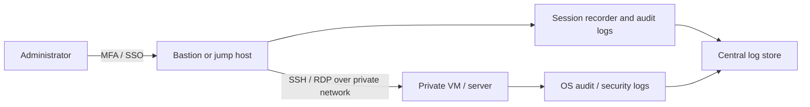
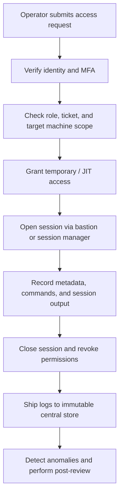
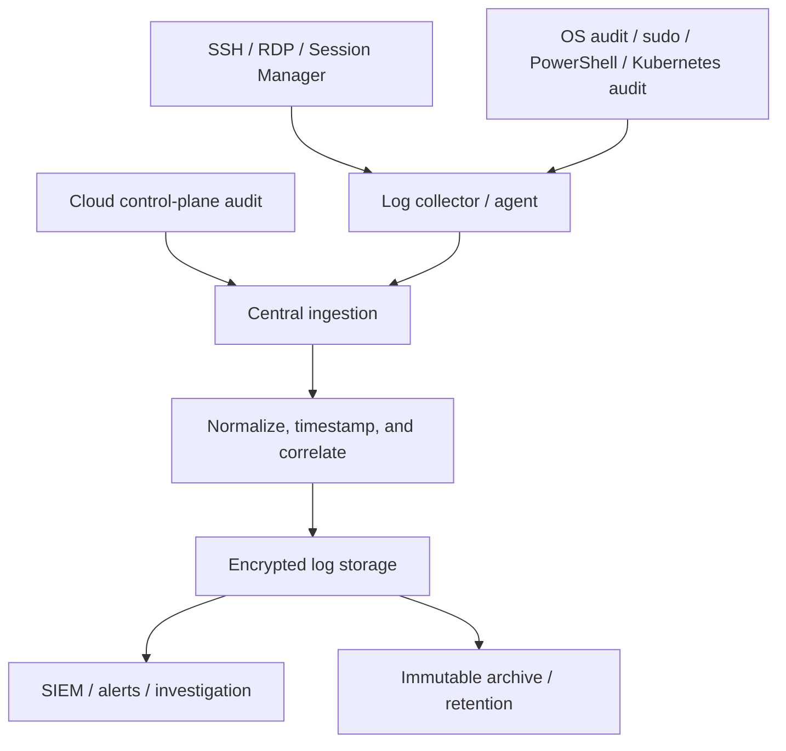
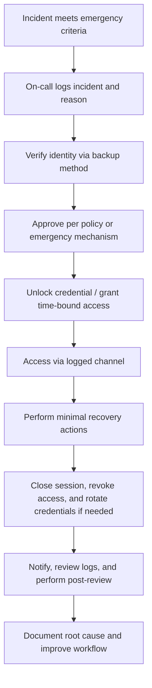

# Administrative Session Logging and Break-Glass Access

## Context: Knowing Who Accessed a Machine, What They Did, and Why

Virtual machines, Kubernetes nodes, database servers, and compute workloads require administration throughout their lifecycle. Engineers may SSH into Linux, use RDP for Windows, open shells via a session management service, run commands from a bastion, or modify configurations through cloud APIs. When an incident occurs, the organization must be able to answer: who accessed which machine, at what time, through which method, what actions they performed, and who approved that access.

**Administrative session logging** captures access session details and administrative activities to support operations, incident investigation, and auditing. **Break-glass access** provides a controlled emergency path when normal authentication workflows or management systems are unavailable, or when a severe incident requires elevated recovery actions.

These two mechanisms must be designed together. Emergency privileges must be sufficient to restore service, yet every use must be logged, alerted, time-bounded, and reviewed afterward. Logs must be trustworthy enough to establish accountability while protecting sensitive data and operator privacy.

Within **CLOUD_CORE_SERVICES_COMPUTE**, this topic applies to VMs, hosts, container nodes, and infrastructure management systems; it helps safeguard machine access, improve traceability, and sustain operations when normal access paths fail.

## 1. Distinguishing Types of Administrative Logs

No single log type captures all activity completely. Authentication logs, session logs, OS logs, and control-plane logs must be combined.

| Log type | Typically recorded contents | Questions it can answer |
|---|---|---|
| Authentication log | Successful/failed logins, principal, MFA method, access source | Who authenticated and were there any anomalous login attempts? |
| Session metadata | User, target machine, start/end times, session ID, client/IP, access reason | Who opened a session to which machine and during what timeframe? |
| Session recording | Terminal content or session activity captured per tool capabilities | Within a recorded session, what did the operator type or view? |
| Command/process audit | Commands, processes, user, parent process, timestamp, and OS-level result | Which commands or processes ran on the machine? |
| OS/security logs | Account, permission, service, package, firewall, file changes, and security events | What changed inside the operating system? |
| Cloud control-plane audit | VM create/delete, IAM, security group, volume, network, and service config changes | Who modified cloud resources via API/console? |
| Application/database audit | Data access, schema changes, application administrative operations | How did the administrative session impact data or applications? |

For example, an engineer logs in via SSH and then modifies a security group using a cloud API. The SSH session log may capture terminal activity; the cloud audit log records the API call and principal that made the change; OS logs may record local processes or edits. Correlating sources via identity, timestamps, session IDs, and request IDs reconstructs the full event timeline.

### 1.1. Session recording does not replace audit logs

Screen or terminal recording shows activity inside a session, but does not necessarily capture every change. Background jobs continuing after the session ends, operations via another API, direct network access bypassing the bastion, or agent actions may fall outside a session recording.

Conversely, audit logs usually capture events and metadata without saving full terminal contents. Therefore, systems need multiple telemetry layers and a clear definition of which source serves as evidence for each type of action.

### 1.2. Recording scope must be disclosed

Session recordings can capture commands, output, terminal contents, or screen displays. These contents sometimes include tokens, customer data, personal information, or secrets accidentally displayed. Organizations must define the purpose, scope, authorized viewers, retention period, and handling of sensitive data. Operators must be notified in accordance with internal policy and applicable regulations.

## 2. Administrative Access Models

### 2.1. Direct access via SSH or RDP

SSH is typically used to administer Linux; RDP is used for Windows. Direct connections from a personal workstation to a VM may be simple, but opening administrative ports broadly on the network increases the attack surface and makes centralized control difficult.

If direct connections are still used, restrict network sources, require MFA at an appropriate access layer, use individual accounts, short-lived keys or certificates, disable password authentication where appropriate, and collect logs on target machines. Never share a single administrative account across multiple people because accountability is lost.

### 2.2. Bastion host or jump server

A bastion is a hardened intermediary server placed in a management network zone. Engineers authenticate to the bastion first and then connect to private VMs. This model centralizes administrative entry and simplifies enforcing network controls, MFA, logging, and session recording in one place.



Bastions must be patched, hardened, monitored, and deployed redundantly. If every connection passes through a single bastion, it can become a single point of failure or bottleneck. Consider multiple instances, multiple availability zones, and appropriate scaling.

A bastion does not automatically guarantee all activity is recorded. If users can open arbitrary tunnels, copy files via SCP, or forward RDP channels, terminal recordings may not capture contents inside encrypted channels. Design policies and logging at other layers to govern those flows.

### 2.3. Session manager or inbound-portless access

A session management service allows engineers to open shells or administrative sessions through a control plane/agent without a public IP or inbound SSH/RDP on the VM. An agent on the machine establishes an outbound connection to the management service; users authenticate via SSO/MFA and are authorized via IAM.

This model often supports shipping metadata, commands, or terminal output to a centralized log store. Examples include platforms offering session managers, serial consoles, or browser-based shells. Capture capabilities, supported protocols, agent requirements, and session limits depend on the provider.

Common benefits include eliminating inbound ports, centralizing authentication, and simplifying audit integration. Verify that the agent is running, the VM has egress to control endpoints, and DNS and IAM policies are properly configured. If the agent or control plane is unavailable, have a pre-tested recovery plan.

### 2.4. Identity-aware access proxy

An identity-aware access proxy authenticates users before allowing connections to internal machines or applications. Access decisions can consider group, role, device, MFA status, location, or grant expiration. This model is helpful when an organization manages many environments and wants to avoid broad network-wide VPN access.

Proxies should issue connections per individual identity and log session metadata. For SSH/RDP protocols, verify whether the proxy supports session recording or integrates with a recorder. Allowing a connection through a proxy does not replace OS-level and application-level permissions.

## 3. Lifecycle of a Controlled Administrative Session

An administrative session should start from a purposeful request, be authenticated and granted with a time limit, and end by revoking temporary privileges and preserving evidence.



### 3.1. Identifying who, which machine, and why

Before granting a session, the system must know the individual or workload identity, group/role, environment, target machine, access justification, related ticket or incident, and duration. For high privileges, requests should require peer approval under the four-eyes principle.

Do not use shared account names like `admin`, `rootuser`, or `operator` across multiple people without a clear mechanism linking each session to a human identity. System accounts may still exist, but their usage must be brokered and audited per requester.

### 3.2. Just-in-time access

Just-in-time (JIT) access grants permissions only when needed and automatically expires after a defined period. Rather than keeping broad standing administrative privileges, users request a temporary role or group membership for the specific machine, environment, and task.

A JIT workflow may include:

1. The operator selects the required resource and permissions.
2. The system verifies MFA, device posture, ticket, and policy conditions.
3. An authorized approver approves if privileges exceed baseline thresholds.
4. Permissions are granted for a short window, such as 30 or 60 minutes per policy.
5. The session opens through a logged administrative channel.
6. Upon expiration or session close, temporary permissions are revoked.

Duration should be sufficient for the task without lingering unnecessarily. Extensions must be logged and may require re-approval. JIT applies beyond cloud IAM; it can govern sudo groups, local administrators, SSH certificates, or database privileges.

### 3.3. Recording sessions end to end

Minimum metadata should include:

- Unique session ID and correlation/request ID if available.
- Individual principal, group, role, and authentication method.
- Target machine name/ID, account/project, environment, and region/zone.
- Start time, end time, duration, and justification/ticket.
- Bastion, session manager, or proxy used.
- Source IP, device, or client details per policy.
- Authentication result, approval, JIT grant, and revocation timestamp.
- Recording status, logging errors, or telemetry gap intervals.

Session recording may store terminal input/output, commands, or screen video depending on the tool. Document what data type is captured and the recording status. If a session fails to record due to a recorder error, that event must trigger an alert; sensitive privileges should not silently proceed without an explicit policy decision.

### 3.4. Ending sessions and revoking access

Upon termination, the system should close the session, terminate related tunnels/processes, revoke temporary certificates or roles, invalidate short-lived tokens where possible, and record the end timestamp. Simply closing a terminal window does not guarantee background processes or tunnels have stopped.

For sudo or local administrator privileges, verify temporary group memberships were removed. For SSH certificates, short lifetimes and CA controls limit post-session exposure. For cloud IAM, verify session tokens and role permissions expire according to platform policy.

## 4. Logging Commands and Activity on Machines

### 4.1. SSH and Linux

Linux typically records authentication events via `journald`, `auth.log`, `secure`, or audit subsystems depending on the distribution. `sudo` can log the user, command, and authentication outcome. The Linux Audit Framework (`auditd`) can track system events such as account changes, permission changes, sensitive file accesses, and specific syscalls.

Examples for checking login and sudo logs on a systemd-based system:

```bash
# View recent SSH/sshd events
sudo journalctl -u sshd --since "1 hour ago"

# Find sudo events in the journal
sudo journalctl _COMM=sudo --since "1 hour ago"

# View active login sessions
who
last -a | head
```

Service names and log paths vary across distributions. `journalctl` reads only already-recorded events; it does not create full session recordings on its own. Capturing terminal input/output requires tools such as a session manager, bastion recorder, or dedicated PAM solution.

SSH should use individual accounts, managed keys/certificates, MFA at the access layer, and logged `sudo` configurations. An SSH CA can issue short-lived certificates instead of distributing long-lived public keys to every machine. Disable direct root login and password authentication if compatible with recovery workflows.

### 4.2. RDP and Windows

Windows can log sign-ins, sign-outs, authentication, special privilege use, and policy changes in the Windows Security Event Log. PowerShell logging can capture script blocks and module activity; Windows Event Forwarding or agents can ship logs to a centralized system.

Key events to monitor include:

- Successful/failed logons and logon types.
- Remote Desktop connections, session IDs, disconnects, and logoffs.
- Changes to the local `Administrators` group or special privileges.
- Account creation/deletion, password changes, and policy changes.
- PowerShell script blocks, process creation, and administrative tool usage.
- Firewall, service, scheduled task, and security configuration changes.

Place RDP behind a VPN, bastion, or identity-aware access gateway; avoid exposing TCP/3389 directly to the Internet. Enable Network Level Authentication, TLS, and appropriate account lockout policies. For sessions requiring visual capture, use a solution supporting RDP session recording; the Windows Event Log alone does not record full screens or mouse actions.

### 4.3. Containers and Kubernetes nodes

Node/container administration requires combining Kubernetes API audit logs, node OS logs, and runtime logs. A Kubernetes audit policy can record who called the API, verb, resource, namespace, response code, and timestamp. This helps trace `exec`, `port-forward`, Secret edits, RBAC changes, or privileged pod creation when configured at sufficient detail.

Do not rely solely on API audit logs to infer what happened inside a container. Commands executed inside containers, processes, file access, and network activity may require a runtime security agent, node auditing, or application logs. Shell access into containers should be restricted and logged with the requester identity, target pod/container, namespace, and justification.

### 4.4. Automated commands and automation identities

Not all administrative actions are typed directly by humans. Pipelines, configuration management agents, patch managers, and automation accounts can modify machines. Logs must distinguish human principals from service principals and record pipeline/run IDs, commits or change requests, initiating identity, and executing identity.

Do not reuse one credential across multiple automations. Each service identity should have least privilege, a clear lifecycle, and separate logs. When a pipeline runs commands on VMs, link command/session records with deployment IDs or job IDs to correlate with application changes.

## 5. Centralizing, Protecting, and Retaining Audit Logs

Logs are useful only when collected completely, queryable, and trustworthy. If logs remain only on the machine being administered, someone with high privileges on that machine can delete or alter tracks. Therefore, critical logs must be shipped promptly to a centralized system managed independently of the source machine.

### 5.1. Log collection architecture



Sources can push logs directly or via agents/collectors. Normalize timestamps, timezones, hostnames, resource IDs, principals, session IDs, and event types to correlate events. Synchronize clocks using NTP or a reliable time synchronization service; clock skew makes reconstructing event sequences difficult.

### 5.2. Protecting log integrity

To hinder log modification or deletion:

- Ship logs off source machines as soon as possible; never rely solely on local disk.
- Use log-writing accounts with append/write-only permissions to the exact destination; machine operators must not have permission to delete centralized logs.
- Encrypt in transit and at rest; manage encryption keys separately from machine access privileges.
- Enable versioning, retention locks, or immutable/WORM storage when compliance requires tamper resistance.
- Audit the logging system itself: who queries, exports, modifies retention, or deletes data.
- Monitor disconnected agents, full queues, ingestion lag, and log gaps.
- Verify checksums/signatures or platform integrity mechanisms if available.

Not every log must be stored immutably forever. Retention policies should balance legal, security, investigative, and cost requirements; expired logs should be deleted under controlled processes.

### 5.3. Protecting sensitive data and log viewing permissions

Session recordings may contain command lines, output, file paths, user data, or accidentally printed secrets. Restrict who can view recordings, mask or redact sensitive values where tooling supports it, and avoid capturing unnecessary fields. During investigations, viewers should access logs under a ticket or role, with auditing and expiration.

Never pass passwords, tokens, or private keys on the command line because they can appear in shell history, process lists, audit logs, or session recordings. Use a secret manager, file descriptors, workload identities, or protected secret-entry mechanisms. If a secret is exposed in a recording, treat it as a credential leak incident: revoke, rotate, and restrict access to the affected recording.

### 5.4. Retention and queryability

Policies can be structured in tiers:

- Short-term operational logs for daily debugging and troubleshooting.
- Administrative audit logs retained per compliance and investigative timelines.
- Sensitive session recordings with restricted access and explicit retention limits.
- Long-term archives encrypted, immutable when needed, and retrievable via defined procedures.

Exact retention periods should follow organizational policy and applicable regulations. Index logs by principal, resource ID, session ID, ticket, timestamp, and event type. Searchability must be tested periodically; logs that exist but cannot be queried in time lose investigative value.

## 6. Break-Glass Emergency Access

Break-glass is a workflow granting special access to authorized personnel when normal paths fail or are insufficient to restore service. Examples include an SSO outage, an MFA provider failure, an unreachable normal management control plane, or a severe incident requiring actions beyond everyday roles.

Break-glass must never be an always-used broad admin account for convenience. It is an exceptional privilege with defined purposes, activation criteria, time limits, monitoring, and post-incident review.

### 6.1. When is it used?

Policy should state valid scenarios, such as:

- Primary SSO or identity provider is unavailable and recovery work is blocked.
- The MFA/approval system fails during a severe ongoing service incident.
- An IAM or network misconfiguration locked out normal administrative recovery paths.
- Serial/console access or a privileged OS account is required to recover a VM/host.
- The system must be isolated or recovered when normal admin accounts show signs of compromise.

Never use break-glass to bypass approvals, perform routine work, or avoid logging. If the normal path can be used within incident response targets, use the normal workflow.

### 6.2. Designing emergency accounts and secrets

Depending on architecture, break-glass may be an emergency cloud account, a local administrative account, standalone console credentials, or an offline access mechanism. You should:

- Keep account counts minimal and assign them to specific accountable owners.
- Store credentials in a vault or protected offline medium, with dual-person control on retrieval where appropriate.
- Enforce strong MFA, preferring hardware security keys or a factor independent of the failing system.
- Protect accounts with dedicated policies, alert on every use, and avoid routine shared usage.
- Maintain a workflow to rotate credentials after use or suspected exposure.
- Verify accounts remain functional with sufficient permissions without holding broad standing permissions beyond scope.

If an emergency identity depends entirely on the same identity provider, MFA device, or vault that could fail during an outage, it is not a true fallback path. Design an independent failure domain with equivalent protection.

### 6.3. Time-bounded emergency elevation

Even when using special accounts, scope permissions by resource, scope, and duration. When supported by the platform, grant temporary roles or unlock accounts for a fixed window, then automatically revoke or re-lock them afterward. If static credentials are unavoidable, enforce checkout/return, rotation, and post-event verification workflows.

Break-glass requires independent alerting. Do not send alerts solely through the failing system; notify the on-call channel, SIEM, or accountable owners through an out-of-band communication path.

### 6.4. Break-glass workflow



In acute emergencies, pre-approval may not be feasible. Policy may allow a single on-call responder to activate access, provided they record the reason, trigger immediate alerts, and require a second person to conduct a post-review within a defined deadline. Never skip auditing simply because an incident is severe.

### 6.5. Mandatory actions after break-glass use

Immediately after recovery:

1. Close all open sessions and tunnels; verify no unexpected administrative processes remain running.
2. Revoke temporary roles, tokens, certificates, or group memberships.
3. Rotate emergency credentials if used or potentially exposed; audit vault access and who retrieved secrets.
4. Verify IAM configurations, firewalls, local accounts, and services have returned to an approved state.
5. Attach session recordings, cloud audits, OS audits, tickets, and the incident timeline to the incident record.
6. Have an independent reviewer inspect commands and changes to verify intent, scope, and impact.
7. Document why break-glass was needed and create action items to eliminate the root cause.

If out-of-scope activity is detected, escalate to the security incident response workflow, preserve evidence, and revoke related identities/credentials.

## 7. Example Policy and Control Configuration

The conceptual policy below illustrates control conditions. Field names are not a schema for any specific product.

```yaml
administrative_access:
  allowed_paths:
    - session_manager
    - hardened_bastion
  require_mfa: true
  require_personal_identity: true
  require_ticket: true
  just_in_time:
    enabled: true
    max_duration_minutes: 60
  session_recording:
    enabled: true
    central_destination: security-audit-store
    alert_if_recording_unavailable: true
  break_glass:
    enabled: true
    require_incident_id: true
    notify_security_on_use: true
    max_duration_minutes: 30
    post_use_review_required: true
```

In production, policies must explicitly define who can approve, which resources are in scope, which session types must be recorded, how recorder failures are handled, and how permissions are revoked. Setting `enabled: true` means nothing if networking still permits SSH/RDP around the controlled path.

### 7.1. Preventing bypass paths

To ensure all administrative sessions go through the bastion or session manager, verify that VM security groups/firewalls accept connections only from approved entry points. Check IPv4, IPv6, VPNs, peering, transit gateways, secondary subnets, and console paths. A single stale rule opening SSH/RDP from anywhere can defeat session recording controls.

For Kubernetes, restrict `pods/exec`, `nodes/proxy`, port-forward, and privileged workload creation. For Windows, check the RDP listener and firewall. For Linux, inspect `sshd_config`, sudoers, local accounts, and SSH authorized keys. Every exception needs an owner, justification, and expiration.

### 7.2. Separating administrative and audit duties

Anyone with root or local administrator privileges can tamper with logs on the source machine. Therefore, machine administrators must not simultaneously hold permission to delete or alter centralized logs. Log administrators should also avoid holding production machine modification rights unless necessary.

Role separation reduces the risk of one person making unauthorized changes and erasing evidence. During emergencies, a break-glass user may hold high privileges on the machine, while logs ship to a separate system with independent administrative control and alert the security team.

## 8. Detecting and Alerting on Anomalous Activity

Audit logs are far more valuable when used to detect anomalous behavior rather than merely archived for post-incident review. Signals to monitor include:

- Logins outside normal hours or from unusual locations or devices, especially with high privileges.
- Repeated authentication failures, MFA fatigue, or a successful login following a string of failures.
- Usage of root/Administrator accounts or adding users to privileged groups.
- Administrative sessions to production machines without a linked ticket/change record.
- Session recording disabled, disconnected agents, or interrupted log ingestion.
- Break-glass access, vault credential reads, or policy modifications on emergency accounts.
- Opening SSH/RDP from the Internet, changing routes/firewalls, or creating long-lived keys.
- Out-of-process `exec`, port-forward, or privileged containers.
- Deleting logs, changing retention, disabling audit policies, or altering system clocks.
- An automation identity performing actions outside registered pipelines or schedules.

Alerts should carry context for responders to evaluate: principal, resource, session ID, source, ticket, privilege level, and related changes. Avoid generating overwhelming unactionable noise; prioritize high-risk events and tune thresholds against baseline behavior.

## 9. Testing and Drilling Emergency Access

An untested break-glass account may fail when needed most: expired credentials, missing MFA devices, unreachable vaults, blocked routes, or insufficient privileges. Run regular drills in a safe environment.

Drill tests should verify:

1. **Login verification:** confirm backup authentication works and authorized responders can retrieve credentials per procedure.
2. **Permission scope verification:** confirm required recovery actions succeed without excess out-of-policy permissions.
3. **Logging verification:** confirm session metadata, recordings, cloud audits, and OS audits reach the central store.
4. **Alerting verification:** confirm on-call and security teams receive immediate notifications when break-glass is activated.
5. **Revocation verification:** confirm roles/tokens/certificates are revoked and credentials are rotated when required.
6. **Failure-mode verification:** simulate an SSO or recorder outage in a test environment and validate the response procedure.
7. **Recovery verification:** evaluate time-to-access and ability to complete recovery tasks within RTO targets.

Drills should produce records including test date, participants, resources, results, discovered defects, and remediation owners. Never test emergency credentials by arbitrarily logging into production; follow approved procedures and appropriate test environments.

## 10. Administrative Access Incident Runbook

When operators cannot access a machine, first determine whether the failure lies in identity, networking, agents, or the OS. Do not immediately escalate to break-glass if a safe normal path remains usable or recoverable within acceptable time.

| Symptom | Checks | Remediation |
|---|---|---|
| SSO/MFA unavailable | Identity provider, MFA service, system clock, and device state | Use approved identity recovery; invoke break-glass only if criteria are met |
| Bastion unreachable | Health, capacity, DNS, routes, firewalls, and certificates | Fail over to standby bastion or pre-tested session manager |
| Session manager fails to connect | Agent, egress, DNS, service endpoints, and IAM | Restore agent/network path; use backup console per policy if incident is severe |
| SSH/RDP timeout | IP, routes, firewall, listener, and host health | Separate network failure from guest failure; avoid uncontrolled temporary public ports |
| Login succeeds without recording | Recorder, collector, log destination, and policy | Block sensitive privileges or apply emergency exception with alerts and post-review per policy |
| Break-glass credential unusable | Vault, backup MFA, account lock, credential rotation | Use secondary backup option; restore and update credential store |
| Logs not reaching SIEM | Agent, queue, network, ingestion endpoint, and quotas | Preserve local logs temporarily, restore forwarding, and document telemetry gaps |

General workflow:

1. Record the incident ID, severity impact, target machine, and operational objective.
2. Identify which normal access paths remain functional and diagnose the failure cause.
3. Select a pre-tested fallback method; verify identity with an independent factor if possible.
4. If break-glass is required, log the justification, timestamp, activator, and approver or post-reviewer.
5. Use least privilege to recover; document critical commands and changes.
6. Close sessions, revoke permissions, and rotate credentials per policy.
7. Review audit logs, session recordings, configuration changes, and any anomalies.
8. Update the runbook, remediate root cause, and re-drill afterward.

## 11. Deployment Checklist

### Before enabling administrative access

- [ ] Every user has an individual identity; MFA and groups/roles are configured properly.
- [ ] Access path is approved: bastion, session manager, or identity-aware proxy.
- [ ] SSH/RDP is not exposed to the Internet outside policy; firewalls allow only required sources.
- [ ] Administrative privileges are granted via JIT, scoped to machine and environment, and time-limited.
- [ ] Ticket or access justification is linked to session metadata.
- [ ] Session recording and OS/cloud auditing are enabled per disclosed scope.
- [ ] Logs ship to a centralized store, encrypted and protected against unauthorized modification/deletion.
- [ ] Alerts fire if recording or log ingestion is interrupted.

### Before declaring break-glass ready

- [ ] Activation criteria and authorized personnel are explicitly defined.
- [ ] Credentials are protected independently of primary authentication systems that may fail.
- [ ] Backup MFA, vault access, and accountable custodians have been verified.
- [ ] Permissions and duration suffice for recovery operations with bounded scope.
- [ ] Every use sends immediate alerts to on-call and security teams.
- [ ] Workflows exist for closing sessions, revoking permissions, rotating credentials, and post-review.
- [ ] Workflows have been drilled, including scenarios where SSO or log collectors are unavailable.

## 12. Common Misconceptions

**Having authentication logs means the entire session is recorded.** Authentication logs usually record only login events. Seeing in-session activity requires session recording, command/process auditing, and logs across related layers.

**A bastion automatically records everything done on the target machine.** A bastion records only traffic passing through it that the recorder supports. Bypass connections, tunnels, or other APIs can fall outside the recording.

**Session recording replaces cloud audits and OS audits.** Recordings do not necessarily capture API calls, background processes, or agent-driven changes. Multiple log sources must be combined.

**Someone with root privileges can manage their own logs safely.** Machine administrators can tamper with local logs. Critical records must ship to a centralized store under independent administrative control.

**Break-glass is an always-on admin account kept around for convenience.** Emergency access must be conditional, alerted, time-bounded, and post-reviewed. Standing broad privileges increase abuse risk.

**Break-glass MFA can rely on the same primary MFA system.** If the primary system goes down, that authentication factor may fail too. Fallbacks need an independent failure domain with equivalent protection.

**Using break-glass means logging can be skipped.** Emergency access requires even stricter logging and review because it typically carries high privileges during high-risk events.

**Keeping logs as long as possible is always better.** Session recordings can contain sensitive data. Define retention by purpose, restrict viewers, protect data, and delete according to policy.

## Conclusion

Administrative session logging must combine authentication logs, session metadata/recordings, OS audits, and cloud control-plane audits to maintain an end-to-end trail from user to resource. Bastions, session managers, and identity-aware proxies centralize entry points; JIT minimizes standing privileges; centralized immutable log stores protect evidence. Break-glass provides a fallback access path when normal workflows fail, provided it enforces activation criteria, independent authentication, time limits, alerting, revocation, and post-incident review. Regularly drilling both normal and emergency access paths allows organizations to recover compute during incidents while preserving traceability and accountability.
