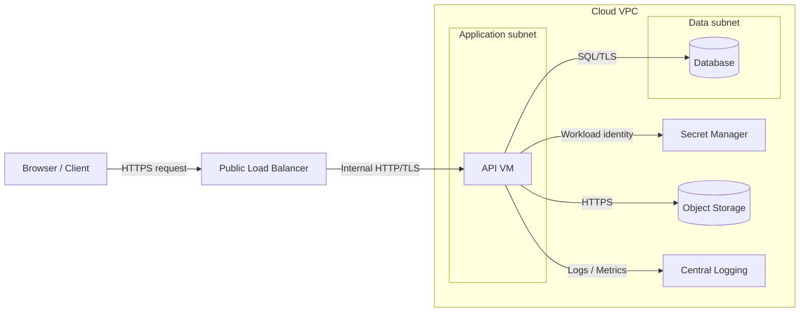
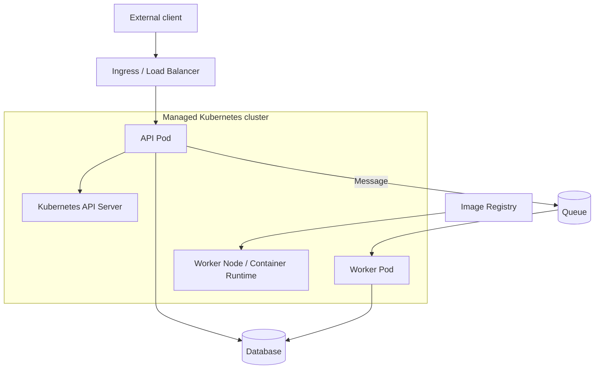
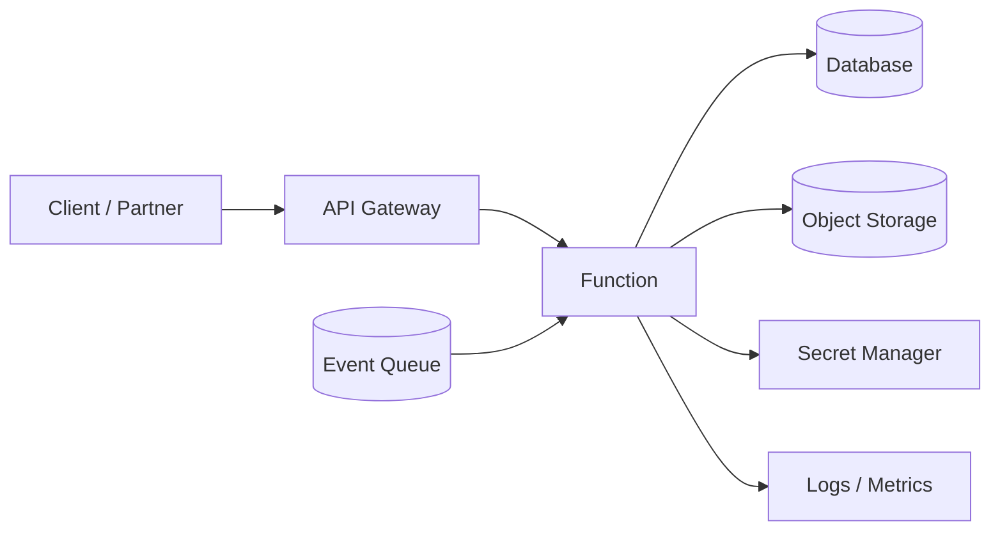
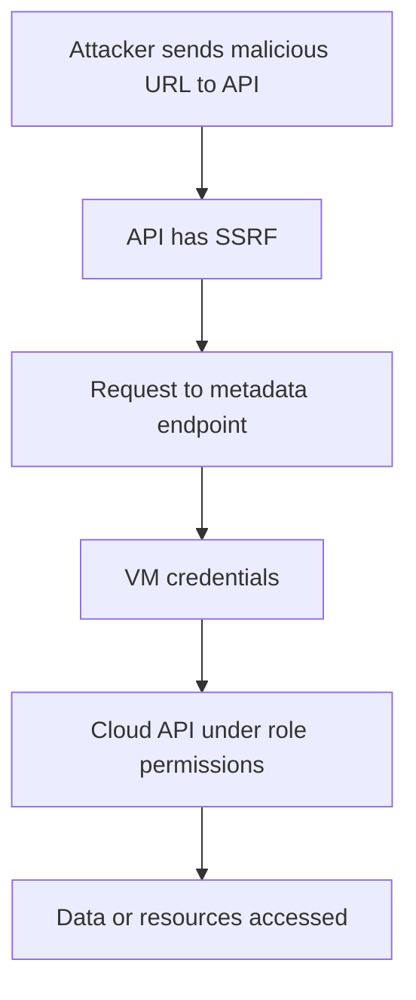
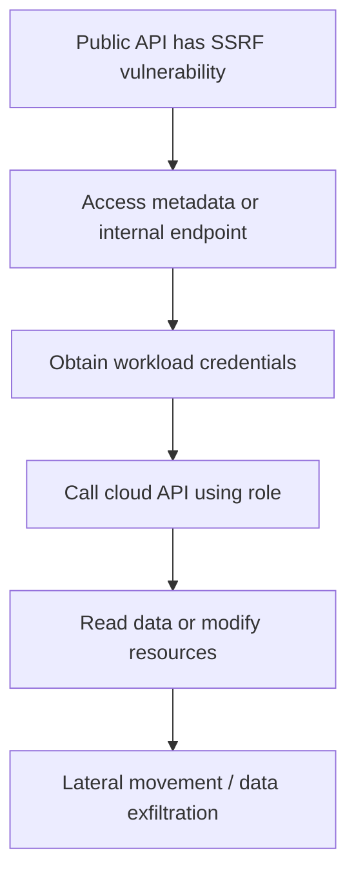
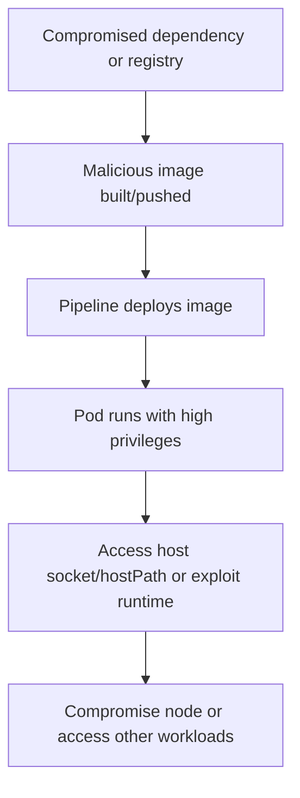
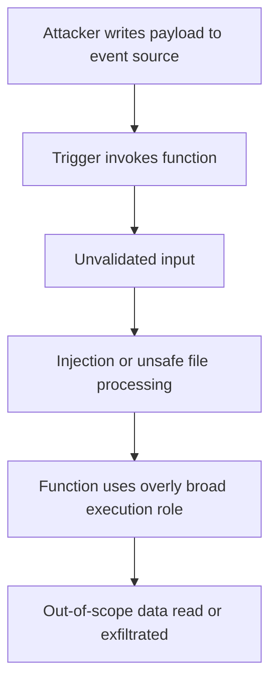

# Threat modeling for virtual machines, containers, and serverless functions

Threat modeling is a structured analysis approach to understanding what a workload needs to protect, who might attack it, where attack paths travel, and what controls should be designed before the system goes into production. With cloud compute, the same application can run on a virtual machine (VM), a container, or a serverless function (FaaS), yet each model has different trust boundaries, attack surfaces, and operational responsibilities.

In the **CLOUD_CORE_SERVICES_COMPUTE** module, choices around CPU, memory, networking, images, runtimes, identities, and deployment methods all affect security. Threat modeling connects those decisions into a risk model that can be discussed and verified. Instead of merely listing vulnerabilities, development and operations teams describe assets, data flows, trust boundaries, threats, mitigations, and evidence verifying that controls work.

## Learning objectives

After this lesson, you can:

- Explain the purpose, scope, and timing of threat modeling for compute workloads.
- Identify assets, threat actors, trust boundaries, entry points, and data flows.
- Use STRIDE to categorize threats for VMs, containers, and FaaS.
- Recognize attack paths involving metadata services, the image supply chain, the control plane, event triggers, secrets, and networking.
- Assess risk by likelihood, impact, and exposure.
- Choose preventive, detective, responsive, and recovery controls suited to each compute model.
- Build a threat model that can be re-verified across design, CI/CD, and production operations.

## 1. What is threat modeling?

Threat modeling is the process of describing a system from a security perspective, asking what could go wrong, and determining how to reduce risk. A useful threat model is more than a list of CVEs or a configuration checklist. It links a threat to affected assets, feasible attack paths, required preconditions, existing controls, residual risk, and the accountable owner.

For example, for a VM running an API:

- **Assets:** order data, workload credentials, deployment image, and database access.
- **Entry points:** HTTPS from the Internet, administrative channels, and the metadata endpoint.
- **Threat:** an attacker exploits SSRF in the API to reach the metadata service and obtain credentials.
- **Impact:** the credentials can be used to read objects or access cloud services.
- **Controls:** metadata service protection, egress restrictions, least-privilege roles, destination URL validation, and credential access monitoring.
- **Evidence:** metadata configuration, IAM policies, SSRF testing, flow logs, and audit events.

Threat modeling is usually performed early in design and then updated whenever architecture, data, runtime, or network flows change. It is not a one-time activity before release day.

### 1.1. Threat, vulnerability, attack, and risk

| Concept | Meaning | Example in compute |
|---|---|---|
| Threat | A situation or actor that can harm the system | An attacker seeking to take over a VM |
| Vulnerability | A weakness that can be exploited | An outdated package with a remote code execution vulnerability |
| Attack | The act of exploiting a weakness | Sending a malicious request to an API vulnerable to RCE |
| Attack path | A chain of steps connecting an entry point to a valuable asset or permission | API → SSRF → metadata → workload credentials → object storage |
| Risk | The likelihood and impact of a harmful event in a specific context | Data exposure because the VM role has read permissions across the entire bucket |
| Control | A measure that reduces likelihood or impact | IAM least privilege, egress policy, patching, and auditing |
| Residual risk | Risk remaining after controls are applied | SSRF can still reach certain permitted internal endpoints |

A high-severity CVE score does not automatically mean a workload carries the highest risk. You must examine whether the service exposes the weakness, whether exploitation conditions are feasible, what permissions the process holds, and what data could be affected.

### 1.2. Value of threat modeling

- Detect risks before infrastructure and applications become hard to change.
- Give architects, developers, platform engineers, and security teams a shared model of the system.
- Clarify responsibilities between the customer and the cloud provider.
- Prioritize protections based on actual impact rather than adding controls indiscriminately.
- Produce testable requirements that can be integrated into CI/CD and operational procedures.
- Explain why private subnets, workload identity, or image signing are necessary.

## 2. Scope and boundaries to model

A compute workload typically consists of more than the application process. It also includes the image, guest OS or runtime, network interfaces, identity, secrets, storage, logs, control plane, deployment pipeline, and dependent services.

### 2.1. Defining system scope

Before drawing diagrams, answer:

1. Which application or workload is being analyzed?
2. Which environments are in scope: development, staging, production, or all three?
3. What data is processed, and how sensitive is it?
4. Which users, internal systems, and external services interact with the workload?
5. Does the compute run on VMs, containers, Kubernetes, FaaS, or a combination of models?
6. Which components are managed by the provider and which are managed by the team?
7. Which dependent systems can alter risk, such as databases, queues, object storage, DNS, CI/CD, and secret managers?

Explicitly document what is out of scope and why. For example, the cloud provider may operate the hypervisor; the customer's threat model should still record the hypervisor as a trust boundary and reference service security attestations, even though the application team does not configure this layer directly.

### 2.2. Assets to protect

| Asset group | Examples | Security concerns |
|---|---|---|
| Business data | Orders, user profiles, uploaded files | Confidentiality, integrity, retention, and data deletion |
| Credentials and secrets | Access tokens, API keys, private keys, DB passwords | Leakage, misuse, lifecycle, and revocation |
| Identities and permissions | VM roles, service accounts, function execution roles, Kubernetes service accounts | Compromise, privilege escalation, overly broad trust policies |
| Compute artifacts | VM images, container images, function packages, dependencies | Malware, trojanized dependencies, tampered builds |
| Runtime and configuration | Guest OS, container runtime, function runtime, environment variables | Vulnerabilities, weak configurations, end-of-life versions |
| Network and endpoints | VPC/VNet, subnets, security groups, API endpoints, private endpoints | Unauthorized access, lateral movement, data exfiltration |
| Control plane | Cloud API, Kubernetes API, deployment controllers | Administrative takeover and workload modification |
| Logs and evidence | Audit logs, flow logs, traces, image scan reports | Tampering/deletion, leaking sensitive data, lack of forensic capability |
| Availability | APIs, workers, queue consumers, inference services | DoS, resource exhaustion, dependency failures, and outages |
| Deployment pipeline | Source repositories, build runners, artifact registries, IaC state | Supply-chain compromise and unauthorized deployments |

### 2.3. Threat actors and capabilities

Actor groups that may be relevant to a workload:

- Unauthenticated Internet users or legitimate users behaving abusively.
- External attackers exploiting application, endpoint, or dependency vulnerabilities.
- Malware or a process that has already compromised a VM/container/function.
- Compromised internal accounts or personnel with excessive permissions.
- Compromised dependency, image, package, or build tool providers.
- Untrusted sibling workloads in the same network or cluster.
- Actors causing intentional or accidental disruption, such as sending heavy traffic, generating anomalous events, or misconfiguring resources.

Describe relevant capabilities: able to send Internet requests, holds user credentials, runs containers in a separate namespace, has repository access, or has permissions to modify IaC. There is no need to make unrealistic assumptions such as every actor having root access on the hypervisor.

### 2.4. Trust boundaries

A trust boundary is a boundary where data, commands, or identities cross from one trust domain to another. Whenever data crosses a boundary, identify the authentication, authorization, input validation, encryption, and logging mechanisms.

Common boundaries include:

- Internet to public load balancer/API gateway.
- Load balancer to VM or container.
- Container/workload to node and Kubernetes control plane.
- VM/container/function to metadata service.
- Workload identity to cloud IAM/API.
- Application to database, queue, and object storage.
- Build pipeline to artifact registry and cloud deployment API.
- One tenant or namespace to another tenant/namespace.
- Provider-operated managed services to customer-managed configurations.

Do not treat a private subnet as an absolute trust boundary. A workload in a private subnet can still be compromised through dependencies, credentials, administrative paths, or internal flows.

## 3. Modeling data flows and architecture

A Data Flow Diagram (DFD) helps visualize components, connections, data stores, and trust boundaries. The diagram should be detailed enough to identify where data goes, who initiates connections, and what permissions are used.

### 3.1. Components of a DFD

| Component | Meaning | Examples |
|---|---|---|
| External entity | Actor outside the system | Browser, partner API, payment system |
| Process | Process or workload handling data | VM API, container worker, FaaS function |
| Data store | Place where data is stored | Database, object storage, queue, cache |
| Data flow | Flow of data or requests | HTTPS, event, SQL, message |
| Trust boundary | Boundary between trust domains | Internet/VPC, tenant, cluster, cloud account |

### 3.2. Example DFD for a VM application



The diagram should also mark the trust boundaries between the Internet and the cloud, between the application subnet and the data subnet, as well as the IAM boundary when the VM calls the secret manager or object storage. Data in requests, logs, and databases may carry different sensitivity levels.

### 3.3. Example DFD for containers/Kubernetes



The diagram prompts key questions: who has permission to call the Kubernetes API, which Pods are allowed to read secrets, which registry are images pulled from, does the node allow workloads to access the metadata endpoint, and is NetworkPolicy enforced by the CNI?

### 3.4. Example DFD for FaaS



For FaaS, represent the function trigger sources, execution role, destination service permissions, retry/dead-letter behavior, concurrency, and log destination. An event arriving from a queue and an HTTP request can have different trust levels even when they invoke the same function.

## 4. The STRIDE methodology

STRIDE categorizes threats into six groups. It helps teams avoid missing categories of risk when analyzing each component and data flow.

| Category | Meaning | Examples in compute |
|---|---|---|
| Spoofing | Impersonating an identity | Spoofing a service account or event source to invoke a function |
| Tampering | Unauthorized modification of data or configuration | Replacing a VM image, container image, IaC state, or queue payload |
| Repudiation | Denying an action due to lack of evidence | No audit logs proving who changed a security group or deployed an image |
| Information Disclosure | Exposing information | Leaking secrets via metadata endpoints, logs, snapshots, or object storage |
| Denial of Service | Degrading or halting service | Flooding requests/events, exhausting CPU/RAM/concurrency or connection pools |
| Elevation of Privilege | Gaining higher privileges | Container breakout, overly broad roles, or compromising a pipeline with admin access |

### 4.1. Spoofing

Attackers can spoof users, services, events, or network sources to gain system trust. Authentication and data provenance must be verified at every trust boundary.

Examples:

- An API accepts `X-User-ID` from the client and trusts that value without verifying a token.
- A function is triggered by a queue without verifying the producer's publish permissions.
- A Pod uses the default service account with broad permissions and is abused by another workload.
- A pipeline accepts artifacts from an uncontrolled registry.

### 4.2. Tampering

Attackers can alter images, packages, startup scripts, environment variables, network policies, or stored data. Controls include artifact signing, digest pinning, IaC review, registry protection, integrity checks, and write/delete access control.

### 4.3. Repudiation

Without audit logs, a permission change or data access operation is hard to attribute to a specific identity. Enable logging for cloud APIs, Kubernetes APIs, IAM, deployments, secret access, and application events; protect logs from tampering/deletion and synchronize clocks.

### 4.4. Information Disclosure

Common leakage paths include public buckets, open database ports, mis-shared snapshots, secrets baked into images, metadata credentials, logs containing tokens, and unencrypted backups. Controls must combine networking, IAM, encryption, data classification, and logging hygiene.

### 4.5. Denial of Service

Compute has finite limits: vCPU, RAM, disk I/O, network, connections, GPU memory, function concurrency, and quotas. Attackers can exploit resource-intensive endpoints or trigger massive event volumes. Measures include rate limits, quotas, bounded autoscaling, timeouts, queue backpressure, circuit breakers, and cost alerts.

### 4.6. Elevation of Privilege

An initially low-privilege process may try to gain higher privileges within a VM, container, cluster, or cloud account. Risks often stem from kernel/runtime vulnerabilities, privileged containers, mounted host sockets, overly broad IAM roles, shared secrets, or pipelines with unrestricted deployment rights.

## 5. Threat modeling workflow

A practical workflow must be lightweight enough to apply to individual changes yet thorough enough for workloads handling sensitive data or broad permissions.

1. **Define goals and scope.** Record the workload name, owner, environment, compute type, data, security requirements, and in-scope/out-of-scope components.
2. **Inventory assets and criticality.** Record data, identities, secrets, artifacts, compute resources, endpoints, logs, and pipelines; identify owners and protection requirements.
3. **Draw the DFD and trust boundaries.** Record external entities, processes, data stores, flows, protocols, ports, identities, and data types on key flows.
4. **List entry points and threat actors.** Review public APIs, SSH/RDP, Kubernetes API, container registries, function triggers, metadata endpoints, CI runners, and cloud management APIs.
5. **Perform STRIDE and attack path analysis.** Ask questions across all six categories for each process, store, and flow; chain steps that could lead from an entry point to a high-value asset.
6. **Document existing and proposed controls.** Group controls into preventive, detective, responsive, and recovery; record owners and where each is configured.
7. **Assess residual risk and prioritize.** Estimate likelihood, impact, exposure, and recoverability.
8. **Turn findings into verifiable work.** Each mitigation needs an owner, deadline, completion criteria, and evidence.
9. **Update when the system changes.** Revisit when adding endpoints or changing compute, trust policies, service accounts, databases, egress, base images, triggers, or managed services.

## 6. Risk assessment and prioritization

A threat model should distinguish between inherent risk and residual risk after controls. Either a qualitative matrix or an internal scoring scale can be used. No single formula fits every organization.

### 6.1. Example scoring scale

A simple approach is scoring Likelihood and Impact from 1 to 5:

```text
Risk score = Likelihood × Impact
```

| Score | Likelihood | Impact |
|---:|---|---|
| 1 | Very unlikely in the current context | Minor impact, easy to recover |
| 2 | Low likelihood, requires multiple preconditions | Impact limited to a single component |
| 3 | Possible, with a plausible exploit path | Impacts a workload or group of users |
| 4 | High likelihood or similar incidents observed | Impacts critical data/services |
| 5 | Easily accessible or actively exploited | Severe data breach, broad compromise, or outage of critical services |

Illustrative classification: 1–4 low, 5–9 medium, 10–16 high, 17–25 critical. Organizations must define thresholds, handling procedures, and who is authorized to accept risk. Scores do not replace expert judgment; an unlikely attack path that could cause irreversible data loss still warrants serious attention.

### 6.2. Factors affecting likelihood

- Is the endpoint public or internal-only?
- Are strong authentication and rate limiting in place?
- Does the vulnerability have a public exploit or simple exploitation conditions?
- Can it be reached from another tenant or workload?
- Are credentials short-lived and least-privilege?
- Are images, dependencies, and runtimes kept up to date?
- Are network controls and policies actually enforced?

### 6.3. Factors affecting impact

- Data types and number of records accessible.
- Permissions of the workload identity and scope of cloud resources.
- Ability to move laterally to other workloads.
- Impact on availability, revenue, or business safety.
- Ability to detect, isolate, and recover.
- Legal, contractual, and reputational obligations if an incident occurs.

## 7. Threat model for virtual machines (VMs)

VMs provide an isolated guest OS with a virtualization boundary operated by the provider. Customers typically manage the guest OS, runtime, applications, identity, host firewall, and data. The threat model must cover both the Internet-facing surface and administrative and metadata channels.

### 7.1. VM assets and entry points

- Data on volumes, snapshots, and filesystems.
- Workload identity or instance profile.
- SSH keys, RDP credentials, certificates, and secrets.
- Guest OS, kernel, packages, agents, and applications.
- Network interfaces, security groups, routes, and public IPs.
- Startup scripts, machine images, and launch templates.
- Logs, crash dumps, and memory dumps.

Entry points can include HTTPS, SSH/RDP, management agents, the metadata endpoint, internal service ports, cloud APIs, and pipelines with permissions to change images or security groups.

### 7.2. Common threats

| STRIDE | VM threat | Primary controls |
|---|---|---|
| Spoofing | Attacker uses stolen SSH keys/credentials or spoofs an API client | MFA, certificates, short-lived credentials, application authentication |
| Tampering | Modifying startup scripts, images, packages, or configuration files | Immutable images, artifact signing/verification, file integrity, change review |
| Repudiation | Not knowing who logged in or modified firewalls/roles | OS auditing, cloud audit logs, policy-based session recording |
| Information Disclosure | SSRF steals metadata credentials, public snapshots, logs containing secrets | Metadata hardening, IAM least privilege, encryption, log redaction |
| Denial of Service | CPU/RAM/disk/network exhaustion from malicious requests or processes | Rate limits, quotas, monitoring, resource limits, bounded autoscaling |
| Elevation of Privilege | Kernel/package vulnerabilities, misconfigured sudo, or overly broad roles | Patching, hardening, least privilege, dedicated workload identities |

### 7.3. Metadata service and SSRF

Some platforms provide a metadata endpoint for VMs to retrieve instance information and temporary credentials. If an API has a Server-Side Request Forgery (SSRF) vulnerability, an attacker can force the server to send requests to internal addresses, including the metadata endpoint if left unprotected.



Controls:

- Enable provider-recommended metadata protections, such as requiring session tokens or limiting hop counts.
- Block application access to metadata address ranges and unnecessary internal endpoints.
- Validate URLs after DNS resolution, block redirects to private/link-local addresses, and handle DNS rebinding.
- Use a workload role scoped strictly to the specific buckets, queues, or APIs required.
- Never store long-lived credentials in configuration files or images.
- Monitor metadata access and anomalous cloud API activity.

Blocking metadata with a firewall is not the only control; some platform agents depend on metadata to function. Always verify dependencies and use official protection mechanisms rather than blocking blindly.

### 7.4. VM hardening

- Choose minimal base images with verified provenance and a clear update process.
- Disable unnecessary services, ports, and packages.
- Patch OS, kernel, and runtime on schedule and according to vulnerability severity.
- Run applications under dedicated accounts; avoid running services as root unless required.
- Restrict SSH/RDP via VPN, bastion, or session manager; never expose management ports directly to the Internet.
- Attach dedicated workload identities with least privilege and short-lived credentials.
- Encrypt disks and snapshots, restrict sharing permissions, and set retention policies.
- Enable audit logs, endpoint protection, or monitoring agents per organizational requirements.
- Verify security groups, host firewalls, routes, and egress rules.

## 8. Threat model for containers and Kubernetes

Containers package an application with its dependencies and typically share the host kernel. Kubernetes adds a control plane, API server, scheduler, nodes, service accounts, admission controllers, and network plugins. The attack surface therefore spans from the image to the cluster control plane.

### 8.1. Assets and trust boundaries

- Container images, registries, build artifacts, and dependencies.
- Host OS, kernel, container runtime, and node credentials.
- Kubernetes API server, etcd, control plane, and cluster configuration.
- Namespaces, Pods, service accounts, RBAC, and secrets.
- Persistent volumes, CSI drivers, and data inside Pods.
- NetworkPolicies, ingress controllers, service meshes, and cloud IAM roles.
- CI/CD runners and deployment credentials.

Trust boundaries include registry → node, control plane → worker, namespace → namespace, Pod → host, Pod → cloud metadata/API, and cluster → external services.

### 8.2. Container threats

| STRIDE | Container/Kubernetes threat | Primary controls |
|---|---|---|
| Spoofing | Pod impersonates another workload or uses an unintended service account | Dedicated service accounts, workload identity, mTLS, and authorization |
| Tampering | Image replaced, tag overwritten, ConfigMap/Secret modified | Digest pinning, image signing, registry access control, admission policies |
| Repudiation | Missing audit trail for kubectl, deployments, and RBAC changes | Kubernetes audit logs, GitOps history, cloud auditing |
| Information Disclosure | Overly broad secret mounts, Pods reading metadata, public volumes | Secret scoping, metadata protection, encryption, and network policies |
| Denial of Service | Pod consumes all CPU/RAM, fork bomb, request flood | Requests/limits, quotas, rate limits, autoscaling bounds, and node isolation |
| Elevation of Privilege | Privileged Pod, hostPath, container escape, cluster-admin RBAC | Non-root, seccomp, AppArmor/SELinux, admission control, least privilege |

### 8.3. Image supply chain risks

Images can contain exploitable packages, malware, embedded secrets, or binaries of unknown provenance. If a registry is compromised or tags can be overwritten, a deployment may pull a different image than the one reviewed.

Controls:

- Use minimal base images from approved registries.
- Scan for vulnerabilities and secrets in the build pipeline.
- Generate a Software Bill of Materials (SBOM) to track components inside the image.
- Pin images by digest rather than mutable tags alone.
- Sign images and verify signatures at admission or deployment when supported by the platform.
- Restrict push/pull permissions and separate production registries from testing environments.
- Rebuild images whenever base images or dependencies need updates.

Image scanning does not prove an image is completely safe. Combine it with provenance, source review, runtime checks, and post-deployment behavioral monitoring.

### 8.4. Container escape and excessive privileges

Containers are not an absolute security boundary. Configurations that increase risk include:

- Running containers with `privileged: true`.
- Running processes as root when unnecessary.
- Mounting `/var/run/docker.sock` or the runtime socket into a container.
- Mounting overly broad host filesystems via `hostPath`.
- Unnecessarily sharing host network, host PID, or host IPC namespaces.
- Adding Linux capabilities beyond what is required.
- Disabling seccomp or equivalent protection mechanisms.

If a compromised container has host-level access, an attacker can try to escape the container, read other workloads' data, or take over the node. Drop capabilities, use a read-only root filesystem where appropriate, apply seccomp profiles, avoid privileged mode, and isolate workloads of differing trust levels.

### 8.5. Kubernetes RBAC and Secrets

A Kubernetes service account identifies a Pod when calling the API server. RBAC policies determine which API actions are permitted. Never grant `cluster-admin` to an application service account merely to bypass permission errors.

Best practices:

- Create a dedicated service account per workload or functional group.
- Disable automatic token mounting if a Pod does not need to call the Kubernetes API.
- Grant only the required verbs, resources, and namespaces.
- Protect secrets in etcd with encryption at rest per cluster configuration.
- Restrict who can read secrets and audit all sensitive access.
- Use an external secret manager when appropriate; rotate and revoke credentials.
- Avoid placing secrets in images, public environment manifests, or logs.

### 8.6. NetworkPolicy and lateral movement

Without network segmentation, Pods in a cluster can communicate more broadly than needed. NetworkPolicies or CNI policies restrict ingress and egress by Pod, namespace, and port. Confirm that the CNI actually enforces policies and include necessary rules for DNS, metrics, logging, service discovery, and dependencies.

NetworkPolicy does not replace RBAC, application authentication, or service mesh authorization. A Pod permitted to open a TCP connection to a database still requires valid credentials and appropriate SQL permissions.

## 9. Threat model for serverless functions (FaaS)

FaaS reduces server management but introduces distinct areas to analyze: event sources, execution roles, packages/dependencies, concurrency, timeouts, retries, and connections to data services. The provider typically manages the underlying host and runtime; the customer still manages code, permissions, data, and function configuration.

### 9.1. Assets and entry points

- Source code, packages, layers, and dependencies.
- Execution roles and secrets used by the function.
- Event triggers: HTTP, queues, object storage, streams, or schedulers.
- Input events, outputs, and data written to dependent services.
- Concurrency quotas, timeouts, memory, and retry settings.
- Logs, traces, and dead-letter events.
- API gateways, function URLs, or invocation endpoints.

### 9.2. Common threats

| STRIDE | FaaS threat | Primary controls |
|---|---|---|
| Spoofing | Spoofed events or unauthenticated trigger sources | Invoke/publish permission controls, request authentication, and event source validation |
| Tampering | Modified packages/layers or tampered event payloads | Artifact signing, digest/version pinning, schema validation |
| Repudiation | Unable to trace function invocations and calling principals | Invocation logs, request IDs, audit logs, and correlation IDs |
| Information Disclosure | Function role reads overly broad data or logs sensitive payloads | Least privilege, secret manager, redaction, and data access auditing |
| Denial of Service | Event flood, concurrency exhaustion, or cost spikes | Throttling, reserved concurrency, quotas, rate limits, and budget alerts |
| Elevation of Privilege | Overly broad execution role or compromised dependency | Dedicated roles, dependency scanning, short-lived credentials, and deploy controls |

### 9.3. Event sources and input validation

Events are not inherently trustworthy just because they come from a cloud-provided queue or storage service. Verify who has permission to publish, invoke, or write objects; validate schema, size, format, and content. For HTTP triggers, authenticate clients, limit request size, apply rate limits, and prevent replay if required by the business logic.

For object storage triggers, verify the bucket/prefix, write permissions, file type, and file contents. Never trust client-declared MIME types. For queues and streams, handle duplicate messages, poison-pill messages, and out-of-order delivery.

### 9.4. Execution roles and least privilege

Each function should have its own task-scoped role. An image-resizing function might need to read objects from one prefix and write to another; it does not need bucket administration rights or access to the orders database.

- Scope resource ARNs/IDs and required actions.
- Separate roles for functions handling sensitive data from notification functions.
- Never embed long-lived access keys in environment variables.
- Retrieve secrets from a secret manager and restrict read permissions.
- Review trust policies and principals allowed to invoke the function.
- Audit cloud API actions originating from the execution role.

### 9.5. Concurrency, retries, and cost

Functions can scale rapidly with event volume, generating sudden load spikes on databases or downstream APIs. Without bounded retries, a transient error can create an invocation loop and drive up costs. Configure appropriate concurrency limits, timeouts, retry policies, backoff, dead-letter queues, and circuit breakers.

Design idempotent handlers so redelivered events do not cause duplicate side effects. Monitor invocation counts, throttling, duration, error rates, concurrent executions, and cost. Configure budgets and alerts to detect event floods or credential abuse.

## 10. Cross-model attack paths

An attack often traverses multiple components. Examining attack paths exposes risks that inspecting individual resources in isolation can miss.

### 10.1. From application to cloud credentials



Layered controls: fix SSRF, harden metadata, restrict egress, use dedicated workload identities, enforce least-privilege IAM, maintain audit logs, and detect anomalous data access.

### 10.2. From container image to node/cluster



Controls: secure source/registry/runners, SBOMs and image signing, admission policies, non-root execution, minimal capabilities, sandboxing, network segmentation, and runtime monitoring.

### 10.3. From malicious event to FaaS data leakage



Controls: restrict producers, validate schemas and files, sandbox parsers, use dedicated roles, restrict egress, use a secret manager, and audit data access.

## 11. Lifecycle controls

A threat model should map each threat to controls across design, build, deploy, and runtime operations.

### 11.1. Design

- Define trust boundaries, data classification, and network flows.
- Design IAM/workload identity according to least privilege.
- Segment networks and restrict egress.
- Select managed services aligned with risk and operational capacity.
- Define encryption, backup, retention, and audit requirements.
- Design timeouts, quotas, rate limits, and graceful degradation.

### 11.2. Build and supply chain

- Review source code and dependencies.
- Scan secrets, dependencies, and container images.
- Pin dependencies, versions, and base images.
- Generate SBOMs, provenance, and artifact signatures where workflows support them.
- Secure build runners, repositories, registries, and pipeline tokens.
- Separate build permissions from production deployment permissions.

### 11.3. Deploy

- Use IaC with peer review and policy checks.
- Use short-lived credentials or federation for pipelines.
- Verify images and artifacts before deployment.
- Validate network rules, roles, secret references, and metadata protection.
- Set resource limits, quotas, timeouts, and autoscaling bounds.
- Require approvals for high-impact changes and maintain a rollback plan.

### 11.4. Runtime

- Collect application, OS, container, function, network, and cloud audit logs.
- Monitor for anomalous behavior, processes, network egress, IAM API calls, and data access.
- Patch OS, runtime, and dependencies according to responsibility boundaries.
- Rotate secrets, revoke credentials, and review permissions.
- Alert on OOMs, throttling, concurrency, quotas, egress, and cost.
- Drill workload isolation, image replacement, credential rotation, and data recovery.

### 11.5. Decommission

- Revoke workload identities, keys, certificates, and tokens.
- Remove endpoints, security groups, routes, and obsolete permissions.
- Retain or delete data according to retention and compliance policies.
- Delete images, snapshots, volumes, and artifacts per procedure.
- Retain required audit logs and document workload retirement.

## 12. Shared responsibility in threat modeling

Cloud providers generally protect data centers, hardware, physical networking, hypervisors, and the underlying components of managed services. Customers generally protect data, identities, network configurations, applications, images, and workloads within their scope of control. Exact boundaries vary by service.

| Layer | VM/IaaS | Managed Container/Kubernetes | FaaS |
|---|---|---|---|
| Data center/hardware | Provider | Provider | Provider |
| Hypervisor/underlying host | Provider | Provider | Provider |
| Guest OS/node | Customer manages guest OS | Depends on node pool and service; verify patch responsibility | Provider manages underlying host OS |
| Control plane | Infrastructure APIs operated by provider; customer protects account/IAM | Provider manages control plane if managed; customer configures cluster/RBAC/workloads | Provider manages control plane/runtime service |
| Image and application | Customer | Customer | Customer manages packages/code |
| Identity and permissions | Customer configures IAM/roles | Customer configures IAM/RBAC/service accounts | Customer configures execution role and invoke permissions |
| Network | Customer configures VPC/SG/host firewall | Customer configures VPC, ingress, NetworkPolicy per service | Customer configures triggers, VPC attachment, and egress per service |
| Data, secrets, and backups | Customer | Customer | Customer |
| Underlying runtime | Customer updates guest runtime | Shared depending on node/managed service | Provider operates underlying runtime; customer updates code/dependencies |

When documenting a threat model, every threat needs an owner. For instance, hypervisor vulnerabilities fall under the provider's security processes; overly broad VM role configurations belong to the customer. Managed services reduce host operations but do not automatically fix data access permissions or application logic.

## 13. Applied threat model: order processing service

An e-commerce application consists of an API, an order-processing worker, a database, a queue, object storage, and a notification function. The API runs on VMs or containers; the worker can run in containers; the function processes events to send emails/SMS.

### 13.1. Assets and requirements

| Asset | Protection requirements |
|---|---|
| Customer and order information | Confidentiality, integrity, retention, and access auditing |
| Payment status | Integrity, idempotency, and traceability |
| API/worker identities | Least privilege, rotation, and auditing |
| Images and function packages | Provenance, integrity, vulnerability management |
| Queue events | Producer authentication, schema validation, replay protection when needed |
| Logs/traces | Free of secrets or unnecessary sensitive data |
| Availability | SLOs, backpressure, bounded retries, and recovery |

### 13.2. Attack surface

- Public HTTPS endpoint of the API.
- VM/cluster administrative channels.
- Queue producers and consumers.
- Object storage uploads and event triggers.
- Function invoke permissions.
- Cloud IAM, Kubernetes API, and deployment pipeline.
- Database, cache, and secret manager.

### 13.3. Prioritized threat list

| ID | Threat | Impact | Proposed controls | Verification evidence |
|---|---|---|---|---|
| T-01 | SSRF from API to metadata service | Exposure of workload credentials and cloud API access | Metadata hardening, URL allowlist, egress restriction, least-privilege role | SSRF test, metadata config, IAM policy, audit log |
| T-02 | Container image contains malicious dependency | Code execution in Pod, potential lateral spread to node if privileged | Trusted registry, scanning, SBOM, signing, admission policy | Build attestation, scan report, admission test |
| T-03 | Worker role has read access to all storage | Data exposure outside order scope | Dedicated role, scoped bucket/prefix/actions | IAM policy test and access audit |
| T-04 | Spoofed event or replayed message | Duplicate order processing or wrong notifications sent | Producer permissions, schema validation, idempotency key | Event authorization test, duplicate delivery test |
| T-05 | Function concurrency spike | Exhausted quotas/DB connections, cost surge | Reserved concurrency, queue backpressure, budget alert | Load test, throttle metric, cost alert test |
| T-06 | Secrets appear in logs | Credentials exposed via observability systems | Redaction, secret manager, log access control | Automated secret scan and log review |
| T-07 | Public database or overly broad security group | Unauthorized access and data leakage | Private subnet, SG reference, network policy | Network reachability test, rule audit |
| T-08 | Compromised pipeline deploys image | Unauthorized code deployed to production | Protected branches, short-lived identities, approvals, artifact signing | Audit trail and negative deployment test |

### 13.4. Remediation prioritization

Suppose T-01 could expose cloud credentials and customer data; T-07 exposes the database to a broad network; T-06 could leak tokens into logs. The team should assess likelihood based on exposure, existing vulnerabilities, and workload permissions. T-01 and T-07 may receive high priority if the endpoint is public and the database holds sensitive data. T-06 also requires prompt action if logs are broadly shared or tokens have long lifetimes.

Do not assign scores based solely on a threat's title. Document assumptions, existing controls, and evidence. If a policy has not been verified, treat that control as unproven.

### 13.5. Action plan

1. Separate workload identities for the API, worker, and function.
2. Scope down database and storage permissions by function.
3. Verify metadata protection and SSRF defenses in the API.
4. Pin images by digest, scan them, and verify provenance.
5. Restrict queue producers/consumers, and add idempotency and dead-letter policies.
6. Configure concurrency, timeouts, retries, and budgets for the function.
7. Enable audit logs for IAM, deployments, secret access, and data access.
8. Verify network paths so the database only accepts traffic from authorized workloads.
9. Add security tests to CI/CD and re-verify after deployment.

## 14. Reusable threat model template

The following template can be used in design reviews or pull requests. Each threat should have its own row linked to evidence or remediation tasks.

| Field | What to record |
|---|---|
| Workload / owner | Service name, accountable team |
| Environment | Dev, staging, production, account/project/region |
| Compute model | VM, container/Kubernetes, FaaS, or hybrid |
| Data classification | Data types and sensitivity levels |
| Trust boundaries | Internet, VPC, node, namespace, IAM, managed service |
| Entry points | API, SSH/RDP, triggers, registry, metadata, control plane |
| Threat actor | Actor groups and relevant capabilities |
| Threat / attack path | STRIDE category, preconditions, and exploit chain |
| Impact | Confidentiality, integrity, availability, business impact |
| Existing controls | Controls currently in place and where they are configured |
| Evidence | Tests, policies, logs, scan reports, audit records |
| Likelihood / impact | Qualitative level or score with rationale |
| Residual risk | Risk after controls and remaining assumptions |
| Mitigation owner | Responsible person/team and deadline |
| Status / review date | Remediation status and next review date |

### 14.1. Example record

```yaml
id: THREAT-VM-001
workload: orders-api
environment: production
compute: vm
asset: workload-identity-credential
entry_point: public-api
stride: information-disclosure
threat: SSRF could reach the metadata endpoint
attack_path:
  - attacker sends a URL under their control
  - API fetches the URL without restricting destinations
  - request reaches the metadata endpoint
  - credentials are used to call cloud APIs
impact: access to data outside API scope
controls:
  - metadata token protection
  - URL allowlist and blocking link-local addresses
  - least-privilege workload role
  - cloud API auditing
evidence:
  - SSRF negative test
  - IAM policy review
  - metadata configuration check
owner: orders-platform-team
status: planned
```

This is an illustrative record. Actual schemas may differ depending on your organization's risk management tooling. Do not store credentials, personal data, or sensitive exploit details in a threat model if readers do not need to know them.

## 15. Testing and verifying controls

A threat model only has value when controls are verified. Every significant threat should have at least one appropriate verification method.

### 15.1. Code and build-level checks

- Static analysis and dependency scanning.
- Secret scanning across source, images, and artifacts.
- Container image scanning, SBOM generation, and artifact signing.
- Unit and integration tests for authorization and input validation.
- IaC scanning for public exposure, encryption, IAM, and network policies.
- Policy and admission checks to block non-compliant images or configurations.

### 15.2. Deployment-level checks

- Verify VM images, metadata settings, roles, and security groups.
- Verify containers run as non-root, are not privileged, and define resource limits.
- Verify Kubernetes RBAC, service accounts, NetworkPolicies, and admission policies.
- Verify function trigger permissions, execution roles, timeouts, and concurrency.
- Verify secrets do not appear in environment variables, logs, or artifacts outside the design.
- Verify databases and object storage accept access only from required workloads.

### 15.3. Runtime and response checks

- Monitor for anomalies in processes, network egress, IAM APIs, and data access.
- Test alerts for administrative logins, security group modifications, or image changes.
- Drill credential revocation, VM/Pod/function isolation, and clean artifact redeployment.
- Test backup/restore and recovery after data deletion or encryption.
- Test rate limits, quotas, timeouts, and backpressure in a test environment.

Testing must stay within approved scope and avoid unintended impact on production. Exploitation tests or stress tests require a plan, boundaries, and an accountable owner.

## 16. Common pitfalls in threat modeling

| Pitfall | Why it falls short | How to improve |
|---|---|---|
| Only listing CVEs | Fails to show exploit paths and workload impact | Link vulnerabilities to entry points, identities, assets, and attack paths |
| Only drawing network diagrams | Misses data, control planes, pipelines, and trust boundaries | Draw data flows and label identities/secrets on flows |
| Treating private subnets as completely safe | Internal workloads can still be compromised and used for lateral movement | Enforce segmentation, least privilege, egress control, and runtime detection |
| Assuming managed services handle all security | Customers still manage data, permissions, and configuration | Document shared responsibility per service |
| Using one threat model for all environments | Production differs from dev in data, permissions, and traffic | Separate by environment and criticality |
| Assessing only likelihood | Can overlook severe impacts | Evaluate likelihood, impact, and recoverability |
| Omitting assumptions | Reviewers cannot tell what conditions conclusions rely on | Record assumptions, verification sources, and confidence levels |
| No owner for mitigations | Threats are documented but never addressed | Assign owners, deadlines, statuses, and evidence |
| Letting the threat model go stale | Architecture and attack surface have evolved | Review on change triggers and on a regular cadence |
| Relying solely on scanning tools | Tools do not fully understand business logic and trust boundaries | Combine architecture review, testing, and monitoring |

## 17. Threat modeling checklist for production

**Scope and assets**

- [ ] Workload, owner, environment, and compute model identified.
- [ ] Data, secrets, identities, artifacts, and logs classified.
- [ ] Threat actors and relevant capabilities identified.
- [ ] Data flows, entry points, and trust boundaries diagrammed.

**Threat analysis**

- [ ] All six STRIDE categories evaluated.
- [ ] Attack paths from entry points to critical assets described.
- [ ] Metadata, image supply chain, control plane, event triggers, and CI/CD evaluated.
- [ ] Likelihood, impact, and assumptions assessed.
- [ ] Residual risk and risk acceptance authority identified.

**Controls**

- [ ] IAM/workload identity follows least privilege.
- [ ] Network segmentation and egress policies are appropriate.
- [ ] Image/runtime/dependency update and provenance verification processes exist.
- [ ] Secrets are managed, encrypted, rotated, and audited.
- [ ] Resource limits, quotas, timeouts, rate limits, and autoscaling bounds are configured.
- [ ] Logging, alerting, incident response, and recovery are designed.

**Verification and maintenance**

- [ ] Tests or evidence exist for critical controls.
- [ ] IaC, CI/CD, and admission policies validate relevant configurations.
- [ ] Every mitigation has an owner and deadline.
- [ ] Threat model is updated when architecture or services change.
- [ ] Drills exist for isolation, credential revocation, and workload recovery.

## 18. Conclusion

Threat modeling helps teams understand a workload's assets, trust boundaries, entry points, and attack paths before an incident happens. STRIDE provides a systematic classification; DFDs make data flows visible; risk assessment prioritizes controls by likelihood and impact.

VMs require attention to guest OS, administration, metadata, and workload identity. Containers and Kubernetes require protecting the image supply chain, nodes, control plane, RBAC, secrets, and network policies. FaaS requires controlling event sources, execution roles, inputs, dependencies, concurrency, and retries. Regardless of compute model, the core principles remain least privilege, segmentation, input validation, trusted artifacts, observability, and response readiness.

A complete threat model must translate into action items with owners and verification evidence. Whenever the workload, data, runtime, or network flows change, update the model and re-verify the affected controls.

## Key terms to remember

| Term | Meaning |
|---|---|
| Threat modeling | A structured process for analyzing assets, threats, attack paths, and controls. |
| Threat actor | An individual or group capable of carrying out harmful actions. |
| Trust boundary | A boundary between trust domains where data or identities cross. |
| Data Flow Diagram (DFD) | A diagram representing processes, data stores, external entities, and data flows. |
| STRIDE | Classification of threats into Spoofing, Tampering, Repudiation, Information Disclosure, Denial of Service, and Elevation of Privilege. |
| Attack surface | The points where an actor can interact with or attempt to compromise a system. |
| Attack path | A sequence of steps that can lead from an entry point to a valuable asset or permission. |
| SSRF | Server-Side Request Forgery; a flaw causing a server to send requests to targets influenced by a user. |
| Workload identity | An identity assigned to a VM, container, or function to access services. |
| Least privilege | Granting only the minimum permissions necessary for a task. |
| SBOM | Software Bill of Materials; an inventory of software components in an artifact. |
| Residual risk | Risk remaining after controls are applied. |
| Microsegmentation | Dividing a network into small zones by workload or role. |
| Admission policy | A policy that inspects or blocks workloads or configurations before they are admitted into a cluster. |
| Idempotency | The property of handling repeated processing without producing unintended extra side effects. |
