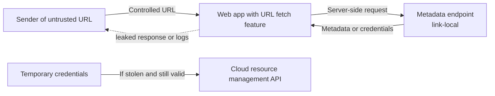

# Protecting metadata endpoints against SSRF and credential theft

Virtual machines and cloud workloads often need to query a metadata service to obtain their instance ID, deployment region, network configuration, user data, or temporary credentials associated with the machine's identity. The metadata service is typically exposed on a link-local address reachable only from within the workload's runtime environment. This very characteristic makes the endpoint an attractive target when an application has a Server-Side Request Forgery (SSRF) vulnerability.

If an attacker controls the URL that a server sends requests to, they can attempt to force the application to call the metadata endpoint instead of a user-supplied address. In some configurations, the response may contain identity information or temporary credentials. If those credentials carry overly broad permissions, the attacker can use them to read data, modify resources, or move laterally to other workloads.

Protecting the metadata endpoint therefore requires defense in depth: URL validation in the application, network restrictions to sensitive addresses, enabling provider metadata protections, least-privilege workload identities, and monitoring credential usage. Enabling a single header or blocking one URL in source code is not enough to eliminate SSRF risk.

## 1. The metadata service and its role in the cloud

A metadata service is an endpoint provided by the cloud platform so an instance or workload can query information about its running environment. The endpoint typically resides on a link-local address, such as `169.254.169.254` in IPv4. Because this address is not routed like a standard Internet address, applications inside a VM can reach it while external clients cannot call it directly in the same way.

Metadata information may include:

- Instance ID, machine type, region, zone, project, or account.
- Private IP, network interfaces, subnet, and routing information.
- Image ID, platform version, and instance identity data.
- User data or startup scripts supplied when launching the machine.
- Temporary credentials attached to an instance role, managed identity, or service account.

The metadata service automates configuration and provides workload identity without baking long-lived access keys into images. However, any data returned from the metadata endpoint should be treated as sensitive according to its data type. User data may contain configurations or secrets if misused by deployers; temporary credentials grant cloud access for their validity period.

### Metadata does not mean credentials

Some metadata paths only return descriptive instance details. Other paths may provide tokens or credentials for the identity attached to the workload. You should not assume all metadata is equally secret, nor should you allow a web application to arbitrarily read or return metadata contents to users.

Secure design ensures only components that genuinely need metadata can reach that endpoint. Applications should use the platform's official SDK or credential provider to retrieve temporary identities, rather than manually constructing URLs and handling credentials unnecessarily.

## 2. What is SSRF and why are metadata endpoints targeted?

SSRF occurs when a server-side application sends a request to an address wholly or partially controlled by a user. Legitimate features such as fetching an image from a URL, checking a webhook, previewing links, importing data from an API, or forwarding requests can become SSRF entry points if the application fails to restrict destinations.

For example, a service exposes an endpoint accepting a `url` parameter to fetch remote content. Normal users supply the URL of a public image. If the server does not validate the destination, an attacker can supply an internal or link-local address. The request originates from inside the VM, where the metadata endpoint is reachable.



The diagram illustrates one plausible risk chain; not every SSRF can read metadata or extract credentials. Exploitability depends on metadata protection mechanisms, how the application constructs requests, network permissions, endpoint type, and the permissions of the workload identity.

### Common steps in an attack

1. The attacker discovers a feature that causes the backend to access a user-supplied URL.
2. They try internal, loopback, or link-local addresses in place of an Internet URL.
3. If requests to the metadata endpoint are accepted, they attempt to read sensitive fields or credential-issuing paths.
4. If the response is returned, written to accessible logs, or used elsewhere in the application, the information may be exposed.
5. Exposed credentials can be used to call cloud APIs within their permission scope and remaining lifetime.

Some SSRF flaws are blind SSRF: the attacker cannot read the response directly but still forces the backend to issue requests. Blind SSRF can still cause impact by invoking internal services, triggering actions, or leaking data through side channels. Thus, no visible response does not mean a request is safe.

## 3. What can stolen metadata credentials do?

Credentials attached to an instance role or service account are typically short-lived. They allow workloads to call APIs without storing static access keys. However, if stolen while still valid, those credentials can be used from another environment until they expire or are revoked via provider mechanisms.

Impact depends on the permissions assigned to the workload identity:

- If it only has read access to a specific set of objects, the attacker can read data within that scope.
- If it has write or delete permissions, data or resources can be altered.
- If it has IAM management or credential-issuing permissions, compromise can spread to other identities.
- If the identity has access across multiple accounts, projects, or environments, blast radius can extend beyond the initial workload.

Never grant account-wide administrative permissions to a VM just because the application needs to read a bucket or write logs. Create a dedicated role per workload, grant only required actions and resources, restrict conditions by environment where supported, and review permissions regularly.

### Metadata and user data

User data is commonly used to pass startup scripts or initialization configuration. It is not a secrets vault. User data may be readable from metadata or through management consoles depending on the platform and access permissions. Never place passwords, private keys, long-lived tokens, or secret material in user data. Instead, use a secret manager or workload identity to fetch secrets at runtime with appropriate scope and lifetime.

## 4. Provider metadata protection mechanisms

Cloud platforms offer various mechanisms to reduce the likelihood of SSRF reaching metadata. Names and technical details vary by service; verify the configuration for your exact instance type and platform version.

### AWS EC2 Instance Metadata Service

AWS EC2 IMDS has two commonly referenced access modes:

- **IMDSv1:** simple metadata requests without first obtaining a session token.
- **IMDSv2:** the client must send a `PUT` request to retrieve a session token, then include that token in a header when reading metadata. The token has a time-to-live and hop limits can be configured.

With IMDSv2, requiring a token mitigates SSRF variants that only permit simple GET requests or do not allow header control. However, if an SSRF lets the backend send arbitrary PUT requests and headers, IMDSv2 alone does not eliminate the risk. Combine it with URL validation, egress controls, and IAM scoping.

Another related setting is the metadata response hop limit. This value governs whether responses can traverse extra network hops, especially in certain container architectures. A low value can reduce the chance of containers receiving metadata responses directly, but you must test with your network namespaces, CNI, and actual deployment before broad rollout.

### Azure Instance Metadata Service

Azure IMDS is accessed via a link-local address and requires the `Metadata: true` header on metadata requests. Requiring this header prevents accidental requests and simple SSRF, but it is not a standalone control. If the application allows an attacker to control headers, risk must still be addressed at the application and network layers.

Managed identity lets workloads obtain tokens to call authorized services without storing long-lived secrets. Assign least privilege to managed identities and restrict which workloads can access the endpoint or identity.

### Google Cloud metadata server

Google Cloud provides a metadata server for VMs and supported workloads. Metadata requests typically use the `Metadata-Flavor: Google` header. Workload identity and service accounts supply identity to applications; service account permissions must be scoped to actual needs.

A required header does not replace SSRF validation. Applications must block access to the metadata endpoint from untrusted URL-fetching features while also restricting service account permissions.

### High-level comparison

| Platform | Common mechanism | Benefit | Limitations to remember |
|---|---|---|---|
| AWS EC2 | IMDSv2 session token; endpoint and hop limit settings | Token requirement hinders simple SSRF | SSRF may support PUT/headers; overly broad IAM roles remain dangerous |
| Microsoft Azure | `Metadata: true` header; Managed Identity | Request requires special header; avoids long-lived secrets | Apps may allow arbitrary headers; network and identity controls still needed |
| Google Cloud | `Metadata-Flavor: Google` header; service accounts / workload identity | Request requires special header; integrated workload identity | Header is not a standalone security boundary; least privilege still required |

Details such as endpoint paths, API versions, token requirements, mandatory settings, and container applicability vary by service. Consult official documentation for your deployment environment and verify live configurations with provider management tools.

## 5. Preventing SSRF at the application layer

The application layer is the earliest enforcement point because it decides whether a request is sent at all. Every URL fetch, webhook, import, proxy, or preview feature must be reviewed.

### Prefer allowlists over blocklists

If the application only needs to call a set of known services, allowlist specific hostnames, schemes, and ports. Allowlists are generally safer than blocklists because the set of internal addresses to block is vast and easily bypassed via IPv6, alternative IP representations, DNS aliases, or new address ranges.

For example, if a service only fetches images from `images.example.net`, restrict it to the HTTPS scheme, that hostname, and port 443. If multiple providers are needed, declare approved endpoints in controlled configuration.

### Layered URL validation

Before sending a request:

1. Accept only required schemes, typically HTTPS; reject `file:`, `ftp:`, `gopher:`, `dict:`, and unsupported schemes.
2. Parse URLs using a standard library rather than simple regexes to extract hostnames.
3. Reject userinfo in URLs, disallowed ports, and hostnames outside the allowlist.
4. Resolve DNS and inspect all returned addresses; block loopback, private, link-local, multicast, unspecified, and policy-reserved ranges.
5. Ensure the validated address is the exact address the actual connection uses, mitigating DNS rebinding and time-of-check/time-of-use issues.
6. Disable automatic redirects or re-validate the destination after every redirect.
7. Set timeouts, maximum response sizes, maximum redirect counts, and total fetch duration limits.
8. Never forward sensitive headers, cookies, or user credentials to another host.

Validating the initial hostname is not enough. An allowed hostname can resolve to an internal IP; a redirect from an allowed host can point to a link-local address; DNS can return different addresses between check time and connect time. Use an HTTP client or egress proxy capable of pinning verified addresses and validating every redirect hop.

### Example URL validation logic

The snippet below illustrates conceptual validation structure. In real applications, use vetted URL and HTTP client libraries, handle IPv4/IPv6 completely, pin DNS results for the connection, and validate each redirect. Do not treat this illustrative snippet as a complete SSRF defense library.

```python
from urllib.parse import urlsplit

ALLOWED_HOSTS = {"images.example.net"}

def validate_fetch_target(raw_url: str) -> str:
    parsed = urlsplit(raw_url)

    if parsed.scheme != "https":
        raise ValueError("Only HTTPS is allowed")

    if parsed.username or parsed.password:
        raise ValueError("URL userinfo is not allowed")

    if parsed.port not in (None, 443):
        raise ValueError("Unexpected port")

    hostname = (parsed.hostname or "").rstrip(".").lower()
    if hostname not in ALLOWED_HOSTS:
        raise ValueError("Destination is not allowlisted")

    return hostname
```

This snippet only checks syntax and hostname allowlisting. To be complete, the connection layer must check DNS A/AAAA records, reject non-public IPs per policy, connect to the exact verified IP, validate TLS against the expected hostname, and re-verify destinations after redirects. If these guarantees cannot be met, use a dedicated egress proxy rather than reimplementing networking logic in every application.

### Never return metadata contents to clients

Even when the backend must call an internal service, never echo raw response bodies, headers, or network errors back to users. Responses can contain tokens, internal hostnames, network addresses, or configuration details. Return generic errors to clients; internal logs should strip or mask sensitive data.

## 6. Defending at the network and OS layers

Network-layer controls reduce the chance that an application bug can reach sensitive endpoints. This is a complementary defense layer, not a replacement for URL validation and least privilege.

### Egress filtering

Outbound policies should restrict workloads to connecting only to required services. Host firewalls, egress security groups, network policies, subnet routes, or egress proxies can block unauthorized address ranges, especially the link-local metadata endpoint for workloads that do not need it.

If an application needs metadata for identity, grant controlled access to the specific component that requires it. For workloads that do not need metadata, blocking the network path to the endpoint significantly limits SSRF impact.

### Mind proxies and environment variables

Some applications use HTTP proxies to govern outbound traffic. Inspect `HTTP_PROXY`, `HTTPS_PROXY`, and `NO_PROXY`, because bypass settings may cause link-local requests to go direct rather than through the proxy. Do not add the metadata endpoint to bypass lists casually; understand the exact request path of your runtime and SDKs.

Proxies must reject internal and link-local addresses per policy, check DNS/redirects, and prevent clients from choosing an alternate proxy. If a proxy only checks the initial hostname without checking resolved IPs or redirects, SSRF can still bypass it.

### Host firewalls and routing

OS firewalls can restrict which processes or users may reach the metadata endpoint, depending on OS capabilities and network architecture. However, UID- or cgroup-based rules must be tested because applications may run via helper processes, sidecars, or separate namespaces.

Do not block a broad link-local range without checking whether other platform services use it. Some cloud services use link-local addresses for metadata, DNS resolvers, time synchronization, or agents. Identify exact endpoints and dependencies before deploying rules.

## 7. Protecting metadata in containers and Kubernetes

Containers typically share the host kernel while having separate network namespaces. Depending on CNI, routing, host networking, and network policies, a container may be able to reach the node's metadata endpoint. If an application inside a Pod suffers from SSRF, an attacker may try to access the host VM's metadata or the identity attached to the node.

### Common risks

- Pods can reach the node's metadata endpoint over a link-local route.
- Pods using `hostNetwork` have a closer network path to the host.
- Overly broad node roles make exposed credentials high-impact.
- Multiple unrelated workloads share a single node identity.
- Sidecars or proxies have metadata access and inadvertently forward requests.
- Network policies govern only part of the traffic, while link-local paths depend on CNI and node configuration.

### Mitigations

1. Use Pod-level workload identity or service account identity when supported by the platform.
2. Reduce the node role to the minimum needed for node operations; never use the node role as a substitute for application permissions.
3. Block Pods that do not need metadata from reaching the node endpoint using network policies, host firewalls, or cloud/CNI-provided mechanisms.
4. Restrict `hostNetwork`, privileged containers, host PID, and host mounts to workloads that truly require them.
5. Use dedicated namespaces and service accounts; never share identities across workloads with differing trust levels.
6. Audit sidecars, service meshes, and egress gateways to ensure they do not unintentionally allow link-local access.
7. Test from regular Pods, privileged Pods, and hostNetwork Pods to verify actual policy enforcement.

In Kubernetes, standard network policies control Pod traffic according to CNI implementation; never assume every CNI handles link-local or host networking identically. Check documentation and test on your actual cluster.

### Credentials and workload identity

Workload identity lets Pods or workloads obtain short-lived credentials bound to a dedicated service account or identity. This reduces the need for shared node roles or storing access keys in Secrets. Even so, applications must still protect issued tokens; SSRF or code execution bugs can abuse whatever permissions the workload holds.

Assign distinct identities by application, environment, and purpose. For instance, an image-processing worker only needs to read input objects and write outputs to a specific prefix; it does not need bucket administration rights or permission to create IAM roles.

## 8. Designing workload identity and least privilege

The metadata endpoint is often one way workloads receive credentials. To limit impact if credentials are exposed, design permissions properly from the start.

### One identity per workload role

Do not attach the same privileged role to every VM in an account. Create roles per application or functional group, scoping specific resource ARNs/projects/resources and required actions. Separate permissions for reading data, writing data, deploying infrastructure, and administering security.

### Short-lived credentials

Prefer short-lived credentials issued automatically via instance roles, managed identities, or workload identities. Avoid storing long-lived access keys in images, user data, configuration files, persistent environment variables, or repositories.

Short-lived credentials shrink the exploitation window but do not eliminate risk: if stolen, they can still be used until expiration or revocation. Monitor API activity and maintain a revoke/rotate procedure when compromise is suspected.

### Additional access conditions

Where supported by the platform, restrict permissions by resource, region, network condition, session tag, source identity, or token audience. These conditions reduce the chance of credentials being used outside their intended context. Verify SDK and service compatibility before enforcing complex policies.

### Prevent applications from leaking credentials

- Never return tokens or credentials in HTTP responses.
- Never write Authorization headers, session tokens, or secret contents to logs.
- Never include metadata responses in exception messages shown to clients.
- Never store credentials in shared caches without tenant isolation and TTL controls.
- Never pass cloud credentials in URL query strings.
- Restrict read permissions on configuration files and process environments on hosts/containers.

## 9. Testing and verifying defenses

SSRF testing should be conducted in an authorized environment using mock endpoints or test resources. The goal is to confirm the application cannot reach internal destinations outside the allowlist and does not leak metadata or credentials in responses or logs.

### Test matrix

| Case | Expected outcome |
|---|---|
| Valid allowlisted HTTPS URL | Processed within size and timeout limits |
| URL with disallowed scheme | Rejected before sending request |
| URL to loopback or private IP | Rejected at application or egress layer |
| URL to link-local metadata address | Blocked; no metadata content returned |
| Allowlisted hostname resolving to internal IP | Rejected after DNS validation step |
| Valid hostname redirecting to internal IP | Redirect blocked after re-validating destination |
| DNS changes between check and connect | Connection remains pinned to verified address or is rejected |
| URL with userinfo or unexpected port | Rejected |
| Oversized or slow response | Terminated per timeout and size limits |
| App running in Pod not needing metadata | Cannot reach node metadata endpoint |
| Application workload identity | Holds only required permissions on target resources |

You do not need to exfiltrate real credentials to prove an endpoint is blocked. Use mock endpoints or inspect network policies in a test environment; never save tokens into test output.

### Checking metadata configuration

During infrastructure reviews, verify:

- Whether the metadata endpoint is enabled and which workloads genuinely need it.
- Whether required session/token mechanisms are enabled per provider recommendations.
- Whether hop limits or network path restrictions match VM and container architectures.
- Whether node roles, managed identities, or service accounts follow least privilege.
- Whether security groups, firewalls, routes, proxies, and network policies properly restrict egress.
- Whether user data and startup scripts contain any secrets.
- Whether audit logs capture identity usage and permission changes.

## 10. Monitoring and detecting anomalous behavior

Early detection reduces how long stolen credentials can be abused. Combine application logs, network telemetry, cloud audit logs, and identity signals.

### Indicators to watch

- A URL-fetching application sends requests to link-local, loopback, or undesigned private ranges.
- A workload calls the metadata endpoint at unusual frequency or from a process that does not need metadata.
- Instance role credentials are used from an IP, region, or user agent inconsistent with normal behavior.
- A read-only data workload calls IAM enumeration, role creation, or policy modification APIs.
- A spike in requests to object storage, secret manager, or the control plane follows an SSRF alert.
- User data or bootstrap configurations contain tokens, access keys, or passwords.

### Logs and telemetry to collect

- Request ID, user ID, route, and URL parameters with sensitive data masked.
- Normalized target hostname, resolved IP after DNS lookup, and policy check outcome.
- Process/container identity initiating the request when collectible.
- Cloud audit events including principal, action, resource, source IP, and timestamp.
- Alerts on egress to the metadata endpoint from workloads outside the allowlist.
- Change history for roles, policies, service accounts, and network rules.

Do not log raw URLs that might contain tokens in query strings, metadata payloads, Authorization headers, or credentials. Logs must support investigation without becoming a new leakage vector.

## 11. Responding to suspected metadata or credential exposure

When an SSRF capable of reaching metadata is discovered or credentials are suspected stolen, address both the exploit path and the exposed permissions simultaneously.

1. **Restrict access:** temporarily disable the affected URL-fetch feature, block egress to sensitive endpoints for workloads not needing metadata, or isolate the workload per incident procedures.
2. **Assess identity:** identify the role, managed identity, or service account attached to the VM/Pod and all of its permissions.
3. **Revoke or replace credentials:** revoke sessions/tokens if supported by the provider; otherwise, disable or replace the identity/policy safely and wait for old credentials to expire.
4. **Investigate activity:** query cloud audit logs for unusual API calls, accessed/modified resources, IAM changes, and activity from unfamiliar sources.
5. **Protect data:** assess objects, databases, secrets, and logs that may have been accessed; preserve evidence and execute appropriate notification workflows.
6. **Fix root cause:** remediate SSRF in the application, add allowlists/egress filtering, and validate redirects and DNS.
7. **Reduce permissions:** tighten roles and split identities if the workload held excessive privileges.
8. **Verify post-remediation:** re-run the SSRF test matrix, confirm old credentials no longer work, and monitor for anomalous activity.

Do not simply rotate secrets and close the incident. If the SSRF remains, new credentials can be stolen again. Fix the entry point, network path, and workload permissions together.

## 12. Defensive architecture example

Suppose a web service running on a VM includes a feature to fetch images from user-supplied URLs. The service also needs to read objects from a bucket for image processing.

An appropriate design may include:

- The application fetches images only from a list of approved domains, using HTTPS and port 443 exclusively.
- An egress proxy validates DNS, blocks private/link-local addresses, and inspects each redirect.
- Firewall/routing blocks access to the metadata endpoint from the image-fetching process if the architecture separates components.
- The image-processing component receives a dedicated identity permitted only to read input objects and write results to a designated prefix.
- The metadata endpoint uses the strongest provider-supported protection; user data contains no secrets.
- Cloud audit logs and network telemetry alert on requests to metadata originating from the URL-processing path.
- Application logs mask sensitive URLs and never record metadata response bodies.

If the application and worker require different permissions, split them into separate workloads with distinct identities and network policies. This limits blast radius if one component is compromised.

## 13. Common mistakes

- **Only blocking the string `169.254.169.254`.** Attackers can use alternate IP encodings, IPv6, hostnames, DNS, or redirects. Parse URLs, verify IPs after DNS resolution, and validate every connection step.
- **Only requiring a special metadata header.** SSRF may permit header control; headers are a mitigation layer, not a replacement for allowlists and egress controls.
- **Blocking metadata only in the frontend.** SSRF requests originate from the backend; browser-side checks do not protect internal endpoints.
- **Assuming short-lived credentials are harmless.** Valid credentials can still access resources within their granted scope.
- **Sharing one broad role across all VMs/Pods.** Compromising one workload exposes permissions belonging to many applications.
- **Putting secrets in user data.** User data can be read via metadata or the control plane and may persist in logs or image workflows.
- **Disabling metadata without checking dependencies.** Agents or bootstrap scripts may require metadata; identify dependent workloads before blocking.
- **Assuming network policies behave identically across all CNIs.** Link-local paths, host networking, and node traffic can be handled differently; test on the actual platform.
- **Inspecting only response bodies.** Blind SSRF can still trigger internal requests or cause indirect impact.

## 14. Implementation checklist

**Metadata service and identity:**

- [ ] Identified which workloads need metadata and which endpoints are allowed.
- [ ] Enabled provider-appropriate metadata protection mechanisms.
- [ ] Assigned dedicated identities and least-privilege permissions per workload.
- [ ] Used short-lived credentials instead of long-lived access keys.
- [ ] User data, images, and startup scripts contain no secrets.

**Application and network:**

- [ ] URL fetching enforces hostname, scheme, and port allowlists.
- [ ] DNS A/AAAA records, private/link-local IPs, and DNS rebinding are validated.
- [ ] Redirects are disabled or re-verified at each hop.
- [ ] Timeouts, response size limits, and redirect limits are configured.
- [ ] Egress filtering or proxies block unnecessary access paths.
- [ ] Logs and responses do not expose metadata or credentials.

**Containers and operations:**

- [ ] Pods not needing metadata are blocked from reaching the node endpoint.
- [ ] `hostNetwork` and privileged container permissions are restricted.
- [ ] Network policies are tested against the actual CNI.
- [ ] Audit logging is active for identity usage and permission changes.
- [ ] Procedures exist for credential revocation and SSRF incident response.
- [ ] Test matrix is re-run after application or infrastructure changes.

## Conclusion

The metadata service helps workloads obtain environment information and temporary credentials without embedding long-lived keys. However, SSRF can turn a backend into an access path to internal endpoints and expose cloud identities. Defend in depth: URL and DNS validation, allowlists, redirect checks, egress filtering, provider metadata token/header protections, dedicated workload identities, least privilege, and audit monitoring. When credential exposure is suspected, block the SSRF path, revoke or replace credentials, investigate cloud APIs, and verify after remediation. This design prevents the metadata endpoint from becoming the starting point for cloud resource compromise.
