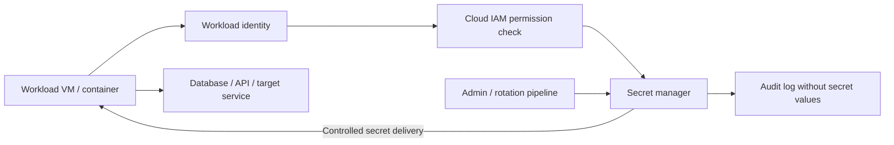
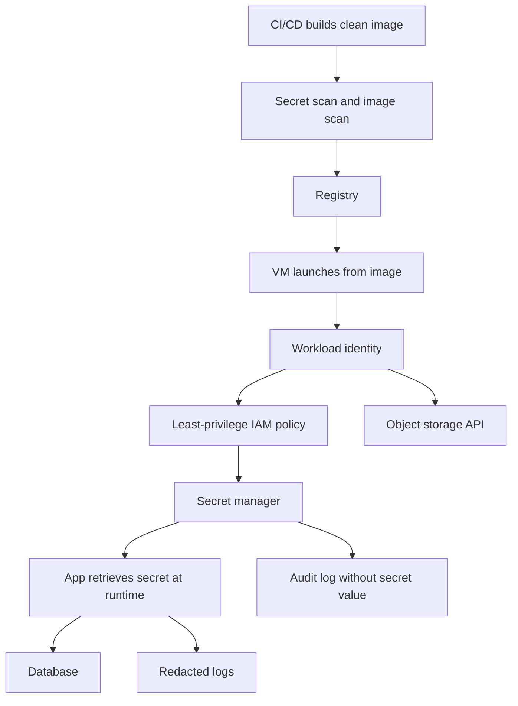

# Preventing access keys and secrets in images, scripts, or logs

Virtual machines, containers, and serverless workloads often need credentials to access databases, object storage, APIs, or cloud services. If access keys, passwords, tokens, or private keys are packaged into machine images, container images, startup scripts, or logs, that sensitive data can outlive its intended lifetime and be copied across many environments. A shared image, a created snapshot, logs forwarded to a centralized system, or a downloaded build artifact can all spread secrets widely.

The core principle is **never store secrets in artifacts or long-lived operational data**. Assign workload identities, retrieve secrets from a secret management system at runtime, grant least privilege, and limit validity periods. At the same time, design pipelines to detect secrets before release and ensure logs never inadvertently record credentials.

## 1. What is a secret and why protect it?

A secret is data that a user or workload can use to prove identity or gain authorization to access resources. Examples include:

- Cloud API keys and access keys.
- Database, cache, message broker, or service account passwords.
- Access tokens, refresh tokens, and session cookies.
- SSH private keys, TLS private keys, and client certificates with private keys.
- Signing keys, webhook signing secrets, and encryption keys.
- Credentials for registries, package repositories, CI/CD, or monitoring systems.

Some data such as hostnames, instance IDs, or service names are not necessarily secrets. Still, they may be internal information requiring policy-based controls. Proper classification focuses protection on data capable of granting access.

An exposed secret can allow an attacker to:

- Read, modify, or delete data in a cloud account.
- Access databases or internal services.
- Provision resources, run compute, and incur unauthorized costs.
- Impersonate services, sign data, or decrypt data.
- Maintain persistent access after the original VM or container has been deleted.
- Access cross-environment resources if the same credential is reused.

Risk rises sharply when a secret is long-lived, overly permissive, shared, or present in downloadable artifacts. Controls must therefore cover where secrets are created, where they are stored, how workloads retrieve them, and how they are revoked.

## 2. Common places where secrets leak

| Location | How secrets can appear | Consequence |
|---|---|---|
| Machine image or snapshot | Config files, shell history, credential caches, `.env` files, private keys | Every VM launched from the image can inherit the secret |
| Container image | Dockerfiles, build arguments, environment variables in layers, copied files | Secrets persist in layers/history and the registry |
| Startup scripts/user data/cloud-init | Passwords or tokens written directly in scripts | Readable via metadata, control plane, logs, or saved config |
| Infrastructure as Code | Literal secrets in Terraform, templates, state, or plans | Exposed via repositories, state backends, artifacts, or reviews |
| CI/CD pipelines | Secrets printed to console, command lines, debug traces, or artifacts | Anyone with access to logs/builds can extract credentials |
| Application logs | Authorization headers, request bodies, connection strings, exceptions | Secrets copied into logging systems and backups |
| Crash dumps/diagnostics | Process memory or environment variables written to files | Secrets persist in dumps and support systems |
| Shell history/process lists | Tokens passed in command arguments or interactive commands | Readable by other users or agents |
| Backups and support bundles | Packaged configuration files, logs, or dumps | Secrets persist long after the source is cleaned up |

Checking source code alone is not enough. Secrets can be injected post-build, generated at runtime, or captured in backups and diagnostic tools.

## 3. Threat model: who can read secrets?

During design, identify which identities and systems can read each location holding secrets:

- Users authorized to pull images or download snapshots.
- Users authorized to read repositories, pipeline logs, artifacts, or IaC state.
- Other processes running on the same VM, container, or node.
- Administrators with access to filesystems, process memory, or debug endpoints.
- Actors able to exploit SSRF, command injection, path traversal, or application flaws.
- Monitoring agents, crash reporters, support tools, or logging systems ingesting workload output.
- Cloud accounts with permissions to read the secret manager or decrypt data.

Do not assume a secret is safe simply because a repository is private or an image registry requires login. Internal access may be broad, accounts can be compromised, and artifacts can be shared beyond their intended scope.

Map every secret by three attributes: **owner**, **authorized workloads**, and **lifetime/revocation conditions**. Every secret must have a clear purpose and should never be shared across unrelated workloads.

## 4. Prefer workload identity over long-lived keys

When a workload needs to call cloud APIs, the preferred approach is attaching a platform-managed workload identity rather than storing static access keys in images or configuration files.

Platform examples:

| Platform | Compute identity mechanism | How applications use it |
|---|---|---|
| AWS | IAM role attached via EC2 instance profile; containers can use dedicated task/Pod identity mechanisms | AWS SDK credential provider fetches and auto-refreshes temporary credentials |
| Azure | Managed identity attached to VM or compute service | Azure Identity SDK requests tokens for the required resource/scope |
| Google Cloud | Service account attached to VM or corresponding workload identity | Google Cloud client libraries fetch short-lived access tokens |

Temporary credentials reduce long-lived key storage and enable control-plane revocation. However, if a workload is compromised, an attacker can exercise credentials within their granted scope. Identities therefore still require least privilege, audience/resource scoping, and behavioral monitoring.

### 4.1. Granting least privilege

A workload that only reads files from one bucket does not need administrative permissions over the entire storage account. An API that reads one secret does not need permissions to list or modify every secret in a project.

Design permissions according to these principles:

- Create dedicated roles per application or functional group.
- Grant only required actions and resources.
- Separate production permissions from development/test.
- Avoid attaching broad roles to every VM in the same subnet or node pool.
- Use resource, tag, audience, or time conditions where supported by the platform.
- Audit permissions periodically and remove them when workloads are decommissioned.

### 4.2. Never share one credential across multiple workloads

If multiple applications share one API key, compromising one makes blast-radius assessment hard and revoking its access alone impossible. Creating separate identities enables accurate auditing, scoped permissions, and independent rotation.

## 5. Using a secret manager for runtime delivery

A secret manager is a service for storing and distributing secrets with access control. Examples include AWS Secrets Manager/Systems Manager Parameter Store SecureString, Azure Key Vault, and Google Cloud Secret Manager. Self-managed solutions can also be used if equivalent controls exist.

A common workflow:

1. An authorized administrator or pipeline creates the secret in the secret manager.
2. The workload receives a dedicated platform identity.
3. The application uses a supported SDK or agent to request the exact secret.
4. The secret manager authenticates the identity and evaluates policy.
5. The application receives the secret over a protected channel and uses it in memory or a designated mechanism.
6. The system records an audit event for the access without logging the secret value.
7. The secret is rotated or revoked per policy.



Applications should retrieve secrets at startup or just in time, depending on rotation and availability requirements. If caching secrets in memory, define a TTL and refresh mechanism. Never cache indefinitely if secrets can be rotated or revoked.

### 5.1. A secret manager does not replace IAM

The secret manager still requires policies defining who can read, write, delete, and rotate secrets. Separate secret administration roles from workload read roles. A workload typically only needs `Get` on a specific secret; it does not need permissions to create or delete secrets.

### 5.2. Handling temporary secret manager unavailability

This is a critical application dependency. Decide:

- Can it keep running on valid cached secrets, or must it fail closed?
- Does startup retry with backoff and bounded timeouts?
- Are alerts configured when refreshes fail or secrets near expiration?
- Can the application keep serving active requests when the secret backend has transient errors?
- Is there a recovery plan if IAM, DNS, or the secret manager private endpoint fails?

Avoid writing secrets to persistent temporary files merely to avoid calling the secret manager. If local caching is required, restrict file permissions, lifetime, and cleanup; prefer in-memory caching or platform-managed secret volumes.

## 6. Never embed secrets in machine images

Machine images are used to launch many VMs and can be copied across regions, accounts, or subscriptions. Any secret inside an image risks being replicated across every instance created from it.

Before creating a golden image:

- Remove `.env` files, configuration files containing passwords, private keys, and tokens.
- Clear shell history, login caches, credential helpers, and temporary files.
- Remove cloud CLI profiles containing access keys or refresh tokens.
- Never leave administrator SSH private keys inside the image.
- Never store database passwords in systemd units or installation scripts.
- Clean package manager credentials and repository tokens.
- Remove sensitive data from `/tmp`, home directories, logs, and crash dumps.
- Inspect intermediate snapshots or images before release.

A golden image should contain only software, non-secret configuration, and required agents. When a VM boots, it receives its workload identity and retrieves secrets from a controlled source.

### 6.1. Cloud-init and user data

Cloud-init or startup scripts are commonly used to configure VMs at boot. User data may be stored in the metadata service, control plane, deployment templates, or logs depending on the platform. Therefore, never place passwords or tokens directly inside user data.

Unsafe example:

```yaml
# Do not follow: password written directly in user data
# and may be stored in metadata, templates, or logs.
write_files:
  - path: /etc/myapp/database.conf
    content: |
      password: "example-password"
```

Instead, the startup script should configure an agent or application to fetch secrets via workload identity. If using templates, pass only secret names/identifiers and non-sensitive settings; never pass secret values.

### 6.2. Snapshots and intermediate images

VM snapshots can contain data in the filesystem, swap, caches, or deleted files still recoverable at the block level. Before taking a snapshot to use as an image, stop relevant processes, clean credentials, handle swap, and verify no sensitive data remains. Standard file deletion does not guarantee data is gone from every block or older snapshot.

## 7. Never embed secrets in container images or build layers

Container images are stored in registries and pulled across multiple environments. Dockerfiles, build arguments, environment variables, and copied files can all leave secrets in layers or metadata.

Unsafe example:

```dockerfile
# Do not follow: secret is written into an image layer.
FROM alpine:3.20
ARG PACKAGE_TOKEN
RUN echo "$PACKAGE_TOKEN" > /root/.package-token
RUN install-my-dependencies
```

Even if a later layer deletes the file, data in the earlier layer remains in image history and the registry. `ARG` and `ENV` are likewise unsafe mechanisms for storing secrets.

With Docker BuildKit, secrets can be temporarily mounted during a build step for tools to use without persisting values into the final layer:

```dockerfile
# syntax=docker/dockerfile:1.7
FROM alpine:3.20
RUN --mount=type=secret,id=package_token \
    PACKAGE_TOKEN="$(cat /run/secrets/package_token)" \
    install-my-dependencies
```

Supply the secret to the build step from a trusted environment:

```bash
DOCKER_BUILDKIT=1 docker build \
  --secret id=package_token,src=/secure/path/package-token \
  -t example/app:1.0 .
```

This illustrates the syntax; ensure the source file has minimal permissions and sits outside the build context. BuildKit secret mounts avoid baking secrets into layers like `ARG`/`ENV`, yet build commands can still leak secrets if scripts print them to stdout/stderr, write them to other files, or send them to untrusted services. Audit build logs and package installer behavior.

### 7.1. `.dockerignore` and the build context

Add sensitive files to `.dockerignore` to prevent sending them into the build context:

```text
.env
.env.*
*.pem
*.key
credentials/
secrets/
.git/
```

Tailor the list to your project structure. `.dockerignore` is a risk-reduction layer, not a substitute for secret scanning and Dockerfile review. Never commit secrets to a repository assuming `.dockerignore` will hide them later.

### 7.2. Runtime secrets in containers

Containers should receive secrets at runtime through a secret manager, workload identity, or orchestrator-managed secret volume. Never bake secrets into images and avoid passing credentials in command-line arguments. If using environment variables, understand they may appear in process inspection, crash dumps, or diagnostics depending on OS and reader permissions.

Kubernetes Secrets help distribute sensitive data to Pods, but by default do not satisfy all security requirements on their own. Enable encryption at rest for the datastore per cluster configuration, restrict RBAC, use external secret providers where appropriate, and never grant read access to all Secrets across all namespaces or service accounts.

## 8. Protecting secrets in Infrastructure as Code

Terraform, CloudFormation, Bicep, and other IaC tools enable repeatable infrastructure management, yet configuration files, plans, and state can hold sensitive values.

Principles:

- Never write literal secrets in committed `.tf`, YAML, JSON, or template files.
- Use the pipeline's workload identity to access the secret manager.
- Avoid passing secrets via command-line arguments or variables printed in debug logs.
- Protect state backends with encryption, IAM, versioning, and auditing.
- Restrict state read permissions; anyone who can read state can read many sensitive values.
- Use `sensitive` attributes to suppress console display, but do not treat them as encryption or assume they remove secrets from state.
- Never attach plans or state files to tickets or public artifacts.
- Separate infrastructure deployment permissions from production secret-reading permissions when unnecessary.

Terraform examples that reference secrets from a secret manager must be designed so the pipeline holds an appropriate identity. Remember that if Terraform reads a secret value into state, marking it `sensitive` does not remove it from state. For application runtime secrets, it is generally better for the workload to fetch secrets itself at runtime rather than routing values through IaC.

## 9. Never write secrets into logs, traces, or metrics

Logs aid operations and investigation, but can turn into a credential store if applications log entire requests or configurations. Once logged, a secret can be replicated through agents, queues, SIEMs, backups, exports, and analytics systems.

Fields that must never be logged:

- `Authorization`, `Proxy-Authorization`, cookies, and session tokens.
- Passwords, connection strings with passwords, and API keys.
- Private keys, certificate material, and signing secrets.
- Request bodies containing authentication credentials or unnecessary sensitive data.
- Secret manager responses containing secret values.
- Environment dumps, process arguments, or full configurations on error.

### 9.1. Redaction and allowlists

Design logging using allowlists: log only fields required for operations rather than dumping entire objects and trying to strip secrets afterward. If requests/responses must be logged, apply redaction at multiple layers:

- HTTP middleware filtering sensitive headers and body fields.
- Loggers configured to scrub field names like `password`, `token`, `secret`, `api_key`.
- Reverse proxies/API gateways configured not to log authorization headers or cookies.
- Log agents configured not to collect configuration files or secret paths.
- Traces/telemetry excluding credentials from span attributes and baggage.

Field-name redaction can miss arbitrarily named secrets or encoded strings. Prefer keeping secrets out of logged objects from the start.

### 9.2. Safe logging examples

Do not log the entire request:

```python
# Unsafe
logger.info("request=%s", request.headers)
```

Log only required fields:

```python
logger.info(
    "request_received method=%s path=%s request_id=%s",
    request.method,
    request.url.path,
    request_id,
)
```

Do not log secret values when handling credential retrieval errors:

```python
try:
    credential = secret_provider.get("payments/database")
except SecretProviderError as exc:
    logger.error("cannot_load_database_credential error_type=%s", type(exc).__name__)
    raise
```

In this example, the log records only the error type. Ensure the library's exception message does not contain secrets; if it might, normalize or strip sensitive parts before logging.

## 10. Managing secrets in CI/CD

Build and deploy pipelines often have access to source code, registries, cloud APIs, and production environments. Pipelines are therefore high-value targets.

Measures to apply:

- Use federated identity/OIDC or short-lived credentials instead of static access keys when supported by the platform.
- Scope secrets strictly to the jobs and stages that need them.
- Isolate production secrets from pull requests originating from forks or untrusted branches.
- Disable shell tracing/debug output when handling sensitive data.
- Never pass secrets as command-line arguments visible in process lists.
- Mask values in logs, but do not rely solely on masking since variants/encodings can bypass filters.
- Never write secrets into artifacts, caches, workspaces, or uploaded files.
- Use dedicated runners or isolated environments for jobs with production permissions.
- Audit pipeline identities, accessed secrets, and executed deployments.
- Revoke runner or job credentials upon signs of compromise.

### 10.1. Secret scanning in pipelines

Secret scanners can be integrated across stages:

1. Pre-commit hooks on developer workstations.
2. Pull requests to catch newly introduced secrets in diffs.
3. Full repository and Git history scans during investigations.
4. Filesystem, container image, and artifact scans before release.
5. Policy-based scans of IaC, build logs, and deployment configurations.

Scanners can produce false positives or miss secrets depending on formatting. Establish verification workflows, justified allowlist management, and re-scans when tooling is upgraded. If a real secret was committed, deleting the line in a new commit is not enough; revoke/rotate the secret and evaluate Git history, forks, caches, clones, and previously built artifacts.

## 11. Rotating and revoking secrets

Secrets need a clear lifecycle: creation, issuance, usage, rotation, revocation, and deletion. Do not wait for an incident to figure out how to change credentials.

A rotation policy should define:

- Owner and authorized workloads for each secret.
- Maximum lifetime or triggers for rotation.
- How secrets are updated in the target service and secret manager.
- How workloads pick up new values without downtime.
- Overlap windows allowing old and new credentials to coexist during transitions.
- How to verify the application is using the new credential.
- Emergency revocation procedures and investigation of prior access.

### 11.1. Zero-downtime rotation

For some services, you can create the new credential first, update the secret manager, let workloads refresh and verify connectivity, and then revoke the old credential. For databases, two accounts or a transition phase may be needed to avoid downtime. Exact steps depend on the target system and multi-credential support.

Applications should handle refreshing tokens or expiring secrets rather than assuming credentials remain valid for the entire process lifetime. Set metrics/alerts for refresh failures, upcoming secret expiration, or authentication rejections from dependencies.

### 11.2. When a secret is exposed

1. Identify the secret type, owner, resources, and permissions granted.
2. Revoke or disable the exposed credential as soon as possible.
3. Issue a replacement credential and update the secret manager/workloads.
4. Inspect audit logs for anomalous activity.
5. Identify everywhere the secret could have been copied: repositories, images, layers, snapshots, logs, artifacts, caches, and backups.
6. Delete or restrict access to copies per policy; preserve forensic evidence if needed.
7. Verify workloads are using the new credential and the old credential no longer works.
8. Add controls to prevent recurrence of the root cause.

If a secret resides in a published image, build a new clean image and revoke access to the old image where appropriate. Deleting a file in a newer image does not erase the secret from earlier pushed layers or image versions.

## 12. Detecting secrets in images, filesystems, and logs

Secret detection should span multiple layers, as each tool sees only part of the surface.

| Scope | Inspection method | Notes |
|---|---|---|
| Source code and Git | Secret scanners, pre-commit, repository scans | Also check commit history and forks if exposed |
| Container images | Scan layers, filesystems, and metadata | Secrets can persist in layers deleted by later layers |
| Machine images/snapshots | Mount or analyze images in an isolated environment; inspect files, history, caches, and package configs | Avoid booting untrusted images on production networks |
| CI/CD logs | Log scanners, inspect headers/bodies and debug output | Masking does not guarantee all secret forms are removed |
| Runtime filesystems | Inventory file permissions, process environments, and diagnostic dumps | Avoid collecting sensitive data beyond necessity |
| Cloud auditing | Monitor secret access, IAM changes, and anomalous API calls | Correlate identity, timestamp, and workload |

Combine automated checks with review processes. When a scanner flags a credential-like string, verify it via secret manager metadata or the owner; never test-authenticate with the suspected credential casually, as doing so can trigger changes or introduce further risk.

## 13. Filesystem and process permissions

If a workload must read a secret from a file, restrict access strictly to what is needed:

- Create the file owned by the application user with minimal permissions, typically unreadable by other users.
- Never place secret files in web roots, source directories, or directories packaged into images.
- Never pass secrets in command-line arguments.
- Restrict read access to `/proc`, core dumps, and diagnostic endpoints according to the OS security model.
- Delete temporary files after use and limit their lifespan.
- Ensure log rotation, backup agents, and support bundles exclude secret files.

Environment variables are convenient for configuration but are not a dedicated secret store. Depending on OS and permissions, values can be read via process inspection, crash dumps, debug endpoints, or configuration dumps. If using environment variables, inject them only into the exact process, restrict host permissions, and avoid dumping the environment.

With systemd, version-supported credential mechanisms can pass secrets to services with restricted access. Verify how credentials are stored at runtime and avoid writing values into unit files or command lines.

## 14. Example secure architecture for a VM-based API

Suppose an API running on a VM needs to access PostgreSQL and object storage. A secure deployment can work as follows:

1. The VM is assigned a dedicated IAM role, managed identity, or service account.
2. The role grants read access only to the specific database secret and write access only to a designated bucket/prefix.
3. The image contains the application, runtime, and agents; it contains no database passwords or cloud access keys.
4. At startup, the application uses the SDK to retrieve temporary credentials from workload identity.
5. The application uses those credentials to request the database secret from the secret manager.
6. The secret is kept in memory only as needed; logs record only connection status and normalized error codes.
7. Object storage connections use workload identity directly if supported, eliminating separate API keys.
8. The pipeline scans repositories, images, IaC, and logs; images are published only if policy checks pass.
9. The secret manager logs audit events, and monitoring alerts if a workload accesses secrets outside expected scope.
10. When personnel or workloads no longer need access, roles are revoked and secrets rotated if exposure is possible.



This architecture reduces the number of places secrets exist and enables control-plane revocation. You still must protect the VM, application, and workload identity, since a compromised process can exercise whatever permissions the workload holds.

## 15. Common mistakes

**Putting API keys in Dockerfiles or machine images.** Secrets can persist in layers, image history, or snapshots and replicate across machines. Retrieve secrets at runtime.

**Using build arguments or environment variables to pass secrets at build time.** Values can be saved in metadata or layers. Use build-tool secret mounts and audit logs/build contexts.

**Putting passwords in cloud-init/user data.** Initialization data can be stored or read via metadata/control plane. Pass only secret references and use workload identity.

**Marking a Terraform output sensitive and assuming state holds no secrets.** That attribute mainly hides console output; state can still store values. Protect state and avoid routing runtime secrets through IaC.

**Logging entire requests or exceptions.** Authorization headers, cookies, and connection strings can be recorded. Use allowlists and layered redaction.

**Using long-lived access keys across all VMs.** Keys are hard to rotate and easy to copy. Use workload identity and short-lived credentials.

**Only deleting a secret from the latest commit.** The secret remains in Git history, forks, images, logs, and backups. Revoke the credential and audit all copied locations.

**Sharing one secret across multiple applications.** Makes scoping permissions and tracing leaks difficult. Create separate identities and secrets per workload.

**Not testing rotation.** Workloads may fail to pick up new credentials or old ones may remain unrevoked. Test the full workflow before broad rollout.

## 16. Checklist for protecting secrets in compute workloads

- [ ] Inventoried secrets, owners, consuming workloads, and granted permissions.
- [ ] Workloads use temporary identities/credentials instead of long-lived keys where supported.
- [ ] IAM/RBAC grants least privilege scoped to required resources.
- [ ] Secrets are stored in a secret manager or dedicated system with equivalent controls.
- [ ] Machine images and snapshots contain no `.env` files, private keys, cloud profiles, or credential caches.
- [ ] Cloud-init/user data contains only non-secret configuration and secret references when needed.
- [ ] Dockerfiles do not use `ARG`/`ENV` to package secrets; build secrets use secure mount mechanisms.
- [ ] `.dockerignore` excludes sensitive files from the build context.
- [ ] IaC repositories, state, plans, and artifacts are protected; `sensitive` is not mistaken for encryption.
- [ ] CI/CD uses short-lived identities, scopes secrets per job, and never prints secrets to logs.
- [ ] Application logs, traces, metrics, and crash reports strip tokens, passwords, and private keys.
- [ ] Runtime secret files have proper ownership, permissions, and lifetime limits.
- [ ] Secret scanning runs on source, images, artifacts, and logs per policy.
- [ ] Rotation schedules, refresh logic, and emergency revocation procedures are established.
- [ ] Simulated secret-exposure drills confirm old credentials are invalidated.
- [ ] Audit logs record secret access without recording secret values.

## 17. Conclusion

Access keys and secrets must never be stored in machine images, container images, startup scripts, IaC repositories, or logs. Those locations are frequently copied, archived, and shared well beyond a workload's lifecycle. Prefer workload identities and short-lived credentials, store secrets in a secret manager, enforce least privilege, and deliver secrets only to processes that need them.

Secret protection spans the entire lifecycle: pre-build checks, avoiding baking secrets into images, runtime retrieval, log redaction, source and artifact scanning, periodic rotation, and incident revocation. Combining these measures limits blast radius if a VM or application is compromised and supports safer compute operations.
