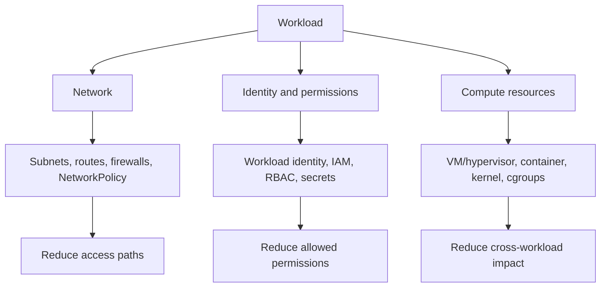
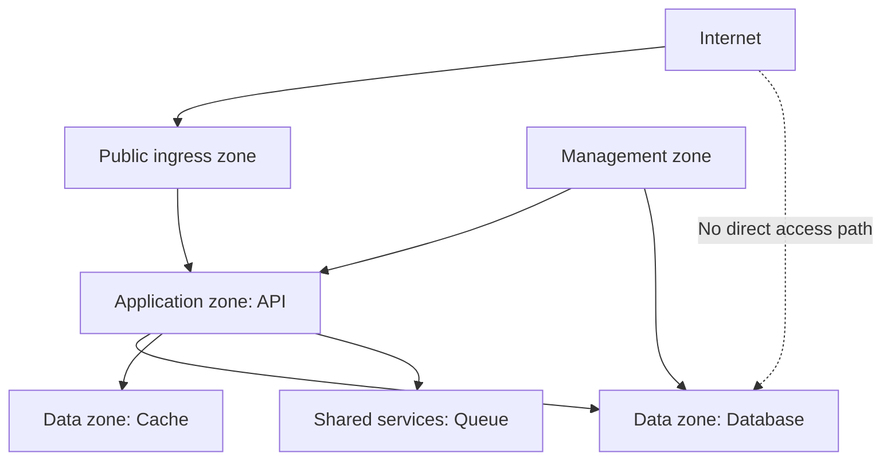
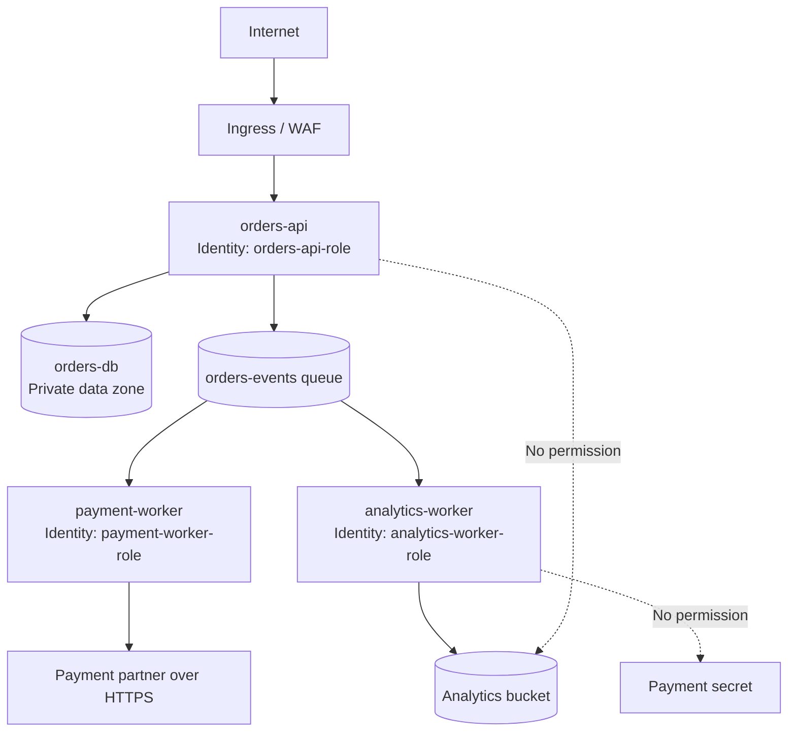
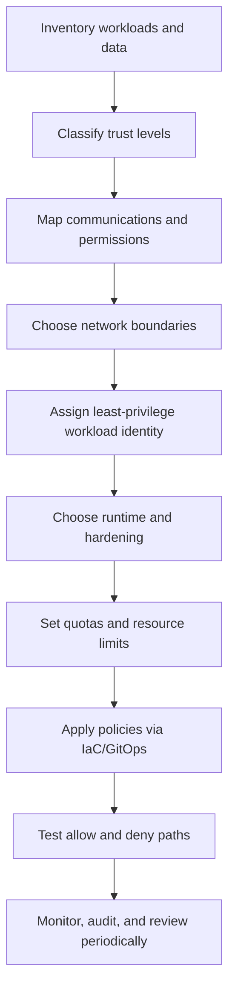

# Isolating workloads with networking, identity, and resource boundaries

In a cloud environment, multiple workloads often run within the same account, virtual network, container cluster, or host group. If workloads can communicate freely, share identities, or consume unbounded shared resources, a single misconfiguration or compromised workload can spread to other components.

**Workload isolation** is the practice of designing boundaries so each application, service, or tenant can access only the resources and communications required for its role. Boundaries must be enforced simultaneously across three layers: **networking**, **identity and permissions**, and **compute resources**. Isolating at one layer does not replace the other two.

After this lesson, you can:

- Explain why workload isolation is needed in multi-application and multi-tenant environments.
- Design network segmentation, ingress/egress controls, and restrictions on service-to-service communication.
- Assign dedicated identities per workload and apply least privilege.
- Distinguish the isolation boundaries of virtual machines, containers, and sandboxed execution environments.
- Constrain CPU, memory, processes, kernel privileges, and data access.
- Test isolation boundaries and respond when out-of-scope access is detected.

## 1. Goals and threat model

A workload can be a virtual machine, container, group of containers, serverless function, or application running on a managed platform. Workloads can fail through misconfiguration, vulnerability exploitation, malicious libraries, or leaked credentials. If a workload's permissions are overly broad, an attacker can use it as a pivot point for lateral movement to other services.

Scenarios to prevent include:

- A compromised public API gaining unauthorized access to an internal database.
- A compromised container reading another container's secrets or filesystem.
- A hijacked workload using its instance identity to read object storage or modify resources outside its scope.
- One tenant exhausting CPU, RAM, PIDs, or bandwidth and degrading other workloads.
- A process running as root or privileged affecting the host kernel.
- A compromised workload opening outbound connections to the Internet or external command-and-control servers.
- A shared network configuration unintentionally allowing every subnet to communicate freely.

The goal of isolation is to shrink the **blast radius**. When one component is breached, its permissions and communication paths must be narrow enough to contain the damage.

### Design principles

1. **Default deny:** deny communications and access by default, then open only what is justified.
2. **Least privilege:** each workload holds only the permissions and resources it needs.
3. **Identity over location:** authenticate workload identity rather than relying solely on IP addresses or network placement.
4. **Defense in depth:** combine multiple independent control layers.
5. **Separate trust zones:** isolate production, staging, development, and data zones with differing sensitivity levels.
6. **Explicit ownership:** every policy, service account, network segment, and resource has an owner.
7. **Continuous verification:** test and monitor boundaries after every change.

## 2. The three core isolation layers



| Layer | Question to answer | Typical controls |
|---|---|---|
| Network | Which workloads may connect to which workloads, over which ports and protocols? | VPC/VNet, subnets, routes, security groups, firewalls, NetworkPolicy, private endpoints, egress controls |
| Identity and permissions | Who is the workload and which actions is it permitted to perform? | IAM roles, service accounts, workload identity, RBAC, secret manager, short-lived tokens |
| Compute resources | To what extent can a workload affect the host or other workloads? | Hypervisors, container namespaces, cgroups, seccomp, SELinux/AppArmor, capabilities, resource quotas, sandboxes |

For example, a database can sit in a private subnet, accept connections only from the API's security group, and grant only the API's workload identity access to that specific database. Simultaneously, the database runs in a resource-bounded, patched environment. Putting the database in a private subnet while giving the API account-wide admin rights still leaves an insufficient boundary.

## 3. Isolation through network segmentation

Network segmentation divides infrastructure into zones with distinct trust levels and purposes. Zones must not communicate freely; traffic between them must traverse enforced policy controls.

### Zoning by role and trust level

An application architecture can be divided into:

- **Public ingress zone:** load balancers, API gateways, or reverse proxies receiving Internet traffic.
- **Application zone:** APIs, web backends, and workers accepting connections only from required upstream components.
- **Data zone:** databases, caches, and storage systems accepting connections only from authorized workloads.
- **Management zone:** bastions, managed session endpoints, management systems, and monitoring agents.
- **Shared services zone:** internal DNS, registries, logging, secrets, and shared infrastructure services.

You do not need a dedicated subnet for every microservice. Group subnets by trust tier, then use security groups, firewalls, or NetworkPolicies for finer control. Balance zone count between isolation strength and operational complexity.



### Ingress and egress

- **Ingress** is traffic entering a workload or network zone.
- **Egress** is traffic initiated by a workload leaving its zone or targeting another destination.

Ingress controls block unauthorized sources from reaching services. Egress controls restrict workloads from calling unneeded endpoints, downloading malware, or exfiltrating data.

For instance, an API may accept TCP/443 from a load balancer, call a database over TCP/5432, and call a payment endpoint over HTTPS. The API does not need SSH access to every VM or arbitrary outbound connectivity to the entire Internet.

### Security groups, network ACLs, and firewalls

Cloud platforms typically provide one or more network filtering mechanisms:

| Mechanism | Typical scope | Characteristics to understand |
|---|---|---|
| Security group / network security group | NIC, instance, or resource group | Usually stateful; return traffic for permitted connections may be allowed automatically depending on platform |
| Network ACL | Subnet or network boundary | Often stateless; requires explicit allow rules for both outbound and return traffic, including ephemeral ports |
| Host firewall | VM operating system | Adds guest-OS-level filtering; must be managed consistently with cloud firewalls |
| Kubernetes NetworkPolicy | Pod or namespace | Requires CNI support; selects Pods and restricts ingress/egress by selector, namespace, IP block, or port |
| Service mesh policy | Service-to-service communication | Can add workload authentication and application-layer policies; does not fully replace network segmentation |

Naming, stateful/stateless semantics, and rule evaluation order vary across providers. Verify exact platform semantics rather than inferring from product names.

### Default-deny and allowlisting

A safe deployment pattern creates default-deny policies for ingress and egress within an appropriate scope, then opens only required flows. Before enabling default-deny in production, map dependencies so you do not break DNS, logging, monitoring, secret managers, time sync, or security updates.

Each allowed flow should document:

- Source and destination (CIDR, security group, namespace, service identity, or endpoint).
- Protocol and port.
- Business purpose.
- Owner and approver.
- Review date or expiration condition.

Never leave an `allow all` rule in place after troubleshooting a connectivity issue. If temporary diagnostics are needed, record the change, limit scope, and set a removal deadline.

## 4. Network isolation for containers and Kubernetes

Containers commonly share the host network stack or a virtual network layer managed by the runtime/orchestrator. Kubernetes provides a Pod network and Service abstraction; Pods can communicate according to CNI configuration and policies.

### Namespaces and NetworkPolicy

Kubernetes namespaces group resources by environment or team. Namespaces do not automatically create network boundaries. To control which Pods can connect to which Pods, use NetworkPolicies backed by a CNI that supports enforcement.

Example default-deny ingress and egress policy within a namespace:

```yaml
apiVersion: networking.k8s.io/v1
kind: NetworkPolicy
metadata:
  name: default-deny-all
  namespace: orders
spec:
  podSelector: {}
  policyTypes:
    - Ingress
    - Egress
```

Next, create explicit allow rules for the API to reach the database and DNS. The example below illustrates structure only; adjust labels, namespaces, ports, and DNS endpoints for your cluster:

```yaml
apiVersion: networking.k8s.io/v1
kind: NetworkPolicy
metadata:
  name: allow-api-to-orders-db
  namespace: orders
spec:
  podSelector:
    matchLabels:
      app: orders-api
  policyTypes:
    - Egress
  egress:
    - to:
        - podSelector:
            matchLabels:
              app: orders-db
      ports:
        - protocol: TCP
          port: 5432
```

This policy demonstrates restricting egress from API Pods to database Pods on TCP/5432 in the same namespace. To ensure the database accepts connections only from the API, pair it with an ingress policy on the database Pods. You also need DNS and required dependency rules; enabling default-deny egress without allowing DNS can prevent applications from resolving service names.

### Verifying effective scope

- Confirm the CNI supports NetworkPolicy and policies are actively enforced.
- Verify Pod selectors and namespace selectors match live workloads.
- Test traffic across namespaces, nodes, and external IPs.
- Check both IPv4 and IPv6 if the cluster is dual-stack.
- Confirm DNS, metrics, logging, image registries, and secret retrieval continue working.
- Test both permitted flows and flows expected to be blocked.

Never treat a Kubernetes namespace as a security boundary equivalent to a cloud account or VM boundary. For workloads with significantly different trust levels, consider separate clusters, separate node pools, or sandboxed/runtime isolation.

## 5. Isolation through workload identity

Networking answers "does a connection path exist?"; identity and permissions answer "once connected, what may the workload do?" Workloads need individual identities rather than sharing one system-wide credential.

### One identity per workload or role

For example:

- `orders-api` can only read the database connection secret and publish to the orders queue.
- `invoice-worker` can only read the invoice queue and write files to the invoice bucket.
- `reporting-job` can only read aggregated data and write reports to a dedicated storage area.

Do not share an instance role with administrative permissions over all storage, databases, and networks across every workload. If one component is compromised, separate identities limit which resources can be accessed.

### Use short-lived credentials

Prefer workload identity, instance roles, service account federation, or temporary token issuance mechanisms. Avoid embedding long-lived access keys in images, static environment variables, or configuration files.

Short-lived credentials reduce exposure duration if stolen, yet still require scoping permissions and audience, controlling refresh, protecting metadata endpoints, and auditing activity. A short-lived token with overly broad permissions remains dangerous while valid.

### Least privilege in IAM and RBAC

- Grant only required actions on specific resources.
- Separate read, write, delete, and policy administration permissions.
- Scope roles per environment and workload; never reuse production roles in staging.
- Scope Kubernetes service accounts and RBAC to specific namespaces and resources.
- Disable mounting service account tokens into Pods that do not need to call the Kubernetes API.
- Revoke roles, bindings, and tokens when workloads are deleted or repurposed.

Conceptual permission specification example:

```yaml
workload_identity:
  name: orders-api
  permissions:
    - action: secrets.read
      resource: secret/orders/database
    - action: queue.send
      resource: queue/orders-created
  denied_by_default: true
  credential:
    type: short_lived_federated_token
```

This is not syntax for a specific cloud provider. Translate it into your actual IAM service and validate policies using platform tools.

## 6. Protecting metadata and secret access paths

VMs or containers can receive credentials via metadata services, workload identity endpoints, or local agents. If an untrusted workload can reach the host or VM metadata endpoint, it may obtain the instance role's credentials.

Common controls include:

- Use provider-recommended SSRF protections for metadata, such as requiring appropriate metadata session tokens.
- Restrict instance role permissions; never assign broad admin roles to machines hosting workloads of differing trust levels.
- For containers, use Pod-level workload identity instead of letting every Pod inherit node credentials.
- Block or restrict Pod access to the node's metadata endpoint when unnecessary.
- Never store secrets in images, source code, logs, or uncontrolled shared volumes.
- Retrieve secrets from a secret manager using workload identity and scope secrets strictly by environment.
- Rotate secrets and audit access; prevent any workload from reading all secrets in a namespace or account.

A compromised container can exploit SSRF to hit the metadata endpoint if paths are unprotected. Combine metadata hardening, egress policies, identity scoping, and application patching.

## 7. Compute resource isolation

Networking and IAM constrain access paths, yet one workload can still affect another through shared CPU, RAM, kernel, filesystem, or devices. Understand the isolation boundaries of your execution environment.

### Virtual machines and hypervisors

A virtual machine runs its own guest OS. The hypervisor partitions CPU, memory, and virtual devices across VMs while providing virtualization-layer isolation. This is generally stronger than standard containers because each VM has its own kernel.

However, VMs still share physical hardware and the host hypervisor layer. Hypervisor vulnerabilities, device passthrough misconfigurations, cloud administrative privileges, or shared credentials can weaken this boundary. For high-isolation workloads, evaluate dedicated hosts, confidential computing, or specialized services based on your threat model and provider capabilities.

### Containers and the shared kernel

Containers isolate processes using kernel features such as:

- **Namespaces:** separate views of process IDs, networking, mounts, users, IPC, and hostnames.
- **cgroups:** limit and meter CPU, memory, I/O, and process counts.
- **Linux capabilities:** divide root powers into granular capabilities so containers need not retain full privileges.
- **seccomp:** restrict which system calls processes are permitted to invoke.
- **SELinux/AppArmor:** enforce mandatory access control policies on processes and resources.
- **Read-only root filesystems:** limit modification of the base filesystem.

Because containers share the host kernel, a kernel vulnerability or privileged configuration can break isolation. Never run untrusted workloads with `privileged: true`, host PID/network namespaces, or host filesystem mounts without compelling justification and compensating controls.

### Sandboxes and isolation-enhanced runtimes

Some environments use microVMs, sandboxed containers, or runtimes with an extra kernel or virtualization layer. They strengthen boundaries between workloads but introduce trade-offs in startup time, compatibility, performance, and operations. Choose based on trust level, latency requirements, syscall profile, and platform support.

### Boundary comparison

| Environment | Primary boundary | Advantages | Considerations |
|---|---|---|---|
| VM | Hypervisor and separate guest OS | Dedicated kernel; suits workloads needing OS control or stronger isolation | Higher resource overhead; still relies on hypervisor and cloud control plane |
| Standard container | Host kernel, namespaces, and cgroups | Lightweight, fast startup, high density | Shared kernel; requires hardening and avoiding privileged workloads |
| Sandboxed container/microVM | Sandbox layer or lightweight VM between workload and host | Stronger isolation for less-trusted workloads | May constrain compatibility or add overhead |
| Serverless function | Platform-managed runtime and sandbox | Reduces customer infrastructure management | Still requires IAM, network policy, secret isolation, and event trigger controls |

No model guarantees safety automatically. Inspect your provider's exact implementation, responsibility boundaries, and security options.

## 8. Constraining CPU, RAM, processes, and storage

Resource isolation prevents a single workload from starving the host or node.

### CPU and memory

- Set CPU requests so the scheduler knows what resources the workload requires.
- Set CPU limits when needed to prevent CPU monopolization; understand throttling behavior.
- Set memory requests based on working set so the scheduler selects appropriate nodes.
- Set memory limits with headroom; exceeding limits can trigger OOM kills.
- Use namespace or project quotas to cap total resources a group can request.

Example container resource configuration:

```yaml
resources:
  requests:
    cpu: "500m"
    memory: "512Mi"
  limits:
    cpu: "1"
    memory: "1Gi"
```

`500m` represents half a logical CPU in Kubernetes notation; this is illustrative, not a universal sizing recommendation. Measure load, p95/p99 latency, and working set to choose appropriate values.

### Process and file descriptor limits

A workload can spawn excessive processes, threads, or file descriptors, exhausting node resources. Enforce PID limits via runtime/cgroup settings, configure appropriate ulimits, and monitor process, thread, socket, and descriptor counts.

Do not set limits so low that legitimate workloads cannot open connections or spawn workers. Measure normal usage and test under peak load.

### Ephemeral storage and I/O

Containers can write to writable layers or ephemeral volumes. Without limits, unbounded logs or temporary files can fill node disks. Set quotas, log rotation, ephemeral storage limits, and cleanup policies. For durable data, use persistent storage with proper access controls and encryption.

## 9. Container and Pod hardening

A secure Pod should run with minimal privileges and only the filesystem access it needs. Illustrative Kubernetes configuration:

```yaml
apiVersion: v1
kind: Pod
metadata:
  name: orders-api
  namespace: orders
spec:
  automountServiceAccountToken: false
  containers:
    - name: app
      image: registry.example/orders-api:1.2.0
      securityContext:
        runAsNonRoot: true
        runAsUser: 10001
        allowPrivilegeEscalation: false
        readOnlyRootFilesystem: true
        capabilities:
          drop:
            - ALL
        seccompProfile:
          type: RuntimeDefault
      resources:
        requests:
          cpu: "250m"
          memory: "256Mi"
        limits:
          cpu: "1"
          memory: "512Mi"
```

This example demonstrates common hardening choices. Applications needing writable directories must mount dedicated volumes with appropriate permissions; images and processes must work under a non-root user. If a Pod must call the Kubernetes API, intentionally enable the service account token and assign minimal RBAC.

Additional practices:

- Use images from trusted registries, scan for vulnerabilities, and prefer minimal images.
- Pin image versions or digests to control deployed contents.
- Avoid `hostPath`, `hostNetwork`, `hostPID`, and privileged containers.
- Never mount Docker or container runtime sockets into application workloads.
- Enforce Pod Security Standards or equivalent admission policies.
- Separate node pools for workloads with differing trust levels or hardware needs.
- Patch kernels, runtimes, orchestrators, and nodes on a defined schedule.

## 10. Isolation by environment and tenant

Organizations typically operate multiple environments and tenants. Boundaries must reflect data sensitivity and trust between groups.

### Separating development, staging, and production

- Use separate cloud accounts/projects/subscriptions when high isolation or separate billing and policy boundaries are required.
- If sharing an account, separate VPCs/VNets, subnets, IAM roles, secrets, cluster namespaces, and storage policies.
- Never reuse production credentials in development.
- Restrict network paths from dev/staging into production; every exception needs clear justification.
- Never copy production data verbatim into lower-trust environments.

### Multi-tenancy

For multi-tenant platforms, protect both data and compute resources:

- Isolate tenant IDs and enforce authorization on every request; never rely solely on a client-supplied tenant identifier.
- Use separate schemas, databases, buckets, or encryption keys when isolation requirements demand it.
- Enforce per-tenant quotas for CPU, RAM, request rates, and storage.
- Prevent tenants from accessing another tenant's service accounts, secrets, network endpoints, or volumes.
- Test cross-tenant access attempts and authorization error handling.

A namespace or label alone is insufficient as a security boundary if RBAC, network policies, and admission policies are misconfigured. For mutually untrusted tenants or highly sensitive data, consider dedicated clusters or accounts.

## 11. Example architecture: isolating an order-processing system

An e-commerce application has the following components:

- `web-ingress`: receives HTTPS from the Internet.
- `orders-api`: processes orders and accesses the database.
- `payment-worker`: calls payment partners and updates status.
- `orders-db`: stores orders.
- `analytics-worker`: reads events and writes analytics data.

Isolation design:

1. Public ingress forwards HTTPS only to the API; the database has no public endpoint.
2. The API can connect only to the required database and queue; the payment worker can call only partner endpoints and the queue.
3. Each workload has its own service account/role; the API cannot read the analytics bucket, and the analytics worker cannot read payment secrets.
4. Containers run non-root, drop capabilities, use read-only root filesystems, and enforce resource quotas.
5. The production namespace enforces a default-deny NetworkPolicy; allow rules open only verified flows.
6. Secrets are retrieved at runtime from a secret manager via workload identity.
7. Audit logs, flow logs, and metrics are collected centrally; alerts fire if a workload attempts to call endpoints outside the allowlist.



If `orders-api` is compromised, an attacker may attempt to reach other endpoints. NetworkPolicy constrains connectivity; workload identity constrains actions and data; resource and kernel controls limit host impact. All three layers work together to shrink the blast radius.

## 12. Process for designing and deploying isolation



### Step 1: inventory workloads and data

Document workloads, owners, environments, tenants, data types, sensitivity levels, endpoints, ports, dependencies, and active identities. Identify whether any workload runs untrusted code or processes untrusted user input.

### Step 2: map communications

Diagram ingress/egress and service-to-service flows. Record sources, destinations, protocols, ports, frequency, purpose, and owners. Use flow logs, service maps, or traces to confirm live flows rather than relying solely on stale documentation.

### Step 3: define trust boundaries

Group workloads by environment, tenant, data sensitivity, and trust level. Decide where separate accounts/clusters/VPCs are warranted versus granular policies inside a shared cluster.

### Step 4: apply network policies

Start with deny-by-default in a test environment. Add rules for verified dependencies. Test DNS, telemetry, secret retrieval, backups, updates, and business flows before rolling out to production.

### Step 5: assign identities and permissions

Create distinct identities per workload with short-lived tokens and least privilege. Separate read/write/delete permissions, scope resource ARNs/URIs or equivalents, apply environment conditions, and revoke obsolete credentials.

### Step 6: harden the runtime and cap resources

Choose VM/container/sandbox models matching trust levels. Strip unnecessary privileges, run non-root, enable seccomp/AppArmor/SELinux, cap CPU/RAM/PID/storage, and avoid host resource mounts.

### Step 7: test and roll out safely

Verify authorized flows succeed and unauthorized flows are blocked. Roll out by namespace, node pool, or partial traffic first; watch connection errors, latency, restarts, throttling, and OOMs. Keep a rollback plan ready if a policy blocks a legitimate dependency.

### Step 8: maintain boundaries

When adding services, changing ports, modifying subnets, or altering roles, update policies alongside deployment code. Periodically prune unused rules, excess permissions, stale secrets, and shared resources.

## 13. Testing and monitoring isolation effectiveness

Policies created without testing can create a false sense of security. Verify both directions: permitted connections succeed and prohibited connections genuinely fail.

### Network tests

- API connects to the database on the expected port.
- Workloads cannot connect to the database from disallowed subnets or namespaces.
- Pods cannot call the metadata endpoint if unneeded.
- Egress reaches only permitted endpoints; DNS and platform services continue operating.
- IPv4 and IPv6 exhibit equivalent policy enforcement.

### Identity tests

- Workload A cannot read Workload B's secrets.
- Expired or revoked tokens are rejected.
- Roles cannot delete or modify out-of-scope resources.
- Service account tokens are not mounted into Pods that do not call the API.
- Cross-tenant access attempts are denied at both application and data layers.

### Resource tests

- Workloads cannot read host filesystems or container runtime sockets unless authorized.
- Containers lack privileged mode and unnecessary capabilities.
- CPU/RAM/PID/storage quotas behave properly under load spikes.
- One workload hitting OOM or CPU throttling does not destabilize the node or sibling workloads beyond design limits.
- Runtime isolation matches the workload's trust level.

### Metrics and logs to monitor

- Denied network flows, anomalous egress, and connections to unexpected ports.
- IAM access-denied events, token issuance, secret reads, and role/policy changes.
- Container restarts, OOM kills, CPU throttling, PID exhaustion, and disk pressure.
- Creation of privileged Pods, `hostPath` mounts, `hostNetwork`, or NetworkPolicy modifications.
- Changes to security groups, routes, firewalls, and subnets.
- Cross-tenant access attempts or privilege escalation attempts at the application layer.

Logs must carry synchronized timestamps, workload identities, resource IDs, and action outcomes. Never log tokens, private keys, passwords, or sensitive payloads.

## 14. Common incidents and troubleshooting

| Symptom | Possible cause | What to check |
|---|---|---|
| API cannot reach database after enabling default-deny | Missing egress/ingress rule or DNS rule | NetworkPolicy, security groups, routes, DNS egress, and ports |
| Pod can still call metadata endpoint | Unrestricted egress or node credentials exposed via metadata | Network paths, CNI policies, metadata protection, and workload identity |
| Service account reads out-of-scope secrets | Overly broad IAM/RBAC or shared identity | Role bindings, trust policies, secret scopes, and token audiences |
| Container reads host files | `hostPath` or privileged mount | Pod spec, mount namespaces, admission policies, and runtime config |
| One tenant overloads the node | Missing quotas or resource limits | cgroups, namespace quotas, requests/limits, and autoscaling |
| Policy does not block traffic as expected | CNI lacks enforcement or selector mismatch | CNI mode, policy status, labels, namespaces, and flow logs |
| IPv4 blocked while IPv6 still reachable | Only IPv4 rules configured | IPv6 routes, firewalls, NetworkPolicy, and listeners |
| Adding policy causes widespread outage | Simultaneous rollout without dependency inventory | Policy diffs, DNS/monitoring/secret paths, and rollback |

When incidents occur, pinpoint the specific control layer blocking or over-permitting traffic. Never resolve issues by opening global permissions or deleting all policies. Small, scoped, time-bound adjustments restore service while preserving essential boundaries.

## 15. Common mistakes

**Assuming a private subnet is enough.** Workloads in a private subnet can still reach other internal services or exit to the Internet via NAT. Enforce east-west and egress controls.

**Sharing one IAM role across all VMs or Pods.** Compromising one workload exposes permissions belonging to every other workload. Assign dedicated identities scoped by resource and action.

**Treating namespaces as complete security boundaries.** Namespaces help organize resources, but still require NetworkPolicies, RBAC, admission controls, quotas, and runtime hardening.

**Running privileged containers as a quick fix.** Privileged mode weakens host isolation. Identify the minimal capability or mount actually needed and document any exceptions.

**Restricting ingress while ignoring egress.** Compromised workloads can still call outbound servers or probe internal services. Build egress allowlists based on dependencies.

**Relying solely on IPs to authenticate workloads.** IPs change and get reused. Use workload identity and application-layer authentication.

**Neglecting IPv6.** An IPv6 path can bypass policies applied only to IPv4. Test both protocols.

**Setting resource limits without measurement.** Limits set too low trigger throttling/OOMs; missing limits invite noisy neighbors. Base settings on metrics and load testing.

## 16. Workload isolation checklist

### Network

- [ ] Workloads are placed into network zones by role and trust level.
- [ ] Ingress and egress enforce default-deny policies within appropriate scopes.
- [ ] Only required sources, destinations, protocols, and ports are opened.
- [ ] Databases, caches, and control endpoints are private unless explicitly required.
- [ ] DNS, logging, monitoring, secret retrieval, and update paths remain functional.
- [ ] NetworkPolicies are enforced by the CNI; both IPv4 and IPv6 are tested.
- [ ] Flow logs or telemetry are active to detect anomalous connections.

### Identity and permissions

- [ ] Every workload has a dedicated identity and clear owner.
- [ ] IAM/RBAC follows least privilege, scoping actions and resources.
- [ ] Credentials are short-lived; no secrets are baked into images or source code.
- [ ] Metadata endpoints are protected; Pods receive only necessary identities.
- [ ] Secrets are separated by workload and environment.
- [ ] Rotation, revocation, and auditing processes exist.

### Compute resources

- [ ] Runtime isolation matches workload trust level.
- [ ] Containers run non-root, drop capabilities, and avoid privileged mode unless required.
- [ ] No `hostPath` or runtime socket mounts outside approved needs.
- [ ] Seccomp and SELinux/AppArmor or equivalents are appropriately enabled.
- [ ] CPU, RAM, PIDs, and ephemeral storage have sensible requests, limits, and quotas.
- [ ] Nodes, kernels, runtimes, and orchestrators are kept patched.

### Operations

- [ ] Both permitted and prohibited flows are tested.
- [ ] Rollout, rollback, and exception handling procedures exist.
- [ ] Audit logs record identity, resource, action, and timestamp.
- [ ] Policies and permissions are reviewed periodically, pruning obsolete rules/roles.
- [ ] Procedures exist to respond to compromised workloads and revoke credentials.

## 17. Self-check

1. Why is a private subnet insufficient to isolate one workload from others?
2. Distinguish the roles of security groups, network ACLs, host firewalls, and Kubernetes NetworkPolicies.
3. Why should each workload have its own identity instead of sharing one instance role?
4. A Pod does not need to call the Kubernetes API. How should its service account token configuration be handled?
5. Do Kubernetes namespaces automatically block Pods in different namespaces from connecting to each other? Which mechanism enforces this?
6. How do privileged containers or `hostPath` mounts weaken isolation boundaries?
7. Why must CPU, RAM, PIDs, and ephemeral storage all be bounded?
8. Propose three control layers to isolate an API from its database and a payment worker.
9. How do you prove a policy works properly after deployment?

Workload isolation is effective when networking permits only required flows, identity grants only task-specific permissions, and the runtime limits impact on the host and neighboring workloads. Combining these three layers with testing, auditing, and continuous review reduces lateral movement paths and shrinks incident blast radius in cloud compute environments.
