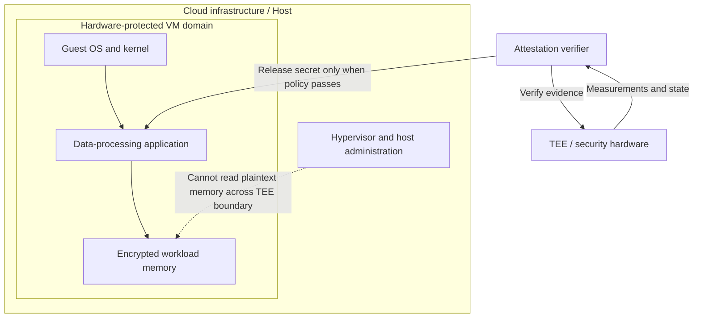
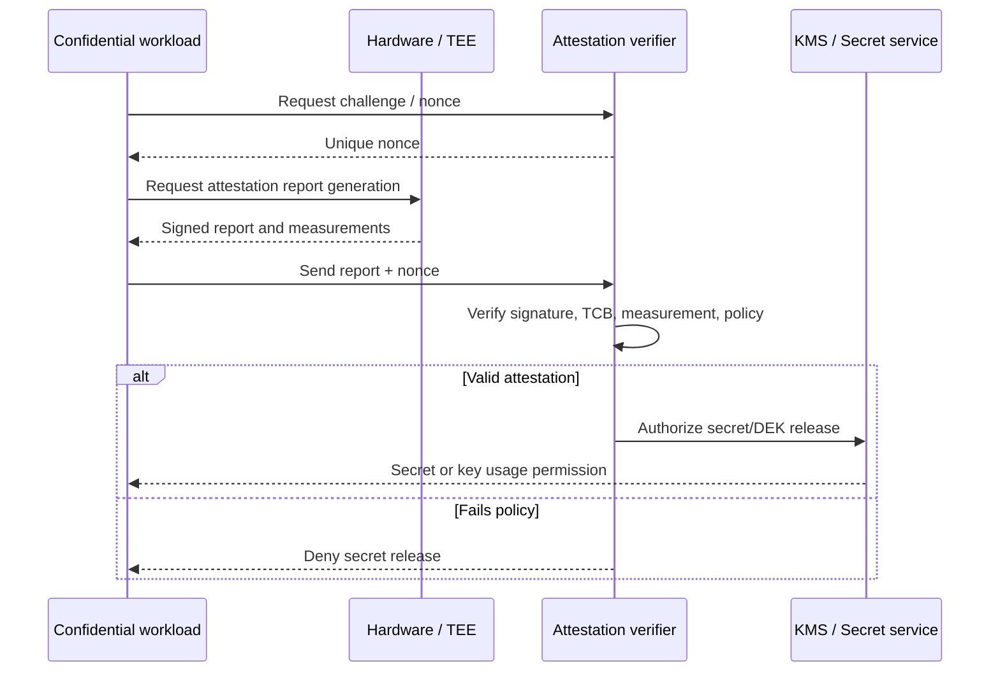
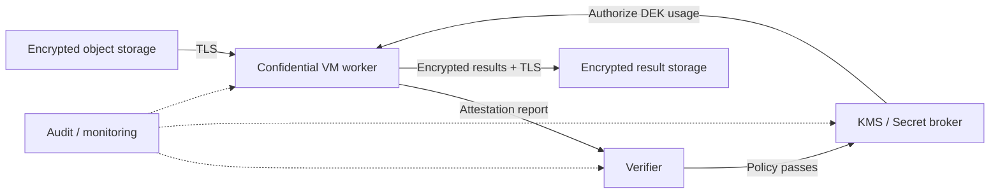

# In-memory data encryption and confidential computing models

## Learning objectives

After this lesson, you can:

- Explain why encryption at rest and encryption in transit are not enough to protect data while a workload is actively processing it.
- Distinguish memory encryption, Trusted Execution Environments (TEEs), confidential VMs, and enclaves.
- Describe how technologies such as AMD SEV-SNP, Intel TDX, and Arm CCA protect workload memory.
- Explain the role of attestation, measurements, the TCB, and releasing secrets only after verifying the runtime environment.
- Evaluate limitations, performance impacts, and compatibility requirements when deploying confidential computing in the cloud.
- Build testing, operational, and incident response procedures for workloads handling sensitive data.

## 1. Why protect data in use?

Cloud applications commonly protect data in two familiar states:

- **Data at rest:** data is encrypted while stored on disks, snapshots, object storage, or backups.
- **Data in transit:** data is protected while traversing networks using TLS or another secure transport channel.

However, to process data, the CPU and OS must bring it into memory. At that point, data is typically decrypted in RAM so the application can read, compute on, and update it. Privileged administrators on the host, hypervisor, or OS may be able to observe parts of memory state, depending on the architecture and protection mechanisms.

For instance, a customer profile analytics service may use TLS when receiving data and disk encryption when saving results. Yet during computation, sensitive data is still loaded into RAM. If the execution environment is compromised or the infrastructure layer has memory access, data in use can be exposed.

**Confidential computing** focuses on protecting data while it is being processed by running workloads inside a hardware-isolated and hardware-protected environment. The goal is typically to reduce unauthorized access to memory and execution state from components outside a defined trust boundary.

Understand the scope clearly: confidential computing adds a protection layer for data in use. It does not automatically replace disk encryption, TLS, IAM, application security, key management, or runtime monitoring.

### Three states of data and protection layers

| State | Examples | Common protection layers |
|---|---|---|
| Data at rest | Boot disks, data volumes, snapshots, backups | Disk encryption, KMS, access controls |
| Data in transit | API requests, database connections, replication | TLS, mTLS, VPN, or protected channels |
| Data in use | Data in RAM during queries, AI inference, or transaction processing | Memory encryption, TEE, confidential VM, enclave |

An architecture protecting sensitive data usually combines all three layers. For example, a VM uses CMK-encrypted disks, connects to services over TLS, and runs inside an attested confidential VM.

## 2. What is memory encryption?

Memory encryption encrypts data while it resides in DRAM. The memory controller or CPU security hardware encrypts on write and decrypts on read according to the platform's mechanism.

Conceptually:

1. The CPU or execution unit produces plaintext data within a protected processing boundary.
2. When data is written to DRAM, the controller encrypts it using a memory key.
3. When data is read back into the protected processing boundary, hardware decrypts it so the CPU can continue executing.
4. Components outside the trust boundary observe only encrypted memory contents or data controlled by hardware design.

Memory keys are typically generated and managed by platform hardware. In many confidential VM models, keys are provisioned per VM or protection domain and are never exposed in plaintext to the hypervisor. Details on key count, lifecycle, migration handling, and protection scope depend on CPU technology and the cloud provider.

### 2.1. Memory encryption is not disk encryption

| Criterion | Disk encryption | Memory encryption |
|---|---|---|
| Protected data | Data blocks on storage devices | Memory contents during execution |
| When encrypted/decrypted | When reading/writing stored data | When data moves between CPU and DRAM via hardware mechanisms |
| Keys | May use KMS, CMK, DEK, or guest OS keys | Typically generated and managed by CPU/security hardware |
| Goal | Protect stored data and copies | Reduce memory snooping from outside the trust domain |
| Does not protect | Unlocked data in RAM | Disks, backups, network traffic, or applications against all attack classes |

If you enable only disk encryption, data can still appear in plaintext in RAM once the volume is unlocked. If you enable only memory encryption, snapshots and backups still require dedicated storage encryption.

### 2.2. Memory encryption does not protect the entire machine

The term memory encryption may refer to a system-level memory protection feature or one part of a TEE. The exact protection scope must be identified:

- Is the entire VM's memory protected, or only an enclave region?
- Is integrity protected, or only content confidentiality?
- Which registers, device states, or metadata can the hypervisor observe?
- Is GPU or accelerator memory inside the protection scope?
- Are snapshots, crash dumps, live migration, and debugging supported?
- Which memory regions can DMA devices access?

DRAM encryption is an important building block, but does not automatically make the entire system trustworthy. Read documentation for your exact technology and VM type to understand its boundaries.

## 3. Trusted Execution Environments and confidential computing

A **Trusted Execution Environment (TEE)** is a hardware-backed execution environment that isolates code and data from certain components outside the trust zone. A TEE typically provides a protection boundary, a mechanism to measure initial state, and a way to prove the environment is running an approved configuration.

**Confidential computing** is the practice of building and operating workloads on data-in-use protection mechanisms, commonly using TEEs and attestation. In the cloud, a common form is a confidential VM (CVM): the entire VM or a VM memory domain is protected by CPU features.

Common characteristics include:

- Workload memory is encrypted with hardware keys.
- The hypervisor or host administrator is restricted from reading protected memory contents.
- Integrity protections detect or block certain unauthorized state modifications, depending on technology.
- Measurements or attestation reports can be generated to prove platform configuration and boot state.
- Keys or secrets can be released only after attestation satisfies policy.

### 3.1. Trust boundaries

In a standard VM, customers typically trust the hypervisor and part of the provider's management infrastructure. With a confidential VM, the goal is to reduce reliance on trusting the host/hypervisor for memory confidentiality and certain integrity properties.

Conceptual diagram:



This diagram shows the conceptual protection goal. The host can still control certain resources outside the TEE, such as CPU scheduling, virtual devices, network traffic, or availability. I/O channels must be protected separately.

### 3.2. Confidential VMs and enclaves

Two common models:

- **Confidential VM:** protects a VM or relatively large execution domain. The guest OS and applications run inside the protected VM. This suits migrating existing workloads into confidential environments with fewer architectural changes, provided the OS and machine type are compatible.
- **Enclave:** protects a smaller execution region inside an application or supported OS. Only code and data inside the enclave sit within the protection boundary; the rest of the system may not receive equivalent protection.

| Criterion | Confidential VM | Enclave |
|---|---|---|
| Scope | Protected VM or guest domain | Isolated code and data region |
| Operating system | Guest OS runs inside the VM | Often requires a specialized runtime, SDK, or programming model |
| Application changes | Often fewer if the application is compatible | Typically requires splitting the app into enclave and untrusted parts |
| Attestation | Often measures firmware/boot, guest, or VM state per technology | Often measures enclave code and enclave configuration |
| Use cases | Existing services, databases, multi-process workloads | Narrow-scope processing of small secrets, keys, algorithms, or sensitive data |

Not every TEE supports both models. Intel SGX is typically associated with enclaves; Intel TDX targets confidential VMs. AMD SEV-SNP protects VMs using AMD's own mechanisms. Choose based on workload, OS, and cloud-provider-supported instance types.

## 4. Representative hardware technologies

The technologies below illustrate how CPUs and platforms implement confidential computing. Naming, protection guarantees, and cloud availability vary across hardware generations.

### 4.1. AMD SEV, SEV-ES, and SEV-SNP

AMD Secure Encrypted Virtualization (SEV) is designed to encrypt VM memory and isolate memory keys between VMs. Subsequent extensions add execution-state and integrity protections:

- **SEV:** encrypts VM memory with a per-VM key, reducing the hypervisor's ability to read RAM directly.
- **SEV-ES (Encrypted State):** adds protection for guest register state during certain transitions between guest and hypervisor.
- **SEV-SNP (Secure Nested Paging):** adds integrity protection and memory page mapping controls, helping detect or prevent certain unauthorized memory modifications from a malicious hypervisor.

SEV-SNP supports attestation reports so verifiers can evaluate platform state and measurements. Key usage and report verification must follow AMD and corresponding cloud service protocols.

Do not assume every VM running on an AMD CPU is a confidential VM. Select the right instance family, enable the platform-supported confidential mode, and use a compatible image.

### 4.2. Intel TDX and SGX

Intel offers two frequently referenced technologies:

- **Intel TDX (Trust Domain Extensions):** targets protecting a VM, called a trust domain (TD), from platform management software outside the trust domain. TDX protects trust domain memory and execution state and can provide a TD report for attestation.
- **Intel SGX (Software Guard Extensions):** provides enclaves inside an application's address space. An enclave protects defined code and data regions even when the rest of the OS is untrusted under the threat model.

TDX suits the confidential VM model. SGX suits applications that can isolate sensitive logic inside an enclave and manage communication with untrusted code.

SGX constraints on enclave memory, APIs, and programming models can significantly impact application porting. TDX protects a broader VM scope but still requires protecting the guest kernel and applications against vulnerabilities inside the guest.

### 4.3. Arm Confidential Compute Architecture

Arm Confidential Compute Architecture (CCA) provides a protected execution environment called a Realm. Realms are designed to isolate code and data from certain privileged system components, backed by supporting hardware and firmware.

CCA extends confidential computing to the Arm architecture. Actual support depends on CPU, firmware, hypervisor, OS, and cloud service availability. Not every Arm VM provides Realms or confidential computing simply by using the Arm architecture.

### High-level comparison

| Technology | Primary protection scope | Key concept | What to verify |
|---|---|---|---|
| AMD SEV | VM memory | Per-VM key | Generation: SEV, SEV-ES, or SEV-SNP; attestation support |
| AMD SEV-SNP | VM and memory page mappings | Integrity protection and attestation report | Firmware/TCB, guest image, and instance family |
| Intel TDX | Trust domain/VM | Hardware-isolated VM domain | TDX module, firmware, guest kernel, and attestation |
| Intel SGX | Application enclave | Fine-grained code and data isolation | SDK, enclave size limits, application compatibility |
| Arm CCA | Realm | Confidential execution domain on Arm | CPU/firmware/hypervisor and service support |

This table provides conceptual orientation, not a security ranking. Each technology has distinct threat models, versions, hardware requirements, and limitations.

## 5. Attestation: proving a workload runs in a trusted environment

Memory encryption protects memory contents, but an application also needs to know whether it is genuinely running inside the right type and configuration of TEE. **Attestation** is the process of generating and verifying evidence about the state of a platform or workload.

An attestation report or quote may contain:

- Measurements of firmware, bootloader, kernel, hypervisor, or enclave depending on technology.
- Platform identification and version details.
- Security attributes such as debug mode, TEE state, or protection level.
- TCB (Trusted Computing Base) information and security component versions.
- A nonce or requester-supplied data to prevent replaying stale reports.
- Cryptographic signatures or evidence enabling a verifier to authenticate the report's origin.

Exact fields differ by technology. A report does not necessarily contain every item above; verifiers must understand the platform's schema and protocol version.

### 5.1. Measurements and TCB

A **measurement** is a measured value, typically based on a hash of one or more components. Measurements allow comparing the running state against an approved configuration.

The **TCB (Trusted Computing Base)** is the set of components that must be trusted for protection mechanisms to operate correctly. Depending on the technology, the TCB may include the CPU security processor, microcode, firmware, TDX module or equivalent, and certificate chain. The hypervisor typically sits outside a confidential VM's trust boundary; certain components interacting with the hypervisor may still require evaluation under the platform threat model.

A matching measurement alone does not prove the entire workload is free of vulnerabilities. It only provides evidence for the measured components and state. Verifiers must check versions, revocation status, security advisories, and acceptance policies.

### 5.2. Remote attestation flow

Reference flow:

1. The workload starts inside a confidential VM or enclave.
2. The workload initiates an attestation request, typically including a verifier-issued nonce.
3. Hardware or the security component generates a signed report/quote.
4. The workload sends the report to the verifier or attestation service.
5. The verifier validates the signature, certificate chain, nonce, measurements, and TCB status.
6. The verifier compares results against approved policy.
7. Only when policy passes does the system release secrets, keys, or access to sensitive data.
8. The workload uses secrets inside the protected domain and re-attests periodically if required by architecture.

Diagram:



Nonces prevent replaying old reports. Verifiers must also check timestamps, certificates, revocation lists, and TCB versions per policy. Never compare a single hash while ignoring platform security status.

### 5.3. Attestation is not application testing

Attestation can prove certain hardware properties and boot state, but does not automatically verify that:

- The application lacks logic flaws.
- Runtime libraries contain no malicious code if unmeasured or unverified.
- Users are authorized to access all data the application can read.
- Input data is trustworthy.
- Workloads are immune to attacks via APIs, dependencies, or post-boot misconfigurations.

Combine attestation with secure boot, image management, artifact signing, supply-chain controls, IAM, patching, and application monitoring.

## 6. Releasing secrets after attestation

One of the primary uses of attestation is **gated secret release**: releasing secrets to a workload only if the execution environment satisfies policy.

For example, a confidential VM processing financial records needs a data decryption key. The KMS or secret broker can require attestation evidence before allowing the VM to use the key.

Policies can evaluate:

- Accepted TEE technology and VM type.
- Measurements of firmware, bootloader, and guest image.
- Approved kernel or image versions.
- TCB security version meeting a minimum threshold.
- Debug mode disabled when required by policy.
- Nonce matching the active challenge.
- Valid region, project, workload identity, or deployment attributes.

### Illustrative policy example

```json
{
  "workload": "financial-data-processor",
  "tee": {
    "technology": "confidential-vm",
    "debug": false
  },
  "measurements": {
    "firmware": ["approved-firmware-measurement"],
    "guestImage": ["approved-image-measurement"]
  },
  "minimumTcbVersion": 5,
  "secretRelease": {
    "key": "finance-data-key",
    "allowOnlyAfterAttestation": true
  }
}
```

This is an illustrative structure, not a schema ready to paste directly into a provider's KMS. Production policies must use the claims, fields, and attestation mechanisms supported by the service.

### Secure key retrieval flow

1. The workload authenticates its service identity.
2. The workload sends attestation evidence to the verifier.
3. The verifier validates the report and binds it to the workload identity or active session.
4. The KMS/secret broker evaluates policy.
5. The KMS authorizes the operation or returns protected secrets to the rightful workload.
6. The workload uses the key within the protected memory domain.

Never send plaintext keys to a host agent or write them to temporary disks. If the application must retrieve keys from KMS, ensure the transport channel is authenticated and secrets enter only the protected processing domain.

## 7. Deploying confidential VMs in the cloud

Not every VM type supports confidential computing. Deployment eligibility depends on region, instance family, CPU generation, OS, image, firmware, and service capabilities.

### 7.1. Prerequisites to verify

- **Instance family:** does the VM type support confidential mode and which TEE technology?
- **Region/zone:** is the capability available in your deployment location?
- **CPU architecture:** are the workload and image compatible with the CPU architecture?
- **Guest OS:** do the kernel version, drivers, initramfs, and bootloader support it?
- **Secure Boot:** must it be enabled to protect the boot chain and measurements?
- **Attestation:** does the provider offer an appropriate verification service, API, or library?
- **Disk/network:** do virtual devices and I/O have special limits in confidential mode?
- **GPU/accelerators:** are they supported in the same confidential configuration?
- **Snapshots/migration:** can the VM be snapshotted, backed up, suspended, or live-migrated?
- **Operational limits:** are serial console, debugging, memory dumps, nested virtualization, or hibernation restricted?

These constraints evolve across providers and instance generations. Check current documentation for the exact VM type before finalizing architecture.

### 7.2. Reference deployment workflow

1. **Define data and threat model.** Specify what data requires protection, who sits outside the trust boundary, and which host/hypervisor capabilities must be mitigated.
2. **Select technology.** Choose confidential VM vs. enclave based on workload scope and ability to modify the application.
3. **Select instance and image.** Verify TEE support, region, CPU, kernel, drivers, firmware, and I/O limits.
4. **Standardize the boot chain.** Use signed images, security updates, Secure Boot, and policy-backed measurements where supported.
5. **Configure attestation.** Set up the verifier, measurement/TCB policies, nonce validation, and revocation checks.
6. **Integrate KMS/secret release.** Release secrets only when both identity and attestation pass.
7. **Benchmark the workload.** Measure latency, throughput, CPU, memory, I/O, startup time, and compatibility issues.
8. **Test recovery.** Exercise reboots, provisioning replacement VMs, backup restores, image updates, and attestation failure handling.
9. **Roll out in phases.** Start with lower-impact workloads, monitor telemetry, and expand once SLAs are confirmed.
10. **Maintain TCB and images.** Track security advisories, firmware versions, kernels, and attestation libraries.

### 7.3. Distinguishing platform capabilities

Some cloud services offer confidential VMs as a machine-type option; others offer confidential computing through enclaves or specialized services. Product names change, so inspect technical properties rather than relying on marketing labels alone.

When evaluating a provider, clarify:

- Whether the protection boundary covers a VM, an enclave, or a specific device.
- What generates attestation evidence and who verifies it.
- Who manages memory keys and attestation signing keys.
- How deeply customers can inspect measurements and TCB status.
- Whether data is ever decrypted on any host or I/O device outside the protection boundary.
- How firmware updates, migrations, snapshots, and hardware failures are handled.

## 8. Performance impact and technical limitations

Memory encryption and TEEs can introduce overhead in compute, page management, and state transitions. Impact depends on CPU, memory footprint, workload pattern, enclave transition frequency, and I/O implementation.

Factors to measure:

- **CPU overhead:** additional CPU cycles for memory encryption/decryption or protection metadata handling.
- **Memory bandwidth:** RAM read/write throughput when workloads scan large datasets.
- **Latency:** p50, p95, and p99 latency, especially for memory-intensive workloads.
- **Page management:** cost of allocating, mapping, and protecting memory pages.
- **I/O overhead:** overhead across networking, storage, interrupts, and virtual devices.
- **Startup/attestation time:** VM boot and report verification duration before the application is ready.
- **Memory footprint:** memory reserved for runtime, metadata, or protected regions.

Do not apply a single generic overhead percentage across all TEEs. Benchmark using datasets and concurrency levels representative of production.

### Common limitations

- Some instance types do not support GPUs or specialized devices in confidential mode.
- Live migration, suspend/resume, or memory snapshots may be unsupported or restricted.
- Guest OS and kernel require compatible versions.
- Debugging, crash dumps, and console access may be restricted to preserve protection boundaries.
- Some drivers or kernel modules may not work in protected configurations.
- Enclaves have memory constraints and require dedicated application design.
- I/O still traverses host-managed devices or paths, requiring separate integrity checks and transport encryption.

## 9. Threat model and what TEEs do not protect

Confidential computing is not a silver bullet against all attacks. Write an explicit threat model clarifying which components remain trusted.

### Risks that can be mitigated

- Host or hypervisor attempts to directly read protected memory contents.
- Certain memory-mapping or VM-state tampering by components outside the TEE, depending on technology.
- Unauthorized access to enclave regions or confidential execution domains.
- Releasing secrets to workloads running unapproved images or TCBs, if attestation policies are properly designed.

### Risks still requiring separate controls

- **Vulnerabilities in guest OS or applications:** TEEs do not fix logic bugs, memory corruption, or compromised dependencies inside the protected domain.
- **Side channels:** execution timing, cache access, memory access patterns, or shared resources can leak information. Mitigation depends on CPU, microcode, and coding practices.
- **Denial of service:** the host can withhold CPU, networking, or storage; TEEs do not guarantee availability.
- **I/O attacks:** data traversing virtual devices, networks, storage, or accelerators requires separate encryption, authentication, and integrity validation.
- **Supply chain:** images, kernels, libraries, or artifacts can contain malware prior to measurement or approval.
- **Credential misuse:** a validly attested workload with an exploited application can still misuse any secrets released to it.
- **Physical attacks:** resistance to physical tampering depends on hardware protections and the provider's threat model.
- **Rollback or stale state:** policies must enforce version and TCB checks to prevent running outdated configurations.
- **Misconfigured attestation policies:** overly permissive measurement allowlists can allow unintended images to receive secrets.

### Defense in depth

| Layer | Controls to include |
|---|---|
| Firmware and boot | Secure Boot, signed images, TCB updates |
| TEE | Memory encryption, integrity protection, attestation |
| Identity | Workload identity, least privilege, short-lived tokens |
| Secrets and keys | KMS, gated secret release, rotation, and auditing |
| Network | TLS/mTLS, segmentation, endpoint controls |
| Storage | Disk encryption, snapshot/backup encryption |
| Application | Secure coding, patching, dependency scanning, logging |
| Operations | Monitoring, incident response, restore drills |

## 10. Real-world example: processing financial data in a confidential VM

A financial analytics provider processes transaction records from multiple clients. Security policy requires restricting infrastructure or host administrators from reading plaintext data during computation.

Reference architecture:

- Input data is encrypted in object storage.
- Workers run inside confidential VMs on a supported instance family.
- Boot images are signed and patched; their measurements are added to an approved list.
- The VM generates an attestation report containing a fresh nonce.
- The verifier validates the signature, TEE technology, measurements, and TCB.
- Only when the report passes does the secret broker authorize the workload to use the data decryption key.
- Workers read data over TLS, decrypt it, and process it inside the protected memory domain.
- Results are encrypted before being written back to storage.
- Audit logs record principal, verified measurement, key usage, and request ID without recording sensitive data or tokens.

Diagram:



If the image measurement is not in policy, the verifier denies key release. The worker can boot, yet cannot read sensitive data. Operations must verify whether the image is approved rather than disabling attestation just to make the application run.

Before production launch, verify:

- The VM boots with the approved image and produces a valid report.
- Tampered images or outdated TCB versions are rejected.
- Stale nonces are rejected.
- KMS rejects unauthorized principals.
- When the verifier or KMS is temporarily unavailable, the workload fails closed per policy.
- Backup and restore still work using approved keys and images.
- Latency and throughput meet SLOs with production-like data.

## 11. Troubleshooting common issues

| Symptom | Possible cause | What to check |
|---|---|---|
| Cannot launch confidential VM | Instance family/zone unsupported or insufficient dedicated quota | Check support matrix, region, quota, and VM configuration |
| Guest OS fails to boot | Incompatible image/kernel/driver or broken boot chain | Inspect boot diagnostics, kernel version, firmware, and image |
| Attestation report rejected | Signature, nonce, measurement, or TCB fails policy | Inspect report, verifier logs, certificates, and measurement list |
| Verifier reports stale TCB | Firmware, microcode, or security component requires update | Check security advisories and platform-supported versions |
| Workload fails to receive secrets | Attestation failure, wrong identity, or KMS policy denial | Check principal, audience, key policy, grants, and audit logs |
| Severe performance drop | TEE overhead, memory bandwidth, or I/O bottlenecks | Benchmark CPU/RAM/network/storage profiles |
| Cannot snapshot or migrate | Features restricted in confidential mode | Check service limits and alternative backup/restore options |
| App fails with specialized driver | Driver or device incompatible with TEE | Confirm support across image, kernel, and instance family |
| Report valid yet app compromised | Guest vulnerability or measurement policy misses artifacts | Check secure boot, image provenance, dependencies, and runtime security |

### Diagnostic workflow

1. Isolate whether the failure sits in VM provisioning, firmware/boot, TEE, attestation, IAM/KMS, or the application.
2. Record request ID, VM ID, image version, instance type, timestamp, and error code.
3. Verify the VM is running in the requested confidential mode.
4. Check guest kernel, drivers, firmware, and TCB versions.
5. Collect reports securely; never put tokens or secrets into logs.
6. Inspect nonce, signature, certificate chain, measurements, and verifier policy.
7. Compare principals and KMS permissions if secret release is denied.
8. Check recent changes to images, policies, firmware, or instance families.
9. Reproduce on a test VM using a known-good image.
10. Modify policies only after identifying root cause and evaluating security impact.

Never relax measurement policies or bypass attestation merely to clear a deployment error. If diagnostic modes are needed, use test data and never release production secrets.

## 12. Design and operations checklist

Before deploying confidential computing, confirm:

- [ ] Sensitive data and trust boundaries are documented.
- [ ] Threat model identifies what sits outside the TEE and which threats it mitigates.
- [ ] Instance family, region, CPU, and guest OS support the selected technology.
- [ ] Images, firmware, kernels, and drivers are tested.
- [ ] Secure Boot and artifact signing are configured as needed.
- [ ] Attestation verifier checks nonce, signature, measurements, and TCB.
- [ ] Policy rejects stale reports, unapproved images, and improper debug states.
- [ ] KMS releases secrets only after both identity and attestation pass.
- [ ] Sensitive tokens, keys, and reports are kept out of logs.
- [ ] Disks, snapshots, backups, and network connections are protected independently.
- [ ] Performance and cost are benchmarked.
- [ ] Procedures exist for TCB/image updates and retiring old measurements.
- [ ] Backup/restore, reboots, and incident response are rehearsed.
- [ ] Fallbacks exist if the verifier, KMS, or attestation service is temporarily unavailable.

## 13. Common misconceptions

- **Memory encryption means the entire workload is secure.** Memory encryption protects only the hardware-defined scope; applications, guest OS, I/O, and supply chain still need protection.
- **Confidential VMs block all host access.** TEEs reduce memory read/tampering within the protected scope, yet the host still controls resources and can cause denial of service.
- **Successful attestation means the app has no vulnerabilities.** Attestation proves only the checked properties and measurements; it does not replace application security testing.
- **AMD SEV, SEV-SNP, Intel TDX, and SGX are identical.** They differ in protection boundaries, programming models, and capabilities.
- **Enabling confidential mode automatically provides secrets.** Workloads still need identity, policies, and attestation-gated secret release mechanisms.
- **Secure Boot and attestation are the same mechanism.** Secure Boot controls which code can execute at boot; attestation provides evidence for a verifier to evaluate state.
- **Any snapshot can be taken from a confidential VM.** Certain snapshot, memory dump, or migration features may be restricted.
- **TEEs prevent all side-channel attacks.** Side channels must be evaluated separately across CPU, microcode, workload, and coding practices.
- **Measuring only firmware is enough.** Policies may also need to measure bootloaders, kernels, images, or enclaves depending on goals.
- **Attestation can be disabled during an outage.** Doing so risks releasing secrets to unverified environments; fail closed for sensitive data.

## 14. Self-check

**Scenario 1:** A VM enables disk encryption and TLS, yet data is still decrypted in RAM for processing. What risk remains?

**Hint:** Data in use may be observable by components outside the trust boundary depending on architecture. Memory encryption and TEEs mitigate this risk when running in a supported environment.

**Scenario 2:** A confidential VM generates an attestation report, but the verifier rejects it because the guest image measurement is not in the approved list. Should you bypass the check to obtain production keys?

**Hint:** No. Verify image provenance, measurement, and the approval process. Add the measurement only after inspecting the artifact and policy.

**Scenario 3:** A workload runs inside a TEE with valid attestation, yet the application has a SQL injection flaw. Does the TEE block exploitation?

**Hint:** No. TEEs protect the execution domain from certain external components, not from logic bugs inside the application. Enforce input validation, parameterized queries, and security testing.

**Scenario 4:** An organization wants to protect an existing Linux service without rewriting the application. Should they evaluate confidential VMs or enclaves first?

**Hint:** Confidential VMs are usually the first candidate because they protect a broader VM scope and typically require fewer application changes. Still verify OS, driver, I/O, and instance-type support.

**Scenario 5:** The attestation verifier is temporarily unreachable. Should keys be issued from a cached old policy?

**Hint:** For sensitive production secrets, policy should typically fail closed or use a carefully bounded, time-limited caching mechanism. Never accept stale reports indefinitely, as they can be replayed or fail to reflect current TCB status.

**Scenario 6:** A confidential workload exhibits lower throughput than a standard VM. Which metrics should be measured before concluding the TEE is the cause?

**Hint:** Measure CPU utilization, memory bandwidth, p95/p99 latency, page management, network/storage I/O, startup, and attestation duration. Compare identical datasets, loads, and CPU generations.

## Conclusion

In-memory encryption and confidential computing add an essential layer of protection for data in use. Memory encryption protects DRAM contents via hardware mechanisms; TEEs create isolated execution boundaries; confidential VMs and enclaves apply those boundaries at different scopes. Attestation enables verifiers to evaluate measurements and TCB status before releasing secrets or key-usage permissions. To deploy safely, combine TEEs with secure boot, workload identity, KMS, TLS, disk encryption, image governance, patching, and recovery testing. Final design decisions should rest on your threat model, instance-family capabilities, measured performance, and provider operational constraints.
