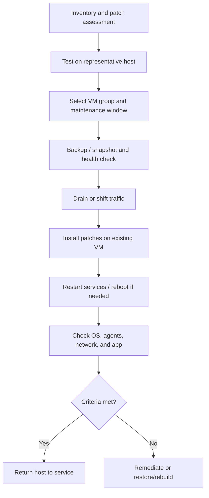
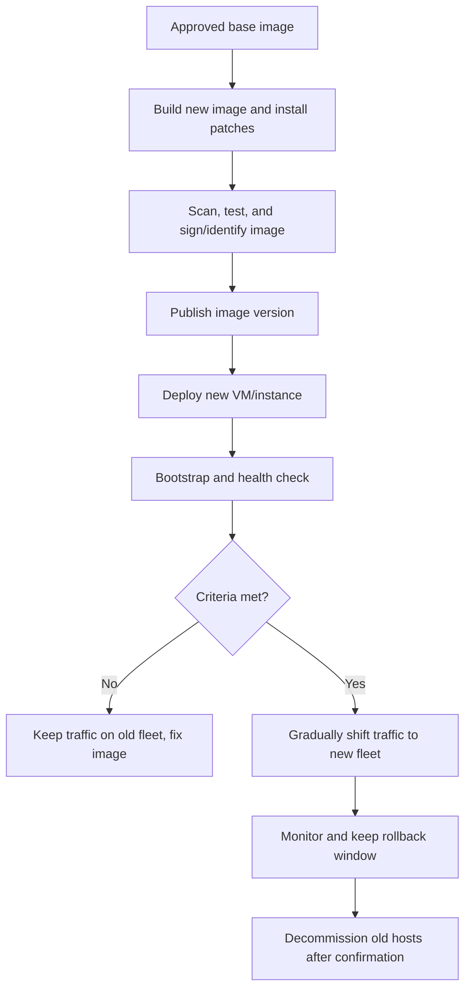
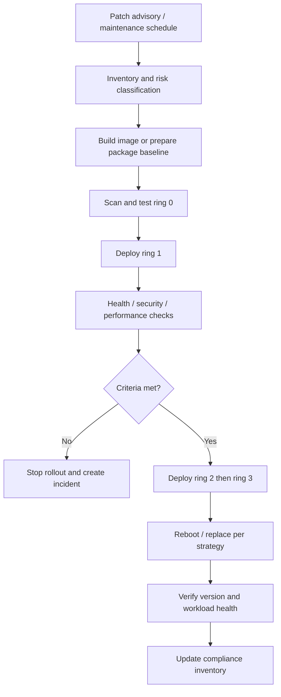

# Applying Patches via In-Place Updates or Image Replacement

## Context: Keeping Operating Systems Secure Without Disrupting Services

Virtual machines and cloud servers need regular updates to fix security vulnerabilities, resolve bugs, improve stability, and maintain compatibility. Patches can apply to the kernel, system libraries, packages, drivers, firmware, or foundational software. If delayed too long, servers may continue running versions with publicly disclosed vulnerabilities; if deployed hastily, updates can break applications, drivers, or boot processes.

Two common approaches are:

- **In-place patching:** installing patches directly onto the running operating system of an existing VM or server.
- **Image replacement:** creating a new, patched server image, deploying new VMs/instances from that image, and shifting workloads onto the new hosts.

In-place patching preserves the existing host and often suits servers with state or local data that is difficult to replace. Image replacement creates fresh machines from a tested template, enabling uniform deployments and easier fallback to the prior version before cutover. Many organizations combine both depending on workload type, criticality, and automation maturity.

In the **CLOUD_CORE_SERVICES_COMPUTE** module, choosing a patching approach must align with the VM, image, storage, networking, autoscaling, and availability models. The goal is to deliver patches to the right hosts, verify them post-update, and have a recovery plan when failures occur.

## 1. Why Is a Structured Patch Management Process Needed?

Patch management covers the full lifecycle from detecting updates, assessing impact, testing, deploying, and verifying to compliance reporting. It is not merely running a package update command.

Key reasons:

- **Reduce security risk:** remediate CVEs, authentication flaws, privilege escalation bugs, and vulnerabilities in system libraries.
- **Maintain stability:** fix bugs in the kernel, drivers, filesystem, network stack, and background services.
- **Compatibility:** maintain supportability across runtimes, agents, applications, and the cloud platform.
- **Compliance:** demonstrate that servers are updated within organizational policies and deadlines.
- **Reduce technical debt:** prevent the OS from falling so far behind that future upgrades become complex and risky.

Not all updates carry the same urgency. Security patches for actively exploited flaws take higher priority than non-security feature updates. Evaluate severity, exploitability, host exposure, workload criticality, and patch availability.

### 1.1. Update Classifications

| Type | Examples | Potential Impact |
|---|---|---|
| Security patch | Fixes for vulnerabilities in kernel, OpenSSL, SSH, or system libraries | Reduces exploitation risk; may require service restart or reboot |
| Bug fix | Fixes for filesystem, memory leaks, or network drivers | Improves stability; may alter existing behavior |
| Kernel update | Updates to the Linux kernel or Windows kernel components | Typically requires a reboot for the new kernel to take effect |
| Driver/agent update | NIC/GPU drivers, guest agents, monitoring agents | Can affect virtual devices, telemetry, or performance |
| Feature update | Adds capabilities or changes OS version | Larger scope of change; requires thorough compatibility testing |
| Firmware/platform update | Virtual firmware or provider-managed components | May be deployed by the cloud provider; requires tracking maintenance events |

Some library patches take effect after restarting processes; kernel patches generally require a reboot unless supported live-patching technology is used. Always verify reboot requirements and conditions from the vendor or distribution.

### 1.2. Determining Priority

Do not rely solely on CVSS scores. Combine:

- Vulnerability severity and real-world exploitability.
- Whether the host has public exposure, sensitive access privileges, or critical data.
- Whether the host sits on a critical data path or control plane.
- Whether public exploits, signs of active exploitation, or urgent vendor advisories exist.
- Whether a patch is available for the current image/kernel and whether known issues exist.
- Downtime risk and the workload's failover options.

Policy can define patch SLAs by risk level, such as emergency patches within a few days, high patches within a short maintenance cycle, and routine updates on schedule. Exact timeframes must be set by the organization based on operational and compliance needs.

## 2. In-Place Patching

### 2.1. How It Works

In-place patching installs packages or updates directly onto the OS of the existing VM. The host generally retains its ID, NIC, IP address, volumes, and cloud configuration; packages are upgraded and certain services may restart. If a kernel or boot component update requires it, the host must reboot to run the new version.

General flow:



### 2.2. Advantages and Limitations

Advantages:

- No need to provision new VMs or migrate the entire workload to different hosts.
- Preserves host IDs, IPs, volumes, and links to monitoring systems.
- Fits hosts with manual configuration, local data, or hard-to-recreate software.
- Can be applied gradually in small batches with minimal infrastructure changes.

Limitations:

- Package state and configuration can diverge across hosts after repeated manual edits.
- Failed patches can leave inconsistent state if installation is interrupted.
- Reboots can cause downtime if the workload lacks replicas or failover.
- Package rollback is not always safe; downgrading may not reverse schema or data changes.
- Servers accumulate drift over time and it is hard to prove identical configuration across the fleet.

In-place patching works when hosts must be preserved, provided there is inventory, configuration management, deployment logging, and a tested recovery plan.

### 2.3. Linux Update Examples

On Ubuntu/Debian, a basic workflow can use APT:

```bash
# Update package index
sudo apt-get update

# View upgradable packages
apt list --upgradable

# Apply updates per approved plan
sudo apt-get upgrade

# Check whether a reboot is required (if the system uses this indicator)
test -f /var/run/reboot-required && echo "Reboot required"
```

On RHEL-compatible systems, DNF can be used:

```bash
# Check available updates
sudo dnf check-update

# Apply approved updates
sudo dnf upgrade --security

# Check running kernel and installed kernels
uname -r
rpm -q kernel
```

Command names and options vary by distribution version. `dnf upgrade --security` only filters updates tagged with a security advisory; verify repository metadata and package policies. Do not run bulk commands in production without testing and preparing a maintenance window.

### 2.4. Windows Server Example

Windows Server typically receives updates via Windows Update, Windows Server Update Services (WSUS), Microsoft Configuration Manager, or cloud patch management tools. The operational workflow includes evaluating update classifications, testing on a pilot group, deploying in rings, verifying installation status, and rebooting as required.

Update history and status can be checked via the Windows Update UI, centralized management tools, or PowerShell modules suited to the environment. Do not assume a single PowerShell command deploys safely across all Windows Server versions; use organization-standardized methods and log results.

## 3. Image Replacement

### 3.1. How It Works

Image replacement builds a new, updated server image from an approved base image. The image is tested, tagged with an immutable version/digest, and used to launch new VMs/instances. The workload is deployed to the new hosts; once health checks pass, traffic shifts gradually from old hosts to new ones. Old hosts are kept during a rollback window before being decommissioned per policy.

This approach is commonly paired with **immutable infrastructure**: once a VM is deployed, the OS is not manually edited during its normal lifecycle. When updates are needed, a new image is built and hosts are replaced with fresh instances. This gives the fleet clear provenance and easy reproducibility.



### 3.2. Advantages and Limitations

Advantages:

- New hosts are created from a versioned image, easy to reproduce and audit.
- Reduces configuration drift caused by manual edits on individual VMs.
- Supports rolling, canary, or blue-green deployments to minimize downtime.
- OS/application rollback is often clearer by shifting traffic back to the old fleet, provided data and schemas remain compatible.
- Fits autoscaling groups, VM scale sets, and IaC-managed fleets.

Limitations:

- Requires an image build pipeline, testing, a registry, and a release process.
- Requires temporary capacity to run old and new hosts side by side.
- Data on boot disks or local disks does not automatically transfer to new hosts.
- Changes to IPs, hostnames, instance IDs, or metadata may occur; systems relying on these values must be designed accordingly.
- Must handle stateful workloads, volume attachments, sessions, queues, and open connections during traffic shifting.

Image replacement works best when applications are stateless or state lives outside the VM, such as databases, block volumes with attach/failover support, file shares, or object storage.

### 3.3. Golden Images and Image Pipelines

A **golden image** is a base image tested and approved by the organization. It typically contains the OS, baseline security configuration, required agents, and foundational packages. Never embed secrets, personal credentials, or environment-specific data inside the image.

An image pipeline can include:

1. Select a base image from a trusted source and pin its version.
2. Install OS patches and approved packages.
3. Apply the hardening baseline, auditing configuration, time sync, and agents.
4. Scan for vulnerabilities, check packages, configurations, and unwanted software.
5. Boot the image in a test environment and verify boot, network, storage, and agents.
6. Run smoke tests, sample application checks, and management access checks.
7. Seal the image, attach version/metadata, and publish to the image catalog.
8. Promote the image through staging to production via an approval workflow.

Images should include traceability details such as base image ID, build date, package versions, patch advisories, pipeline commit, scan results, and approver. Use immutable image IDs/versions when deploying so a single mutable tag never points to changing contents over time.

Example metadata of a published image:

```yaml
image:
  name: compute-linux-golden
  version: "2026.11.22-2"
  base_image: "linux-lts-approved-2026-10"
  patch_baseline: "security-baseline-2026-11"
  build_id: "image-pipeline-1842"
  scan_status: passed
  approval: production-approved
```

This is illustrative metadata; the real schema depends on your image catalog or build tool. Avoid placing secrets, private keys, or sensitive data in public metadata.

## 4. Comparing the Two Approaches

| Criterion | In-Place Patching | Image Replacement |
|---|---|---|
| Target of change | OS on the existing VM | New VM created from a new image |
| Preserves VM ID | Usually yes | Usually no; new host gets a new ID |
| Downtime | May require restart/reboot; depends on replicas/failover | Can be minimized via rolling/canary/blue-green |
| Uniformity | Depends on history and drift of each host | Higher if image and bootstrap are identical |
| Rollback | Can be difficult if packages/schemas do not support downgrade | Can shift traffic back to prior fleet/image if state is compatible |
| Local data | Usually preserved | Requires separating and migrating/reattaching data |
| Automation requirements | Patch orchestration and configuration management | Image pipeline, registry, IaC, and rollout controller |
| Temporary capacity | Usually less required | Usually needs new hosts running alongside old ones during rollout |
| Best suited for | Stateful/legacy VMs, hard-to-replace hosts, low-automation environments | Stateless fleets, autoscaling, immutable infrastructure |

There is no rule that every host must use the same method. You can use image replacement for web/API fleets, in-place patching for certain stateful or legacy hosts, and managed patching services where supported by the provider. Base the decision on risk, reproducibility, state storage, downtime requirements, and operational capability.

## 5. Safe Patch Deployment Workflow

Whether choosing in-place or image replacement, follow a controlled workflow from inventory to verification.

### 5.1. Inventory and Scope Assessment

First, know exactly which hosts need patching:

- OS, version, architecture, and source image.
- Running kernel and installed kernels/packages.
- Critical packages, drivers, runtimes, and agents.
- Environment, owner, application, criticality, and fault domain.
- Public exposure, sensitive data, and host permissions.
- Backup, snapshot, replication status, and recovery options.
- Last patch date, patch compliance, and reboot-pending status.

Inventory should update automatically as VMs are created or replaced. Do not rely solely on static lists since autoscaling fleets change continuously.

### 5.2. Assessment and Testing

Read OS and software vendor advisories to identify affected packages, applicability conditions, dependencies, and reboot requirements. Check known issues, driver compatibility, agent support, and application compatibility.

Run pilot tests on a canary group or representative staging environment. Verify boot, disks, networking, DNS, monitoring, logging, security agents, application health, performance, and background tasks. For critical workloads, run functional and load tests before expanding rollout.

### 5.3. Pre-Patch Preparation

- Confirm recent backups/snapshots and restore capability; snapshots do not replace independent backups.
- Identify the maintenance window, on-call engineer, and notification channels.
- Define node/replica ordering so quorum or total capacity is never lost.
- Verify remaining capacity for draining or replacing hosts.
- Verify health checks, load balancers, autoscaling, and failover procedures.
- Record current image IDs, package inventories, and configurations for comparison.
- Define rollout stop criteria and rollback conditions.

### 5.4. Phased Deployment

Never patch an entire production fleet in a single operation. Divide hosts into rings or batches, such as canary, small group, single zone, and then the full fleet. Wait for health and metrics to stabilize after each batch before proceeding.

For multi-node clusters, drain workloads using platform mechanisms, respect PodDisruptionBudgets or quorum, patch/reboot the node, verify it returns to Ready, and then proceed to the next node. For VMs behind a load balancer, remove the host from the pool, wait for connection draining, patch or replace it, verify health, and re-register it.

### 5.5. Post-Update Verification

Do not just check that the update command returned success. Verify:

- Running kernel/packages match expected versions.
- No unexpected pending reboots or failed updates remain.
- VM booted cleanly, and filesystems and volumes are mounted.
- NICs, routes, DNS, firewalls, and dependency connections work.
- Monitoring, logging, security agents, and backup agents are active.
- Application passes readiness/health checks with no error spike.
- Latency, throughput, CPU, RAM, disk I/O, and network remain stable.
- Inventory/CMDB and patch compliance reports are updated.

## 6. Reducing Downtime with Controlled Rollouts

### 6.1. Rolling Updates

A rolling update patches or replaces a small group of hosts at a time. Load balancers or orchestrators return hosts to service only after health checks pass. This fits multi-replica fleets that can sustain capacity while some hosts undergo maintenance.

Define `maxUnavailable`, `maxSurge`, or equivalent limits. If `maxUnavailable` is too high, serving capacity can drop sharply; if `maxSurge` is too high, quotas may be exceeded or capacity exhausted. For stateful applications, coordinate update order with quorum and replication.

### 6.2. Canary Deployment

Canary deploys the new image/patch to a small fraction of hosts first. Monitor error rates, latency, logs, resource saturation, and business metrics. If criteria pass, expand to larger groups; otherwise, halt rollout and investigate.

Canaries help catch behavioral changes missed by simple boot checks. However, the canary group must represent the rest of the fleet in machine type, zone, traffic, and dependencies.

### 6.3. Blue-Green Deployment

Blue-green maintains two fleets: blue serving live traffic and green updated. Once green passes validation, traffic shifts gradually or all at once to green. If issues arise, traffic can shift back to blue while blue remains intact.

This model requires parallel capacity and data compatibility management. If green upgrades a database schema in a way blue cannot read, shifting traffic back to blue may be unsafe. Design migrations for backward compatibility or decouple schema migrations from fleet cutover.

## 7. Rollback and Recovery When Patches Fail

Rollback must be planned before deployment. Reversibility depends on the type of change:

- **Package updates:** can be downgraded if older versions remain in the repository and the package supports safe downgrade. Some patches modify data or schemas and cannot be simply reverted.
- **Kernel updates:** can select the prior kernel in the bootloader if retained and allowed by boot configuration. Assess security risks before continuing to run an older kernel.
- **Image replacement:** can shift traffic back to the old fleet or recreate VMs from the previous image, provided data and configuration remain compatible.
- **Database/application schemas:** require backward-compatible migrations, backups, and dedicated recovery plans; reverting to an older image does not undo schema changes.

### 7.1. Rollout Stop Criteria

Predefine stop thresholds, such as:

- Health check failure rate exceeds threshold.
- Error rate or p95/p99 latency spikes significantly above baseline.
- Nodes fail to return to Ready or VMs fail to boot.
- Security/monitoring agents stop functioning.
- Database replication lag, quorum, or queue backlog exceeds limits.
- Signs of data loss, filesystem corruption, or severe application errors.

When thresholds are breached, halt the next batch, preserve evidence, assess blast radius, and choose a recovery path. Do not continue rolling out just because some hosts updated cleanly.

### 7.2. Snapshots and Backups

Pre-patch volume snapshots assist with recovering data or disk state, though they do not guarantee application-wide consistency. For databases or continuous-write systems, take application-aware backups or coordinate flush/quiesce before snapshotting when consistency is required.

Before relying on a snapshot for rollback, test launching a VM from a snapshot, attaching volumes, booting the OS, and verifying data. Snapshots do not replace backups stored in an independent failure domain, especially when an account or region could be affected simultaneously.

## 8. Live Patching and Rebootless Updates

Some operating systems and vendors support **live patching** for a subset of kernel patches or system components. This applies changes to the running kernel to reduce reboots and downtime.

Live patching helps long-uptime servers, but has limitations:

- Only applies to supported kernels, versions, and patch types.
- Not all kernel, driver, firmware, or user-space changes can be live-patched.
- Periodic reboots may still be required to finalize changes or return hosts to the baseline.
- Live patch status and actual kernel version must be verified after application.
- Does not replace image refreshes, backups, and recovery testing.

Treat live patching as one disruption-reduction tool within an overall patch strategy. Do not assume live-patched hosts can skip all maintenance cycles or image replacements.

## 9. Automating Fleet-Wide Patch Management

As VM counts grow, manually updating individual hosts becomes error-prone and hard to audit for compliance. Patch orchestration manages inventory, target grouping, command execution, reboot scheduling, result collection, and reporting.

### 9.1. Grouping Hosts by Ring and Environment

A common deployment structure:

| Ring | Scope | Objective |
|---|---|---|
| Ring 0 | Internal test hosts or sandboxes | Catch basic failures quickly |
| Ring 1 | Staging or low-risk production canary | Test near-production behavior |
| Ring 2 | Subset of production fleet across zones | Evaluate under controlled live traffic |
| Ring 3 | Remainder of production | Complete rollout after earlier rings stabilize |

Do not place all critical hosts in the same batch or zone. Distribute across applications, fault domains, roles, and criticality so one bad patch cannot take down an entire service.

### 9.2. Example Automation Flow



The pipeline should log:

- Patch advisory or change ID and deployment rationale.
- Host list per batch and before/after image or package versions.
- Start, completion, reboot timestamps, and per-host status.
- Scan, test, health check, and post-update metric results.
- Errors, retries, exceptions, approvers, and recovery plans.
- Compliance evidence and list of unpatched hosts.

### 9.3. Avoiding Uncontrolled Update Commands

Automation needs timeouts, bounded retries, locking, or controls preventing two jobs from patching the same host concurrently. Avoid rebooting multiple nodes in the same cluster simultaneously. If an agent is unresponsive or a host is offline, mark it unverified rather than assuming success.

For image replacement, pipelines must use immutable image versions and shift traffic only after new VMs pass health checks. For in-place patching, automation must verify exit codes, reboot-required flags, package states, and kernel/package versions after rebooting.

## 10. Security and Change Governance

Patch pipelines hold elevated privileges because they install packages and execute admin commands across many hosts. Protect pipelines and package sources as part of the software supply chain.

- Pull packages/images only from trusted repositories or registries; verify signatures and publisher sources where supported.
- Scope pipeline permissions by environment and host group; never use an unrestricted admin credential.
- Store secrets in a secret manager, using short-lived credentials and rotation.
- Audit changes to repositories, image pipelines, patch policies, and deployment permissions.
- Scan images/packages, verify hardening configurations, and remove unnecessary tools.
- Govern patch deferral exceptions: require an owner, justification, mitigations, and expiration date.
- Separate patch/image authors, approvers, and production deployers where risk warrants separation of duties.

Do not automatically install every latest package into production without version control. A compromised repository or malicious package can impact the entire fleet if pipelines have broad privileges.

## 11. Troubleshooting Common Issues

| Symptom | Possible Cause | Investigation and Remediation |
|---|---|---|
| Package manager reports dependency conflict | Out-of-sync repository, pinned packages, or incompatible dependencies | Check repos, package holds/pins, advisories, and test in staging |
| Installation succeeded but old kernel still runs | Host not rebooted or bootloader selected older kernel | Check reboot-required, installed kernels, and `uname -r`; schedule reboot |
| VM fails to boot after kernel update | Incompatible driver/module, broken initramfs, or bootloader error | Use serial/console access, boot prior kernel, or restore from verified snapshot/image |
| Application fails after patching | Changed library/runtime or service not restarted properly | Compare package versions, app logs, dependencies, and perform controlled rollback |
| New VM receives no traffic | Health check, security group, route, DNS, or bootstrap error | Inspect NIC/IP, routes, firewall, cloud-init/agents, and target health |
| Fleet lacks capacity during image replacement | Insufficient quota/instance capacity or excessive surge | Shrink batch size, expand capacity, pick suitable zone/family, or extend rollout |
| Cluster node does not return to Ready | Kubelet/agent, CNI, disk, certificate, or runtime failure | Check node conditions, system logs, CNI, and runtime before proceeding |
| Patch compliance still reports missing | Stale inventory, offline host, or non-baseline package | Sync inventory, verify versions, and process time-bound exceptions |
| Live patch reports unsupported | Kernel/package outside supported matrix | Switch to maintenance window and reboot/replace per plan |

## 12. Choosing Methods by Workload Type

| Workload | Typically Suitable Approach | Notes |
|---|---|---|
| Stateless web/API fleet | Image replacement with rolling/canary | Data and sessions must reside outside the VM or support handoff |
| Queue-processing workers | Image replacement or batched in-place | Drain queues, handle in-flight messages, and ensure idempotency |
| Databases on VMs | Node/replica in-place or image replacement with designed failover | Protect data, replication lag, quorum, backups, and recovery time |
| Manually configured legacy hosts | Controlled in-place | Improve inventory, manage drift, and gradually standardize images |
| Bastion/management hosts | Image replacement or HA-pair in-place | Never lose all administrative access paths during maintenance |
| GPU/accelerator hosts | Depends on driver, kernel, and framework; needs thorough testing | Driver compatibility, CUDA/runtime, and workload draining may require reboots |
| Kubernetes worker nodes | Drain, patch/replace nodes per node pool | Respect PDBs, capacity, local data, and control plane/node versions |

For databases or stateful workloads, image replacement can still fit if data is decoupled from boot disks and replication/failover are tested. Conversely, in-place is not automatically safe simply because the VM stays intact; patches can disrupt filesystems, drivers, or services actively writing data.

## 13. Maintenance Windows, Compliance, and Exception Management

An effective patching program needs both a regular schedule and an emergency patching path. Schedules should factor in low-traffic hours, user timezones, batch schedules, backup windows, replication, and on-call coverage.

### 13.1. Maintenance Windows

Maintenance windows define approved periods for deploying potentially disruptive changes. Before the window, notify owners, confirm on-call engineers, and verify dependencies and spare capacity. During the window, deploy in batches and monitor health; afterward, confirm stability and send reports.

Not every patch can wait for a routine schedule. When a vulnerability has high active exploitability, organizations can invoke emergency patching with an expedited workflow that still enforces appropriate approvals, change logging, minimal testing, and a recovery plan.

### 13.2. Patch Compliance

Patch compliance measures how well servers meet the update baseline. The baseline should specify supported OS versions, minimum patch levels, package groups, remediation SLAs, and exception criteria.

A useful report should show:

- Total hosts in scope and active hosts.
- Counts of compliant, non-compliant, offline, and unassessed hosts.
- Vulnerability counts by severity and age of missing patches.
- Hosts needing reboot, hosts patched but not yet rebooted, and failed hosts.
- Active image versions per environment/region.
- Approved exceptions, owners, mitigations, and expiration dates.

Never count offline hosts or those missing inventory data as compliant. Report `unknown` states separately and assign an owner to investigate.

### 13.3. Exception Management

Some hosts cannot be patched immediately due to legacy applications, incompatible drivers, missing vendor fixes, or high downtime risk. Exceptions must record:

- Affected hosts, applications, and owner.
- Unapplied vulnerability/patch and technical justification.
- Residual risk level and exploitability.
- Temporary mitigations such as network isolation, reduced privileges, or disabling affected features.
- Approver, exception duration, and review date.
- Plan to eliminate the blocker and target patch date.

Exceptions must never become permanent states. Upon expiration, the system should alert and require re-evaluation.

## 14. Cost and Operational Efficiency

In-place patching can save temporary compute capacity since no parallel fleet is needed, but it may raise engineering effort if hosts diverge and require manual intervention. Image replacement requires upfront investment in pipelines, registries, and surge capacity, yet reduces drift remediation time and simplifies future deployments.

When comparing, consider:

- Compute cost for running old and new hosts concurrently during rollouts.
- Storage cost for snapshots, images, and backups.
- Network cost for copying images, replicating data, and shifting traffic.
- Engineering time spent on testing, troubleshooting, reboots, and post-checks.
- Cost of downtime or reduced capacity when replica headroom is insufficient.
- Risk and recovery cost if a patch causes an outage.

A practical metric is time from patch release until all in-scope hosts meet the baseline. Also track rollout success rate, rollback rate, reboot duration, exception counts, and hosts missing telemetry.

## 15. Example Image Replacement Workflow for a Stateless Web Fleet

Suppose a web service runs six VMs across two availability zones behind a load balancer. Boot disks hold the OS and application; user data lives in a database and object storage. A new image can be deployed via these steps:

1. Build a new image from an approved base image with security patches and agents installed.
2. Scan for vulnerabilities, verify packages, and run smoke tests on a temporary VM.
3. Publish the image with an immutable version and tag the patch baseline.
4. Launch two new VMs across the corresponding zones; verify bootstrap, health endpoints, and database/object storage connectivity.
5. Add one new VM to a canary target group receiving a small traffic percentage.
6. Monitor error rates, latency, CPU/RAM, logs, and business metrics.
7. If stable, launch and validate the remaining new VMs in batches.
8. Shift traffic gradually to the new fleet; retain the old fleet during the rollback window.
9. After confirming zero errors and drained connections, decommission old VMs.
10. Update inventory, image catalog, patch compliance, and change records.

If the canary fails, halt the rollout and shift traffic back to the old fleet. Because data resides outside the VMs and the app is schema-compatible, rollback does not require restoring boot disks on the new hosts. If database schema changes occur, ensure the older app version remains compatible before relying on this rollback approach.

## 16. Common Misconceptions

**Installing packages cleanly means the patch is active.** Kernel patches usually require a reboot; services may need restarts. Always verify running versions and reboot status.

**All VMs must be patched simultaneously to stay uniform.** Batched rollouts detect errors earlier and preserve serving capacity. Uniformity is the end state, not a requirement for simultaneous change.

**Snapshots are a complete rollback solution.** Snapshots may not be application-consistent and do not protect against failures spanning the same fault domain. Maintain backups and test restores.

**Image replacement is always zero-downtime.** Switching hosts requires capacity, health checks, connection draining, and state handling. Single-instance or stateful workloads may still experience disruption.

**A new image is automatically safe because it was built from a base image.** Images still require scanning, testing, hardening, traceability metadata, and package source verification.

**Live patching replaces all reboots and image refreshes.** Live patching covers only a subset of patches and configurations; periodic maintenance is still needed for unsupported changes.

**No error during update means a host is compliant.** Verify running kernel/packages, health, agents, telemetry, and inventory. Offline or unreported hosts must be treated as unverified.

## 17. Patch Deployment Checklist

### Pre-Deployment

- [ ] Accurate inventory of OS, images, packages, kernels, owners, and environments.
- [ ] Advisories, risk levels, blast radius, and reboot requirements assessed.
- [ ] In-place vs. image replacement chosen based on state, HA, drift, and automation.
- [ ] Tested in staging/canary, checking driver, agent, and runtime compatibility.
- [ ] Restorable backups/snapshots verified; data and schemas protected.
- [ ] Capacity, replicas, quorum, maintenance window, and on-call confirmed.
- [ ] Rollout stop criteria, rollback plan, and incident notifications defined.

### During Deployment

- [ ] Roll out in rings/batches without losing total capacity at once.
- [ ] Properly drain traffic/workloads before rebooting or replacing hosts.
- [ ] Monitor package state, reboots, boot health, and metrics after each batch.
- [ ] Halt rollout when error thresholds trigger; preserve logs and evidence.
- [ ] Record images/versions, processed hosts, errors, and exceptions.

### Post-Deployment

- [ ] Running kernel/packages meet the baseline; no unexpected pending reboots remain.
- [ ] Applications, networking, storage, monitoring, and security agents are healthy.
- [ ] Latency, error rates, and resource utilization return to acceptable thresholds.
- [ ] Old fleet decommissioned only after rollback window closes and data is safe.
- [ ] Inventory and patch compliance updated; offline/unknown hosts assigned to owners.
- [ ] Exceptions have mitigations, approvers, and expiration dates.

## Conclusion

In-place patching updates the OS directly on existing VMs, retaining most identities and resources while requiring careful management of reboots, package drift, and rollback paths. Image replacement builds a newly patched image and replaces VMs via rolling, canary, or blue-green strategies, improving uniformity and reproducibility at the cost of pipeline infrastructure, temporary surge capacity, and externalized state design. Choose the approach based on workload traits, data architecture, availability targets, and automation capability. Either way, ensure accurate inventory, representative testing, phased rollouts, post-update verification, compliance tracking, and tested recovery plans.
