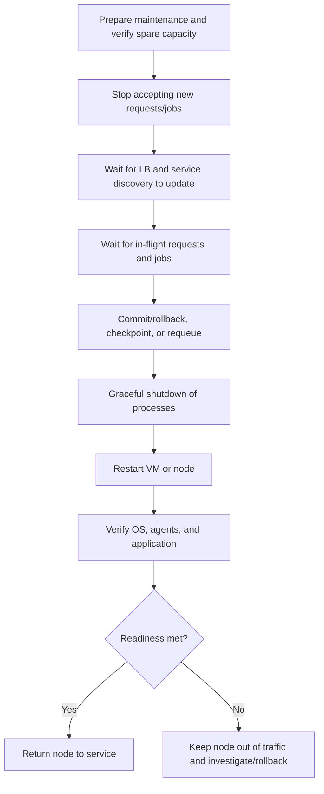

# Draining Traffic and Tasks Before Rebooting

Rebooting a virtual machine or node to install patches, upgrade the kernel, update drivers, or resolve incidents is a routine maintenance operation. Restarting immediately while a host still receives requests or processes work can sever connections, leave transactions incomplete, cause duplicate message processing, or prevent data from flushing to storage. Even a host coming back healthy after a reboot does not mean the service has recovered properly.

**Draining** is the process of removing an instance from receiving new work, waiting for or safely handling in-flight work, and only then stopping processes and rebooting the host. Draining requires coordination across the load balancer, application, workers/queues, orchestrator, and data layer. This lesson explains how to perform controlled draining for VMs, containers, and background workloads to minimize disruption and protect data integrity.

## 1. What Is Draining and When Should It Be Performed?

Draining makes a node or instance stop accepting new workloads while allowing active requests, connections, or tasks to finish safely. Once draining completes, the node can be restarted, replaced, upgraded, or removed from the cluster.

Draining is typically required before:

- Rebooting a VM to apply a kernel update, driver update, or security patch.
- Host maintenance, hardware configuration changes, or instance resizing.
- Upgrading the operating system, container runtime, or infrastructure agents.
- Replacing a cluster node or shifting workloads to other nodes.
- Removing an instance from an autoscaling group or backend pool.
- Handling a host showing early signs of failure while enough time remains to migrate workloads.

Draining is not the same as shutting down. It is a preparation phase with a clear objective: **stop accepting new work, complete or hand off in-flight work, confirm a safe state, and only then restart**.

## 2. Distinguishing Drain, Stop, Restart, and Failover

| Operation | Meaning | Primary Impact |
|---|---|---|
| Drain | Stop accepting new workloads and handle in-flight work | Minimizes interrupted requests/tasks before maintenance |
| Stop | Stop processes or the VM | Workloads no longer run on that host |
| Restart/reboot | Stop and restart the OS or VM | Drops connections and in-memory state during restart |
| Replace | Create a new instance/node and retire the old one | Infrastructure change, common in immutable models |
| Failover | Transfer role or traffic to another replica/endpoint | Keeps the service running when the primary node stops |

Draining can precede stop/restart/replace. Failover may happen before or during draining depending on the architecture. For databases or leader-based systems, transfer leadership using the application's mechanism before stopping the node holding the primary role.

## 3. Types of Work That Must Be Drained

An instance can handle multiple activity types simultaneously. Identify the exact workload types to select the right drain method.

| Workload Type | Examples | Pre-Restart Handling |
|---|---|---|
| New requests | New HTTP requests, RPCs, TCP sessions | Mark unready or deregister from load balancer |
| In-flight requests | Uploads, long API calls, streaming responses | Stop accepting new requests and wait up to a timeout |
| Long-lived connections | WebSockets, gRPC streams, TCP sessions | Send close notice, support reconnect/resume if available |
| Background tasks | Workers pulling messages from a queue | Stop polling/consuming; complete or release lease/visibility timeout |
| Batch jobs | Imports, exports, reports, large data processing | Pause scheduler triggers; checkpoint or let jobs finish |
| Data transactions | Database transactions, file writes | Controlled commit/rollback and flush required data |
| Admin tasks | Backups, log rotation, package updates | Wait for completion or stop per tool guidance |

Not every task can wait indefinitely. Hung requests, failing jobs, or unresponsive connections need timeouts and handling policies. Draining must have a deadline so maintenance is not blocked forever.

## 4. General Drain Sequence

A drain workflow can be divided into six stages:

1. **Preparation:** verify replacement nodes have enough capacity, check health of other replicas, announce the maintenance window, and set a deadline.
2. **Stop accepting new work:** mark the instance unready or deregister from the load balancer; stop consumers from pulling new messages and pause schedulers if needed.
3. **Wait for propagation:** allow health checks, endpoint controllers, DNS/service discovery, or load balancers to update state.
4. **Complete in-flight work:** wait for active requests and jobs to finish, commit/rollback transactions, checkpoint, or safely return messages to the queue.
5. **Stop processes:** send graceful shutdown signals, close connection pools, flush logs/buffers, and verify processes have exited.
6. **Restart and recover:** reboot, verify the OS, start services, confirm readiness, and only then return the instance to traffic.



Wait times at each stage must align with application, load balancer, and orchestrator timeouts. Avoid relying on a fixed sleep interval when reliable status signals can be checked.

## 5. Draining Traffic at the Load Balancer

For applications receiving requests through a load balancer, remove the instance from the backend pool before restarting. Most load balancers provide a deregister/draining state and a wait period for handling existing connections.

### 5.1. Stop Sending New Requests

When an instance begins draining:

- Mark the backend to stop receiving new requests or initiate deregistration.
- Wait for load balancer status to transition to draining/deregistering or equivalent.
- Verify new requests are routed to other healthy backends.
- Keep active connections alive during the deregistration delay if supported by the service.

Health checks and deregistration are related but distinct mechanisms. Health checks evaluate whether a backend is eligible for traffic; deregistration is an administrative action removing a backend from the target group. Some load balancers keep existing connections open, while others close them once the timeout expires. Check your specific service's behavior.

### 5.2. Connection Draining and Timeouts

Connection draining gives active requests or connections time to finish. This period must be long enough for valid requests yet short enough not to stall maintenance.

For example, if an API normally completes in seconds but includes a 10-minute export request, decide whether exports can continue on a draining node or should become asynchronous checkpointed jobs. A 30-second timeout suits standard API calls but not long-running exports.

For WebSockets or gRPC streaming, the application should send a close notice with a reason, give clients time to reconnect, and support resume if the business protocol allows. Never assume a load balancer will automatically migrate an open TCP connection to another backend.

### 5.3. Verify Remaining Capacity

Before deregistering an instance, verify that remaining backends have sufficient CPU, memory, connection limits, and throughput to handle the shifted load. If the cluster operates near limits, draining multiple instances concurrently can overload the remaining pool.

## 6. Graceful Shutdown in the Application

Graceful shutdown is how an application terminates in a controlled sequence upon receiving a shutdown signal. On Linux, processes typically receive `SIGTERM` first; if they do not exit within the allowed period, the management system may send `SIGKILL`.

An application supporting graceful shutdown should:

- Stop accepting new requests or work.
- Set readiness status to false.
- Allow in-flight requests to finish within a configured deadline.
- Stop spawning new background tasks and wait for running workers.
- Commit or roll back transactions cleanly.
- Close connection pools, sockets, file handles, and clients to dependent services.
- Flush log and telemetry buffers.
- Record shutdown status for troubleshooting.
- Exit before the deadline to avoid forced termination.

### 6.1. Python SIGTERM Handling Example

Illustrative example showing how to set a shutdown flag so a worker loop stops picking up new jobs. The `finish_current_job()` function represents business logic that must implement appropriate timeouts, checkpoints, and error handling.

```python
import signal
import threading
import time

shutdown_requested = threading.Event()


def handle_shutdown(signum, frame):
    shutdown_requested.set()


signal.signal(signal.SIGTERM, handle_shutdown)
signal.signal(signal.SIGINT, handle_shutdown)


def run_worker():
    while not shutdown_requested.is_set():
        job = receive_job(timeout=1.0)  # Do not block indefinitely
        if job is None:
            continue

        try:
            finish_current_job(job, deadline_seconds=20)
            acknowledge_job(job)
        except Exception:
            release_or_requeue_job(job)

    close_worker_clients()
    flush_application_logs()


if __name__ == "__main__":
    run_worker()
```

Functions `receive_job`, `finish_current_job`, `acknowledge_job`, and `release_or_requeue_job` are queue/application-specific, not built-in Python APIs. In real implementations, ensure the signal handler performs no blocking or unsafe operations in signal context; here it merely sets an event so the loop manages shutdown.

### 6.2. Aligning Deadlines and Timeouts

The application, container runtime, orchestrator, and operating system each have their own timeouts. For example, if the app needs 60 seconds to finish a request while Kubernetes gives a Pod only 30 seconds before sending SIGKILL, the app will still be terminated mid-request.

Design timeouts in order:

- Time to stop accepting new requests and wait for propagation.
- Time to drain in-flight requests/jobs.
- Time to close connections and flush data.
- Buffer before the forced termination deadline.

Total actual duration must fit within platform or maintenance limits. If work takes longer than the limit, use checkpointing, split jobs into smaller pieces, or move tasks to an asynchronous processing system.

## 7. Safely Draining Workers and Queues

Message-processing workers require a different sequence than web servers. When draining, a worker must stop pulling new messages while staying responsible for messages already acquired.

### 7.1. Complete and Acknowledge

If a job can complete within the drain window:

1. Stop polling or receiving new messages.
2. Continue processing the active job.
3. Acknowledge the message only after results are durably persisted.
4. Close the consumer and connection to the broker.

Never acknowledge before persisting results. If a worker crashes after acknowledging but before writing data, the message disappears from the queue even though the work was never finished.

### 7.2. Requeue, Visibility Timeout, and Leases

If a job cannot finish before the deadline, use the broker's mechanism to return the message to the queue or let the lease/visibility timeout expire. Prevent two workers from unintentionally processing the same message concurrently.

With queues using visibility timeouts, the timeout must be long enough or extended while the job runs. When a worker stops, ensure the message becomes available again after the lease ends. With brokers using locks/leases, release locks via the official API whenever possible.

### 7.3. Idempotency and Duplicate Processing

Many queue systems provide at-least-once delivery. Consequently, a job may be redelivered after a timeout or restart. Handlers must be idempotent: processing the same job multiple times must not produce incorrect business side effects.

Use job IDs, idempotency keys, unique constraints, or state tables to recognize completed work. For multi-step tasks, save durable checkpoints after each recoverable step.

### 7.4. Long-Running Tasks and Checkpoints

For jobs processing millions of records, large exports, or training batches, do not rely on draining waiting until the entire job completes. Split jobs into chunks, persist offsets/checkpoints durably, and allow new workers to resume from the saved position.

## 8. Draining Batch Schedulers and Periodic Tasks

Hosts may run cron, systemd timers, internal schedulers, or batch orchestrators. Restarting right as a job triggers can create duplicate runs or missed schedules.

Before maintenance:

- Pause the scheduler or mark the node ineligible for new jobs.
- Check running jobs and expected completion times.
- If a job can finish within the maintenance window, let it complete.
- Otherwise, checkpoint and transfer execution to another node per scheduler mechanisms.
- Record skipped or catch-up runs to avoid duplicate processing.
- After restart, re-enable the scheduler only when the node is ready and old leases/locks are released.

For cron running across multiple VMs, use distributed locks or leader election if a schedule must execute only once cluster-wide. Disabling cron on one VM alone does not prevent another node from running the same job.

## 9. Draining Databases and Stateful Workloads

Databases and stateful systems require extra caution because in-memory state, transaction logs, and replication can affect consistency.

Before restarting a database node:

- Identify whether the node is primary, replica, leader, or follower.
- Check replication lag and standby replica health.
- If needed, fail over the primary/leader role to a healthy node per the database failover procedure.
- Stop accepting new connections or place the application in maintenance mode.
- Let active transactions commit or roll back within a timeout.
- Ensure logs/WAL/journals are flushed as required by the database engine.
- Stop the database using its supported tool/service manager.
- After restart, verify recovery, replication, consistency, and connection acceptance.

Never kill a database process or reboot the host without understanding storage and replication state. Some databases self-recover after crashes, but recovery time and data loss risk depend on durability, storage, and engine settings.

For caches or session stores, determine whether data can be regenerated. If losing cache causes a sudden load spike on the database, warm the cache or rate-limit traffic once the node returns.

## 10. Draining on Kubernetes

Kubernetes provides node cordon and drain mechanisms to prepare for maintenance.

- `kubectl cordon` marks a node unschedulable for new Pods via the normal scheduler.
- `kubectl drain` evicts eligible Pods from the node so controllers can recreate them on other nodes if configuration permits.
- PodDisruptionBudget (PDB) limits how many available Pods can be disrupted during voluntary disruptions performed via the eviction API.

Example:

```bash
# Prevent the scheduler from placing new Pods on the node
kubectl cordon worker-01

# Evict Pods from the node; DaemonSets require their own policy handling
kubectl drain worker-01 --ignore-daemonsets

# After maintenance and verifying the node is healthy
kubectl uncordon worker-01
```

The commands above are operational examples. Before running in production, inspect PDBs, local storage, DaemonSets, static Pods, stateful workloads, and remaining node capacity. `kubectl drain` may wait or be blocked if a PDB disallows eviction; do not arbitrarily pass `--disable-eviction` or `--force` to bypass protections.

### 10.1. PodDisruptionBudget

A PDB can set `minAvailable` or `maxUnavailable` to bound Pod disruptions during voluntary evictions. Example:

```yaml
apiVersion: policy/v1
kind: PodDisruptionBudget
metadata:
  name: checkout-api
spec:
  minAvailable: 2
  selector:
    matchLabels:
      app: checkout-api
```

With the PDB above, at least two matching Pods must remain available during PDB-protected evictions. The cluster must have enough replicas and node resources to reschedule Pods. A PDB does not protect against all failures: it does not prevent sudden node crashes, guarantee bug-free apps, or replace readiness/liveness probes.

### 10.2. Readiness, preStop, and Termination Grace Period

When a Pod is terminated, Kubernetes runs the `preStop` hook if defined, sends the termination signal to containers, and waits up to `terminationGracePeriodSeconds`. `preStop` execution time runs inside the grace period; it is not added on top of it.

A common pattern:

1. The application switches readiness to false.
2. Endpoint controllers and proxies/load balancers take time to update endpoints.
3. `preStop` may wait a short propagation interval if needed.
4. The container receives SIGTERM and executes graceful shutdown.
5. If the grace period expires, the container may receive SIGKILL.

Do not rely solely on a long `sleep` in `preStop` without application shutdown logic. Flip readiness to false early, size the grace period for actual processing duration, and ensure the app receives SIGTERM before the deadline. For long-lived connections, implement reconnect/resume policies.

### 10.3. Stateful Workloads and Local Storage

StatefulSets, PersistentVolumes, and local ephemeral storage carry distinct constraints. Before draining, check whether volumes can attach to other nodes, whether Pods use local data, whether databases have replication, and whether detach/attach sequences are safe. Pods using local storage can lose data if the node is deleted; `kubectl drain` may require flags for local data, which does not make local data durable.

## 11. Draining and Restarting VMs with systemd

On Linux VMs, systemd manages service lifecycles. Units can be configured to send SIGTERM and wait a set duration before forced termination.

Example unit:

```ini
[Service]
Type=simple
ExecStart=/opt/myapp/bin/server
KillSignal=SIGTERM
TimeoutStopSec=90s
Restart=on-failure
```

The application must handle SIGTERM properly. `TimeoutStopSec` sets how long systemd waits for the configured stop; if the application does not exit, systemd may apply kill behavior per unit settings. Do not increase the timeout indefinitely to mask hung processes.

A general VM maintenance workflow:

```bash
# 1. Remove the instance from the backend pool using your load balancer tool.
# 2. Verify draining status and wait for in-flight requests.

# 3. Stop the worker from accepting new jobs (service name is illustrative).
sudo systemctl stop myapp-worker.service

# 4. Stop web/API after the load balancer has drained.
sudo systemctl stop myapp-api.service

# 5. Confirm services have stopped.
systemctl is-active myapp-worker.service
systemctl is-active myapp-api.service

# 6. Reboot the host after verification checks pass.
sudo systemctl reboot
```

Stop commands are safe only when services implement graceful shutdown and workers have job completion/requeue logic. In production, verify exit status, logs, and backend state rather than assuming commands succeeded.

## 12. Planning Maintenance Without Exhausting Cluster Capacity

Draining a node reduces available capacity. If a cluster only has enough resources for current load, draining can overload remaining nodes.

Before maintenance, assess:

- CPU and memory headroom on remaining nodes.
- Minimum replica counts and PDBs.
- Connection limits on databases, caches, and upstream services.
- Network throughput, load balancer capacity, and IOPS limits.
- Whether Pods/VMs can reschedule into another zone or face topology constraints.
- Whether the autoscaler can add capacity before draining.
- How many nodes can drain concurrently while still meeting SLOs.

For multi-node clusters, maintain sequentially or in small batches: drain one node, wait for the refreshed node to become healthy and capacity to stabilize, then continue. If multiple nodes must drain concurrently, pre-calculate spare capacity and check fault domain impact.

## 13. Timeouts, Force Termination, and Handling Incomplete Work

Not every request or job finishes before the deadline. Define behavior when drain timeouts expire:

| Situation | Recommended Behavior |
|---|---|
| Short request still running | Wait up to the request deadline within drain limits |
| Resumable long request | Send close notice and support client resumption |
| Incomplete background job | Checkpoint or requeue/release lease; never acknowledge early |
| Uncommitted transaction | Commit if validly completed; otherwise roll back or rely on database recovery procedure |
| Hung worker | Stop cleanly at timeout; ensure job can safely retry |
| Process ignores SIGTERM | Log/alert, wait until deadline, then apply forced termination per policy |

Forced termination may be needed to finish maintenance or handle incidents, but risks losing in-memory state and interrupting I/O. Before forcing termination, verify whether jobs can re-run, whether data is durably persisted, and how the system recovers.

## 14. Example Runbook for an API and Worker VM

Suppose a VM runs two services: an API serving HTTPS behind a load balancer and a worker consuming queue messages. The goal is restarting the VM for a kernel update.

**Pre-Maintenance**

1. Verify other backends are healthy with sufficient capacity.
2. Check queue backlog, oldest message age, and active jobs.
3. Confirm the update was tested in an equivalent environment and a rollback plan exists.
4. Verify logs, metrics, and alerts are operational.

**Drain**

1. Deregister the API from the load balancer and wait for connection draining.
2. Switch the worker to stop pulling new messages.
3. Wait for active API requests to finish within the defined limit.
4. Wait for short worker jobs to finish; safely checkpoint or requeue long jobs.
5. Confirm no critical transactions or I/O remain active.
6. Stop API and worker via systemd, verifying both services exited.

**Restart and Return to Service**

1. Reboot the VM and verify the target kernel/version.
2. Verify volumes, network, DNS, monitoring agents, and identity work properly.
3. Start API/worker; run health checks and smoke tests.
4. Verify API readiness before re-registering with the load balancer.
5. Re-enable worker job consumption once dependencies and queue connections are healthy.
6. Monitor error rates, latency, queue backlog, job retries, and resources.
7. Proceed to the next node only after the system stabilizes.

Startup order between API and worker depends on dependencies. If the worker produces data the API reads, verify data state before opening traffic. If the API depends on an unready queue or database, readiness must reflect critical dependencies.

## 15. Observability and Criteria to Confirm Drain Completion

Do not treat draining as finished simply because an instance left the target group or `kubectl drain` exited successfully. Check multiple signals:

- The instance no longer receives new requests.
- In-flight requests have reached 0 or within an accepted threshold.
- No worker holds an unprotected active job.
- Queue messages are acknowledged only after durable persistence or properly requeued.
- Transactions, file writes, and critical buffers are completed/flushed.
- Application connections closed gracefully.
- Processes exited before the deadline.
- The node/VM is no longer an active traffic backend.
- Logs and metrics show no abnormal shutdown errors.

Useful metrics include active connections, in-flight requests, request duration, active worker jobs, queue visibility/leases, retry counts, termination duration, shutdown timeouts, Pod eviction status, and backend health. Maintain audit logs of who requested the drain, which node, the reason, and the outcome.

## 16. Common Mistakes

**Restarting before removing the instance from the load balancer.** Clients keep sending requests to a shutting-down host and hit connection errors. Deregister or mark unready first, then wait for propagation.

**Stopping the process without stopping new job ingestion.** Workers may grab new messages mid-shutdown. Stop polling/consuming before waiting on active jobs.

**Acknowledging messages before persisting data.** If the process dies in between, the message is lost while the result does not exist. Acknowledge only after durable persistence.

**Unaligned timeouts across layers.** The orchestrator sends SIGKILL before the app finishes. Design consistent overall deadlines and grace periods.

**Using `sleep` instead of status checks.** Propagation time varies with load and platform. Poll APIs/status/metrics where possible; sleep only as a bounded buffer.

**Draining too many nodes at once.** Remaining capacity cannot absorb the load, triggering cascading overload. Maintain sequentially or in calculated batches.

**Bypassing PDBs or forcing evictions.** Available replicas can drop below requirements. Verify PDBs and capacity before draining.

**Lacking idempotency/checkpoints.** Redelivered jobs can duplicate data or fail to resume. Build idempotent handlers and persist progress durably.

**Returning a node to traffic too early.** The app opens its port before dependencies, volumes, or caches are ready. Re-register backends only after readiness and smoke tests pass.

## 17. Pre-Restart Checklist

- [ ] Maintenance reason, scope, and window identified.
- [ ] Remaining instances/nodes have enough capacity for the load.
- [ ] Replicas, health checks, PDBs, and related fault domains verified.
- [ ] Stopped accepting new requests via readiness or deregistration.
- [ ] Waited for load balancer/service discovery state updates.
- [ ] Stopped workers from pulling new jobs/messages.
- [ ] In-flight jobs completed, checkpointed, or safely requeued.
- [ ] Messages acknowledged only after results are durably stored.
- [ ] Active transactions and writes handled per app/database procedures.
- [ ] Application supports SIGTERM with aligned timeouts/grace periods.
- [ ] Logs, metrics, and connections flushed/closed cleanly.
- [ ] Processes stopped and node no longer receives traffic.
- [ ] Post-restart OS, volumes, network, identity, and agents verified.
- [ ] Readiness/smoke tests pass before returning the node to service.
- [ ] Post-maintenance latency, error rates, queue backlog, and retries monitored.
- [ ] Rollback or recovery plan ready if the node fails to recover.

## 18. Conclusion

Draining traffic and tasks is essential before restarting VMs or nodes to prevent dropped requests, lost jobs, and inconsistent data states. The workflow must stop new work, wait on active components, complete or hand off tasks, shut down gracefully, and only then reboot. Load balancers, applications, queues, databases, and orchestrators must share compatible timeouts.

For VMs, coordinate deregistration, connection draining, and service managers such as systemd. For Kubernetes, combine cordon/drain, PDBs, readiness, and termination grace periods. For workers and batch jobs, stop polling, checkpoint or requeue, acknowledge only after persisting results, and design for idempotency. Return a node to traffic only once the OS, application, and dependencies are ready. This keeps compute maintenance controlled and preserves service availability.
