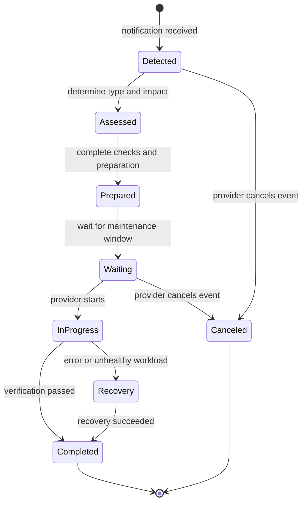
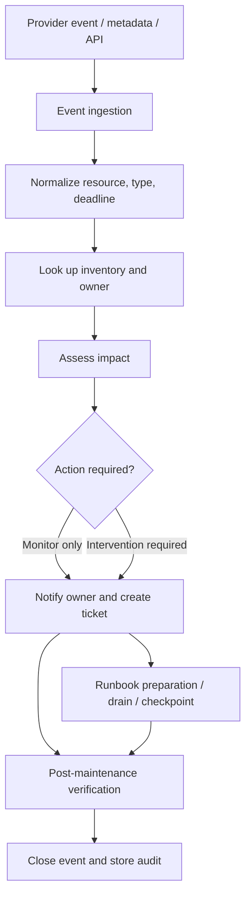

# Provider Maintenance Events and Guest Impact

Cloud providers must maintain physical servers, hypervisors, firmware, networking, and storage systems to preserve platform security, performance, and availability. During this process, customer VMs may be live-migrated to another host, rebooted, stopped and started, marked for replacement, or temporarily disconnected. Some events are announced in advance; emergency events can occur when hardware or the platform encounters faults.

Operations teams do not control physical host maintenance schedules, but they can design workloads to tolerate disruption, monitor provider notifications, and prepare appropriate responses. The key is understanding the **event type**, **response deadline**, **impact on data and networking**, and **customer responsibilities** for the OS and application.

## 1. Why Do Providers Perform Maintenance?

Cloud infrastructure spans multiple hardware and software layers. Providers perform scheduled or unscheduled maintenance to replace components, apply security updates, fix bugs, and upgrade platform capacity.

Common drivers include:

- **Hardware:** replacing failing DIMMs, CPUs, NICs, storage controllers, power supplies, or degraded servers.
- **Firmware and BIOS/UEFI:** updating firmware, CPU microcode, security configurations, or boot components.
- **Hypervisor:** patching vulnerabilities, upgrading versions, updating configurations, or rebooting hosts.
- **Networking and storage:** maintaining switches, fabrics, storage appliances, or control components.
- **Emergency security:** addressing critical vulnerabilities or risks that could affect multiple tenants.
- **Platform lifecycle:** migrating workloads off aging hosts, retiring hardware generations, or sunsetting configurations.

Not every maintenance activity disrupts a VM. Some changes happen at the underlying platform layer with virtually no noticeable impact on workloads; others require VM migration or restarts. Provider notices should be treated as signals to assess and prepare, not assumptions that every workload will experience identical impact.

## 2. Types of Maintenance Events

### Planned Routine Maintenance

The provider determines the scope and timeframe in advance, then sends notices to the account, project, subscription, or individual instances. Customers may receive a maintenance window, deadline, or action options. Details can appear in the portal, event service, API, email, or metadata endpoint.

Advance notice helps operations teams check replicas, backups, deployment schedules, and capacity. However, exact timing, deferral options, and permitted actions depend on the service type. Some events carry hard deadlines because the host must be taken out of service.

### Live Migration

Live migration moves a running VM from one physical host to another without requiring the customer to shut down the OS normally. The platform copies or synchronizes memory and CPU state, then transfers execution to the destination host. For compatible workloads, disruption is typically brief, though zero impact should never be assumed.

During cutover, there can be a brief pause, latency jitter, physical network path changes, or clock synchronization events. Workloads sensitive to real-time timing, packet processing, or continuous I/O should be tested on the specific instance type and platform.

Live migration can be constrained by instance family, passthrough devices, GPUs, local NVMe, host affinity, dedicated hosts, or special configurations. If a VM cannot be live-migrated, the provider may require a reboot, stop/start, or instance replacement.

### Reboot Due to Host Maintenance

The provider may require a VM reboot to finalize hypervisor, firmware, or hardware updates. Reboots can be scheduled in advance or executed during a maintenance window. During a reboot, in-memory processes and active connections are lost; the OS restarts and the application must recover.

If a VM runs a single-instance workload, a reboot can cause complete service downtime for the boot duration. If the application has multiple replicas behind a load balancer, traffic can shift to other replicas while one VM undergoes maintenance, provided spare capacity is sufficient.

### Stop/Start or Deallocate

Some events require stopping and restarting a VM, sometimes onto a different physical host. Impact can exceed a standard reboot:

- The VM loses in-memory state and all running processes.
- Local/ephemeral disks may lose data or are no longer guaranteed.
- Dynamic public IPs may change if the service releases addresses upon deallocation.
- Host placement and physical topology may change.
- Re-allocation may take time if the zone experiences capacity constraints.

Verify the specific behavior of your instance type, disks, NICs, and IP addresses before accepting a stop/start.

### Instance Retirement or Replacement

If a host or instance has an issue that cannot be repaired in place, the provider may mark the VM for retirement, requiring the customer to launch a replacement instance or migrate workloads. In some services, old compute resources may be stopped or deleted after the deadline.

Retirement is a signal to inspect data and dependencies immediately. Do not wait until the last minute if the workload has local state, static IPs, host-bound licenses, or special placement requirements.

### Emergency Events and Unplanned Failures

Hosts can suffer power, thermal, memory, CPU, NIC, or storage failures without long advance notice. The provider may automatically migrate, reboot, or stop VMs to protect the platform. Customers may receive notifications only after the event has begun or completed.

This is why production workloads need fault tolerance independent of maintenance notices. Notifications help prepare for planned events; replication, health checks, and failover handle unannounced disruptions.

## 3. Distinguishing Actions and Impact

| Provider Action | Does VM Keep Running? | RAM / Processes | Local / Ephemeral Disk | IP and Connections | Typical Disruption Level |
|---|---|---|---|---|---|
| Live migration | Usually yes | State transferred; brief pause possible | Usually unchanged if supported by service | Brief jitter possible | Low, but not zero |
| Guest/instance reboot | No during reboot | Lost | Usually persists across reboot, depending on disk type | TCP sessions dropped; IP usually preserved | Medium |
| Host maintenance requiring stop/start | No while stopped | Lost | May be lost or vary by commitment | Dynamic public IP may change; connections lost | Higher than reboot |
| Instance retirement/replace | Old instance stops serving | Lost | Depends on disks and replacement workflow | May need to reattach NIC/IP or update DNS | Depends on migration |
| Sudden host failure | May be lost immediately | Lost if not preserved elsewhere | Not guaranteed for local disks | Connections severed | Unpredictable |

This table describes typical behavior. Providers may define specific behaviors per instance family, disk type, accelerator, and tenancy model. Read event notices and documentation for the exact service before choosing an action.

## 4. How Are Maintenance Events Announced?

Providers deliver events through multiple channels. Operations teams should know where notices arrive, how to correlate events to resources, and how to route alerts to accountable owners.

### Portal and Event API

Management portals typically show events by resource ID, status, action type, and scheduled time. Event APIs or event routing services can forward notifications into ticketing systems, team chat, event buses, or automation.

Do not rely solely on personal emails sent to whoever created the VM. Route notices to shared operational channels with audit history and clear ownership.

### Metadata Endpoint and Guest Agent

Some clouds expose maintenance event details via a metadata service or guest OS agent. This lets applications or daemons on the VM detect upcoming events shortly before they occur. However:

- Not every provider or instance type supports the same mechanism.
- Metadata may expose only status or estimated time, not the full maintenance plan.
- Workloads must access the endpoint according to provider security requirements.
- Applications must handle timeouts, unavailable data, and repeated event notices.

Never use metadata events as the sole notification channel. If a VM cannot boot or the agent fails, in-guest notices cannot be processed. An independent control-plane channel is mandatory.

### Fields to Collect

When receiving an event, normalize it into a record containing:

| Field | Meaning |
|---|---|
| Event ID | Identifier for deduplicating processing |
| Resource ID | Affected VM, host group, or resource |
| Event type | Live migration, reboot, stop/start, retirement, or other type |
| Status | Scheduled, in progress, completed, canceled, or equivalent |
| Not-before / deadline | Earliest start or final deadline requiring action |
| Maintenance window | Expected timeframe if provided |
| Required action | Provider-handled automatically vs. customer-driven replacement/migration |
| Region / zone | Relevant infrastructure scope |
| Documentation link | Specific guidance for the event type |
| Received time | Timestamp when the customer's system received the notice |

Timestamps must be stored with explicit timezones, ideally normalized to UTC in orchestration systems and displayed in the on-call team's local timezone. Avoid misreading deadlines due to timezone differences or daylight saving transitions.

## 5. Lifecycle States of a Maintenance Event

An event can transition through multiple states. Exact state names vary by provider, but internal workflows can standardize them as follows:



Do not close an event simply because the provider reports `completed`. Customer systems must confirm that the VM, disks, networking, and applications have returned to the desired state. Conversely, if the provider cancels an event, update schedules and close out any temporary preparations.

## 6. Impact on Workloads and Services

### CPU, Memory, and Processes

Live migration can briefly pause a VM or alter execution latency. Reboots or stop/starts wipe RAM and process state. Long-running tasks such as batch jobs, video processing, model training, or scientific computing should use checkpointing to resume after VM restarts.

If workloads use CPU pinning, NUMA, huge pages, or accelerators, verify that destination hosts have compatible topology. With GPU passthrough or specialized accelerators, live migration may be unavailable or restricted.

### Storage and Data

Persistent block volumes are typically designed to outlive individual hosts, though attach and detach policies still require verification. Local NVMe or instance store volumes may be tied to the physical host and are not preserved when a VM moves hosts or retires.

For databases, maintenance events can briefly interrupt storage connectivity or trigger crash recovery on reboot. Applications need proper transaction logs, replication, checkpoints, and backups. Never treat automatic volume snapshots as proof that a database always has application-consistent backups.

### Networking and Connection Sessions

During live migration, physical network paths or NIC mappings may change. Even though logical IPs persist, open TCP connections may still pause, time out, or reset depending on platform migration mechanics and application handling.

During a reboot or stop/start, active connections are definitively interrupted. After the machine boots, verify:

- NICs and drivers are active.
- Private IPs, public IPs, routes, DNS, and security policies are correct.
- Load balancer health checks have re-admitted the VM.
- Service discovery and connection pools have re-established connections.
- Clients implement retries with backoff to avoid retry storms.

### System Clocks and Timekeeping

Pause/resume or migration can affect how the guest OS observes time, especially for clock-sensitive workloads. The OS must synchronize time through a supported service; applications must not rely on monotonic clocks or wall clocks to assume a VM was never paused.

In distributed systems, use pause-tolerant timeouts, leases, and heartbeats. If a node pauses longer than its lease, another node may be elected leader; when the old node resumes, fencing or write-permission checks are needed to prevent split-brain.

### Licensing and Host Affinity

Some software is licensed per core, socket, host ID, or specific hardware. Live migration or host replacement can affect license counting or usage terms. Dedicated hosts, host groups, or placement constraints may also restrict migration.

Before deploying, verify license terms and provider policies. Never assume host IDs or physical topology remain constant across maintenance.

## 7. Provider and Customer Responsibilities

The shared responsibility model still applies during maintenance events. The provider manages physical hosts, hypervisors, and underlying infrastructure per service; the customer manages the guest OS, applications, data, and fault-tolerant architecture within their chosen service tier.

| Area | Typical Provider Responsibility | Typical Customer Responsibility |
|---|---|---|
| Physical server and firmware maintenance | Schedule, notify, and execute | Monitor notices and prepare workloads |
| Hypervisor and virtualization layer | Patch, replace hosts, live-migrate per service capability | Choose compatible instance types and features |
| Guest OS | May expose event signals or agents | Patch OS, configure reboots, and verify services |
| Applications | No guarantee of application self-recovery | Design retries, checkpoints, health checks, and failover |
| Data | Provide durability per storage SLA | Backups, replication, restore testing, and consistency |
| Customer logical networking | Maintain cloud network fabric per SLA | Security groups, routes, DNS, load balancers, and apps |
| Business continuity | Provide foundational service capabilities | Multi-instance/zone design, RTO/RPO, and runbooks |

Exact boundaries depend on managed vs. unmanaged services, SLAs, and contracts. Read product documentation to understand what maintenance types the provider guarantees, notification lead times, and instance-type limitations.

## 8. Preparing Workloads Before the Maintenance Window

Upon receiving an event, operations must classify impact and prepare according to workload type.

### Scope Identification

1. Look up the resource ID to identify the VM, application, owner, and environment.
2. Identify the event type: live migration, reboot, stop/start, or retirement.
3. Check scheduled time, deadline, and mandatory actions.
4. Identify instance family, zone, host affinity, GPUs, and local disks.
5. List volumes, NICs, IPs, DNS, load balancers, and dependencies.
6. Check replicas, spare capacity, SLAs, RTO, and RPO.

### Backup and Data Checks

- Verify the latest backup succeeded and is restorable.
- Check database or storage replication lag.
- Create checkpoints for batch jobs, training jobs, or long processes.
- Check whether local/ephemeral disks hold data that must be migrated.
- Verify transaction logs, filesystem flushes, and post-reboot recovery capability.
- Identify which volumes persist, detach, or need reattachment after the event.

### Capacity and Failover Readiness Checks

If one VM must reboot, remaining replicas need enough capacity for the load. Look beyond instance counts: inspect CPU, RAM, connection limits, database throughput, network bandwidth, and standby zone quotas.

With autoscaling, check min/max capacity, quotas, and ability to launch new instances in remaining zones. If multiple VMs in the same group undergo maintenance, scaling out may not react fast enough or capacity may be constrained simultaneously.

### Scheduling and Communication

Link the event to a ticket/change record, owner, and on-call engineer. Notify application, database, network, security, and service desk teams if affected. If the provider allows choosing a maintenance window, pick a time aligned with traffic and support coverage.

## 9. Runbooks by Event Type

### When Provider Announces Live Migration

1. Verify that the VM and instance type support migration as described in the notice.
2. Monitor latency, packet loss, CPU pauses, or application errors during maintenance.
3. Confirm workloads have appropriate retries and timeouts.
4. Check whether GPUs, passthrough, local disks, or placement constraints restrict migration.
5. Track the event to completion and verify post-migration health.

Usually, there is no need to manually reboot the VM if the provider only requests live migration. Do not arbitrarily stop/start the VM, as that increases disruption and can change IP addresses or host placement.

### When Provider Requires a Reboot

1. Drain traffic from the VM or reduce weight in the load balancer.
2. Wait for in-flight requests and jobs to complete.
3. Flush data, checkpoint, and confirm replicas are healthy.
4. Allow the provider to perform the reboot within the window or proactively self-reboot per guidance.
5. Monitor boot logs, OS services, disks, NICs, and agents.
6. Run health checks and smoke tests, then return the VM to traffic.

If the provider gives a deadline to self-reboot before forced action, allow enough lead time for booting and testing so failures can still be handled cleanly.

### When Provider Requires Stop/Start or Retirement

1. Identify local disks and data that will not persist.
2. Migrate stateful data to persistent storage or another replica.
3. Save configurations, image IDs, necessary instance metadata, and license details.
4. Prepare replacement instances or verify quota/capacity in the target zone.
5. Determine how to retain or transfer private IPs, static public IPs, NICs, and DNS.
6. Shift traffic or write ownership to the new instance.
7. Execute stop/start, migration, or replacement per provider instructions.
8. Verify data, networking, agents, applications, and performance.
9. Decommission old resources only after confirming the new system is stable and data is intact.

Never terminate the old VM merely because the replacement booted. Confirm data, backups, network endpoints, and dependencies migrated cleanly.

## 10. Stateless and Stateful Workloads Need Different Handling

### Stateless

Stateless workloads store no unique data on a single VM. On a maintenance event, drain the node, launch or scale other replicas, and shift traffic. Essential elements:

- Multiple replicas distributed across appropriate fault domains.
- Load balancer health checks and connection draining.
- Bounded retries, exponential backoff, and idempotent requests.
- Sessions and user files stored in shared services or durable storage.
- Autoscaling and sufficient quota to offset capacity when some nodes pause.

### Stateful

Stateful workloads tie data or write ownership to a node/volume. Manage replication, quorum, leader election, fencing, backups, and ability to attach volumes to replacement hosts.

For database clusters, rebooting one node can trigger failover. Verify replica lag, quorum, and remaining nodes' headroom for extra load. When the old node rejoins, never allow it to accept writes automatically before the cluster confirms its state and role.

For batch or AI training, frequent checkpoints allow resuming after stop/start or retirement. Checkpoint frequency dictates how much work might need re-execution.

## 11. Maintenance in Container and Kubernetes Clusters

When VMs serve as Kubernetes worker nodes, maintenance events may require draining nodes so Pods reschedule elsewhere. However, `kubectl drain` or node maintenance hooks do not automatically guarantee every Pod can move.

Factors to check:

- **PodDisruptionBudget (PDB):** can block eviction if healthy replicas are insufficient.
- **Replicas and topology spread:** does the workload have enough Pods across other nodes/zones?
- **Local Persistent Volumes:** Pods may not move if data is node-bound.
- **EmptyDir and ephemeral storage:** temporary data may be lost when Pods recreate.
- **DaemonSets:** some system Pods do not drain via standard eviction.
- **GPUs/accelerators:** destination nodes must have matching devices and free capacity.
- **Node affinity/taints/tolerations:** Pods might fail to find eligible replacement nodes.

Node maintenance should include cordoning, controlled draining, confirming Pods run on other nodes, and only then letting the provider maintain the host. When the node returns, verify kubelet, CNI, CSI, device plugins, and node conditions before uncordoning.

With managed Kubernetes, the provider may automatically upgrade or replace nodes per node pool policy. Understand boundaries between control plane and worker node operations, as well as managed service maintenance notices.

## 12. Automating Maintenance Event Ingestion and Handling

At scale, you cannot rely on operators manually watching the portal. Build automated flows to ingest provider events, classify them, create tickets, and trigger runbooks.



This is a reference flow. For events requiring destructive or data-impacting actions, automation should pause at the recommendation step and await owner approval. Never automatically terminate hosts, detach volumes, or transfer leadership based solely on an unverified event.

### Designing the Event Handler

Handlers should exhibit these properties:

- **Idempotent:** receiving the same event multiple times does not repeat destructive actions.
- **Deduplication:** use event IDs or composite keys of resource ID and timestamp to filter duplicates.
- **Deadline-aware:** calculate remaining lead time and prioritize events nearing deadlines.
- **Owner-aware:** identify the right team via tags, service catalogs, or inventory.
- **Bounded retries:** handle transient errors without creating infinite loops.
- **Audited:** log raw events, decisions, approvers, actions, and outcomes.
- **Safe defaults:** if event type or resource cannot be resolved, raise an alert for operator review.

### Event Processing Pseudocode

```text
onMaintenanceEvent(event):
    if alreadyProcessed(event.id):
        return

    resource = inventory.lookup(event.resourceId)
    if resource is unknown:
        alertOperations(event)
        recordForReview(event)
        return

    impact = assessImpact(resource, event.type)
    owner = resolveOwner(resource)
    createOrUpdateTicket(event, resource, impact, owner)

    if impact.requiresDestructiveAction:
        requestHumanApproval()
    else:
        runApprovedPreparationChecks()

    recordEventDecisionAndResult(event)
```

Pseudocode illustrates logic, not directly runnable code. In production, verify event signatures or sources to prevent spoofing, protect automation credentials, and scope service identity permissions tightly.

## 13. SLAs, Maintenance Windows, and Commitment Limits

Cloud SLAs typically define availability targets per service, resource scope, and eligibility for service credits. They do not guarantee a single standalone VM will never reboot or live-migrate. Many SLAs calculate monthly availability with exclusions, requiring multi-instance deployments or specific usage conditions.

When reviewing SLAs and maintenance policies, verify:

- Whether commitments apply to VMs, disks, networks, or managed services.
- Whether availability is measured at the instance, zone, region, or service level.
- How planned maintenance events factor into downtime calculations.
- How much advance notice the provider gives and which channel is official.
- Whether customers can defer, choose windows, or self-reboot.
- Which instance types or devices do not support live migration.
- Eligibility criteria and deadlines for claiming service credits.

Do not architect systems assuming the provider will always live-migrate. Instance types, GPUs, local disks, dedicated hosts, or emergency faults can behave differently. High-availability designs must withstand any single VM dropping at any time.

## 14. Testing Maintenance Resilience

Runbooks only hold value when rehearsed. Test each layer in staging or canary groups:

1. Reboot a stateless VM and confirm traffic shifts to other replicas.
2. Drain a worker node and verify PDBs, topology spread, local volumes, and Pod startup.
3. Simulate brief connectivity loss between applications and storage/databases.
4. Test retries, timeouts, circuit breakers, and protection against retry storms.
5. Stop a stateful node per approved failover procedures and verify quorum.
6. Restore a VM from an image/backup on a compatible instance family.
7. Measure latency from event arrival to owner notification, preparation completion, and service recovery.

Never test by crashing production hosts or forcing uncontrolled provider maintenance. Use supported fault injection mechanisms within bounded scopes.

### Metrics to Track

| Metric | Purpose |
|---|---|
| Event detection latency | Time from provider event emission to customer ingestion |
| Owner acknowledgement time | Time for the owner to acknowledge receipt |
| Preparation completion | Percentage of events completing pre-checks before deadline |
| Maintenance-related downtime | Service interruption duration caused by maintenance |
| Failover success rate | Rate of successful workload handoffs |
| Recovery time | Time for applications to return to healthy state |
| Data recovery point | Data loss or replication lag upon recovery |
| Unhandled event count | Number of events lacking an owner or appropriate runbook |

These metrics expose weaknesses in notifications, inventory, capacity, automation, and application design.

## 15. Common Mistakes

- **Assuming live migration causes zero disruption.** Brief pauses or latency spikes can still affect sensitive workloads.
- **Assuming reboots take only a couple of minutes.** Boot times, database recovery, cache warming, and health checks can take much longer.
- **Overlooking local/ephemeral disks.** Data on host-attached disks can vanish during stop/start or retirement.
- **Failing to check IPs after stop/start.** Dynamic public IPs or host placement may change depending on the service.
- **Relying only on email alerts.** Recipients may be on leave, switch teams, or miss deadlines; implement event routing and clear ownership.
- **Draining Kubernetes nodes without checking PDBs.** Pods may fail to evict or lack replacement nodes.
- **Automating all events identically.** Live migration, reboots, and retirements carry different impacts; build runbooks per event type.
- **Ignoring spare capacity.** Remaining replicas can overload when a zone or host group undergoes maintenance.
- **Believing SLAs guarantee an individual VM never goes down.** SLAs do not replace application-level fault tolerance.
- **Closing events when the control plane reports completion.** Verify the guest OS, applications, and data are healthy again.

## 16. Maintenance Event Operations Checklist

**Upon Receiving Notification:**

- [ ] Verify event source, event ID, resource ID, and action type.
- [ ] Identify owner, environment, service, and criticality.
- [ ] Record deadline, maintenance window, and provider requirements.
- [ ] Check whether the VM uses GPUs, passthrough, local disks, host affinity, or special licenses.
- [ ] Open a ticket and notify relevant teams.

**Before Maintenance:**

- [ ] Check replicas, quorum, and spare capacity.
- [ ] Verify backups, snapshots, replication lag, and checkpoints.
- [ ] Identify ephemeral disk data and migration steps.
- [ ] Drain traffic or nodes per workload type.
- [ ] Check IPs, NICs, DNS, volumes, and dependencies.
- [ ] Prepare recovery runbooks and on-call coverage for the maintenance window.

**After Maintenance:**

- [ ] Confirm event completion or cancellation.
- [ ] Verify VM, OS, drivers, agents, volumes, and networking.
- [ ] Run application-level health checks and smoke tests.
- [ ] Check replication, quorum, data integrity, and checkpoints.
- [ ] Return traffic in phases and monitor metrics.
- [ ] Record downtime, anomalies, actions, and outcomes in audit/tickets.

## Conclusion

Provider maintenance events may be brief live migrations or require reboots, stop/starts, or instance replacements. Impact depends on instance type, storage, networking, accelerators, and how applications manage state. Ingest events via centralized channels, map them to owners and inventory, evaluate data and capacity, and execute matching runbooks. Stateless workloads rely on replicas and traffic draining; stateful workloads rely on replication, checkpoints, backups, and failover procedures. After maintenance, verify both infrastructure and applications before closing the event. Designing this way keeps compute services available even when physical hosts require maintenance or replacement.
