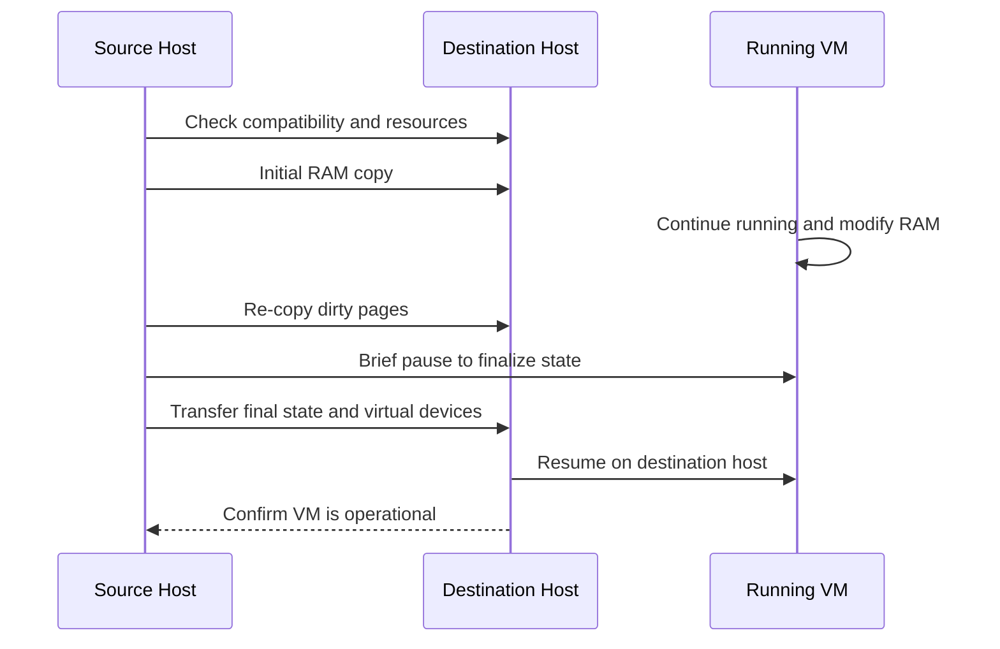

# Live Migration, Reboot, and Host Replacement in Maintenance

Virtual machines (VMs) run on the cloud provider's physical hosts. To patch hardware faults, update hypervisors, replace devices, or resolve incidents, the provider sometimes needs to move a VM, restart a VM, or shift a VM to another host. These operations can affect application connections, performance, and availability.

Three common concepts are **live migration**, **reboot**, and **host replacement**. Live migration transfers VM state to another host while attempting to keep the service running with minimal downtime. A reboot restarts the VM or guest OS, interrupting processes and connections. Host replacement substitutes the physical server running the VM; depending on the platform, the VM may be migrated live, restarted on a new host, or recreated from existing disks and configuration.

Operations teams need to understand what maintenance type the provider is performing, how workloads are affected, and how applications recover. Not every maintenance event behaves the same; live migration capability depends on the hypervisor, VM family, attached devices, storage setup, deployment zone, and service policy.

After this lesson, you will be able to:

- Distinguish live migration, guest reboot, host reboot, and host replacement.
- Explain the phases and technical prerequisites of live migration.
- Assess how reboots or host changes impact state, connections, and data.
- Prepare applications, storage, networking, and HA to tolerate infrastructure maintenance.
- Interpret maintenance notices, plan responses, and verify systems post-event.
- Determine when to fail over, restart, redeploy, or restore from backup.

## 1. Why Do Hosts Need Maintenance?

A VM is a virtualized environment running on a physical server's CPU, RAM, NICs, storage devices, and hypervisor. Providers must maintain this layer to preserve platform security, performance, and reliability.

Common reasons include:

- Replacing degraded CPUs, RAM, DIMMs, NICs, power supplies, fans, or storage devices.
- Updating firmware, BIOS/UEFI, CPU microcode, or the hypervisor.
- Patching security vulnerabilities in hardware, firmware, or the virtualization layer.
- Upgrading switches, racks, storage networks, or power/cooling systems.
- Moving workloads off hosts at risk of failure or scheduled for retirement.
- Replacing a host after hardware fails beyond continued operation.

Providers may schedule maintenance proactively or react immediately upon detecting a fault. Planned maintenance generally includes advance notice and preparation time; sudden host failures can stop a VM without prior migration.

## 2. Distinguishing Live Migration, Reboot, and Host Replacement

| Operation | What Changes? | Typical Impact on VM | What Applications Must Prepare |
|---|---|---|---|
| Live migration | VM state transfers from source host to destination host | May experience only a very brief pause; TCP connections may survive but still require testing | Tolerate brief latency spikes, minor packet loss, or pauses; avoid pinning to a fixed physical host |
| Guest OS reboot | Operating system inside the VM restarts | Processes and connections are severed; unpersisted data may be lost | Graceful shutdown/startup, auto-starting services, readiness checks, and job recovery |
| Host reboot / maintenance reboot | Physical host or underlying layer restarts; VM may reboot or migrate per policy | Can cause downtime if live migration is unsupported or the service requires a VM reboot | HA design, tracking maintenance events, testing reboots and failover |
| Host replacement | Old physical host is replaced by another host | VM may be migrated, stopped/started, or recreated depending on the service | Data must live on persistent storage or backups; configuration and identity must restore properly |
| Sudden host failure | Host stops functioning before migration finishes | VM can lose power suddenly; apps must restart or fail over | Crash recovery, journal/database recovery, safe retries, and backup/replication |

Provider terminology varies. For example, some platforms use "redeploy," "recovery," "rehost," or "maintenance event" for operations with distinct semantics. Always verify policies for your specific VM type and read event details rather than guessing from names.

## 3. How Does Live Migration Work?

Live migration moves a running VM from a source host to a destination host without fully shutting down the workload for most of the transfer. The goal is minimizing downtime, though zero disruption is not guaranteed.

### Components Transferred or Maintained

- **CPU state:** register states, execution context, and CPU features used by the VM.
- **Memory state:** VM RAM contents, including memory pages actively used by processes.
- **Virtual device state:** state of virtual network adapters, disk controllers, and virtual devices.
- **Storage access:** the destination host must retain access to VM disks or receive a consistent data copy.
- **Network identity:** IP addresses, logical MACs, virtual NICs, and network flows must continue operating per platform design.
- **Execution state:** at the final switchover, the VM must resume execution from a consistent state on the destination host.

### Common Pre-Copy Workflow

A widely used technique is pre-copy:

1. **Initialization:** the control plane picks a destination host and checks compatibility, resources, networking, and storage.
2. **Initial RAM copy:** VM memory pages are copied from source to destination while the VM keeps running.
3. **Dirty page tracking:** as the application modifies RAM, the hypervisor tracks modified pages (dirty pages).
4. **Iterative copy:** modified pages are retransmitted until the remaining delta is small enough or a convergence limit is reached.
5. **Brief pause:** the VM pauses briefly to transfer final state, virtual devices, and execution context.
6. **Resume on destination:** the VM resumes on the new host; networking and storage cut over per platform mechanisms.
7. **Completion:** the source host frees resources after confirming the destination host is stable.



Some platforms use post-copy or hybrid techniques. With post-copy, a VM starts executing on the destination host before all RAM finishes transferring; missing pages are fetched on demand from the source host. This has different performance and failure characteristics than pre-copy. Users generally do not pick the algorithm, but should recognize that behavior and disruption levels depend on the provider's implementation.

### Why Can Live Migration Still Cause Impact?

- The VM may pause briefly while finalizing state.
- Network flows may drop a few packets or see elevated latency as paths update.
- Storage and migration network traffic can alter I/O latency.
- High dirty page rates can prolong copying or prevent convergence.
- The destination host may differ in CPU, NUMA, cache, or bandwidth characteristics.
- Some workloads are sensitive to pauses, clock drift, or passthrough devices.

Therefore, live migration reduces impact but does not replace fault-tolerant application design.

## 4. Prerequisites and Limitations of Live Migration

Not every VM can be live-migrated in every scenario. Capability depends on hardware, hypervisor, VM configuration, and the cloud service.

### CPU and Host Compatibility

The destination host must support the CPU instruction sets and virtualization features required by the VM. Some platforms offer CPU compatibility modes or limit exposed instruction sets to allow migration across host generations. If a VM uses specialized CPU features or host-bound settings, migration may be restricted.

### Special Devices and Features

The following configurations may not support live migration or may require special handling:

- GPU passthrough or PCIe device passthrough.
- SR-IOV or NICs with specialized offload features.
- Local/ephemeral disks directly attached to the physical host.
- Host affinity/anti-affinity or dedicated host constraints.
- Virtual devices or drivers incompatible with the destination host.
- VMs using nested virtualization or provider-specific special configurations.

This list does not apply uniformly across all clouds. Some platforms now support migrating certain accelerators; consult the support matrix for your exact instance type.

### Capacity and Migration Networking

The destination host needs sufficient CPU, RAM, storage, and network capacity to host the VM. If a cluster is nearly full or many VMs must migrate concurrently, the provider may queue migrations, pick different hosts, or require reboots.

### Shared Storage and Local Data

If a VM uses shared storage, the destination host can keep accessing the same volumes. If a VM uses host-attached local disks, data may not follow the VM across host changes. Clearly identify which data is persistent, which is cache/ephemeral, and how to recover it.

## 5. Reboot: What Happens When a VM Restarts?

Reboots can be triggered by the OS, administrators, patching tools, or the cloud provider. Regardless of cause, processes inside the VM terminate and start fresh.

### Guest Reboot

A guest reboot restarts the guest operating system. The sequence typically includes:

1. The OS receives the reboot request.
2. Services receive stop signals and finish whatever work they can.
3. Filesystems flush data and unmount cleanly.
4. The kernel halts, the VM resets, and the bootloader loads the OS.
5. Networking, disks, agents, and services initialize.
6. Applications bootstrap, connect to dependencies, and report readiness.

If a VM suffers a hard reset or host power loss, graceful shutdown steps may be skipped. Filesystem journals and database crash recovery help restore consistency, but do not replace backups.

### Host Reboot or Maintenance Requiring VM Reboot

Providers may notify you that a VM needs a reboot to apply patches or hardware updates. Some events let users choose a time within a window; emergency events may carry tight deadlines or be provider-scheduled.

Upon notification, determine:

- Affected VM ID, region/zone, host, or resource group.
- Maintenance completion deadline and whether timing is selectable.
- Whether the action is live migration, VM reboot, stop/deallocate, or redeploy.
- Whether local/ephemeral disks will be lost.
- Whether IPs, MACs, hostnames, instance identity, and attached disks are preserved.
- Dependent workloads and expected outage duration.

## 6. Host Replacement and VM Recovery

Host replacement substitutes a failed or retiring physical server. Depending on the platform, recovery may occur automatically without user intervention or require user-confirmed redeploy/recovery.

### Common Recovery Patterns

| Recovery Pattern | Behavior | Key Requirements |
|---|---|---|
| Live migrate before host retires | VM moves to another host while running | VM and devices support migration; destination host has capacity |
| Reboot on a new host | VM stops and boots on a replacement host | Boot disk and required data remain accessible; app self-recovers |
| Stop/deallocate then start | VM is released from the old host and reallocated | Must understand IPs, local disks, reservations, and compute state after deallocation |
| Redeploy/recreate | Platform creates a new VM environment from existing disks or image/config | Configuration is reproducible; durable data resides outside local disks |
| Failover to standby VM | Workload shifts to another instance or zone | Replication, health checks, routing, and failover mechanisms pre-configured |

Naming and exact semantics vary. For instance, "redeploy" on one service may move the VM to another host while keeping disks; on another, it may rebuild the environment and wipe local temporary storage. Verify exactly which data and attributes are preserved.

### What Can Change After Host Replacement?

- Physical host, CPU stepping, or NUMA layout may differ.
- The VM may reboot and drop all open connections.
- Local/ephemeral disks may be lost or reinitialized.
- Private IPs may persist if bound to a NIC, or change if network resources are recreated.
- Public IPs, hostnames, instance IDs, and metadata behave according to platform rules.
- Monitoring agents or host registration software may need to re-register.
- CPU, network, or storage performance may shift on the new host hardware.

Never assume a VM keeps every attribute simply because its VM name stays unchanged. Use resource IDs and re-verify NICs, IPs, disks, identities, and metadata after recovery.

## 7. Data: Persistent Disks vs. Local/Ephemeral Disks

This is one of the most critical aspects of preparing for host replacement.

| Storage Type | Characteristics | Preparation |
|---|---|---|
| Persistent/managed disk | Managed independently from the host; can detach/attach or survive reboots per service | Check backups, encryption, attachments, and reattachment capability |
| Local/ephemeral disk | Located on local or host-attached storage; may be lost on host replacement/deallocation | Store only caches, scratch data, or regenerable data; never use as the sole copy of critical data |
| Network file/object storage | Accessed over the network and independent of the VM | Verify permissions, endpoints, routes, and accessibility post-migration |
| Snapshots/backups | Point-in-time or scheduled copies | Verify consistency, retention, restore permissions, and recovery time |

For databases, locate where logs, data files, journals, and write caches reside. A single volume snapshot may be inconsistent if the app is actively writing. Use native database backup tools, workload quiescing, or platform application-consistent snapshot mechanisms.

## 8. Preparing Applications for Migration and Reboots

Design applications assuming connections can drop and processes can restart at any time.

### Avoid Relying Solely on In-Memory State

- Persist critical business state in durable databases or storage.
- Use queues with proper acknowledgements for background tasks.
- Design jobs to be retryable and idempotent to avoid duplicate transactions.
- Checkpoint long batch or compute jobs.
- Never keep the sole copy of unique data on local/ephemeral disks.

### Connection Recovery

After a reboot or migration, TCP connections, database pools, DNS caches, and sessions may reset or expire. Applications should:

- Set timeouts on connections and requests.
- Retry with exponential backoff, jitter, and bounded attempts.
- Recreate connection pools when broken connections are detected.
- Avoid infinite retries or synchronized retry bursts causing thundering herds.
- Handle DNS errors and endpoint changes via discovery mechanisms.

### Startup and Readiness

A process may start before the application is truly ready. Readiness endpoints should report ready only after configuration, secrets, dependencies, and required components finish initializing. Load balancers must not route new requests to unready VMs or containers.

### Graceful Shutdown

When the platform sends a maintenance event or stop signal, the application should:

1. Stop accepting new work.
2. Mark itself not-ready and exit the backend pool.
3. Drain in-flight requests or messages.
4. Flush data and close connections.
5. Exit within the grace period.

Not every host failure delivers a shutdown signal. Graceful shutdown minimizes errors during planned maintenance; crash recovery remains essential for sudden outages.

## 9. Designing HA so Maintenance Does Not Disrupt Services

Live migration reduces impact on an individual VM, but HA must be engineered at the application tier. If a service runs on a single VM, a reboot or host replacement still causes downtime while the VM recovers.

### Multiple Instances and Load Balancing

Run multiple instances across distinct hosts or fault domains behind a load balancer with health checks. When one instance needs maintenance, drain it and let remaining instances serve traffic.

### Multi-Availability Zone Distribution

For high availability, spread instances across multiple AZs. Multiple VMs on the same host or in the same AZ do not protect against host, rack, or zone failures at the corresponding tier. Verify actual topology and service placement policies.

### Capacity Headroom

When one instance drains or an AZ goes down, the remaining fleet must handle the load. If a cluster routinely runs at 90–100% CPU, maintaining one VM can overload the rest. Plan N+1 capacity or reserve headroom per service targets.

### Data and Failover

Stateless applications are generally easier to replace per instance. For databases or stateful workloads, implement replication, quorum, failover, backups, and RPO/RTO validation. Asynchronous replication may lose recent writes during failover; synchronous replication trades latency and availability.

## 10. Maintenance Notifications and Events

Providers send notifications via portals, email, event services, APIs, metadata endpoints, or health/advisor systems. Some platforms emit maintenance events containing resource ID, action type, start time, deadline, and status.

An ingestion workflow should include:

1. **Collection:** receive the event and log VM/resource ID, region, maintenance type, deadline, and expected action.
2. **Classification:** determine whether the event affects one instance, one host, an AZ, or a shared service.
3. **Assessment:** review workloads, local data, dependencies, HA, and criticality.
4. **Scheduling:** if timing is selectable, choose a low-traffic window avoiding backups, batches, or releases.
5. **Preparation:** drain, back up, confirm capacity, and verify standby instances.
6. **Execution/monitoring:** track maintenance status, health checks, latency, error rates, and follow-up events.
7. **Verification:** check the VM, storage, networking, identity, and application post-event.
8. **Closure:** document outcomes, actual downtime, any data loss, and improvement actions.

Do not rely solely on one individual's inbox. Integrate maintenance events into ticketing/alerting systems with clear owners, deadlines, and audit trails. Also avoid automating destructive actions based on unverified events.

## 11. Maintenance Planning by Workload Type

| Workload | Primary Risks | Priority Preparations |
|---|---|---|
| Stateless Web/API | Failed requests, connection resets, reduced capacity | Multiple instances, readiness, load balancer draining, bounded retries |
| Queue workers | Lost or duplicate message processing | Graceful stop, visibility timeouts, idempotency, checkpoints |
| Databases | Lost writes, slow recovery, bad failovers | Consistent backups, replication, quorum, RPO/RTO, restore testing |
| Caches | Sudden cache miss spikes flooding the database | Warm-up, cache stampede protection, database headroom |
| GPU/accelerator workloads | No live migration, local data loss, or long startup | Checkpointing, job queuing, verify host maintenance support and drivers |
| Batch/HPC | Interrupted long jobs | Periodic checkpoints, retries, job splitting, preemptible capacity where suitable |
| Bastion/management VMs | Loss of administrative access | Redundant access paths, console/managed sessions, multi-AZ if needed |

## 12. Example: Host Maintenance for an API and Database System

A retail app runs three API VMs behind a load balancer and a primary/standby database cluster across two AZs. The provider announces that one API VM will undergo live migration and one database VM requires a reboot within a maintenance window.

**For the API:** the team verifies all three instances are healthy and have enough headroom if one leaves the backend pool. The load balancer drains the target VM; in-flight requests finish. The provider executes the migration. Post-event, the team checks instance health, latency, error rates, and database connectivity before restoring full load.

**For the database:** the team checks replication lag, the latest backup, quorum health, and failover readiness. If supported by the service, the team fails over the primary role to the standby node before the reboot window. Once the node reboots, the team verifies replication catches up, tests read/write queries, and decides whether to keep the node as standby.

**End-to-end verification:** the team monitors error rates, transaction failures, queue depth, and p95/p99 latency. If anomalies appear, keep traffic on healthy nodes and execute rollback/failback per the runbook.

This example shows how a single host event type affects stateless and stateful workloads differently. Identical maintenance notices should not trigger identical actions across every VM.

## 13. Maintenance Event Response Runbook

A concise runbook can standardize team responses:

```text
1. Validate the maintenance event and identify the resource ID.
2. Determine the action: live migration, reboot, redeploy, or host replacement.
3. Check owner, criticality, dependencies, and maintenance windows.
4. Verify HA, capacity, replication, backups, and local/ephemeral storage.
5. Drain traffic or stop jobs if required.
6. Monitor the event and VM status while the provider executes maintenance.
7. Post-event, verify boot, IP/NIC, disks, identity, agents, and app readiness.
8. Test representative transactions or jobs; inspect metrics and logs.
9. Restore traffic distribution and confirm SLOs.
10. Record downtime, impact, evidence, and operational lessons.
```

### Stop or Escalation Conditions

- Standby instances are unhealthy or capacity is insufficient.
- Replication lag exceeds thresholds or backups failed to complete.
- The event indicates local disks may be lost while data has not been migrated.
- Maintenance overruns the window or status stops updating.
- After reboot, the VM lacks an IP, fails to mount disks, or fails readiness.
- Error rates, latency, or business metrics breach acceptable thresholds.

When encountering these conditions, keep workloads safe, page owners/on-call, and follow incident procedures. Do not repeatedly retry reboots or redeploys without understanding the root cause.

## 14. Post-Event Checks After Live Migration, Reboot, or Host Replacement

Verify both infrastructure and applications after the event. A VM status of "running" does not prove the service has recovered.

### Infrastructure

- The VM is in the expected state with no pending maintenance events left.
- CPU, memory, disk I/O, and network throughput show no anomalies.
- NICs, private/public IPs, routes, and security policies match design.
- Persistent disks are attached properly; local/ephemeral disks checked per policy.
- Management, monitoring, backup, patching, and endpoint protection agents are active.
- Instance identity, certificates, and access permissions remain valid.

### Application and Data

- Processes and services started; readiness passes before taking traffic.
- Connections to databases, queues, caches, and dependent APIs work.
- No orphaned transactions, lost jobs, or uncontrolled duplicate messages exist.
- Database recovery/replication completed; consistency checked per runbook.
- Load balancers, service discovery, and DNS point to the right endpoints.
- Error rates, p95/p99 latency, queue depth, and saturation return to normal.

### Operational Evidence

Record start/end times, action type, VM ID, host/zone if provided, observed downtime, before/after metrics, test results, and issues encountered. This evidence improves future maintenance planning.

## 15. Measuring Impact and Recovery Objectives

To evaluate how well workloads tolerate maintenance, track:

- **Downtime:** duration the service fails to serve valid requests.
- **Recovery Time:** time from disruption start until the service reaches readiness and SLOs.
- **RTO (Recovery Time Objective):** target maximum recovery time accepted by the business.
- **RPO (Recovery Point Objective):** target maximum tolerable data loss, typically expressed as a time interval.
- **Error rate and latency:** error percentages and p95/p99 during and after maintenance.
- **Replication lag and data integrity:** replication delay and data verification results.
- **Capacity headroom:** load remaining instances must carry when a VM or AZ leaves service.

Do not treat the provider's published live migration pause time as the sole measure of application downtime. DNS, connection pools, retries, load balancer health checks, and dependency recovery can make actual recovery longer.

## 16. Common Mistakes

**Assuming live migration causes zero disruption.** Brief pauses, packet loss, or latency spikes can occur. Applications still need safe timeouts and retries.

**Assuming reboots preserve all state.** Processes, RAM, and connections are lost; local disks or addresses may change depending on resource type.

**Using local disks as the sole storage for data.** Host replacement or deallocation can wipe local data. Use persistent storage and appropriate backups.

**Running a critical service on a single VM.** Live migration does not guarantee zero downtime across every event. Use multiple instances, HA, and spare capacity.

**Ignoring maintenance events.** Reboots, redeploys, and live migrations behave differently. Always identify the action, deadline, and affected resources.

**Failing over a database without checking replication.** Data loss or split-brain can occur if quorum/fencing is misconfigured. Follow the database runbook.

**Returning a VM to traffic just because its status is running.** The app may not have connected to dependencies or warmed up yet. Check readiness and representative transactions.

**Ignoring capacity when draining an instance.** Remaining instances can overload during maintenance or failover. Plan headroom for N+1 or realistic targets.

## 17. Host Maintenance Preparation Checklist

### Before the Event

- [ ] Identify VM ID, owner, environment, region/zone, and workload.
- [ ] Read the maintenance action type, deadline, and service data behavior.
- [ ] Verify whether live migration is supported for the VM family and attached devices.
- [ ] Check local/ephemeral disks, persistent disks, snapshots, and backups.
- [ ] Confirm HA, standby instances, load balancers, and capacity headroom.
- [ ] Verify replication, quorum, and RPO/RTO for stateful workloads.
- [ ] Pick a maintenance window avoiding peak traffic and critical batches.
- [ ] Prepare draining, graceful shutdown, retries, checkpoints, and rollback/failover runbooks.
- [ ] Notify owners, on-call engineers, and dependent teams.

### During the Event

- [ ] Track the maintenance event and VM state.
- [ ] Monitor health checks, traffic, latency, error rates, and queues.
- [ ] Confirm standby instances stay healthy with enough capacity.
- [ ] Do not issue additional reboot/redeploy actions without diagnosing root cause.
- [ ] Escalate if deadlines are missed or safety conditions no longer hold.

### After the Event

- [ ] Verify VM boot, networking, IPs, disks, identity, and agents.
- [ ] Verify readiness before returning the VM to traffic.
- [ ] Check databases, queues, caches, jobs, and business data.
- [ ] Check metrics, logs, SLOs, and replication lag.
- [ ] Confirm backups and monitoring continue operating.
- [ ] Record downtime, impact, and outcomes in tickets/runbooks.

## 18. Self-Check

1. How does live migration differ from a reboot in terms of VM state and disruption duration?
2. Why can live migration still increase latency or drop some packets?
3. What are dirty pages, and why can RAM-intensive write workloads make migration harder to converge?
4. Which devices or configurations can restrict live migration?
5. When host replacement happens, why do local/ephemeral disks require special inspection?
6. What should a three-instance stateless API behind a load balancer prepare before one VM reboots?
7. For a primary/standby database, what must be verified before failing over or rebooting a node?
8. Why is a VM state of `running` insufficient to return an instance to the load balancer?
9. Distinguish RTO and RPO in maintenance and recovery planning.

Live migration, reboots, and host replacement are normal operations in the cloud infrastructure lifecycle, but their impact depends on workload characteristics and configuration. When data sits in the right storage tier, applications tolerate restarts, HA has adequate headroom, maintenance events follow runbooks, and readiness is verified afterward, organizations minimize disruption and recover cleanly whenever physical hosts need maintenance or replacement.
