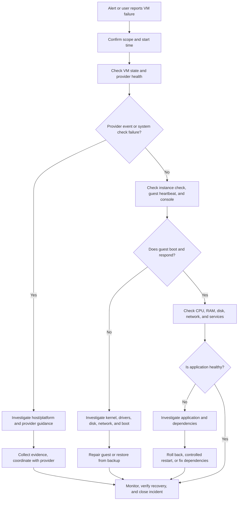

# Monitoring Instance Health and Distinguishing Host Failures from Guest Failures

## Learning Objectives

After this lesson, you will be able to:

- Build a metric set for monitoring VM health across infrastructure, guest OS, and application layers.
- Distinguish host or cloud platform failures from failures inside the guest OS based on signals and evidence.
- Understand the limitations of VM states, status checks, heartbeats, and default metrics.
- Use logs, consoles, agents, and OS tools to isolate incidents.
- Design alerts, troubleshooting workflows, and recovery options suited to each failure domain.
- Capture evidence before rebooting, migrating, or replacing an instance to reduce downtime and support root cause analysis.

## 1. What Is Instance Health?

A VM can display a **Running** state in the cloud console while the application remains unreachable. Conversely, the guest OS may operate normally while the cloud platform announces that the host requires maintenance or has an infrastructure fault. Therefore, VM power state alone is not enough to conclude that a machine is healthy.

Instance health is a comprehensive assessment of the operational readiness of a VM and the services running on it. The evaluation should span multiple layers:

1. **Host and cloud platform layer:** physical server, hypervisor, storage network, power, orchestration systems, and infrastructure components operated by the provider.
2. **VM/virtual hardware layer:** provisioning state, virtual CPUs, RAM, network devices, virtual disks, and platform connectivity channels.
3. **Guest OS layer:** kernel, drivers, filesystems, processes, system services, memory, network stack, and agents.
4. **Application layer:** business processes, endpoints, dependencies, queues, database connections, and ability to serve actual requests.

These layers are related but not identical. The host can be healthy while the guest suffers a kernel panic. The guest can be healthy while the application dies from connection pool exhaustion. An application can still return a simple health check even when critical functionality is broken.

### 1.1. How do host and guest differ?

- **Host** is the physical server and virtualization layer running the VM. The cloud provider is typically responsible for operating, repairing, and maintaining this layer.
- **Guest** is the operating system and software running inside the VM. Customers typically administer the guest kernel, drivers, services, agents, filesystems, and applications.
- **Control plane** is the management plane used to create, stop, configure, and track resources. The control plane may report a VM as Running even if the guest is unresponsive.
- **Data plane** is the path handling actual traffic and I/O, such as network or disk access. The control plane and data plane can fail independently.

For example, a VM creation API returning `Running` means the resource has been provisioned and is in a running state according to the platform's model. It does not prove SSH/RDP works, the guest has finished booting, or the application is ready.

### 1.2. Four observation layers

| Layer | Question to answer | Example signals |
|---|---|---|
| Host/platform | Is the underlying infrastructure failing or under maintenance? | System health events, host maintenance events, platform status checks |
| VM/virtual hardware | Is the VM provisioned and attached to virtual devices? | Instance state, system/instance status checks, disk/network attachments |
| Guest OS | Has the OS booted and is it operating normally? | Agent heartbeat, CPU/RAM, filesystems, kernel logs, service state |
| Application | Can users use the functionality? | HTTP probes, latency, error rate, queue lag, synthetic transactions |

A solid monitoring workflow needs signals across all four layers. With only cloud CPU metrics, you may know the VM is busy without knowing whether the application can serve users. With only an HTTP health check, you know the API is failing without knowing whether the root cause lies in the host, guest, network, or database.

## 2. Understanding VM States and Cloud Health Checks

Cloud consoles typically display lifecycle states such as `Creating`, `Starting`, `Running`, `Stopping`, `Stopped`, `Deleting`, or `Failed`. These are resource control states. Providers may also offer status checks or resource health to reflect infrastructure and VM operability.

Distinguish between:

- **Instance state:** lifecycle state of the VM resource.
- **Host/system health check:** signal from the platform regarding the host, hypervisor, or infrastructure required for the VM to run.
- **Instance/guest reachability check:** signal indicating whether the guest responds to basic checks.
- **Guest agent heartbeat:** signal sent from an agent inside the OS to the management system.
- **Application health check:** verification of an endpoint or business function.

Naming and check mechanisms vary by provider. For example, AWS EC2 has system and instance status checks; Azure provides Resource Health, VM availability, and boot diagnostics depending on service type; Google Cloud provides VM status, guest attributes/agents, and host maintenance or fault events depending on platform capabilities. Read the documentation for the exact service and VM type in use.

### 2.1. A status check is not a comprehensive check

A passing status check means the checked conditions passed at that point in time. It does not prove:

- The application is processing business logic correctly.
- Every filesystem has sufficient free space.
- Databases or dependent services are healthy.
- The guest has no memory leak or logic bug.
- All network paths from every client are working.
- The VM will remain healthy for the next few minutes.

Similarly, a failing status check must be read alongside the check type, timestamp, and event details. If a system check fails, investigate the host/platform. If an instance check fails, the guest may be unresponsive due to the kernel, network stack, firewall, boot failure, or internal VM resources.

### 2.2. Default metrics and guest monitoring agents

Cloud platforms typically collect certain metrics at the hypervisor or service layer, such as CPU utilization, network bytes, disk operations, and VM state. These metrics are useful, though they do not necessarily reflect every detail inside the guest.

To monitor RAM, swap, filesystems, processes, services, logs, and application metrics, installing a guest agent or monitoring agent may be required. The agent typically collects data inside the OS and sends it to the monitoring service.

Before installing an agent, determine:

- Which OSes and versions the agent supports.
- System permissions and network endpoints the agent requires.
- How the agent authenticates with the monitoring service.
- Metric and log emission frequency, generated volume, and cost.
- How to detect a stopped agent or lost heartbeat.
- Whether the agent impacts CPU, RAM, disk I/O, or security.

Do not treat missing metrics as proof that the VM has failed. The agent might not be installed, may be misconfigured, blocked by the network, or lack permissions to write data.

## 3. Health Signals to Monitor

The metric set should match the VM's role. A database server, web server, batch worker, and jump host have different load characteristics. Build baselines per workload group rather than using a single threshold across the entire system.

### 3.1. CPU

Commonly used indicators:

- Overall and per-vCPU utilization.
- Load average or run queue inside the guest.
- CPU steal time if provided by the OS.
- I/O wait time.
- Throttling frequency or VM/container CPU limits if applicable.
- CPU usage by process and service.

Sustained high CPU can result from increased business load, infinite loops, failing processes, or insufficient vCPUs. High CPU steal time can indicate the guest is not receiving CPU time as expected in certain virtualization environments, though it does not prove a host fault on its own. Cross-check instance type, CPU sharing policy, timing, and platform metrics.

High load average does not always mean CPU overload either. Processes waiting on I/O can drive up load average even when CPU utilization is low. Examine run queue, CPU, I/O wait, and application response time together.

### 3.2. Memory

Monitor:

- Available RAM and per-process usage.
- Swap-in/out and page faults.
- OOM killer or memory allocation errors.
- OS cache/buffer memory.
- Runtime heap, garbage collection, and memory pools.
- Memory pressure and VM/container limits.

Do not use RAM used percentage alone to conclude memory exhaustion. Linux regularly uses idle RAM as page cache. Look at available memory, swap activity, OOM events, and memory growth over time. A VM can have free RAM while a Java application still hits `OutOfMemoryError` due to heap limits or non-heap regions.

### 3.3. Disk and filesystem

Monitor two distinct layers:

- **Cloud-layer disk:** volume state, IOPS, throughput, latency, queue depth, burst balance, or service limits.
- **Guest filesystem:** used capacity, inodes, mount points, read-only state, filesystem errors, and temporary storage.

Notable warning signs:

- Unusual spikes in disk latency or queue depth.
- IOPS/throughput hitting provisioned limits.
- Full filesystem or exhausted inodes.
- Volume detached, lost path, or remounted read-only.
- Kernel logs showing block device errors, timeouts, or filesystem corruption.

Cloud disk metrics reflect I/O delivered to the volume, but do not provide full visibility into the filesystem inside the guest. Combine volume metrics with `df`, `iostat`, and kernel logs.

### 3.4. Network

Monitor:

- Bytes/packets in and out.
- Packet drops, errors, and retransmissions.
- Network latency and TCP connections.
- Connection counts and sockets in abnormal states.
- DNS resolution and dependency reachability.
- Network interface state and routes.

A VM may show normal network metrics while the application remains unreachable due to security groups, guest firewalls, routes, DNS, or ephemeral port exhaustion. Test from multiple vantage points: inside the guest, from a machine in the same subnet, and from actual clients.

### 3.5. Boot, kernel, and system services

Important signals:

- Boot diagnostics, serial console, or console screenshots.
- Time from VM power-on until the guest agent heartbeat appears.
- Kernel panics, bugchecks/BSODs, and watchdog resets.
- Errors mounting the root filesystem or disks.
- Critical services failing to start.
- Failed systemd units or Windows Service failures.
- Changes to kernels, drivers, packages, or configs near the time of failure.

A VM may emit no metrics because the guest has not finished booting. In that case, console logs and boot diagnostics are far more valuable than standard metric dashboards.

### 3.6. Application and dependencies

Health should ultimately map to serviceability:

- HTTP success/error rate.
- p50, p95, and p99 latency.
- Active in-flight requests and queue depth.
- Connection pools, thread pools, and worker counts.
- Database connections, query latency, and replication lag.
- Cache hit ratio, evictions, and timeouts.
- Queue lag, retries, and dead-letter counts.
- Synthetic transactions simulating user actions.

Health endpoints must reflect their exact purpose. Liveness checks answer whether the application needs to be restarted; readiness checks answer whether the application should receive traffic. Avoid putting non-essential dependencies into liveness checks, as a temporary database outage could cause every instance to restart in a loop.

## 4. Distinguishing Host/Platform Failures from Guest OS Failures

No single indicator is enough to classify every incident. Combine status checks, platform events, guest metrics, console output, and blast radius.

### 4.1. Signals pointing toward host or platform

- The cloud provider posts notices of host degradation, hardware failure, scheduled maintenance, or recovery events.
- System/host status checks fail with no evidence that the guest caused the failure.
- Multiple independent VMs are affected simultaneously within the same infrastructure or service boundary.
- The platform indicates the VM must be migrated, restarted, or recovered due to a host issue.
- The guest cannot access virtual devices due to a confirmed provider-side fault.
- The failure occurs after an infrastructure event and is confirmed by the provider in resource health or service health.

These are signals for investigation, not absolute proof. For instance, multiple VMs losing connectivity together can also be caused by shared routes, firewalls, or customer network configuration changes.

### 4.2. Signals pointing toward guest OS

- Host/system checks pass, while instance/guest reachability checks fail.
- Guest agent heartbeat drops while the platform still reports the VM as running.
- Serial console shows a kernel panic, boot loop, filesystem error, or driver failure.
- OS logs contain OOM killer entries, bugchecks, service crashes, disk full errors, or network misconfigurations.
- SSH/RDP fails due to guest firewall, `sshd`/Remote Desktop service, or OS configuration.
- A process consumes excessive CPU/RAM, runs out of file descriptors, or exhausts sockets.
- Booting into rescue mode or attaching the disk to a rescue VM shows the fault lies in the filesystem, bootloader, or guest configuration.

Passing host checks does not guarantee the guest is completely healthy; host checks only evaluate the components tested by the platform.

### 4.3. Comparison table

| Criterion | Host/platform failure | Guest OS failure |
|---|---|---|
| Origin | Physical server, hypervisor, or infrastructure service | Kernel, drivers, filesystems, services, or config inside the VM |
| Primary signals | Provider events, system/host checks, maintenance notices | Guest heartbeat, instance checks, OS logs, console |
| Blast radius | May affect multiple VMs or resource groups sharing a host/zone/service | Usually isolated to one VM or VM group sharing an image/config |
| SSH/RDP | May drop due to host/virtual network | May drop due to OS boot, firewall, service, or resource exhaustion |
| Guest CPU/RAM | May be uncollectible when guest is unresponsive | May show overload, OOM, or faulty process if agent is still running |
| Action | Follow provider guidance, use supported recovery/migration | Fix OS, drivers, disk, services, or roll back changes |
| Owner | Provider owns host; customer coordinates and restores workload | Guest/application operations team holds primary responsibility |

### 4.4. Cases that cannot be concluded immediately

Some cases sit on the boundary between the two domains:

- The guest hangs, causing instance checks to fail, while the initial trigger may have been host or storage I/O.
- Virtual networking drops due to guest configuration or a network infrastructure incident.
- Rising CPU steal may relate to contention, though instance type and CPU policy must be inspected.
- An agent stops sending metrics due to agent crash, DNS, proxy, firewall, or the monitoring service itself.
- A zone incident can disconnect many VMs, though a shared route change could do the same.

When evidence is insufficient, record the cause as **undetermined**. Do not blame either the host or the guest solely because a VM fails to respond to ping.

## 5. Layered Diagnostic Workflow

Use the workflow below to move from symptoms to the failure domain. The goal is to gather evidence first, then select the action with the smallest impact.



### Step 1: Confirm symptoms

Record:

- VM ID, hostname, region/zone, and instance type.
- Start time, timezone, and duration.
- Which users or systems are affected.
- Whether SSH/RDP, ping, application endpoints, and dependencies work.
- Any recent changes to images, kernels, drivers, firewalls, routes, disks, or policies.
- Whether the failure affects one VM, multiple VMs in a group, or the entire service.

Compare the failure time against deployments, autoscaling, backups, patching, and maintenance windows.

### Step 2: Check control plane and provider events

- Inspect instance state and status checks.
- Inspect the provider's Resource Health / instance health events.
- Check regional/zonal service health or maintenance events.
- Read boot diagnostics, serial console, or system logs if available.
- Record request IDs, event IDs, and error codes.
- Check whether the platform recommends recovery, reboot, redeploy, or migration.

If the provider confirms a host issue, save evidence and follow supported recovery procedures. Do not assume live migration or arbitrary host relocation is possible; many platforms only support stop/start, automatic recovery, or creating a replacement VM.

### Step 3: Check the guest

If the VM is still accessible:

- Confirm OS uptime and boot time.
- Check CPU, RAM, swap, disk, and network.
- Inspect kernel/system logs around the failure timestamp.
- Check critical services and processes.
- Check agent heartbeat, DNS, and connectivity to monitoring endpoints.
- Verify filesystems are writable and not full.

If the VM is inaccessible:

- Use the serial console or boot diagnostics.
- Check boot screenshots if provided by the platform.
- Look for crash logs, kernel panics, or Windows bugchecks.
- Use rescue mode or attach a disk copy to another VM if needed.
- Before repairing filesystems or bootloaders, take a snapshot/copy per procedure.

### Step 4: Check application and dependencies

If the guest OS is healthy:

- Call endpoints from localhost and from external networks.
- Inspect service status, application logs, and error rates.
- Check DNS, routes, firewalls, and security groups.
- Check databases, caches, queues, and secret services.
- Check connection pools, workers, threads, and file descriptors.
- Compare against recent deployments or configuration changes.

### Step 5: Choose action and verify

Only perform reboots, service restarts, disk detaches, migrations, or VM replacements after weighing impact and collecting necessary evidence. Afterward, re-verify host, guest, and application layers; do not close an incident simply because the console shows `Running`.

## 6. Diagnostic Tools Inside a Linux Guest

The following commands assist initial diagnosis. Depending on the distribution, some utilities require additional packages or `sudo` privileges.

### 6.1. CPU, load, and memory

```bash
# Overview of CPU, processes, and RAM
top

# Per-second CPU, run queue, swap, and I/O wait
vmstat 1

# Memory, swap, and available RAM
free -h

# Per-process CPU stats (if sysstat is installed)
pidstat 1

# Per-core CPU stats (if sysstat is installed)
mpstat -P ALL 1
```

When reading `vmstat`, watch run queue, `si`/`so` (swap in/out), `wa` (I/O wait), and `st` (steal time if exposed by the system). Do not interpret a single column in isolation while ignoring load and instance type.

### 6.2. Disk and filesystem

```bash
# Filesystem capacity and inodes
df -h
df -i

# Devices, filesystems, and mount points
lsblk -f

# Latency, IOPS, queue, and utilization (if sysstat is installed)
iostat -xz 1

# Active mounts
findmnt
```

If a filesystem is full, identify which directory or log is consuming space before deleting anything. Do not delete data files or logs needed for investigation before preserving evidence and checking retention policies.

### 6.3. Kernel and services

```bash
# Current kernel log
sudo dmesg -T | tail -n 100

# Critical errors from the current boot
sudo journalctl -p err -b

# List of failed services
systemctl --failed

# Status of a specific service
systemctl status sshd

# Uptime and load average
uptime
```

The SSH service may be named `ssh` instead of `sshd` depending on the distro. For post-reboot incidents, inspect the previous boot's logs with `journalctl -b -1` if persistent journaling is enabled.

### 6.4. Network and connectivity

```bash
# IP addresses and interface states
ip -br address

# Routes and default gateway
ip route

# Listening sockets and connections
ss -tulpn

# Test DNS resolution
getent hosts example.internal

# Test TCP connectivity to target service
nc -vz example.internal 443
```

`ping` only tests ICMP and may be blocked by policy. Failing to ping does not mean the VM or application is dead. Use TCP/HTTP checks matching the actual protocol.

## 7. Diagnostic Tools Inside a Windows Guest

Run PowerShell with appropriate privileges. Some commands require specific modules or administrative rights.

### 7.1. System and service status

```powershell
# OS information and boot time
Get-ComputerInfo | Select-Object WindowsProductName, WindowsVersion, OsLastBootUpTime

# Uptime
(Get-Date) - (Get-CimInstance Win32_OperatingSystem).LastBootUpTime

# Services that are stopped or not Running
Get-Service | Where-Object Status -ne 'Running'

# Check a specific service
Get-Service -Name 'TermService'
```

Not every service needs to be in the `Running` state. Compare against the list of services required by the workload.

### 7.2. Event logs and performance

```powershell
# System errors in the last 24 hours
$since = (Get-Date).AddHours(-24)
Get-WinEvent -FilterHashtable @{
  LogName = 'System'
  Level = 1,2
  StartTime = $since
} | Select-Object TimeCreated, ProviderName, Id, LevelDisplayName, Message

# Selected CPU and memory counters
Get-Counter '\Processor(_Total)\% Processor Time',
            '\Memory\Available MBytes',
            '\Memory\Pages/sec' -SampleInterval 2 -MaxSamples 5
```

Performance counter names can vary by Windows language and machine configuration. Event logs must be filtered by incident timestamp, provider, and event ID to avoid drawing conclusions from unrelated warnings.

### 7.3. Network

```powershell
# IP, gateway, and DNS
Get-NetIPConfiguration

# Routes
Get-NetRoute -AddressFamily IPv4

# Connectivity to endpoint
Test-NetConnection example.internal -Port 443

# Active sockets and ports
Get-NetTCPConnection
```

If RDP is unreachable, check the Remote Desktop service, Windows Firewall, Network Security Groups, routes, and boot diagnostics. An RDP failure does not prove a host failure on its own.

## 8. Designing Health Checks and Alerts

A health check suite should distinguish liveness, readiness, and dependency health:

- **Liveness:** is the process alive and able to keep running? If not, the system may restart the process or instance per policy.
- **Readiness:** is the instance eligible to receive traffic? If not, the load balancer or service discovery should temporarily stop routing traffic to it.
- **Dependency health:** are databases, caches, queues, DNS, or dependent APIs working?
- **Platform health:** is the provider reporting a host or infrastructure failure?

Do not use a single health endpoint for every purpose. For example, a transient database disconnect can fail readiness to pause incoming traffic while keeping liveness passing to avoid restarting the entire VM repeatedly.

### 8.1. Baseline-driven alert thresholds

Signals that commonly need alerting:

| Signal | Example alert condition | Interpretation |
|---|---|---|
| Provider system check | Any failure persisting per policy | Investigate host/platform |
| Guest heartbeat | Heartbeat missing past defined window | Agent, OS, network, or VM unresponsive |
| CPU | Sustained high usage with rising latency | Potential CPU shortage or runaway process |
| RAM | Low available memory with swap/OOM | Memory pressure |
| Disk | Filesystem near full or rising latency | Risk of write failure or I/O bottleneck |
| Network | Rising drops/retransmits or failed probes | Investigate NIC, route, firewall, and upstream |
| Application | Error rate/latency breaching SLO | Users are impacted |
| Boot time | VM boot slower than baseline | OS, driver, disk, or startup dependency issue |

Thresholds illustrate condition types, not numbers suitable for every workload. Set them based on baselines, SLOs, duration, and impact. A 90% CPU alert for 30 seconds may mean nothing for a batch job, whereas sustained 70% CPU accompanied by rising p99 latency can be a critical signal.

### 8.2. Correlation and multi-layer alerting

When a VM fails an application probe, correlate signals from the same time window:

- Provider events and status checks.
- Guest heartbeat and OS logs.
- CPU/RAM/disk/network.
- Application logs, latency, and error rate.
- Deployments, patching, backups, and configuration changes.
- Database, DNS, load balancer, or network incidents.

Use VM ID, instance name, zone, timestamp, and request/correlation ID as labels for cross-querying. Synchronize clocks using NTP or the platform's time synchronization service; clock skew can scramble event ordering.

### 8.3. Alerts must specify clear actions

A useful alert should state:

- Affected resource and environment.
- Symptom and start time.
- Suspected layer: host, guest, application, or dependency.
- Severity and user impact scope.
- Relevant dashboards, logs, and runbook.
- First action and escalation criteria.

Avoid sending duplicate alerts for the same incident. Group by VM, service, and incident window; use sustained duration (`for` duration), hysteresis, or recovery thresholds to reduce alert flapping.

## 9. Automatic Recovery and Host Maintenance

Cloud providers can detect host degradation and perform automated actions such as restarting the VM on another host, live migration, issuing maintenance notices, or requiring customers to redeploy. Capabilities depend on VM type, region, policy, and service features.

### 9.1. Recovery options

- **Automatic recovery:** the platform automatically recovers the VM when supported host failures are detected.
- **Restart/reboot:** restarts the guest or instance. Can clear transient states but also destroys volatile evidence.
- **Stop/start or redeploy:** may place the VM on a different host via platform mechanisms, though impact on ephemeral disks, IPs, placement, and downtime must be checked.
- **Live migration:** moves a running VM if supported by the platform and VM type.
- **Replace instance:** launches a new VM from images, configuration, and persistent data.
- **Failover:** shifts traffic to another VM or zone when the architecture has redundancy.

Not all actions are available for every VM. For stateful workloads, determine whether data lives on persistent disks, local/ephemeral disks, or in RAM before selecting recovery.

### 9.2. Maintenance events

When receiving a host maintenance notification:

1. Identify the VM, zone, timing, and event type.
2. Read the provider's guidance on automatic migration, restarts, or deadlines.
3. Verify redundancy, replicas, load balancers, and failover readiness.
4. Check data on local/ephemeral disks and application state.
5. Notify workload owners per procedure.
6. Rehearse or perform traffic shifting during an appropriate window.
7. Verify the VM after maintenance and close the event once the service stabilizes.

A maintenance event is not necessarily an active failure incident. However, it is a signal to plan ahead to prevent unexpected disruption.

### 9.3. When should you reboot?

A reboot may be necessary when the guest OS hangs, the kernel requires a restart, or patches demand a reboot. Before rebooting:

- Save console output, event logs, kernel logs, and metrics that could be lost after restart.
- Check running processes and active I/O.
- Identify unflushed data, queues, and in-flight transactions.
- Confirm the application has replicas or traffic draining mechanisms.
- Check persistent disks and take snapshots if needed.
- Record the timestamp, operator, and reason.

If the provider confirms a host issue and recommends a specific recovery path, follow the platform runbook. Avoid repeated blind reboots without a clear hypothesis, as they can erase evidence and prolong recovery time.

## 10. Real-World Example: VM Running While API Is Unresponsive

An API runs on a Linux VM. The cloud dashboard shows the VM in the `Running` state, CPU around 35%, and network bytes still climbing. Users report request timeouts, and SSH fails to connect as well.

The operations team checks layer by layer:

1. **Control plane:** VM is still `Running`. System/host check passes, while instance/guest reachability check fails.
2. **Provider events:** no host maintenance or hardware degradation events.
3. **Console:** serial console shows the guest booted, but kernel logs contain messages about the filesystem nearly full and logging processes failing to write.
4. **Guest:** guest agent heartbeat is lost. When accessed via a rescue path, the root filesystem is at 100% and inodes are nearly exhausted.
5. **Application:** the API process stopped because it could not write logs or temporary files.

The root cause lies in the guest filesystem. The team saves logs and needed artifacts, identifies the directory growing abnormally, expands the volume or frees space per retention policy, and restarts the service. Finally, they add filesystem/inode capacity alerts and log rotation.

Looking only at the `Running` state or CPU makes this failure hard to spot. Blaming the host hastily because SSH failed would waste time waiting on the provider while the cause sits inside the guest.

### Variant: host check failure

Suppose the VM is unresponsive and the system/host check fails while the provider simultaneously emits a host degradation event. Guest metrics stop updating and the console yields no new logs. In this case, the operations team records the event ID and timestamp, checks the provider's recovery guidance, verifies persistent disks, and fails over to a standby instance if needed. Once the VM recovers, inspect OS logs to verify whether any secondary guest issues occurred.

Both scenarios share similar outward symptoms yet demand different actions. Multi-evidence classification prevents acting on the wrong failure domain.

## 11. Common Misconceptions

- **VM `Running` means the machine is healthy.** `Running` only reflects control-plane lifecycle state; the guest and application can still fail.
- **Ping failure proves the host is broken.** ICMP may be blocked; the fault can sit in firewalls, routes, the guest network stack, or the application.
- **Passing system check means the guest OS is healthy.** System checks only evaluate the platform components tested by the provider.
- **Failing instance check is always a guest fault.** Virtual devices or platform dependencies could be failing; cross-check provider events and console output.
- **Low CPU means the VM has no problems.** The guest can be hung, waiting on I/O, out of RAM, cut off from the network, or the application may not be listening on its port.
- **Missing metrics means the host is dead.** The agent may be stopped, lack permissions, or be unable to transmit data.
- **Multiple VMs failing together must be a shared host issue.** It could be shared networking, DNS, policies, or dependencies.
- **Reboot is the first diagnostic step.** Rebooting can wipe volatile evidence and complicate root cause analysis.
- **Application health checks can replace platform health.** Application probes cannot tell if a host has a maintenance event or a disk volume has an underlying fault.
- **One CPU/RAM threshold works for every VM.** Baselines are needed per workload, SLO, and traffic pattern.
- **Automatic recovery replaces backups.** Recovery does not protect all data and does not replace tested backups and restores.

## 12. Instance Health Operations Checklist

### Before placing a VM into production

- [ ] Defined owner, VM role, and workload SLOs.
- [ ] Enabled VM state and provider/system health tracking.
- [ ] Installed and configured an appropriate guest monitoring agent.
- [ ] Collected CPU, RAM, swap, disk, filesystem, network, and service state.
- [ ] Configured liveness, readiness, and application synthetic checks.
- [ ] Synchronized time and standardized VM ID, zone, and environment labels.
- [ ] Configured boot, kernel, system, and application log retention per policy.
- [ ] Created alerts with runbooks and escalation owners.
- [ ] Defined recovery options for host or guest failures.
- [ ] Verified backups, persistent disks, and ephemeral data handling.

### During an incident

- [ ] Recorded start time, scope, VM ID, and symptoms.
- [ ] Checked provider events, system checks, and instance checks.
- [ ] Saved boot diagnostics, console output, and logs before rebooting if possible.
- [ ] Checked guest heartbeat and agent status.
- [ ] Checked CPU, RAM, disk, filesystem, network, and services.
- [ ] Checked application health and dependencies.
- [ ] Classified as host/platform, guest, application, or undetermined.
- [ ] Selected recovery action per runbook and assessed potential data loss.
- [ ] Verified recovery across platform, guest, and application layers.
- [ ] Documented root cause, time to detect, time to recover, and follow-up improvements.

## 13. Self-Check

**Scenario 1:** The cloud console shows the VM as `Running`, yet both SSH and the API are unresponsive. Can you conclude the host has failed?

**Hint:** Not yet. Check system/host health, instance/guest checks, provider events, serial console, guest heartbeat, and logs. `Running` does not prove the guest is ready.

**Scenario 2:** The system status check passes, while the instance status check fails. Which layer should you investigate first?

**Hint:** Inspect the guest OS, boot, kernel, firewall, network stack, and resources inside the VM. Still cross-check console output and platform events so virtual device faults are not missed.

**Scenario 3:** Five VMs in the same subnet lose connectivity at the same time. Is this guaranteed to be a host failure?

**Hint:** No. Check routes, firewalls, security policies, DNS, subnets, and shared network events. Blast radius narrows the scope but is not enough to conclude the cause.

**Scenario 4:** The guest agent stops sending metrics while the application continues serving requests normally. Should you reboot immediately?

**Hint:** No. Check the agent process, permissions, endpoints, DNS, proxy, and agent logs. A healthy application allows troubleshooting the agent independently while continuing to monitor.

**Scenario 5:** The provider announces host maintenance for tomorrow. How should the operations team prepare?

**Hint:** Identify affected VMs and timing, check failover/replicas, persistent and ephemeral disks, load balancers, backups, and recovery procedures. Verify guest and application health after maintenance.

**Scenario 6:** CPU is only 10% while the API times out and `iostat` shows a sharp spike in disk latency. Where should you focus investigation?

**Hint:** Inspect I/O wait, queue depth, IOPS/throughput limits, volume health, filesystems, and block device logs. Low CPU does not rule out an I/O failure.

## Conclusion

Monitoring instance health requires combining signals from the host/platform, VM, guest OS, and application. A `Running` state, a single status check, or a lone metric is not enough to declare the entire system healthy. Host failures typically require confirmation via provider health events or system checks; guest failures must be isolated using heartbeats, console output, kernel/system logs, and in-OS metrics. Capture evidence before rebooting, pick recovery aligned with the failure domain, and verify service health across platform, guest, and application layers after restoration.
