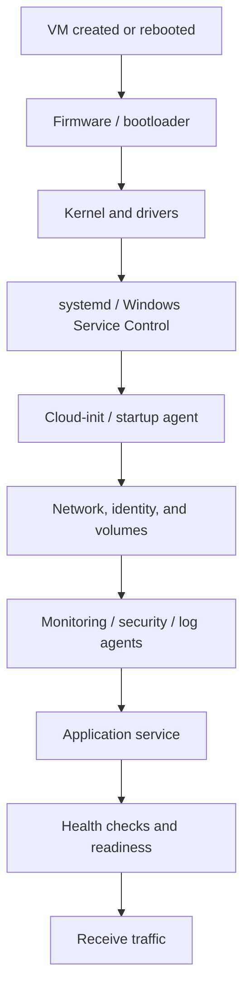
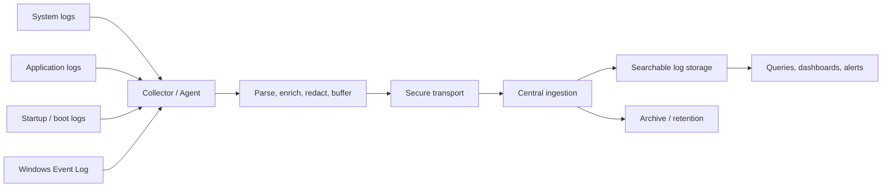

# Collecting System Logs, Application Logs, and Startup Logs

When a virtual machine or compute workload encounters an incident, current snapshots of CPU, memory, or network are often insufficient to explain what happened. Logs provide a timeline of operating system activity, application processes, and initialization. When collected properly, operations teams can determine when a machine rebooted, which service failed, what requests the application received, which dependency timed out, and what changes preceded the incident.

Three log categories to distinguish are **system logs**, **application logs**, and **startup logs**. System logs reflect OS and background service activity; application logs describe program behavior; startup logs capture the initialization of the VM, OS, and application. They differ in source, format, lifecycle, and access permissions. A sound observability system collects them in a structured way, synchronizes time, forwards them to centralized storage, and protects sensitive data.

## 1. Why Collect Logs?

Logs are one of the core signals of observability alongside metrics and traces. Metrics show how a quantity changes over time; traces show which components a request traverses; logs record detailed events and context at a specific moment.

Collecting logs helps:

- Investigate boot failures, crashes, reboots, and services failing to self-recover.
- Identify causes of failed requests or latency spikes.
- Track updates to the OS, drivers, agents, and applications.
- Detect anomalous logins, permission changes, or suspicious behavior.
- Correlate events across multiple VMs, containers, zones, and services.
- Support auditing, compliance, and security incident analysis.
- Measure the stability of deployment and maintenance workflows.

Logs are only useful if they are searchable, interpretable, and trustworthy. Logs lacking timestamps, missing workload identifiers, or lost when a VM is deleted interrupt investigations. Conversely, logging too much data or recording secrets inflates costs and creates security risks.

## 2. Distinguishing System Logs, Application Logs, and Startup Logs

| Log group | Primary content | Common sources | Example investigative questions |
|---|---|---|---|
| System log | Kernel, service manager, daemons, drivers, authentication, devices, and system resources | `journald`, `syslog`, Windows Event Log, kernel log | Why did the VM reboot? Which service was killed? Did the disk suffer I/O errors? |
| Application log | Business and technical events emitted by the application | stdout/stderr, log files, logging frameworks, container runtime | Which request failed? Where did the database time out? Which application version is running? |
| Startup log | Steps from VM boot until the OS and application become ready | cloud-init, serial console, boot diagnostics, systemd boot/service logs, startup scripts | Which step did the VM stall on? Did user data run? Did the agent start successfully? |

These categories can overlap. For instance, an `nginx` startup failure appears in the system journal, in the application/service log, and in the startup timeline if it happens during boot. When designing pipelines, tag the source type so you can query by layer.

## 3. Log Sources on Linux Machines

Linux provides multiple logging mechanisms. Implementation depends on the distribution, init system, packages, and image configuration.

### 3.1. systemd journal

On systems using systemd, `systemd-journald` collects messages from the kernel, services, and applications via the journal API or service stdout/stderr. `journalctl` is the tool used to read the journal.

Useful commands:

```bash
# View recent logs
journalctl -n 100

# Follow new logs in real time
journalctl -f

# View logs for a specific service
journalctl -u nginx.service

# View logs from the current boot
journalctl -b

# View logs from the previous boot
journalctl -b -1

# Filter by time range
journalctl --since "2026-11-22 08:00:00" --until "2026-11-22 09:00:00"

# View logs at warning level or above
journalctl -p warning
```

The journal can be stored either volatilely in memory or persistently on disk. If `/var/log/journal` is not configured or journal storage is set to volatile, logs may be lost across reboots. For VMs requiring post-incident forensics, define journal retention policies, size caps, and off-host forwarding.

### 3.2. Syslog and traditional log files

Some Linux distributions store logs in files such as:

| Common path | Content |
|---|---|
| `/var/log/syslog` | System messages on certain Debian/Ubuntu systems |
| `/var/log/messages` | System messages on certain RHEL-compatible systems |
| `/var/log/auth.log` | Authentication and login activity on certain Debian/Ubuntu systems |
| `/var/log/secure` | Authentication and security activity on certain RHEL-compatible systems |
| `/var/log/kern.log` | Kernel messages on certain distributions |
| `/var/log/audit/audit.log` | Audit events when the audit subsystem is configured |

Paths vary by distribution and configuration. Do not assume every machine has all of the files above. Use `journalctl`, syslog configuration, and OS documentation to confirm exact sources.

`rsyslog` or `syslog-ng` can receive, filter, route, and forward syslog messages to a central server. If multiple sources write to the same file, define parsers and formats clearly to avoid dropped fields or mis-merged log lines.

### 3.3. Kernel and hardware

Kernel logs help investigate driver, device, filesystem, memory pressure, and network failures. Inspect them with:

```bash
# Kernel messages in the current ring buffer
dmesg -T | tail -n 100

# Kernel messages from the journal
journalctl -k -b

# Search for OOM events or device errors in the journal
journalctl -b | grep -Ei "oom|out of memory|I/O error|reset|failed"
```

`dmesg` reflects the current ring buffer and may not retain full history across reboots. When investigating across multiple boots, a persistent journal or remote log collection system is more reliable.

### 3.4. Logs from systemd-managed services

Services typically write logs to stdout/stderr or the journal. Inspect unit configuration and status with:

```bash
systemctl status myapp.service
journalctl -u myapp.service --since today
systemctl cat myapp.service
```

If a service writes to its own log file, identify the path, owner, permissions, rotation, and which agent collects that file. Avoid having the application and a log collector daemon contend for permissions or rotate the same file without coordinated configuration.

## 4. Collecting Logs on Windows Server

Windows uses the Windows Event Log to record OS, service, application, and security events. Event Viewer is the common interface for channels such as:

- **System:** drivers, Service Control Manager, hardware, and system events.
- **Application:** events recorded by applications and runtimes.
- **Security:** logons, audits, and security events per audit policy.
- **Setup:** installation and update events.
- **Forwarded Events:** events forwarded from other machines when Windows Event Forwarding is configured.

PowerShell can be used to query events:

```powershell
# Get the 50 most recent System events
Get-WinEvent -LogName System -MaxEvents 50

# Filter Application error events in the last 24 hours
$since = (Get-Date).AddHours(-24)
Get-WinEvent -FilterHashtable @{
    LogName = 'Application'
    Level = 2
    StartTime = $since
}

# List available channels
Get-WinEvent -ListLog * | Select-Object LogName, RecordCount, IsEnabled
```

`wevtutil` also supports querying, exporting, and configuring Event Logs. For centralized collection, use Windows Event Forwarding or an agent supporting Windows Event Log. Define channels, event levels, retention, maximum size, and read permissions per log.

Do not collect only Application and System while ignoring Security if investigations require auditing logons or permission changes. Conversely, overly broad auditing can generate huge log volumes; tune policies to match security objectives and storage capacity.

## 5. Startup Logs and the Boot Process

Startup logs capture the steps from platform VM initialization until the application is ready. They are critical when a VM cannot be reached over SSH/RDP, agents are not running yet, or startup scripts fail.

Stages can include:

1. Hypervisor and virtual firmware initialize devices.
2. Bootloader loads the kernel and initramfs.
3. Kernel detects CPU, memory, disk, and network devices.
4. Init system starts targets and system services.
5. Cloud-init or bootstrap agent reads user data/metadata and runs initial configuration.
6. Management, monitoring, security, and logging agents start.
7. Application starts, connects to dependencies, and transitions readiness to ready.



If one step fails, subsequent steps may never run. During an investigation, locate the last successful step rather than looking only at application logs at the end of the chain.

### 5.1. Cloud-init on Linux

Cloud-init typically processes metadata and user data to configure a VM on first boot or according to configured modules. On many Linux images, logs live at:

- `/var/log/cloud-init.log`: detailed cloud-init execution activity.
- `/var/log/cloud-init-output.log`: stdout/stderr from script/module stages depending on configuration.

Inspection commands:

```bash
cloud-init status --long
sudo tail -n 200 /var/log/cloud-init.log
sudo tail -n 200 /var/log/cloud-init-output.log
```

Not every image includes cloud-init or uses identical paths. Some providers use proprietary initialization agents. Startup scripts may re-run depending on configuration and instance state; therefore, scripts should be idempotent and never write secrets to output.

### 5.2. Serial console and boot diagnostics

When a VM does not come onto the network or SSH/RDP fails, the serial console or boot diagnostics can provide very early boot output. This data is typically accessed via the cloud provider's control plane and may be retained for a limited period or under a separate policy.

Serial output is useful for diagnosing kernel panics, bootloader errors, filesystem failures, or initialization faults before the logging agent starts. It does not replace system logs once the OS is running. Enable and verify access permissions for boot diagnostics on critical workloads.

### 5.3. Startup logs on Windows

On Windows Server, combine System/Application Event Logs, Windows service logs, cloud agent logs, and platform-provided boot diagnostics/serial output. For startup scripts or extensions, check the corresponding agent logs and extension status in the control plane.

Exact sources vary by image and provider. Document in runbooks where to find logs for VM agents, custom script extensions, initialization tasks, and applications instead of assuming everything sits in one Event Log channel.

## 6. Application Logs: What to Record?

Application logs are emitted by the application or framework to describe its activity. A good log entry typically answers:

- What event happened?
- When did it happen?
- Which application, version, and instance emitted it?
- Which request, transaction, or job is involved?
- What is the severity level?
- What was the outcome or error?
- Which trace or metric can it be linked to?

Example of a useful log entry:

```text
2026-11-22T09:15:32.418Z INFO service=checkout-api version=2.8.1
instance_id=vm-024 region=asia-southeast1 request_id=req-8f21
event=payment_authorized duration_ms=184 status=success
```

This log includes timestamp, service, version, instance, region, request ID, event, duration, and status. It does not record card numbers, access tokens, or sensitive payment data.

### 6.1. Log levels

| Level | Purpose | Example |
|---|---|---|
| TRACE | Very deep detail for diagnosing internal execution flow | Execution step or non-sensitive variable state |
| DEBUG | Information for development and troubleshooting | Dependency call duration, branch selection |
| INFO | Meaningful normal operational events | Service started, job completed, config loaded |
| WARN | Abnormal condition where the system continues running | Retry, fallback, quota nearing threshold |
| ERROR | A failed operation requiring investigation | Database query failed, request failed |
| FATAL/CRITICAL | Severe failure preventing the process or core function from continuing | Required config failed to load, critical data loss |

Not all libraries use these exact levels identically. Standardize conventions across services. If every normal request logs ERROR or every failure only logs DEBUG, alerting and investigations lose effectiveness.

### 6.2. Structured logging

Structured logging stores logs as typed data fields, typically JSON, rather than plain free-form prose. Example:

```json
{
  "timestamp": "2026-11-22T09:15:32.418Z",
  "severity": "INFO",
  "service": "checkout-api",
  "version": "2.8.1",
  "instance_id": "vm-024",
  "region": "asia-southeast1",
  "request_id": "req-8f21",
  "event": "payment_authorized",
  "duration_ms": 184,
  "status": "success"
}
```

JSON allows log backends to parse and query by `service`, `severity`, `request_id`, or `event`. Standardize field names, data types, and timestamp formats. Do not arbitrarily change `duration_ms` from a number to a string across releases.

### 6.3. Simple Python JSON logging example

```python
import json
import logging
from datetime import datetime, timezone


class JsonFormatter(logging.Formatter):
    def format(self, record):
        payload = {
            "timestamp": datetime.fromtimestamp(
                record.created, timezone.utc
            ).isoformat(),
            "severity": record.levelname,
            "logger": record.name,
            "message": record.getMessage(),
        }
        if hasattr(record, "request_id"):
            payload["request_id"] = record.request_id
        return json.dumps(payload, ensure_ascii=False)


handler = logging.StreamHandler()
handler.setFormatter(JsonFormatter())
logging.basicConfig(level=logging.INFO, handlers=[handler])

logger = logging.getLogger("checkout-api")
logger.info("application_started")
```

This is a minimal example. Production applications should also include service name, version, environment, instance/pod ID, trace ID, exception type, and schema version. Never pass raw request objects or credentials directly into `extra` or the log message.

## 7. Correlation IDs, Trace IDs, and Cross-Service Context

In multi-VM or microservice architectures, a single request may traverse a load balancer, API, queue, worker, and database. Each component emits its own logs. Without shared identifiers, stitching those log lines into a single event flow is difficult.

Commonly used fields:

- `request_id`: identifies the request at the system boundary.
- `trace_id`: identifies a distributed trace, linking spans across multiple services.
- `span_id`: identifies a single unit of work within a trace.
- `correlation_id`: identifies a business transaction or workflow spanning multiple requests.
- `job_id` or `message_id`: identifies background tasks.
- `instance_id`, `pod_name`, `host_id`: identifies where the log was emitted.

Upon receiving a request, services should propagate or generate correlation context according to convention. When calling downstream services, propagate trace context using standard headers such as W3C Trace Context if supported. For queues, attach trace/correlation IDs to message metadata and restore context in the worker.

Do not blindly trust client-supplied IDs without bounding length or validating appropriately. Log correlation IDs are not authentication proof. Avoid embedding personal data or secrets inside correlation IDs.

## 8. Centralized Log Pipeline

Do not store logs solely on the VM's local filesystem. Machines can be terminated, disks can fill up, filesystems can corrupt, or attackers can tamper with logs. A centralized pipeline typically includes:

1. **Sources:** journald, syslog, Windows Event Log, application stdout/files, cloud-init, and boot diagnostics.
2. **Collector/agent:** reads logs, parses, enriches with metadata, and buffers temporarily.
3. **Transport:** ships over TLS or a private channel to the receiving system.
4. **Ingestion/processing:** normalizes schemas, filters, redacts, enriches, and routes.
5. **Storage/index:** stores logs searchable by time, service, host, and severity.
6. **Alerts/dashboards:** generates alerts, queries, and trend visualizations.
7. **Archive/retention:** transitions older data to lower-cost tiers and deletes per policy.



Collectors should run with least-privilege permissions to read only designated log sources. If an agent can read the entire filesystem or all secrets, an agent compromise expands the blast radius. Keep agents patched, protect configuration files, and monitor delivery health.

### 8.1. Writing to stdout/stderr or files?

For containerized applications, the common pattern is logging to stdout/stderr so the runtime or agent collects them. On traditional VMs, applications can log to `journald` or files per OS conventions.

| Logging target | Advantages | Operational considerations |
|---|---|---|
| stdout/stderr | Simple for containers and service managers; easy collector integration | Runtime rotation and buffering, multiline events |
| systemd journal | Includes service/process metadata and unified querying | Journal retention, size limits, and persistent storage |
| Log files | Useful for legacy apps/agents and custom formats | File permissions, rotation, rename/reopen, and collector offsets |
| Windows Event Log | Standardized by channel, event ID, and level | Channels, retention, subscriptions, and forwarding |

Avoid having two collectors read the same file without coordination, as this creates duplicate records. When applications write to files, rotation and agent configs must agree on handling file renames, truncation, and inodes.

## 9. Collecting Logs in Cloud Environments

Cloud providers offer agents and centralized logging services to collect system and application logs from VMs.

| Platform | Common tools | Role |
|---|---|---|
| AWS | CloudWatch Agent, CloudWatch Logs, EC2 console output | Collects log files and metrics/logs from VMs, and exposes boot output when supported |
| Azure | Azure Monitor Agent, Data Collection Rules, Log Analytics | Selects log sources, ships data, and enables centralized querying |
| Google Cloud | Ops Agent, Cloud Logging, serial port output | Collects system/application logs and aids boot diagnostics |

Agent names, capabilities, and configuration methods vary by OS and version. Verify that the agent supports your image/OS, has permissions to access log sources, and has network reachability to ingestion endpoints.

### 9.1. Selecting log sources instead of collecting everything

Agents typically allow selecting specific files, journals, Windows Event channels, or log types. Choose sources based on actual use cases. Ingesting verbose debug logs from every library inflates costs, drowns out important signals, and slows down queries.

A sensible configuration might include:

- System: warnings/errors, service lifecycles, kernel, and required authentication events.
- Application: structured INFO/WARN/ERROR; time-boxed DEBUG enabled during investigations.
- Startup: cloud-init, agent bootstrap, serial output, and application startup.
- Security/audit: logon events, permission changes, and required administrative actions.

Do not discard operationally meaningful success logs such as `application started`, `deployment version loaded`, or `backup completed`. They help distinguish "no errors occurred" from "the service never ran at all."

## 10. Timestamps, Timezones, and Time Synchronization

Logs from multiple VMs can only be ordered accurately if clocks are synchronized. A machine drifting by a few minutes makes events appear out of order during an investigation.

Principles to apply:

- Synchronize system clocks via NTP or the platform's time synchronization service.
- Record timestamps in UTC, preferring ISO 8601 format with timezone.
- Preserve both the event's origin timestamp and the collector's ingestion timestamp if supported by the pipeline.
- Monitor clock drift and alert when skew exceeds thresholds.
- Do not infer strict ordering solely from timestamps when multiple systems have varying transport delays; use trace/span IDs and sequence numbers where needed.

Example of a good timestamp: `2026-11-22T09:15:32.418Z`. The `Z` suffix denotes UTC. If local time is used, include an explicit offset to avoid ambiguity across timezone changes or daylight saving transitions.

## 11. Log Security and Privacy

Logs can contain sensitive data even though they are not designed as business data stores. Control content, read access, transport, and retention periods.

### 11.1. Never log secrets or sensitive data

Avoid logging:

- Passwords, API keys, access tokens, refresh tokens, and session cookies.
- Authorization headers, private keys, or connection strings containing credentials.
- Payment card numbers, personally identifiable information (PII), or health data unless strictly required with proper legal/security controls.
- Full request/response payloads when only status, request ID, or error type is needed.
- Secrets from metadata, user data, environment variables, or secret managers.

Design logging around an allowlist of required fields. Apply redaction in both the application and collector, rather than relying solely on regex scrubbing after sensitive data has already been written.

### 11.2. Access control

- Use separate roles for operators, developers, security analysts, and auditors.
- Scope query permissions by project, environment, or data classification whenever possible.
- Audit search, export, and deletion actions on sensitive logs.
- Protect ingestion endpoints with identity verification and TLS.
- Avoid sharing the same agent credentials across all VMs if the platform supports per-instance identities.
- Protect collector configurations from unauthorized modification.

### 11.3. Integrity and tamper/deletion protection

For logs supporting security investigations or audits, reduce the risk that a compromised account can delete both local logs and centralized copies. Depending on the platform, use append-only permissions, immutable retention, or replication to a dedicated security account.

Storing logs in a centralized system does not automatically guarantee immutability. Users with log service admin privileges can still delete or alter data if policies permit. Separate workload administration from log deletion permissions and audit all such actions.

## 12. Log Rotation, Buffering, and Log Loss Risks

Logs can grow continuously. Without rotation or quotas, a full filesystem can halt application writes or impact the entire VM.

### 12.1. Rotation

For log files, `logrotate` is commonly used to rotate files by size or time, compress them, and delete old copies per retention rules. Applications must support reopening log files or use mechanisms compatible with how the collector tracks files after renaming.

Illustrative configuration example:

```text
/var/log/myapp/*.log {
    daily
    rotate 14
    compress
    missingok
    notifempty
    create 0640 myapp adm
    sharedscripts
    postrotate
        systemctl kill -s HUP myapp.service >/dev/null 2>&1 || true
    endscript
}
```

This is only an example; the `HUP` signal must be supported by the application. Some applications do not reopen logs on HUP, or write to stdout/journald and do not need this setup. Verify owner/group, paths, and how your collector handles rotated files.

### 12.2. Buffering and backpressure

Collectors can buffer logs during transient network outages. Buffering reduces log loss but requires capacity caps and overflow policies. When a buffer fills, the agent may drop logs, block the source, or spill to disk depending on configuration.

Monitor:

- Whether the agent is running and its version.
- Events sent, retried, and dropped.
- Queue/buffer utilization.
- Latency from log emission to queryability.
- Authentication, DNS, or connection errors to the ingestion endpoint.
- Filesystem space allocated to journals and log files.

Do not allow a collector to block application execution threads indefinitely just because the logging backend is temporarily slow. Decide on priorities: mandatory audit logs may require stronger durability guarantees than debug logs.

## 13. Retention, Archiving, and Cost

Log costs depend on ingestion volume, storage capacity, indexing, query volume, and retention duration. Policies should classify logs by purpose:

| Log group | Purpose | Typical storage considerations |
|---|---|---|
| Detailed debug/traces | Short-term troubleshooting | Short retention, time-bounded enablement, or sampling |
| Operational application logs | Operations, SLOs, and error analysis | Searchable storage sized to investigation needs |
| System/startup logs | Boot, service, and OS troubleshooting | Retained long enough to span maintenance and incident cycles |
| Security/audit logs | Forensics and activity attestation | Retention per security/compliance policy, restricted deletion |
| Archive | Historical investigation or regulatory retention | Lower-cost storage tier with defined retrieval process |

No single retention period fits every organization. Weigh legal, contractual, and industry requirements, incident detection windows, and cost. When expired logs are purged, ensure copies, exports, and archives also comply with data deletion policies.

Cost-control measures:

- Select the right sources and severities; never ingest unbounded debug logs.
- Use structured logging for efficient filtering and querying.
- Suppress repetitive health check noise if individual lines are unnecessary.
- Sample high-volume logs/traces while keeping essential error and audit logs intact.
- Set retention per data class and archive infrequently accessed logs.
- Track ingestion volume by service and owner to catch unexpected spikes.

## 14. Diagnosing Incidents by Combining the Three Log Groups

Suppose a VM reboots, yet the API stops serving requests. An investigative sequence could be:

1. Check boot diagnostics or serial output to verify the VM cleared firmware, bootloader, and kernel stages.
2. Check `journalctl -b` or the Windows System log to see which services and drivers failed to start.
3. Check startup logs/cloud-init to inspect metadata, user data, volume mounts, networking, and agent bootstrap.
4. Check application startup logs to inspect configuration, secret retrieval, database connections, and port binding.
5. Cross-check health check/load balancer logs to see if the backend was marked healthy.
6. Use instance ID, version, request ID, and timestamps to correlate events.
7. Verify the log collector is running; missing logs may mean the agent never started or failed to ship.

For example, if cloud-init failed to mount a data volume, the application may report missing data directories. Reading only the application log reveals the final symptom; checking startup and system logs uncovers the root cause much earlier.

### 14.1. Missing logs are also a signal

When a log query returns no data, distinguish between:

- The application emitted no events.
- The application has not started yet.
- The collector is not running or lacks read permissions.
- Logs were filtered out due to wrong severity/path/parser.
- Network or credential issues prevent the agent from shipping.
- Buffers are full or data is being dropped.
- Clock skew causes the query to inspect the wrong time window.

Maintain a heartbeat or agent health metric to confirm log sources are actively shipping. Never conclude "no errors occurred" solely because a log query returned empty results.

## 15. Example Log Collection Setup for a Linux VM

Suppose a VM runs an API via systemd and uses cloud-init for bootstrapping. A design might include:

1. systemd journal stores system logs and the API's stdout/stderr.
2. cloud-init logs are collected from `/var/log/cloud-init.log` and `/var/log/cloud-init-output.log` if the image uses cloud-init.
3. The cloud logging agent collects the journal and both startup files, attaching `instance_id`, `environment`, `service`, and `region`.
4. The application emits JSON to stdout with UTC timestamps, severity, request ID, trace ID, and event name.
5. The collector redacts sensitive fields before shipping.
6. Logs are transmitted over TLS to the central backend using the VM's dedicated identity.
7. Dashboards surface application errors, service restarts, startup failures, and agent delivery status.
8. Security/audit logs are routed to a destination with stricter retention and deletion controls.

Investigations can query by `instance_id`, `service`, `request_id`, or time range. Even if the VM is terminated, shipped logs remain retrievable according to the centralized system's retention policy.

## 16. Log Collection Implementation Checklist

- [ ] Inventoried system, application, startup, and security/audit logs to collect.
- [ ] Identified exact sources on Linux or Windows and corresponding paths/channels.
- [ ] Configured appropriate retention and size limits for journals or log files.
- [ ] Ensured startup logs/serial output remain accessible when the VM lacks network access.
- [ ] Standardized application log severity and structured logging where appropriate.
- [ ] Included UTC timestamps, service, version, instance ID, and correlation/trace IDs in logs.
- [ ] Stripped secrets, tokens, passwords, and sensitive data before writing or shipping.
- [ ] Configured the collector to run with least privilege and monitored its health.
- [ ] Secured transport and assigned proper identity/credentials to the agent.
- [ ] Built pipelines to parse, enrich, redact, and route logs by data type.
- [ ] Set clear bounds for buffering, retries, drops, and backpressure.
- [ ] Verified log rotation does not lose entries or cause duplicate reads by the collector.
- [ ] Aligned retention, archiving, access control, and deletion with policy.
- [ ] Tested incident investigation across a reboot, service failure, and startup script failure.
- [ ] Configured heartbeats/metrics to detect when a log source stops shipping.

## 17. Conclusion

System logs show how the OS and background services behave; application logs explain program and request behavior; startup logs trace how the VM, OS, and application progress from boot to readiness. All three groups must be collected together to investigate the full chain of events.

Identify the exact log sources on Linux/Windows, keep startup and boot diagnostics accessible, adopt structured logging and correlation IDs, synchronize clocks, ship logs to centralized storage, and protect contents with redaction, IAM, TLS, and proper retention. Monitor collector health and ingestion latency so you know when logs are being lost. Done right, logs become reliable operational data for monitoring, troubleshooting, and securing compute workloads.
