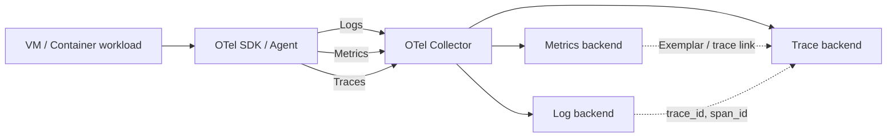

# Correlating Logs, Metrics, and Traces by Workload or Instance

When an application runs across multiple virtual machines, containers, or availability zones, a single request may traverse a load balancer, several services, queues, and databases. Each component emits logs, metrics, and traces in different places. Without consistent identifying metadata across this data, operations teams struggle to answer critical questions: which instance handled the failed request, which service added latency, which VM had high CPU at that exact moment, and which deployment change triggered the incident.

Correlating all three telemetry signals shifts operations from viewing isolated charts and logs to investigating a workload end-to-end. This requires a stable set of identifiers for the service, environment, and instance; trace context propagation across components; injecting trace IDs and span IDs into logs; and keeping metrics at an appropriate aggregation level to observe trends and detect anomalies.

## 1. How the Three Telemetry Signals Complement Each Other

**Logs** record an event that occurred at a point in time, usually with a severity, message, and contextual fields. Logs are useful when you need to know why a specific request failed, which action a process performed, or which configuration was rejected.

**Metrics** are numeric measurements sampled and aggregated over time, such as CPU utilization, memory usage, requests per second, error rate, p95 latency, or queue depth. Metrics help spot trends, compare instances, and alert when thresholds are crossed.

**Distributed traces** describe the path of a request or job across multiple components. A trace consists of spans; each span represents an operation such as receiving an HTTP request, calling another service, querying a database, or processing a message. Traces pinpoint which segment contributed most to total duration and where errors originated.

| Data type | Question answered | Example |
|---|---|---|
| Log | What happened during a specific event? | `orders-api` logged a timeout error while calling `inventory-service` |
| Metric | How frequently does the issue occur and what is the trend? | Timeout rate jumped from 0.2% to 4% over 5 minutes |
| Trace | Where did the request go and which step consumed the time? | The inventory call span took 1.8 seconds out of 2.1 seconds total |

No telemetry type completely replaces the other two. Metrics usually detect problems quickly, traces isolate the slow component, and logs supply event-level detail to determine root cause.

## 2. Establishing Consistent Workload Identity

Before correlating data, define clearly what the workload is and which instance is executing it. One service may run across many VMs, each machine may run multiple processes, and each process may handle thousands of requests. Do not use hostname or IP as the sole service identifier, because those values change during autoscaling, machine replacement, or redeployment.

Distinguish between identity tiers:

- **Service/workload identity:** stable logical name of the application, e.g., `orders-api`.
- **Namespace:** logical group or business domain containing the service, e.g., `commerce`.
- **Environment:** runtime environment, e.g., `production`, `staging`, or `development`.
- **Instance identity:** identifier for a specific running copy of the service, such as the VM instance ID or container ID.
- **Infrastructure identity:** host, region, zone, cloud account, and resource type details.

OpenTelemetry defines `Resource` to describe the entity producing telemetry. Common resource attributes include:

| Attribute | Meaning | Example |
|---|---|---|
| `service.name` | Logical name of the service | `orders-api` |
| `service.namespace` | Namespace or domain containing the service | `commerce` |
| `service.instance.id` | Unique identifier of the service instance | `vm-i-0abc123-orders-api` |
| `deployment.environment.name` | Deployment environment | `production` |
| `cloud.provider` | Cloud provider | `aws`, `azure`, `gcp` |
| `cloud.region` | Deployment region | `ap-southeast-1` |
| `cloud.availability_zone` | Availability zone | `ap-southeast-1a` |
| `host.id` | Host or virtual machine ID | `i-0abc123` |
| `host.name` | Hostname | `orders-vm-07` |
| `host.type` | Machine or instance type | Platform-specific value |

The values above are examples; follow the exact attribute names and conventions of the semantic conventions version you use. Keep `service.name` stable across deployments of the same service. `service.instance.id` must distinguish concurrent running copies; for a VM running one service process, it can combine the cloud instance ID and service name. If one VM runs multiple independent instances of the service, append a process or workload identifier to avoid collisions.

Do not embed application version, request ID, or deployment-specific hostnames into `service.name`. Those belong in separate attributes. If the service name changes on every release, dashboards and alerts split into fragmented groups that are hard to compare.

## 3. Choosing Resource Attributes vs. Per-Event Attributes

Resource attributes describe where telemetry is generated and are typically attached to logs, metrics, or traces throughout the resource's lifecycle. Event/span attributes describe a specific request or operation.

Examples:

- `service.name`, `service.instance.id`, `cloud.region`, and `deployment.environment.name` describe the resource.
- `http.request.method`, `http.response.status_code`, `db.system`, or `messaging.destination.name` describe a specific operation.
- `trace_id` and `span_id` link a log entry to its corresponding trace.
- `request.id` can help correlate with gateway or business system logs.

Avoid copying everything into every record. Identify which attributes are foundational identifiers, which apply only within a single request, and which are sensitive. A unified attribute schema simplifies queries, yet stuffing high-churn fields into metrics increases cardinality and storage cost.

In particular, never use `trace_id`, `span_id`, `user_id`, `session_id`, raw URLs containing entity IDs, or `request_id` as ordinary metric labels. Such values can spawn a new time series for nearly every request. Use traces to inspect individual requests and metrics to aggregate trends; if supported by your backend, use exemplars to link a metric sample to a representative trace.

## 4. Propagating Trace Context Across Services

Traces can only connect spans if context is propagated from one component to the next. When service A calls service B, A sends trace context in the request; B uses that context to create child spans belonging to the same trace.

W3C Trace Context is the standard convention for HTTP. The `traceparent` header carries the trace ID, parent span ID, and trace flags. Illustrative example:

```http
traceparent: 00-4bf92f3577b34da6a3ce929d0e0e4736-00f067aa0ba902b7-01
```

Components instrumented with OpenTelemetry or compatible libraries can read this header, create a new span, and propagate the context onward. When calling via supported HTTP clients, gRPC, message brokers, or frameworks, proper instrumentation handles propagation automatically.

For queues or asynchronous processing, context must be injected into message metadata on publish and restored when the consumer processes it. Without propagating context across message boundaries, the producer request's trace and the worker's trace split apart. For long-running jobs or fan-outs, span links can be used when a simple parent-child relationship does not fit.

Do not generate a brand-new trace ID in every service if the request belongs to the same execution flow. Equally, do not trust trace context headers from arbitrary external clients unconditionally: edge gateways may need to strip or normalize client-supplied context depending on trust models and anti-spoofing policies.

## 5. Attaching Trace IDs and Span IDs to Logs

When a log entry is emitted while an active span is executing, the logger or logging bridge can inject `trace_id` and `span_id` into the record. That allows jumping from an error log directly to its trace, and from a failed span to every log emitted in that same context.

Illustrative JSON log:

```json
{
  "timestamp": "2026-11-22T10:15:32.481Z",
  "severity": "ERROR",
  "service.name": "orders-api",
  "service.namespace": "commerce",
  "service.instance.id": "vm-i-0abc123-orders-api",
  "deployment.environment.name": "production",
  "cloud.region": "ap-southeast-1",
  "host.id": "i-0abc123",
  "trace_id": "4bf92f3577b34da6a3ce929d0e0e4736",
  "span_id": "00f067aa0ba902b7",
  "request.id": "req-7d3a",
  "message": "Inventory lookup timed out",
  "error.type": "TimeoutException"
}
```

This is an illustrative structure; field names and ID encoding depend on the logger, exporter, and backend. The OpenTelemetry Log Data Model defines dedicated `TraceId` and `SpanId` fields; backends may map them to different field names.

If a log is emitted on a background thread or after the request context ends, trace context may no longer exist in thread-local storage. For asynchronous tasks, pass context explicitly across executors, coroutines, messages, or callbacks. Never attach trace IDs from global variables, as concurrent requests will cross-contaminate logs.

Logs must still retain timestamps, severity, service identity, and instance identity even when no trace exists. Boot events, shutdowns, health checks, or out-of-request errors may lack a trace ID, yet still require complete logging for diagnosis.

## 6. Correlating Metrics with Workloads and Instances

Metrics should enable drilling down from aggregate views to individual instances. At the service level, you typically need request rate, error rate, latency, in-flight requests, and queue depth. At the instance level, you need CPU, RAM, disk, network, process count, restarts, and agent health.

A common organization scheme:

| Scope | Representative metrics | Grouping attributes |
|---|---|---|
| Service | Request rate, error rate, latency histogram | `service.name`, `service.namespace`, `deployment.environment.name` |
| Instance | CPU, memory, disk, network, process health | `service.instance.id`, `host.id`, `cloud.availability_zone` |
| Runtime | Heap, garbage collection, thread count, connection pool | Service identity and runtime attributes |
| Dependency | DB latency, connection errors, queue lag | Service identity, dependency type/name |
| Infrastructure | VM CPU credits, NIC throughput, storage IOPS | `host.id`, instance type, region/zone |

When a dashboard shows rising latency for `orders-api`, filtering by `service.instance.id` reveals whether one machine is affected or the entire fleet. If only one instance shows high CPU, investigate local processes, noisy neighbors, machine type, or local misconfiguration. If all instances show rising latency while CPU stays low, investigate the database, network, DNS, or dependent services.

Per-instance metrics are valuable, though cardinality must be managed. Instance IDs are bounded by fleet size, yet autoscaling and instance churn accumulate series over time. Retain service-level metrics for long-term tracking; enable detailed per-instance metrics selectively where operationally justified. Avoid attaching per-request unique values to metrics.

## 7. Using Exemplars to Jump from Metrics to Traces

Histogram metrics aggregate the latency of many requests. When the backend supports **exemplars**, selected observations in a histogram can store a reference to that sample's trace ID. Operators can spot a latency spike on a chart and open a representative trace to see which spans the request traversed.

Exemplars do not mean every request is stored as a trace or every bucket carries a trace reference. Exemplar availability depends on the SDK, exporter, collector, and backend. When sampling is enabled, exemplars may only point to retained traces; align sampling and exemplar configuration so links stay valid.

If your backend does not yet support exemplars, you can still correlate by filtering traces by service, instance, time window, and request attributes. However, timestamp-based queries must account for clock skew, ingestion delay, and metric resolution.

## 8. Standardizing Telemetry with OpenTelemetry

OpenTelemetry (OTel) provides APIs, SDKs, instrumentation, and the Collector to generate, process, and ship logs, metrics, and traces. Sharing resource attributes and semantic conventions makes telemetry across diverse runtimes and platforms correlatable.

High-level architecture:



Applications can send telemetry directly to a Collector or via a local agent/daemon near the workload. The Collector receives data, applies processors such as batching, memory limiting, resource enrichment, or filtering, and exports to backends. An intermediate Collector decouples applications from specific backends and centralizes configuration management.

Standardize the following:

- Service name, namespace, environment, and instance identity.
- Cloud provider, region, zone, host ID, and workload metadata.
- Metric naming conventions, units, and span/log attributes.
- Trace context propagation across HTTP, gRPC, and message brokers.
- Trace ID/span ID formatting in structured logs.
- Sampling, retention, access control, and sensitive data filtering policies.

All three telemetry signals do not need to live in the same backend, provided you preserve cross-querying or linking across backends. When storage systems are separate, standardizing service identity, environment, instance ID, and timestamps is essential for end-to-end investigation.

## 9. Example Resource Configuration for a Java Application on a VM

Suppose `orders-api` runs on a Linux VM in production. The application is instrumented with the OpenTelemetry Java Agent and ships telemetry through an internal Collector.

Environment variables can be declared as follows:

```bash
export OTEL_SERVICE_NAME="orders-api"
export OTEL_RESOURCE_ATTRIBUTES="service.namespace=commerce,deployment.environment.name=production,service.instance.id=vm-i-0abc123-orders-api,cloud.provider=aws,cloud.region=ap-southeast-1,cloud.availability_zone=ap-southeast-1a,host.id=i-0abc123"
export OTEL_EXPORTER_OTLP_ENDPOINT="https://otel-collector.internal:4317"
export OTEL_EXPORTER_OTLP_PROTOCOL="grpc"
```

This example uses OTLP/gRPC. Endpoint, protocol, TLS, and authentication must match the Collector configuration. In production, enforce TLS and proper authentication; never expose telemetry ingestion endpoints publicly. Instance IDs should be injected dynamically from metadata or provisioning systems rather than hard-coded across all machines. Ensure each running copy gets a distinct `service.instance.id`.

Across multiple environments, keep the same service name while varying the environment attribute. That lets dashboards compare `orders-api` between staging and production without splitting it into two unrelated service identities.

## 10. Example OpenTelemetry Collector Configuration

The Collector can receive OTLP over gRPC or HTTP and forward all three telemetry signals. Minimal illustrative configuration:

```yaml
receivers:
  otlp:
    protocols:
      grpc:
        endpoint: 0.0.0.0:4317
      http:
        endpoint: 0.0.0.0:4318

processors:
  memory_limiter:
    check_interval: 1s
    limit_mib: 512
  batch:
    timeout: 5s

exporters:
  otlp:
    endpoint: observability-backend.internal:4317

service:
  pipelines:
    traces:
      receivers: [otlp]
      processors: [memory_limiter, batch]
      exporters: [otlp]
    metrics:
      receivers: [otlp]
      processors: [memory_limiter, batch]
      exporters: [otlp]
    logs:
      receivers: [otlp]
      processors: [memory_limiter, batch]
      exporters: [otlp]
```

This illustrates a Collector distribution containing the corresponding components; verify that the receiver, processors, and exporter exist in your deployed build. Production configs must add TLS, authentication, network restrictions, appropriate retry/queue settings, health checks, and monitoring of the Collector itself. Do not bind receivers to all interfaces unless the network or firewall restricts allowed senders.

In production, exporter endpoints typically require TLS and authentication. You can add resource processors to normalize or enrich metadata, but avoid blindly overwriting `service.name` or instance IDs supplied by workloads without verifying the source. For untrusted client data, the Collector may need to filter attributes or drop fields that risk carrying sensitive data.

## 11. Integrating Application Logs with Trace Context

For Java applications, the OpenTelemetry Java Agent can automatically instrument HTTP frameworks, clients, databases, and popular libraries. Loggers must be configured to emit structured logs and receive trace context from instrumentation or a compatible logging bridge.

A practical approach:

1. Enable HTTP server instrumentation so every incoming request creates a server span.
2. Enable HTTP client, JDBC, or messaging instrumentation to create spans for downstream dependency calls.
3. Configure the logger to output JSON with timestamp, severity, service identity, and trace/span IDs when context is active.
4. Ensure context propagates across executors, thread pools, and message consumers.
5. Test a sample request from gateway to API, database, and worker to verify an unbroken trace.

Do not log full request bodies, authorization headers, cookies, access tokens, or personal data just for tracing. Span attributes should contain necessary, vetted diagnostic context. For example, recording route template `/orders/{orderId}` is usually safer and more useful than recording raw URLs containing IDs or user data.

If a log backend ingests logs by tailing files, determine how trace context enters the log record. An agent can parse JSON fields written by the logger, or a logging appender can forward logs directly via OTel. Avoid shipping the same log through two pipelines without deduplication.

## 12. Choosing Sampling and Retention

Traces can generate massive data volumes, especially for high-request-rate services. Sampling controls cost and storage load, while requiring a balance between investigative utility and retained volume.

Common sampling approaches:

- **Head sampling:** decides whether to keep a trace right at the start, usually based on a fixed ratio or attributes known at request entry. Simple and drops data early, though it can miss error traces if the initial decision discarded them.
- **Tail sampling:** decides after the Collector receives the full trace or a portion of it, prioritizing error traces, high latency, or special attributes. Requires state and memory in the Collector, and requires routing all spans of the same trace to the same sampling instance.
- **Always-on or always-off by environment:** suitable for low traffic or test environments, subject to cost and sensitive-data review.

Logs and metrics also require separate retention policies. Aggregated metrics can be kept longer than verbose logs; debug logs and full traces can be kept shorter than audit or security logs. Policies should reflect investigation needs, SLOs, data regulations, and budget.

Never use sampling as a substitute for alerting. Alerts on error rate, saturation, or latency should rely on proper metrics; traces exist to investigate representative requests. If 100% of a specific security event category must be retained, define explicit rules and a dedicated storage path.

## 13. Cardinality, Data Quality, and Cost

Cardinality is the number of unique attribute value combinations generating distinct series or data groups. If a metric carries labels `service.name`, `instance.id`, `http.route`, and `status_code`, series count scales with instances, routes, and status codes. Adding `user.id` or `trace_id` causes cardinality to explode rapidly.

Good practices:

- Keep metric labels bounded and operationally meaningful.
- Use route templates instead of URLs containing dynamic IDs.
- Never attach request ID, trace ID, email, user ID, or session token as metric labels.
- Enable per-instance metrics only when needed for isolation; rely on service-level metrics for long-term trends.
- Filter or drop unneeded attributes in the Collector before export.
- Track active series count, log volume, span rate, and ingestion cost.

Data quality matters just as much as volume. Two services using different names for the same workload, mismatched timezones, or reused instance IDs corrupt dashboards and misattribute traces. Validate resource attributes automatically at application startup and alert when `service.name`, environment, or instance identity is missing.

## 14. Telemetry Security and Privacy

Logs, metrics, and traces can contain sensitive data: IP addresses, emails, order IDs, SQL statements, URLs, bucket names, tenant details, or exception payloads. Your observability system is therefore also an asset that must be protected.

Principles to enforce:

- Never record secrets, passwords, access tokens, cookies, or private keys in logs/spans.
- Mask or strip personal data and unnecessary business data.
- Encrypt data in transit between workloads, Collectors, and backends.
- Authenticate workloads emitting telemetry; restrict who can query or export data.
- Separate read permissions for application logs, audit logs, and security data by role.
- Enforce retention, deletion, and data residency per policy.
- Lock down telemetry ingestion endpoints to prevent abuse as an exfiltration path or overload vector.

External trace context can correlate data across systems, but never treat baggage as a carrier for secrets or personal data. Baggage can be forwarded across many services and cross trust boundaries if unfiltered.

## 15. Building Dashboards from Service Down to Instance

Dashboards should support top-down investigation from overview to detail:

1. **Service overview:** request rate, error rate, p50/p95/p99 latency, and saturation.
2. **Instance comparison:** CPU, memory, disk, network, restarts, request rate, and latency by `service.instance.id` or `host.id`.
3. **Dependency view:** latency and errors for databases, caches, queues, and HTTP dependencies.
4. **Trace exploration:** error or high-latency traces filtered by service, environment, region, and instance.
5. **Log exploration:** logs filtered by service, severity, time range, trace ID, and instance ID.

A typical investigative flow:

- A metric alert fires for rising `orders-api` error rate.
- The service dashboard reveals only instance `vm-i-0abc123` has elevated p99 latency.
- Filter traces by `service.instance.id` and the incident window to locate slow spans.
- Open a trace and find the span calling `inventory-service` timing out.
- Using the `trace_id`, query logs for both `orders-api` and `inventory-service` to read exceptions and retries.
- Cross-check instance CPU, network, DNS, and OS logs to determine whether it is a local fault or a shared dependency issue.

Dashboards should do more than show red/green status. Provide links or drill-downs from service to instance, metric to trace, trace to log, and back. Keep filter conventions for service, environment, region, version, and time consistent across pages.

## 16. Verifying Telemetry Correlation Quality

After deploying instrumentation, test correlation using a reproducible request. Do not merely verify that all three backends contain data; verify that the data refers to the same workload and the same operation.

Verification checklist:

- `service.name`, namespace, and environment match across logs, metrics, and traces.
- Instance IDs in telemetry match actual VMs/containers and are never shared across instances.
- A single request produces a trace with expected server and client/dependency spans.
- Trace context propagates across HTTP/gRPC and message brokers.
- Logs emitted during the request carry `trace_id`/`span_id` matching the stored trace.
- Service-level metrics aggregate cleanly by service; instance-level metrics filter cleanly by instance.
- Exemplars or equivalent metric-to-trace links open the right trace if supported by the backend.
- Timestamps and timezones are consistent; clock skew and ingestion delay are accounted for.
- No secrets or out-of-policy personal data appear in logs or spans.
- Sampling does not drop all critical error traces.
- The Collector exposes self-metrics for receiver accepted/refused counts, exporter failures, queues, and memory.

Diagnose an instance missing data by checking agent status, Collector endpoints, network ACLs, TLS certificates, exporter config, and telemetry error logs. Do not assume a workload received no traffic merely because the backend shows no data; the telemetry pipeline itself may be broken.

## 17. Common Mistakes

- **Using hostname as service identity:** hostnames change during instance replacement or autoscaling, fragmenting data. Use a stable `service.name` and separate instance IDs.
- **Each service picks its own naming convention:** dashboards cannot group instances of the same workload. Standardize namespaces and service names.
- **Failing to propagate trace context:** every service starts an isolated trace, hiding the end-to-end request path. Enable propagation across HTTP, RPC, and messaging.
- **Logs missing trace IDs:** forces correlation by timestamp and text search, making it easy to mix up requests. Inject trace/span context into structured logs.
- **Putting trace IDs into metric labels:** causes cardinality and cost to skyrocket. Use exemplars or separate trace queries instead.
- **Keeping only aggregated metrics:** makes it hard to spot which specific instance is failing. Add selective per-instance metrics.
- **Having traces without logs:** makes it hard to read full exception details or business state. Correlate logs inside span context.
- **Poor sampling choices:** error or slow traces get dropped. Evaluate head vs. tail sampling against investigative goals.
- **Missing or wrong resource attributes:** data gets misattributed to the wrong environment or instance. Validate resources at startup and in the Collector.
- **Secrets inside telemetry:** turns the observability platform into a data leak vector. Filter, mask, and restrict access.

## 18. End-to-End Example for a Multi-VM Workload

`orders-api` is deployed across three VMs in two availability zones. Each VM runs the same image and application version, with distinct `host.id` and `service.instance.id` values. A load balancer distributes HTTP requests across instances. The API calls `inventory-service`, queries PostgreSQL, and enqueues asynchronous jobs.

Telemetry design:

| Component | Telemetry emitted | Correlation mechanism |
|---|---|---|
| Orders API | HTTP server/client spans, request/error/latency metrics, structured logs | `service.name=orders-api`, instance ID, trace/span ID |
| Inventory service | Server spans, dependency metrics and logs | Propagates `traceparent` from Orders API |
| PostgreSQL client | DB client spans, connection pool metrics, error logs | Child span inside request trace |
| Queue producer/consumer | Messaging spans, queue depth/lag metrics, worker logs | Trace context in message metadata or span links |
| VM/OS agent | CPU, memory, disk, network, and system logs | `host.id`, region, zone, and service-instance mapping |
| OTel Collector | Receive/export metrics, logs, traces, and pipeline health | Normalizes resources, filters data, batches, and exports |

When an order creation request slows down, service metrics show p99 climbing. The instance dashboard shows two VMs normal while one VM has high network retransmissions. A slow request's trace shows the inventory call span taking most of the time; logs with the same `trace_id` show timeout retries. Infrastructure metrics and logs for that instance confirm the problem occurs in only one AZ. Operations can immediately isolate the route, NIC, or dependency in that AZ instead of scaling CPU across the entire fleet.

This example demonstrates the payoff of linking workload identity, instance identity, and trace context: metrics detect the problem, instance metadata bounds the scope, traces isolate the slow step, and logs supply event-level details.

## 19. Implementation Checklist

- [ ] Every workload has a stable `service.name` and `service.namespace`.
- [ ] Every running copy has a unique `service.instance.id`; host/VM identity is recorded.
- [ ] Environment, cloud provider, region, and zone attributes are standardized.
- [ ] Logs, metrics, and traces share the required resource attributes.
- [ ] Trace context propagates across HTTP, gRPC, and message brokers.
- [ ] Structured logs include `trace_id`/`span_id` when executing inside a trace context.
- [ ] Service-level and instance-level metrics are clearly separated.
- [ ] Metric labels exclude trace IDs, request IDs, and excessively high-cardinality data.
- [ ] Exemplars or metric-to-trace links are enabled if supported by the backend.
- [ ] The Collector uses TLS, authentication, network restrictions, batching, and memory protection.
- [ ] Sampling, retention, and ingestion budgets match operational requirements.
- [ ] Logs/spans strip secrets and personal data; access is restricted.
- [ ] Dashboards support drilling down from service to instance, metrics, traces, and logs.
- [ ] End-to-end verification tests and pipeline interruption alerts are in place.

Correlating logs, metrics, and traces by workload or instance gives operations teams visibility into both service-level trends and the behavior of each underlying machine. When identifiers are standardized, trace context propagates end-to-end, and logs carry matching trace IDs, a single metric alert can lead directly to the exact instance, request, and event that need investigation—shortening detection and recovery times in distributed compute environments.
