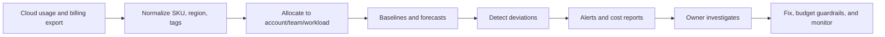

# Alerting on Capacity Shortages, Resource Exhaustion, and Cost Anomalies

## 1. Why Early Alerting Matters

A compute workload can stop serving even while the server remains running. A full filesystem prevents applications from writing logs or data; memory exhaustion causes the OS to terminate processes; connection pool exhaustion forces requests to wait; rapidly growing queues push processing times past the SLO. At the cloud layer, an account can exhaust vCPU, GPU, IP address, or volume quotas before hitting physical hardware limits. Meanwhile, misconfigured autoscaling, log spikes, or unexpected egress traffic can rapidly inflate the bill.

Monitoring is only useful when it turns data into timely action. Dashboards show what is happening; alerts notify when a condition requires intervention; runbooks guide responders through remediation. A good alert must indicate the affected resource or workload, urgency, rate of degradation, expected impact, and the next verification step.

In the **CLOUD_CORE_SERVICES_COMPUTE** module, learners connect monitoring across VM, container, and serverless models; CPU, memory, and network selection; deployment and scaling; high availability; and operational cost optimization. This lesson focuses on three signal groups:

- **Capacity shortage:** remaining resources are insufficient for current or projected demand.
- **Resource exhaustion:** a specific limit is nearly reached or breached, preventing the workload from operating normally.
- **Cost anomaly:** spend or resource consumption rate deviates significantly from baseline, budget, or work output.

After this lesson, you will be able to:

- Identify metrics to track across compute, memory, storage, network, quotas, and dependencies.
- Set alert thresholds based on utilization, consumption rate, and time remaining until exhaustion.
- Distinguish early warnings, urgent pages, and informational alerts.
- Detect cost anomalies by service, environment, owner, and unit of work.
- Reduce alert noise using sustained durations, baselines, grouping, and routing.
- Connect alerts to runbooks, autoscaling, capacity planning, and incident response workflows.

## 2. Foundational Concepts

### 2.1. Capacity, utilization, and headroom

**Capacity** is the maximum amount of a resource a component can provide under specific conditions and limits. **Utilization** is the portion of capacity currently in use. **Headroom** is the remaining capacity available to absorb traffic surges, variance, or component failures.

For a resource with capacity (C) and usage (U):

\[
Utilization = \frac{U}{C} \times 100\%
\]

\[
Headroom = C - U
\]

For example, a worker pool capable of running 1,000 concurrent tasks using 750 slots has 75% utilization and 250 slots of headroom. However, headroom is only meaningful if the measured capacity is actually usable. Cloud quotas, connection limits, CPU throttling, or slow dependencies can prevent nominal capacity from translating into real throughput.

Do not target 100% utilization for every resource. Systems need slack to absorb bursts, scale-outs, rolling maintenance, and failures. Appropriate headroom depends on load volatility, resource provisioning lead time, SLOs, and graceful degradation capabilities.

### 2.2. Capacity shortage vs. resource exhaustion

Capacity shortages are usually trends: disk space steadily shrinking, queues growing hour by hour, or CPU repeatedly nearing saturation. Resource exhaustion occurs when a hard limit directly triggers failures: a filesystem has no free blocks left, inodes run out, connections exhaust, PIDs exhaust, IP addresses run out, or cloud APIs reject instance creation due to quota.

A single resource can exhaust while overall utilization dashboards stay low. For example, one mount point fills up while total disk capacity across drives still shows plenty of space; one pod exhausts ephemeral storage while the node still has space; one subnet runs out of IPs while the VPC has many unused CIDR ranges.

Therefore, monitor at the exact scope where workloads allocate resources: process, container, volume, mount point, subnet, node pool, region, account, and service quota.

### 2.3. Metrics, logs, traces, and events

- **Metrics:** numeric time series suited for tracking utilization, rates, latency, and trends.
- **Logs:** contextual event records helpful for pinpointing exact causes such as `OutOfMemory`, `No space left on device`, or API quota exceeded.
- **Traces:** end-to-end request paths across services, identifying which component is slow or retrying heavily.
- **Events:** state-change notifications such as pod evictions, instance scale-outs, volume resizes, quota rejections, or configuration changes.

Do not rely on a single signal type. Metrics catch memory pressure; logs identify which process hit OOM; traces show requests stalling on database connection pool waits; events record that the autoscaler hit its replica ceiling.

### 2.4. Symptom vs. cause

An alert usually indicates a symptom, not necessarily the root cause. High CPU may result from rising traffic, a bug loop, garbage collection, new code, or a slow dependency triggering retries. Rising cost can stem from legitimate request growth, scale-outs, egress, log ingestion, or forgotten orphaned resources.

Alert design should help responders decide the next diagnostic step rather than jumping to conclusions from a single metric.

## 3. Building a Workload Capacity Model

### 3.1. Start from workload and SLOs

Before setting thresholds, identify what function the workload serves, normal vs. peak load, load growth rate, resource provisioning lead time, dependencies, and the consequences of exhaustion. Connect technical metrics to SLOs or business outcomes such as successful requests, completed jobs, processed transactions, and queue wait times.

For example, 85% CPU for several minutes may be acceptable for a batch job yet concerning for an API whose p99 latency is breaching its SLO. Growing queue backlogs can be normal during a scheduled batch run, yet an incident if wait times cause orders to miss processing deadlines.

### 3.2. Defining units and measurement scope

Every metric needs a clear scope:

| Scope | Example metrics | Question to answer |
|---|---|---|
| Process | RSS, heap, file descriptors, thread count | Which process is consuming or exhausting resources? |
| Container/pod | CPU requests/limits, memory working set, ephemeral storage | Which container is throttled, OOMKilled, or evicted? |
| VM/node | CPU, RAM, disk, network, PIDs, conntrack | Which machine or node is nearing its limit? |
| Storage | Bytes, inodes, IOPS, throughput, latency, queue | Which volume or mount point is filling up or saturating? |
| Network | Bandwidth, packet drops, connections, IPs/ports | Which link or state table is nearing exhaustion? |
| Cloud service/account | vCPU/GPU/IP/volume/API quotas | Can new resources be provisioned when scaling is needed? |
| Application | Queue backlog, pool usage, request concurrency | Which internal limit is throttling throughput? |
| Cost allocation | Spend, usage, SKU, owner, environment | Which service or workload is deviating from cost baseline? |

Cluster-wide aggregate metrics cannot replace per-node or per-workload metrics. One node can fill up while cluster average stays low; one namespace can hit its quota while the cluster still has spare CPU and RAM.

### 3.3. Calculating time to exhaustion

For a resource with remaining capacity (A) and a steady net consumption rate (R), you can estimate:

\[
Time\ to\ exhaustion \approx \frac{A}{R}
\]

For example, a volume with 120 GB remaining growing at 10 GB net per day has roughly 12 days until full. This is only a simple linear projection; account for traffic growth, retention, log rotation, cleanup jobs, and periodic spikes.

Time-to-exhaustion is more useful than a static percentage threshold whenever consumption grows continuously. A volume at 80% full growing by 100 MB per week is far less urgent than a volume at 50% full growing by 100 GB per hour.

### 3.4. Setting thresholds from response lead time

Alert thresholds must give operations enough time to act. If expanding a volume and verifying the application takes 4 hours, the alert must fire at least 4 hours plus safety margin before projected exhaustion. If a cloud quota increase takes a day of manual approval, you cannot wait until 5% quota remains to alert.

An illustrative severity tiering:

- **Info:** upward trend worth watching, no immediate action required.
- **Warning:** low headroom or time-to-exhaustion falls inside the change preparation window.
- **Critical:** exhaustion projected before remediation can finish, or provisioning errors have already occurred.
- **Page/Incident:** workload is already impacted, and SLOs or business functions are degraded.

Percentages such as 70%, 85%, or 95% are only starting points. Final thresholds must reflect consumption rate, provisioning lead time, and workload criticality.

## 4. Storage Capacity Shortage Alerts

### 4.1. Block and filesystem capacity

Track both free bytes and utilization percentage. A huge volume with 10% left may still hold hundreds of gigabytes; a small volume with 10% left can fill in minutes if logs surge. Combine percentage thresholds with absolute capacity floors and time-to-full projections.

Distinguish between layers:

- Provisioned cloud volume or block device size.
- Filesystem size after partitioning and formatting.
- Specific mount points such as `/`, `/var`, `/var/log`, `/tmp`, or data directories.
- Container or node ephemeral storage capacity.
- Snapshot, backup, and object storage capacity per retention policy.

Increasing a cloud volume size does not always expand the partition and filesystem automatically. After resizing in the cloud control plane, OS-level steps may be required; alerts must monitor both cloud capacity and the filesystem actually visible to the application.

### 4.2. Inodes and file descriptors

A filesystem can run out of inodes even with gigabytes free if an application creates massive numbers of small files. Monitor free inodes and file creation rate. Log rotation, cache files, temporary files, or session directories are common sources of inode growth.

File descriptors are a per-process or OS-level limit. Applications opening too many files, sockets, or pipes without closing them cleanly can hit `Too many open files`. Track open descriptors relative to soft/hard limits alongside socket and connection counts.

### 4.3. PVCs and ephemeral storage in Kubernetes

In Kubernetes, monitor PersistentVolumeClaim capacity, volume filesystem usage, container ephemeral storage, and node disk capacity. Pods can be evicted when exceeding ephemeral storage limits or when nodes experience disk pressure. A PVC can fill up even while the node has plenty of disk because it is a separate volume.

Also monitor PVC `Pending` states, volume attach/mount errors, data growth rates, and whether the `StorageClass` supports volume expansion. Not every storage class supports online expansion; some changes require filesystem resizing or provider-specific steps.

### 4.4. Time-to-full alerting

An effective alert can combine:

- Used capacity percentage exceeding a threshold over a sustained window.
- Absolute remaining capacity dropping below a safe floor.
- Projected remaining capacity hitting zero sooner than remediation lead time.
- Abnormal growth rate compared to baseline.

Do not alert on temporary filesystems or irrelevant mounts that do not affect workloads. Filter filesystem types accurately and attach workload, mount point, owner, and environment labels.

## 5. Compute Resource Exhaustion Alerts

### 5.1. CPU and CPU throttling

Monitor CPU utilization alongside run queue, load average, CPU steal, CPU throttling, and application latency. Sustained high CPU may indicate capacity shortage; container CPU throttling indicates the workload is constrained by its CPU limit even if the node has free CPU elsewhere.

In Kubernetes, inspect both CPU requests and limits. Requests affect scheduling; limits cause throttling. A pod with low CPU utilization relative to the node can still be slow if repeatedly throttled by a tight limit.

High CPU does not always call for scaling. First check traffic, retry storms, tight loops, GC, lock contention, and dependencies. If throughput fails to rise alongside CPU, find the true bottleneck before adding instances.

### 5.2. Memory and OOM

Memory exhaustion can cause the Linux OOM killer to terminate processes, containers to become `OOMKilled`, or serverless runtimes to reject further allocations. Monitor available memory, working set, RSS, heap, swap, page faults, GC pauses, and OOM events.

Do not rely solely on host-wide memory utilization. A container can hit its memory limit while the node still has free RAM; a single process can leak memory while cluster memory looks low. On the JVM, track heap, non-heap, and RSS together; on other runtimes, use equivalent metrics.

Steadily climbing memory over time suggests a leak. Memory that rises with load and drops after load subsides may be legitimate caching or buffering. Baselines and post-load behavior distinguish the two.

### 5.3. Processes, threads, and connections

Frequently overlooked limits include:

- PIDs or maximum process counts.
- Thread counts and runtime thread limits.
- File descriptors and sockets.
- TCP connections, ephemeral ports, and conntrack tables.
- Database connection pools, HTTP connection pools, and worker pools.
- Request concurrency, queue length, and active tasks.

When a pool hits its ceiling, requests stall even with spare CPU and RAM. Track pool utilization, connection acquisition wait time, timeouts, and retry counts. Before increasing pool sizes, verify downstream databases or services can handle higher concurrency instead of shifting the bottleneck downstream.

### 5.4. GPUs and accelerators

For GPU workloads, monitor GPU utilization, memory utilization, free VRAM, ECC errors, temperature, power limits, GPU allocation wait time, and scheduler queues. Low GPU utilization does not necessarily mean excess GPU capacity; jobs may be stalled waiting on data loading, collective networking, or CPU preprocessing.

Also track GPU quotas by region/account, available GPU nodes, capacity wait times, and VRAM usage. A job can fail to schedule even when the organization has unused GPUs globally due to quotas or placement constraints.

### 5.5. Queues and backlogs

Queue backlogs are valuable indicators for workers and asynchronous systems. Monitor queued message counts, age of the oldest message, ingress/egress rates, retries, and dead-letter counts. Steadily growing backlogs show processing rate lags arrival rate.

Queue drain time can be estimated by:

\[
Drain\ time \approx \frac{Backlog}{Processing\ rate - Arrival\ rate}
\]

This formula only holds when processing rate exceeds arrival rate and rates are relatively steady. If arrival rate matches or exceeds processing rate, the queue will not drain on its own. Alerts should prioritize message age and business deadlines rather than raw message count alone.

## 6. Network and Cloud Quota Alerts

### 6.1. Network capacity

Monitor inbound/outbound bandwidth, packet drops, retransmissions, connection counts, latency, and DNS errors. A workload can saturate NIC bandwidth or hit its instance network performance cap while CPU stays low.

Network resources that can exhaust include:

- Available IP addresses in a subnet.
- Ephemeral ports on hosts or NAT gateways.
- Conntrack tables or connection tracking quotas.
- NAT gateway port allocations or concurrent connection limits.
- Load balancer connection/target quotas.
- Network interface or per-instance bandwidth limits.
- DNS query rates, resolver capacity, or API rate limits.

When connection alerts fire, check for connection leaks, keep-alive settings, retries, timeouts, and socket closure behavior. Never blindly raise kernel limits if downstream dependencies cannot handle additional connections.

### 6.2. Quotas and service limits

Cloud providers enforce quotas by account, region, zone, or service. Examples include vCPUs, VM counts, GPUs, IP addresses, volumes, snapshots, load balancers, network interfaces, API requests, and function concurrency.

Quotas are control-plane limits rather than current hardware utilization. An autoscaler may request additional nodes and fail due to quota while CPU dashboards still show an overloaded cluster. Therefore, monitor both quota usage and API quota/throttling error counts.

For adjustable quotas, alerts must fire early enough to submit a request and wait for approval. For quotas that cannot be raised quickly, cap autoscaling, reserve quota for critical workloads, and prepare fallback plans.

### 6.3. Checking real scaling readiness

Scale-out only succeeds when all of these hold simultaneously:

- Sufficient quota for instances/GPUs/IPs/volumes.
- Available capacity in the chosen region/zone and instance type.
- Available IP addresses in the target subnet.
- Reachable images, registries, secrets, and network endpoints.
- Databases, queues, and dependencies able to absorb additional concurrency.
- Proper autoscaler permissions and configuration.

A solid capacity alert checks this chain rather than just reporting high CPU. When scaling fails, distinguish `quota exceeded`, `insufficient capacity`, `subnet exhausted`, `image pull failure`, and permission errors.

## 7. Detecting Cost Anomalies

### 7.1. What is a cost anomaly?

A cost anomaly is spending or resource consumption deviating significantly from expectations. Anomalies can appear as a sudden bill spike, one service burning faster than baseline, rising cost per request, or resources continuing to accrue charges after a workload finished.

Not every cost increase is an incident. Traffic growth, business expansion, large batch runs, or spinning up new environments legitimately raise spend. Systems must correlate spend against usage, work output, deployment schedules, and configuration changes to verify causes.

### 7.2. Data to collect

To investigate cost anomalies, allocate spend by:

- Account, subscription, project, or cloud organization.
- Service and SKU: compute, GPU, storage, database, network, logging.
- Region, availability zone, and resource type.
- Environment: `production`, `staging`, `development`, `test`.
- Owner, team, application, cost center, and workload.
- Tags or labels tied to version, deployment, and change tickets.
- Usage quantity, unit price, discounts, commitments, and credits.

When resources lack tags or owners, costs fall into unallocated buckets. Track the percentage of unallocated spend and enforce metadata hygiene processes. Never use tags as security boundaries; tags exist for cost allocation and governance.

### 7.3. Comparing against baselines

Baselines can use averages or medians of comparable days, same weekday/hour, matching batch cycles, or output-adjusted models. Avoid comparing a weekend day against a weekday when workloads follow weekly seasonality.

A straightforward detection approach compares actual spend against baseline:

\[
Absolute\ deviation = Actual - Baseline
\]

\[
Relative\ deviation = \frac{Actual - Baseline}{Baseline} \times 100\%
\]

For example, today's compute spend is 1,300 currency units against a matching-day/window baseline of 1,000. Absolute deviation is 300 and relative deviation is 30%. Alerts can require both absolute and percentage thresholds to avoid firing on tiny fluctuations in services with negligible baseline spend.

When baseline is zero or near zero, percentage increase is meaningless. In that case, use absolute dollar thresholds, new-resource detection, or comparisons against budgets/forecasts.

### 7.4. End-of-period forecasting

Do not wait until the monthly invoice closes to spot budget overruns. Use current usage and trends to forecast end-of-period spend. Simple forecasts multiply average burn rate by remaining time, adjusted for day of week, batch schedules, commitments, and billing cycles.

An alert can fire when the forecast exceeds budget or targets—for instance, projecting more than 15% over budget while enough time remains to investigate. 15% is only an example; organizations must tune thresholds to budget size and volatility.

Note that billing data can arrive delayed or undergo retroactive provider adjustments. Near-real-time cost dashboards may not immediately reflect very recent usage. For fast alerting, pair billing data with live usage metrics and resource creation events.

### 7.5. Unit economics (unit cost)

Rising total cost is not necessarily anomalous if output grows proportionally. Tracking cost per unit of work measures efficiency:

- Cost per 1,000 successful requests.
- Cost per order or transaction.
- Cost per million tokens or thousand processed images.
- Cost per productive GPU hour or completed job.
- Cost per TB of stored data per month.

If total cost rises 20% while successful requests jump 40%, cost per request has actually improved. Conversely, flat total cost alongside halved throughput signals resource waste.

## 8. Common Causes of Unexpected Compute Cost Spikes

### 8.1. Autoscaling or workload runaway

A retry bug, queue backlog, or misconfigured HPA/ASG can drive instance counts upward continuously. Monitor replica counts, scaling events, CPU/memory, queue depth, and per-workload spend. Enforce maximum capacity caps, quotas, and budget guardrails. Maximum caps should accommodate valid load without allowing a configuration bug to generate unbounded spend.

### 8.2. Idle expensive GPUs or instances

GPU instances can keep accruing charges after a job finishes if machines are never reclaimed. Track GPU utilization, job scheduler state, idle duration, and instance owners. Automatically stop idle resources only when safe rules protect data and active workloads.

### 8.3. Unchecked storage growth

Snapshots, backups, logs, image layers, unattached volumes, and object versions accumulate silently. Track capacity, resource age, retention, and growth rate. Never delete data solely because a resource is unattached from a VM; verify owners, retention policies, and recoverability first.

### 8.4. Network egress and NAT

Data transfer costs can surge due to repeated downloads, cross-zone traffic, Internet egress, replication, or NAT gateways. Track bytes by path, region, service, and workload. Optimize with caching, data-colocated placement, private endpoints, or eliminating unnecessary chatter.

### 8.5. Excessive logging and observability

Verbose debug logs, high-cardinality metrics, 100% trace sampling, or overly long retention can rapidly drive up ingestion and storage bills. Track log bytes, metric series count, trace volume, retention, and pipeline spend. Drop low-value operational noise, apply intentional sampling, and avoid embedding unique IDs in metric labels that explode cardinality.

### 8.6. Unreclaimed orphaned resources

IPs, load balancers, NAT gateways, disks, snapshots, clusters, and test environments often linger after a workload is deleted. Use inventory tracking and owner tags to spot orphaned resources. Cleanup workflows need grace periods, owner verification, and safeguards for stateful data.

## 9. Designing Actionable Alerts

### 9.1. Static thresholds, dynamic thresholds, and forecasts

**Static thresholds** are straightforward and ideal for hard limits such as quotas, inodes, or volume capacity. **Dynamic thresholds** compare against historical baselines over time, fitting cyclical workloads. **Forecasts** estimate when resources will exhaust or spend will breach budgets.

Combine multiple methods:

- Alert immediately when hitting hard limits or receiving API quota errors.
- Alert when utilization remains continuously high over a sustained window.
- Alert early when growth rate indicates exhaustion before remediation lead time.
- Alert on anomalies when usage/spend diverges markedly from baseline.
- Alert via SLOs when resource constraints begin impacting requests or jobs.

### 9.2. Severity and routing

| Severity | Meaning | Handling channel |
|---|---|---|
| Info | Trend or change worth watching | Dashboards, reports, or non-urgent tickets |
| Warning | Low headroom, forecast near threshold, or cost diverging from baseline | Owner/on-call team during support hours, time-bound ticket |
| Critical | Exhaustion projected before remediation, quota blocking scaling, or spend runaway | Immediate on-call, escalation, and runbook |
| Incident | Workload already failing, degraded functionality, or SLO breached | Incident response, incident commander, and formal communications |

Do not route every alert to the same channel. Alerts must include owner, workload, environment, region, severity, and links to dashboards/runbooks. Alerts lacking a clear recipient or action are quickly ignored.

### 9.3. Reducing alert fatigue

To curb noisy alerts:

- Use `for` or sustained durations to filter out meaningless brief spikes.
- Group alerts sharing a root cause—e.g., a node losing metrics should not fire hundreds of independent pod alerts.
- Deduplicate by fingerprint and distinguish firing alerts from resolved ones.
- Inhibit child alerts when an upstream root incident is active, without hiding independent critical signals.
- Create time-bound maintenance silences with clear owners; avoid indefinite silences.
- Review unactionable alerts or frequent false positives regularly.
- Reserve paging alerts for issues needing fast human intervention; route long-term trends to tickets.

### 9.4. Contents of a good alert

An alert should include:

- Short title describing the condition.
- Affected resource/workload and environment.
- Current value, threshold, and sustained duration.
- Trend or projected time until exhaustion.
- Likely impact.
- Relevant dashboards, log queries, and runbooks.
- Owner and severity.

Example: "Filesystem `/var/lib/app` on `worker-07` has 8% remaining, growing at 12 GB/hour, projected full in ~4 hours; owner `payments-platform`; check log growth and volume expansion runbook." This is far more actionable than a generic "Disk usage high" notice.

## 10. Example Alert Configuration with Prometheus

Prometheus can evaluate metrics and fire alerts using expressions. The example below illustrates alerts for filesystems, memory, CPU throttling, and PVC capacity. Exact metric names depend on the exporter, version, and configuration; verify that metrics exist before deploying.

```yaml
groups:
  - name: compute-capacity
    rules:
      - alert: FilesystemSpaceLow
        expr: |
          (
            node_filesystem_avail_bytes{fstype!~"tmpfs|overlay"}
            /
            node_filesystem_size_bytes{fstype!~"tmpfs|overlay"}
          ) < 0.10
        for: 15m
        labels:
          severity: warning
        annotations:
          summary: "Filesystem has less than 10% space remaining"
          description: "Check mount point, data growth rate, and expansion plan."

      - alert: FilesystemWillFillSoon
        expr: |
          predict_linear(
            node_filesystem_avail_bytes{fstype!~"tmpfs|overlay"}[6h],
            24 * 3600
          ) < 0
        for: 10m
        labels:
          severity: critical
        annotations:
          summary: "Filesystem may fill within 24 hours"
          description: "Forecast based on 6-hour trend; verify growth rate and remediation lead time."

      - alert: MemoryAvailableLow
        expr: |
          node_memory_MemAvailable_bytes
          /
          node_memory_MemTotal_bytes < 0.10
        for: 10m
        labels:
          severity: warning
        annotations:
          summary: "Available memory below 10%"
          description: "Check processes, container limits, cache, swap, and OOM events."

      - alert: ContainerCpuThrottlingHigh
        expr: |
          sum by (namespace, pod) (
            rate(container_cpu_cfs_throttled_periods_total[5m])
          )
          /
          sum by (namespace, pod) (
            rate(container_cpu_cfs_periods_total[5m])
          ) > 0.25
        for: 15m
        labels:
          severity: warning
        annotations:
          summary: "Container experiencing sustained CPU throttling"
          description: "Compare CPU limits against workload latency and throughput."

      - alert: PersistentVolumeSpaceLow
        expr: |
          kubelet_volume_stats_available_bytes
          /
          kubelet_volume_stats_capacity_bytes < 0.10
        for: 10m
        labels:
          severity: warning
        annotations:
          summary: "Persistent volume has less than 10% remaining"
          description: "Identify PVC, namespace, owner, and volume expansion support."
```

Thresholds of 10%, 15 minutes, and 24 hours are illustrative examples. Tune them for workload behavior, total size, growth rate, and remediation lead time. Linear prediction expressions may not fit cyclical or retention-managed data; exclude temporary filesystems, irrelevant mounts, and missing metrics. Container CPU throttling ratios should also be interpreted alongside requests/limits and SLOs.

### 10.1. Testing alerts before rollout

Before enabling production alerts:

1. Verify the metrics and labels exist in your system.
2. Evaluate expressions against historical data.
3. Test behavior when metrics are missing or exporters stop.
4. Run `promtool check rules` to validate rule file syntax.
5. Use synthetic data or a staging environment to test firing/resolved transitions.
6. Verify routing, deduplication, owner, and runbooks.
7. Observe false positives over a trial period before enabling paging.

Never assume a silent alert means the system is healthy. An exporter might have dropped data, scrapes might be failing, or the rule might not be loaded. Maintain dedicated alerts for telemetry pipelines and down targets.

## 11. Designing Cost Anomaly Detection

### 11.1. Cost data pipeline

A typical pipeline includes:



Billing exports often carry latency and retroactive adjustments. Therefore, pair billing exports with near-real-time usage metrics such as instance counts, GPU hours, storage growth, egress bytes, and log ingestion volume.

### 11.2. Cost alerting rules

A practical rule can require all of the following together:

- Absolute deviation exceeds a minimum dollar floor.
- Percentage increase over baseline exceeds a threshold.
- Anomaly persists across multiple intervals or end-of-period forecast breaches budget.
- No scheduled deployment, campaign, or registered batch job explains the spike.

Illustrative example: alert if daily compute cost exceeds the same-weekday baseline by at least 25% and absolute deviation exceeds 500 currency units. Real numbers must reflect budgets, organizational scale, and billing lag. For brand-new services lacking baselines, use budgets, quotas, and new-resource creation alerts.

### 11.3. Analyzing root cause by usage

When a cost anomaly fires, investigate in order:

1. Identify the account, service, SKU, region, and start time of the spike.
2. Compare usage quantity against unit price to separate higher consumption from pricing/discount shifts.
3. Group by owner, environment, application, and deployment.
4. Cross-check autoscaling, instance/GPU counts, storage growth, egress, logs, and request volume.
5. Hunt for new resources, orphaned resources, stuck jobs, or retry loops.
6. Check commitments/discounts, credits, taxes, and billing adjustments if applicable.
7. Document root cause, remediation, and preventive guardrails.

Never delete resources automatically just because a cost anomaly fired. Confirm owner and impact first; resources may be supporting backups, DR, or seasonal workloads.

### 11.4. Budgets, quotas, and kill switches

Budget alerts warn of projected overruns; quotas cap resource creation; kill switches or policy guardrails can block scaling or pause workloads. These are distinct mechanisms.

Never automatically shut down production solely because a budget threshold was crossed without an explicitly approved policy. Prefer blocking new resource creation in dev/test environments, capping maximum autoscaling, pausing non-urgent batch jobs, or requiring approval before scaling expensive GPUs. For production, decisions must weigh cost against service impact.

## 12. Alert Response Runbooks

### 12.1. When disk is nearly full

1. Identify the filesystem, mount point, volume, workload, and owner.
2. Check growth rate, space-consuming directories, inodes, and file descriptors.
3. Distinguish logs, caches, temporary data, backups, and business data.
4. Clean up per approved retention policies or expand the volume.
5. If expanding the volume, verify cloud volume, partition, and filesystem all reflect the new size.
6. Verify applications read/write normally and the alert resolves.
7. Document root cause and update retention/capacity plans.

Never delete database files, transaction logs, snapshots, or backups just to lower utilization without understanding data retention policies.

### 12.2. When memory/CPU/connections exhaust

1. Identify the affected process, pod, or instance.
2. Inspect metrics, OOM logs, throttling, threads, connection pools, and queues.
3. Check recent changes, traffic, retries, and dependency health.
4. Shed load or scale if quotas and capacity allow.
5. Tune limits/pools only after confirming dependencies can absorb extra load.
6. Restore service per runbook and monitor SLOs.
7. Create follow-up action items for leaks, retry storms, sizing, or quotas.

If scaling out overloads the database, apply concurrency limits or backpressure rather than adding more replicas.

### 12.3. When cloud quotas near exhaustion

1. Identify the constrained quota, account, region, and service.
2. Check current usage, pending requests, and reserved capacity.
3. Estimate demand for the upcoming load window.
4. Submit a quota increase request if possible; note expected approval time.
5. Reclaim unused resources after confirming with owners.
6. Adjust autoscaling max bounds or shift workloads to pre-tested alternative configs/regions.
7. Confirm quota API errors subside and scaling resumes.

### 12.4. When costs spike unexpectedly

1. Identify the service/SKU and time window of the increase.
2. Inspect usage, unit rates, regions, egress, logs, storage, and instance counts.
3. Cross-check deployments, batch runs, campaigns, and work output.
4. Locate runaway or ownerless resources.
5. Apply safe mitigations: cap scaling, stop non-essential jobs, or fix logging pipelines.
6. Never delete production data or resources without owner confirmation.
7. Monitor spend rate and unit cost after remediation.

## 13. Organizing Dashboards and Alerts

### 13.1. Layered dashboards

Maintain linked views across:

- **Service overview:** availability, error rate, latency, throughput, SLOs, and workload owner.
- **Compute capacity:** CPU, memory, throttling, instance counts, autoscaling, and quotas.
- **Storage capacity:** space, inodes, IOPS, throughput, latency, queue depth, and time-to-full.
- **Network capacity:** bandwidth, packet drops, connections, IP availability, NAT, and quotas.
- **Application saturation:** thread pools, connection pools, queue backlogs, and worker concurrency.
- **Cost:** spend by service/team/workload, forecasts, budgets, unit costs, and unallocated spend.

Dashboards should link metrics directly to logs/traces and alerts directly to runbooks. Share consistent owner, service, environment, and region labels so responders filter consistently.

### 13.2. SLOs and error budgets

Not every resource alert deserves a page. Some metrics are predictive signals; reserve paging for situations needing immediate intervention or threatening short-term SLO breaches.

Combining saturation with latency/error rates clarifies impact. For instance, 90% CPU while requests meet SLOs may only warrant observation; 75% CPU paired with climbing p99 and errors may demand immediate action. Remaining error budget and burn rate help prioritize maintenance, capacity work, and feature changes.

### 13.3. Ownership and escalation

Every alert must have a primary and backup owner. Define response times by severity, escalation policies if unacknowledged, and shift handoff procedures. For cost anomalies, coordinate across platform/FinOps, service owners, and procurement/finance when commitments or billing are involved.

## 14. Real-World Examples

### Example 1: API VM running out of log space

A group of API VMs sees `/var` growing rapidly after deploying a new release. Dashboards show 82% disk usage, yet growth is 8 GB per hour and volume expansion requires roughly a 3-hour window.

**How to alert:** fire a warning when time-to-full drops below preparation lead time plus buffer; fire critical if projected full before expansion completes. Alerts must include instance, mount point, service owner, and log dashboard link.

**Remediation:** identify overly verbose new logging, apply log rotation/retention, inspect volumes and filesystems, and update capacity baselines. Do not merely enlarge the disk while ignoring why logs surged.

### Example 2: Kubernetes cluster unable to scale due to quota

A worker queue builds a backlog. HPA increases replicas, yet pods stay `Pending` because the node pool cannot provision new VMs—the region's vCPU quota is nearly exhausted. Cluster average CPU sits below 80%, so overview dashboards show no overload.

**How to alert:** track quota usage, autoscaler scaling failures, `Pending` pods, and queue age. Pair early quota warning alerts before exhaustion with critical alerts when scale requests are rejected.

**Remediation:** request a quota increase, check node pools and subnet IPs, cap consumer concurrency to protect the database, and prioritize queues by SLA. Afterward, add quota headroom to capacity plans.

### Example 3: GPU costs surging after a hung job

A training job fails silently while its GPU instance keeps running for hours. Billing shows GPU hours climbing while completed checkpoints or steps stay flat.

**How to alert:** correlate GPU utilization, scheduler job state, process activity, instance age, and cost per completed step. If GPU stays idle for long periods while accruing charges, alert both the owner and the scheduler team.

**Remediation:** verify the job is no longer progressing, save logs/checkpoints if possible, terminate the instance per procedure, and check scheduler cleanup. Add job timeouts/leases and alerts on cost per productive GPU hour.

### Example 4: Logging causing a sudden cost spike

After enabling debug logging, log ingestion surges several-fold and observability spend exceeds forecast. The application continues running normally, so availability alerts stay silent.

**How to alert:** monitor log bytes by service, environment, and log level; compare against same-hour baselines; forecast end-of-period ingestion spend. Alerts must pinpoint the service and deployment version that drove log growth.

**Remediation:** lower log levels per policy, deduplicate noisy logs, sample non-essential events, and preserve mandatory audit/security logs. Verify retention and unit cost after the fix.

## 15. Common Mistakes

- **Setting only percentage thresholds:** ignores growth rate, absolute space, and remediation lead time.
- **Looking only at average metrics:** hides individual nodes, pods, mount points, or namespaces that are exhausted.
- **Ignoring inodes/PIDs/connections/quotas:** workloads fail even while headline capacity remains.
- **Assuming high CPU always means CPU shortage:** the culprit could be retry storms, locks, GC, or dependencies.
- **Scaling without checking quotas:** autoscalers fail to allocate new capacity.
- **Alerting on every brief spike:** induces alert fatigue and causes responders to miss real outages.
- **Comparing this month's cost naively to last month:** ignores seasonality, work volume, weekdays, and pricing changes.
- **Using percentage cost anomalies near zero baseline:** produces huge percentage jumps on trivial dollar amounts.
- **Waiting for billing exports to spot runaways:** billing data lags; pair it with live usage telemetry.
- **Auto-deleting resources on cost alerts:** risks destroying backups, DR assets, or critical data.
- **Omitting owners:** unowned alerts stall without clear accountability.
- **Failing to monitor telemetry pipelines:** dead exporters or dropped billing ingestion make dashboards look falsely healthy.

## 16. Implementation Checklist

### Capacity and resource exhaustion

- [ ] Identified workload, owner, SLOs, and criticality.
- [ ] Measured CPU, memory, storage, network, and application pools at the proper scope.
- [ ] Tracked bytes, inodes, file descriptors, PIDs, connections, and queues.
- [ ] Tracked cloud quotas, subnet IPs, GPUs, and autoscaling limits.
- [ ] Calculated headroom and time-to-exhaustion from consumption rates.
- [ ] Set warning/critical alerts based on remediation lead time, not percentages alone.
- [ ] Tested alerts against historical data and missing-metric scenarios.

### Cost anomalies

- [ ] Allocated spend by account, service, SKU, region, environment, and owner.
- [ ] Tracked usage quantities alongside unit prices and billing lag.
- [ ] Built cyclical baselines and end-of-period forecasts.
- [ ] Combined absolute dollar floors with relative deviation thresholds.
- [ ] Monitored unit costs and idle running resources.
- [ ] Checked egress, NAT, storage, snapshots, logs, and GPU hours.
- [ ] Enforced budget/quota guardrails and approval policies for automated actions.

### Alert operations

- [ ] Every alert includes severity, owner, workload, environment, and runbook.
- [ ] Configured `for` windows, grouping, deduplication, inhibition, and time-bound maintenance silences.
- [ ] Separated paging alerts from ticket-worthy warnings.
- [ ] Tested routing, escalation paths, and backup on-call coverage.
- [ ] Built dashboards linking metrics, logs, traces, and events.
- [ ] Rehearsed responses for disk full, OOM, quota exhaustion, and cost runaways.
- [ ] Periodically reviewed false positives, unactionable alerts, and telemetry blind spots.

## 17. Conclusion

Alerting on capacity shortages, resource exhaustion, and cost anomalies starts from understanding workloads and the hard limits at each compute layer. Monitoring CPU, memory, disks, inodes, networks, connections, queues, and quotas pinpoints where headroom is shrinking; forecasting time-to-exhaustion buys time to act. Analyzing spend by usage, owner, service, and unit of work separates legitimate growth from runaways and waste.

An effective alerting system combines static thresholds, baselines, forecasts, and SLOs; curbs noise with sustained windows, grouping, and smart routing; and links every alert to a clear owner and runbook. When capacity telemetry and cost telemetry are tracked together, teams scale at the right time, protect service quality, and keep cloud costs under control.
