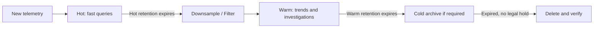
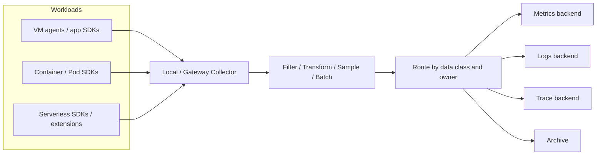

# Controlling Telemetry Cardinality, Retention, and Cost

Telemetry helps teams understand how compute workloads behave through metrics, logs, traces, and events. However, every new metric label, every stored log line, every generated span, and every day of retention adds storage volume, processing load, and cost. Without upfront design, a small change such as placing `user_id` into a metric label or logging full request bodies can cause observability costs to grow faster than the workload itself.

In the **CLOUD_CORE_SERVICES_COMPUTE** module, telemetry reflects the health of VMs, containers, serverless functions, networking, storage, and dependent services. This lesson focuses on three tightly coupled decisions: bounding cardinality to control series and dimensionality; defining retention periods by purpose; and managing costs across collection, processing, querying, replication, and storage. The goal is to retain enough signal for operations, investigations, and audit requirements without collecting unbounded data.

## Learning Objectives

After this lesson, you will be able to:

- Explain cardinality in metrics, logs, and traces, and distinguish metric series counts from distinct field values in logs.
- Design labels and attributes with bounded value sets, avoiding placing identifiers or arbitrary values into metric dimensions.
- Estimate telemetry volume from series count, scrape frequency, event rate, record size, and retention.
- Choose sampling, aggregation, filtering, and downsampling suited to each data type.
- Build retention policies based on criticality, investigation windows, and retention obligations.
- Analyze cost drivers: ingestion, indexing, storage, querying, egress, replication, and archiving.
- Establish budgets, quotas, alerts, ownership, and incident workflows when telemetry grows unexpectedly.
- Design a controlled telemetry pipeline using the OpenTelemetry Collector or an equivalent mechanism.

## 1. Telemetry and the Cost Problem

Telemetry is data emitted by applications, runtimes, operating systems, and infrastructure to describe system behavior. The three most common signal types are:

| Type | Content | Operational questions typically answered |
|---|---|---|
| Metrics | Numeric values recorded over time, usually aggregated periodically | Is CPU climbing? Are error rates and latency breaching SLOs? |
| Logs | Event records with timestamps and contextual fields | Why did a specific request fail? Who changed the configuration? |
| Traces | Chains of spans describing a request or job across services | Is the request slow in the API, queue, database, or external service? |

In addition, systems may collect profiles, security events, audit logs, flow logs, and resource inventory data. Each type has distinct operational value and storage characteristics. Metrics typically have small record sizes yet series counts can explode quickly. Logs can consume massive byte volumes due to text and payloads. Traces can generate many spans per request and typically require sampling.

### 1.1. Why does telemetry cost grow?

An observability platform may bill by one or more units:

- Number of active metric series or ingested metric samples.
- Gigabytes of logs ingested, indexed, or queried.
- Number of spans/traces ingested or stored.
- Storage capacity and retention duration.
- Query count, compute time, bytes scanned, or user seats.
- Data transfer bandwidth, cross-region replication, and archive retrieval.
- Resources for self-operated collectors, gateways, message queues, and backends.

Exact pricing models depend on the provider and plan. Read the pricing documentation for the platform you use; cost cannot be inferred from file size or log line count alone. A backend may bill separately for ingestion, indexing, retention, and queries.

### 1.2. Three questions before collecting

For every signal, determine:

1. **Purpose:** is this signal used for alerts, dashboards, debugging, auditing, security, or long-term analysis?
2. **Resolution:** do you need per-request, per-minute, per-hour, or only daily aggregated visibility?
3. **Lifespan:** how long is raw data needed before it can be aggregated, archived, or deleted?

If no user, query, or operational decision depends on the data, consider reducing collection volume or retention.

## 2. What Is Cardinality?

Cardinality is the number of distinct values in a dataset or unique combinations of values generating separate series. In a time-series metrics system, a metric name combined with a set of label values forms a distinct time series. Adding a label with many distinct values can multiply series counts exponentially.

For example, the metric `http_requests_total` has labels:

```text
http_requests_total{
  service="orders-api",
  method="GET",
  route="/orders/{order_id}",
  status_code="200"
}
```

Every unique combination of `service`, `method`, `route`, and `status_code` creates a separate series. If those dimensions have 4, 5, 20, and 6 values respectively, the theoretical maximum combinations by multiplication is:

```text
4 × 5 × 20 × 6 = 12,000 time series
```

This is the theoretical upper bound if all combinations occur; actual series counts may be lower. However, adding just one label with hundreds of thousands of values—such as `user_id`, `request_id`, or full URLs—can make cardinality explode dramatically.

### 2.1. Cardinality and time-series count

For a single metric, maximum series count can be estimated as:

\[
N_{series} \approx \prod_{i=1}^{k} |V_i|
\]

Where:

- `k` is the number of label dimensions.
- `V_i` is the set of possible values for label `i`.
- `|V_i|` is the number of distinct values of that label.

Across multiple metrics, total series is the sum of series across each metric after accounting for observed label combinations. Metrics have different label sets, so a single product formula cannot be applied blindly across an entire system.

For example, `http_requests_total` has 12,000 series; `http_request_duration_seconds` shares the same label dimensions and is a classic histogram with 12 finite buckets plus `+Inf`, `sum`, and `count`. For each label combination, a classic histogram can generate 15 component series, totaling roughly 180,000 series for that single histogram metric. Native histograms use different representations and costs, so verify which histogram format your backend uses.

### 2.2. Cardinality is more than just label count

A metric with 8 labels does not necessarily have high cardinality if every label has a small value set. Conversely, a metric with only 2 labels can still generate millions of series if one label contains arbitrary identifiers.

Evaluate simultaneously:

- Number of label dimensions.
- Number of possible values per label.
- Actual realized combinations.
- Rate at which series appear and disappear (series churn).
- Number of instrumented metric names.
- Number of histogram buckets and how the backend stores histograms.
- Number of workloads, replicas, regions, and environments scraped.

High cardinality increases RAM, CPU, indexing, metadata, compaction, query planning, and storage usage. High series churn also creates heavy load even when concurrent active series are modest, because the backend constantly creates and closes new series.

### 2.3. Cardinality in logs and traces

For logs, distinguish between:

- **Event volume:** number of records and total bytes written.
- **Field cardinality:** number of distinct values for a field such as `user_id`, `session_id`, `url`, or `exception.message`.
- **Index cardinality:** number of values or terms the indexing engine must track, depending on backend architecture.

A field with many distinct values does not necessarily create time series, yet it can bloat indexes, slow down queries, or increase index storage cost. If your backend supports non-indexed fields or selective field indexing, choose based on actual query patterns.

For traces, each request can emit many spans. `trace_id` and `span_id` naturally have huge cardinality; they are essential for linking traces and debugging, yet should generally not become aggregated metric dimensions or universally indexed dimensions. Standardized attributes such as `http.route` are usually better than `url.full` containing arbitrary paths/queries.

## 3. Designing Controlled Labels and Attributes

The core principle is to place only bounded, stable dimensions that add dashboard/alert value into metric labels. Unique identifiers belong in logs or traces when needed for investigation, protected by appropriate access controls and retention.

### 3.1. Low- and high-cardinality labels

| Field | Typical assessment | Rationale and usage |
|---|---|---|
| `service` | Low to medium | Managed list of services; use when governed by a registry/ownership |
| `environment` | Low | Examples: `dev`, `staging`, `production` |
| `region` | Low | Bounded set of deployment regions |
| `method` | Low | `GET`, `POST`, `PUT`, `DELETE`, or standardized method set |
| `status_code` | Low | Bounded HTTP codes; can be grouped into `2xx`/`4xx`/`5xx` classes |
| `route` | Low if normalized | Use route templates like `/orders/{order_id}`, not concrete URLs |
| `instance_type` | Low to medium | VM types selected from catalog; monitor actual distinct values |
| `version` | Medium | Useful for release comparisons; control number of active concurrent versions |
| `instance_id` | High/high churn | Each VM creates separate series; prefer log/resource metadata for drill-down |
| `pod_uid` / `container_id` | High/high churn | Changes with Pod/container lifecycle; avoid in default metrics |
| `user_id` | Very high and sensitive | Never use as metric label; store under access control in traces/logs if truly needed |
| `request_id` / `trace_id` | Nearly unique per request | Use to correlate logs/traces, never as a metric label |
| `url.full` | Potentially very high | Arbitrary query strings/paths; replace with route template and normalized domain |
| `exception.message` | Potentially very high | Error text can embed IDs, paths, and data; use standardized exception type/code |
| `sql.query` | Potentially very high and sensitive | Never use raw SQL as a label; use standardized operation/query fingerprint |

Cardinality is a property of actual runtime data. A field that looks bounded today can grow unbounded if the application allows user-supplied values. Enforce rules and validation where telemetry is emitted.

### 3.2. Normalizing routes and errors

Do not emit a separate metric series per concrete URL like:

```text
http_requests_total{path="/orders/839201"}
http_requests_total{path="/orders/839202"}
http_requests_total{path="/orders/839203"}
```

Use a route template instead:

```text
http_requests_total{route="/orders/{order_id}"}
```

Similarly, never put raw exception messages into labels. Use `exception_type="TimeoutError"` or `error_code="DB_POOL_EXHAUSTED"` with a controlled value set. Full stack traces can live in logs with restricted access and proper retention.

### 3.3. Resource attributes and metric labels

OpenTelemetry resource attributes describe the entity producing telemetry, such as `service.name`, `service.version`, `deployment.environment.name`, `cloud.region`, and `host.name`. Backends may convert certain resource attributes into metric dimensions or indexed fields. Therefore, attaching an attribute at the resource level does not automatically eliminate cardinality risk.

Distinguish between:

- **Resource attributes:** identity of the service, process, host, container, or function emitting data.
- **Metric attributes/labels:** dimensions used to group and query time series.
- **Log attributes:** context of an individual event; choose indexed fields based on query needs.
- **Span attributes:** context of an operation; keep trace/span IDs for linking while controlling indexing and metric conversion.

Certain resource attributes such as `host.id`, `container.id`, or `faas.instance` can have many values and high churn. Include them in metrics only when clearly operationally justified and cardinality-budgeted.

### 3.4. Naming conventions and limits

Establish shared telemetry conventions:

- Metric names describe the quantity and unit, e.g., `http_server_request_duration_seconds`.
- Labels use standard names, approved value sets, and assigned owners.
- Never place personal data, secrets, tokens, emails, or request payloads into metrics.
- Normalize routes, error codes, operations, and statuses.
- Enforce limits on label dimensions and per-service series budgets.
- Require review for label changes, as they can break dashboards, alerts, and cost budgets.

## 4. Managing Metric Cardinality

Metrics are typically stored as time series. Every series carries metadata and time-ordered samples; hence cardinality impacts both active memory and persisted storage.

### 4.1. Estimating sample volume

If `N` series are scraped every `T` seconds, the number of samples over a duration of `D` seconds is roughly:

\[
Samples \approx N \times \frac{D}{T}
\]

For example, with 1,200 series scraped every 15 seconds over 30 days:

```text
Scrapes per second = 1 / 15
Seconds in 30 days = 30 × 24 × 60 × 60 = 2,592,000
Samples = 1,200 × (2,592,000 / 15)
        = 207,360,000 samples
```

If cardinality grows to 12,000 series, samples jump to roughly 2.0736 billion over the same period. This is a raw sample count estimate; actual cost also depends on encoding, compression, replication, metadata, indexing, retention, and billing models.

### 4.2. Histograms and summaries

Histograms analyze distributions of latency or payload size. With classic histograms, each label set generates multiple bucket series plus `sum` and `count`; adding buckets multiplies series counts. Avoid adding excessive buckets merely for unnecessary precision.

Choose buckets based on:

- SLOs or latency thresholds being evaluated.
- Actual observed distribution from benchmarks.
- Quantile calculation needs and cross-replica aggregation requirements.
- Series cost and backend storage capabilities.

Summaries compute quantiles client-side yet typically cannot be aggregated accurately across multiple instances simply. Histograms are generally better suited for distribution aggregation in histogram-capable backends. Choose metric types based on semantics and backend support, not habit.

### 4.3. Controlling cardinality at multiple layers

1. **Instrumentation:** design labels with bounded value sets; normalize routes and error codes.
2. **SDK/agent:** cap attributes and drop unneeded fields before export.
3. **Collector:** transform, filter, aggregate, or drop dimensions per policy.
4. **Backend:** enforce series limits, cardinality alerts, per-tenant/service quotas, and monitor series churn.
5. **Dashboards/alerts:** use proper aggregations and avoid querying high-detail identifiers when only trends are needed.

Prefer fixing at the source. Dropping labels in the collector can protect the backend during an incident, yet does not stop applications from generating uncontrolled data. Before dropping a label, verify whether any dashboard, alert, or investigation workflow depends on that dimension.

### 4.4. Detecting abnormal metric cardinality

Track these indicators:

- Total active series and new series over time.
- Series count by metric name, service, namespace, and environment.
- Count of new label values and top labels with the most distinct values.
- Series churn, scraped samples, ingestion rate, and rejected samples.
- Ratio of metrics unused by any dashboard or alert.
- Storage and cost growth rate per service/tenant.

Example PromQL query to inspect series count by metric name:

```promql
topk(20, count by (__name__) ({__name__=~".+"}))
```

Example checking series count by service if metrics carry a `service` label:

```promql
topk(20, count by (service) ({__name__=~".+"}))
```

These queries can be expensive on large backends; use your platform's cardinality explorer or metadata APIs if available. Exact syntax and performance depend on your Prometheus-compatible backend.

## 5. Managing Log Cardinality and Volume

Logs are typically stored as events with timestamp, severity, body, and attributes. Cost is driven by event rate, average record size, indexing depth, compression, retention, and query load.

### 5.1. Structured logging

Prefer structured logs so filterable fields are cleanly separated:

```json
{
  "timestamp": "2026-11-22T10:15:30Z",
  "severity": "ERROR",
  "service": "orders-api",
  "environment": "production",
  "route": "/orders/{order_id}",
  "error_code": "DB_POOL_EXHAUSTED",
  "request_id": "req-7f91c2",
  "message": "Database connection pool exhausted"
}
```

In this example, `service`, `environment`, `route`, and `error_code` serve as common filter fields. `request_id` is highly valuable when investigating a single request yet has very high cardinality; the backend should store it for targeted lookup without necessarily building expensive indexes across every record. Weigh platform indexing policies, field mappings, and access controls carefully.

### 5.2. Avoiding logging unnecessary data

Avoid logging:

- Passwords, access tokens, API keys, session cookies, and private keys.
- Full request/response bodies containing personal or payment data.
- Raw SQL containing user data.
- Authorization headers or secrets inside URL query strings.
- Repetitive stack traces with zero diagnostic value.

When correlation is needed, record a controlled generated request/trace ID and link to traces. Redaction must happen before data leaves the workload or at a trusted collector; scrubbing secrets after ingestion into the backend may fail to remove copies, indexes, or archives.

### 5.3. Sampling and reducing log volume

Ways to curb log volume:

- Suppress repetitive `DEBUG` logs in production.
- Log only meaningful events; avoid logging every loop iteration or poll tick.
- Sample extremely high-frequency success logs if audit rules do not mandate keeping every event.
- Retain error logs, security alerts, and administrative events per policy.
- Deduplicate or rate-limit repetitive logs while keeping a counter of suppressed occurrences.
- Use metrics for volume trends instead of emitting a log line for every single occurrence.

Never sample mandatory audit logs, financial transactions, or events requiring complete evidentiary records when policy requires 100% retention. For error logs, conditional sampling can be used carefully while ensuring rare errors or single-tenant failures are not dropped.

### 5.4. Selective indexing

Not every log field needs to be indexed. Identify common queries and index high-value fields such as timestamp, service, severity, environment, error code, and selected correlation keys. High-cardinality fields can be stored inside the document without indexing, or looked up via alternative mechanisms if supported by the backend.

Before modifying mappings/indexes, assess impacts on queries, dashboards, alerts, and reindexing costs. Some backends bill by ingestion or storage even for unindexed fields; reducing indexing cuts part of the bill, though not necessarily all of it.

## 6. Managing Trace Cardinality and Volume

Distributed tracing follows requests across services as traces composed of spans. Each span typically includes an operation name, start/end timestamps, status, parent, and attributes.

### 6.1. Spans and attributes

Useful fields commonly include:

- `service.name`, `service.version`, `deployment.environment.name`.
- `http.request.method`, `http.route`, `http.response.status_code`.
- `db.system`, `db.operation.name`, or normalized query fingerprint.
- `messaging.system`, normalized destination, and consumer group.
- `exception.type` and status code.

Restrict attributes with arbitrary values such as raw URLs, SQL statements, user emails, payloads, tokens, or unnormalized exception text. Keep `trace_id` and `span_id` for correlation as intended by tracing, while controlling indexing and conversion into metric dimensions.

### 6.2. Sampling

Sampling decides which traces are retained. Common approaches:

- **Head sampling:** decides early when the trace starts, e.g., keeping a fixed percentage. Easy to scale, yet can miss rare errors because the decision happens before the outcome is known.
- **Tail sampling:** decides after observing spans or final outcomes, prioritizing error traces, slow traces, or specific groups. Requires collectors to buffer spans temporarily and group them by trace, increasing memory demand and complexity.
- **Adaptive/dynamic sampling:** adjusts rates by load, service, or system state; requires bounds and monitoring to preserve statistical representativeness.

An example tail sampling policy might retain 100% of error traces, retain traces exceeding a latency threshold, and sample a small fraction of successful traces. This is only an example; tune thresholds to SLOs and actual traffic.

### 6.3. Preserving correlation

When logs carry `trace_id`, you can pivot from an error log to its matching trace. Metrics can use exemplars to link a data point to a sample trace if supported by the backend. With sampling enabled, remember that not every request has a stored trace; dashboards must not assume every log links to a retained trace.

## 7. Designing Purpose-Driven Retention

Retention is how long data stays in a system or storage tier. A solid policy sets durations by telemetry type, purpose, sensitivity, legal/contractual obligations, investigative needs, and cost.

### 7.1. Distinguishing retention from backups and archives

- **Retention:** duration data is kept searchable or available for its intended operational purpose.
- **Backup:** copies maintained for restoring lost or corrupted systems/data.
- **Archive:** long-term lower-cost storage, typically with slower retrieval.
- **Legal hold:** preserving data beyond normal retention under an approved legal or investigative mandate.

Backups do not replace retention policies; archives do not automatically satisfy fast-query requirements; deleting from a hot tier does not guarantee data was purged from every replica, snapshot, or archive.

### 7.2. Retention by data type

| Data | Primary purpose | How to determine retention |
|---|---|---|
| High-resolution metrics | Alerting, dashboards, near-real-time incident investigation | Keep raw data long enough for investigation windows and recent trend analysis |
| Downsampled metrics | Long-term trend analysis and capacity planning | Retain longer at lower resolution while still useful |
| Application logs | Debugging, operations, and error analysis | Match incident needs, SLOs, privacy, and organizational policy |
| Security/audit logs | Investigating access, changes, and security events | Match legal, audit, contractual, and internal compliance requirements |
| Traces | Request debugging and latency analysis | Keep selectively; apply sampling and shorter retention unless otherwise required |
| Flow/network logs | Investigating network paths and anomalies | Match investigation windows and storage capacity |
| Profiles | CPU/memory performance analysis | Retain around profiling campaigns and comparison needs |

No single retention day count fits every organization. Define requirements around data classification, legal obligations, time to detect, investigation lead time, and budget. Without an existing policy, align with data owners, security, and legal teams before setting production retention periods.

### 7.3. Tiered retention

Storage can be organized into tiers:

| Tier | Characteristics | Suitable data |
|---|---|---|
| Hot | Fast queries, higher cost | Recent metrics/logs/traces supporting alerts and active investigations |
| Warm | Moderate cost and query speed | Data queried less frequently |
| Cold/archive | Lower storage cost, longer restore/query latency | Audit or long-term data permitted for archiving |
| Expired/deleted | Past retention with no legal hold | Data purged per policy and verification procedures |

Example lifecycle flow:



Not all data needs to pass through every tier. Successful traces can be sampled and purged early; critical audit logs may require longer storage; raw metrics can be downsampled before archiving.

### 7.4. Downsampling and aggregation

Downsampling reduces time resolution. For example, CPU metrics recorded every 15 seconds can be aggregated into 5-minute and 1-hour averages, min/max, or percentiles. This shrinks sample counts at the expense of short-term granularity.

Choose aggregations matching metric semantics:

- Gauges such as CPU utilization: store average, min, max, or percentiles depending on need.
- Counters: compute deltas/rates and aggregate properly; never sum raw cumulative counters across resets.
- Histograms: aggregate buckets/counts/sums structurally to preserve distribution accuracy.
- Error counts: keep total error counts and total request counts so accurate ratios can be recalculated.

Do not downsample every metric using simple averages. For latency, averaging hides tail behavior; preserve histograms or proper percentile summaries instead.

### 7.5. Privacy, legal holds, and data deletion

Logs and traces can contain personal data or confidential details. Retention policies must govern collection purpose, access rights, storage location, encryption, retention, and deletion. If a user exercises a right to delete personal data, you must know which logs, traces, indexes, and archives hold that data and how deletion is executed.

Legal holds require an approver, defined data scope, justification, and end criteria. Once lifted, data returns to the normal retention lifecycle. Never keep telemetry indefinitely "just in case it might be useful someday."

## 8. Estimating Telemetry Volume and Cost

Estimating upfront catches unsustainable designs early. Use measurements from staging/load tests or comparable production services, and document assumptions explicitly.

### 8.1. Metrics

```text
Metric samples ≈ active_series × (duration_in_seconds / scrape_interval)
Raw size ≈ sample_count × average_bytes_per_sample
Retention storage ≈ compressed_daily_size × retention_days × replication_factor
```

Average bytes per sample varies by backend and encoding; do not assume one fixed number across all systems. Beyond raw samples, account for metadata/indexes, WAL, compaction, replicas, and head blocks.

### 8.2. Logs

```text
Log bytes per day ≈ events_per_second × average_event_bytes × 86,400
Retention storage ≈ log_bytes_per_day × retention_days × storage_multiplier
```

For example, a service emitting 250 log events/second averaging 700 bytes/event:

```text
250 × 700 × 86,400 = 15,120,000,000 bytes/day
≈ 15.12 GB/day (decimal), before compression/indexing/replication
```

Over 14 days, raw input volume equals roughly 211.68 GB before compression, indexing, and replicas. This is an arithmetic illustration, not a price quote from any specific provider.

### 8.3. Traces

```text
Spans per day ≈ requests_per_second × average_spans_per_request
                × 86,400 × sampling_ratio

Trace bytes ≈ retained_spans × average_span_bytes
```

For example, 500 requests/second averaging 8 spans/request with 10% trace sampling:

```text
500 × 8 × 86,400 × 0.10 = 34,560,000 spans/day
```

Because a single trace spans many operations, head/tail sampling at the trace level keeps or drops connected span groups consistently compared to sampling individual spans independently. Real sizing must also add attributes, events, links, indexes, and overhead.

### 8.4. Total cost model

Break costs down by component:

| Component | Primary driver | Control question |
|---|---|---|
| Ingestion | Samples, log bytes, spans, events | Are we collecting duplicate or unnecessary data? |
| Cardinality/index | Series count, field values, index terms | Are there unbounded dimensions or overly broad field indexing? |
| Storage | Volume, retention, replication | Does raw data need long retention? Can we downsample/archive? |
| Query/compute | Query volume, scanned bytes, compute time | Are dashboards scanning too broadly or refreshing too often? |
| Egress/network | GB transferred across regions, accounts, or providers | Can we process near the source or use private paths? |
| Collector/agent | CPU, RAM, queues, disk buffers | Are collectors overprovisioned or retrying in ways that duplicate data? |
| Archive/restore | Cold capacity, retrieval requests, restore time | Does the data truly need archiving and have restores been tested? |
| People/operations | Operational and investigative effort | Is the design overly complex or lacking clear ownership? |

Overall cost can be expressed as:

```text
Total telemetry cost
  = ingestion
  + indexing/cardinality
  + hot/warm/cold storage
  + query/compute
  + network/egress/replication
  + collector and pipeline infrastructure
  + archive retrieval and operations
```

Some pricing plans bundle components or charge per host/seat rather than per gigabyte. Map these drivers to your actual rate card and invoice rather than assuming all providers bill identically.

## 9. Controlled Telemetry Pipelines

Rather than shipping all data directly from every workload to backends, use a collector/gateway to enforce centralized policies. The OpenTelemetry Collector is a popular choice for metrics, logs, and traces.

### 9.1. Reference architecture



Collectors can normalize resource attributes, strip secrets, drop unneeded fields, batch records, sample traces, and route by data classification. For sensitive data, secure transport, collectors, buffers, and configuration access.

### 9.2. Common processors

- **Memory limiter:** protects the collector from exceeding RAM limits.
- **Batch:** groups records together to reduce transport overhead.
- **Filter:** drops unneeded or disallowed telemetry.
- **Attributes/resource transform:** normalizes, renames, or deletes attributes.
- **Probabilistic sampling:** samples proportionally where appropriate.
- **Tail sampling:** retains traces after inspecting status or trace characteristics.
- **Routing:** forwards each data class to the appropriate backend or retention policy.

Processor order matters. Redacting sensitive data must happen before exporting to external systems. Tail sampling requires enough buffer memory to hold spans belonging to a trace; if a collector runs out of memory or span routing is inconsistent, sampling decisions break.

### 9.3. Illustrative configuration

The example below illustrates the Collector configuration concept; exact receiver/exporter names and syntax must be adapted to your Collector version, backend, and deployment environment:

```yaml
processors:
  memory_limiter:
    check_interval: 1s
    limit_mib: 512
    spike_limit_mib: 128

  batch:
    send_batch_size: 1024
    timeout: 5s

  attributes/sanitize:
    actions:
      - key: http.request.header.authorization
        action: delete
      - key: user.email
        action: delete

  filter/drop_debug:
    logs:
      log_record:
        - 'severity_text == "DEBUG"'

service:
  pipelines:
    logs:
      receivers: [otlp]
      processors: [memory_limiter, attributes/sanitize, filter/drop_debug, batch]
      exporters: [otlp/logs-backend]
```

This is a directional example, not a copy-paste production config for every Collector. Configure actual receivers/exporters, validate filter expressions against your version, and ensure dropping attributes does not break auditing or investigations. Never drop `DEBUG` if a specific environment or requirement needs it.

## 10. Budgets, Quotas, and Ownership

Telemetry needs owners and budgets just like compute. Without knowing which service emits data, platform teams struggle to curb growth and allocate costs.

### 10.1. Per-service telemetry budgets

A budget can cover:

- Maximum active series and series growth rate.
- Samples/sec or ingested bytes/day.
- Log bytes/day by severity and service.
- Spans/sec, sampling ratio, and retained trace count.
- Hot/warm/archive retention periods.
- Projected monthly spend and alert thresholds.
- Owner, cost center, environment, and review date.

Directional budget example:

| Signal | Initial target | Threshold for review |
|---|---|---|
| Metrics | Approved bounded label sets; per-service active series quota | Series count jumps >20% above baseline in one day |
| Logs | Per-service and per-severity volume budget | Daily ingested bytes exceed budget or spike sharply |
| Traces | Sampling by request type and errors; normalized attributes | Span rate or trace bytes grow unexpectedly |
| Retention | Hot/warm/cold tiers by data class | Expired data still present or unowned archives |

Thresholds like 20% only illustrate how to structure alerts; tune them to normal volatility and SLOs. Alerting on baseline deviation and growth rate catches runaway growth much earlier than absolute caps alone.

### 10.2. Chargeback and showback

- **Showback:** reports telemetry spend to each team/service to build cost awareness.
- **Chargeback:** allocates or bills costs back to cost centers per internal accounting rules.

To allocate accurately, attach metadata such as `service`, `team`, `environment`, `cost_center`, and `data_class` consistently. Never use personal identifiers or arbitrary values as cost dimensions. If backends cannot attribute costs cleanly per service, use collector/ingestion metrics or a clearly documented estimation method.

### 10.3. Automated guardrails

Checks can run in CI/CD or admission controllers:

- Reject metric instrumentation that promotes `user_id`, `request_id`, or raw URLs to labels.
- Warn when new labels lack owners or cardinality estimates.
- Block log fields containing known tokens/secrets via secret scanning.
- Verify retention policies are attached to data streams/indexes.
- Alert when collector exporter or sampling policies change.
- Flag new services missing budgets or owners.

Guardrails need time-bound exception workflows and audit trails. Overly rigid blocks push developers to bypass the pipeline or ship telemetry through shadow channels.

## 11. Real-World Example: Controlling Telemetry for a Compute Platform

Suppose a platform runs 40 API VMs, 60 worker Pods, and several event-processing functions. Metrics are scraped every 15 seconds; logs ship centrally; traces are instrumented with OpenTelemetry.

### 11.1. The cardinality problem

The API adds a `customer_id` label to `http_requests_total` to look up errors per customer. The platform serves 200,000 customers, 5 HTTP methods, 30 route templates, and 6 status groups. The upper bound across those dimensions alone is:

```text
200,000 × 5 × 30 × 6 = 180,000,000 series
```

Not every combination occurs, yet `customer_id` alone risks spawning a massive number of series. Remediation:

1. Remove `customer_id` from metric labels.
2. Keep aggregated metrics by `service`, `route`, `method`, and `status_class`.
3. Place customer identifiers into traces/logs when needed for investigation under privacy and access controls.
4. Use correlation IDs to locate specific requests.
5. Monitor active series counts post-deploy and alert on unexpected jumps.

### 11.2. Metric estimation

Suppose after normalization, the API has 1,500 active series. With a 15-second scrape interval and 15-day raw retention:

```text
Samples/day = 1,500 × (86,400 / 15)
            = 8,640,000 samples/day

Samples/15 days = 129,600,000 samples
```

Increasing scrape frequency to every 5 seconds triples sample volume while keeping cardinality constant. Therefore, tie resolution to alerting and debugging needs rather than lowering intervals across all metrics just for faster-updating dashboards.

### 11.3. Log and trace policy

An example policy for this workload:

- Keep application error logs on the hot tier for the agreed operational investigation window.
- Minimize `DEBUG` logs in production; enable time-boxed `DEBUG` on a single service during investigations.
- Never store access tokens, emails, or sensitive request bodies.
- Retain security/audit logs under a separate policy with restricted access.
- Sample successful traces proportionally; prioritize retaining error and slow traces via tail sampling if the pipeline supports it.
- Keep `trace_id` inside logs for correlation; never turn `trace_id` into a metric label.
- Archive long-term audit data if policy requires, then delete upon expiration when no legal hold applies.

Exact durations must be agreed upon by data owners, security, and legal teams according to applicable obligations. This example illustrates classification, not a universal day count.

### 11.4. Responding when costs surge

If ingestion volume doubles in a single day:

1. Identify which signal surged: metric series/samples, log bytes, or spans.
2. Break down by service, environment, collector, and deployment version.
3. Inspect recent changes to instrumentation, labels, log levels, retries, or sampling.
4. Pinpoint the top contributing dimension or event type.
5. Apply controlled mitigations: drop unneeded labels, curb repetitive logs, adjust sampling, or pause non-essential telemetry.
6. Preserve mandatory audit/security signals and SLO-backing metrics.
7. Verify dashboards, alerts, and incident workflows still function.
8. Record root cause, owner, deadline for source-level remediation, and update budgets.

## 12. Troubleshooting Cardinality or Telemetry Cost Spikes

### 12.1. Warning signs

- Sudden spikes in active series or series churn.
- Backends reporting cardinality limits, sample rejections, or ingestion throttling.
- Rising RAM/CPU on metrics backends or collectors.
- Slow queries, timeouts, or failing dashboard loads.
- Rising log ingestion bytes/index size even while request rates stay flat.
- Unusual span rate spikes or overflowing tail-sampling buffers.
- Telemetry bills growing faster than application traffic.

### 12.2. Investigation workflow

1. Confirm blast radius and start time; correlate with deployments/change events.
2. Split by signal type: metrics, logs, traces, profiles, or flow logs.
3. Find the top contributing service/metric/field/event type.
4. Compare cardinality, event rate, record size, scrape interval, and sampling against baselines.
5. Check for new labels/attributes, raw URLs, IDs, exception text, retry loops, or log-level shifts.
6. Inspect collector queues, retries, exporters, and duplicate pipelines.
7. Separate mandatory signals to keep from non-essential signals that can be temporarily throttled.
8. Apply a scoped change, monitor the backend, and verify alerts/SLOs.
9. Fix instrumentation/policies at the source, add regression guardrails, and document before/after costs.

### 12.3. Emergency load-shedding measures

- Drop a metric or dimension confirmed unnecessary.
- Disable `DEBUG` logs or rate-limit a specific noisy log pattern.
- Lower sampling of successful traces within agreed bounds.
- Increase batch sizes or scale collectors if the bottleneck is in the pipeline and budget allows.
- Pause resource-heavy dashboards/queries unrelated to the incident.
- Transition infrequently queried data to cheaper tiers if policy allows.

Never delete data under legal holds or audit mandates. Never turn off all telemetry just to cut a bill; doing so blinds teams to active incidents and ongoing investigations.

## 13. Common Design Mistakes

| Mistake | Consequence | Fix |
|---|---|---|
| Using `user_id` or `request_id` as metric labels | Series explode per user/request | Move identifiers to logs/traces and keep aggregated metrics |
| Using full URLs as labels | Arbitrary paths/queries create huge cardinality and leak data | Use route templates and strip query strings |
| Adding too many histogram buckets | Multiplies series count per label set | Pick buckets matching SLOs and real distributions |
| Indexing every log field | Bloated indexes, expensive ingestion and queries | Index frequently queried fields; store others as needed |
| Logging full requests/responses | Massive volume and PII/secret exposure risks | Use structured logs, redaction, and allowlisted fields |
| Sampling individual spans independently | Incomplete traces missing spans, hard to analyze | Sample at the trace level or use trace-consistent rules |
| Insufficient tail-sampling buffers | Dropped spans or wrong sampling decisions | Route consistently by `trace_id`, size collectors, and monitor buffers |
| Retaining raw telemetry indefinitely | Storage and indexes grow endlessly | Implement tiered retention, downsampling, and deletion policies |
| Deleting data only from hot tiers | Replicas/archives keep data longer than intended | Define lifecycles across all copies and verify deletion |
| Lacking per-service owners/budgets | Impossible to pinpoint who drove cost growth | Enforce `service`/`team`/`cost_center` tags and showback |
| Watching only monthly invoices | Spikes discovered far too late | Alert on ingestion rates, cardinality, and daily spend estimates |
| Dropping telemetry without review | Loss of security or SLO signals | Classify mandatory vs. optional signals and audit exceptions |

## 14. Telemetry Governance Checklist

**Cardinality and instrumentation**

- [ ] Metric labels have bounded value sets approved by owners.
- [ ] User IDs, request IDs, trace IDs, raw URLs, and exception text are excluded from metric labels.
- [ ] Routes, error codes, and operations are normalized.
- [ ] Histogram buckets align with SLOs and series budgets.
- [ ] Active series, churn, and top dimensions are actively monitored.
- [ ] Resource attributes are reviewed before becoming metric dimensions or indexed fields.

**Logs and traces**

- [ ] Logs are structured with consistent severity and correlation IDs.
- [ ] Secrets, tokens, and sensitive data are redacted before export.
- [ ] Indexing applies only to fields required for queries.
- [ ] Sampling never drops mandatory audit/security events.
- [ ] Trace sampling is consistent per trace; tail sampling has sufficient buffer memory.
- [ ] Logs, metrics, and traces correlate without creating unnecessary cardinality.

**Retention and cost**

- [ ] Every data class has an owner, purpose, retention period, and access policy.
- [ ] Raw, downsampled, hot, warm, cold, and deletion lifecycles are defined.
- [ ] Legal holds and backups are managed separately from standard retention.
- [ ] Ingestion, storage, indexing, query, egress, and replication costs are estimated.
- [ ] Per-service/team budgets, quotas, and alerts are in place.
- [ ] Showback/chargeback or cost allocation reports exist.

**Operations**

- [ ] Collectors enforce memory limits, batching, retries, and queue monitoring.
- [ ] Procedures exist for handling cardinality/volume spikes.
- [ ] Changes to instrumentation, labels, and retention undergo review.
- [ ] Automated checks block dangerous dimensions and secrets in telemetry.
- [ ] Verification procedures confirm expired data is deleted from indexes, replicas, and archives.

## 15. Conclusion

Telemetry cardinality, retention, and cost must be designed together. Metrics need bounded label sets; logs need controlled event volumes and indexed fields; traces need bounded spans/attributes and trace-level sampling. Retention should reflect purpose, sensitivity, investigation windows, and compliance obligations across clear hot, warm, cold, and deletion tiers.

Measuring active series, samples, log bytes, spans, queries, and storage catches runaway growth before bills or backend outages become incidents. Collectors, budgets, quotas, ownership, and automated guardrails turn these principles into verifiable operations. Retain the signals needed for SLOs, security, and investigations; cut duplicate, unneeded, or unbounded-cardinality data; and verify data lifecycles from emission through deletion.

## Key Terms to Remember

| Term | Meaning |
|---|---|
| Telemetry | Data emitted by workloads/infrastructure to observe system behavior. |
| Cardinality | Number of distinct values or value combinations in a dataset. |
| Time series | Time-ordered stream of samples identified by metric name and label set. |
| Label / attribute | Dimensional field used to describe and group telemetry. |
| Series churn | Rate at which new time series are created and retired. |
| Histogram | Metric representing value distributions via buckets, sum, and count, or native histogram structures. |
| Structured logging | Writing logs as structured fields for filtering and analysis. |
| Head sampling | Trace sampling decision made at the start of processing. |
| Tail sampling | Trace sampling decision made after observing spans and outcomes. |
| Downsampling | Reducing data resolution by aggregating over time intervals. |
| Retention | Duration data is kept inside a system or storage tier. |
| Archive | Long-term storage tier, typically cheaper yet slower to retrieve. |
| Legal hold | Requirement to preserve data beyond normal retention for legal or investigative purposes. |
| Showback | Cost reporting to teams/services to provide visibility into usage. |
| Chargeback | Allocating or billing costs to cost centers per organizational rules. |
| OpenTelemetry Collector | Component that receives, processes, and exports telemetry through configured pipelines. |
