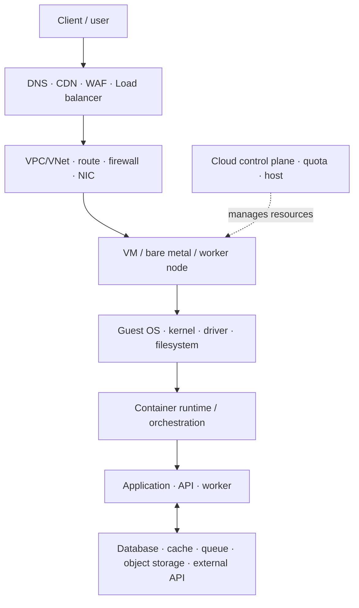
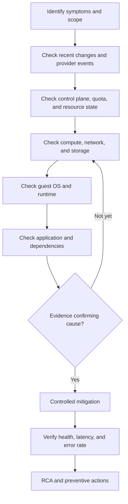

# Troubleshooting Workflow from Cloud Platform to Application

When a compute service is slow, unreachable, or returning errors, the root cause can lie across multiple layers: the cloud control plane, host capacity, network, storage, operating system, container/runtime, application, or dependent services. A VM in a `Running` state does not guarantee the application is healthy; a Pod in a `Running` state does not guarantee it is ready to receive traffic; a successfully deployed serverless function does not guarantee it has sufficient concurrency or permissions to process requests.

Effective diagnosis starts from symptoms and evidence, then isolates each layer in order. Every step should answer three questions: **what is being observed, what evidence confirms the hypothesis, and which next check rules out which cause?** A systematic approach reduces recovery time, avoids changes that introduce additional failures, and preserves the data needed to identify the root cause.

## 1. Viewing the compute system in layers

A request passes through many components before reaching application code. The diagram below illustrates the typical path of an application running on a VM or container; serverless services may abstract away several provider-managed layers.



The layers can be checked in the following order:

1. **Cloud platform and control plane:** are resources provisioned, are quota/capacity sufficient, and are there provider incidents or maintenance events?
2. **Compute:** is the VM, host, or node operating stably; are CPU, RAM, GPU, and resource limits exhausted?
3. **Network:** are DNS, routes, firewalls, load balancers, NICs, TLS, and outbound connectivity working?
4. **Storage:** are volumes, filesystems, IOPS, throughput, and storage latency meeting demand?
5. **Guest OS:** are there errors in the kernel, services, drivers, processes, file descriptors, or agents?
6. **Runtime and orchestration:** are containers, Pods, scheduler, probes, resource requests/limits, and serverless runtimes operating properly?
7. **Application and dependencies:** are there errors in application code, thread pools, connection pools, queues, databases, or external APIs?

This is an isolation order, not a rigid rule. If there is clear evidence pointing to a specific layer, go directly to that layer. For example, if a cloud event shows a volume detached unexpectedly, inspect storage immediately rather than starting with CPU profiling.

## 2. Diagnostic principles before modifying the system

### Start with impact and scope

First determine which service is affected, when the issue started, and whether it affects all traffic or only a subset of requests, a single zone, an instance, or a specific deployment version. Distinguish complete outage (availability) from partial degradation (latency, throughput, error rate).

Record at minimum:

- Start time and timezone; first occurrence and most recent occurrence.
- Affected endpoints, features, tenants, regions/zones, and user groups.
- Error rate, p50/p95/p99 latency, throughput, and number of queued/in-flight requests.
- Standardized error codes and messages, such as 4xx, 5xx, timeout, connection reset, or OOM.
- Recent changes: releases, configuration, images, instance families, network rules, secrets, certificates, or maintenance events.
- Mitigations already attempted, who performed them, and their outcomes.

Do not lump distinct symptoms into a single generic error. For instance, database timeouts and HTTP 500 errors from request validation failures may occur together but require two separate lines of investigation.

### Preserve evidence

Before rebooting, terminating, scaling down, or deleting a Pod, collect the necessary logs, events, metrics, and state. A reboot can wipe traces in RAM; replacing an instance can lose local disk data; deleting a Pod can make local logs inaccessible.

Prioritize read-only operations first: inspect status, gather logs, capture metrics, check configuration, and cross-reference audit events. If a change is needed to reduce impact, record the state prior to the change and apply one change at a time.

### Use testable hypotheses

For example, "the API is slow because CPU is insufficient" is a hypothesis, not a conclusion. To verify it, inspect CPU utilization, run queue, throttling/steal, request count, latency, and the timing of spikes. If CPU is low while requests remain slow, pivot to checking network, storage, or dependencies.

Avoid changing instance type, timeouts, connection pools, and network rules simultaneously. If conditions change, it becomes difficult to know which change produced the effect.

### Distinguish mitigation from root cause

Mitigation is an action that immediately reduces impact, such as shifting traffic to healthy replicas, temporarily adding capacity, or rolling back a release. Root cause is the underlying condition that created the incident, such as a memory leak, exhausted quota, misconfigured route, or locked database query. A mitigation may restore service without resolving the root cause; investigation must continue once the system is stable.

## 3. General isolation workflow



In practice, the workflow may return to an earlier layer as new data emerges. For example, application logs may show `connection refused` to the database, and subsequent checks reveal that a route or security rule changed. In that case, the root cause lies in the network layer even though the symptom surfaced in application logs.

## 4. First step: verify the cloud platform and control plane

The control plane is the layer that manages cloud resources: creating VMs, attaching volumes, configuring NICs, updating security groups, managing quotas, and emitting events. Failures at this layer can cause management operations to fail even while running VMs continue serving traffic.

### Check resource state

For VMs, verify:

- Instance state and provider-reported health status.
- System check and instance/guest check statuses, if the provider distinguishes them.
- Boot/console logs, serial output, or console screenshots when the OS fails to boot.
- Volume attachment, NIC, public IP, security group, and placement status.
- Maintenance events, host retirement, live migration, or hardware alerts.

For container platforms or managed Kubernetes, inspect the control plane, node pools, cluster events, quotas, and scheduler status. For serverless, check deployment revisions, invocation errors, concurrency, timeouts, quotas, and dependent service health.

### Check quota and capacity

A VM creation or scaling operation can fail due to quotas on vCPUs, instance count, IP addresses, volumes, GPUs, or API rate limits. A zone may also temporarily lack capacity for a specific instance type.

Distinguish between:

- **Quota:** limits enforced at the account, project, subscription, or region level.
- **Capacity:** physical hardware availability in a zone/region at the time of request.
- **Permission:** the identity lacks permission to call the API or operate on the resource.
- **Configuration error:** invalid instance parameters, image, subnet, key, or disk specification.
- **Service/API issue:** the control plane is experiencing errors, throttling, or degradation.

Read the API error code and request ID to classify the failure. Do not continuously retry resource creation when the error is quota or permission; retries are appropriate only for transient errors and must use backoff.

### Check recent changes and provider events

Correlate audit logs with the incident start time. Look for recent changes to instance types, images, routes, firewalls, IAM, volumes, autoscaling policies, and deployments. Check maintenance events or advisories in the portal/event service. Host maintenance can trigger a pause or reboot without any changes from the application team.

If the control plane is experiencing an incident, management commands may fail while the data plane continues running. Do not terminate or recreate VMs simply because the portal temporarily fails to display the expected state; verify via APIs, events, and independent observability data before taking action.

## 5. Check compute: CPU, RAM, and accelerators

### High CPU or degraded throughput

Common indicators include:

- Sustained high CPU utilization accompanied by a growing run queue.
- Latency increasing in lockstep with CPU saturation.
- A single core or thread hitting near 100% while overall CPU remains low.
- CPU throttling due to quotas, limits, or exhausted credits on burstable instances.
- vCPUs waiting for hypervisor scheduling time; some environments report steal time or CPU ready.

Check both the active processes and the workload profile. CPU-bound tasks may require more vCPUs or algorithmic optimization; single-threaded applications may require faster cores; workloads suffering from lock contention may not improve with additional vCPUs.

### Memory exhaustion and OOM

Indicators include rising memory utilization, heavy swap activity, processes terminated by the kernel OOM killer, containers marked `OOMKilled`, or runtimes restarting repeatedly. Inspect memory working set, heap, native memory, page cache, swap, cgroup limits, and growth trends over time.

Increasing RAM can serve as a mitigation, but you still need to find the root cause: a memory leak, unbounded cache, oversized batch, increased worker count, misconfigured heap, or a container limit set below actual demand. Simply adding RAM without bounding a memory leak will allow the incident to recur.

### GPU or accelerator not working

Verify that the device is detected by the VM/container, that the driver and runtime are compatible with the kernel, that VRAM/HBM is sufficient, and that the workload is actually executing kernels on the accelerator. Low GPU utilization can occur because CPU preprocessing, data loaders, storage, or the network are not feeding data fast enough.

In multi-GPU setups, inspect topology and interconnects, ECC errors, temperature/power metrics if available, and synchronization overhead across devices. Do not conclude a GPU is faulty based solely on low utilization.

### Linux inspection commands

```bash
# Load average and uptime
uptime

# CPU, processes, and memory
top
free -h
vmstat 1

# Per-core CPU usage if sysstat is installed
mpstat -P ALL 1

# Per-process memory and swap activity
pidstat -r 1

# Recent OOM and kernel errors
dmesg -T | grep -i -E 'oom|out of memory|killed process'
```

Tool names and permissions may vary by distribution. These commands are for observation; do not automatically conclude RAM is exhausted just because page cache is large, since Linux uses idle RAM as cache and reclaims it when needed.

## 6. Check network: DNS, routes, firewalls, and load balancers

Network issues typically manifest as timeouts, connection refused errors, TLS handshake failures, packet loss, or connectivity failures limited to a subset of clients. Inspect the path from source to destination rather than relying solely on pinging an address.

### DNS

Check whether the hostname resolves, returns the expected address, and has appropriate TTL/caching behavior. Compare results from an affected host against a healthy host. Stale records or split-horizon DNS can send two environments to different endpoints.

```bash
# Name resolution on Linux
getent hosts api.example.internal
nslookup api.example.internal

# Inspect resolver configuration
cat /etc/resolv.conf
```

On Windows:

```powershell
Resolve-DnsName api.example.internal
ipconfig /displaydns
```

### Routes and network addressing

Verify that the NIC has the correct IP address, that routes to the target subnet/endpoint exist, and that traffic is not captured by a higher-priority misconfigured route. Inspect the associated network interface, subnet, route table, NAT gateway, peering, VPN, or private endpoint.

```bash
# Interfaces and IP addresses
ip addr

# Routing table
ip route

# Active connections and listening sockets
ss -lntup

# Path to destination if the tool is available
traceroute api.example.internal
```

Do not treat a failed traceroute as sole proof that the network is broken; firewalls may block ICMP or UDP probes while TCP traffic still passes.

### Security groups, network ACLs, and host firewalls

Check both directions. Security groups are stateful on many platforms, whereas network ACLs or other firewalls may be stateless, requiring matching rules for return traffic and ephemeral ports. Host-level firewalls inside the guest OS can also block connections even when cloud rules permit them.

Verify source/destination CIDRs, protocols, ports, interfaces, routes, and rule priority order. Avoid opening `0.0.0.0/0` just to "test quickly"; if testing is necessary, restrict source, duration, and scope, and revert immediately afterward.

### Load balancers and health checks

If a VM is reachable directly but fails through a load balancer, check:

- Listener, target group/backend pool, and protocol/port mappings.
- Health check path, expected status code, timeout, and interval.
- Security rules between the load balancer and backends.
- TLS certificate, SNI, hostname, and certificate chain.
- Connection draining, idle timeout, and connection limits.
- Whether the backend binds to the right interface/port rather than listening only on loopback.

Failing health checks can stem from an unready application, a check path that depends on the database, or a firewall blocking probes. Do not simply increase timeouts without understanding why the health check is slow.

### Testing TCP and TLS connectivity

```bash
# Test TCP connectivity to the target port
nc -vz api.example.internal 443

# Check HTTP status and connection timing breakdown
curl -sS -o /dev/null -w 'status=%{http_code} connect=%{time_connect} tls=%{time_appconnect} total=%{time_total}\n' https://api.example.internal/health

# Inspect TLS certificate and handshake
openssl s_client -connect api.example.internal:443 -servername api.example.internal </dev/null
```

On Windows:

```powershell
Test-NetConnection api.example.internal -Port 443
```

Do not include tokens, cookies, or credentials in test commands if the output might be saved in shell history or tickets. When checking TLS, verify the hostname and certificate expiration; never disable certificate validation as a permanent fix.

## 7. Check storage: capacity, mounts, and I/O performance

Storage issues can slow down an application even when CPU is low. Symptoms include high I/O wait, slow read/write requests, full filesystems, exhausted inodes, detached volumes, or filesystem errors.

### Capacity and mounts

```bash
# Filesystem disk space usage
df -h

# Inode usage
df -i

# Block devices and filesystems
lsblk -f

# Mount points
findmnt
```

A full filesystem can prevent logs from being written, block databases from creating new files, or cause upload write errors. Inode exhaustion can occur even when byte capacity remains, especially when many small files exist.

### Latency and throughput

```bash
# I/O statistics if sysstat is installed
iostat -xz 1

# Per-process read/write statistics
pidstat -d 1

# Kernel and storage device errors
dmesg -T | grep -i -E 'blk|nvme|scsi|I/O error|filesystem'
```

Compare IOPS, throughput, queue depth, and latency against volume and instance limits. A volume with a high IOPS cap can still be throttled by total bandwidth or burst credit exhaustion. Check limits at the volume level, instance level, and storage path.

### Detached volumes or read-only filesystems

Check the cloud control plane to verify that the volume is attached to the correct VM/zone. Inside the guest OS, verify that the device appears, check the filesystem mount, and inspect kernel logs. If a filesystem transitions to read-only after I/O errors, do not attempt to remount read-write or run repair utilities before assessing data state and backups.

For critical databases or filesystems, prioritize taking a consistent snapshot/backup, collect logs, and follow the recovery runbook. Never format or create a new filesystem on a device suspected of containing data.

## 8. Check the guest OS and system services

If the VM is running and basic networking works, verify that the OS finished booting, required processes exist, and services are listening on the expected ports.

### Linux

```bash
# systemd service status
systemctl status my-app

# Service logs from the last 30 minutes
journalctl -u my-app --since '30 minutes ago' --no-pager

# Running processes and listening sockets
ps aux
ss -lntp

# File descriptor and process limits
ulimit -n
```

Check `systemd` dependencies, restart loops, exit codes, permissions, file descriptors, disk mounts, and environment variables. Avoid printing full environment blocks or configuration files that may contain secrets into shared output.

### Windows

```powershell
# Service status
Get-Service -Name 'MyApp'

# Recent System event logs
Get-WinEvent -LogName System -MaxEvents 50

# Network configuration
Get-NetIPConfiguration

# Listening ports
Get-NetTCPConnection -State Listen
```

Inspect System/Application logs in Event Viewer, service recovery policies, Windows Firewall, drivers, disks, and update status. If a VM fails to boot, use console/serial logs or the provider's recovery workflow rather than repeatedly resetting the machine.

### Platform agents

Cloud guest agents, monitoring agents, backup agents, and security agents can affect management or observability. A failing agent can cause the portal to report a VM as unhealthy, block remote command execution, or stop metric ingestion. Distinguish agent failures from application failures; check agent logs and verify version compatibility with the current image/kernel.

## 9. Check containers and Kubernetes

Containers add layers such as images, runtimes, cgroups, network namespaces, volume mounts, and schedulers. A container may be running while the application inside is not yet ready; a Pod may remain Pending due to insufficient resources or no matching node.

### Troubleshooting by Pod status

| Status or reason | Common causes | What to inspect |
|---|---|---|
| `Pending` | Insufficient CPU/RAM, quota, node selector, taint/toleration, or unbound PVC | `describe pod`, scheduler events, node capacity, and PVCs |
| `ImagePullBackOff` | Wrong image/tag, registry auth, network issue, or rate limit | Image reference, image pull secrets, registry events |
| `CrashLoopBackOff` | Process exiting, bad config, missing secret, or failing probe | Container logs before/after restart, exit code, probes, and config |
| `OOMKilled` | Exceeded memory limit or memory leak | Memory usage, limit, heap, and worker count |
| `Running` but `NotReady` | Failing readiness probe or unready dependency | Probe path/port, endpoints, and application logs |
| Prolonged `ContainerCreating` | Slow CNI, CSI, volume mount, or image pull | Pod events, node events, CNI/CSI logs |
| `Evicted` | Node low on memory, disk, or ephemeral storage | Node conditions, pressure flags, and resource requests |

### Kubernetes inspection commands

```bash
# Nodes and Pods across the cluster
kubectl get nodes -o wide
kubectl get pods -A -o wide

# Pod details and related events
kubectl describe pod <pod-name> -n <namespace>
kubectl get events -n <namespace> --sort-by=.lastTimestamp

# Current logs and previous container instance logs
kubectl logs <pod-name> -n <namespace> --since=15m
kubectl logs <pod-name> -n <namespace> --previous

# CPU/RAM usage if the metrics API is installed
kubectl top nodes
kubectl top pods -A
```

These commands are primarily read-only. `kubectl logs --previous` is especially helpful when a container has already restarted. If a Pod has multiple containers, specify `-c <container-name>`. Do not immediately delete a Pod or run a rollout restart upon seeing `CrashLoopBackOff`; preserve logs, events, and the exit reason first.

### Probes and resource limits

- **Startup probe:** gives the application time to boot; if configured too tightly, the container may be restarted before startup finishes.
- **Liveness probe:** determines whether a process needs to be restarted; avoid depending on flaky external services if continuous restarts amplify load.
- **Readiness probe:** decides whether a Pod receives traffic; it should reflect actual ability to serve requests.
- **CPU limit:** can cause throttling even when the node still has spare CPU.
- **Memory limit:** exceeding this limit can trigger an OOM kill.
- **Requests:** affect scheduling and resource allocation; setting them too low can cause overcommitment.

If multiple Pods become NotReady simultaneously after a rollout, inspect the image, config, secrets, probes, and dependencies instead of merely scaling up replicas.

## 10. Check serverless and managed workloads

Serverless removes most host-management responsibilities, yet still enforces limits on runtime, concurrency, timeout, memory, package size, and networking.

Key questions to verify:

- Are invocations reaching the function/service, or is the failure at the API gateway/event source?
- Are there deployment errors, runtime initialization failures, or dependency import errors?
- Is the function hitting timeouts, memory exhaustion, or concurrency throttling?
- Are cold starts driving up p95/p99 latency?
- Can the VPC connector, subnet, NAT, DNS, or private endpoint establish connectivity?
- Does the service identity have permissions to read secrets, write storage, or call databases?
- Does the event source have retries, dead-letter queues, or duplicate-message handling?

Inspect logs by invocation/request ID and correlate concurrency, duration, error, throttle, and retry metrics. For queue triggers, check age of oldest message, backlog, visibility timeout, or ack deadline depending on the service. Increasing concurrency can overload downstream databases; account for connection pool limits and dependency capacity.

## 11. Check the application and dependent services

Once cloud resources, network, OS, and runtime appear healthy, move to the application. Distinguish in-process errors from failures caused by downstream dependencies.

### Application

Inspect:

- Error logs, stack traces, exceptions, and request IDs.
- Thread pools, worker pools, internal queues, and event loop lag.
- Database/cache connection pools and the count of waiting connections.
- File descriptors, sockets, lock contention, and deadlocks.
- Heap, garbage collection, native memory, and memory leaks.
- Timeouts, retries, circuit breakers, and request body limits.
- Releases, feature flags, config changes, or secret updates near the error onset.

An API can return 500 because its connection pool is exhausted even while the database remains healthy. Conversely, the database may be healthy while the application issues slow queries or holds transactions open too long. Distributed tracing helps pinpoint which span consumes the time.

### Database

Check endpoint status, DNS, network, TLS, authentication, connection count, CPU, memory, storage latency, locks, slow queries, and replication lag. If only one application cannot connect, compare its identity, subnet, security policy, and connection string against a healthy application.

Do not expand connection pools indefinitely. Too many connections can overload the database or exceed its connection cap. Estimate total connections as replica count multiplied by pool size, plus workers and background jobs.

### Queues, caches, and object storage

- Queue: backlog, message age, consumer lag, retry count, dead-letter queue, and visibility/ack timeout.
- Cache: hit ratio, evictions, memory pressure, connection count, and latency.
- Object storage: IAM permissions, bucket policies, endpoint, DNS, request throttling, and object size.
- External APIs: timeouts, rate limits, circuit breakers, and certificate or endpoint changes.

If an external dependency is failing, scaling up application-tier compute can accelerate failed requests. Use bulkheads, backoff, and circuit breakers to protect the rest of the system.

## 12. Symptom-to-priority-layer matrix

| Symptom | Priority layer | Evidence to look for |
|---|---|---|
| Cannot create new VM | Control plane | API error, quota, capacity, permission, image/zone |
| VM fails to boot | Compute / image / storage | Console logs, bootloader, root volume, drivers, maintenance events |
| VM Running but cannot SSH/RDP | Network / guest OS | Routes, security rules, host firewall, service state, console logs |
| API times out from all clients | Edge / network / app / dependency | LB health, DNS, routes, latency traces, dependency health |
| Only one subnet is unreachable | Network | Route table, ACL, NAT, peering, DNS resolver |
| 5xx spikes after release | Application / runtime | Deployment diff, exceptions, readiness, config, and secrets |
| High CPU and rising latency | Compute / application | Per-core CPU, run queue, profiles, throttling, and traffic |
| Low CPU but high I/O wait | Storage | Volume latency, IOPS, queue depth, filesystem, and kernel logs |
| Containers restarting continuously | Runtime / OS / app | Exit code, OOM, probes, pre-restart logs, and node pressure |
| Pod Pending | Scheduler / capacity / storage | Events, requests, taints, quota, PVCs, and node capacity |
| Serverless throttling | Managed runtime | Concurrency, quota, invocation rate, and downstream capacity |
| Database connection timeout | Network / IAM / database | DNS, port, TLS, credentials, connection count, and DB health |
| Errors after maintenance event | Provider / compute / network / storage | Event details, reboots, host migration, NIC, and volume state |

This matrix helps choose a starting point. Never conclude a root cause from a single symptom alone; confirm it with logs, metrics, events, or independent checks.

## 13. Phased incident response runbook

### Phase A: triage and classification

1. Confirm whether the alert is real and impacting users.
2. Determine severity based on affected users, services, data, and SLO breach level.
3. Record timestamps, scope, request IDs, error codes, and relevant dashboards.
4. Assign an incident owner and investigators for each layer.
5. Check recent changes and provider events.

### Phase B: isolation

1. Test the endpoint from multiple vantage points: external, inside the VPC/VNet, and from a VM/Pod.
2. Verify DNS, routes, firewalls, and load balancers.
3. Check VM/node/function status, quotas, and health events.
4. Correlate CPU, RAM, storage, network, and runtime metrics.
5. Read OS, container, and application logs over the same time window.
6. Inspect dependencies via traces and connection errors.
7. Document ruled-out hypotheses and missing evidence.

### Phase C: impact mitigation

Choose the smallest mitigation that can restore service:

- Roll back a recently deployed application version or configuration.
- Drain unhealthy instances/nodes from the load balancer.
- Scale out capacity once compute is confirmed as the bottleneck and quota/capacity permits.
- Shift traffic to a healthy zone or replica.
- Reduce concurrency or pause producers to protect databases/queues.
- Fail over per a tested runbook if a primary dependency has failed.

Before rebooting, terminating, detaching volumes, or deleting Pods, preserve evidence and assess data impact. Do not apply multiple mitigations simultaneously without clear justification.

### Phase D: recovery verification

- Platform, OS, runtime, and application health checks all pass.
- Error rate, latency, and throughput return to target thresholds.
- Queue backlog decreases; database connections and replication stabilize.
- No new OOMs, restart loops, disk pressure, or network errors appear.
- Users or synthetic probes confirm core business workflows operate properly.

Do not close an incident merely because an alert cleared on its own. Verify stability over an observation window suited to traffic cycles and system characteristics.

### Phase E: root cause analysis

Once the service is stable, construct a timeline from alerts, deployments, audit logs, provider events, metrics, and logs. Distinguish the trigger (activating condition), root cause, contributing factors, and detection gaps (why detection was delayed).

Action items should have an owner, due date, and completion criteria—for example, adding memory pressure alerts, bounding retries, testing migrations, updating quotas, adding canary rollouts, or fixing policies. Avoid generic conclusions like "human error" when the system allowed unreviewed changes or lacked guardrails.

## 14. Practical example: API latency spike and 5xx responses

Suppose p95 latency climbs from 200 ms to 3 seconds, HTTP 5xx rises from 0.2% to 8%, and VM CPU stays around 35%.

A sound investigation workflow:

1. **Confirm scope:** determine whether errors affect all endpoints or only read endpoints; all zones or one zone; all clients or a subset.
2. **Check changes:** a new release was deployed 10 minutes before latency rose. Capture the commit and config diff.
3. **Check platform/network:** VMs and load balancers are healthy; DNS and TCP to the database succeed; no maintenance events exist.
4. **Check storage/compute:** CPU is not high, RAM is stable, and disk latency is normal; there is no evidence compute is the bottleneck.
5. **Check traces:** request duration increased primarily in the database call span; retry counts increased.
6. **Check database:** the application connection pool hit its cap because a new query in the release holds connections longer.
7. **Mitigation:** roll back the release or disable the feature causing slow queries; reduce retries to avoid amplifying load.
8. **Verification:** pool utilization drops, and p95 and 5xx return to baseline; continue monitoring backlog and database load.
9. **RCA:** optimize the query, set appropriate timeouts, cap retries, add pool wait metrics, and run load tests prior to release.

In this example, adding vCPUs would not solve the issue because CPU is not the bottleneck. Trace and connection pool data directly revealed the issue that needed fixing.

## 15. Observability: metrics, logs, traces, and events

Rapid diagnosis depends on correlating data across multiple layers.

### Metrics

Metrics reveal trends and impact severity over time. Include:

- Compute: CPU utilization, run queue, memory/swap, OOMs, GPU utilization, and throttling.
- Network: throughput, packet drops, retransmissions, connection counts, DNS latency, and load balancer target health.
- Storage: capacity, inodes, IOPS, throughput, latency, queue depth, and disk errors.
- Runtime: container restarts, Pod readiness, evictions, serverless duration, concurrency, and throttles.
- Application: request rate, error rate, p50/p95/p99 latency, queue depth, and saturation.
- Dependencies: DB connections, slow queries, replication lag, cache hit ratio, and external API latency.

### Logs

Logs need timestamps with clear timezones, severity, service name, version, environment, instance/pod identity, and request/correlation IDs. Synchronize clocks across hosts and applications so timelines can be correlated accurately. Never log passwords, access tokens, private keys, or unnecessary sensitive data.

### Distributed tracing

Traces show which services a request traverses and how much time is spent in each span. This is valuable for distinguishing slowdowns caused by application CPU, queues, databases, or external APIs. Propagate trace context across HTTP, message queues, and workers to maintain links across asynchronous steps.

### Provider events and audit logs

Events explain platform-initiated changes such as host maintenance, instance retirement, volume detachment, or quota updates. Audit logs show which user or service identity modified a resource. Correlating events with metrics establishes temporal correlation; correlation is a clue, and additional evidence is still required to confirm causality.

## 16. Common diagnostic mistakes

- **Rebooting immediately on error:** can destroy evidence, lose in-RAM state or local data, and fail to resolve the root cause.
- **Scaling specs by guesswork:** adding CPU/RAM when the bottleneck lies in network, storage, or database increases cost without improving service.
- **Checking only VM state:** `Running` does not prove the OS, ports, application, and dependencies are healthy.
- **Looking only at aggregate CPU:** a single core may be saturated, CPU may be throttled, or the workload may be waiting on I/O.
- **Confusing DNS with network issues:** incorrect DNS resolution can produce symptoms resembling firewall or routing failures.
- **Opening firewalls overly wide to test:** increases security risk and fails to pinpoint the exact blocking rule.
- **Deleting Pods/instances before collecting logs:** destroys forensic data and risks repeating the incident.
- **Setting unlimited retries:** overloads dependencies and triggers a retry storm.
- **Ignoring quotas/capacity:** autoscaling cannot provision resources if the provider rejects requests due to quota or zone capacity shortages.
- **Closing an incident as soon as short-term metrics recover:** backlogs, data consistency, and business workflows may not yet have recovered.

## 17. Quick diagnostic checklist

**Triage:**

- [ ] Identify affected services, endpoints, regions/zones, and user groups.
- [ ] Record timestamps, error codes, request IDs, and impact severity.
- [ ] Check recent releases, config changes, maintenance events, and audit logs.
- [ ] Preserve logs/metrics/events before restarting or replacing resources.

**Cloud platform and compute:**

- [ ] Check instance/node/function states and health events.
- [ ] Check quotas, capacity, permissions, and API errors.
- [ ] Correlate CPU, RAM, throttling/steal, GPU, and OOMs.

**Network and storage:**

- [ ] Check DNS, IPs, routes, security groups, ACLs, firewalls, and load balancers.
- [ ] Check TCP/TLS connectivity, listening ports, packet drops, and connection timeouts.
- [ ] Check volume attachments, filesystems, disk space, inodes, IOPS, and latency.

**OS, runtime, and application:**

- [ ] Check boot logs, services, drivers, agents, and kernel events.
- [ ] Check container/Pod states, events, probes, restarts, and resource limits.
- [ ] Check application logs, traces, thread/connection pools, and dependencies.
- [ ] For serverless, check timeouts, concurrency, throttling, and event retries.

**Recovery and post-incident review:**

- [ ] Select mitigations based on evidence and data-risk assessment.
- [ ] Verify health, latency, error rate, throughput, and backlog.
- [ ] Record timeline, root cause, contributing factors, and action items with owners.

## Conclusion

Isolate compute incidents effectively by combining symptoms, metrics, logs, traces, provider events, and audit logs. Start from impact scope and recent changes; inspect the control plane, compute, network, storage, guest OS, runtime, application, and dependencies in turn. Prefer read-only checks first, make controlled changes, and verify recovery at the service level. Once impact is mitigated, complete the RCA and add guardrails so similar incidents are prevented or detected earlier.
