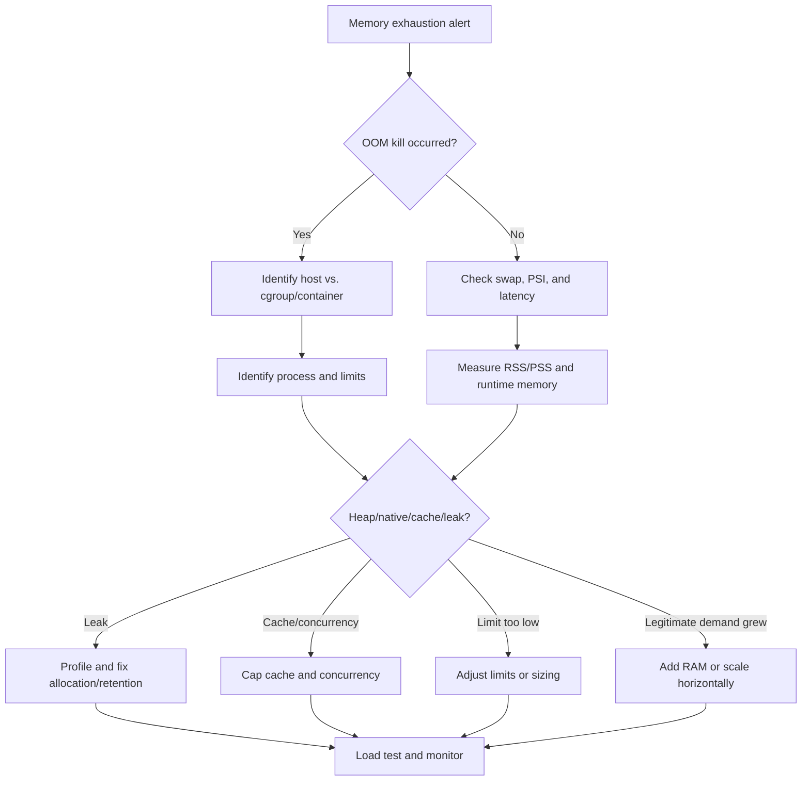

# Memory Exhaustion: OOM, Swap, Memory Leaks, and Process Limits

A virtual machine can run slowly, time out, or reboot unexpectedly even when CPU and network look normal if memory is no longer sufficient for the workload. An application may be terminated by the OS Out Of Memory (OOM) mechanism, processes may stall continuously waiting on swap, heap usage may climb endlessly, or a service/container memory limit may be reached. Looking only at total used RAM makes it very easy to mistake reclaimable cache for genuine memory pressure.

Diagnosing memory exhaustion requires identifying **the constrained scope**, **the consuming process or process group**, **the type of memory growing**, and **when pressure appears**. Only then can you decide whether to add RAM, adjust limits, fix a memory leak, reduce concurrency, or change caching and data-processing behavior.

## 1. Understand types of memory exhaustion

Memory exhaustion does not simply mean physical RAM displays 100% utilization. Common scenarios include:

- **Host memory pressure:** total demand from the OS and processes exceeds usable RAM; the kernel must reclaim page cache, swap, or select processes to terminate.
- **OOM from cgroup/container limits:** the host still has free RAM, but a service or container exceeds `memory.max` or a platform-enforced limit.
- **Application-level out of memory:** the runtime cannot allocate a required memory region, such as a full Java heap or .NET GC unable to allocate further.
- **Swap thrashing:** the system continuously swaps pages between RAM and swap space, causing response times to spike even before an OOM kill occurs.
- **Memory leak:** allocated memory that is no longer needed remains referenced, causing usage to grow over time.
- **Memory fragmentation or allocation region limits:** total free memory appears adequate, yet a specific allocation type or address range cannot be satisfied.
- **Process or account limits:** a process hits limits on virtual address space, task count, commit limit, or administrative configuration even though overall machine resources remain.

Distinguishing these three incident layers helps pick the right investigation path:

| Layer | Example symptoms | Where to inspect |
|---|---|---|
| Operating system / VM | OOM killer, growing swap, machine-wide memory pressure | Kernel logs, RAM, swap, PSI, cloud metrics |
| Service / container | One unit or container is OOMKilled while host still has RAM | Cgroup, systemd, Docker/Kubernetes limits |
| Runtime / application | `OutOfMemoryError`, full heap, allocation failure | Heap, GC, native memory, dumps, and profilers |

An application can hit multiple layers at once. For instance, a JVM can breach its cgroup limit because total heap, direct buffers, and thread stacks exceed the container cap even before heap reaches `-Xmx`.

## 2. Distinguish physical RAM, virtual memory, and process memory

Operating systems use virtual memory to give each process its own address space. Not every virtual address maps to an active physical RAM page. Portions may be untouched, shared, file-backed mappings, or paged out to swap.

Common Linux metrics include:

- **VSZ/VIRT:** total virtual address space mapped or reserved by a process. This can be much larger than actual RAM used.
- **RSS:** pages of the process currently resident in RAM, including a portion of shared memory. Summing RSS across multiple processes can double-count shared pages.
- **PSS:** apportions shared memory proportionally across the processes using it; more useful for estimating each process's true share.
- **Anonymous memory:** memory not backed directly by a file, typically including heap, stack, and runtime data.
- **File-backed memory/page cache:** memory pages backed by files; much of it can be reclaimed when the system needs RAM.
- **Swap:** memory pages moved out to swap space on disk or a swap device.
- **Kernel memory/slab:** memory reserved for kernel structures and caches, sockets, inodes, dentries, and system objects.

Therefore, do not conclude a machine is about to OOM merely because `used` is high. Linux uses idle RAM as page cache and reclaims most of that cache when applications need it. Inspect `available`, swap-in/swap-out, memory pressure, OOM events, and latency together.

Quick inspection commands:

```bash
free -h
cat /proc/meminfo
vmstat 1
```

In `free -h`, the `available` field estimates how much RAM can be allocated to applications without heavy swapping. `buff/cache` does not represent permanently occupied memory. `vmstat 1` shows `si` and `so` (swap-in/swap-out) columns per sampling interval; if they remain persistently high alongside elevated latency, investigate swap pressure.

## 3. Recognize OOM on Linux

The Linux kernel uses the OOM killer to select a process to terminate when memory demand cannot be met within an allocation scope. OOM can occur host-wide or inside a memory cgroup. When a cgroup hits its limit, the kernel can kill a process inside that cgroup even if the host still has free RAM.

Common messages in kernel logs include `Out of memory`, `oom-kill`, `Killed process`, or `Memory cgroup out of memory`. Determine:

- Which process was killed, its PID, and its command line.
- Which service/cgroup/container the process belonged to.
- Whether OOM occurred host-wide or due to a memory cgroup limit.
- Total RAM, swap, and configured limits at the time of the event.
- Whether other processes grew simultaneously or workload spiked.

Read kernel logs:

```bash
sudo journalctl -k --since "2 hours ago" --no-pager
sudo dmesg -T | grep -Ei 'out of memory|oom|killed process|memory cgroup'
```

On some systems, `dmesg` may have restricted permissions or logs may have rotated. Pull logs from centralized logging if the machine already rebooted. OOM log lines usually list the chosen victim process, RSS, cgroup, and memory constraint; save the full surrounding log block for analysis.

The OOM killer does not necessarily pick the process with the highest RSS. The kernel weighs multiple factors including memory usage, process characteristics, and `oom_score_adj`. Do not tune `oom_score_adj` to mask an incident without understanding the impact: it only changes victim selection priority and creates no extra RAM.

## 4. Identify memory-consuming processes

Once you know when OOM or pressure occurred, find processes with growing RSS/PSS and compare across multiple samples. A single point-in-time snapshot can miss slow leaks or brief spikes.

Useful Linux commands:

```bash
# Sort processes by RSS
ps -eo pid,ppid,user,rss,vsz,%mem,etime,cmd --sort=-rss | head -n 20

# View details of a process
cat /proc/1234/status

# View memory map of a process (if pmap is available)
sudo pmap -x 1234

# Monitor per-process memory every second
pidstat -r 1
```

Replace `1234` with the actual PID. In `/proc/PID/status`, pay attention to `VmRSS`, `VmSize`, `VmSwap`, `RssAnon`, `RssFile`, and `RssShmem`. `pmap -x` shows memory mappings, though it does not by itself prove which region is leaking. `pidstat` is part of the `sysstat` package on many distributions.

If you need more accurate attribution of shared memory, tools like `smem` can report USS/PSS/RSS when installed. Do not install unapproved new tools on production machines during an incident; rely on existing monitoring agents, installed packages, or reproduce in a test environment.

## 5. Check memory pressure and swap

Swap lets the OS move less-used pages to storage to free RAM. It helps absorb brief bursts, but storage access is orders of magnitude slower than RAM. When the active working set persistently exceeds RAM, the system must continuously read/write swap, causing swap thrashing.

Check swap:

```bash
swapon --show
free -h
vmstat 1
```

Metrics to watch:

- Used swap capacity and upward trend.
- `si`/`so` in `vmstat`, showing swap-in/swap-out volume per sample.
- Application latency, I/O wait time, and disk utilization.
- `available` RAM, page cache, and processes with large working sets.

Used swap alone is not necessarily an incident. The kernel may keep inactive pages in swap even after current pressure subsides. What matters is sustained swap I/O accompanied by latency, queueing, or memory pressure.

Linux Pressure Stall Information (PSI) reports how much time tasks are stalled due to resource scarcity. Inspect it with:

```bash
cat /proc/pressure/memory
```

The `some` and `full` fields indicate the percentage of time some or all tasks are stalled due to memory pressure over the measurement window. PSI helps detect pressure before OOM occurs. Avoid applying a single threshold to all workloads; compare against baseline and correlate with SLO/latency.

Do not disable swap just to make RAM graphs look cleaner. If a workload relies on swap to absorb sudden spikes and avoid abrupt OOMs, disabling it can cause failures sooner. Conversely, sizing swap too large can keep an application alive while making responses unusably slow. Choose a swap policy based on latency requirements, workload profile, and provider guidance.

## 6. Distinguish memory leaks from caches and normal load growth

A memory leak happens when an application retains references to data it no longer needs, preventing reclamation. However, rising RSS does not always mean a leak.

Legitimate reasons memory usage grows include:

- Increased concurrent requests or worker counts.
- Caches warming up and holding entries within configured bounds.
- Runtimes expanding heap size to reduce allocation or GC frequency.
- Page cache growing as files or data are read.
- Connection pools, thread pools, or buffers scaling with load.
- Native allocators retaining allocated arenas even after the application frees objects.

Leak symptoms become clearer under repeated identical load cycles: after each processing cycle or completed garbage collection, memory keeps climbing rather than returning to a stable plateau. Observe long enough to distinguish warm-up growth from unbounded growth.

Verification workflow:

1. Record a baseline right after service startup.
2. Apply representative load and track request rate, concurrency, RSS, heap/native memory, and cache size.
3. After load drops, observe whether memory stabilizes or declines.
4. Repeat the cycle multiple times and compare the post-cycle floor.
5. Use a profiler or heap/native dump to locate objects, buffers, or allocation sites retaining memory.
6. Inspect library versions, cache settings, connection pools, and changes near the start of growth.

Never conclude a leak from an upward-sloping RSS chart alone. Combine runtime metrics with application behavior.

## 7. Diagnose Java application memory

For a JVM, the heap is only one part of process memory. Total process memory also includes metaspace, code cache, thread stacks, direct buffers, JNI/native allocations, native libraries, monitoring agents, and JVM internal structures.

A conceptual model:

\[
\text{Process memory} \approx \text{Heap} + \text{Metaspace} + \text{Thread stacks} + \text{Direct/native buffers} + \text{JVM/native overhead}
\]

Consequently, setting `-Xmx` equal to total host RAM or the cgroup limit can cause the kernel to OOM-kill the JVM even before the heap fills. Always reserve headroom for native memory and the OS.

### Distinguish Java memory errors

| Message / symptom | Common meaning | Investigation direction |
|---|---|---|
| `OutOfMemoryError: Java heap space` | Heap cannot satisfy an allocation | Heap dump, object retention, heap sizing, load, and caches |
| `OutOfMemoryError: Metaspace` | Insufficient metaspace or abnormal class metadata growth | Classloader leaks, dynamic class generation, metaspace limit |
| `OutOfMemoryError: Direct buffer memory` | Cannot allocate direct buffers within runtime limit | Direct buffer usage, `MaxDirectMemorySize`, I/O libraries |
| `GC overhead limit exceeded` | JVM spends excessive time in GC while reclaiming very little | Heap pressure, object churn, leaks, and workload |
| Process `Killed` / exit 137 with no Java OOME | Likely kernel/cgroup kill or external SIGKILL | Kernel logs, cgroup memory events, container/runtime events |

Useful diagnostic commands:

```bash
jcmd 1234 VM.flags
jcmd 1234 GC.heap_info
jcmd 1234 GC.class_histogram
jcmd 1234 VM.native_memory summary
```

Replace the PID with the JVM process ID. `VM.native_memory` provides detailed breakdowns only if Native Memory Tracking (NMT) was enabled at JVM startup, such as with `-XX:NativeMemoryTracking=summary`; enabling NMT carries overhead. `GC.class_histogram` can be expensive and pause or impact large applications, so run it under operational controls.

GC logging can be enabled with syntax matching your JVM version; for example, modern Java supports unified logging:

```bash
-Xlog:gc*,safepoint:file=/var/log/orders/gc.log:time,uptime,level,tags
```

Heap dumps help identify objects holding references, but they can be huge and contain sensitive data. Ensure sufficient disk space, restrict access, encrypt dumps, and enforce retention rules. If the kernel kills the JVM abruptly, a heap dump may not be written depending on configuration.

## 8. Process and service memory limits on Linux

Multiple mechanisms enforce resource limits, and not all of them constrain resident RAM in the same way.

### Cgroups and systemd

On Linux, cgroups are the primary mechanism for accounting and limiting resource usage across process groups. In cgroup v2, key files include:

| File | Meaning |
|---|---|
| `memory.current` | Memory currently charged to the cgroup |
| `memory.max` | Hard memory limit |
| `memory.high` | Pressure/throttling threshold where the kernel attempts reclaim |
| `memory.events` | Event counters such as `high`, `max`, `oom`, `oom_kill` |
| `memory.stat` | Breakdown of memory categories inside the cgroup |
| `memory.swap.current` | Swap currently used by the cgroup if controller is enabled |
| `memory.swap.max` | Cgroup swap limit if configured |

To find a process's cgroup:

```bash
cat /proc/1234/cgroup
```

With cgroup v2, paths usually live under `/sys/fs/cgroup`. For example:

```bash
cat /sys/fs/cgroup/system.slice/orders-api.service/memory.current
cat /sys/fs/cgroup/system.slice/orders-api.service/memory.max
cat /sys/fs/cgroup/system.slice/orders-api.service/memory.events
```

Paths vary by unit, container runtime, and system configuration. Do not assume every host uses cgroup v2; cgroup v1 has different controller hierarchies and filenames.

In systemd, limits can be configured in the unit file:

```ini
[Service]
MemoryHigh=3G
MemoryMax=4G
MemorySwapMax=1G
```

`MemoryHigh` sets a pressure threshold where the system aggressively reclaims memory and throttles the workload; `MemoryMax` sets a hard limit. When the hard limit is exceeded and reclaim fails to free enough memory, processes in the cgroup may be OOM-killed. `MemorySwapMax` controls swap usage for the unit on supported systems. Choose values based on total process memory, peak workload, and headroom; never set them equal to average RSS.

After modifying a unit, reload configuration and restart the service per deployment procedure. Monitor `memory.events`, systemd status, and kernel logs to confirm whether limits are being hit.

### RLIMIT and ulimit

Linux also provides process-level resource limits inspected via `ulimit` or `prlimit`. For example, `RLIMIT_AS` caps total virtual address space; it is not equivalent to a resident RAM limit. Older limits such as `RLIMIT_RSS` are not reliable mechanisms for isolating RAM on modern Linux.

```bash
ulimit -a
prlimit --pid 1234
```

Do not use `ulimit -v` as a substitute for cgroup memory limits without understanding its behavior: an application can fail while reserving address space even when physical RAM remains free. Systemd's `TasksMax` limits the number of tasks/processes/threads as counted by the kernel, not RAM capacity.

## 9. Memory limits in containers and Kubernetes

Containers use cgroups to account for and enforce memory limits. A container can be OOM-killed upon exceeding its limit even when the node has spare memory. Inspect container limits, Pod limits, node pressure, and runtime-reported status together.

With Docker, `--memory` sets the container memory limit; `--memory-swap` governs combined memory+swap according to Docker and kernel semantics. Exact behavior depends on runtime version and host configuration, so consult documentation for your runtime. Do not simply raise swap to avoid OOM if the workload requires low latency.

In Kubernetes:

- `requests.memory` is the memory amount the scheduler uses for Pod placement and relative scheduling guarantees; it is not a hard cap.
- `limits.memory` is the container's memory cap; exceeding it can result in an OOM kill.
- An `OOMKilled` container status is a key clue, yet you must also inspect events, exit codes, node memory pressure, and runtime logs.
- A Pod can be evicted when the node runs low on resources even if the container has not breached its own memory limit.

Setting requests too low causes the scheduler to overpack workloads onto nodes. Setting limits too low triggers OOMs; setting limits too high can expose the node to memory pressure. Size based on peak working set, runtime overhead, and concurrency, while monitoring memory working set alongside OOM/eviction events.

## 10. Memory limits and diagnostics on Windows

Windows manages virtual memory and commit differently from Linux. **Committed memory** is the amount of memory the OS has guaranteed can be backed by RAM or the pagefile. The **commit limit** generally depends on RAM plus pagefile size. As committed bytes approach the commit limit, allocations can fail even when individual process working sets look moderate.

Distinguish these metrics:

- **Working Set:** process pages currently resident in RAM.
- **Private Bytes:** private committed memory belonging to the process, not shared in the way working set can be.
- **Commit charge / Committed Bytes:** total memory committed by the system.
- **Commit Limit:** the system's current commit cap.
- **Pagefile usage:** pagefile utilization; evaluate alongside committed bytes and paging activity.

Observe these via Task Manager, Resource Monitor, and Performance Monitor. Useful counters include:

- `Memory\Committed Bytes` and `Memory\Commit Limit`.
- `Memory\Available MBytes`.
- `Memory\Pages/sec` or related paging counters.
- `Process\Private Bytes` and `Process\Working Set`.

Event Viewer may record `Resource-Exhaustion-Detector` warnings, commonly Event ID 2004 on some Windows versions. Read the event details to see the consuming processes and usage figures; do not rely solely on the Event ID number.

PowerShell enables quick checks:

```powershell
Get-CimInstance Win32_OperatingSystem |
  Select-Object TotalVisibleMemorySize, FreePhysicalMemory, TotalVirtualMemorySize, FreeVirtualMemory

Get-Process |
  Sort-Object PrivateMemorySize64 -Descending |
  Select-Object -First 20 ProcessName, Id, WorkingSet64, PrivateMemorySize64
```

Fields in `Win32_OperatingSystem` are reported in KB; `WorkingSet64` and `PrivateMemorySize64` are returned in bytes. For Windows services, also inspect Job Objects or container limits if the workload runs under quota controls. Do not disable the pagefile to "force applications to use RAM"; doing so lowers the commit limit and increases allocation failures.

## 11. Distinguish runtime OOM from kernel OOM

These two failure modes differ in symptoms and remediation:

| Indicator | Runtime OOM | Kernel/cgroup OOM |
|---|---|---|
| Process state | May stay alive while failing requests or throwing exceptions | Usually terminated abruptly |
| Application logs | Contains exceptions or allocation failure messages | May not have time to flush final logs |
| Kernel logs | Not necessarily any OOM killer event | Typically shows OOM/kill messages if logs survive |
| Exit status | Depends on how the application handles exceptions | Often 137 from SIGKILL in many environments, but must be verified |
| Data to inspect | Heap/native dumps, GC, profiler | Kernel logs, cgroup events, host/container memory |

Exit code 137 commonly corresponds to termination by signal 9 in many shells/runtimes, but it does not prove OOM by itself. An administrator or another controller can also send SIGKILL. Cross-check OOM events, kernel logs, and container status.

## 12. Step-by-step diagnostic workflow

When a memory exhaustion alert arrives, narrow from broad host scope down to process and runtime:

1. **Identify timing and scope:** one instance, one service, or an entire host/cluster; correlate with deployments, traffic, and batch jobs.
2. **Check RAM and swap:** `free -h`, `/proc/meminfo`, `vmstat`, PSI, and cloud monitoring.
3. **Locate OOM events:** kernel logs, systemd journal, container events, or Windows Event Viewer.
4. **Find consuming processes:** RSS/PSS, `pidstat`, `pmap`, runtime metrics, or Private Bytes.
5. **Check limits:** cgroups, systemd `MemoryMax`, Docker/Kubernetes limits, RLIMIT, or Windows commit/pagefile.
6. **Identify memory category:** heap, native, caches, page cache, thread stacks, direct buffers, or file mappings.
7. **Reproduce under control:** representative load, soak tests, heap profiles, or allocation profiles.
8. **Apply remediation:** fix leaks, cap caches/concurrency, adjust limits, or add RAM.
9. **Verify:** re-run load tests and monitor memory pressure, OOM events, latency, and error rates.

Simple decision flow:



## 13. Remediation measures

The right fix depends on the root cause:

| Cause | Typical appropriate action |
|---|---|
| Instance lacks RAM for legitimate working set | Resize instance or distribute load across more instances |
| Application memory leak | Profile, fix object/reference lifecycle, upgrade libraries, and run soak tests |
| Unbounded cache | Configure max size, TTL, eviction policies, and cache metrics |
| Excessive concurrency | Bound in-flight workers/requests, add backpressure and queues |
| Cgroup/systemd limit too low | Adjust `MemoryHigh`/`MemoryMax` based on actual capacity and headroom |
| JVM heap consumes nearly the entire container limit | Lower heap target or raise container limit to leave room for native/runtime memory |
| Swap thrashing | Shrink working set, add RAM, or spread workload; review swap policy |
| Overpacked nodes/containers | Adjust requests/limits and Pod/instance distribution |
| Batch-driven spikes | Process in chunks, cap batch sizes, or isolate onto dedicated nodes/pools |

Do not only add RAM if a leak persists; extra capacity merely delays the next failure. Conversely, do not squeeze heap or caches excessively to the point where GC, disk I/O, and latency surge. Evaluate total cost and SLOs together.

## 14. Setting up early alerts

Alerting solely when RAM exceeds a fixed percentage creates false positives due to page cache. Combine multiple signals:

- Sustained low available memory over a continuous window.
- Rising swap-in/swap-out paired with abnormal latency or I/O wait.
- Rising PSI memory `some`/`full` relative to baseline.
- Increasing cgroup `memory.events` counters for `high`, `max`, `oom`, or `oom_kill`.
- Continuously climbing process RSS/PSS, JVM heap/native memory, or Windows Private Bytes.
- OOM kills, container `OOMKilled`, Pod evictions, or runtime allocation failures.
- Concurrent degradation in request latency, error rate, and restart counts.

Set thresholds per workload and SLO, using time windows to filter brief spikes. Trend-based growth alerts can catch leaks before hitting hard caps. Separate "high but stable memory utilization" from "memory pressure actively degrading the workload."

## 15. Example: JVM OOMKilled even though heap never reached Xmx

A Java API runs inside a container with a 4 GiB memory limit. The JVM is configured with `-Xmx3g`. Under high load, heap usage stays around 2.4 GiB, yet the container is still `OOMKilled`.

The likely cause is combined off-heap plus heap memory exceeding 4 GiB:

| Component | Illustrative usage |
|---|---:|
| Java heap | 2.4 GiB |
| Metaspace and code cache | 0.25 GiB |
| Thread stacks | 0.35 GiB |
| Direct buffers / JNI / native | 0.55 GiB |
| Agent and runtime overhead | 0.25 GiB |
| Total | 3.8 GiB |

Actual usage may also include page tables, file-backed memory, and sidecar/child processes within the same cgroup. As load rises, direct buffers or thread counts can grow past the 4 GiB cap. The kernel kills the container before the JVM ever throws an `OutOfMemoryError` on the heap.

To investigate, correlate `memory.current`, `memory.max`, `memory.events`, container status, and kernel logs; then measure heap, threads, direct buffers, and native memory. Remediation may involve lowering `-Xmx` to preserve headroom, bounding threads/buffers, fixing native leaks, or increasing the container limit if node capacity permits. Afterward, run a peak-load soak test and monitor total process/cgroup memory rather than heap alone.

## 16. Best practices to prevent repeat incidents

- Size RAM for peak working set plus total memory of the runtime, agents, and auxiliary processes.
- Enforce limits on caches, queues, connection pools, thread pools, and concurrent requests.
- Implement backpressure so the application does not accept work faster than it can process it.
- Run soak tests long enough to expose slow leaks.
- Track memory per service, instance, process, and cgroup; retain history for comparison.
- Budget `-Xmx`, native memory, and container limits as a single combined allocation.
- Maintain a swap policy aligned with latency goals and cloud provider guidance.
- Avoid overly tight limits that cause OOM under normal traffic.
- Log OOM events and ship kernel/container logs off-instance for post-reboot investigation.
- When scaling horizontally, verify that databases, caches, and queues can handle the added instance count.

## 17. Memory exhaustion troubleshooting checklist

- [ ] Determine whether the issue occurs at the host, service, container, or application runtime layer.
- [ ] Record timestamp, instance/resource ID, workload, and changes near the failure start.
- [ ] Check `available` memory, swap, PSI, and memory pressure instead of `used` RAM alone.
- [ ] Look for OOM killer/kernel logs, cgroup events, container status, or Windows memory events.
- [ ] Identify consuming processes via RSS/PSS, Private Bytes, or runtime metrics.
- [ ] Inspect memory limits, swap limits, RLIMIT, systemd, container, and scheduler settings.
- [ ] Distinguish heap, native memory, thread stacks, direct buffers, page cache, and application caches.
- [ ] Evaluate leaks across multiple load cycles and post-GC/post-load baselines.
- [ ] Pick remediation based on root cause: fix leaks, cap caches/concurrency, tune limits, or add capacity.
- [ ] Run load/soak tests and verify latency, error rate, OOM events, and memory headroom.
- [ ] Configure early alerts and store logs off-instance for post-reboot investigation.

Memory exhaustion incidents are resolved efficiently when operations teams know precisely where memory is consumed and which limit was hit. Combining OS, cgroup, runtime, and application metrics distinguishes real OOM conditions from page cache or legitimate growth, enabling targeted fixes and sufficient headroom for compute workloads.
