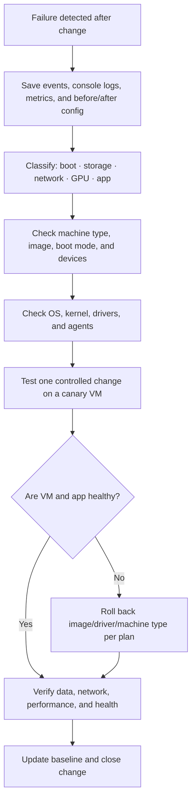

# Failures After Changing Image, Driver, or Machine Type

Changing a machine image, driver, or machine type can improve VM security, performance, and cost. However, such a change can also prevent the VM from booting, drop network connectivity, hide disks, fail to detect GPUs, or slow down the application. These incidents commonly appear right after provisioning a new VM, swapping an image, upgrading a kernel, updating drivers, or migrating to a different instance family.

To handle this safely, identify precisely **what changed**, **which layer became incompatible**, and **what data is at risk**. Avoid changing multiple drivers or boot settings at once. Preserve evidence, compare before/after configuration, restore access if needed, and test each change on a non-production VM before rolling out broadly.

## 1. Distinguish image, driver, and machine type

These three components affect different VM layers:

| Component | Role | Changes can affect |
|---|---|---|
| Machine image | Provides OS, kernel, bootloader, packages, agents, and initial configuration | Boot, system services, libraries, security, and application compatibility |
| Driver | Enables the OS to communicate with assigned virtual or physical devices | Root disk, NIC, GPU, console, I/O, and network performance |
| Machine type / instance family | Defines CPU, RAM, virtual devices, network capability, accelerators, and host traits | CPU architecture, instruction sets, NUMA, storage controller, NIC, GPU, resource caps, and licensing |

For example, an older Linux image might boot on an instance family using virtual storage controller A yet fail to detect its root disk on a newer family using controller B. An x86_64 image cannot become an arm64 image simply by changing the machine type. An installed GPU driver may be incompatible with a newer kernel or the target instance's GPU model.

### Identify what changed

Before diagnosing, record:

- Image ID, image version, OS release, CPU architecture, and build date.
- Kernel or Windows build before and after the change.
- Drivers and driver versions for storage, NIC, GPU, and cloud guest agent.
- Old and new machine type/family, vCPU count, RAM, CPU architecture, and accelerators.
- Boot mode (BIOS/UEFI), Secure Boot status, and root device type.
- Volume type, controller, NIC model, local/ephemeral disks, and network policies.
- Change timestamp, executing user or pipeline, change record, and deployment logs.

If the image and machine type changed simultaneously, isolating which factor caused the failure is difficult. Whenever possible, separate changes and test independently; if both already changed together, use snapshots, the prior image, or a canary VM to reconstruct individual combinations.

## 2. Classify symptoms before fixing

| Symptom | First layer to inspect | Common causes |
|---|---|---|
| VM stalls during boot or enters emergency shell | Boot chain / storage | BIOS/UEFI mismatch, missing root disk driver, missing initramfs module, filesystem error |
| VM boots yet cannot SSH/RDP | NIC / network / guest OS | NIC driver, changed interface name, firewall, routes, agent, or login service |
| OS runs yet secondary disks do not appear | Storage driver / device mapping | Different controller, missing driver, renamed device, unattached volume |
| GPU not detected | GPU driver / runtime / device assignment | Driver/kernel mismatch, unsupported GPU model, wrong passthrough/profile |
| App reports `Illegal instruction` or crashes early | CPU architecture / instruction set | Wrong binary architecture or CPU feature missing on new machine |
| VM runs yet throughput drops | Machine type / driver / topology | Different CPU generation, throttling, NUMA, network/storage limits, or untuned driver |
| Windows halts with boot error after controller change | Boot-critical storage driver | Driver not installed or not set to boot-start |
| Linux boots yet mounts fail | Filesystem / UUID / device path | Changed device name, wrong UUID, bad mount option, or faulty driver |
| Cloud agent not working | Guest agent / image compatibility | Outdated agent, service failed to start, wrong endpoint or permissions |
| Error occurs only after first reboot | Driver/module / update state | Kernel module not auto-loaded, incomplete update, unsaved boot config |

A `Running` state in the control plane only confirms the VM is provisioned and powered on from the platform's view. It does not prove the guest OS finished booting or the application is ready to serve traffic.

## 3. Safe diagnostic workflow



Follow this sequence:

1. Define scope: one VM, one family, one image version, or the entire fleet.
2. Check provider events, activity logs, console output, and resource state.
3. Compare specifications before and after the change.
4. Collect guest OS and driver logs before rebooting or recreating the VM.
5. Inspect each layer according to symptoms; prioritize read-only checks.
6. Test fixes on a non-production VM or a rollback-ready canary first.
7. If recovery is not achieved within the allowed window, execute the prepared rollback.
8. Verify OS, data, networking, agents, and application health before restoring traffic.

Never format disks, run arbitrary filesystem repairs, delete volumes, or terminate VMs before confirming data locations and recovery options.

## 4. Check cloud control plane and machine type

### Verify instance configuration

Read the live configuration from the provider portal, API, or CLI:

- Does the current machine type match the expected family and size?
- Did the VM switch CPU architecture, such as x86_64 to arm64?
- Does the instance include a GPU/accelerator; did its profile or device count change?
- Are the boot disk and data disks still attached to the right VM in the right zone?
- Did the NIC, subnet, security group, routes, or IP addresses change?
- Did the instance transition to `stopped`, `deallocated`, or `pending` after resizing?
- Are there maintenance events, host migrations, instance retirements, or provisioning errors?

Some platforms require stopping the VM before changing machine types; other changes can happen live or via a dedicated resize operation. Behavior and limits depend on the provider, family, and device types. Do not apply a generic resize procedure across all clouds.

### Check quotas and provisioning capacity

If a new VM fails to start or a resize fails to finish, check quotas for vCPU, RAM, GPU, instance count, and zonal capacity. Distinguish quota errors from image/driver errors: quotas usually fail in the control plane before the guest OS ever boots; driver errors usually appear after devices are allocated and the OS begins booting.

Record request IDs, operation IDs, and API error codes. Do not infinitely retry resizes or VM creations when the provider returns permanent quota, capacity, or permission errors.

### Check image compatibility metadata

Verify the image supports:

- Target instance CPU architecture.
- BIOS or UEFI and Secure Boot, if required.
- Provider virtualization type and boot mode.
- Required storage/NIC/GPU drivers.
- Supported OS release and kernel.
- Appropriate guest agent, cloud-init, or initialization tooling.

If image metadata declares the wrong architecture or boot mode, the platform may reject VM creation or launch an unbootable VM. Never alter metadata to force an image onto an architecture its internal binaries do not support.

## 5. Diagnose boot failures on Linux

When Linux fails to boot after an image or machine-type change, determine which stage halted: firmware, bootloader, kernel, initramfs, root filesystem mount, or systemd.

### Collect console and boot logs

If SSH is unreachable, use console output, serial console, or the provider's recovery console. Look for messages such as:

- `No bootable device` or bootloader not found.
- `Kernel panic` or kernel module loading failure.
- `ALERT! UUID=... does not exist` or root filesystem not found.
- Prolonged `Waiting for root device`.
- Filesystem mount failures or I/O errors.
- `systemd` dropping into `emergency mode` due to a failed mount unit or essential service.

These messages identify the boot stage, yet you must read surrounding context to find the first root error rather than reacting only to the final line.

### Check boot mode and bootloader

An image installed for legacy BIOS may not boot on UEFI-only platforms without an EFI System Partition and compatible bootloader. UEFI images require a proper EFI partition, boot entry, and bootloader. Secure Boot can reject unsigned kernel modules or drivers.

Inspect VM settings and disk layout from a recovery environment. If the filesystem is accessible:

```bash
# Determine whether the system booted via UEFI or legacy BIOS
test -d /sys/firmware/efi && echo UEFI || echo Legacy-BIOS

# View block devices, filesystems, and UUIDs
lsblk -f
blkid

# Inspect mounts and EFI partition
findmnt
```

If the VM does not reach a shell, run these checks from a recovery environment or on a cloned disk. Never modify boot partitions directly on production disks without a snapshot and recovery plan.

### Missing root disk driver in initramfs

The kernel requires the storage controller driver to read the root volume. If the driver is neither built in nor included in `initramfs`, the kernel may start yet fail to find the root filesystem.

On an accessible Linux VM or a mounted disk in a recovery VM, check:

```bash
# Running kernel and loaded modules
uname -r
lsmod

# Inspect PCI device controllers and drivers
lspci -nnk

# Inspect initramfs on dracut-based distributions
lsinitrd /boot/initramfs-$(uname -r).img
```

Initramfs filenames and tools vary by distribution. Ubuntu/Debian workflows typically use `update-initramfs`; RHEL-family systems typically use `dracut`. Rebuild initramfs strictly per your OS documentation and ensure required drivers are baked into the image. Test booting a clone first after repairing.

### Changed UUIDs and mount paths

After switching controllers, device ordering or naming can change—for instance, `/dev/sda` appearing as `/dev/nvme0n1`. An `/etc/fstab` relying on old device names can mount the wrong volume or drop the VM into emergency mode.

Prefer persistent UUIDs or filesystem labels in `fstab`, verifying actual UUIDs via `blkid` and checking mount options. Never edit a UUID in configuration merely to silence a warning; confirm the exact volume and filesystem integrity.

### Check systemd after booting

```bash
# Failed units and service boot timing
systemctl --failed
systemd-analyze critical-chain

# Errors in the current boot
journalctl -b -p warning..alert --no-pager

# Kernel messages
dmesg -T | tail -n 100
```

If only a single service fails, check dependencies, permissions, device paths, and packages instead of reinstalling the entire OS.

## 6. Diagnose boot failures on Windows

Windows VMs can fail to boot after changing image or machine type due to missing boot-critical drivers, firmware changes, Secure Boot, BCD issues, or incomplete updates.

### Common indicators

- `INACCESSIBLE_BOOT_DEVICE`: Windows cannot access the system volume, often tied to storage controllers or boot-critical drivers.
- Automatic Repair or boot loops: can stem from incomplete updates, faulty drivers, or BCD corruption.
- BSOD after driver installation: incompatible driver, version mismatch, or conflict.
- Windows boots without networking: NIC driver or network configuration issue.
- Device Manager displays Unknown devices or warning icons: missing driver or changed virtual hardware.

### Inspect using a recovery environment

If RDP fails, use the console or the provider's Windows recovery workflow. Inspect startup repair, boot logs, BCD, and boot-critical drivers per Windows and provider guidance. When attaching a disk to a recovery VM, ensure two operating systems never mount the same filesystem read-write simultaneously unless the platform and filesystem explicitly support shared access.

Useful checks inside a recovery environment or running OS:

```powershell
# List PnP devices and their statuses
Get-PnpDevice -PresentOnly

# List installed signed drivers
Get-CimInstance Win32_PnPSignedDriver |
  Select-Object DeviceName, DriverVersion, Manufacturer

# View volume and filesystem information
Get-Volume

# Inspect relevant services
Get-Service
```

Do not run BCD repair commands, offline registry edits, or boot-start driver changes before identifying the exact Windows partition and having a disk copy. For `INACCESSIBLE_BOOT_DEVICE`, prioritize verifying the storage controller and driver before editing other components.

### Sysprep and Windows images

Reusable Windows images for multiple VMs must follow a proper capture workflow—typically running Sysprep to strip unique identifiers and execute `specialize` on new instances. Capturing an image in an improper state can cause `specialize`, activation, domain join, or duplicate agent identity failures on new VMs.

When changing machine types, verify the Windows version supports the target family's CPU type, firmware, and drivers. Also verify licensing/activation, as some licensing models bind to cores, hosts, or machine types.

## 7. Diagnose storage driver errors

Storage drivers are a top cause of VM boot failures or missing volumes after resizes and migrations.

### Check from cloud to guest

1. Confirm the volume exists and is healthy in the control plane.
2. Verify the volume is attached to the VM in the right zone with the right device mapping.
3. Identify the virtual controller or device type exposed by the new machine type.
4. Check whether the kernel/Windows detects the device.
5. Verify the driver loads and the filesystem/volume is recognized.
6. Check mounts, access permissions, and I/O error logs.

### Linux

```bash
# Block devices and filesystems
lsblk -o NAME,TYPE,SIZE,FSTYPE,UUID,MOUNTPOINTS

# Drivers bound to PCI devices
lspci -nnk

# Storage-related kernel logs
dmesg -T | grep -i -E 'nvme|virtio|scsi|blk|I/O error|reset'

# Mount status
findmnt
```

If a volume shows attached in the cloud yet does not appear in `lsblk`, inspect the controller, driver, guest kernel, and platform events. If the device appears yet the filesystem fails to mount, check UUID, filesystem type, mount options, and logs before running repair utilities.

### Windows

Check Disk Management, Device Manager, Event Viewer, and controller drivers. Confirm the disk is Online, has the right partitions, and is not placed Offline by policy. If the disk is missing entirely, check cloud attachment before installing random drivers.

Never initialize or format a disk containing data just because Windows shows `Unknown` or `Not initialized`. Always verify disk identity, attachment, and backups first.

## 8. Diagnose NIC and network driver errors

After changing machine type or image, a VM may use a different NIC model or driver. The OS may assign new interface names, breaking IP configuration, firewall rules, or bootstrap scripts.

### Linux

```bash
# Interfaces and link states
ip -br link
ip -br addr

# Interface driver details
ethtool -i eth0

# Routes and listening sockets
ip route
ss -lntup

# NIC-related kernel logs
dmesg -T | grep -i -E 'eth|ens|enp|virtio|ena|mlx|link is'
```

Replace `eth0` with the actual interface name. Driver names and tools depend on the NIC model. Check the cloud network interface, MAC, private IP, security group, route table, DHCP, and DNS alongside guest OS settings.

### Windows

```powershell
Get-NetAdapter -IncludeHidden
Get-NetIPConfiguration
Get-NetRoute
Get-NetAdapterStatistics
```

If a new adapter appears without an IP, check DHCP, static IP bindings, routes, and drivers. If the IP is correct yet connectivity fails, inspect Windows Firewall, cloud security rules, DNS, and service ports.

### Avoid interface-name-dependent configuration

Initialization scripts and firewall rules should never assume the NIC is always named `eth0`. Use network manager rules matching MAC/metadata or cloud-agent-managed networking per platform guidance. After changing machine types, verify interface configuration applied to the new device.

## 9. Diagnose CPU architecture and instruction set issues

Switching between `x86_64` and `arm64` is an architecture change, not just a CPU speed change. Images, kernels, packages, and binaries must be compiled for the target architecture.

### Error symptoms

- The VM fails to boot or the provider rejects the image due to architecture mismatch.
- Binaries fail with `Exec format error` on Linux.
- Applications crash with `Illegal instruction` from using instructions unsupported by the CPU.
- Native libraries, JNI, extensions, or agents fail to load.
- Container images lack a manifest for the target architecture.
- Commercial software or drivers do not support the new CPU family.

### Inspect on Linux

```bash
# Userspace and kernel architecture
uname -m
getconf LONG_BIT

# CPU model and feature flags visible to the guest
lscpu
grep -m1 -E 'model name|Features|flags' /proc/cpuinfo

# Binary architecture
file /path/to/application
```

For containers, inspect both the image platform and internal binaries. Multi-arch images use manifest lists to pick matching artifacts; if only `linux/amd64` exists, do not assume it runs natively on `linux/arm64`.

### Instruction set compatibility

Binaries may be compiled requiring AVX2, AVX-512, or other extensions. If a new machine type lacks a feature required by the binary, the process can abort with an illegal instruction error. Check compiler flags, runtime CPU dispatch, and guest CPU feature flags. If running across multiple families, compile a compatible baseline or ship architecture/feature-specific builds.

For Java, bytecode is generally cross-architecture, yet the JVM, JNI, native libraries, cryptographic providers, codecs, and agents still must support the target platform. Run integration tests on the target machine family rather than relying only on a clean build.

## 10. Diagnose GPU and accelerator failures

After changing GPU family or image, applications may fail to see the device, kernel driver modules may fail to load, CUDA/ROCm runtimes may mismatch, or the allocated GPU profile may differ from expectations.

### Check from the control plane

- Does the VM use a machine type that supports GPUs?
- Is the GPU attached via passthrough, vGPU, or partitioning?
- Do the allocated profile and device count match expectations?
- Are required quotas/capacity and licenses in place?
- Was the GPU detached or changed in model during the update?

### Inspect on Linux

For NVIDIA environments:

```bash
# Devices and driver status
nvidia-smi

# Whether NVIDIA kernel modules are loaded
lsmod | grep -i nvidia

# Kernel version and GPU/driver logs
uname -r
dmesg -T | grep -i -E 'nvidia|nvrm|xid|gpu'
```

For AMD environments, use corresponding ROCm utilities such as `rocminfo` or `rocm-smi` if installed and supported. Command names and metrics depend on hardware generation.

### Compatibility points to verify

- GPU model and supported driver generation.
- Kernel version and kernel headers used to build modules.
- Driver, CUDA/ROCm runtime, cuDNN, and matching libraries.
- Framework and package versions.
- Secure Boot and kernel module signing if enabled.
- Container runtime, device plugins, and device node permissions.
- VRAM/HBM, partitioning profiles, and interconnects for multi-GPU setups.

Do not arbitrarily install the latest driver if the provider requires a certified driver image or specific version. In cloud GPU environments, drivers may be supplied via specialized images or provider packages; follow the exact compatibility matrix.

## 11. Cloud guest agent and bootstrap failures

A new image may ship a different version of the cloud guest agent, `cloud-init`, Windows agent, or monitoring/security agents. If the agent fails to run, the VM can still boot and applications can run while the portal fails to execute remote commands, collect metrics, or apply initialization settings.

Check:

- Is the agent service installed and enabled?
- Does the agent version support the OS/kernel and machine family?
- Does the agent have access to the metadata endpoint, APIs, and required certificate stores?
- Do DNS, routes, proxies, and firewalls allow reaching management endpoints?
- Were machine IDs, agent IDs, or `cloud-init` state duplicated during image capture?
- Did startup scripts rerun unexpectedly or hit idempotency failures?

On Linux:

```bash
systemctl --failed
systemctl status cloud-init
journalctl -u cloud-init --no-pager
```

Cloud agent service names vary by provider and image. On Windows, inspect Services and Event Viewer. Do not delete agent identity files or reset `cloud-init` on production machines without understanding the impact on remote management and instance configuration.

## 12. Diagnose performance degradation after changing machine type

The VM boots and the application runs, yet performance falls short of expectations. Causes include CPU traits, NUMA layout, network/storage bandwidth, burst credits, drivers, or service-tier limits.

### CPU and NUMA

Compare CPU model, generation, vCPU count, socket/core topology, instruction sets, and per-core utilization. Moving from a compute-optimized family to a general-purpose family can reduce CPU-bound throughput even at the same vCPU count.

On large vCPU/RAM VMs, check NUMA topology and locality. Memory-latency-sensitive applications can suffer if vCPU and memory placement shifts. Some clouds abstract host topology and manage scheduling internally; tune guest settings only when the platform exposes supported controls.

### Network

Compare bandwidth, packets-per-second, NIC queues, offloads, MTU, and instance-size caps. Smaller machine types often enforce lower network baselines. If throughput drops after resizing, check instance limits before blaming the driver.

### Storage

Some instance families enforce aggregate IOPS/throughput limits at the VM level even when individual volumes have high provisioned specs. Check both volume caps and instance-level bandwidth. New drivers or controllers can also alter queue depth and latency.

### Bursting and throttling

Burstable instances or shared resources can deliver high short-term performance before throttling. Check CPU credits, baselines, throttling, and contention metrics. Compare sustained benchmarks rather than brief point tests.

### Before/after comparison

| Metric group | Before change | After change | Interpretation |
|---|---|---|---|
| CPU | Model, vCPUs, utilization, run queue | Same metric set | Assess capacity and contention |
| Memory | Capacity, swap, page faults | Same metric set | Separate RAM shortage from locality changes |
| Network | Throughput, latency, drops, PPS | Same metric set | Separate driver issues from instance limits |
| Storage | IOPS, throughput, p95 latency, queue | Same metric set | Check volume and instance caps |
| GPU | Model, VRAM, utilization, driver | Same metric set | Verify profile and runtime |
| Application | Throughput, p95/p99, error rate | Same workload | Measure end-to-end impact |

Hold data, application version, concurrency, and measurement duration constant for valid comparisons. Changing multiple variables simultaneously makes benchmarks inconclusive.

## 13. Restoring access when the VM fails to boot or loses networking

If SSH/RDP is unreachable, use the provider's recovery workflow. Common options include the serial console, rescue mode, attaching the boot disk to a helper VM, or restoring from a prior snapshot/image.

### Recovery via helper VM

1. Identify root/data volumes and take a snapshot or copy per procedure.
2. Stop the broken VM if detaching requires it per provider rules.
3. Attach the system volume to a helper VM in the appropriate mode.
4. Identify the exact device via volume ID, serial, UUID, and size; never rely solely on `/dev/sdX`.
5. Mount the filesystem safely; for read-only investigation, mount read-only.
6. Collect logs and inspect boot config, drivers, `fstab`, networking, and agents.
7. Test fixes on a clone or edit with verified backups and clear change records.
8. Detach cleanly, reattach to the target VM, and attempt boot.

Never mount a filesystem read-write on two VMs concurrently unless both filesystem and application support shared access. For databases, never use a recovery VM to modify data files actively used by another node.

### Recovery when only networking is broken

If the console shows the OS booted completely yet SSH/RDP fails:

- Check whether the NIC and driver initialized the device.
- Verify IP, DHCP/static config, routes, and DNS.
- Check host firewall, security groups, and network ACLs.
- Verify the SSH/RDP service is listening on the right interface.
- Check remote management agents and identity permissions.

Never open management ports to the entire Internet to regain access. Use a bastion, VPN, session manager, or approved management IP ranges.

## 14. Roll back image, driver, or machine type

Rollback restores a workload to a known-good configuration combination. Prepare rollback before any change, especially for production and stateful workloads.

### Image rollback

Retain old image IDs/versions, boot disk snapshots, or tested templates. When a new image fails, launch from the prior image or swap the boot disk per provider workflow. Verify data volumes, NICs, identities, and app configs, as image rollback does not revert data modified after capture.

### Driver rollback

Retain prior driver packages or images carrying certified drivers. If a new driver breaks networking, GPUs, or storage, use the console or a recovery VM to revert to the previous driver per OS/provider guidance. Avoid removing boot-critical storage drivers while the VM depends on them for its root volume.

### Machine-type rollback

Confirm the old machine type remains available with sufficient quota/capacity and compatible volumes/NICs. Some providers require stopping the VM before resizing back; some devices or accelerators cannot convert directly in place. If replacing the VM is necessary, preserve stable endpoints via load balancers, static IPs, or DNS, and shift traffic under control.

### Data and licensing risks

Compute rollback does not automatically roll back database schemas, application data, filesystem formats, or license activations. If a new app release ran data migrations, verify the older version can read the new schema. For host- or core-bound licenses, changing machine types may require reactivation or license compliance checks.

## 15. Safe change process before broad rollout

### Preparation phase

1. Document current image, drivers, machine type, boot mode, disks, NICs, and accelerators.
2. Review compatibility matrices across OS, provider, drivers, frameworks, and commercial software.
3. Identify any local-disk data and take required backups/snapshots.
4. Prepare rollback steps and confirm quota/capacity for both old and new configurations.
5. Define health checks, benchmarks, and rollout halt criteria.

### Canary phase

1. Launch a test VM from the new image or machine type.
2. Verify boot, storage, NIC, DNS, cloud agent, and access permissions.
3. Run OS, driver, application, database connectivity, and representative workload checks.
4. Measure CPU, RAM, network, storage, GPU, and p95/p99 latency.
5. Test reboots and stop/start if the change can affect lifecycle operations.
6. Verify backup/restore and rollback capability.

### Rollout phase

- Deploy in small batches or one fault domain at a time.
- Drain traffic before replacing VMs serving live requests.
- Keep spare capacity headroom throughout the rollout.
- Monitor error rates, latency, restarts, disk/network errors, and health checks.
- Halt the rollout if any mandatory criterion fails.
- Retire old images or VMs only after observation windows and stability criteria pass.

## 16. Troubleshooting examples

### Example 1: Linux enters emergency mode after changing machine type

A Linux VM was migrated to a new instance family. The control plane reports `Running`, yet the console shows it booting into emergency mode with root/data volume mount errors.

Investigation workflow:

1. Capture console output and determine whether failure hits the root mount or a data mount.
2. Compare storage controllers between old and new families.
3. Use a recovery environment to inspect `lsblk`, `blkid`, and `/etc/fstab`.
4. If the root volume is missing, inspect controller drivers inside kernel/initramfs.
5. If only a data volume fails to mount, verify UUID and device before editing mount config.
6. Test on a clone, reboot, and verify all filesystems.
7. Run application health checks before returning the VM to service.

### Example 2: Windows reports INACCESSIBLE_BOOT_DEVICE

After moving a VM to a machine family with a different storage controller, Windows stops at a BSOD showing `INACCESSIBLE_BOOT_DEVICE`.

Remediation path:

1. Check events and confirm the root volume remains attached.
2. Compare old/new controllers and boot-critical drivers.
3. Use the recovery workflow to inspect drivers and logs on a disk copy.
4. Install or enable the proper driver per OS/provider documentation.
5. Test booting on a canary VM of the same machine type.
6. If recovery fails within the allowed window, roll back to a known-working machine type or image.

Never initialize or format the boot disk during investigation.

### Example 3: GPU unrecognized by frameworks after kernel upgrade

A GPU VM boots, yet `nvidia-smi` reports it cannot communicate with the driver.

Inspect the new kernel, NVIDIA modules, Secure Boot, driver build, and runtime. If the module failed to build due to missing kernel headers or an unsupported kernel version, install a certified driver for that kernel or roll back kernel/driver to the standard image. Once `nvidia-smi` sees the GPU, verify the framework and run a sample workload to confirm actual accelerator utilization.

### Example 4: API slows down after moving to a smaller instance family

A VM boots cleanly after downsizing, yet p95 latency climbs and throughput drops. Before/after comparisons show higher CPU utilization, network throughput hitting instance caps, and rising disk latency during peak hours.

Check machine-type-level limits rather than only volume or application settings. Consider rolling back size, selecting a better-matched family, or splitting workloads. Re-benchmark under representative load and compare cost per request before locking in the configuration.

## 17. Pre-change compatibility checklist matrix

| Component | Must verify | Passing evidence |
|---|---|---|
| OS and architecture | OS release supports target CPU architecture | Matching image architecture, clean boot, and working packages |
| Firmware | BIOS/UEFI, EFI partition, Secure Boot | VM boots cleanly past bootloader and kernel |
| Storage | Controller, drivers, root volume, data volumes | Disks detected and filesystems mount properly |
| Network | NIC model, driver, interface names, IP, and routes | DNS, TCP/TLS, and remote management work |
| CPU | Feature flags, topology, licensing | Binaries and runtimes run cleanly; benchmarks pass |
| GPU/accelerator | Model, profile, driver, runtime, frameworks | Devices detected and sample workload runs |
| Guest agent | Agent version and bootstrap | Monitoring, remote management, and metadata work |
| Security | Driver signing, Secure Boot, IAM, and firewalls | Security policies remain enforced |
| Storage durability | Local disks and persistent disks | Critical data protected/recoverable |
| Application | Native libraries, services, dependencies | Smoke tests and representative load pass |

Do not mark a combination compatible just because the VM booted. Verify every device, agent, and application path used by real workloads.

## 18. Troubleshooting and rollback checklist

**Collect evidence:**

- [ ] Recorded image ID, OS/kernel, drivers, machine type, and change timestamp.
- [ ] Saved provider events, API errors, console logs, and audit logs.
- [ ] Recorded before/after disk, NIC, IP, boot mode, and accelerator details.
- [ ] Preserved guest OS and application logs before rebooting or deleting resources.

**Isolate:**

- [ ] Determined whether the failure lies in boot, storage, network, CPU architecture, GPU, or application.
- [ ] Checked quotas/capacity and control-plane configuration.
- [ ] Checked drivers, kernel, firmware, and Secure Boot.
- [ ] Verified UUIDs, mounts, NICs, routes, and agents.
- [ ] Checked native libraries, runtimes, and licensing.

**Recover:**

- [ ] Created snapshot/backup or clone before modifying disks/drivers.
- [ ] Tested fixes on a canary or recovery VM first.
- [ ] Rolled back image/driver/machine type if criteria were not met.
- [ ] Verified data, filesystems, networking, and identity post-recovery.
- [ ] Ran smoke tests, benchmarks, and health checks before accepting traffic.

**Prevent recurrence:**

- [ ] Updated compatibility matrix and golden images.
- [ ] Pinned tested driver/runtime versions.
- [ ] Added boot, network, storage, and GPU tests to image pipelines.
- [ ] Documented root cause, owner, and preventive actions.

## Conclusion

Failures after changing an image, driver, or machine type usually stem from differences in CPU architecture, boot mode, kernel, storage controller, NIC, GPU, or guest agent. Identify the exact change, preserve console logs and resource state, and isolate from control plane down to guest OS and application. Use recovery workflows and clones to inspect drivers or configuration safely; protect data before any disk modifications. Roll out via canaries, test boot and real workloads, keep image/driver/machine-type rollbacks ready, and expand only after both compatibility and performance criteria pass.
