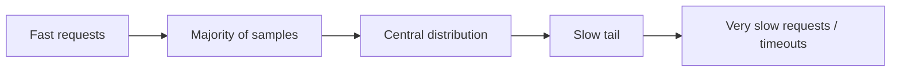
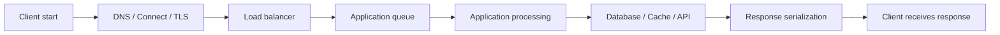
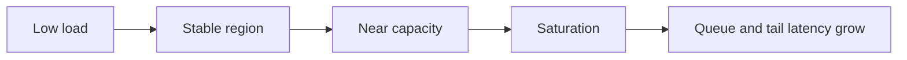

# Measuring p50, p95, p99, and Latency Distributions Under Load

The latency of a workload cannot be fully described by a single average number. When a system is under load, most requests may respond quickly while a small subset is slow due to queues, CPU saturation, garbage collection, disk I/O, network, connection pools, or downstream services. Percentiles such as p50, p95, and p99 expose the tail of the latency distribution, helping evaluate user experience and determine operating limits.

In the **CLOUD_CORE_SERVICES_COMPUTE** module, latency measurement must be tied to CPU, memory, network, storage capacity, the number of VMs/containers/functions, autoscaling, and dependencies. A reliable measurement must clearly define which requests are measured, how load is generated, how results are aggregated, and what state the system is in during testing. This lesson guides you through reading percentiles, designing tests under load, and analyzing distributions to avoid drawing wrong conclusions from a single average value.

## Learning Objectives

After this lesson, you can:

- Explain p50, p95, p99 and how they describe latency distributions.
- Compute percentiles from sample sets and understand the impact of sample size, histograms, and estimation algorithms.
- Distinguish client-side, server-side, queue, and per-dependency latency.
- Design load tests with warm-up, steady state, ramp-up, peak, and cooldown phases.
- Distinguish open workload models from closed workload models and recognize coordinated omission.
- Measure latency alongside throughput, error rate, concurrency, and saturation.
- Aggregate histograms properly across multiple instances and avoid averaging percentiles.
- Interpret p50/p95/p99 relative to SLOs, identify bottlenecks, and propose optimizations.
- Build repeatable tests for VMs, containers, and serverless.

## 1. Latency and Latency Distributions

Latency is the time from a defined start point to a defined end point. For an HTTP API, it may be measured from when the client starts sending the request until the full response is received. For a background job, it may be measured from when the message is enqueued until processing completes. These two measurements answer different questions, so specify the scope before comparing.

A request-handling system typically exhibits a latency distribution rather than a fixed value. For example, out of 10,000 requests:

- Many requests complete in 40–80 ms.
- A smaller portion takes 100–200 ms due to database queries or network.
- A few take over 1 second due to retries, queueing, or garbage collection.

If only the mean is calculated, the very slow requests can be hidden by the large number of fast requests. Percentiles indicate the time threshold within which a given percentage of requests complete.

### 1.1. P50, p95, and p99

| Metric | Meaning | Practical Question |
|---|---|---|
| p50 | 50% of samples have latency less than or equal to this threshold; close to median | How long does a typical request usually take? |
| p95 | 95% of samples have latency less than or equal to this threshold | Where does the slowest 5% of requests begin? |
| p99 | 99% of samples have latency less than or equal to this threshold | Is the slower tail affecting user experience or SLOs? |
| p99.9 | 99.9% of samples have latency less than or equal to this threshold | Are very rare requests creating major risk? |

For example, p99 = 900 ms means roughly 99% of requests in the measured set complete within at most 900 ms; the remaining ~1% of requests are slower. It does not mean every request takes 900 ms or that the system always responds within 900 ms.

P50 reflects the common experience. P95 and p99 are more sensitive to queueing, contention, pauses, retries, and slow dependencies. No single percentile identifies the cause on its own; combine them with throughput, error rate, and resource metrics.

### 1.2. Distributions and Tail Latency



Tail latency is the tail end of the distribution where a small fraction of requests are significantly slower than the rest. In multi-service systems, a single request may call multiple dependencies; even one slow branch or retry can sharply raise total latency. With parallel fan-out to multiple services, the probability that at least one branch is slow increases with the number of branches.

### 1.3. Mean, Median, and Percentiles Differ

- **Mean (average):** sum of latencies divided by sample count; easily skewed by outliers.
- **Median/p50:** middle value after sorting; less sensitive to a few extreme outliers.
- **p95/p99:** focus on the tail region, useful for evaluating slow requests.
- **Min/max:** show extremes in the measured set, but are highly sensitive to noise and sample size.

Inspect mean, p50, p95, p99, max, and histograms together. If the mean is much higher than p50, the distribution may be right-skewed or contain outliers. If p50 is stable while p99 climbs sharply, investigate tail latency and saturation.

## 2. Computing Percentiles from Sample Data

To understand percentiles, suppose latency samples are sorted in ascending order:

```text
12, 15, 18, 20, 22, 25, 29, 35, 40, 120 (ms)
```

The median lies between the 5th and 6th samples under the standard median definition, equal to 23.5 ms. p90/p95/p99 values depend on the percentile convention and interpolation used by the tool. With a small set of 10 samples, the tail is poorly represented; never use p99 from a small sample set to draw production conclusions.

### 2.1. Nearest-Rank Method

A simple calculation method is nearest rank:

\[
rank = \lceil p \times N \rceil
\]

Where:

- `p` is the percentile as a proportion, e.g., 0.95 for p95.
- `N` is the number of samples sorted in ascending order.
- `rank` is the index of the selected sample, 1-based.

With 10,000 samples:

| Percentile | Nearest-Rank Position | Interpretation |
|---|---:|---|
| p50 | 5,000 | Midpoint threshold of the distribution |
| p95 | 9,500 | 5% of samples lie above |
| p99 | 9,900 | 1% of samples lie above |
| p99.9 | 9,990 | 0.1% of samples lie above |

Statistical libraries may use interpolation rules other than nearest-rank. When comparing two tools, check the percentile definition, handling of duplicate samples, and discarded data.

### 2.2. Sample Size and Confidence

Higher percentiles require more samples for a stable estimate. With 1,000 requests, p99 represents only about 10 samples in the tail; p99.9 has only about one sample in the tail. A few outliers or a single timeout can swing the value dramatically.

Practical recommendations:

- Record the counts of successful, failed, timed-out, and dropped requests.
- Ensure enough samples for the target percentile; do not look only at test duration.
- Repeat the test and compare distributions across runs.
- Inspect histograms or confidence intervals if supported by the tool.
- Avoid interpreting p99.9 when sample count is too small or sampling is unrepresentative.

If reliable p99 is needed, design tests with sufficient requests and steady-state duration. Increasing request count does not mean pushing load to the point where the generator becomes a bottleneck; verify load generator capacity.

### 2.3. Outliers and Timeouts

Timeouts must not be silently excluded from the measurement set. If the client stops waiting after 2 seconds, that request is not a "zero-latency" request; it is a failed or timed-out request and must be accounted for separately. Calculating percentiles over successful requests only can make the system appear faster while many users actually receive no response.

Report:

- Latency percentiles of completed requests.
- Timeout and error rates.
- Number of requests canceled or not sent due to generator limits.
- Number of requests still in flight when the test ended.

For availability/latency SLOs, apply a specific definition of success. A request returning HTTP 500 in 20 ms must not be counted as a fast successful request.

## 3. Histograms and Percentile Aggregation

A histogram stores a latency distribution in buckets or equivalent structures. It allows aggregating data from multiple instances without storing every individual sample.

### 3.1. Classic Histograms

Classic histograms use cumulative buckets. For example:

| `le` Bucket | Requests with Latency Less Than or Equal To |
|---:|---:|
| 50 ms | 420 |
| 100 ms | 820 |
| 200 ms | 960 |
| 500 ms | 990 |
| 1,000 ms | 998 |
| +Inf | 1,000 |

With 1,000 requests, p95 lies within the bucket up to 200 ms because 960 requests completed by that threshold. p99 lies in the bucket region up to 500 ms because 990 requests completed. The exact value inside a bucket is estimated by interpolation; the histogram does not retain individual latencies.

Buckets should concentrate around SLO thresholds and regions of meaningful variation. If all buckets are very wide, p95/p99 estimates are coarse. If there are too many buckets, time-series count and cost increase. Buckets must be consistent across instances to be aggregated.

### 3.2. Aggregating Histograms Across Multiple Instances

Suppose a service runs across 10 VMs. Each VM records a request latency histogram. Counts in matching buckets can be summed across all VMs, and then percentiles calculated on the combined histogram. Do not compute p99 on each VM and average the 10 p99 values; that calculation does not yield the p99 of all requests.

PromQL example with classic histograms:

```promql
histogram_quantile(
  0.99,
  sum by (le, service, route) (
    rate(http_server_request_duration_seconds_bucket[5m])
  )
)
```

Similarly for p95:

```promql
histogram_quantile(
  0.95,
  sum by (le, service, route) (
    rate(http_server_request_duration_seconds_bucket[5m])
  )
)
```

In this example, `sum by (le, service, route)` sums buckets across instances while preserving bucket boundaries and the service/route dimensions. If a service-wide percentile is needed, omit `route`. Exact syntax depends on metric names and Prometheus-compatible backend.

### 3.3. Why Not Average p99?

Suppose instance A handles 9,000 requests with p99 = 100 ms, and instance B handles 100 requests with p99 = 2,000 ms. The average of the two p99 values is 1,050 ms, which is not the p99 of the 9,100 requests. The combined distribution must be computed from raw samples or mergeable histograms/sketches, accounting for sample counts from each source.

Rules:

- Do not average percentiles across VMs, Pods, or regions to infer a system-wide percentile.
- Do not add percentiles across routes or status classes.
- Use histogram buckets or mergeable sketches for distributed aggregation.
- If the backend only provides client-side summary quantiles, understand that those quantiles cannot be accurately aggregated by summing or averaging.
- Compare over identical time windows, units, populations, and error filters.

### 3.4. Native Histograms and Sketches

Some systems support native histograms or sketches such as HDR Histogram, DDSketch, and t-digest. These structures compress or represent distributions in ways that can be merged across sources, with trade-offs in accuracy, memory, and cost.

When choosing a structure, consider:

- Relative/absolute error in the target percentile region.
- Mergeability across multiple processes and shards.
- Behavior with heavily skewed distributions and outliers.
- Memory footprint and ingest/storage cost.
- Backend, SDK, and query tool support.

Do not assume all histogram systems use the same definition or offer the same precision. Read backend documentation and validate with reference sample sets before using them as SLO grounds.

## 4. Where Should Latency Be Measured?

Latency needs consistent start and end points. A request can be measured at the client, load balancer, server, queue, or individual dependencies. These numbers are not interchangeable.

### 4.1. Client-Side Latency

Client-side latency measures how long the user or load generator actually waits. It can include DNS, TCP connect, TLS handshake, sending the request, server wait time, receiving the response, and network transit.

This is usually the measurement closest to user experience. However, components must be separated to see where slowness lies. A client in a distant region may see high latency even when the server processes very fast.

### 4.2. Server-Side Latency

Server-side latency measures the time from when a request enters the application or middleware until processing finishes. It may exclude DNS, TLS handshake at the load balancer, or network transit between client and server.

Name metrics clearly, such as:

- `http_server_request_duration_seconds`: server processing time as defined by instrumentation.
- `http_client_request_duration_seconds`: time a client waits on a dependency.
- `queue_processing_duration_seconds`: time a worker spends processing a message.
- `request_end_to_end_duration_seconds`: time from business start point to final result.

Do not compare two metrics just because both contain `duration`; check instrumentation and boundaries.

### 4.3. Stage-by-Stage Latency

A request can be decomposed as follows:



Components may overlap or execute in parallel. Do not add individual percentiles to infer end-to-end percentiles. Measure end-to-end latency directly and use traces/spans to break down components of slow requests.

### 4.4. Queue Time vs. Service Time

- **Queue time:** time a request/message waits before being processed.
- **Service time:** time the worker or server spends actually executing the work.
- **End-to-end latency:** total time from start until the result is ready.

If service time stays constant while queue time grows, the cause usually lies in load exceeding serving capacity, concurrency limits, or downstream backpressure. If queue time is low while service time grows, investigate CPU, locks, memory, disk, network, or dependencies.

## 5. Relationship Between Latency, Throughput, and Saturation

Latency cannot be evaluated in isolation from load. As throughput increases, the system may respond quickly until a resource nears saturation. Beyond that threshold, queues grow and tail latency typically climbs rapidly.

### 5.1. Little's Law

Little's Law describes the relationship between average work in the system, throughput, and time spent in the system:

\[
L = \lambda W
\]

Where:

- `L` is the average number of requests/jobs in the system.
- `λ` is the average throughput, e.g., requests/second.
- `W` is the average time a request/job spends in the system.

For example, a system processes 200 requests/second and each request stays in the system for 0.25 seconds on average:

```text
L = 200 × 0.25 = 50 requests
```

On average, about 50 requests are being processed or waiting in the system. This relationship holds for steady-state systems under appropriate conditions; do not use it to directly derive p95/p99.

### 5.2. Queueing and the Saturation Region

As utilization approaches 100%, wait times can rise sharply because little room remains to absorb bursts. For example, 70% CPU may keep latency stable; when CPU stays at 95–100%, run queues grow and p99 rises quickly. Similarly, a full database connection pool can make requests wait even when database CPU is not high.

Saturation signals to monitor:

- CPU utilization, run queue, throttling, and steal time.
- Available memory, page faults, swap, OOMs, and garbage collection pauses.
- Disk IOPS, throughput, queue depth, and latency.
- Network throughput, packet loss, retransmissions, and connection tracking.
- Database pool utilization, lock waits, query queues, and replication lag.
- Queue depth, oldest message age, worker concurrency, and retry counts.
- Function concurrency, throttling, cold starts, and execution duration.

### 5.3. Load and Latency Curve



In the stable region, increasing load increases throughput nearly linearly with little change in latency. Near capacity, throughput growth slows while p95/p99 rise. Beyond saturation, the system may suffer timeouts, retries, and declining useful throughput.

## 6. Designing Load Tests Properly

A load test must simulate real workloads closely enough for results to be meaningful. A test sending simple requests to an empty endpoint may measure network or framework overhead, failing to reflect database queries, caching, authentication, and production dependencies.

### 6.1. Defining Objectives and Hypotheses

Example objectives:

- Determine maximum throughput while keeping p95 under 300 ms and error rate under 1%.
- Compare p99 before and after increasing vCPU count from 2 to 4.
- Verify whether autoscaling keeps latency within bounds when traffic doubles.
- Determine whether the queue or database pool becomes a bottleneck at 500 requests/second.

A good hypothesis predicts what will happen and includes metrics to verify it. For example: "Increasing worker concurrency from 20 to 40 will reduce queue age until the database pool saturates."

### 6.2. Building a Workload Profile

Describe the request mix based on real observations:

- Read/write endpoint ratio.
- Request and response sizes.
- Authentication/session behavior.
- Cache hit/miss ratio.
- Frequency of calls to databases, queues, and external APIs.
- Concurrent request count and arrival rate.
- Error/retry rate and long-running processing times.

Mask or synthesize sensitive data when generating test data. Do not use a single account or single key if it creates hot partitions, cache patterns, or lock contention unlike production.

### 6.3. Phases of a Test

| Phase | Purpose | Actions |
|---|---|---|
| Preflight | Confirm environment and generator readiness | Verify versions, data, endpoints, quotas, and monitoring |
| Warm-up | Prime runtime/caches/connection pools | Apply light load before measuring |
| Ramp-up | Gradually raise load to observe transition points | Step up arrival rate or concurrency |
| Steady state | Measure at target load level | Hold load long enough and record p50/p95/p99, throughput, errors, saturation |
| Peak/burst | Test peak load or sudden spikes | Apply bounded spike and observe queues/autoscaling |
| Cooldown | Allow system to recover | Reduce load, wait for queues to drain and resources to stabilize |
| Analysis | Compare results against hypothesis | Compare baselines, distributions, and resource metrics |

Do not mix warm-up or cooldown samples into steady-state percentiles when the goal is measuring steady-state performance. Still keep data from those phases to evaluate cold starts, autoscaling, and recovery.

### 6.4. Choosing Duration and Sample Count

Test duration must be long enough to:

- Generate enough requests for the target percentiles.
- Observe autoscaling cycles, cache behavior, garbage collection, and batch jobs.
- Reach steady state rather than measuring only the first few seconds.
- Detect memory leaks or queue accumulation in soak tests.

There is no single fixed duration for all systems. A 1-minute test may suffice for a simple microbenchmark, but is insufficient to observe autoscaling or periodic background tasks. Record actual request count and steady-state window duration so others can reproduce results.

## 7. Open Workload vs. Closed Workload Models

The load-generation model directly affects measured latency.

### 7.1. Closed Workload Model

In a closed model, a fixed number of virtual users send requests, wait for responses, and then send the next request. If the server slows down, each user automatically slows its request rate.

This model suits some interactive user scenarios with think time, but can hide overload because the generator sends fewer requests precisely when the system slows down.

### 7.2. Open Workload Model

In an open model, requests are scheduled at an arrival rate relatively independent of previous response times. For example, the system receives 200 requests/second even while some requests are slow. This model suits testing APIs receiving external traffic from users or other systems at a defined rate.

If the server cannot keep up, queues and latency grow; the generator must record requests that could not start on schedule or were dropped. Never omit `dropped iterations` or unsent requests when reporting.

### 7.3. Coordinated Omission

Coordinated omission occurs when a load generator waits for the previous request to finish before sending the next, failing to record requests that should have arrived while the server was slow. Resulting percentiles can appear more optimistic than real user experience under continuous load.

For example, a generator aims to send 100 requests/second using a single sequential thread. When one request takes 1 second, the generator misses many subsequent send times. Counting only completed requests fails to reflect the full backlog an actual arrival stream would create.

To mitigate this:

- Choose an open model when production workload arrival rate is independent of response time.
- Use tools supporting arrival-rate executors or coordinated omission correction.
- Track scheduled requests, started requests, completed requests, and dropped requests.
- Ensure the generator has enough VUs, CPU, network, and socket capacity.
- Clearly report the workload model so readers understand the results.

## 8. Tools and Practical Example with k6

k6 is a load testing tool capable of driving load by VUs or arrival rate and exporting Trend metrics for percentile calculation. Other tools such as JMeter, Gatling, Locust, wrk2, or internal systems can also be suitable; choose based on protocols, workload model, and required observability.

### 8.1. k6 Example with Constant Arrival Rate

The example below generates roughly 100 iterations per second for 5 minutes. The URL is a placeholder to be replaced with an approved test environment endpoint.

```javascript
import http from 'k6/http';
import { check } from 'k6';

export const options = {
  scenarios: {
    steady_load: {
      executor: 'constant-arrival-rate',
      rate: 100,
      timeUnit: '1s',
      duration: '5m',
      preAllocatedVUs: 50,
      maxVUs: 200,
    },
  },
  thresholds: {
    http_req_duration: ['p(95)<300', 'p(99)<800'],
    http_req_failed: ['rate<0.01'],
    dropped_iterations: ['count==0'],
  },
};

export default function () {
  const response = http.get('https://test.example.invalid/api/orders');
  check(response, {
    'status is 200': (r) => r.status === 200,
  });
}
```

Run the script in a test environment:

```bash
k6 run --summary-trend-stats="avg,min,med,max,p(50),p(90),p(95),p(99),p(99.9)" load-test.js
```

Thresholds in the example are illustrative targets, not default SLOs. `constant-arrival-rate` attempts to start iterations on schedule; allocate sufficient `preAllocatedVUs` and `maxVUs`. If the generator runs short of VUs, `dropped_iterations` increases and the test no longer achieves the configured arrival rate.

### 8.2. Interpreting k6 Results

Metrics to inspect:

- `http_req_duration`: total time sending, waiting, and receiving response as defined by k6.
- `http_req_waiting`: time waiting for the first response byte (TTFB) after sending the request.
- `http_req_connecting`: TCP connection establishment time.
- `http_req_tls_handshaking`: TLS handshake time.
- `http_req_failed`: request failure rate according to k6 rules.
- `iterations` and `iteration_duration`: iteration count and duration per iteration.
- `dropped_iterations`: iterations that could not start on schedule under an arrival-rate executor.
- `vus`/`vus_max`: current and maximum VU counts.

`http_req_duration` does not include every pre-request phase such as blocked time or DNS in the exact same way as total browser experience. If end-to-end browser latency is needed, add real-client or browser synthetic monitoring.

### 8.3. Adding Tags by Route and Scenario

Attach tags such as `service`, `route`, `scenario`, `region`, or `release` to analyze across finite-cardinality groups. Avoid putting `user_id`, `request_id`, or arbitrary URLs into metric tags because that increases cardinality. Use log/trace correlation when tracing individual requests.

### 8.4. Checking the Generator

The load generator can become a bottleneck before the application. Monitor CPU, memory, network, open file descriptors, socket usage, DNS, and VU count. If the generator reaches saturation, client latency may reflect the generator rather than the server.

For high loads, use multiple distributed generators with synchronized clocks. Record generator location, region, network path, tool version, and configuration so the test is repeatable.

## 9. Measuring Percentiles in Metrics and Dashboards

In production, latency usually needs continuous observation via histogram metrics. Dashboards should display p50/p95/p99 alongside throughput, error rate, and saturation so operators never read percentiles out of context.

### 9.1. Prometheus Histograms

Suppose the application exports the histogram `http_server_request_duration_seconds_bucket`. Query p50:

```promql
histogram_quantile(
  0.50,
  sum by (le, service) (
    rate(http_server_request_duration_seconds_bucket[5m])
  )
)
```

p95:

```promql
histogram_quantile(
  0.95,
  sum by (le, service) (
    rate(http_server_request_duration_seconds_bucket[5m])
  )
)
```

p99:

```promql
histogram_quantile(
  0.99,
  sum by (le, service) (
    rate(http_server_request_duration_seconds_bucket[5m])
  )
)
```

These queries illustrate classic Prometheus histograms. The metric unit is seconds; dashboards may convert to milliseconds for readability. The 5-minute window is an example; choose windows based on traffic, alerting delay, and SLO requirements.

### 9.2. Histogram Buckets Aligned with SLOs

If an SLO requires 95% of requests under 300 ms, buckets need a boundary at or near 0.3 seconds to measure compliance accurately. Design buckets around critical regions, such as 50 ms, 100 ms, 200 ms, 300 ms, 500 ms, 1 s, and 2 s. This list is illustrative; choose based on actual distributions and cost.

### 9.3. What Should a Dashboard Include?

A latency-under-load dashboard should include:

- p50, p95, p99 by service and route.
- Request rate/throughput over the same time range.
- Error rate, timeout rate, and retry rate.
- Histograms or heatmaps to visualize distribution shape.
- CPU, memory, throttling, disk/network, and queue depth.
- Database connection pool, query latency, and downstream latency.
- Replica/instance counts and autoscaling/deployment events.
- Request counts in the measurement window to assess percentile reliability.

Avoid displaying too many high-cardinality dimensions on dashboards. Choose dimensions with diagnostic value such as service, route template, status class, region, and version.

## 10. Analyzing p50/p95/p99 Results

Percentiles are signals prompting follow-up questions. Examine spreads between percentiles, trends over time, and correlated metrics.

### 10.1. Common Patterns

| Observation | Possible Cause | Investigation Direction |
|---|---|---|
| Both p50 and p99 increase | Overall capacity drop, slow dependency, or network issue | Throughput, CPU, network, downstream latency |
| p50 stable, p99 increases | Tail latency from queues, GC, locks, retries, or specific shards/instances | Histograms, slow traces, per-instance metrics, queue age |
| p50 increases, p99 increases slightly | Most requests became slower | Code changes, CPU throttling, network path, cache hit rate |
| p99 spikes with bursts | Autoscaling lag, cold starts, queues, or connection pools | Scale events, warm-up, concurrency, queue depth |
| High p99 on one route | Endpoint-specific query or logic | Route-level traces, DB queries, payload size |
| High p99 in one region/zone | Network, placement, dependency, or capacity imbalance | Region/zone breakdown, routes, and resource metrics |
| Low latency but rising error rate | Fast failures or rejections | Status breakdown, timeouts, saturation, and dependency errors |
| High client latency, low server latency | DNS/TLS/network/client or load balancer | Client timing breakdown and network path |

### 10.2. Comparing Before and After Optimization

Do not compare only p99 between two runs. Keep identical:

- Request mix, data, region, and network path.
- Arrival rate/concurrency and steady-state duration.
- Application version, dependencies, and runtime configuration except the variable being tested.
- Replica/VM counts and compute types.
- Warm-up, cache state, and run timing.
- Rules for excluding errors, timeouts, and outliers.

Changing multiple factors at once makes it hard to determine which factor produced the improvement. Change one primary variable at a time or use a controlled experimental design.

### 10.3. Benchmark Result Example

Suppose an API running on 4 VMs produces the following results at the same arrival rate of 300 requests/second:

| Metric | Before Optimization | After Optimization |
|---|---:|---:|
| Completed throughput | 298 req/s | 300 req/s |
| p50 | 72 ms | 61 ms |
| p95 | 310 ms | 180 ms |
| p99 | 920 ms | 360 ms |
| Error rate | 0.8% | 0.2% |
| Average CPU | 82% | 74% |
| DB pool wait p95 | 140 ms | 35 ms |

The results suggest connection pool/query optimization improved the tail and reduced error rate while maintaining throughput. However, verify request counts, variance across multiple runs, and database metrics before concluding. Lower average CPU alone does not prove the system has more capacity; check peaks, run queues, and saturation.

## 11. SLOs and Percentiles

A latency SLO should define the population, evaluation window, and success criteria. For example: 99% of valid requests to the create-order endpoint complete under 500 ms over a 30-day window, excluding specific request classes explicitly exempted by policy.

### 11.1. Percentile SLOs vs. Threshold-Based SLOs

You can use a percentile like p99 < 500 ms, or a proportion of requests below a threshold:

```text
Latency SLI = number of successful requests with latency <= 500 ms
              / total number of eligible requests
```

Threshold-based SLIs are often convenient for error budgets because each request is classified as good or bad against the threshold. Percentiles describe distributions well, though they are not always straightforward for direct error budget math. Follow your organization's SLO definitions.

### 11.2. Defining Eligible Requests

Specify:

- Endpoints and traffic types in scope.
- Whether failed requests are included in the latency SLI.
- How timeouts, client cancellations, and retries are counted.
- Whether internal health checks and synthetic traffic are excluded.
- Whether requests with unusual payload sizes are grouped separately.
- Whether measurement occurs at the client, gateway, or server.

If only successful requests are measured, monitor error rate separately so fast-failing responses are not mistaken for good performance.

### 11.3. Per-Route vs. Service-Wide SLOs

A service-wide SLO can hide a critical endpoint with low traffic. Identify endpoints of differing criticality and track route templates. Do not create separate SLOs for every dynamic ID or URL, as this complicates management and increases cardinality.

## 12. Testing VMs, Containers, and Serverless

Each compute model has distinct latency sources and startup behaviors. Tests must measure both steady state and transitional states.

### 12.1. VMs

Factors to check:

- vCPUs, CPU steal, run queue, and hypervisor/guest throttling.
- Memory pressure, swap, page faults, and garbage collection.
- Disk type, IOPS, throughput, and queue depth.
- Network bandwidth, packet loss, and placement zone.
- Number of VMs, autoscaling warm-up, and bootstrap time.
- Connection pools and local caches on each instance.

When comparing VM sizes, keep image, workload, storage, network path, and replica count constant if evaluating CPU/RAM impact. If both instance type and autoscaling policy change, explicitly note both changed variables.

### 12.2. Containers/Kubernetes

Factors to check:

- CPU requests/limits and cgroup CPU throttling.
- Memory requests/limits, OOM kills, and working set.
- Pod startup, readiness, image pulls, and node scheduling.
- Node pressure, noisy neighbors, and network plugins.
- Replica counts, HPA/VPA behavior, and scale-up delay.
- Service mesh sidecars, ingress controllers, and network policies.

A Pod with a CPU limit set too low can be throttled even when the node has free CPU. p99 may spike on a subset of Pods due to placement or node pressure. Break down by Pod/node/zone, while avoiding averaging percentiles.

### 12.3. Serverless/FaaS

Factors to check:

- Cold starts and warm invocations.
- Memory/CPU allocation and execution duration.
- Concurrency limits, throttling, and queue waits.
- VPC attachment, DNS, NAT, and connection setup.
- Runtime initialization, package size, and dependency loading.
- Retries, timeouts, event batch sizes, and downstream saturation.

Do not mix cold-start latency with warm latency when measuring each state separately. If the SLO reflects user experience, retain cold starts in the corresponding population. Test both low and high concurrency to observe effects on databases, queues, and function limits.

## 13. Types of Performance Tests

| Test Type | Goal | How Load Is Generated |
|---|---|---|
| Load test | Measure system at expected load | Ramp up to normal/peak load levels |
| Stress test | Find limits and overload behavior | Increase beyond design load in a controlled manner |
| Spike test | Measure response to sudden bursts | Jump rapidly from low to high load, then drop |
| Soak/endurance test | Detect leaks and degradation over time | Sustain steady load for a long duration |
| Scalability test | See capacity scaling when adding resources | Add VMs/Pods/CPUs and measure throughput/latency |
| Capacity test | Determine maximum load meeting SLOs | Increase arrival rate until SLO or saturation is breached |
| Regression test | Detect performance regressions after changes | Re-run standard workload and compare against baseline |

Each test type answers a different question. Do not use an overload stress test in place of a load test at expected production load; do not conclude a system has no memory leaks from a short benchmark.

## 14. Common Mistakes

| Mistake | Consequence | Fix |
|---|---|---|
| Reporting only average latency | Hides tail latency | Report p50/p95/p99, histograms, and error rate |
| Averaging p99 across instances | Wrong system-wide percentile | Merge histograms/sketches or aggregate raw samples |
| Testing too few requests | Unstable p99/p99.9 | Increase sample size and repeat runs |
| Dropping timed-out requests from data | Artificially fast-looking results | Report timeouts/errors separately and define population |
| Using closed model for open traffic | Coordinated omission underestimates latency | Use open arrival-rate model and track dropped requests |
| Not monitoring the load generator | Measures generator bottleneck instead of server | Monitor CPU/network/VUs/sockets and distribute generators |
| Mixing warm-up into steady state | Hard-to-compare percentiles | Tag phases and filter to the proper measurement window |
| Measuring server-side only | Misses DNS/TLS/network and user experience | Measure client-side and break down traces/spans |
| Looking at latency without throughput | Unclear if system shed load | Read latency alongside completed RPS and dropped iterations |
| Changing request mix | Compares two different workloads | Use consistent profiles and test data |
| Changing multiple variables at once | Cannot isolate cause of improvement | Vary one primary factor per experiment |
| Computing p99 from low trace sampling | Trace sample may be unrepresentative | Use histogram metrics for SLOs, traces for investigation |

## 15. Workflow for Analyzing a Benchmark Run

1. Confirm goals, SLOs, workload profile, and expected load.
2. Verify environment, versions, data, generator, and monitoring.
3. Run warm-up followed by ramp-up as planned.
4. Select the steady-state window and confirm actual arrival rate.
5. Record request count, throughput, p50/p95/p99, errors, timeouts, and dropped iterations.
6. Correlate CPU, memory, disk, network, queues, and dependency latencies.
7. Inspect histograms/traces of slow requests to pinpoint the stage causing tail latency.
8. Compare against baseline and initial hypothesis.
9. Change one factor and re-run with an equivalent workload.
10. Document results, measurement limitations, configuration, and next decisions.

A benchmark report should include date/time, region, compute type, application version, generator config, request mix, arrival rate, sample count, steady-state duration, percentiles, error rate, and resource metrics. Do not record just a dashboard screenshot.

## 16. Checklist for Measuring Latency Under Load

**Before Testing**

- [ ] Defined latency boundaries and measurement units.
- [ ] Defined successful, failed, timed-out, and canceled requests.
- [ ] Workload profile and request mix close to production.
- [ ] Selected open/closed model appropriate for the goal.
- [ ] Sufficient sample count for target p95/p99.
- [ ] Load generator has enough CPU, network, VU, and socket capacity.
- [ ] Monitoring collects throughput, errors, saturation, and dependency metrics.

**During Testing**

- [ ] Includes preflight, warm-up, ramp-up, steady state, and cooldown.
- [ ] Records expected and actual arrival rates.
- [ ] Tracks dropped iterations, timeouts, and request failures.
- [ ] Distinguishes client-side and server-side latency.
- [ ] Tags by service/route/scenario/version with controlled cardinality.
- [ ] Logs scale events, deployments, and environment changes.

**After Testing**

- [ ] Reports p50, p95, p99, and sample counts.
- [ ] Inspects histograms and distributions, not just a single percentile.
- [ ] Properly aggregates histograms/sketches across instances.
- [ ] Correlates throughput, error rate, CPU/RAM/disk/network/queues.
- [ ] Analyzes traces of slow requests and dependencies.
- [ ] Compares against baseline under matching conditions.
- [ ] Documents assumptions, limitations, results, and follow-up actions.

## 17. Conclusion

P50 describes the middle of the distribution, p95 shows the slower group of requests, and p99 clarifies tail latency. These values are meaningful only when latency boundaries, population, workload model, and sample counts are clearly defined. Read percentiles alongside throughput, error rate, dropped requests, and saturation to know whether the system truly handles the load or is simply completing fewer requests.

Histograms or sketches allow aggregating distributions across multiple instances; averaging per-machine p99 does not produce the system-wide p99. Open workload models help simulate independent arrival rates and limit coordinated omission. When diagnosing bottlenecks, combine client timings, server metrics, queue depth, and distributed traces. A good benchmark must be repeatable, document all conditions, and prove the link between configuration changes and outcomes.

## Key Terms

| Term | Meaning |
|---|---|
| Latency | Time from a defined start point to a defined end point of an operation. |
| Percentile | Threshold below or equal to which a given percentage of samples fall. |
| p50 / median | The 50th percentile, close to the median value. |
| p95 | The 95th percentile; 5% of samples lie above this threshold. |
| p99 | The 99th percentile; 1% of samples lie above this threshold. |
| Tail latency | Latency in the slow tail of the distribution. |
| Histogram | Structure grouping samples into buckets to represent a distribution. |
| Nearest rank | Method selecting a sample position via `ceil(p × N)`. |
| Throughput | Number of requests/jobs completed per unit of time. |
| Saturation | State where a resource or queue nears/exceeds serving capacity. |
| Little's Law | Relationship `L = λW` between work in the system, throughput, and residence time. |
| Open workload model | Model generating requests at an arrival rate independent of previous response times. |
| Closed workload model | Model where users wait for a response before sending the next request. |
| Coordinated omission | Bias when a generator misses request send times while the system is slow. |
| Warm-up | Phase that primes runtime, caches, and connections before steady-state measurement. |
| Soak test | Test sustaining load over a long duration to detect degradation over time. |
| SLI / SLO | Service level indicator and service level objective. |
| Dropped iteration | Iteration that could not start on schedule in the load generator. |
