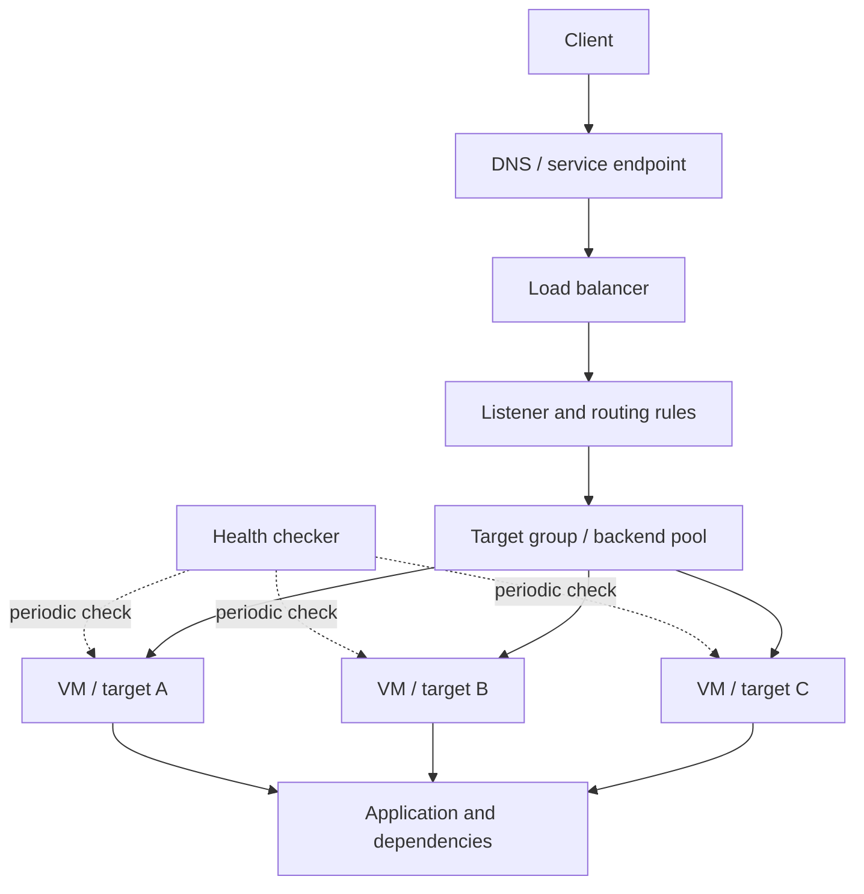

# Backend Pools, Target Groups, and Automatic Instance Registration

A load balancer distributes requests or connections across multiple backends to increase serving capacity, scale horizontally, and reduce the impact when a machine fails. A backend pool is the set of machines or endpoints capable of receiving traffic; a target group is how many cloud platforms group identically configured targets so the load balancer can run health checks and route traffic to them. When VMs are created, replaced, or scaled based on load, the system must register new targets and remove old targets from the pool at the right time.

If instances are registered manually, the backend list quickly becomes stale: new VMs receive no traffic, terminated VMs remain in the pool, or targets receive requests before they are ready. Automatic registration and deregistration tied to the compute lifecycle keep the pool accurately reflecting healthy serving machines. However, automation must coordinate with health checks, connection draining, IAM permissions, autoscaling, and deployment workflows to avoid sending traffic too early or dropping in-flight requests.

## 1. What Are Backend Pools and Target Groups?

A **backend** is a server or service performing work behind a load balancer, such as a VM running a web server, a container, a Pod, an IP endpoint, or an application service. A **backend pool** is the collection of backends from which a load balancer can choose when forwarding requests.

A **target group** is a configuration object grouping targets and health-check/routing rules. Depending on the platform, a target can be an instance ID, IP address, endpoint, function, or another resource type. A load balancer can have multiple listeners/rules, with each rule forwarding traffic to an appropriate target group.

For example, a web application might use:

- Target group `web-http` for backends serving internal HTTP on port 8080.
- Target group `web-admin` for administrative endpoints accessible only from the management network.
- Target group `api-v2` for a new API version during a canary phase.

A target group is typically associated with attributes such as protocol, port, target type, health check, stickiness, deregistration delay, and distribution algorithm. Exact attributes depend on the provider and load balancer type.

### Related Components

| Component | Role |
|---|---|
| Listener | Receives connections on a public or internal protocol/port |
| Listener rule | Selects an action based on host, path, header, or other conditions |
| Target group / backend pool | Groups backends sharing a common routing configuration |
| Target | A registered VM, IP, Pod endpoint, or service |
| Health check | Determines whether a target is healthy enough to receive traffic |
| Registration | Adds a target to the pool and begins tracking its state |
| Deregistration | Stops sending new requests to a target and completes in-flight connections |
| Autoscaling group / instance group | Creates or deletes compute members according to policy |
| Lifecycle hook | Allows running preparation or cleanup steps during the instance lifecycle |

## 2. Request Flow Through a Load Balancer

A client connects to the load balancer's address. The listener accepts the connection, evaluates rules, selects a target group, and picks a healthy target. The load balancer forwards the request or connection to the backend over the internal network.



The health checker may run from the load balancer itself or an associated control system. A target should receive traffic only when its state and routing policy allow it. A target may already be registered while still in an `initial`, `unhealthy`, `draining`, or equivalent state.

### A Target Group Can Support Multiple Target Types

Platforms typically support one or more registration modes:

- **Instance target:** Registers a VM/instance ID; the platform maps the target to a network interface and port.
- **IP target:** Registers an IP address and port; useful for endpoints outside directly managed VM groups, containers, or internal addresses.
- **Pod/endpoint target:** Integrates with Kubernetes or a container platform to route directly to the appropriate endpoint.
- **Service/function target:** Some services support managed backends instead of VMs.

Not every load balancer type supports every target type. Choose the type that matches how the workload is deployed and how backend addresses change.

## 3. Choosing Target Types and Registration Models

### Registering by Instance ID

With instance targets, an autoscaling group or instance group can automatically add a new VM's ID to the target group and remove the ID when the VM is removed from the group. The load balancer uses provider metadata to locate the network endpoint.

Advantages:

- Integrates naturally with the VM lifecycle managed by autoscaling.
- Eliminates the need to maintain an IP list manually if internal addresses change.
- Can link health checks and instance state within the control plane.

Limitations:

- Typically applies only to instances within the scope supported by the load balancer/provider.
- Requires checking zones, VPC/VNet, account/project, and registration permissions.
- May not fit if backends are container endpoints or IPs outside the instance group.

### Registering by IP and Port

IP targets let you register specific endpoints, such as a Pod IP, container host, machine on a privately connected network, or a service in another environment. This approach is flexible but requires an accurate endpoint address and state management system.

Common risks:

- Dynamic IPs being reused after a VM/Pod is deleted.
- Old targets failing to deregister, causing requests to hit nonexistent endpoints.
- IPs belonging to subnets or networks unreachable by the load balancer.
- Port or protocol mismatches with the application.
- Target registration falling out of sync with the scheduler or autoscaler.

If using dynamic IPs, a controller or lifecycle automation must update the target group whenever an endpoint is created or deleted. Do not rely on a static IP list file if backends change frequently.

### Choosing a Target Type by Architecture

| Backend Architecture | Typically Suitable Registration | Items to Verify |
|---|---|---|
| VMs in an autoscaling group | Instance target | Group-to-target-group association and lifecycle policy |
| VMs created by multiple independent pipelines | Instance or IP target | Ownership mechanism, tagging, and cleanup |
| Containers on VMs | IP/endpoint or container platform integration | Dynamic ports, network mode, and service discovery |
| Kubernetes Pods | Ingress/controller or CNI/cloud target integration | Endpoint readiness, Pod termination, and target health |
| Hybrid-connected on-premises | IP target if supported | Routing, firewall, latency, and stable addressing |
| Managed services | Provider-specific dedicated target type | Protocol limits, timeouts, and health semantics |

## 4. Health Checks Determine Whether a Target Receives Traffic

A health check is a periodic test evaluating whether a target is capable of serving. A newly registered target is typically kept out of the serving pool until it passes the configured number of consecutive successful checks. When a target fails repeatedly, the load balancer stops sending traffic to it.

### Types of Health Checks

- **TCP check:** Confirms a connection can be opened to the port. It does not prove the application handles requests properly.
- **HTTP/HTTPS check:** Sends requests to a specific path and verifies the status code or body depending on platform capabilities.
- **Application-level check:** An endpoint checking application state and required dependencies for serving.
- **Platform check:** Some platforms combine instance or network health with target health checks.

Health checks should reflect actual serving capability. If `/health` always returns 200 even when the database is unreachable, the load balancer may keep sending requests to a backend that cannot complete work. Conversely, if the health check depends on every auxiliary service, a non-critical dependency failure could cause all targets to be dropped from the pool.

### Designing Health Endpoints

Separate two distinct purposes:

- **Liveness:** The process is running and not deadlocked to the point of needing a restart.
- **Readiness:** The application has initialized and can accept new requests.

A load balancer typically needs a readiness/health endpoint to decide whether a target receives traffic. This endpoint should be lightweight, have a short timeout, and avoid running expensive queries. It can check mandatory dependencies, but should not turn health checks into heavy database load.

Example response:

```http
GET /ready HTTP/1.1
Host: backend.internal

HTTP/1.1 200 OK
Content-Type: application/json

{"status":"ready"}
```

If the application is not ready yet, it can return an unsuccessful code or a state the load balancer is configured to recognize. Ensure response codes and timeouts align with the provider.

### Health Check Parameters

| Parameter | Meaning | How to Choose |
|---|---|---|
| Protocol/port | Protocol and port to probe | Matches the application's internal listener |
| Path | HTTP/HTTPS path | Lightweight readiness endpoint with no unexpected redirects |
| Interval | Time between checks | Balances detection speed against probe load |
| Timeout | Maximum wait time for a response | Longer than normal response time without being excessive |
| Healthy threshold | Consecutive successes to mark healthy | Prevents admitting a target on a single lucky response |
| Unhealthy threshold | Consecutive failures to mark unhealthy | Avoids dropping a target on a transient network blip |
| Success codes | HTTP codes considered healthy | Allow only codes indicating true application readiness |
| Initial delay / grace period | Wait time after creation | Sufficient for boot, model loading, cache warm-up, and bootstrap |

If an application takes 90 seconds to start, yet health checks begin after 10 seconds and time out repeatedly, the target may be marked unhealthy before bootstrap finishes. Use a grace period or startup-aware readiness per platform capabilities, while avoiding overly long delays that slow down detection of real failures.

## 5. Automatic Machine Registration with Autoscaling

Autoscaling creates or deletes VMs based on load, schedule, or metrics. To ensure the load balancer always has the right backends, the autoscaling group/instance group must be linked to the target group or managed by a controller responsible for registering targets.

### Scale-Out Flow

1. A metric or policy triggers scale-out.
2. The autoscaler requests a new instance.
3. The provider provisions the VM and attaches NICs, disks, and identity.
4. The guest OS boots, runs cloud-init/bootstrap, and starts the application.
5. The VM or controller registers the target in the target group.
6. The load balancer begins health checks.
7. Once the target becomes healthy, traffic is routed to the backend.

A crucial point is that **registered does not mean ready**. Even if a target is registered immediately after instance creation, the load balancer must still wait for health checks. Some platforms handle this automatically; some integrations require configuring a health grace period or lifecycle hook.

### Scale-In Flow

1. The autoscaler selects an instance to remove.
2. A lifecycle hook or termination workflow holds the instance in a waiting state if needed.
3. The target is deregistered or marked as draining.
4. The load balancer stops sending new requests to the target.
5. In-flight connections are given time to finish according to the deregistration delay.
6. The application stops accepting new jobs and finishes or checkpoints ongoing work.
7. The VM is terminated and associated resources are reclaimed.

If the autoscaler terminates the VM before target deregistration or connection draining completes, in-flight requests can be reset. Check the hook ordering and timeouts of each platform.

### Linking an Autoscaling Group to a Target Group

Conceptual configuration model:

```yaml
compute_group:
  min_size: 2
  desired_capacity: 3
  max_size: 10
  health_check_type: load_balancer
  health_check_grace_period: 180

load_balancer:
  listener_port: 443
  target_group: web-backends
  target_type: instance
  backend_port: 8080
  health_check:
    protocol: HTTP
    path: /ready
    interval_seconds: 15
```

This is an illustrative example, not a schema to apply directly to a specific provider. In actual configuration, declare the group-to-target-group association, registration permissions, health checks, and lifecycle behavior using your platform's syntax.

## 6. Lifecycle Hooks and the Bootstrap Process

Lifecycle hooks allow the system to perform tasks before an instance transitions to its next state, such as before receiving traffic or before terminating. Hook names and capabilities vary across autoscaling services.

### When an Instance Initializes

A hook or bootstrap workflow can:

- Install packages and configure the runtime.
- Fetch secrets using instance identity.
- Download required models or artifacts.
- Mount volumes and verify data.
- Start services and warm caches.
- Register with service discovery or a target group.
- Wait for readiness before allowing traffic.

Bootstrap must be idempotent: if re-run due to retries, it must not create duplicate users, duplicate mounts, or duplicate target registrations. Long steps such as downloading large models need timeouts, progress tracking, and resume capability.

### When an Instance Is Removed

A pre-termination hook can:

- Stop accepting new work.
- Deregister the target and wait for draining.
- Finish in-flight requests or send a shutdown signal.
- Write checkpoints for long-running jobs.
- Flush logs, metrics, and data to persist.
- Detach volumes or release locks cleanly.

Hooks must not wait indefinitely. Set a deadline and timeout behavior; if work cannot finish before the limit, decide explicitly whether to force-terminate, retry, or transition to an incident state.

## 7. Connection Draining and Deregistration Delay

When a target is removed from a target group, the load balancer typically needs to stop sending new requests while allowing existing connections to finish. This mechanism is commonly called connection draining, deregistration delay, or target draining.

For example, a data export request takes 45 seconds. If the VM is terminated immediately when scale-in starts, the request is aborted. If the load balancer gives the target 60 seconds to drain and the application handles graceful shutdown properly, the request has a chance to finish.

### Recommended Coordinated Shutdown Sequence

1. Mark the backend not to receive new requests or initiate deregistration.
2. Wait for the load balancer to propagate the draining state.
3. Application enters shutdown mode, rejecting new jobs while keeping current requests alive.
4. Wait for active requests, transactions, or messages to finish.
5. Write checkpoints/flush data if needed.
6. Stop the process and let the autoscaler/provider reclaim the VM.

Exact ordering depends on the platform. Some load balancers start draining as soon as the deregister API is called; some autoscaling services automatically invoke deregistration during the lifecycle. Avoid having two systems both trigger deregistration or terminate in an unclear order.

### Choosing Draining Duration

Draining duration should be based on the maximum allowed request duration, application shutdown time, and platform timeouts. If set too short, long requests get dropped. If too long, scale-in drags out and VMs may continue incurring charges while waiting.

| Workload Characteristic | Configuration Guidance |
|---|---|
| Short, stateless requests | Short draining, still enough for p99 requests and shutdown |
| Large uploads/downloads | Account for maximum transfer time and resume mechanisms |
| WebSocket or long-lived connections | Design reconnects, notify clients, and enforce lifetime limits |
| Batch/worker | Stop pulling new jobs; finish or checkpoint running jobs |
| Streaming | Provide handoff, reconnect, or offset checkpointing |
| Database connections | Close connections cleanly after requests finish |

Draining does not guarantee infinite requests will finish. Applications still need timeouts, retries, and idempotency; clients also need reconnect handling.

## 8. Slow Start, Stickiness, and Distribution Algorithms

### Slow Start

Slow start gradually ramps up traffic sent to a newly healthy target over a period of time. It is useful when backends need to warm caches, JIT-compile, load models, or build connection pools. Sending full traffic immediately can overload a new target before warm-up completes.

Slow start does not replace readiness. A target must still be healthy before receiving traffic; slow start only paces the ramp-up afterward. If initialization is incomplete, health checks must continue marking it unready.

### Session Stickiness

Stickiness pins requests from the same client or session to one target for a specified duration. It can help applications that still store session state in memory, but reduces load-distribution flexibility.

Limitations:

- One target can receive disproportionate load if certain sessions are heavy.
- When a target becomes unhealthy or is deregistered, sessions can still be lost or shifted to another backend.
- Cookie affinity does not replace durable session storage or a shared session store.
- Stickiness can reduce the effectiveness of scale-out and scale-in.

Prefer stateless designs and store session state externally in a shared store. Enable stickiness only when there is a specific compatibility requirement and after assessing failover impact.

### Distribution Algorithms

Load balancers may use round robin, least outstanding requests, weighted routing, hashing, or proprietary algorithms. The best choice depends on the protocol and load balancer type.

- **Round robin:** Distributes sequentially; suited when targets are equivalent and requests have similar costs.
- **Least outstanding:** Prefers targets with fewer active requests/connections; helpful when request durations vary.
- **Weighted:** Distributes by weight; supports canaries or backends with differing capacities.
- **Hash/sticky:** Pins a key or client to a target; can help cache locality but requires handling target membership changes.

Do not judge balance solely by request count per target. Compare CPU, latency, active connections, queue depth, and processing times.

## 9. Automatic Registration and Deregistration Across Compute Models

### VM Autoscaling

Associating an autoscaling group with a target group is standard practice. When an instance is created, the service registers the target; when removed, the target is deregistered per lifecycle policy. Verify health check type, grace period, lifecycle hooks, and behavior on unexpected instance termination.

### Instance Groups or Managed VM Groups

Some clouds use managed instance groups to create, replace, and self-heal VMs. A load balancer backend service can reference an instance group or network endpoint group directly. With integrated mechanisms, the provider manages membership automatically. Understand how the group updates backends during rolling updates or autoscaling.

### Container Platforms

Container orchestrators manage service endpoints based on Pod/container state. A load balancer controller or ingress controller can synchronize the target group with Ready endpoints. When a Pod terminates, its endpoint must be removed from the list, and shutdown must coordinate with `preStop`, termination grace period, and readiness.

If registering Pod IPs directly, verify IPAM, CNI, target health, and endpoint propagation delay. If using node targets, understand how traffic traverses NodePort or proxies and the impact during node drains.

### Kubernetes and Target Integration

General flow:

1. Deployment creates a Pod.
2. The Pod starts and its startup probe completes.
3. The readiness probe succeeds.
4. The Service endpoint controller adds the Pod IP to an EndpointSlice.
5. The load balancer controller syncs endpoints to the target group or backend service.
6. The target health check passes and traffic begins flowing.
7. When the Pod is deleted, readiness flips to false and the endpoint is removed; the controller deregisters the target.
8. `preStop` and termination grace period allow active connections/jobs to finish.

Actual ordering depends on the CNI, ingress/controller, and cloud integration. Check the documentation for your plugin; never assume a passing readiness probe instantly means the cloud target is healthy.

### Serverless and Managed Endpoints

Some serverless services attach directly as backends without per-instance registration. The provider manages concurrency and endpoints. For these services, configure invocation permissions, timeouts, concurrency, and health semantics rather than managing target registration manually.

## 10. Security in Backend Registration

The backend pool is part of your network and access boundary. Registering the wrong target can expose internal services or send data to untrusted endpoints.

### Restricting Registration Permissions

The identity performing target registration/deregistration needs least-privilege permissions scoped to the exact target group and compute group. Do not grant permission to modify all listeners or delete load balancers if a workflow only updates membership.

### Controlling the Network Path

- Allow the load balancer to connect only to required backend ports.
- Backends should accept traffic only from valid load balancer security groups/subnets or sources.
- Do not open application ports directly to the Internet unless necessary.
- Check egress and routes when targets reside in another network or hybrid environment.
- Protect health check endpoints from unauthorized access while allowing legitimate probe sources.

### TLS and Backend Verification

If the load balancer terminates TLS at the frontend and connects to backends over HTTP, assess whether the data is sensitive and whether the network is sufficiently protected. For backend TLS, configure certificates, hostname/SNI, and trust chains properly. Some platforms encrypt the backend leg without verifying certificate identity as users might expect; read the service guarantees carefully.

### Preventing Rogue or Stale Targets

Allow automation to register targets only from verified inventory or orchestration. Use tags/labels, subnets, and account/project allowlists. When a VM is reclaimed, target cleanup must run even if shutdown did not complete cleanly. Scheduled reconciliation can detect targets no longer present in inventory to alert or remove according to approved policy.

Do not automatically deregister targets merely because an inventory API is temporarily unreachable; distinguish missing data from targets that were genuinely deleted.

## 11. Observing and Operating Target Groups

Metrics to track:

- Target counts by state: healthy, unhealthy, initial, draining, and unused.
- Health check failure rate by target and by zone.
- Request count, active connections, and new connections.
- Target response time or backend latency.
- HTTP 4xx/5xx from the load balancer and backends.
- Resets, timeouts, connection errors, and rejected request count.
- Targets registered/deregistered per scaling event or deployment.
- Time from instance launch to target healthy.
- Time from deregistration to completed termination.

Logs should correlate request ID, target ID, listener/rule, and backend response. Avoid logging sensitive data or tokens in access logs.

### Useful Alerts

- Zero healthy targets remaining in a production target group.
- Sudden spike in unhealthy targets after a deployment.
- New instances failing to become healthy within the expected window.
- Target group retaining stale targets after VMs are terminated.
- Draining duration repeatedly exceeding the lifecycle hook timeout.
- Backend latency rising even though load balancer latency or frontend traffic is steady.
- A zone losing all targets or cross-zone distribution becoming imbalanced.

## 12. Troubleshooting Backend Pools and Target Registration

| Symptom | Possible Cause | How to Check |
|---|---|---|
| New target does not appear in pool | Wrong association, missing permissions, controller not running | Inspect autoscaling integration, events, and IAM/RBAC |
| Target stays in `initial` state too long | Health check not running yet or grace period | Check interval, port, path, and events |
| Target unhealthy right after launch | Application not ready, firewall, or wrong path | Probe endpoint from an appropriate network, inspect health reason and app logs |
| VM healthy but load balancer cannot connect | Security rule, route, port, or protocol mismatch | Check LB-to-backend path and listener/backend config |
| Old target still receives traffic | Deregistration incomplete or controller error | Inspect target state, events, and cleanup automation |
| Requests reset during scale-in | Terminated before draining finished | Check deregistration delay, hook timeout, and app shutdown |
| Some targets overloaded | Stickiness, algorithm, or uneven capacity | Compare requests, active connections, CPU, and latency per target |
| Target becomes unhealthy after warm-up | Memory leak, dependency error, or overly tight probes | Correlate metrics and logs with health check failure timestamps |
| Pod Ready but target still unhealthy | Controller/CNI out of sync or broken network path | Inspect EndpointSlice, target registration, and firewall |
| Scale-out completes but traffic does not increase | Targets not healthy yet or wrong listener rule | Track registration timeline, rules, and health threshold |

### Quick Troubleshooting Workflow

1. Check whether the listener/rule points to the right target group.
2. Confirm the target ID/IP/port and target type are accurate.
3. Check registration status and the unhealthy reason.
4. Call the health endpoint from a network path equivalent to the load balancer.
5. Check security groups, firewalls, routes, and TLS.
6. Correlate application logs, startup time, and readiness.
7. Check autoscaling events, lifecycle hooks, and controllers.
8. After fixing, wait for targets to become healthy and verify actual request distribution.

## 13. Example Scale-Out and Scale-In Workflows

### Scale-Out

A web VM group has a minimum of two instances. When CPU or request count crosses a threshold, the autoscaler raises desired capacity from 2 to 4.

1. The autoscaler creates two VMs from a standard image.
2. The VMs boot the OS, fetch configuration, and start the web service.
3. The instance group automatically registers the two new targets.
4. The load balancer probes `/ready`; new targets receive no traffic while `initial`.
5. After enough consecutive successful health checks, targets transition to healthy.
6. The load balancer distributes requests using the configured algorithm.
7. Metrics confirm load is spread more evenly and latency drops.

If bootstrap takes a long time, increase the grace period or improve image/warm-up speed. Do not route traffic to a target merely because the VM is `Running`.

### Scale-In

When load drops, the autoscaler lowers desired capacity from 4 to 2.

1. The autoscaler selects two VMs to remove.
2. A lifecycle hook starts the termination workflow.
3. Targets are deregistered and enter draining.
4. The load balancer stops sending new requests to these two targets.
5. The application completes remaining requests, stops workers from taking new jobs, and flushes logs.
6. Once draining finishes or work completes, the lifecycle hook permits termination.
7. Automation verifies old targets are gone and no stray IPs/volumes remain that need preservation.

If a job outlasts the draining period, workers must checkpoint or return the job to the queue for another worker to resume. Do not extend draining indefinitely, as it makes scale-in ineffective and may exceed provider limits.

## 14. Deployment Checklist

**Target group design:**

- [ ] Selected target type matching VMs, IPs, containers, or managed services.
- [ ] Configured protocol, port, and health check to match backends.
- [ ] Listeners/rules point to the correct target groups.
- [ ] Backends accept traffic only from the load balancer or approved sources.
- [ ] Sufficient healthy targets and capacity across required fault domains.

**Automatic registration:**

- [ ] Autoscaling group/instance group is properly linked to the target group.
- [ ] Bootstrap is idempotent and includes a readiness check.
- [ ] Grace period accommodates startup duration.
- [ ] IAM/RBAC grants only necessary register/deregister permissions.
- [ ] Controller or scheduler syncs endpoints whenever backends change.

**Automatic deregistration:**

- [ ] Deregistration begins before the VM/Pod is terminated.
- [ ] Connection draining and an appropriate wait timeout are enabled.
- [ ] Application stops accepting new work and finishes/checkpoints active jobs.
- [ ] Lifecycle hooks have explicit timeouts and failure behavior.
- [ ] Cleanup handles abrupt instance deaths as well.

**Operations:**

- [ ] Monitor target health, backend latency, and connection errors.
- [ ] Alert when zero healthy targets remain or stale targets persist.
- [ ] Test scale-out, scale-in, rolling updates, and zone failures.
- [ ] Validate stickiness, slow start, and distribution algorithms under realistic load.
- [ ] Maintain a recovery runbook if the registration controller or load balancer fails.

## Conclusion

Backend pools and target groups are where a load balancer manages the set of backends eligible for traffic. Automatic registration must tie into the lifecycle of VMs, containers, or managed services; health checks confirm target readiness; deregistration and connection draining protect in-flight requests during scale-in or new deployments. Choose target types suited to your architecture, design appropriate readiness endpoints, coordinate autoscaling with lifecycle hooks, restrict permissions and network paths, and monitor target state. When these steps are properly connected, the backend pool continuously reflects true serving capacity and the system can scale or replace instances with minimal disruption.
