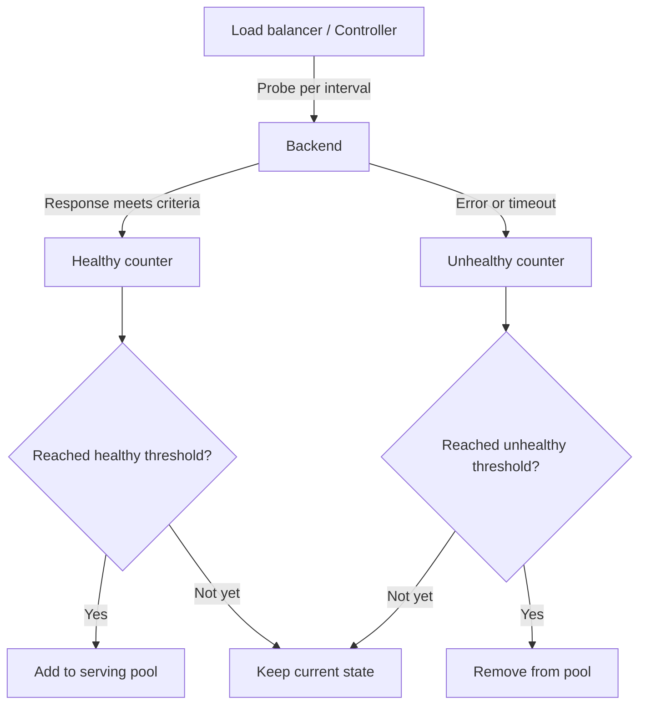

# Health Checks and Thresholds for Removing Failing Machines from Service

## 1. Why Are Health Checks Important?

A load balancer distributes requests across multiple machines or instances to increase serving capacity, scale horizontally, and reduce reliance on a single machine. However, a VM remaining in the `running` state, a container remaining in the `Running` state, or a process keeping a TCP port open does not prove the application can handle requests properly.

A machine may still be up yet suffering from issues such as an exhausted connection pool, inability to reach the database, a full filesystem, CPU throttling, hung workers, or inability to read secrets. If the load balancer continues sending requests to that machine, errors will reach users even while other backends are healthy.

A **health check** is the mechanism for testing a backend's readiness. When a backend fails consecutively according to a configured threshold, the load balancer or orchestrator can mark it unhealthy and stop sending new requests to it. When the backend recovers and passes the required consecutive successful checks, it can be returned to the pool.

Within the **CLOUD_CORE_SERVICES_COMPUTE** module, health checks connect directly to deploying VMs, containers, and serverless; selecting CPU, memory, and networking; scaling under load; ensuring availability; and optimizing cost. This lesson focuses on designing meaningful checks, choosing thresholds to remove failing machines from service, and avoiding false removal of machines that can still serve requests.

After this lesson, learners will be able to:

- Distinguish health checks at the network, process, application, and dependency layers.
- Differentiate readiness, liveness, and startup probes.
- Design safe, lightweight health-check endpoints that accurately reflect serving capability.
- Choose interval, timeout, healthy threshold, and unhealthy threshold values.
- Approximate failure detection time and the time required to return a backend to the pool.
- Combine health checks with connection draining, failover, and autoscaling.
- Handle flapping, simultaneous failures, slow startups, and shared dependencies.

## 2. How Do Health Checks Work?

### 2.1. Basic Probe Flow

The load balancer or control plane periodically sends probes to each backend. The backend returns a result or fails to respond within the allowed time. The controller records the result, updates state, and decides whether to keep sending requests.



This is a generalized model. How consecutive successes/failures are counted, initial probe timing, connection error handling, and behavior when the controller cannot reach targets vary across platforms. Always consult the documentation for your load balancer or orchestrator.

### 2.2. Health Check Failure Does Not Equal Machine Restart

Marking a backend unhealthy usually only means stopping new requests to that backend. It does not necessarily reboot the VM, restart the container, or delete the instance. Another controller such as an autoscaling group, node repair, or operator may decide to replace the resource based on its own policy.

Distinguish three actions:

- **Remove from service:** Temporarily stop routing new requests to the backend.
- **Restart/recover process:** Restart the process or container when an appropriate mechanism applies.
- **Replace instance/node:** Provision a new resource and reclaim the failing one.

Do not automatically replace machines on a brief probe failure. Transient network blips, probe overload, or shared dependencies can cause multiple backends to fail together. Replacing every machine in that scenario can strip away remaining capacity and worsen the outage.

### 2.3. Active and Passive Health Checks

**Active health checks** proactively send scheduled probes to backends. They detect failures even without user requests, though they generate extra probe traffic and may not fully represent real request paths.

**Passive health checks** infer health from live requests, such as error rates, timeouts, or connection resets. They reflect real traffic but may miss failing backends when traffic is absent and risk confusing client or dependency errors with backend failures.

Some systems combine both methods. Active checks verify basic responsiveness; passive signals supplement insight into processing quality. Do not remove a backend based on a few isolated failed requests if the error could stem from clients or a shared dependency.

## 3. Health Check Layers

### 3.1. TCP Checks

A TCP health check attempts to establish a connection to the backend's address and port. It is useful for confirming that the port is open and accepting connections.

Limitation: A successful TCP connect does not prove the application can process requests. A web server may have its port open while workers are deadlocked, the database connection pool is exhausted, or the app returns errors for every request.

### 3.2. HTTP/HTTPS Checks

An HTTP health check sends a request to a specific path such as `/health` or `/ready` and evaluates the status code, response body, or other configured conditions. An HTTPS check also tests the TLS path according to the platform's implementation.

A readiness endpoint typically returns `200 OK` when the backend can accept new requests and `503 Service Unavailable` when it needs to pause serving. Explicitly configure which status codes count as healthy; do not assume every load balancer accepts the same range.

Do not use the homepage or heavy business endpoints for health checks if they depend on many services, run large queries, or trigger side effects. Endpoints should be fast, have clear timeouts, and never mutate data.

### 3.3. gRPC Checks

For gRPC services, you can use the standard gRPC health checking protocol if the server implements it. Clients or load balancers can query status for a specific service. Define the service name, `SERVING`/`NOT_SERVING` states, and behavior when the health service is unimplemented.

Do not treat a successful HTTP/2 connection as proof that every gRPC method works. The health service should reflect the serving health of the service to which the load balancer routes.

### 3.4. Application-Layer Checks

Application health checks can verify critical internals such as worker pools, configuration, caches, or dependency connectivity. However, the deeper the check, the higher the risk that the probe becomes slow, adds load, or marks the backend unhealthy due to external failures.

Separate endpoints by purpose:

- `/live`: The process is alive and able to continue running.
- `/ready`: The application has initialized and can accept traffic.
- `/health/dependencies` or an internal diagnostic endpoint: Exposes dependency details for observability systems, not necessarily used directly to eject backends from the pool.

Do not publicly expose detailed endpoints containing internal hostnames, secrets, connection strings, stack traces, or sensitive data. Protect diagnostic endpoints using internal networking and dedicated access controls.

### 3.5. Dependency Checks

An endpoint may check a database, cache, queue, or other service. This helps detect when a backend cannot serve due to a broken dependency, but requires caution regarding shared failures.

For example, if the primary database goes down, every backend may fail readiness. Having the load balancer eject all backends will not fix the database; it simply leaves the pool with zero targets. For shared dependencies, distinguish "this backend cannot serve" from "the entire system is degraded by a shared dependency." Use controlled readiness, circuit breakers, degraded modes, or separate dependency telemetry to avoid mass ejection.

## 4. Readiness, Liveness, and Startup Probes

### 4.1. Readiness – Can It Accept Traffic Yet?

Readiness indicates whether an instance or container is ready to accept new requests. It can report unready while the application starts up, loads configuration, warms caches, or temporarily lacks capacity.

When readiness fails, the orchestrator typically keeps the container running while stopping traffic to that endpoint. This is the right mechanism for controlled draining, slow startups, or pausing service when the application cannot handle requests.

### 4.2. Liveness – Is the Process Still Running Properly?

Liveness determines whether a process is hung or stuck in an unrecoverable state. When liveness fails past the threshold, the orchestrator can restart the container.

Do not include every dependency in liveness. If the database temporarily drops connectivity and every pod's liveness fails, Kubernetes may mass-restart pods even though the fault lies in the database. Mass restarts can trigger a connection storm and prolong the outage.

### 4.3. Startup – How Long Does the Application Need to Start?

A startup probe protects applications with long initialization times. While startup has not yet succeeded, the system can delay evaluating liveness and readiness per platform configuration. This prevents repeatedly restarting an application merely because it needs time to load models, warm caches, or initialize a runtime.

Startup probes need a reasonable upper bound. Allowing indefinite startup can delay detection of misconfigurations or broken dependencies.

### 4.4. Comparison Table

| Probe Type | Question | On Failure | Example |
|---|---|---|---|
| Readiness | Can it accept new requests? | Removed from endpoint/traffic pool while unready | App warming cache or draining |
| Liveness | Is the process still functioning properly? | May restart container/process per policy | Event loop deadlocked and unrecoverable |
| Startup | Has the application finished starting up? | Keeps waiting within startup budget; then applies failure policy | JVM loading data or GPU model loading at boot |

A load balancer health check and a Kubernetes readiness probe can coexist, but their goals and timings must align. If Kubernetes marks a pod Ready before the app can actually serve traffic, the load balancer may send requests too early. If the two layers have vastly different thresholds, state may oscillate or failures may be detected slowly.

## 5. Designing a Good Health Check Endpoint

### 5.1. Endpoints Must Be Lightweight and Time-Bounded

Health endpoints are polled periodically by multiple controllers. They should:

- Respond quickly within a strict time budget.
- Avoid querying large datasets or executing heavy business logic.
- Never write data, create orders, or trigger side effects.
- Avoid complex authentication if platform probes do not support it; instead restrict access via network policies or equivalent controls.
- Never return secrets, tokens, stack traces, or sensitive internal details.
- Return consistent responses and status codes.

If each probe runs multiple database queries, scaling up backends or controllers can add load to the very dependency that is already stressed. Health checks must be lighter than normal business requests.

### 5.2. Readiness Must Reflect Serving Capability

A backend should be Ready only when it can handle the class of requests routed to it. For example, an API worker might require:

- Application initialization is complete.
- Mandatory configuration has been loaded and validated.
- Worker pool still has minimum capacity.
- Required dependencies are usable, or the application has an explicit degraded mode.
- The backend is not draining or shutting down.

Do not include optional dependencies in readiness if the application can still function while they are temporarily unavailable. Also avoid making readiness so broad that a minor auxiliary service outage ejects the entire pool.

### 5.3. Liveness Must Avoid Restart Loops

Liveness should check indicators that the process is stuck or unable to continue, not every external condition. For example, an endpoint can confirm the event loop responds or the worker supervisor is still making progress. If liveness calls the database on every probe, a database outage can trigger a restart loop.

When liveness fails, understand the orchestrator's action: restart container, restart process, or replace instance. Bound restart policies and monitor restart counts to detect crash loops.

### 5.4. Probing from the Right Network Position

Load balancer probes may originate from a different subnet or source address than user traffic. Security groups, firewalls, network policies, and routes must allow probes to reach the target port/path. If an app binds only to `127.0.0.1`, probes from outside the container/VM will fail even when local `curl` succeeds.

When health checks fail, check the entire path from the probe source to the backend: DNS, routes, security policies, TLS certificates, ports, and responses. Do not conclude the app is broken from a probe failure alone if network controls could be blocking the probe.

### 5.5. Distinguishing Health Endpoints from Synthetic Monitoring

Internal health checks quickly verify a single backend to decide whether to route requests to it. Synthetic monitoring executes simulated user journeys or transactions from an external vantage point, covering public DNS, TLS, login, and multi-step flows.

Synthetic tests are typically heavy and should not be run at high frequency per backend as a health check. The two mechanisms complement each other: health checks control the pool; synthetic monitoring validates the service from the user's perspective.

## 6. Health Check Parameters and Thresholds

### 6.1. Interval

`Interval` is the time between probes. Short intervals detect failures faster but generate more probe requests and make status sensitive to jitter or brief network blips. Long intervals reduce overhead but lengthen detection time.

Choose the interval based on detection requirements, backend probe capacity, and pool size. A load balancer probing thousands of targets every few seconds can generate significant load if the endpoint is heavy.

### 6.2. Timeout

`Timeout` is the maximum time to wait for a single probe. Too low a timeout can falsely eject backends under load or network jitter. Too high a timeout slows detection of genuine failures.

Timeout should exceed normal response times under expected load, yet stay below the acceptable window for detecting an unresponsive backend. Reference latency percentiles for the health endpoint and network path, and test under peak load.

### 6.3. Unhealthy Threshold

`Unhealthy threshold` is the number of consecutive failed checks required before a backend is marked unhealthy. A higher threshold reduces false removals from brief blips but delays removing genuinely broken backends. A lower threshold detects faster but risks flapping.

### 6.4. Healthy Threshold

`Healthy threshold` is the number of consecutive successful checks required before a backend is marked healthy again. This threshold lets a backend stabilize before receiving new traffic. If too low, a briefly recovered machine may re-enter the pool and fail immediately; if too high, capacity recovers slowly.

### 6.5. Initial Delay, Grace Period, and Startup Allowance

A newly created backend may need time to boot, install agents, mount volumes, pull images, start the app, or warm caches. Use an initial delay or grace period if supported by the platform so it is not marked unhealthy during normal startup.

Grace periods must not mask hung startups. Set an overall startup timeout and alert separately for instances that fail to become healthy within the expected timeframe.

### 6.6. Ejection Threshold and Detection Time

Suppose probes run every \(I\) seconds and require \(N\) consecutive failures to mark unhealthy. If the first failure occurs right at a probe, the approximate detection time can be:

\[
T_{detect} \approx (N - 1) \times I + T_{probe}
\]

Where \(T_{probe}\) is the duration of the final probe, which can approach the timeout when the backend is unresponsive. Actual time depends on probe scheduling, timeouts, retries, jitter, initial state, and controller propagation delay.

For example, with a 10-second interval, unhealthy threshold of 3, and a final probe timing out after 2 seconds, detection time can be roughly 22 seconds from the first failure if the first probe happens immediately. If the failure occurs right after a successful probe, add the wait until the next scheduled probe.

Do not use this formula as a substitute for provider documentation. Some systems count probes differently, run distributed probers, or have distinct propagation delays.

### 6.7. Time to Return a Backend to the Pool

If \(H\) consecutive successful probes are required at interval \(I\), recovery time after the application actually becomes ready can be estimated as:

\[
T_{recover} \approx (H - 1) \times I + T_{probe}
\]

Actual time also includes warm-up, state synchronization, propagation, and health checks at other layers. A freshly booted backend is not necessarily ready for full production load.

## 7. Hysteresis and Anti-Flapping

### 7.1. What Is Flapping?

Flapping occurs when a backend's status repeatedly alternates between healthy and unhealthy. Causes include brief CPU spikes, GC pauses, network jitter, intermittent dependencies, overly tight probe timeouts, or fluctuating load on the health endpoint.

Flapping shifts traffic constantly, increases load on remaining backends, causes cold caches, and spreads incidents. If an autoscaler or repair controller reacts to the same signal, the system may continuously replace machines without resolving the root cause.

### 7.2. Using Healthy/Unhealthy Thresholds

Hysteresis creates asymmetry between the threshold to eject a machine and the threshold to restore it. For example, require 3 failures to remove a backend but 5 successes to restore it. This configuration forces the backend to prove stability before taking traffic.

No single threshold pair fits every workload. Latency-sensitive APIs need fast failure detection without false positives; background workers may tolerate longer detection if queues absorb the backlog.

### 7.3. Selective Multi-Signal Evaluation

You can combine probes with passive error rates, saturation, and application readiness. For example, eject a backend if its readiness endpoint fails consecutively, while raising alerts if pool-wide error rates spike or a shared dependency fails.

Avoid combining too many conditions into opaque logic. Clearly distinguish which conditions drive routing, which only trigger alerts, and which trigger replacement.

### 7.4. Avoiding Mass Backend Ejection

If all backends stop answering probes simultaneously, the cause may lie in the load balancer, network path, DNS, or a shared dependency. Some platforms have a fail-open mode when all targets are unhealthy; others stop sending traffic or handle it differently. Never assume behavior when the entire pool is unhealthy; check documentation and test it.

Set a dedicated alert when zero healthy targets remain. When triggered, inspect both the backends and the probe path, and avoid automatically replacing the entire fleet before determining the scope.

## 8. Combining Health Checks with Connection Draining

### 8.1. Why Drain?

When a backend is removed from the pool, new requests stop being routed to it. However, in-flight requests, WebSockets, streams, or keep-alive connections may still be active. Killing the process immediately can fail those requests.

**Connection draining** (or deregistration delay/termination grace period) gives the backend time to finish open connections before being stopped or replaced.

### 8.2. Safe Draining Sequence

1. Mark the backend not to accept new requests or start deregistration.
2. Load balancer stops distributing new connections per platform behavior.
3. Wait for in-flight requests to complete within the drain timeout.
4. Application stops pulling new work and executes shutdown hooks if needed.
5. Once the timeout expires, terminate the process or replace the instance per policy.
6. Confirm no requests needing preservation remain and new backends are healthy.

Drain duration should match the longest supported request, application shutdown time, and load balancer timeouts. If draining is too short, long requests get cut off; if too long, machine replacement and capacity reclamation slow down.

### 8.3. Health Checks During Deployments

In a rolling deployment, new instances should receive traffic only after readiness passes. Old instances must stop accepting new requests before shutting down. In blue/green deployments, the new group must pass health checks and smoke tests before shifting traffic; keep the old group around long enough to roll back if needed.

Do not use liveness as a draining mechanism. Failed liveness can trigger restarts; readiness or deregistration APIs are better suited for gracefully stepping out of service.

## 9. Configuring Health Checks in Kubernetes

### 9.1. Readiness, Liveness, and Startup Probe Example

```yaml
apiVersion: apps/v1
kind: Deployment
metadata:
  name: compute-api
spec:
  replicas: 3
  selector:
    matchLabels:
      app: compute-api
  template:
    metadata:
      labels:
        app: compute-api
    spec:
      containers:
        - name: api
          image: example.invalid/compute-api:v1
          ports:
            - name: http
              containerPort: 8080
          startupProbe:
            httpGet:
              path: /health/startup
              port: http
            periodSeconds: 5
            timeoutSeconds: 2
            failureThreshold: 24
          readinessProbe:
            httpGet:
              path: /health/ready
              port: http
            periodSeconds: 5
            timeoutSeconds: 2
            failureThreshold: 3
            successThreshold: 2
          livenessProbe:
            httpGet:
              path: /health/live
              port: http
            periodSeconds: 10
            timeoutSeconds: 2
            failureThreshold: 3
```

This is an illustrative manifest, not an optimal configuration for every application. The `startupProbe` in this example allows a maximum startup window of roughly 120 seconds based on probe scheduling, though actual timing also depends on the first probe and how Kubernetes evaluates it. When a startup probe is configured, liveness and readiness are held back until startup succeeds.

Readiness `successThreshold` can require multiple consecutive successes before marking the pod Ready; liveness and startup probes follow their own Kubernetes rules. Check your cluster version and corresponding API documentation.

### 9.2. Combining with PodDisruptionBudget

Readiness determines whether a pod receives traffic; a PodDisruptionBudget (PDB) limits how many pods can undergo voluntary disruption at once. A PDB does not repair failing pods and does not guarantee replica counts under every node failure scenario.

Example:

```yaml
apiVersion: policy/v1
kind: PodDisruptionBudget
metadata:
  name: compute-api-pdb
spec:
  minAvailable: 2
  selector:
    matchLabels:
      app: compute-api
```

With three replicas, this configuration requires at least two available pods during PDB-controlled voluntary disruptions. Verify topology spread, node capacity, and actual replicas; a PDB cannot conjure capacity if remaining pods cannot be scheduled.

### 9.3. Termination Grace and preStop

When a pod is deleted or rolled out, kubelet starts `terminationGracePeriodSeconds`. If `preStop` is defined, the hook executes before sending `SIGTERM`, within the same grace period. The application must stop accepting new requests, complete in-flight requests, and close connections cleanly.

Timing overlaps between endpoint updates, propagation to kube-proxy/service mesh/load balancers, and hook execution can create a race window. Test on a real cluster to ensure pods are not terminated before traffic stops arriving.

## 10. Configuring Health Checks for VMs and Load Balancers

### 10.1. Conceptual Configuration Example

A load balancer configuration typically includes fields similar to:

```yaml
health_check:
  protocol: HTTP
  path: /ready
  port: traffic-port
  interval_seconds: 10
  timeout_seconds: 3
  healthy_threshold: 3
  unhealthy_threshold: 3
  success_codes: "200"
```

This is a conceptual example, not a schema to use directly for a specific cloud provider. Field names, defaults, valid status code ranges, timeout limits, and threshold counting vary across services.

### 10.2. Choosing Endpoint and Port

If primary traffic uses HTTPS while internal health checks use HTTP, verify that this is permitted and the probe path does not traverse public ports. If the health check uses the traffic port, changing listeners or application ports can affect probes.

Ensure firewalls/security groups allow the probe source. If using hostnames or virtual hosts, configure an appropriate Host header. If using TLS, check certificates, SNI, and trust chains per platform requirements.

### 10.3. Startup Grace and Slow Start

New VMs may need time for boot, cloud-init, volume mounts, agent installation, image pulls, or cache warm-up. Combine a grace period with a readiness endpoint to avoid admitting machines into the pool prematurely. Some load balancers support slow start to gradually ramp up traffic to newly healthy backends.

Slow start is useful for applications needing cache warm-up or having initial concurrency limits. It does not replace readiness; the backend must still be ready before receiving traffic.

## 11. Choosing Thresholds by Workload Type

### 11.1. Stateless APIs

Stateless APIs typically have multiple replicas and can be replaced quickly. Readiness should reflect request-processing capability; the unhealthy threshold should detect failures quickly without overreacting to a brief spike. Use connection draining to protect in-flight requests.

Also monitor request success, p95/p99 latency, saturation, and error rates. A backend whose health endpoint returns 200 while every business request fails still needs to be caught via application metrics or synthetic checks.

### 11.2. Databases and Stateful Services

Databases often have primary/replica roles and quorum mechanisms. Load balancer health checks should not trigger automatic database failover on a single brief timeout. Distinguish between a healthy node process, a node able to serve queries, and a node eligible to be primary.

If a health check runs a database query, use a lightweight query with a controlled low timeout and avoid creating heavy load. Failover must follow database runbooks, verifying replication lag, consistency, and fencing to prevent split-brain.

### 11.3. Workers and Queue Consumers

Workers do not necessarily serve HTTP requests. Readiness can be based on ability to receive messages, broker connectivity, and worker pool capacity. During draining, stop pulling new messages and finish or return in-flight messages per broker semantics, ensuring proper ack/nack handling.

Liveness should not fail simply because a queue backlog is large; backlogs may indicate capacity or downstream issues. Track message age, processing rate, retries, and dead-letter queues.

### 11.4. GPUs and Long-Startup Workloads

GPU services may take time to load models, allocate VRAM, warm kernels, or initialize collective communication. Startup probes/grace periods must be long enough, and readiness should pass only once the model or worker can genuinely process requests.

Do not send traffic to a GPU worker merely because the process opened a port. Check GPU memory, loaded model state, device health, and minimum capacity. When draining, do not abort long jobs without checkpointing or a requeue plan.

### 11.5. Serverless

Serverless platforms typically do not expose a user-managed, long-lived backend pool for a load balancer to probe per instance. The platform manages instance lifecycles and routing; the application provides readiness through initialization handling, timeouts, concurrency, and dependencies. Health checks may take the form of function health endpoints, synthetic invocations, alias/version validation, or service-level metrics.

For serverless containers or managed container platforms, health check mechanisms depend on the service. Distinguish container instance health from function invocation and trigger health. Check retries, idempotency, and dead-letter handling when instances are replaced.

## 12. Choosing Intervals and Thresholds with Data

### 12.1. Define the Detection Objective

First, determine the maximum time a failing backend is allowed to keep receiving requests. Call this the detection objective. Choose the interval and unhealthy threshold so expected detection time is below the objective while still tolerating normal jitter.

For example, if failing backends must be ejected within roughly 30 seconds, a 10-second interval and threshold of 3 might fit in some systems, provided you account for timeouts, initial probe alignment, and propagation. With a 10-second timeout and slow controller updates, that configuration can exceed the objective.

### 12.2. Measure Health Endpoint Latency

Measure p50/p95/p99 latency of the health endpoint under normal and peak load. If p99 is commonly 1.5 seconds, a 1-second timeout will cause false positives. If an endpoint designed to take a few milliseconds frequently takes seconds, investigate the endpoint itself rather than simply raising the timeout.

### 12.3. Test Failure Modes

Test behavior under scenarios such as:

- Process completely stopped.
- Process running but event loop hung.
- Port open but application returning 500/503.
- Required dependency disconnected.
- Network probes blocked or experiencing packet loss.
- Slow backend startup.
- Backend recovered but warm-up incomplete.
- Multiple backends failing together due to a shared dependency.

Record the time from fault injection to backend ejection, time from recovery to pool re-entry, and number of failed requests during state transitions.

### 12.4. Balancing False Positives and False Negatives

A false positive occurs when a healthy backend is marked unhealthy due to overly aggressive probes or brief network glitches. A false negative occurs when an unable-to-serve backend remains marked healthy because probes are too shallow or endpoints report success while business logic fails.

Reduce false positives with appropriate timeouts/thresholds, hysteresis, and stable endpoints. Reduce false negatives with readiness checks that reflect real serving ability, passive signals, and synthetic tests. Do not try to solve both by simply raising all thresholds; doing so can make real failure detection far too slow.

## 13. Observing and Responding When Backends Are Removed

### 13.1. Metrics to Track

- Counts of healthy, unhealthy, draining, and initial backends.
- Probe pass/fail rates by backend and availability zone.
- Probe latency, timeouts, connection errors, and status codes.
- Backend state transition timestamps and flapping counts.
- Request count, error rate, latency, and traffic distribution per backend.
- Open connections, in-flight requests, and drain durations.
- Number of instances/pods created or replaced following health failures.
- Remaining capacity and utilization of healthy backends.

### 13.2. Distinguishing Backend Failures from Probe Path Failures

If a backend fails probes while succeeding when accessed from another location, inspect the network path, firewall, source IP, DNS, TLS, and probe Host header. If many backends fail at the same time, inspect the load balancer, subnet, routes, and shared dependencies.

Do not look only at final state. Retain transition history and probe reasons to know whether failures are timeouts, connection refused, DNS errors, or invalid response codes.

### 13.3. When Zero Healthy Backends Remain

This is a high-priority incident. Check:

1. Are backends genuinely failing together, or is the probe path broken?
2. Is a shared dependency such as a database, DNS, IAM, or network experiencing an outage?
3. How does the load balancer behave when all targets are unhealthy?
4. Are standby backends or another region/zone available with enough capacity?
5. Can a small subset be recovered via rollback or scaling without triggering cascading overload?

Some load balancers fail open and continue sending traffic to targets even when all are unhealthy; other platforms behave differently. Verify beforehand to design fallbacks. Never rely on fail-open as an availability guarantee.

### 13.4. Alerting on Flapping

Create alerts when backends change state too often within a time window, unhealthy targets spike suddenly, or healthy capacity drops below minimum thresholds. Attach backend ID, AZ/zone, probe reason, and recent deployment info to aid investigation.

## 14. Practical Examples

### Example 1: API VM Has Port Open but Application Is Hung

A VM remains `running` and TCP port 8080 stays open, yet API requests time out because the worker thread pool is deadlocked. TCP health checks keep passing, so the load balancer continues sending traffic.

**Analysis:** Inspect in-flight request metrics, thread pool state, latency, and readiness endpoints. If the endpoint checks only the process or TCP, it misses an exhausted worker pool.

**Improvement:** Have the readiness endpoint verify minimum event-loop and worker-pool capacity; set timeouts/thresholds from measured latency; when readiness fails consecutively, remove the backend from the pool and let in-flight requests drain. Liveness should restart only if the process is truly hung and unrecoverable.

### Example 2: Kubernetes Pod Terminated Prematurely During Startup

A Java application needs about 70 seconds to start and warm its cache. The liveness probe begins after 10 seconds with a short timeout, causing the pod to restart before startup completes.

**Analysis:** Check restart count, startup logs, and actual boot time. Being unready during this phase is normal; liveness is firing too early.

**Improvement:** Add a startup probe with enough budget for initialization, have readiness pass only after warm-up, and keep liveness focused on hung processes. Re-measure startup p95/p99 and set an overall limit to detect boot hangs.

### Example 3: All Backends Marked Unhealthy During a Database Outage

Every API pod's readiness endpoint queries the database every 2 seconds. During a brief database disruption, all pods return 503, and the load balancer ejects every backend. When the database recovers, all pods reconnect simultaneously, causing a connection storm.

**Analysis:** The fault originated in a shared dependency; the health check turned a database blip into complete API pool loss. Restarting or replacing pods does not fix the root cause.

**Improvement:** Separate readiness from dependency status, use timeouts and circuit breakers, rate-limit reconnects, and consider a degraded mode if the app can serve partial requests. Keep separate alerts for database health and healthy target counts; test behavior during dependency outages.

### Example 4: Newly Healthy Backend Overwhelmed Too Quickly

A newly booted VM passes health checks as soon as the web server opens its port. Caches are cold and connection pools are unprimed. Upon receiving full traffic, latency spikes and the backend becomes unhealthy again.

**Analysis:** The health endpoint reflects an open port rather than readiness for production load. The healthy threshold is low and slow start is absent.

**Improvement:** Have readiness wait for warm-up, check minimal dependencies, enable slow start if supported by the load balancer, and ramp traffic gradually. Monitor p99 latency, error rate, and capacity during ramp-up.

## 15. Common Mistakes

- **Using only TCP checks for HTTP applications:** Detects an open port but misses hung workers or broken dependencies.
- **Using heavy business endpoints:** Probes add load and can further overload the system.
- **Conflating readiness and liveness:** A dependency outage can trigger restart loops.
- **Omitting startup probes for slow-starting apps:** Containers get restarted before they are ready.
- **Setting timeouts too low:** Falsely ejects backends during jitter or peak load.
- **Setting unhealthy thresholds too high:** Failing backends keep receiving traffic too long.
- **Setting healthy thresholds too low:** Unstable backends start taking requests prematurely.
- **Not configuring a grace period:** New machines are marked unhealthy during normal boot.
- **Ignoring probe source networks:** Firewalls block health checks even while the app works.
- **Uncontrolled shared dependencies in readiness:** A single outage can eject the entire pool.
- **Confusing unhealthy with needing a reboot:** Mass machine replacement can destroy capacity.
- **Omitting connection draining:** In-flight requests are dropped when backends deregister.
- **Not testing all-targets-unhealthy behavior:** Incorrect assumptions about fail-open/fail-closed.
- **Not monitoring flapping:** Traffic shifts continuously and obscures the root cause.

## 16. Health Check Design and Operations Checklist

### Probe Design

- [ ] Defined the health check goal: TCP, protocol, readiness, or liveness.
- [ ] Endpoint is fast, lightweight, side-effect-free, and leaks no sensitive info.
- [ ] Readiness reflects ability to accept requests; liveness detects only unrecoverable process hangs.
- [ ] Slow-starting apps have an appropriate startup probe or grace period.
- [ ] Dependencies are checked selectively to avoid mass ejection on shared failures.
- [ ] Probe sources can reach the right port/path through firewalls, routes, and TLS.

### Threshold Selection

- [ ] Interval and timeout are grounded in measured latency and detection objectives.
- [ ] Unhealthy threshold balances ejection speed against false positives.
- [ ] Healthy threshold is high enough to confirm stability before taking traffic.
- [ ] Grace period/startup allowance matches actual startup time.
- [ ] Estimated detection time and recovery time, including propagation.
- [ ] Tested flapping, transient faults, and sustained failures.

### Routing and Recovery

- [ ] Unhealthy backends stop receiving new requests per load balancer behavior.
- [ ] Connection draining matches long requests and graceful shutdown.
- [ ] Autoscaling/replacement uses separate policies rather than rebooting on one failed probe.
- [ ] Tested all-backends-unhealthy scenarios and fallbacks.
- [ ] Sufficient remaining capacity when a backend or fault domain is removed.

### Observability and Testing

- [ ] Monitor healthy/unhealthy/draining counts and probe failure reasons.
- [ ] Monitor request errors, latency, and traffic per backend.
- [ ] Alerts configured for flapping or low healthy capacity.
- [ ] Tested failure modes in staging/game days.
- [ ] Verified behavior during deploys, scale-out, draining, and failover.
- [ ] Runbook clearly states owners, stop criteria, rollback, and verification steps.

## 17. Conclusion

Health checks help load balancers and orchestrators determine whether a backend can serve traffic. TCP checks verify connectivity, HTTP/gRPC checks verify protocol responses, readiness reflects capacity to take traffic, and liveness and startup support process lifecycle management. Each must be used for its intended purpose.

Interval, timeout, unhealthy threshold, and healthy threshold govern how fast failing backends are removed and recovered backends return to the pool. Choose thresholds from measured latency, detection objectives, and failure-mode testing; use hysteresis to dampen flapping; and pair with connection draining to protect in-flight requests. Finally, monitor backend states alongside request quality, remaining capacity, and pool-wide failure behavior to ensure load balancing genuinely improves workload availability.
