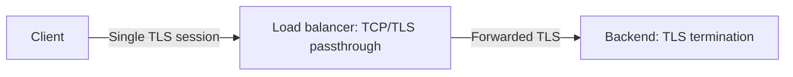
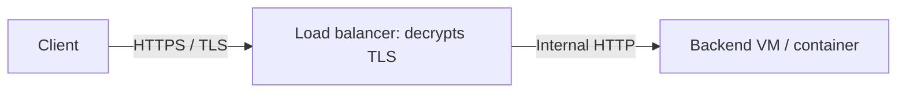
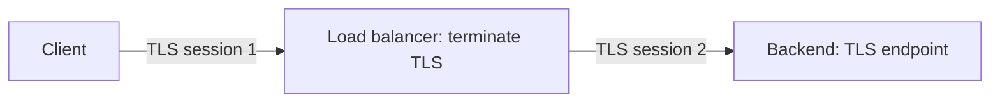
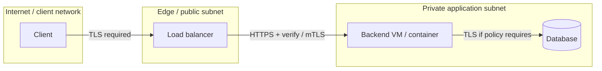

# TLS Termination, Backend Connections, and Encryption Requirements

## Context: Protecting Data Across Both Connection Legs

In cloud architectures, clients typically connect to a load balancer before requests are forwarded to backend VMs, containers, or compute services. When clients use HTTPS, the client-to-load-balancer leg is encrypted with TLS. However, TLS may terminate at the load balancer; the leg from the load balancer to the backend is a separate connection and may use internal HTTP or HTTPS/TLS depending on the design.

This raises a critical security question: **on which legs is data encrypted, and which components can read the payload?** Client-to-load-balancer encryption does not automatically protect the load-balancer-to-backend leg. If the backend accepts HTTP, payloads can traverse the internal network in plaintext. If the backend uses HTTPS, the load balancer must establish a new TLS session and verify the backend certificate according to policy.

Within **CLOUD_CORE_SERVICES_COMPUTE**, TLS design for load balancing directly intersects VM/container network security, certificate management, subnet segmentation, service identity, and data-in-transit protection requirements. Choose the right termination, passthrough, or re-encryption model based on trust boundaries, performance, and control requirements.

## 1. What Does TLS Protect?

TLS (Transport Layer Security) establishes an authenticated, encrypted channel between two endpoints. For HTTPS, TLS typically provides:

- **Confidentiality:** Encrypts payloads so intermediaries along the network path cannot easily read content.
- **Integrity:** Detects tampering with data in transit.
- **Server authentication:** The client verifies the server using a certificate and trust chain.
- **Client authentication (optional):** The server requires a client certificate, commonly called mutual TLS (mTLS).

TLS protects data in transit between the two endpoints of a TLS session. TLS does not automatically protect data after decryption at an endpoint, verify business-level user authorization, or replace encryption at rest.

### 1.1. Certificates and Server Identity

A server certificate typically contains a public key, DNS identity (Subject Alternative Name - SAN), validity period, and a CA (Certificate Authority) signature. Clients check:

1. The certificate is valid and not expired.
2. The hostname accessed by the client matches a SAN.
3. The certificate chain leads to a CA in the trust store.
4. Signatures and algorithms are acceptable.
5. Revocation status is handled per client policy and capability.

A certificate is not a secret; the accompanying private key must be strictly protected. If the private key is compromised, an attacker can impersonate the endpoint until the certificate/key is revoked or expires.

### 1.2. Conceptual TLS Handshake

In TLS 1.3, the client and server negotiate the version, cipher suite, and key exchange parameters; the server sends its certificate and proves possession of the private key; both sides derive traffic keys and exchange encrypted data. TLS 1.2 uses a different flow and older options; prefer TLS 1.3 where supported by endpoints while retaining TLS 1.2 only where compatibility requirements have been evaluated.

The TLS handshake occurs per new TLS connection, not necessarily per HTTP request. Connection reuse, HTTP keep-alive, HTTP/2 multiplexing, and session resumption can reduce handshake overhead.

## 2. Three TLS Models Across a Load Balancer

There are three common deployment models: TLS passthrough, TLS termination, and TLS termination with re-encryption to the backend. The primary differences are where decryption occurs and how many TLS sessions exist.

### 2.1. TLS Passthrough

The load balancer forwards the TLS stream to the backend without decrypting the payload. The backend terminates TLS directly and presents its certificate to the client. The load balancer can route based on L4 details such as IP address/port; some devices can inspect TLS metadata like SNI without decrypting application content, depending on capabilities.



Advantages:

- TLS terminates at the backend; the load balancer does not need to hold the application's private key.
- Backends can perform mTLS directly with clients if the architecture requires it.
- Payloads remain encrypted across the load balancer.

Limitations:

- The load balancer cannot inspect HTTP headers, URLs, or cookies to apply full L7 policies such as path routing, WAF, or rewrites.
- Each backend needs certificates and proper private key management workflows.
- Backends must handle TLS handshakes and certificate lifecycles.
- Health checks and routing must support the corresponding protocol.

Passthrough fits when backends must authenticate clients directly via certificates, end-to-end TLS must remain intact, or the load balancer must not decrypt payloads.

### 2.2. TLS Termination at the Load Balancer

The load balancer terminates TLS from the client, decrypts the request, and forwards it to the backend. The backend leg may use HTTP or another internal protocol. The load balancer typically holds the service's public certificate/private key and performs L7 functions such as host/path routing, WAF, header manipulation, and logging.



Advantages:

- Centralizes certificate and TLS policy management at the load balancer.
- Offloads TLS handshakes and cryptographic processing from backends.
- Enables the load balancer to inspect HTTP for routing, inspection, and L7 policies.
- Simplifies TLS configuration across the backend fleet.

Risks and limitations:

- Data exists in plaintext at the load balancer after decryption.
- If the backend leg uses HTTP, payloads are unencrypted on the network between load balancer and backend.
- The load balancer becomes a critical trust point; private keys, access controls, and logs must be protected.
- Unsuitable if policy mandates encryption on every hop or backends must verify client certificates directly.

Internal HTTP may be acceptable inside a controlled private network under risk policy, but "internal" does not mean "trusted." Assess shared networks, peering, packet capture risks, administrative access, and regulatory requirements before choosing it.

### 2.3. TLS Termination and Re-Encryption to Backends

The load balancer decrypts client TLS, processes HTTP, and then initiates a new TLS session to the backend. Two independent sessions exist: client-to-load-balancer and load-balancer-to-backend.



Advantages:

- Encrypts data across both network legs.
- The load balancer still performs L7 routing and policies.
- Backends can authenticate the load balancer via mTLS.
- Backend certificates can use an internal CA and dedicated service identities.

Control points:

- The load balancer must verify backend certificates, hostname/SAN, and trust chains; never disable verification just to make connections work.
- Certificates and private keys must be managed on both sides.
- Extra TLS handshakes and encryption consume CPU/latency; benchmark at target load.
- Determine whether the load balancer forwards the original client identity to backends via trusted headers or via mTLS/identity tokens.

Re-encryption is typically suitable when both legs require encryption, backends reside in private subnets, or strict security/compliance rules apply alongside L7 load balancing.

## 3. Model Comparison and Selection

| Criterion | Passthrough | Termination + HTTP backend | Termination + re-encryption |
|---|---|---|---|
| Where does client TLS terminate? | Backend | Load balancer | Load balancer |
| Backend TLS | Client TLS session continues to backend | None on backend leg | New TLS session to backend |
| Can LB read HTTP payload? | No | Yes | Yes |
| L7 routing/WAF | Limited or none | Yes | Yes |
| Public service private key | On backend | On load balancer | On load balancer; backend has its own key |
| Encryption on LB-backend network | Yes, same TLS session | No, if using HTTP | Yes, separate TLS session |
| Backend client authentication | Backend authenticates client directly | Typically relies on headers/other identity | Supports mTLS between LB and backend |
| Operational complexity | Certificates distributed to backends | Centralized at LB | Certificates and trust on both legs |

Choose a model by answering:

1. Is encryption required on every network hop?
2. Does the load balancer need to read HTTP for routing, WAF, or rewrites?
3. Must backends authenticate the original client's certificate, or only the load balancer?
4. Who manages private keys and CAs? Is automated issuance/rotation available?
5. Can backends be reached directly bypassing the load balancer?
6. Does TLS handshake and encryption overhead fit within the capacity budget?

There is no single default model for all systems. Define trust boundaries, data sensitivity, load balancer type, and backend capabilities before deciding.

## 4. Connections from Load Balancer to Backend

When a load balancer terminates TLS, it becomes the client on the backend connection leg. It must connect to the right address, port, and protocol while adhering to backend authentication policies.

### 4.1. HTTP Backends in a Private Network

With termination-only, the load balancer may send HTTP to backends over a private subnet. Restrict security groups/firewalls so backends accept traffic only from the load balancer or designated proxies. Do not assign public IPs to backends or allow direct Internet access without a clear reason.

Risk mitigations:

- Place load balancers and backends in network segments with controlled routing.
- Allow backend ingress only from the load balancer's security group or source list.
- Restrict egress and administrative access to backends.
- Use service identities or tokens to authenticate requests at the application layer when needed.
- Avoid logging sensitive payloads at the load balancer or backend.
- Evaluate internal encryption requirements against your threat model and data policy.

A private network reduces exposure but does not replace TLS in multi-tenant environments, shared links, packet-capture risk zones, or regulated encryption mandates.

### 4.2. HTTPS Backends and Certificate Verification

With re-encryption, the load balancer must verify the server certificate presented by the backend. Configuration should specify:

- Accepted CA or trust bundle.
- Expected backend hostname/SAN.
- Allowed TLS protocol versions and cipher policies.
- Handshake timeout and expired certificate handling.
- Behavior on invalid certificates: fail closed and refuse to forward requests.

Simply enabling `HTTPS` to the backend is insufficient for security if the load balancer skips certificate validation. Accepting any certificate allows an attacker on the network path to impersonate a backend while the load balancer keeps sending data to it.

Conceptual configuration example:

```yaml
backend_connection:
  protocol: HTTPS
  port: 8443
  tls:
    min_version: TLS1.2
    verify_certificate: true
    trusted_ca_bundle: internal-service-ca
    expected_server_name: orders-api.internal.example
    client_certificate: lb-client-identity
    fail_on_invalid_certificate: true
```

This is a vendor-neutral illustrative structure, not a specific cloud provider schema. Field names and trust store configuration depend on the load balancer product.

### 4.3. Backend Connection Pooling and Keep-Alive

Load balancers typically maintain a connection pool to backends to avoid repeated TCP/TLS setup costs. Keep-alive and HTTP/2 allow connection reuse, but timeouts must align with the application and backend.

If the load balancer's idle timeout is shorter than the backend's, connections may close unexpectedly. If the backend closes a connection while the load balancer still treats it as usable, initial requests can hit reset errors. Align idle timeouts, keep-alive, max connection age, and connection draining.

With HTTPS backends, connection pooling reduces TLS handshakes without removing the need for certificate validation. When rotating backend certificates, ensure new connections use the new certificate and old connections drain per policy.

### 4.4. Backend Health Checks

Health checks must use the protocol and port the backend actually serves. If a backend accepts only HTTPS, health checks also need proper TLS configuration, including SNI/hostname where required. A successful TCP check only proves the port accepts connections; it does not prove the application can serve requests.

Distinguish:

- **Liveness:** The process is alive and not hung.
- **Readiness:** The backend is ready for requests and critical dependencies are responsive.
- **Deep health:** Deeper diagnostics, not necessarily used to immediately eject backends from the pool.

Health checks should not overly depend on a flaky external service if that causes all backends to be marked unhealthy simultaneously. Use a lightweight endpoint with sensible timeouts and fail/recover thresholds.

## 5. Mutual TLS (mTLS) Between Load Balancer and Backend

In standard one-way TLS, the client verifies the server's certificate. With mTLS, both sides present certificates and verify each other's identity. When a load balancer connects to a backend using mTLS:

1. The load balancer verifies the backend's server certificate against the configured CA and hostname.
2. The backend requests a client certificate from the load balancer.
3. The load balancer sends its client certificate with proof of private key possession.
4. The backend verifies the client certificate against its CA/trust policy.
5. Both sides complete the handshake and exchange encrypted traffic.

```mermaid
sequenceDiagram
    participant LB as Load balancer
    participant BE as Backend
    LB->>BE: ClientHello
    BE->>LB: ServerHello + server certificate + CertificateRequest
    LB->>BE: Client certificate + proof of private key
    BE->>LB: Verify client identity and finish handshake
    Note over LB,BE: TLS session established; traffic encrypted
```

mTLS lets the backend confirm that incoming connections originate from a trusted load balancer identity. It does not authenticate the end user if initial client TLS terminated at the load balancer. In termination architectures, the backend sees the load balancer as its TLS peer; original client identity must be passed via another protected mechanism.

### 5.1. When Should You Use mTLS?

- Backends process sensitive data and must authenticate calling workloads.
- Internal networks host multiple services or tenants where network location alone cannot be trusted.
- Service-to-service identity and certificate-based connection controls are required.
- You need to prevent unauthorized workloads from impersonating the load balancer to hit backends.
- The environment has a PKI/service mesh or certificate platform capable of automated rotation.

### 5.2. Managing CAs and Trust Bundles

Backends and load balancers must agree on trusted CAs. Use an internal CA dedicated to workloads, segmented by environment or trust domain, and scope certificates to specific identities. Avoid placing CA root private keys on VMs or load balancers; deploy only public CA certificates and the endpoint's own private key.

If multiple CAs coexist during rotation, trust bundles can temporarily contain both old and new CAs to support transition. Once all endpoints use new certificates, remove the old CA per procedure. Do not leave obsolete CAs in trust bundles indefinitely.

### 5.3. mTLS from Client to Load Balancer

Some internal or B2B APIs require client certificates directly at the listener. The load balancer requests a client certificate and validates it against a CA/trust policy. If TLS terminates at the load balancer, the backend still sees only the load balancer as the TLS peer; the load balancer must pass the verified client identity via a protected identity assertion.

For example, the load balancer can inject an internal header containing the verified client subject or identifier, provided it strips any header of the same name sent by the client. Backends should accept assertions only from authenticated load balancers, using signatures, short-lived tokens, or backend mTLS. Never pass an arbitrary `X-Client-Cert` value and trust it if backends can receive traffic from other sources.

With TLS passthrough, the backend receives the client certificate directly and can verify it. With termination, the load balancer verifies the client certificate and backends rely on the identity-forwarding mechanism. Decide explicitly where authorization is enforced: at the load balancer, the backend, or both.

## 6. Passing Client Identity Through TLS Termination

When TLS terminates at the load balancer, backends no longer observe the end client as the TLS peer; they see connections coming from the load balancer. If the application needs the original client IP, scheme, or requested host, the load balancer can add headers such as:

- `Forwarded` per RFC 7239.
- `X-Forwarded-For` for client/proxy IP addresses.
- `X-Forwarded-Proto` for the original scheme (`http` or `https`).
- `X-Forwarded-Host` for the host requested by the client.

These headers are trustworthy only when controlled by the load balancer. Clients can spoof headers themselves; the load balancer must strip or overwrite headers from untrusted sources and generate fresh values from the actual connection.

Backends should trust forwarded headers only from authorized proxy addresses or identities. If backends are directly reachable, attackers can bypass the load balancer and inject forged headers. Block direct access or authenticate the proxy at the network/application layer.

### 6.1. Do Not Use Forwarded Headers as Authentication Proof

`X-Forwarded-For` and `Forwarded` describe the request path, not user identity. To authenticate users, use sessions, tokens, OIDC, or application identity mechanisms. If passing authenticated identity from a gateway to a backend, use signed tokens or identity assertions with audience, issuer, expiration, and signature verification.

### 6.2. Redirects and Secure Cookies

After TLS termination, a backend receiving HTTP from the load balancer might assume the original request was HTTP. The application could emit broken `http://` redirects or omit the `Secure` attribute on cookies. Configure frameworks to trust proxies properly and accept forwarded schemes only from authorized proxies.

Do not enable "trust all proxies" if backends have any access path outside the load balancer. Session cookies should use `Secure`, `HttpOnly`, and appropriate `SameSite` flags. HSTS can be set at the appropriate layer after verifying all domains and subdomains support HTTPS.

## 7. TLS Protocols, Cipher Suites, and Security Policies

TLS policy defines allowed protocol versions, key exchange algorithms, encryption, and authentication. Configuration must balance security with client and backend compatibility.

### 7.1. TLS Versions

Prefer TLS 1.3 when supported by clients, load balancers, and backends. TLS 1.2 may still be used where compatibility requires it, configured with secure cipher suites. TLS 1.0, TLS 1.1, and SSLv3 are obsolete and should not be enabled for new services.

On the backend leg, TLS versions may differ from the client-facing leg if legacy appliances or apps have constraints. However, never downgrade the entire system's policy to weak protocols just for one legacy backend; isolate that backend and plan an upgrade.

### 7.2. Cipher Suites and Algorithms

Prefer modern AEAD cipher suites such as AES-GCM or ChaCha20-Poly1305 and key exchanges providing forward secrecy. Avoid legacy or weak algorithms such as RC4, 3DES, export ciphers, static RSA key exchange, and deprecated configurations.

TLS 1.3 defines different cipher suites from TLS 1.2; exact cipher names and options depend on the load balancer product. Use provider-maintained security policies and audit them periodically against organizational standards.

### 7.3. TLS Termination and HTTP Protocols

A load balancer may support HTTP/1.1, HTTP/2, or HTTP/3 on the client side and a different protocol on the backend side. For instance, clients use HTTP/2 over TLS while the load balancer forwards requests to backends over HTTP/1.1. Verify protocol negotiation, ALPN, gRPC, WebSocket, streaming, and connection upgrades.

gRPC typically requires HTTP/2 end-to-end or a proxy mode that supports gRPC. WebSocket requires upgrade handling and long connection timeouts. Do not assume enabling HTTPS automatically supports every application protocol; test each traffic type and configure matching health checks.

## 8. Certificate Lifecycle Management

Certificates are operational assets requiring inventory, issuance, deployment, rotation, revocation, and monitoring. An expired certificate can cause clients or load balancers to reject connections, causing an outage even while compute backends are healthy.

### 8.1. Issuance and Private Key Storage

Certificates may be issued by a public CA for Internet endpoints or a private CA for internal services. Private keys should be generated/stored in a certificate manager, HSM, or access-controlled secret store. Restrict private key export if the platform supports binding certificates directly to the load balancer.

Never commit private keys to Git, images, user data, or logs. Limit key read/export permissions via least privilege with auditing. Separate certificates across dev/staging/prod and trust domains to limit blast radius if a key is compromised.

### 8.2. Zero-Downtime Rotation

A typical rotation workflow includes:

1. Issue the new certificate and verify SANs, chain, validity dates, key usage, and CA.
2. Update peer trust bundles first if the CA or issuer changed.
3. Attach the new certificate to the listener or backend endpoint.
4. Verify new handshakes serve the right certificate across all zones/instances.
5. Drain or close old connections per policy to retire sessions using the old certificate.
6. Revoke or delete old keys/certificates after confirming no dependencies remain.
7. Update inventory and expiration alerts.

If changing CAs, an overlap window may be needed where peers trust both old and new CAs during transition. When rotating mTLS client certificates, backends must trust the new issuer before the load balancer starts presenting the new certificate.

### 8.3. Certificate Monitoring

Track at least:

- Expiration date and days remaining.
- SAN/hostname, issuer, serial number, and fingerprint.
- Completeness of the intermediate certificate chain.
- Whether certificates/keys are attached to the right environment's listeners/backends.
- Handshake errors, unknown CA, hostname mismatch, or revoked certificates.
- Rotation progress and trust bundle versions.

Set tiered alerts before expiration, such as 30, 14, and 7 days depending on remediation lead time. Alerts should identify the owner and affected endpoint; never wait until expiration day to discover an issue.

## 9. Encryption Requirements by Trust Boundary

Encryption decisions should follow trust boundaries, data classification, and actual network paths. The diagram below illustrates common zones:



Not every system needs identical TLS on every hop, but each leg requires an explicit decision:

| Leg | Questions to Assess | Applicable Controls |
|---|---|---|
| Client → load balancer | Traversing the Internet or untrusted networks? | HTTPS, valid certificates, strong TLS policy, appropriate HSTS |
| Load balancer → backend | Multi-tenant network or internal encryption required? | Re-encryption, backend certificate verification, mTLS |
| Backend → database/cache/queue | Sensitive data or network transit? | Client/server TLS, dedicated identity, network segmentation |
| Backend → external API | Sending tokens or customer data? | HTTPS, hostname validation, CA trust, and egress control |
| Admin → load balancer/backend | Managing certificates or policies? | SSO/MFA, least privilege, auditing, and private management paths |

Encryption in transit and encryption at rest address different risks. Data can be encrypted in transit yet stored in plaintext on disk/logs, or encrypted at rest yet sent over internal HTTP. Apply both according to data classification and policy.

## 10. End-to-End HTTPS Architecture Example

Suppose an order application runs across multiple VMs in a private subnet behind a public L7 load balancer. Users access `orders.example.com` over HTTPS. The load balancer routes by host/path and forwards to backends over HTTPS with mTLS.

Request flow:

1. Client resolves DNS and opens an HTTPS connection to listener 443 on the load balancer.
2. Load balancer presents the certificate for `orders.example.com`; client verifies chain and hostname.
3. Load balancer decrypts HTTP, applies WAF/routing, and strips client-supplied forwarded headers.
4. Load balancer establishes or reuses a TLS connection to backend port 8443.
5. Backend verifies the load balancer's client certificate; load balancer verifies the backend's server certificate.
6. Backend processes the request and queries the database over a separate TLS connection if policy requires.
7. Response travels back through the load balancer; each leg is encrypted under its respective session.

Conceptual configuration example:

```yaml
listener:
  port: 443
  protocol: HTTPS
  certificate: public-orders-cert
  tls_policy: modern-tls-policy
  http_protocols:
    - HTTP1.1
    - HTTP2
  security:
    redirect_http_to_https: true
    hsts_enabled: true

backend_pool:
  protocol: HTTPS
  port: 8443
  health_check:
    path: /health/ready
    protocol: HTTPS
  tls:
    verify_server_certificate: true
    trusted_ca: internal-workload-ca
    expected_name: orders-api.internal.example
    client_certificate: lb-to-orders-client-cert
```

This is a vendor-neutral example illustrating the concept. Do not use it directly as a provider configuration file. Verify which listener, TLS policy, mTLS, health check, and certificate validation options your specific product supports.

### 10.1. Corresponding Network Policies

- Public subnet permits clients only to the required HTTPS listener.
- Backend private subnet accepts application-port traffic only from the load balancer's security group.
- Backends have no public IP unless required.
- Backend administration goes through a controlled bastion/session manager or access proxy.
- Backends allow egress only to required dependencies.
- Certificate manager and secret stores have restricted IAM policies.

If using termination-only with HTTP backends, explicitly document why the internal leg is acceptable, which network boundary protects it, and what mitigations cover unauthorized access within the private network.

## 11. Verifying TLS and Certificates in Operations

### 11.1. Testing Client-Facing Endpoints

Use `curl` to inspect handshakes, certificates, and HTTP responses:

```bash
# View connection details and certificate verification errors
curl -v https://orders.example.com/health

# Test with a specific CA bundle when using a private CA
curl --cacert ./trusted-ca.pem https://orders.internal.example/health
```

Do not use `curl -k` or `--insecure` in production acceptance testing, as those flags bypass certificate validation and can mask trust/hostname errors.

Inspect certificates and handshake details with OpenSSL:

```bash
openssl s_client \
  -connect orders.example.com:443 \
  -servername orders.example.com \
  -showcerts
```

`-servername` sends SNI so the server/load balancer selects the certificate for the right hostname. When testing a private CA, add `-CAfile trusted-ca.pem` and use verification flags appropriate for your OpenSSL version. Verify both the chain and hostname; merely seeing a certificate returned does not prove clients will trust it.

To force OpenSSL to verify the hostname and fail on invalid certificates, add `-verify_hostname orders.example.com -verify_return_error`; for a private CA, add `-CAfile trusted-ca.pem`. Check `openssl s_client -help` for your installed version, as options may vary across releases.

### 11.2. Checking Backends from the Load Balancer's Perspective

If backends use HTTPS, verify:

- The backend listener actually serves TLS on the configured port.
- The backend certificate is unexpired, its SAN matches the expected server name, and the chain leads to a trusted CA.
- The load balancer has the latest trust bundle and accurate routes/DNS to the backend.
- If using mTLS, the backend trusts the right client CA and the load balancer presents a valid client certificate.
- Security groups/firewalls allow connections from the load balancer to the backend port.
- Health checks use the proper protocol, hostname/SNI, path, and certificate trust.

Never resolve handshake failures by disabling certificate verification or accepting any certificate. Find the root cause: missing CA, wrong SAN, expired certificate, wrong SNI, incompatible protocol/cipher, or clock skew.

## 12. Troubleshooting TLS Through a Load Balancer

| Symptom | Common Causes | How to Check |
|---|---|---|
| Client reports certificate expired | Listener certificate expired or not rotated | Check expiry, attached certificate, and deployment status across all zones |
| Hostname mismatch | SAN lacks client domain or wrong SNI | Inspect SANs, DNS, listener rules, and SNI |
| Unknown CA / unable to verify | Missing intermediate CA or issuer absent from trust store | Check full chain and CA bundles on client/LB/backend |
| TLS handshake failure | Incompatible protocol/cipher, clock skew, or key error | Inspect handshake logs, TLS policy, system time, and private key binding |
| Client HTTPS succeeds but backend returns 502/503 | Backend listener, health check, security group, or backend TLS failure | Check target health, backend protocol/port, CA/SAN, and app logs |
| Backend certificate fails verification | Wrong expected name, wrong CA, or expired backend cert | Inspect trust config, SAN, chain, and expiry; keep verification enabled |
| mTLS handshake rejected | Backend does not trust client CA, missing/expired client cert, or wrong EKU | Check client certificate, issuer, EKU, and backend trust bundle |
| Backend sees wrong scheme or redirects to HTTP | App does not trust `X-Forwarded-Proto` or proxy config is wrong | Check forwarded headers overwritten by LB and framework proxy trust |
| Client IP in logs is incorrect | Spoofed header retained or proxy chain parsed wrong | Strip untrusted inbound headers, configure trusted proxies, check hop chain |
| Rising TLS latency | Excessive new handshakes, high crypto CPU, or no connection reuse | Inspect connection reuse, handshake rate, LB/backend CPU, and session resumption |
| Health check fails while direct app access works | Wrong health check protocol/host/path or LB lacks CA trust | Check SNI, hostname, path, firewall, and health checker trust bundle |

Investigate from the outside in:

1. Determine whether the failure is client-to-LB or LB-to-backend.
2. Record the hostname, timestamp, listener, backend target, and request ID.
3. Inspect certificates, SANs, chains, expiry, SNI, and TLS policies on the relevant leg.
4. Check network paths, firewalls, routes, and backend listeners.
5. Correlate load balancer access logs, TLS handshake logs, target health, and application logs.
6. After fixing, test both new and reused connections; verify the active certificate across all instances/zones.

## 13. Performance and Capacity with TLS Enabled

TLS consumes CPU and memory on both client-facing listeners and backends. A load balancer can offload TLS from backends with centralized termination, whereas re-encryption makes the load balancer decrypt and re-encrypt. Backends still handle handshakes and encryption when TLS terminates at the backend.

Key factors:

- New connections and TLS handshakes per second.
- TLS version, cipher suite, and hardware acceleration support.
- Keep-alive ratios, HTTP/2 multiplexing, and session resumption.
- Payload sizes, request/response rates, and concurrent connections.
- Long certificate chains, OCSP/revocation checks, and verification overhead.
- Load balancer and backend CPU/memory.

When benchmarking, measure handshake rate, connection reuse, CPU, throughput, p95/p99 latency, and error rates separately. Compare termination-only against re-encryption using the same traffic mix and load. Do not remove encryption simply because CPU rises; scale the load balancer, optimize connection reuse, or pick instances with TLS acceleration.

### 13.1. Timeouts and Connection Lifecycle

Configure sensible timeouts across clients, load balancers, and backends. Timeouts need not be identical, but must coordinate so proxies do not drop connections before backends finish. For streaming or WebSocket, set appropriate timeouts and test long-lived connections.

Connection draining helps the load balancer stop sending new requests to a backend undergoing maintenance while letting existing requests finish. When rotating certificates or replacing backends, account for keep-alive connections established before the change.

## 14. Logging, Auditing, and Data Protection

Load balancers can log access records, TLS negotiation metadata, target status, latency, and headers depending on configuration. These logs help identify failing clients, active listeners, and unhealthy backends.

Logging principles:

- Never log private keys, tokens, session cookies, or Authorization headers.
- Avoid logging payloads containing personal data or sensitive business data.
- Mask or strip sensitive headers before logging if supported by the product.
- Protect logs with IAM, encryption at rest, retention limits, and access audits.
- Synchronize clocks across load balancers, backends, and logging systems.
- Use request/correlation IDs to trace across layers, without embedding sensitive data in IDs.

If logging client certificate identities in mTLS, log only necessary attributes such as issuer/subject or fingerprint per policy. Do not log private keys or unnecessary full certificate blobs.

## 15. Common Misconceptions

**Clients using HTTPS means the entire path is encrypted.** TLS may terminate at the load balancer; verify the protocol on the backend leg.

**Backends in a private subnet do not need encryption.** A private network does not automatically establish an absolute trust boundary. Assess tenancy, peering, network administration, and data policies.

**Enabling backend HTTPS is enough.** The load balancer must verify backend certificates, hostnames, and trust chains. HTTPS with verification disabled does not provide trustworthy server authentication.

**Re-encryption is the same TLS session continuing through the load balancer.** It is two independent TLS sessions; the load balancer decrypts the first and re-encrypts the second.

**mTLS between load balancer and backend authenticates the end user.** The backend authenticates the load balancer as its TLS peer. End-user identity requires separate application mechanisms or identity assertions.

**X-Forwarded-For is always the client's true IP.** Clients can inject forged headers. The load balancer must strip/overwrite untrusted headers and backends must trust only designated proxies.

**Once a certificate is attached, no further monitoring is needed.** Certificates can expire, be revoked, or change SANs/chains. Maintain inventory, alerts, and rotation.

**Disabling certificate verification is a valid quick fix.** It opens the door to backend impersonation and must be avoided. Fix the CA, hostname, chain, or SNI instead.

## 16. Checklist for Designing and Operating TLS Load Balancing

### Design

- [ ] Determined TLS termination, passthrough, or re-encryption for each leg.
- [ ] Documented trust boundaries, data classification, and internal encryption requirements.
- [ ] Selected supported and secure TLS version/cipher policies.
- [ ] Backends are private, accepting traffic only from authorized load balancers/proxies.
- [ ] If re-encrypting, backend certificates are verified via CA and hostname/SAN.
- [ ] If using mTLS, both sides have appropriate certificate identities and trust bundles.
- [ ] Forwarded headers are sanitized, overwritten, and trusted only from authenticated proxies.

### Certificates and Operations

- [ ] Private keys are protected in a certificate manager/HSM/secret store.
- [ ] Certificate inventory, owners, expiration dates, and pre-expiry alerts are maintained.
- [ ] Rotation, CA overlap, and revocation procedures exist.
- [ ] Health checks use the right protocol, port, SNI, hostname, and trust policy.
- [ ] Timeouts, keep-alive, HTTP/2/gRPC/WebSocket, and connection draining have been tested.
- [ ] Logs contain no secrets, cookies, or out-of-policy sensitive payloads.
- [ ] Runbooks exist for handshake failures, certificate expiry, and backend TLS errors.

### Testing

- [ ] Clients properly validate certificates and hostnames.
- [ ] Load balancer validates backend certificates when using HTTPS.
- [ ] mTLS rejects untrusted client certificates.
- [ ] Backends cannot be reached directly outside approved paths.
- [ ] Measured handshake rate, CPU, latency, and throughput at target load.
- [ ] Tested rotation without disruption beyond acceptable thresholds.

## Conclusion

TLS termination determines where TLS is decrypted and where certificates are managed. Passthrough preserves the TLS session to backends at the cost of L7 capabilities; termination centralizes TLS at the load balancer and may use internal HTTP; re-encryption creates a second TLS session to backends to protect both legs while retaining L7 routing. When choosing a model, evaluate trust boundaries, encryption mandates, backend/client authentication, private key management, forwarded headers, health checks, and performance costs. Verifying backend certificates, using mTLS where service identity is needed, controlled rotation, and handshake monitoring keep the client–load balancer–backend path secure and reliable.
