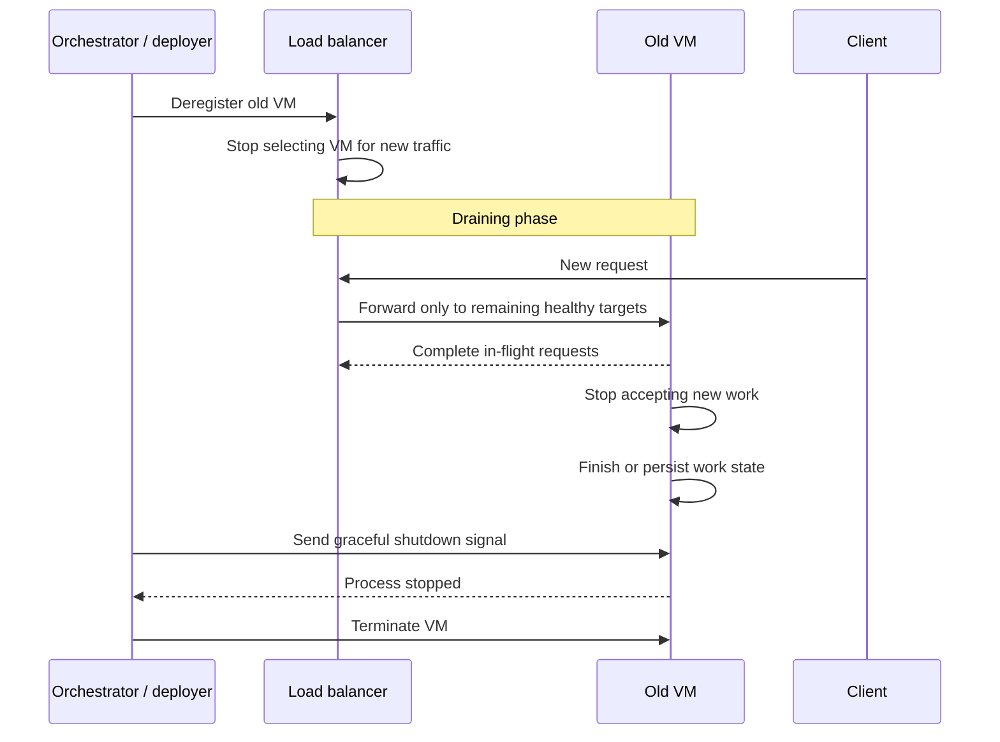
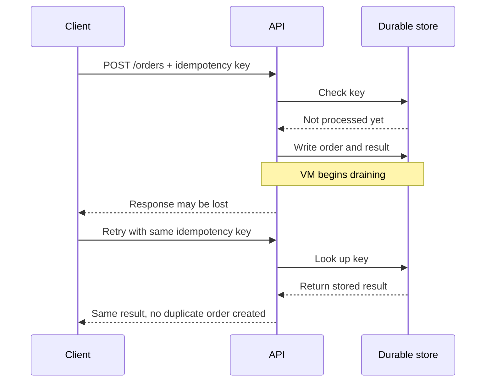

# Connection Draining and Handling Long-Lived Connections During Machine Replacement

## Learning Objectives

After this lesson, you will be able to:

- Explain connection draining (stopping new connections and allowing existing connections to finish) during VM replacement or maintenance.
- Differentiate how connections are handled at Layer 4 versus Layer 7 load balancers.
- Identify characteristics of HTTP keep-alive, HTTP/2, gRPC, WebSocket, and long-lived TCP connections.
- Design a deregister, drain, graceful shutdown, and terminate sequence to minimize deployment errors.
- Choose draining durations, connection limits, and timeouts based on workload behavior.
- Combine health checks, autoscaling lifecycle hooks, rolling updates, and application retry capabilities.
- Monitor and troubleshoot dropped connections, duplicate requests, or VMs failing to terminate on time.

## 1. Why Can Replacing a VM Disrupt Connections?

A compute service typically runs across multiple VMs behind a load balancer. The load balancer distributes requests or connections to VMs eligible to receive traffic. When deploying a new version, scaling in, replacing a host, patching an OS, or removing a failing VM, the system must stop routing new load to the old machine.

If a VM is stopped immediately when replacement begins, active connections can be severed mid-flight. Users may experience timeouts, 5xx errors, dropped WebSocket sessions, aborted gRPC calls, or incomplete uploads/downloads. A mutating request may also be retried by the client, causing duplicate operations if the application is not designed for idempotency.

**Connection draining** is the process of removing a VM from the pool receiving new traffic while giving existing connections or requests time to complete before stopping the application or releasing the VM.

The goal of draining is to reduce disruption during machine replacement. It does not guarantee every connection finishes: a connection can run indefinitely, a client may lose network connectivity, a VM may crash abruptly, or a platform timeout may expire before work completes. Therefore, applications still need reconnect support, safe retries, and durable work-state storage.

### A Typical Scenario

A group of 4 VMs runs an API. When deploying a new version, the orchestrator needs to replace old VMs with new ones:

- Stopping old VMs immediately can drop in-flight requests.
- Continuing to send new requests to old VMs while the app shuts down causes failures.
- Stopping new requests, waiting for current requests to finish, and only then stopping the VM lets most users remain unaware of the replacement.

This waiting period requires a time bound and a policy for handling connections that remain open after expiration.

## 2. Concepts to Distinguish

| Concept | Meaning | Primary Impact |
|---|---|---|
| Deregistration | Removes a VM/target from the load balancer's target pool | Load balancer stops picking the target for new traffic |
| Connection draining | Period allowing active connections or requests to finish | Reduces mid-flight request interruption |
| Graceful shutdown | Application stops taking new work, completes running work, and closes resources | Reduces process-level errors |
| Termination | Stops or deletes the VM | Releases compute resources |
| Health check | Checks whether a target is eligible to serve | Determines whether the target receives traffic per policy |
| Connection timeout | Limits connection lifetime or idle wait time | Avoids holding resources indefinitely |
| Request timeout | Limits processing duration of a single request | Controls client and server wait bounds |

Deregistration and graceful shutdown are two distinct steps. The load balancer manages traffic distribution; the application manages accepting and finishing work inside the process. A sound workflow coordinates both.

### 2.1. General Draining Flow



This diagram shows the conceptual flow. Exact ordering between deregistration and shutdown signals depends on the load balancer, orchestrator, and application. Typically you must stop routing new traffic before closing the application's listener; closing the listener too early lets the load balancer keep sending requests to a process that has already stopped serving.

## 3. At Which Layer Does the Load Balancer Handle Connections?

How draining behaves depends on whether the load balancer operates at Layer 4 or Layer 7.

### 3.1. Layer 4 (L4) Load Balancers

A Layer 4 load balancer typically distributes TCP or UDP flows based on network and transport information. It does not necessarily understand HTTP requests or know when a business request has finished.

For TCP connections:

- An already established flow can stay pinned to the old target.
- When a target is deregistered, the load balancer stops opening new flows to that target.
- Existing connections may stay open until the client closes them, a timeout expires, or platform policy closes the flow.
- Some platforms offer an option to send TCP resets or terminate connections after a set duration.

At L4, connection draining is usually measured by TCP connection lifetime. If a connection lasts several hours, drain duration needs careful thought. Waiting indefinitely slows scale-in and maintenance; cutting connections too early disrupts clients.

UDP has no connection in the TCP sense. A load balancer may track flow state or mappings via timeout, but cannot know exactly when an application-layer task finishes. UDP applications must manage sessions, heartbeats, retries, and recovery themselves.

### 3.2. Layer 7 (L7) Load Balancers

A Layer 7 load balancer understands application protocols such as HTTP/HTTPS. Depending on the product, it can track requests, headers, streams, or backend connections.

With HTTP/1.1 keep-alive:

- One TCP connection can carry multiple sequential requests.
- Once a target begins draining, the load balancer stops sending new requests to that target.
- In-flight requests are allowed to finish within the drain window.
- Keep-alive connections may be closed after the response completes or when timeouts expire, depending on policy.

With HTTP/2:

- One TCP connection can carry multiple concurrent streams.
- Draining must account for active streams and whether clients keep opening new streams.
- Some proxies use the GOAWAY mechanism to signal the peer not to open new streams on that connection while allowing active streams to finish.
- Exact behavior depends on the HTTP/2 implementation, proxy, and load balancer.

At L7, the platform can manage requests at finer granularity than L4, though not every product understands business semantics. For instance, a load balancer knows an HTTP response finished sending, but not whether a background task was durably persisted.

### 3.3. Comparing L4 and L7

| Criterion | L4 | L7 |
|---|---|---|
| Common distribution unit | TCP flow or UDP flow | HTTP request, stream, or backend connection |
| Understands HTTP | Not required | Yes |
| Detects request completion | Usually no | Can detect at protocol level |
| HTTP keep-alive | Does not inspect inner requests | Can control connections and requests |
| HTTP/2, gRPC | Sees only TCP stream without special integration | Can understand streams and support graceful protocol behavior |
| Long-lived connections | Draining usually depends on flow lifetime | Can manage requests/streams, though timeouts are still needed |
| UDP | Can maintain flow mapping via timeout | Only if product supports the corresponding application protocol |

Do not assume every L7 load balancer handles HTTP/2 GOAWAY or WebSockets identically. Check product documentation, proxy modes, and enabled protocol versions.

## 4. Types of Long-Lived Connections Requiring Special Handling

### 4.1. HTTP Keep-Alive

HTTP keep-alive reuses a single TCP connection across multiple requests, reducing handshake overhead and improving resource efficiency.

During draining, stop sending new requests to the old backend and let in-flight requests finish. Afterward, the backend can close keep-alive connections or the proxy can send protocol-level close directives.

Factors to check:

- Keep-alive timeouts on client, load balancer, proxy, and backend.
- Request timeouts and maximum processing times.
- Maximum requests reused per connection if the proxy supports a limit.
- How the backend signals it will accept no further requests.
- Client retry behavior when a connection closes.

If clients hold connections too long and the load balancer fails to close or shift connections properly, new requests may keep hitting a target scheduled for replacement. Test on your exact LB type.

### 4.2. HTTP/2 and gRPC

HTTP/2 allows multiple streams over a single TCP connection. Counting connections alone therefore fails to show how many requests are still active.

gRPC typically uses HTTP/2 and maintains long-lived channels. When replacing a VM:

- The backend must stop accepting new RPCs.
- Clients or proxies must be signaled to open new channels/connections as needed.
- Active RPCs should be allowed to finish within the drain budget.
- RPCs exceeding the limit must terminate cleanly so clients can retry when safe.
- For streaming RPCs, the application must define how to send end status and resume if the stream closes.

GOAWAY is an HTTP/2 mechanism letting an endpoint announce it will accept no new streams on the current connection. However, opening new connections, retrying streams, or resuming RPCs depends on the gRPC library and retry configuration. Not all RPCs are automatically safe to retry; RPCs with side effects need idempotency or request IDs to avoid double execution.

### 4.3. WebSockets

WebSockets maintain a long-lived connection after an HTTP upgrade handshake. Examples include chat, realtime notifications, dashboards, and remote control.

When a target drains:

- The load balancer stops routing new connections to the old target.
- Existing WebSockets may stay open until closed by client or server, or until drain timeout expires.
- The application should notify clients of impending maintenance and provide reconnect timing if appropriate.
- Clients should reconnect with backoff and jitter so thousands of clients do not reconnect simultaneously.
- Sessions, subscriptions, and state should be persisted externally or made recoverable.

Do not rely solely on socket closure to ensure clients recover state cleanly. For chat or event streams, use sequence numbers, cursors, or last-event IDs so clients retrieve missed data.

### 4.4. Long-Lived TCP Connections

Some applications use custom TCP protocols, management agents, tunnels, database proxies, or device connections. An L4 load balancer may not understand business messages.

Applications should implement:

- Heartbeats or keepalives to detect lost peers.
- Idle timeouts and maximum connection lifetimes.
- Protocol signals indicating the server is draining if supported.
- Client reconnect with backoff.
- Session resume or state resynchronization if needed.
- Re-authentication after a new connection is established.

Operating-system TCP keepalive only detects an unresponsive peer after a probe sequence; it is not a substitute for application-level heartbeats and does not guarantee session recovery.

### 4.5. Uploads, Downloads, and Streaming Responses

Large uploads or downloads can outlast normal API requests. If a VM is replaced mid-transfer:

- Uploads can fail before completion.
- Downloads can stall mid-stream.
- Streaming responses can lose unsent chunks.
- Clients may retry the entire payload, increasing bandwidth and causing duplicate writes.

Design for multipart/resumable uploads, HTTP Range requests, or cursor resume where the protocol fits. Temporary upload parts need TTLs and cleanup jobs; mark an upload complete only after checksum verification and successful metadata commit.

### 4.6. Database Connections and Connection Pools

Applications often hold connection pools to databases or caches. When replacing an application VM, close pools gracefully only after stopping new requests and finishing active transactions.

Do not close database connections as soon as draining starts if in-flight requests still need to commit transactions. Conversely, do not wait forever on a hung connection. Enforce transaction timeouts, query timeouts, and rollback handling on connection loss.

## 5. Choosing Draining Duration and Timeouts

Draining duration (deregistration delay or connection draining timeout) is how long the load balancer lets existing connections/requests continue before terminating the target per policy.

If too short:

- Long requests are cut off mid-flight.
- Streams or WebSockets drop abruptly.
- Clients retry aggressively, causing traffic spikes.
- Transactions may fail or roll back.

If too long:

- Scale-in and rolling deployments slow down.
- VMs keep incurring costs despite taking no new traffic.
- Idle connections or misbehaving clients tie up resources.
- One hung target can stall the entire machine replacement process.

### 5.1. Base Decisions on Request Duration Distributions

Do not rely only on average duration. Measure:

- p50, p95, and p99 of request processing time.
- Maximum duration permitted by API contracts.
- Proportion of streaming requests and long-lived connections.
- Time needed to commit transactions and flush data.
- Time the application needs to complete shutdown.
- Maximum limits imposed by the load balancer and orchestrator.

One planning approach is picking a drain timeout large enough for the vast majority of valid requests, with separate limits for long-lived connection classes. If a workload runs multi-hour tasks, do not keep VMs alive just waiting for all connections; design resume capabilities or offload work to durable workers.

### 5.2. Timeouts That Must Coordinate

| Timeout | Managing Entity | Role |
|---|---|---|
| Client request timeout | Client/SDK | Caps how long the client waits for a response |
| Application request timeout | Application | Caps request execution time |
| Proxy/LB idle timeout | Load balancer/proxy | Closes inactive connections |
| Backend connection timeout | Proxy/LB | Caps connection establishment to a target |
| Deregistration/drain timeout | Load balancer | Wait window when a target is being removed |
| Graceful shutdown timeout | Process/orchestrator | Time for process exit before forced kill |
| VM termination deadline | Orchestrator/cloud | Deadline to release the instance |

Timeouts must be ordered logically. For example, application graceful shutdown must have enough time before the orchestrator sends a final kill signal; drain timeout must be compatible with request timeouts and platform caps. If an outer timeout is shorter than an application timeout, connections still break before the app finishes.

There is no single numeric ordering for every architecture. Map out the real timeline across deployer, load balancer, process, and client, then test it.

### 5.3. Timing Calculation Example

Suppose an API has a p99 request duration of 18 seconds, an application request timeout of 30 seconds, and an application shutdown time of 10 seconds. Operations might test a 40-second drain window in staging, then measure aborted request rates, VM replacement duration, and remaining connections.

If multi-hour WebSockets exist, a 40-second drain window cannot guarantee every WebSocket finishes naturally. Send reconnect notices and persist session state outside the VM.

These numbers are only examples. Production timeouts must be grounded in measured telemetry, LB limits, and SLO requirements.

## 6. Safe VM Replacement Sequence

A typical rolling replacement workflow follows these steps:

1. **Provision new VM:** Launch an instance from a tested image/config and verify boot, identity, network, and app startup.
2. **Health-check new VM:** Admit to the target group only after readiness checks pass.
3. **Start draining old VM:** Instruct the load balancer to deregister the old target or mark it out of rotation per supported mechanism.
4. **Stop accepting new work in the app:** Close the admission gate, pause consumers, or reject new RPCs/streams.
5. **Finish in-flight work:** Wait for active requests, transactions, and jobs within the configured budget.
6. **Notify and close long-lived connections:** Send GOAWAY, close frames, protocol shutdowns, or reconnect notices as appropriate.
7. **Close resources:** Flush logs, commit/roll back transactions, close connection pools, release locks, and persist work state.
8. **Stop the process:** Send SIGTERM or equivalent shutdown signal; use forced kill only after the deadline expires.
9. **Confirm target inactivity:** Check connection counts, active requests, process state, and LB target state.
10. **Terminate old VM:** Only after draining completes or the agreed timeout policy is reached.

Steps 3 and 4 may need tighter coordination. Some applications must enter draining mode first to reject new requests at the app layer before deregistering from the LB. The right approach depends on target control capabilities and protocols. Crucially, avoid leaving a window where the LB keeps sending new traffic to a process whose listener is already closed.

### 6.1. Timeline Example

| Phase | New VM | Old VM |
|---|---|---|
| Provisioning | Created and booting | Continues serving traffic |
| Ready | Health checks pass, begins taking traffic | Still serving during traffic shift |
| Draining | Continues serving | Stops taking new traffic, drains active requests/connections |
| Shutdown | Normal serving | Finishes work, closes pools, and stops process |
| Completion | Continues serving | Terminated after drain confirmed or deadline reached |

This timeline illustrates a single VM replacement. Actual durations must come from telemetry and service limits. In multi-VM deployments, bound how many targets drain concurrently to preserve serving capacity.

## 7. Graceful Shutdown Inside the Application

A load balancer cannot replace application shutdown logic. The application needs internal state tracking whether it is serving traffic, draining, or stopped.

A common lifecycle:

- **Serving:** Accepts new requests and jobs.
- **Draining:** Rejects or redirects new work; finishes in-flight requests.
- **Stopping:** Closes listeners, flushes data, closes connection pools, and releases resources.
- **Stopped:** Process has exited.

An application can expose an administrative endpoint such as `/drain` or handle OS signals. Administrative endpoints must be protected by proper permissions; never allow external users to force instances into draining mode.

### 7.1. Pseudocode

```python
import signal
import threading
import time

draining = threading.Event()
active_requests = 0
active_lock = threading.Lock()

def on_request_started():
    global active_requests
    with active_lock:
        if draining.is_set():
            return False
        active_requests += 1
        return True

def on_request_finished():
    global active_requests
    with active_lock:
        active_requests -= 1

def begin_shutdown(signum, frame):
    # Stop accepting new requests/work.
    draining.set()
    stop_accepting_new_work()

    deadline = time.monotonic() + 30
    while time.monotonic() < deadline:
        with active_lock:
            if active_requests == 0:
                break
        time.sleep(0.1)

    # Close resources and exit cleanly.
    flush_logs()
    close_connection_pools()
    stop_background_consumers()

signal.signal(signal.SIGTERM, begin_shutdown)
```

This is pseudocode illustrating the lifecycle, not a standalone production program. In real applications, active requests must be tracked safely across concurrency, exceptions, and cancellations. Ensure listeners stop accepting new requests once draining starts, background workers also stop cleanly, and shutdown handlers do not run twice.

### 7.2. Avoiding Race Conditions

A race condition can occur when:

1. The application checks that draining is not set.
2. A shutdown signal sets draining and reads `active_requests == 0`.
3. The request admitted in step 1 increments `active_requests`.
4. The application exits while that request is still running.

Synchronize the state check and new-request admission with a lock or atomic admission controller. Once draining begins, no new request may increment the active count.

### 7.3. Handling Background Jobs

Workers may be processing jobs pulled from a queue. On shutdown:

- Stop polling or accepting new messages.
- Complete the current job within the allowed deadline.
- If it cannot finish, return the message to the queue or let its visibility timeout expire per design.
- Acknowledge a message only after results are durably persisted.
- Use idempotency keys so jobs can re-run safely.
- Save checkpoints if jobs are long-running and resumable.

Never acknowledge a message before work completes and then shut down; if the VM stops mid-job, the job disappears from the queue without saved results.

## 8. Protocol-Specific Draining Behavior

### 8.1. HTTP/1.1

A backend can:

- Stop accepting new requests on the listener or fail readiness after the LB begins deregistration.
- Complete responses currently in flight.
- Return `Connection: close` on final responses if compatible with proxies and clients.
- Close keep-alive connections once no active requests remain.
- Let clients safely retry requests on a new connection.

Do not close sockets immediately on receiving a shutdown signal if responses are still being sent. With proxies holding separate backend pools, check both client-to-LB and LB-to-backend connections.

### 8.2. HTTP/2 and gRPC

When a server starts graceful shutdown:

- Stop accepting new streams/RPCs.
- Send GOAWAY as supported by the library/proxy.
- Allow active streams to finish within the drain period.
- Enforce deadlines on long-lived streams.
- Close channels after completion or return an appropriate retryable error.
- Use idempotency and request IDs for RPCs with side effects.

gRPC provides graceful stop APIs in many implementations. Read the exact language and runtime documentation, as behavior around waiting for active RPCs, deadlines, and forced stops varies.

### 8.3. WebSockets

A server can send an application-level message such as `server_restarting` with a suggested reconnect window before closing the WebSocket with an appropriate close frame.

Clients should:

- Listen for close events.
- Reconnect using exponential backoff and jitter.
- Re-authenticate.
- Send a valid session token or cursor to resume.
- Restore subscriptions and state.
- Avoid creating a reconnect storm when a fleet of VMs rotates together.

With tens of thousands of connections, do not drain the entire fleet at once. Replace VMs in small batches and monitor connection rates.

### 8.4. Custom TCP Protocols

If a protocol lacks a draining message, add a control message or server banner to notify clients. If the protocol cannot be modified, enforce max connection lifetimes, idle timeouts, and heartbeats so connections periodically re-establish.

An L4 LB cannot guarantee a custom TCP transaction succeeded merely because the flow stayed open. Applications must confirm outcomes with protocol-level acknowledgements and durable state storage.

## 9. Integration with Autoscaling and Orchestrators

When autoscaling scales down VMs, the system picks an instance to terminate. Without lifecycle hooks, the VM may stop before the application finishes its work.

### 9.1. Scale-In Protection and Lifecycle Hooks

Common mechanisms:

- **Scale-in protection:** Temporarily prevents an instance from being chosen for scale-in. This is a safeguard on some platforms, not a substitute for draining.
- **Lifecycle hook:** Pauses termination in an intermediate state so workloads or automation can complete deregistration and draining.
- **Pre-stop hook:** The orchestrator invokes a command/hook before stopping a container or process.
- **Termination grace period:** Window the orchestrator grants for shutdown before sending a forced kill signal.
- **Pod disruption budget or deployment strategy:** Bounds how many replicas can be disrupted concurrently in container environments.

Names and capabilities vary by platform. Determine hook ordering, maximum timeouts, and behavior when a hook fails to complete.

### 9.2. Reference Scale-In Flow

1. Autoscaler selects a VM to remove.
2. Lifecycle hook holds the VM in a pending state.
3. Automation asks the LB to deregister the target.
4. Application enters draining and stops accepting new requests/jobs.
5. Wait for active requests and connections to drop.
6. Complete or return unfinished jobs.
7. Signal lifecycle hook completion.
8. Platform terminates the VM.

If automation fails or times out, define clear policy: retry, keep waiting within bounds, hand off jobs, or force-terminate. Never let lifecycle hooks hang indefinitely.

### 9.3. Rolling Updates and Capacity

During rolling updates, keep enough healthy VMs to carry load while some targets drain. For example, if a fleet has 4 VMs and each handles 25% of peak load, draining 2 VMs simultaneously can overload the remaining 2.

Before deploying, calculate:

- Minimum number of healthy targets required.
- Peak load per VM after removing targets.
- Number of VMs that can be replaced concurrently.
- New VM startup time and readiness time.
- Drain duration and shutdown duration.
- Spare capacity if new VMs fail health checks.

Deregister old VMs only after new VMs are ready and the fleet retains sufficient capacity. For stateful systems, synchronize data or replicas before shifting traffic.

## 10. Configuration Examples and Operational Practices

Exact configuration varies by product. The following examples illustrate properties to consider, not syntax for every provider.

### 10.1. Parameters to Configure on Load Balancers

A target group or backend service typically exposes settings such as:

- Drain/deregistration delay: wait period after a target is removed.
- Connection idle timeout: time an inactive connection stays open before closing.
- Backend keep-alive: duration to reuse connections to a target.
- Health check interval and unhealthy threshold.
- Connection termination behavior: keep or reset flows after drain expires.
- Maximum connection age or request limit if supported.

Do not confuse idle timeout with drain timeout. Idle timeout handles inactive connections; drain timeout handles a target being removed from rotation. A continuously active connection will not trigger idle timeout, yet still must end when the drain deadline expires.

### 10.2. HAProxy Example

A condensed configuration illustrating timeout limits and backend checks:

```haproxy
defaults
    mode http
    timeout connect 5s
    timeout client  60s
    timeout server  60s
    timeout http-keep-alive 15s

backend api_servers
    balance roundrobin
    option httpchk GET /ready
    server api-1 10.0.1.11:8080 check
    server api-2 10.0.1.12:8080 check
```

To drain a backend, an operator or automation can transition the server to maintenance/drain state via the runtime API or update configuration per procedure. Check your exact HAProxy version and operating mode, as runtime commands and connection reuse behavior may differ.

### 10.3. Nginx Worker Shutdown Example

Nginx can be configured to bound how long old workers stay alive to exit after a reload:

```nginx
worker_shutdown_timeout 30s;

http {
    keepalive_timeout 15s;

    upstream api_backend {
        server 10.0.1.11:8080;
        server 10.0.1.12:8080;
    }

    server {
        listen 80;
        location / {
            proxy_pass http://api_backend;
            proxy_connect_timeout 5s;
            proxy_read_timeout 60s;
        }
    }
}
```

On reload, Nginx spawns new workers and lets old workers finish active connections via graceful shutdown up to the configured limit. This governs the Nginx proxy; if Nginx sits behind a cloud load balancer, you must still coordinate draining at the target group and backend application.

Timeout directives must fit the protocol. `proxy_read_timeout` bounds the interval between two successive reads from upstream in many contexts, not necessarily total request duration. Check Nginx documentation for your deployed version.

## 11. Retries, Idempotency, and Data Consistency

Draining lowers the chance of mid-flight disconnects, but cannot eliminate all connection errors. A client can hit a timeout even after the server committed a transaction if the response was lost. If the client retries, the operation could run twice.

### 11.1. Designing Safe Retries

- Retry only recoverable errors such as connection resets, timeouts, or appropriate transient errors.
- Use exponential backoff and jitter so clients do not reconnect in lockstep.
- Set maximum retry counts and an overall deadline.
- Preserve request IDs or idempotency keys across retry attempts.
- Never retry non-idempotent operations without deduplication safeguards.
- Distinguish errors before the server receives a request from errors after the server may have committed.

### 11.2. Idempotency Keys

For operations like order creation or payment, clients send a unique idempotency key. The server stores the key along with processing state/result. If the same request arrives again, the server returns the stored result instead of executing a new operation.

Model:



Idempotency must be enforced in durable storage or a transaction coordinator, not only in VM RAM. If state lives only on the old instance, a replacement instance cannot tell whether the request already ran.

### 11.3. Handling Long-Running Work

For tasks outlasting the drain window, decouple request acceptance from execution:

1. API validates the request and writes a job to a queue or durable store.
2. API returns a job ID to the client.
3. A worker picks up and processes the job.
4. When the worker drains, it stops pulling new jobs.
5. The worker finishes the active job or saves a checkpoint and returns the job to the queue.
6. Another worker resumes from durable state.

This pattern frees VM replacement from depending on long-lived client connections.

## 12. Monitoring the Draining Process

Monitor both load balancer state and internal application state.

### Metrics to Collect

| Metric | Meaning |
|---|---|
| Target state / deregistration state | Whether target is healthy, draining, or removed |
| Active connections | Open connections remaining on the target |
| Active requests/streams | Requests or streams currently being processed |
| In-flight requests | Accepted requests not yet completed |
| Drain duration | Time from deregistration until target stops |
| Forced close count | Connections forcefully closed at deadline |
| Request error rate | Error rate during deployment windows |
| Client reconnect rate | Rate at which clients open new connections |
| Retry count | Number of retried requests/jobs |
| Shutdown duration | Time for application exit after shutdown signal |
| Termination timeout count | VMs force-terminated before finishing |
| Capacity after drain | Remaining load and healthy target count |

### Essential Logs and Traces

- VM ID, target ID, and deployment ID.
- Timestamp when drain signal arrived.
- Timestamp when target was deregistered.
- Remaining active requests/streams.
- Appropriate connection ID or trace ID, avoiding sensitive data.
- Connection close reason: completed, client close, timeout, or forced termination.
- Shutdown duration and counts of completed vs. re-queued jobs.

Use synchronized timestamps and deployment IDs to correlate load balancer, application, and orchestrator logs. Clock skew can lead to false conclusions about deregistration vs. shutdown ordering.

### Useful Alerts

- Target remaining in draining state longer than expected.
- Active connections failing to drop over an extended period.
- Unusual spike in forced closes after deployment.
- Sudden surge in client reconnects or retries.
- Elevated request error rate during rolling updates.
- VM terminated before the application reports shutdown complete.
- Too few healthy targets remaining in the fleet after draining begins.

## 13. Troubleshooting Common Issues

| Symptom | Possible Cause | Investigation Direction |
|---|---|---|
| Requests fail immediately on VM replacement | VM terminated before draining or app shut down too early | Compare deregister, SIGTERM, and terminate timelines |
| Target stays draining for a long time | Long-lived WebSocket/TCP connections, excessive timeouts, or clients not closing | Check active connections by protocol, idle timeouts, and max lifetimes |
| Connections reset at drain timeout | Platform terminated connections at deadline | Verify LB behavior and implement client reconnect/resume |
| VM fails to terminate | Hung lifecycle hook or shutdown handler | Inspect hook state, process state, and max timeouts |
| Request executed twice | Client retried after lost response on non-idempotent op | Look up request ID/idempotency key and durable state |
| gRPC stream severed | Missing GOAWAY or client not resuming streams | Check graceful stop, stream deadlines, and retry policy |
| WebSocket reconnect storm | Many clients reconnecting right after server closes | Add backoff, jitter, and batched rollouts |
| New VM receives traffic before ready | Weak readiness check or premature registration | Check health endpoints and when targets turn healthy |
| Drain timeout shorter than request timeout | Misaligned timeouts | Reconcile timeline and cap request/stream durations |
| Drain finishes but app still holds resources | Background consumers, pools, or threads not stopped | Inspect shutdown hooks and active workers |

### Troubleshooting Runbook

1. Identify the deployment, old VM, new VM, target group, and error timestamps.
2. Check LB target status and deregistration events.
3. Correlate when the app received SIGTERM/pre-stop with drain start and termination deadline.
4. Inspect remaining active requests, connections, streams, and jobs.
5. Classify connections by HTTP, gRPC, WebSocket, TCP, or background worker.
6. Verify timeouts across client, proxy, LB, application, and orchestrator.
7. Identify any requests that may have committed before client retry.
8. Check idempotency keys, transaction logs, or job state to prevent duplicate processing.
9. Restore target capacity if too few healthy machines remain.
10. Adjust drain timeouts or shutdown policies only after gathering telemetry and testing.

## 14. Practical Example: Replacing API VMs Serving WebSockets and gRPC

A realtime notification service runs on 6 VMs behind a load balancer. Each VM serves HTTP APIs, gRPC streaming, and WebSockets. Operations needs to replace 2 VMs for OS updates.

Deregistering both VMs at once could push remaining connections onto the other 4 VMs. Stopping VMs immediately after deregistration would sever active streams and WebSockets. The team designs this workflow:

1. Launch 2 new VMs from a tested image, attach workload identities, and register them with the target group.
2. Wait for readiness checks and synthetic requests to pass.
3. Drain one old VM at a time to preserve serving capacity.
4. Load balancer stops sending new connections to the draining VM.
5. Application stops taking new RPCs, sends GOAWAY for HTTP/2/gRPC, and sends reconnect notices for WebSockets.
6. Short requests complete within the drain window; long streams end at deadline and clients resume from cursors.
7. Background workers stop pulling new jobs and complete or return active jobs to the queue.
8. Application closes pools, flushes logs, and exits within the graceful shutdown timeout.
9. Automation confirms the target is removed before terminating the VM.
10. Monitor error rates, reconnect rates, forced closes, and p99 latency throughout the rollout.

Operations also verifies that new VMs receive traffic properly before draining the next old VM. When clients reconnect simultaneously, backoff and jitter spread out connection load.

Evaluate success not merely by whether VMs were replaced, but by request success rate, recovered streams, re-queued jobs, rollout duration, and load on remaining VMs.

## 15. Deployment Checklist

### Before Replacing VMs

- [ ] Identified protocols and connection types: HTTP/1.1, HTTP/2, gRPC, WebSocket, TCP, or UDP.
- [ ] Measured distributions of request duration, stream duration, and connection lifetime.
- [ ] Checked load balancer deregistration/drain limits.
- [ ] Configured health checks and readiness to accurately reflect serving capability.
- [ ] Aligned request timeouts, idle timeouts, and graceful shutdown timeouts.
- [ ] Defined client reconnect, retry, and resume behaviors.
- [ ] Implemented idempotency for operations with side effects.
- [ ] Implemented durable queues/checkpoints for long-running jobs.
- [ ] Confirmed new VMs are healthy before draining old VMs.
- [ ] Preserved sufficient capacity throughout the rollout.

### During Draining

- [ ] Logged deregistration timestamps and shutdown signals.
- [ ] Stopped accepting new requests/jobs.
- [ ] Monitored active requests, streams, and connections.
- [ ] Completed or checkpointed in-progress work.
- [ ] Sent appropriate protocol shutdowns or reconnect notifications.
- [ ] Kept database pools open until active transactions finished.
- [ ] Monitored retries, reconnects, and error rates.
- [ ] Prevented lifecycle hooks from waiting indefinitely.

### After Replacing VMs

- [ ] Confirmed old targets are removed and VMs terminated cleanly.
- [ ] Confirmed new targets are healthy and receiving traffic.
- [ ] Checked request error rates, latency, and reconnect rates.
- [ ] Audited jobs/transactions for duplicates or losses.
- [ ] Reviewed logs and traces across LB, application, and orchestrator.
- [ ] Updated timeouts and runbooks based on observed results.

## 16. Common Misconceptions

- **Deregistering a target means the app has shut down.** The load balancer only changes traffic routing; processes still need graceful shutdown.
- **The longer the drain timeout, the better.** Overly long windows slow machine replacement and tie up resources; bound them based on workload data.
- **Every connection finishes naturally within the drain window.** WebSockets, gRPC streams, or TCP connections can outlive the limit.
- **HTTP keep-alive and request timeout are the same.** Keep-alive governs connection reuse; request timeout bounds request processing/waiting time.
- **L4 load balancers know when business requests finish.** L4 mainly observes transport flows and does not understand inner transactions.
- **HTTP/2 carries only one request per connection.** One HTTP/2 connection can carry many concurrent streams.
- **Sending SIGTERM is enough.** The application must catch the signal, stop admission, finish active work, and close resources cleanly.
- **Clients can always safely retry on connection reset.** Requests with side effects may have committed; use idempotency or state lookups.
- **WebSocket reconnect alone restores a session.** Applications must persist cursors/sessions/subscriptions to recover state.
- **Failing a health check is the only way to drain.** Explicit deregistration or lifecycle hooks control draining more cleanly; health checks should still reflect true readiness.
- **Multiple VMs can be replaced at once without capacity impact.** Calculate remaining load and cap concurrent draining targets.

## 17. Self-Check

**Scenario 1:** A VM serving HTTP requests is deregistered from the load balancer. Why should the VM not be terminated immediately?

**Hint:** In-flight requests and existing connections may still need to finish. Drain within a configured window, run graceful shutdown, and verify the app has exited.

**Scenario 2:** A WebSocket service has connections lasting hours, while the drain timeout is only 60 seconds. Can you guarantee no clients are disconnected?

**Hint:** No. Send reconnect notifications, close cleanly at the deadline, and support session/cursor resume. Optionally cap connection lifetimes to spread out reconnects.

**Scenario 3:** A gRPC server needs VM replacement while many streaming RPCs are active. Which mechanism helps stop new streams?

**Hint:** Use gRPC/HTTP2 graceful shutdown and GOAWAY per library support, give existing streams time to complete, and close connections at the deadline.

**Scenario 4:** A client submits a payment request; the server commits, but the response is lost when the VM terminates. The client retries and charges a second time. What must be added?

**Hint:** Use a durably stored idempotency key paired with the transaction outcome. Retries with the same key must return the stored result instead of executing a new payment.

**Scenario 5:** A VM fails to terminate because a lifecycle hook stays pending. What should operations check?

**Hint:** Check whether automation sent the hook completion call, whether any active requests/connections/jobs remain, and whether the shutdown handler is hung. Hooks must have deadlines and timeout branches.

**Scenario 6:** After replacing 2 of 4 VMs, latency spikes sharply even though all new targets are healthy. What causes should be checked?

**Hint:** The remaining 2 VMs may have been overloaded during draining, or new targets may not yet be warmed to full capacity. Check traffic-receiving target counts, CPU/RAM, connection counts, and load over time; shrink batch size or add spare capacity.

## Conclusion

Connection draining enables controlled VM replacement by stopping new traffic distribution and giving active requests or connections time to finish. Effectiveness depends on the load balancer layer, protocols, and how the application handles graceful shutdown. HTTP/2, gRPC, WebSockets, and long-lived TCP connections require dedicated mechanisms such as GOAWAY, reconnects, resume, or lifetime limits. Coordinate deregistration, readiness, drain timeouts, shutdown deadlines, autoscaling hooks, and rollout capacity while using idempotency and durable state to handle requests or jobs that may need to retry.
