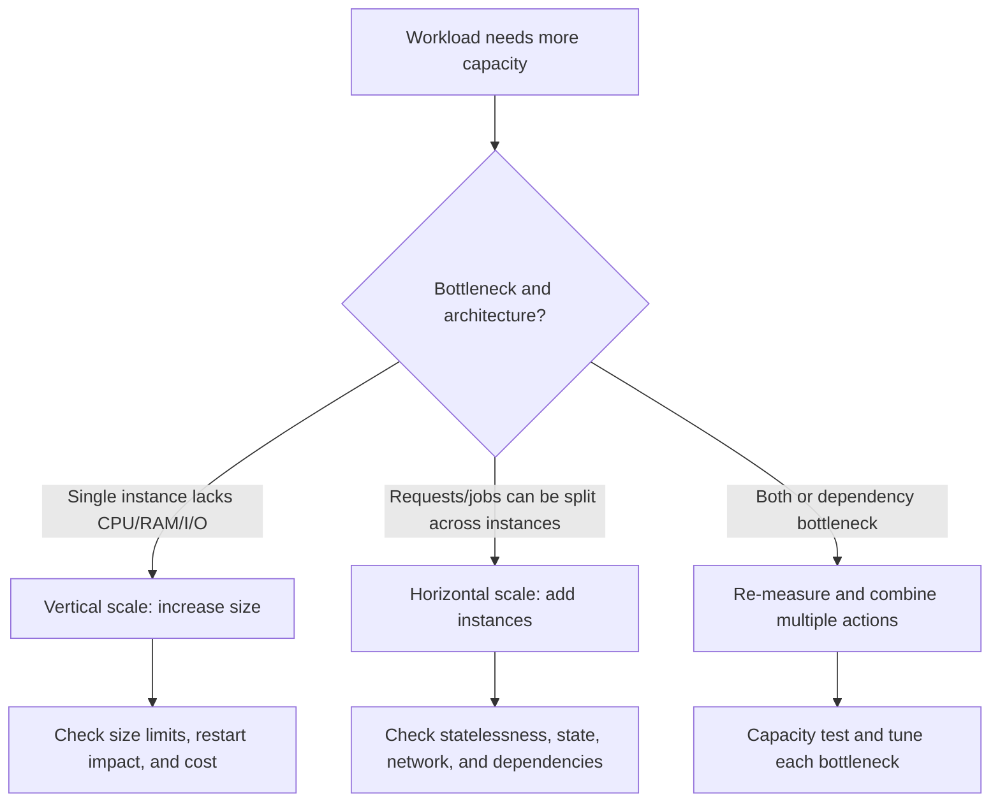
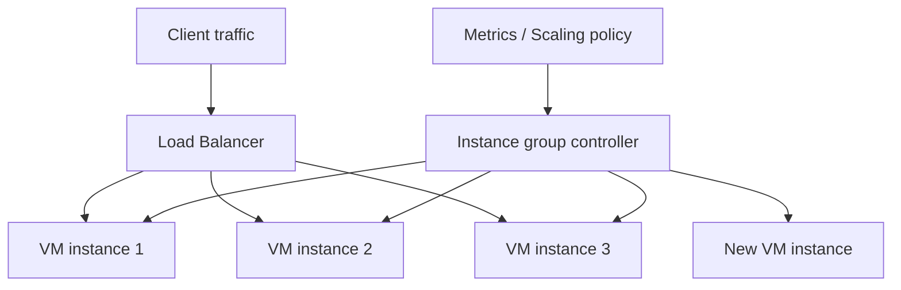

# Horizontal Scaling and Vertical Scaling by Workload Characteristics

When a workload needs additional processing capacity, operations teams generally have two primary options: increasing resources on a running instance (vertical scaling) or adding more instances to share the work (horizontal scaling). These two approaches address different bottlenecks. Adding vCPUs and RAM can help a process that needs large memory or single-threaded performance run faster; adding VMs, Pods, or execution instances can increase total throughput and fault tolerance when the application can distribute requests.

In the **CLOUD_CORE_SERVICES_COMPUTE** module, scaling decisions must be based on workload characteristics, not solely on average CPU utilization. A workload may be constrained by CPU, memory, disk I/O, network, locks, connection pools, databases, queues, or cloud service quotas. Choosing the wrong direction increases costs without improving throughput, leaves p95/p99 latency high, or overloads downstream dependencies. This lesson covers how to classify workloads, estimate capacity, choose between horizontal and vertical scaling, and implement scaling safely across VMs, containers, and serverless platforms.

## Learning objectives

After this lesson, you will be able to:

- Distinguish between scale up/down and scale out/in.
- Identify CPU-bound, memory-bound, I/O-bound, stateful, bursty, and batch workloads.
- Choose a scaling direction based on bottlenecks, work partitioning capability, latency requirements, and availability.
- Estimate processing capacity, instance counts, and headroom based on expected load.
- Understand the limits of vertical scaling and horizontal scaling.
- Apply scaling strategies to VMs/instance groups, containers/Kubernetes, and serverless.
- Design scaling policies, cooldowns, warm-up periods, health checks, draining, and scale-in protection.
- Manage state, sessions, databases, queues, and dependencies when increasing instance counts.
- Measure scaling effectiveness using throughput, p50/p95/p99 latency, error rate, saturation, and cost.

## 1. Two directions for scaling compute capacity

Scaling means adjusting resources or the number of execution units to meet load and service objectives. There are two fundamental axes:

- **Vertical scaling (scale up/down):** changing the resource size of a single instance, such as increasing/decreasing vCPUs, RAM, or I/O capacity.
- **Horizontal scaling (scale out/in):** increasing/decreasing the number of instances running a workload concurrently, such as adding/removing VMs, Pods, workers, or function executions.



### 1.1. Vertical scaling: scale up and scale down

Scaling up increases the resources of an instance—for example, changing a VM from 2 vCPUs/8 GiB RAM to 8 vCPUs/32 GiB RAM, increasing a container's memory allocation, or selecting a function configuration with more memory and CPU.

Scaling down reduces resources when an instance has excess capacity. The goal may be to cut costs, reduce overprovisioning, or right-size the workload to current demand.

Common advantages:

- Minimal application architecture changes; the process still runs on a single logical instance.
- Suitable for applications that are hard to distribute or maintain local state.
- Can improve single-threaded performance if the new instance type has faster CPU cores, though benchmarking is needed rather than just comparing vCPU counts.
- Increasing RAM can prevent swapping, OOM errors, or reduce garbage collection pressure.
- Does not require adding request distribution mechanisms across multiple instances when scaling a single node.

Common limitations:

- Instance size, vCPU, RAM, IOPS, and network throughput have upper ceilings imposed by machine types and quotas.
- May require a stop/start, recreate, or restart, which causes downtime without redundancy.
- A single large instance remains a single failure domain; a host or process failure can impact the entire workload.
- Does not resolve bottlenecks in databases, locks, external APIs, or algorithms that cannot utilize additional CPUs.
- Larger sizes often increase cost in discrete steps; one large instance can be less flexible when load fluctuates.

### 1.2. Horizontal scaling: scale out and scale in

Scaling out adds instances to share load. For example, increasing an API group from 3 to 6 VMs behind a load balancer, scaling Pods from 4 to 10, or adding worker consumers to drain a queue faster.

Scaling in reduces the number of instances when demand is low. It saves costs, but requires selecting the right instances to remove and allowing in-flight requests/jobs to complete safely.

Common advantages:

- Increases total throughput when the workload can be processed in parallel.
- Can improve availability if instances are distributed across multiple failure domains.
- Scales up and down in small increments, adapting flexibly to traffic.
- Limits the blast radius of a single instance failure if traffic routing and health checks are properly configured.
- Enables using smaller, more diverse instances or combining capacity based on demand.

Common limitations:

- The application must support multiple concurrent instances; state/sessions must be managed appropriately.
- Requires load balancers, service discovery, queues, or work distribution mechanisms.
- Increasing instance counts can overload databases, caches, NAT gateways, networks, or downstream APIs.
- Introduces overhead for replication, coordination, cache invalidation, connections, and observability.
- Scaling in at the wrong time can drop requests, lose jobs, or cause sudden capacity drops.

### 1.3. Quick comparison

| Criterion | Vertical scaling | Horizontal scaling |
|---|---|---|
| How capacity increases | Increase resources of one instance | Increase number of instances |
| Unit of change | vCPU, RAM, IOPS, network tier, memory allocation | VM, Pod, worker, execution instance |
| Application changes | Usually fewer | May require stateless design, shared state, or partitioning |
| Scaling ceiling | Bounded by single-instance size limits and quotas | Bounded by quotas, dependencies, and load distribution capability |
| Availability | A large instance can still be a single point of failure | Can tolerate instance failures if deployed across multiple failure domains |
| Single-request performance | May improve if a request needs greater resources | Not necessarily faster if one request still runs on a single instance |
| Total throughput | Scales up to the single instance's limit | Can scale with instance count until dependencies saturate |
| Scale down | Switch to a smaller size, may require restart | Remove instances after draining and protecting active work |
| Cost | Can step up in discrete tier increments | Scales with instance count and coordination overhead; can track load |
| Suitable workloads | Hard-to-distribute apps, memory-heavy, stateful nodes | Stateless APIs, worker pools, partitionable tasks, queue consumers |

Neither direction is universally better. A system might scale up its database for more RAM/IOPS while scaling out its API tier for higher request capacity. Choose based on the specific bottleneck and re-measure after every change.

## 2. Classifying workloads before choosing a scaling direction

Workload characteristics determine which resource must be increased and how work can be split. Classify by observed runtime behavior, not just by application name.

### 2.1. CPU-bound workloads

A CPU-bound workload spends most of its time executing computations: compression/encryption, rendering, image processing, inference, data analytics, or numerical computation.

Common symptoms:

- Sustained high CPU utilization.
- Increasing run queue length or CPU throttling.
- Throughput stops increasing when request concurrency rises.
- p95/p99 latency spikes as CPU approaches saturation.
- Memory and I/O may still have ample headroom.

Mitigation approaches:

- Scale up if each task requires heavy CPU, the application cannot be easily split, or a single thread is constrained by per-core performance.
- Scale out if individual requests/jobs are independent or can be partitioned.
- Optimize algorithms, reduce redundant computation, use caching, or leverage vectorization before buying more compute.
- For parallel workloads, inspect thread pools and concurrency limits; adding vCPUs will not automatically speed up a single-threaded application.

### 2.2. Memory-bound workloads

A memory-bound workload requires a large working set or performs frequent RAM accesses: in-memory caches, analytics, large JVM heaps, database buffers, graph processing, or large-scale data processing.

Symptoms:

- Low available memory, growing working set, or page faults/swapping.
- OOM kills or process restarts.
- Prolonged garbage collection pauses or increased GC frequency.
- Latency rises even when CPU utilization is not high.
- Certain instances experience memory pressure due to uneven data distribution.

Mitigation approaches:

- Scale up to add RAM if a single process needs a large working set or data must reside on one node.
- Scale out if data can be partitioned, caches can be sharded, or workers can process independent slices.
- Reduce object allocations, fix memory leaks, bound caches, and avoid retaining data too long.
- Check container/function memory limits; free RAM on the host node does not mean the container is allowed to use more.

### 2.3. I/O-bound workloads

An I/O-bound workload spends more time waiting on disks, databases, object storage, queues, or networks than on CPU computation.

Symptoms:

- Low or moderate CPU utilization despite high request latency.
- Elevated disk queue depth, I/O wait, storage latency, or network retransmissions.
- Exhausted database connection pools, lock waits, or high query latency.
- Requests waiting on downstream APIs or queue consumers falling behind.

Mitigation approaches:

- Scale up IOPS/throughput, select an appropriate storage/network tier, or increase connection pools if dependencies have capacity.
- Scale out workers when tasks are independent and downstream systems still have headroom.
- Use batching, async I/O, caching, connection reuse, and fewer network round trips.
- If the database is the bottleneck, adding API instances usually only increases connection counts and database load.

### 2.4. Latency-sensitive workloads

Interactive workloads such as transactional APIs, authentication, or payment processing require stable latency, especially at p95/p99.

Examine:

- Instance startup time and cache/runtime warm-up.
- Queueing delays and concurrency limits.
- Tail latency of databases and downstream services.
- Zone/region locality of clients, load balancers, and data stores.
- Impact of scale-out/in on connections, sessions, and caches.

You can maintain a baseline minimum capacity and use scale-out to handle bursts. Scale-to-zero is generally unsuitable for endpoints requiring immediate responses if cold starts exceed SLOs.

### 2.5. Bursty workloads

Bursty workloads experience rapid traffic spikes over short periods, such as flash sales, live events, synchronized batch triggers, or scheduled runs.

Metric-reactive scale-out requires time to detect the spike, provision instances, boot, pull images, and pass health checks. If a burst arrives faster than scale-up time, the system can still overload.

Measures:

- Maintain minimum capacity sufficient for baseline load and predictable bursts.
- Use scheduled scaling when events follow a known schedule.
- Use queues to absorb bursts and process at the rate dependencies allow.
- Pre-warm instances, images, caches, or function environments where appropriate.
- Set quotas and concurrency limits to prevent cascading overload on databases.

### 2.6. Stateful workloads

Workloads with local state or node-bound data can be difficult to scale out. Examples include primary databases, cache nodes, applications storing sessions in RAM, or stream processors with partition ownership.

You cannot simply add instances and expect state to distribute automatically. Determine:

- Does state live in RAM, local disk, shared storage, or an external service?
- Can it be partitioned/sharded by key?
- Are replication and failover mechanisms in place?
- Can sessions move to a shared store or stateless tokens?
- Are there ordering, consistency, or single-writer requirements?

Vertical scaling can be a straightforward way to increase capacity for a stateful node, though backups, replication, failover, and upgrade plans are still required. Horizontal scaling typically demands explicit data partitioning and consistency design.

### 2.7. Batch and queue-driven workloads

Batch workloads process datasets or jobs within a defined time window. Queue-driven workers can increase consumer count when backlogs grow and shrink when backlogs clear.

Key signals:

- Queue depth and age of the oldest message.
- Arrival rate versus completion rate.
- Processing time per job and retry/dead-letter rates.
- Worker concurrency and downstream capacity.
- Batch completion deadlines and cost per job.

Scaling out workers is effective when jobs are independent. If jobs contend for database locks or storage throughput, adding consumers can worsen total completion time.

## 3. Estimating capacity and instance counts

Scaling policies need an approximate capacity model to avoid under-scaling or over-scaling. Use representative benchmarks to measure a single instance's capacity while preserving headroom.

### 3.1. Basic capacity formula

If one instance has a benchmark reference throughput of `C` requests/second and needs to serve load `R`, the minimum instance count under a simple model is:

\[
N = \left\lceil \frac{R}{C \times U} \right\rceil
\]

Where:

- `R` is the target arrival rate.
- `C` is the benchmarked throughput per instance under equivalent conditions; measure up to the capacity region where latency/error targets start degrading.
- `U` is the allowable utilization factor, less than or equal to 1 to preserve headroom; for example, `0.70` means planning to use only 70% of reference throughput.
- `N` is the estimated number of instances required.

For example, benchmarking shows one VM handles 120 requests/second before latency exceeds the target. The team plans to use 70% of that level to leave room for bursts. For a load of 600 requests/second:

```text
N = ceil(600 / (120 × 0.70))
  = ceil(7.14)
  = 8 VMs
```

This is only an initial estimate. Throughput does not necessarily scale linearly with VM count due to load balancers, databases, caches, networks, locks, or shared dependencies. Validate with end-to-end system load tests.

### 3.2. Headroom and failure capacity

Production capacity must account for losing an instance or a zone. If the system must tolerate `f` failed instances while still serving load `R`, the instance count should satisfy:

\[
(N - f) \times C_{safe} \ge R
\]

Where `C_safe` is the safe per-instance throughput accounting for utilization and latency limits. In multi-zone deployments, account for losing an entire zone rather than just a single VM.

For example, 8 VMs are split evenly across two zones, each with a safe capacity of 100 req/s. Losing one zone leaves 4 VMs and 400 req/s of capacity. If demand requires 500 req/s, the system lacks sufficient capacity to maintain SLOs after a zone failure. You must raise the baseline, add zones/capacity, or accept a clearly defined degraded mode target.

### 3.3. Dependency capacity

Before scaling out, map all dependencies:

| Dependency | Limits to inspect | Impact when adding instances |
|---|---|---|
| Database | Connections, CPU, IOPS, locks, transaction rate | Concurrent connections and queries increase |
| Cache | Connections, memory, shard throughput, hot keys | More clients increase connections and request load |
| Queue | Partitions, consumer groups, throughput, visibility timeout | Adding consumers can exceed partitions or trigger retries |
| NAT/egress | Ports, bandwidth, connection tracking, quotas | More instances generate more outbound connections |
| External APIs | Rate limits, quotas, concurrency | Scale-out can cause throttling or higher billing |
| Storage | IOPS, throughput, request rate, metadata limits | Adding workers can increase I/O contention |

Total system capacity is bounded by the narrowest dependency on the request path. Scaling API compute cannot bypass database limits if the database is the bottleneck.

### 3.4. Capacity testing instead of guessing

Run load tests across multiple load levels and record throughput, p50/p95/p99 latency, error rates, CPU, memory, I/O, queues, and dependency metrics. Find the point where adding instances stops increasing throughput or degrades latency. Use those results to set `C_safe`, target utilization, and scaling limits.

## 4. When should you scale up?

Scaling up is appropriate when the bottleneck resides within a single instance and the workload can utilize additional resources.

### 4.1. Suitable scenarios

- A single process requires large RAM or a working set that is hard to partition.
- Legacy applications that only support single-node execution or hold local state.
- A database node needs more RAM for buffer/cache or higher storage IOPS.
- Individual requests demand high CPU/RAM and cannot be split across independent workers.
- A quick mitigation is needed while re-architecting for horizontal scaling.
- The operational overhead of managing multiple nodes, replication, or distributed coordination outweighs scale-out benefits.

### 4.2. Scenarios where scaling up will not solve the problem

- CPU is low because requests are waiting on a database or external API.
- A single thread is blocked on locks or constrained by a sequential algorithm.
- The database connection pool is exhausted due to unmanaged connection counts.
- Current disk/network tiers are the bottleneck, yet only CPU/RAM are increased.
- An instance has already reached its maximum size or quota prevents resizing.
- Availability requirements demand multiple failure domains, not just one larger machine.

### 4.3. Vertical scaling procedure

1. Identify metrics proving the bottleneck is in instance CPU, RAM, storage, or networking.
2. Select a new size based on benchmarks rather than blindly doubling vCPUs.
3. Verify compatibility with CPU architecture, drivers, licensing, OS, and storage/network limits.
4. Determine whether resizing requires a stop/restart/recreate.
5. Ensure backups/snapshots and a rollback plan are ready.
6. For stateful services, check replication/failover impact or schedule a maintenance window.
7. After the change, run the same workload and compare p50/p95/p99 latency, throughput, errors, and cost.

For critical workloads, you can provision a new instance at the larger size, sync data, or gradually shift traffic instead of resizing in place. The exact method depends on the platform and migration capabilities.

## 5. When should you scale out?

Scaling out is appropriate when work can be distributed across multiple instances and the system has mechanisms to handle state and dependencies accordingly.

### 5.1. Suitable scenarios

- Stateless APIs handling many independent requests.
- Workers processing messages/jobs that can run in parallel.
- Batch jobs that can be divided by partition or shard.
- Web tiers requiring availability across multiple zones.
- Bursty workloads with time-varying demand.
- Throughput can increase by adding consumers/replicas without saturating dependencies.

### 5.2. Architectural prerequisites

- Requests can land on any instance, or routing affinity is explicitly designed.
- Sessions/state are stored in shared services, databases, or stateless tokens.
- New instances can bootstrap and accept traffic after passing health/readiness checks.
- Jobs use locks, leases, idempotency, or partition ownership to prevent duplicate processing.
- Graceful shutdown and connection draining occur during scale-in.
- Shared dependencies have sufficient capacity or partitioning/caching/queueing strategies.

### 5.3. Horizontal scaling procedure

1. Measure safe capacity for one instance and its dependencies.
2. Set appropriate minimum/maximum instance counts and quotas.
3. Choose metrics or schedules as scaling triggers.
4. Configure warm-up, readiness, and health checks before accepting traffic.
5. Distribute instances across required zones/failure domains.
6. During scale-in, drain requests/jobs and protect instances executing critical tasks.
7. Monitor throughput, latency, errors, queues, and cost after every scaling event.

## 6. Designing applications for safe scale-out

Horizontal scaling requires instances to coordinate cleanly. Several architectural principles help reduce coupling.

### 6.1. Stateless application tier

A stateless API does not keep critical session state in a single instance's RAM. Any replica can handle any request using tokens or state retrieved from a shared store.

If sessions must be stored server-side:

- Use an appropriate shared session store, such as a highly available cache or database.
- Or use sticky sessions only when strictly necessary, understanding that affinity reduces flexibility and can create hotspots.
- Configure TTLs, eviction policies, and session size limits.
- Design failure behavior when the shared store is unavailable: fail closed, degraded mode, or require re-authentication.

Do not pack all state into cookies/tokens if the data is large, sensitive, or hard to revoke. Stateless does not mean no state exists; it means state is managed outside the request-handling instance.

### 6.2. Shared storage and local disks

Local disks are typically tied to the instance lifecycle. If an instance is replaced, local data may be lost. For user files or shared data, consider object storage, managed file services, or appropriate databases.

If using local caches or temporary files:

- Determine whether the data can be regenerated.
- Set disk quotas and clean up expired data.
- Never rely on local files as the sole source of truth.
- Test behavior when an instance is terminated unexpectedly.

### 6.3. Idempotency and job processing

When scaling workers, the same message may be redelivered due to timeouts, visibility timeouts, or consumer failures. Use idempotency keys, transactions, or deduplication to avoid duplicate side effects.

Principles:

- Jobs can be retried without creating duplicate transactions.
- Lease/visibility timeouts exceed reasonable processing times and use heartbeats if needed.
- Workers stop pulling new jobs before shutting down.
- In-flight jobs either finish or return safely to the queue.
- Dead-letter queues and retry limits are actively monitored.

### 6.4. Caching and consistency

Scaling out can create multiple independent local caches. One instance updates data while another still holds stale entries. Define:

- How long cached data is allowed to be stale.
- Whether invalidation uses events, TTLs, or versioned keys.
- Risks of hot keys or cache stampedes.
- Whether the database can survive fallback traffic if the cache fails.

Do not add cache nodes or API replicas without measuring hit ratios, evictions, hot keys, and backend load.

## 7. Scaling on VMs and instance groups

VMs typically support both vertical and horizontal scaling. Vertical scaling changes the machine type/size; horizontal scaling adjusts the number of VMs in an instance group or autoscaling group.

### 7.1. Vertical scaling for VMs

For example, an API VM running 2 vCPUs/8 GiB RAM exhibits CPU saturation. You can benchmark a 4 vCPU/16 GiB RAM configuration, while verifying:

- Does throughput scale with vCPU count?
- Do CPU frequency or architecture differ?
- Does the application's thread pool leverage the extra cores?
- Does additional RAM reduce GC pauses or swapping?
- Do network bandwidth and IOPS change with the instance size?
- Does resizing require stop/start, and does it affect public/private IPs?

Do not assume performance doubles simply because vCPUs double. Sequential code paths, lock contention, and dependencies cap the speedup.

### 7.2. Horizontal scaling with instance groups

A VM group can maintain minimum, desired, and maximum capacity. A load balancer distributes requests across healthy instances. Scaling policies can trigger on CPU, request count, network traffic, custom metrics, or schedules.



The scale-out flow typically includes:

1. A metric breaches a threshold or a schedule triggers the policy.
2. The controller requests additional VMs.
3. VMs are created from the image/launch template with identity and network settings.
4. Bootstrap installs or starts the application.
5. Health/readiness checks confirm the instance can serve traffic.
6. The load balancer begins routing traffic.

If bootstrap is slow, scale-out capacity may arrive after the traffic peak has passed. Use pre-baked images, idempotent startup scripts, warm pools, or scheduled capacity when appropriate.

### 7.3. Scale-in and connection draining

When reducing VMs, the controller must select instances and remove them from the load balancer safely. Connection draining allows open requests to complete within a bounded window.

Before termination:

- Stop accepting new requests.
- Wait for active connections/requests to finish or reach timeout.
- Workers stop accepting new jobs and finish or release active jobs.
- Flush logs/metrics and write checkpoints if needed.
- Deregister targets, release leases, and close connections.

Set the termination grace period longer than typical work completion time, yet bounded. If requests can hang indefinitely, enforce timeouts and cancellation policies.

### 7.4. Zone distribution

If an instance group spans multiple zones, desired capacity must be large enough to distribute evenly and sustain capacity if one zone fails. Verify per-zone quotas, subnet IP capacity, load balancer target health, and data dependencies. A group of 6 VMs all placed in a single zone has no zone fault tolerance.

## 8. Scaling on containers and Kubernetes

Container platforms typically combine horizontal scaling at the Pod level with vertical scaling at the Pod/node level.

### 8.1. Horizontal Pod Autoscaler (HPA)

HPA adjusts workload replica counts based on metrics such as CPU, memory, or custom/external metrics. For CPU utilization, values are typically calculated relative to the container's CPU request. Consequently, misconfigured requests can cause inaccurate scaling triggers.

Illustrative HPA manifest example:

```yaml
apiVersion: autoscaling/v2
kind: HorizontalPodAutoscaler
metadata:
  name: orders-api
  namespace: production
spec:
  scaleTargetRef:
    apiVersion: apps/v1
    kind: Deployment
    name: orders-api
  minReplicas: 3
  maxReplicas: 20
  metrics:
    - type: Resource
      resource:
        name: cpu
        target:
          type: Utilization
          averageUtilization: 65
```

In this example, HPA maintains at least 3 Pods and no more than 20 Pods, targeting an average CPU utilization of 65% of the CPU request. This is an illustrative configuration; it requires valid resource requests and a Metrics Server or custom metrics adapter. CPU alone may not reflect queue-driven workloads; queue depth or request rate can be better signals.

### 8.2. Vertical Pod Autoscaler (VPA)

VPA recommends or adjusts CPU/memory requests and limits based on observed usage, depending on its mode and configuration. It is useful when Pod sizing is inaccurate or workload resource demands shift over time.

Notes:

- Some VPA modes evict/recreate Pods to apply updated requests.
- VPA cannot make an application use more CPU if the code is sequentially constrained.
- Memory limits set too low can cause OOM kills; limits set too high can make scheduling difficult.
- Running HPA on CPU utilization alongside VPA modifying CPU requests can conflict; coordinate and test their interaction.
- Avoid letting multiple controllers adjust the same resource dimension without explicit policy coordination.

### 8.3. Cluster autoscaler and node capacity

HPA may increase Pod replicas while the cluster lacks sufficient node capacity to schedule them. A cluster autoscaler or node provisioning controller can add nodes when Pods remain pending due to resource shortages.

Layers to monitor:

- HPA desired/current replicas.
- Pending Pods and scheduler rejection reasons.
- Node allocatable capacity, requests, limits, and fragmentation.
- Node scale-up delay, image pulls, and startup times.
- Zone balance, quotas, and subnet IP capacity.
- Pod disruption budgets and node drainability.

Pod scaling and node scaling are two separate control loops. If node provisioning is slow, maintain headroom or warm node pools to absorb bursts.

### 8.4. Requests, limits, and bin packing

CPU requests influence scheduling and HPA CPU utilization calculations; CPU limits can trigger throttling. Memory requests guide scheduling; memory limits typically define the boundary where containers face OOM kills when exceeded.

Setting requests too low causes node overcommitment and Pod contention; setting them too high wastes capacity and causes fragmentation. Tune using metrics for working set, throttling, OOM events, and real traffic loads.

## 9. Scaling on serverless

Serverless/FaaS platforms typically scale execution environments automatically based on concurrency or event rates. Users can tune memory/CPU allocation, concurrency, provisioned/warm capacity, and account/service limits depending on the platform.

### 9.1. Vertical and horizontal dimensions in FaaS

- **Vertical dimension:** increasing memory/CPU allocation or resource configuration per invocation/environment.
- **Horizontal dimension:** increasing concurrent invocations/execution environments to handle more requests/events.

Increasing memory also increases allocated CPU in some services, though the ratio and pricing model depend on the provider. Do not assume all functions share the exact same memory-to-CPU relationship.

### 9.2. When to increase memory/CPU?

- Invocations are CPU-bound or process large payloads.
- Functions frequently time out due to slow execution and metrics show compute starvation.
- Memory pressure, OOM errors, or runtime fallback to temporary storage occurs.
- Increasing memory reduces duration enough to lower total cost under the service's billing model.

### 9.3. When to increase concurrency?

- Many independent events/requests can execute simultaneously.
- Downstream databases/APIs have sufficient capacity.
- Queue backlogs or invocation throttles are increasing.
- Handlers implement idempotency and safe retries.

Configure reserved/max concurrency or equivalent caps to protect dependencies. Without caps, rapid function scaling can overwhelm database connections, NAT gateways, or partner APIs.

### 9.4. Cold starts and provisioned capacity

Scale-out can spin up new execution environments that must download packages, initialize runtimes, establish network connections, and load dependencies. For latency-sensitive workloads, cold starts can inflate p95/p99 latency. You can use provisioned concurrency, pre-warming, or package/runtime optimization if supported by the service.

Measure cold and warm invocations separately, and report end-to-end latency across the real invocation population. Do not exclude cold starts from SLOs if end users actually experience them.

## 10. Choosing scaling triggers and policies

A good policy responds to demand before SLOs are violated without oscillating continuously.

### 10.1. Metric-based scaling

Available signals include:

- CPU utilization or CPU run queue/throttling.
- Memory working set or memory pressure.
- Request count per instance.
- Request arrival rate and concurrency.
- Queue depth or oldest message age.
- Custom metrics for active jobs, in-flight requests, or backlogs.
- Latency can serve as a supplementary signal, but filter out noise and avoid scaling on metrics driven by downstream slowdowns.

CPU fits CPU-bound workloads; queue depth fits workers; request count per target fits APIs with relatively uniform request costs. Do not force a single metric onto every workload type.

### 10.2. Threshold, target tracking, and step scaling

- **Threshold scaling:** scales when a metric crosses a threshold for a defined evaluation period.
- **Target tracking:** adjusts capacity to keep a metric near a target value.
- **Step scaling:** adds/removes instances in increments proportional to how far the metric exceeds the threshold.
- **Scheduled scaling:** adjusts capacity on a predictable calendar schedule.
- **Predictive scaling:** forecasts demand from historical patterns if supported by the platform.

Target tracking is simple for steady metrics, yet still requires min/max bounds, cooldowns, warm-up periods, and scale-in policies. Step scaling suits scenarios requiring faster scale-out when metrics spike far beyond thresholds.

### 10.3. Scale-out and scale-in do not have to be symmetric

Scale-out usually needs to be fast to handle rising load; scale-in should be conservative to avoid oscillation. You can use:

- Lower thresholds or faster reaction times for scale-out than for scale-in.
- Stabilization windows to avoid scaling in on brief dips in load.
- Cooldown/warm-up periods to prevent continuously launching new instances before existing ones are ready.
- Minimum capacity to maintain a baseline.
- Scale-in protection for instances executing long jobs or holding critical state.

Cooldowns do not need a single fixed value across all metrics. Choose them based on boot time, bootstrap duration, warm-up, metric evaluation windows, and how rapidly load changes.

### 10.4. Avoiding scaling oscillation

Scaling oscillation (thrashing) occurs when a policy repeatedly adds and removes instances around a threshold. Causes include noisy metrics, overly short evaluation windows, misconfigured cooldowns, or conflicting controllers.

Reduce oscillation by:

- Using rolling averages and requiring multiple consecutive breach datapoints.
- Adding hysteresis between scale-out and scale-in conditions.
- Capping the scale-in/out rate per evaluation cycle.
- Accounting for warm-up time when evaluating newly launched capacity.
- Avoiding metrics that depend directly on replica counts unless properly normalized.
- Checking interactions among HPA, VPA, cluster autoscalers, and cloud policies.

## 11. Safe scale-in and instance lifecycle

Scale-in is a risky operation because an instance may be serving requests, running jobs, holding leases, or writing data.

### 11.1. Graceful shutdown

A process can handle shutdown signals in sequence:

1. Mark the instance as no longer accepting new traffic.
2. Transition readiness/target health to stop receiving new requests.
3. Stop pulling new messages/jobs.
4. Complete in-flight requests/jobs within the grace period.
5. Flush required buffers, logs, metrics, and checkpoints.
6. Close connections and release leases/locks.
7. Exit before the termination deadline.

If work cannot finish within the grace period, use checkpointing or return the job to the queue. Never keep an instance alive indefinitely for a hung request; enforce timeouts and cancellation.

### 11.2. Health checks and readiness

Health checks answer whether an instance is alive. Readiness answers whether an instance is ready to accept traffic. A process can be alive while still warming up caches or connecting to dependencies, so liveness and readiness should not share an overly simplistic check.

During scale-out:

- Add an instance to the target pool only after bootstrap and readiness succeed.
- Avoid overly sensitive health checks that cause healthy instances to flap.
- Check essential dependencies, but avoid letting a transient auxiliary outage mark every instance unhealthy simultaneously.

During scale-in:

- Stop accepting new connections before termination.
- Wait for connection draining and graceful shutdown.
- Protect workers holding active jobs or instances with state that must be migrated.

## 12. Scaling limits and failure modes

### 12.1. Database bottlenecks

Scaling an API from 4 to 20 replicas can multiply database connections fivefold. If database capacity does not scale accordingly, connection pool waits, lock contention, and query latency increase. Mitigations include connection pooling/proxies, per-replica connection caps, caching, query optimization, read replicas, or partitioning depending on the workload.

### 12.2. Hot partitions and uneven load

If traffic is partitioned by key and one key receives the majority of requests, a single shard/partition can saturate even while the overall cluster has spare capacity. Measure distribution by key/partition, hot keys, skew, and per-shard latency. Adding instances will not help if the router keeps sending traffic to the same partition.

### 12.3. Shared resources and noisy neighbors

Multiple instances may contend for shared storage, network bandwidth, caches, or host node CPU. Scaling out increases aggregate demand on shared resources. Monitor resources at both the instance and dependency layers, not just per-Pod CPU.

### 12.4. Quotas and platform limits

Scale-out can fail due to quotas on vCPUs, VM counts, subnet IPs, ENIs/NICs, disks, public IPs, function concurrency, or API rate limits. Capacity plans must include quota headroom and an escalation process to raise quotas ahead of major events.

### 12.5. Retry storms and cascading failures

When a dependency slows down, clients/workers may retry, adding load and slowing the dependency further. Automated scale-out driven by request counts or queue depth can amplify the problem. Use timeouts, exponential backoff with jitter, retry budgets, circuit breakers, and admission control.

### 12.6. Scaling out too fast

Launching many instances simultaneously can cause bursts of image pulls, package downloads, secret fetches, database connections, and cache warm-ups. Use step limits, warm pools, staggered rollouts, and connection ramp-up to smooth the load.

## 13. Combining horizontal and vertical scaling

Many systems combine both approaches:

- Scale up each VM/Pod so one replica has right-sized capacity.
- Scale out replicas to meet aggregate traffic and availability requirements.
- Scale up databases/caches when each node needs more RAM or IOPS.
- Scale out read replicas or shards when workloads can be distributed.
- Use small, numerous workers for independent jobs; use larger workers for memory-intensive jobs.

### 13.1. API and worker example

A system has a read/write API and an image-processing worker:

- Stateless API needing high request concurrency: scale out the API based on request rate per target and p95 latency.
- CPU-bound image worker: scale out based on queue backlog; if individual images require heavy CPU, choose a larger worker VM/Pod size.
- Object storage handles file persistence: never rely on worker local disks as primary storage.
- Database has connection limits: set pool caps and bound total API/worker concurrency.

### 13.2. Memory-heavy workload example

An analytics service requires a 48 GiB working set in a single process that cannot be easily partitioned. Scaling out multiple small processes may duplicate the entire dataset, increasing total RAM usage without improving efficiency. Scaling up to a node with larger RAM can be more suitable. If the data can be sharded by key, scaling out shards can boost throughput, provided query fan-out and consistency are addressed.

### 13.3. Bursty workload example

An API has a 100 req/s baseline and peaks at 800 req/s during rush hours. You can keep a minimum of 3 replicas for baseline load, apply scheduled/predictive scaling ahead of peak hours, and use target tracking to react to fluctuations. If provisioning a replica takes 3 minutes while traffic spikes in 20 seconds, maintain headroom or use queues/rate limiting to absorb the burst.

## 14. Comparison by workload characteristics

| Workload characteristic | Initial preferred direction | Conditions to verify |
|---|---|---|
| CPU-bound, independent requests | Horizontal or combined | Can work run in parallel? Do dependencies have headroom? |
| CPU-bound, single-threaded task | Vertical or code optimization | Per-core performance and sequential bottlenecks |
| Memory-heavy, centralized state | Vertical | Max instance size, memory bandwidth, restart/failover |
| Memory-heavy, partitionable data | Horizontal | Sharding, replication, query fan-out, and skew |
| I/O-bound on local disk | Vertical storage tier or I/O redesign | IOPS, throughput, queue depth, and caching |
| I/O-bound on database | Optimize/scale database first; cap app concurrency | Connections, locks, queries, read/write mix |
| Stateless web/API | Horizontal | Load balancer, sessions, dependencies, and readiness |
| Queue worker, independent jobs | Horizontal | Backlog, idempotency, consumer limits, and downstream capacity |
| Stateful single-writer | Vertical or controlled replication/partitioning | Consistency, failover, data movement |
| Bursty/seasonal | Horizontal + baseline/scheduled capacity | Scale delay, warm-up, quotas, and queues |
| Latency-sensitive | Baseline + horizontal; consider vertical for per-request compute | p95/p99, cold start, locality, and dependencies |

This table is a starting point. Validate choices with benchmarks and real architecture constraints before adopting production policies.

## 15. Measuring effectiveness after scaling

Never judge success solely by an increased instance count or lower CPU utilization. Scaling must improve service objectives at a reasonable cost.

### 15.1. Metrics to monitor

- Completed throughput (requests/jobs per second).
- p50, p95, p99, and full latency histograms.
- Error rates, timeouts, retries, and dropped requests/jobs.
- CPU utilization, throttling, run queue, and steal time.
- Memory working set, OOM events, swapping, and garbage collection.
- Disk/network throughput, IOPS, queue depth, and packet loss.
- Queue depth, oldest message age, and worker concurrency.
- Database connections, lock waits, query latency, and saturation.
- Desired/current/healthy replica counts, scaling events, and startup duration.
- Cost per request/job and total cost over the load window.

### 15.2. Evaluating horizontal scaling efficiency

If instances increase from `N` to `2N`, throughput will not necessarily double. Approximate scaling efficiency can be calculated as:

```text
Scaling efficiency = (Throughput_after / Throughput_before)
                     / (Instances_after / Instances_before)
```

For example, if throughput increases 1.7x when instance count doubles:

```text
Scaling efficiency = 1.7 / 2 = 0.85 = 85%
```

This efficiency is an approximate measure under identical test conditions. If request mix, latency targets, or dependencies change, results are not directly comparable.

### 15.3. Cost per unit of work

Track cost per completed request/job, not just the total bill. Scaling out may increase total spend while lowering cost per request due to better utilization; conversely, adding idle replicas raises costs with no throughput gain.

Account for:

- Compute and storage costs.
- Load balancer, networking, NAT, logging, and telemetry costs.
- Database/cache/queue costs driven by higher concurrency.
- Idle capacity costs retained for availability and bursts.

## 16. Scaling decision workflow

1. Define the objective: throughput, latency, availability, job completion time, or cost.
2. Measure a baseline under a representative workload, including p50/p95/p99, errors, and saturation.
3. Locate bottlenecks across compute, storage, network, locks, queues, or dependencies.
4. Classify the workload: CPU, memory, I/O, stateful, bursty, batch, or latency-sensitive.
5. Determine whether work can be split across instances and where state lives.
6. Estimate safe capacity, headroom, failure capacity, and quotas.
7. Choose vertical, horizontal, or a hybrid approach; document hypotheses and risks.
8. Pilot in staging/canary with caps and a rollback plan.
9. Re-measure under the same request mix and conditions; compare throughput, percentiles, errors, and cost.
10. Formalize into a policy with min/max bounds, warm-up, cooldown, readiness, draining, and an owner.
11. Monitor post-deployment and tune based on production data.

## 17. Practical examples: choosing scaling for three workloads

### 17.1. Stateless API

An API runs on 4 VMs, each benchmarked safely at 100 req/s with p95 under 250 ms. Expected load is 500 req/s, with a 70% utilization target:

```text
N = ceil(500 / (100 × 0.70))
  = ceil(7.14)
  = 8 VMs
```

Choose horizontal scaling with minimum 4, desired tracking load, and maximum bounded by quotas/dependencies. Before production, load-test 8 VMs and check total database connections. If zone fault tolerance is required, recalculate remaining VMs after losing a zone.

### 17.2. Image-processing worker

Workers process images independently, CPU utilization is high, and queue backlog is growing. One worker completes 2 images/second within SLO. Incoming load reaches 40 images/second:

```text
N = ceil(40 / 2) = 20 workers
```

If higher worker concurrency hits object storage or database limits, cap consumers and measure completion rate. If large images require heavy RAM, use larger worker sizes or separate queues by image type.

### 17.3. Large in-memory cache

A cache node has a 90 GiB working set, low available RAM, and rising latency due to memory pressure. Scaling out additional cache nodes helps only if the cache supports sharding and clients distribute keys properly. Otherwise, scaling up node RAM may be the better step. Either way, verify replication, failover, key skew, and cache warm-up.

## 18. Common mistakes

| Mistake | Consequence | Fix |
|---|---|---|
| Scaling on CPU for every workload | Ignores queue, memory, I/O, or dependency bottlenecks | Pick metrics matched to the workload and measured bottleneck |
| Adding replicas when the database is saturated | Increases connections/queries and worsens p99 | Cap concurrency, optimize DB, or scale dependencies |
| Assuming doubling vCPUs doubles throughput | Ignores sequential paths, locks, and single-core speed | Benchmark the new size with real workloads |
| Scaling out stateful apps without state design | Lost sessions, inconsistent data, or request failures | Shared state, partitioning, replication, and consistency |
| Scaling in immediately on a brief CPU dip | Oscillation and capacity shortage when load returns | Stabilization windows, cooldowns, and min capacity |
| Terminating workers mid-job | Lost jobs or partial side effects | Graceful shutdown, leases, idempotency, and checkpoints |
| Checking only desired replica counts | New Pods/VMs may be unready or not serving traffic | Monitor ready/healthy capacity and startup duration |
| Ignoring quotas and subnet IP limits | Scale-out fails to provision instances | Capacity plan across zones, IPs, vCPUs, and API quotas |
| Ignoring scale-up delay | Bursts arrive before capacity is ready | Headroom, scheduled scaling, warm pools, or queues |
| Multiple autoscalers controlling the same resource | Conflicting policies and oscillation | Assign clear control ownership and test interactions |
| Measuring only CPU after changes | Unclear whether SLOs or costs actually improved | Compare p50/p95/p99, throughput, errors, dependencies, and cost |

## 19. Production checklist

**Workload analysis**

- [ ] Classified as CPU, memory, I/O, stateful, bursty, or batch.
- [ ] Identified bottlenecks using metrics/traces and benchmarks.
- [ ] Defined latency, throughput, availability, and cost objectives.
- [ ] Mapped dependencies and each service's limits.

**Capacity design**

- [ ] Benchmarked safe capacity per instance.
- [ ] Calculated headroom, failure capacity, and quotas.
- [ ] Justified vertical, horizontal, or hybrid scaling choice.
- [ ] Defined minimum/maximum and baseline capacity.
- [ ] Evaluated impact on databases, caches, queues, networks, and storage.

**Implementation and lifecycle**

- [ ] New instances have idempotent bootstrap and health/readiness checks.
- [ ] Warm-up, cooldown, and stabilization windows are tuned.
- [ ] Load balancer routes traffic only to ready instances.
- [ ] Scale-in uses connection draining and graceful shutdown.
- [ ] Workers implement idempotency, retries/dead-letter handling, and checkpoints where needed.
- [ ] Scale-in protection covers critical state/jobs.

**Verification and operations**

- [ ] Executed load, burst, and failure tests.
- [ ] Measured p50/p95/p99, throughput, errors, and saturation before/after.
- [ ] Measured cost per request/job and total dependency cost.
- [ ] Alerts configured when scaling fails to add capacity or hits quotas.
- [ ] Runbooks, owners, rollback plans, and periodic reviews exist.

## 20. Conclusion

Vertical scaling increases a single instance's resources and fits workloads needing concentrated CPU/RAM/I/O or that are hard to distribute. Horizontal scaling increases instance counts and fits workloads where requests/jobs can share load, state is properly externalized, and dependencies have headroom. Both have limits: vertical scaling hits size ceilings and failure domain risks; horizontal scaling is governed by distributed architecture, state, networking, quotas, and shared dependencies.

Start from workload characteristics and measured bottlenecks. Estimate safe capacity, preserve headroom, plan for instance/zone failures, and check impacts on databases, caches, queues, and networks. For horizontal scaling, readiness, warm-up, draining, and graceful shutdown determine whether new instances help and whether removed instances exit safely. Evaluate outcomes using throughput, p50/p95/p99 latency, error rate, saturation, and cost per unit of work to pick a sustainable configuration.

## Key terms to remember

| Term | Meaning |
|---|---|
| Vertical scaling | Increasing or decreasing the resources of a single instance (scale up/down). |
| Horizontal scaling | Increasing or decreasing the number of instances (scale out/in). |
| Capacity | Ability to process a workload under defined conditions and objectives. |
| Headroom | Reserve capacity kept to absorb bursts or failures. |
| CPU-bound | Workload constrained primarily by CPU processing capacity. |
| Memory-bound | Workload constrained by memory capacity or bandwidth. |
| I/O-bound | Workload spending significant time waiting on disk, network, or data services. |
| Stateful workload | Workload relying on local state or state requiring synchronization across instances. |
| Stateless service | Service able to handle requests on any replica without durable local sessions. |
| Autoscaling | Mechanism that automatically adjusts capacity based on metrics, schedules, or forecasts. |
| Warm-up | Phase of preparing instances/runtimes/caches before serving full traffic. |
| Cooldown | Period restricting consecutive adjustments after a scaling action. |
| Readiness | State indicating whether an instance is ready to accept traffic. |
| Connection draining | Stopping new connections and allowing existing ones to finish before removing an instance. |
| Graceful shutdown | Controlled process termination to finish or hand off active work. |
| Idempotency | Property allowing repeated execution without unintended duplicate side effects. |
| Scaling efficiency | Relative throughput gain compared to the relative increase in instance count. |
