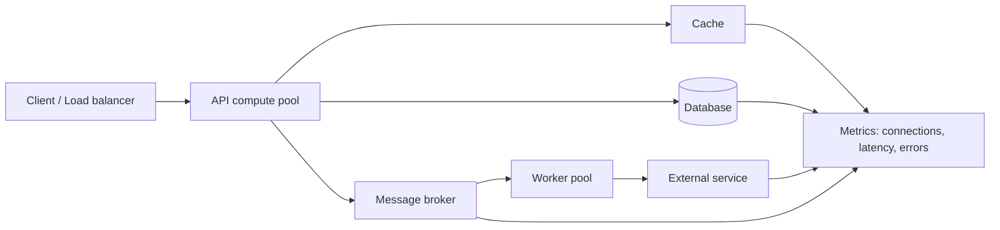

# Coordinating Compute Scaling with Dependent Service Limits

## 1. Why can scaling compute make a system slower?

Autoscaling adjusts the number of VMs, containers, workers, or function instances to match demand. When traffic grows, adding compute increases request ingestion and parallel execution capacity. However, compute rarely operates in isolation. An API may rely on databases, caches, message brokers, object storage, authentication services, or external APIs. Those dependencies enforce limits on connections, throughput, concurrency, quotas, and processing speed.

If you increase instance counts without accounting for dependency capacity, the system can open more database connections than permitted, exceed API rate limits, overload queues or caches, or trigger retry storms. When that happens, compute instance counts rise while response times and error rates get worse. The autoscaler keeps seeing elevated CPU or queue depth and launches even more machines, piling greater pressure onto the dependency.

Therefore, the goal is not maximizing compute scale. The goal is scaling the entire processing pipeline safely within the bounds of the lowest-capacity link, while maintaining SLOs and controlling cost.

In the **CLOUD_CORE_SERVICES_COMPUTE** module, this topic connects machine groups and autoscaling with CPU, memory, networking, VM/container/serverless models, application deployment, availability, and cost optimization. This lesson focuses on coordinating autoscaling with downstream service limits.

After this lesson, learners will be able to:

- Identify dependencies and the connection, concurrency, throughput, and quota limits of each component.
- Calculate replica or worker caps from the safe capacity of databases and downstream services.
- Choose autoscaling signals that reflect real backlogs and processing capacity.
- Use backpressure, rate limiting, bulkheads, circuit breakers, and bounded queues to protect dependencies.
- Design controlled scale-out, scale-in, cooldowns, and warm-up periods.
- Coordinate limits across VM autoscaling groups, Kubernetes HPA/KEDA, and serverless concurrency.
- Test system behavior when downstream services slow down, refuse connections, or hit quotas.

## 2. Capacity model of a processing flow

### 2.1. Requests traverse multiple components

A single request may traverse a load balancer, API instance, cache, database, and payment service. Each component has its own capacity. End-to-end throughput is bounded by whichever component cannot process more work without violating latency, error rates, or operational limits.



Adding API instances increases requests hitting caches, databases, and brokers. Adding workers accelerates message consumption while also raising database connections or external API calls. Compute capacity and dependency capacity must therefore be sized together.

### 2.2. Throughput and link limits

Let:

- \(C_{compute}\): maximum throughput of the compute pool within SLOs.
- \(C_1, C_2, \ldots, C_n\): safe throughput of each dependency.
- \(C_{network}\): throughput limit of network paths or gateways.

Safe end-to-end throughput cannot exceed the lowest constraint:

\[
C_{flow} \leq \min(C_{compute}, C_1, C_2, \ldots, C_n, C_{network})
\]

This is a simplified model. In real systems, one request may call a dependency multiple times, issue parallel calls, or invoke a dependency only on specific business paths. Scale estimates must account for call amplification factors and branching ratios.

For example, an API pool might handle 8,000 requests/second while the database safely serves only 1,500 queries/second. If each request averages 2 queries, the database supports roughly 750 requests/second for that flow—before even subtracting other workloads sharing the same database.

### 2.3. Nominal capacity vs. safe capacity

Peak throughput measured in a benchmark is not necessarily sustainable capacity. A database may sustain higher throughput briefly, yet latency spikes sharply once CPU, I/O, or connection pools near saturation. External services may allow short bursts while enforcing lower sustained average rates.

Define **safe capacity** as the level that still meets SLOs, retains headroom for variance, and avoids degrading co-located workloads. Use production telemetry or representative load tests to establish thresholds rather than relying solely on theoretical spec-sheet ceilings.

### 2.4. Concurrency and throughput are not the same

Concurrency is the number of tasks executing simultaneously; throughput is the number of tasks completed per unit time. Increasing concurrency boosts throughput while compute still has slack, but once a dependency saturates, higher concurrency mainly increases wait times and resource-holding requests.

By Little's Law, in steady state:

\[
L = \lambda W
\]

Where \(L\) is the average number of requests inside the system, \(\lambda\) is average completion throughput, and \(W\) is average time spent in the system. When a slow dependency increases \(W\), in-flight requests \(L\) climb even without higher throughput. Without concurrency bounds, connection pools, memory, and threads exhaust quickly.

## 3. Mapping dependencies and limits

### 3.1. Listing dependencies by business flow

For each workload, document mandatory dependencies, optional dependencies, and graceful degradation options when a dependency is unavailable. A dependency table should include:

| Component | Limits to know | Monitoring signals |
|---|---|---|
| Database | Max connections, query throughput, CPU, IOPS, transaction rate | Active/idle connections, pool wait, query latency, locks, replication lag |
| Cache | Connections, command rate, memory, evictions, shard capacity | Ops/s, latency, hit ratio, memory, rejected connections |
| Message broker | Producer/consumer throughput, partitions, in-flight limits, storage | Queue depth, oldest message age, consumer lag, publish/ack rates |
| External API | Rate limits, concurrency, quotas, timeouts | 429/503 responses, latency, remaining quota, retry counts |
| Object storage | Request rate, bandwidth, per-prefix/service quotas | 4xx/5xx errors, throttling, bytes/s, request latency |
| NAT/API gateway | Connections, ports, request rate, bandwidth | Connection count, port allocation, 5xx errors, throttling |
| Identity/KMS | API quotas, latency, cryptographic operation limits | Throttles, access denied, request latency |

Flag dependencies shared with other workloads. A database serving multiple APIs, workers, and reporting tools has remaining capacity only after subtracting all sibling workloads.

### 3.2. Classifying limits

- **Hard limits:** crossing them triggers immediate rejections or errors, such as max connections, vCPU quotas, or subnet IPs.
- **Throughput limits:** maximum processing rate before throttling or steep latency spikes begin.
- **Concurrency limits:** maximum simultaneous requests or jobs accepted.
- **Burst limits:** permit brief speedups while requiring recovery time or token replenishment.
- **SLO limits:** highest load level still meeting latency/error objectives.
- **Operational limits:** thresholds chosen below technical ceilings to preserve headroom and incident response margin.

Never autoscale all the way up to a hard limit. Set operational caps lower so replicas do not contend for scarce resources during traffic fluctuations.

### 3.3. Identifying quotas and scopes

Quotas may apply per project, account, region, zone, database cluster, tenant, or API key. Raising a quota in one region does not automatically raise it elsewhere. Rate limits may apply per IP, user, credential, or organization.

When planning, document whether each limit is per-instance, per-cluster, or shared. If each API instance opens 100 connections across 20 instances, potential connections reach 2,000—while the database may permit only 500 connections for the entire application.

### 3.4. Estimating demand by request mix

Not all requests hit dependencies equally. For example, 60% of requests read cache, 30% read the database, and 10% write to the database. Compute average downstream calls per request type to forecast load.

If an API processes \(R\) requests/second and each request averages \(q\) database queries, approximate query load is:

\[
Q_{db} = R \times q
\]

Across multiple request classes:

\[
Q_{db} = \sum_{i=1}^{k} R_i \times q_i
\]

Where \(R_i\) is the arrival rate of request class \(i\) and \(q_i\) is its average query count. Include background queries from health checks, schedulers, batch jobs, and dashboards.

## 4. Calculating replica limits from database connections

### 4.1. Connection pool formula

Suppose each compute replica has a maximum connection pool size \(P\), replica count is \(N\), and \(C_{other}\) connections are reserved for other workloads. Maximum potential application connections are roughly:

\[
C_{app} = N \times P
\]

If the database permits \(C_{db}\) total connections, reserve \(C_{reserve}\) for administration, migrations, monitoring, and variance. Then:

\[
N_{max} = \left\lfloor \frac{C_{db} - C_{other} - C_{reserve}}{P} \right\rfloor
\]

This is the connection-based cap. A database can still saturate on CPU, IOPS, or lock contention before exhausting connections; take the minimum of the connection budget and throughput budget.

### 4.2. Calculation example

Suppose a database allows 600 connections. Other services use up to 180 connections, and operators reserve 60 connections as margin. Each API replica has a maximum pool size of 20 connections.

\[
N_{max} = \left\lfloor \frac{600 - 180 - 60}{20} \right\rfloor = 18
\]

From a connection standpoint, the API pool must not exceed 18 replicas under these assumptions. If the autoscaler permits 30 replicas, newly launched instances during scale-out may fail to acquire connections, causing requests to stall and time out.

In production, set `maxReplicas` below 18 for extra headroom. Even if pools open connections lazily, capacity plans should use worst-case connection counts when all replicas are active simultaneously.

### 4.3. Larger connection pools are not always better

Pools that are too small queue requests even when the database has spare capacity. Pools that are too large burden the database with excessive sessions, context switching, memory overhead, and lock contention. Measure pool wait times, active/idle connections, query latency, and throughput.

Some architectures place a connection proxy or pooler in front of the database to multiplex many client connections onto fewer backend sessions. Proxies improve connection efficiency, yet they do not infinitely expand database query throughput. Continue bounding concurrency and monitoring pools at both proxy and database tiers.

### 4.4. Using semaphores for expensive queries

If only a subset of requests executes heavy queries, bound concurrent execution using semaphores or dedicated worker pools. Remaining requests can wait briefly within bounds, fail gracefully, or shift to asynchronous processing.

Enforce limits per dependency and task class. Never share a single unbounded pool across every query type; a heavy analytical report should never starve interactive transactions of connections.

## 5. Coordinating with external service rate limits and concurrency

### 5.1. Quota-based rate limits

External APIs may cap requests/second, requests/minute, or daily quotas. When compute scales out, aggregate requests across all replicas grow. If each replica enforces an independent local rate limit, total traffic can breach the shared quota.

For example, an external API permits 1,000 requests/minute. If 10 replicas each enforce 200 requests/minute locally, the fleet's aggregate rate limit becomes 2,000 requests/minute—double the quota.

Use a distributed rate limiter or intentionally partition quotas across replicas. Without distributed counters, you can divide static quotas by maximum replica count, though you must recalculate when scaling bounds change and ensure the sum never exceeds the cap.

### 5.2. Token buckets and leaky buckets

A token bucket lets requests consume tokens replenished at a configured rate, using finite bucket capacity to absorb bursts. A leaky bucket smooths outbound requests into a steadier flow. Both help regulate traffic toward dependencies.

If a service allows 100 requests/second with a burst of 200 requests, a token bucket permits short bursts without sustaining unbounded high rates. Configure buckets around real quotas, provider counting windows, and all clients sharing the credential.

### 5.3. Handling HTTP 429 and throttling

When a dependency returns `429 Too Many Requests` or equivalent throttling codes:

- Respect `Retry-After` headers when provided.
- Reduce request rate or concurrency.
- Apply exponential backoff with jitter.
- Cap maximum retry attempts and total retry duration.
- Defer delay-tolerant work to queues instead of retrying immediately in a tight loop.
- Monitor remaining quota, retry counts, and rejection rates.

Never retry immediately across every replica. Synchronized retries cause a thundering herd that re-overloads a recovering dependency.

### 5.4. Concurrency limits

A dependency may cap simultaneous in-flight requests even before per-second rate limits trigger. Concurrency limits keep active tasks within what the service can safely handle.

For example, an external API safely handles 50 concurrent requests. If 20 replicas each allow 10 concurrent calls, total in-flight calls reach 200. Enforce a shared concurrency budget or cap aggregate concurrency at a gateway or worker pool.

### 5.5. Tenant fairness

When multiple tenants share a dependency, one noisy tenant can consume the entire quota. Use per-tenant quotas, priority queues, or weighted fair scheduling to protect critical flows. Ensure the sum of per-tenant allocations still respects the dependency's global limit.

## 6. Queue-based autoscaling and consumer limits

### 6.1. Queues absorb bursts, not add downstream capacity

Message queues decouple work ingestion from processing speed. When producers spike abruptly, queues buffer backlogs for consumers to drain later. Autoscalers can scale workers based on queue depth or message age.

However, if workers call databases or external APIs, scaling up consumers can push downstream services past their limits. Queues buffer bursts within retention and storage bounds; they do not make dependencies faster.

### 6.2. Calculating maximum worker count

Suppose each worker processes at most \(r_w\) tasks/second, each task issues an average of \(q\) downstream calls, and the downstream service has a safe capacity of \(C_d\) requests/second. The downstream-bounded worker cap is:

\[
N_{worker,max} \leq \left\lfloor \frac{C_d}{r_w \times q} \right\rfloor
\]

For example, each worker finishes 5 tasks/second, each task calls an external API twice, and the API allocates 400 requests/second to this workload. The rate-budgeted worker cap is:

\[
N_{worker,max} \leq \frac{400}{5 \times 2} = 40
\]

Subtract usage from any other workloads sharing that API before calculating. Also check concurrency limits, latency, and burst quotas.

### 6.3. Selecting scaling metrics

Queue depth counts waiting messages, yet misses message age and processing speed. Track:

- Backlog depth and age of the oldest message.
- Arrival rate and completion rate.
- Retries, visibility timeouts, and dead-letter counts.
- Healthy worker count and per-worker concurrency.
- Downstream latency, throttling, and connection pool waits.

If queue depth grows due to downstream throttling, adding workers can worsen the outage. In that situation, the autoscaler should stop at a safe `maxReplicas` ceiling or throttle consumer concurrency.

### 6.4. Bounded queues and admission control

Queues should not grow unboundedly. Set capacity caps, retention limits, and policies to reject or throttle producers when backlogs exceed business deadlines. Admission control can shed low-priority tasks early, return `429`/`503` with retry guidance, or ask clients to retry later.

When queues fill up, define which messages may be rejected, which must be durably persisted, and who owns dead-letter handling. Never purge backlogs automatically just to make metrics look clean.

## 7. Guardrailed autoscaling policies

### 7.1. Target tracking and scaling signals

Target tracking adjusts instance counts to hold a metric near a target, such as 60% average CPU, requests per target, or messages per worker. This works well when the metric tracks compute load and adding replicas increases throughput.

If CPU stays low while requests stall on a database, CPU scaling fails to engage. If queue depth grows due to downstream slowdowns, scaling solely on backlog generates wasted load.

Combine signals into clear roles:

- **Scale-out signals:** request rate, queue age, CPU, worker utilization, or queued concurrency.
- **Dependency guardrails:** database connection budgets, downstream throttling, latency, quotas, and error rates.
- **Scale-in signals:** stable low backlog, declining request rate, and healthy downstream headroom.

### 7.2. Max replicas must come from downstream budgets

Compute `maxReplicas` from real constraints:

\[
N_{max} = \min(N_{compute}, N_{db}, N_{api}, N_{network}, N_{quota})
\]

Where each term comes from safe capacity and the workload's quota share. This is a composite guardrail; never pick max size from a single dimension like CPU alone.

### 7.3. Min replicas and warm capacity

`minReplicas` maintains baseline capacity for normal load, health checks, and initial bursts. Scaling from 0 or 1 instance exposes requests to long boot, image pull, JVM/model init, and cache warm-up delays.

Minimum replicas also cost money and can hold open database connections even when traffic is low. Account for idle open pools and baseline resources when setting the floor.

### 7.4. Cooldown, stabilization, and warm-up

Scaling out too rapidly creates simultaneous connection spikes; scaling in too rapidly drops workers mid-task. Use cooldowns, stabilization windows, and scaling policies to prevent oscillation. Base timings on startup duration, metric lag, and dependency recovery times.

During scale-out, use slow-start or readiness gates so new backends ramp up traffic gradually. During scale-in, drain requests and jobs before terminating.

### 7.5. Avoiding multiple autoscalers fighting over one resource

If HPA, KEDA, Cluster Autoscaler, and cloud instance groups all interact, clarify each controller's scope and ordering. HPA scales Pod replicas; Cluster Autoscaler adds nodes; instance groups supply VMs to node pools. One controller waiting on another introduces lag or feedback loops.

Assign clear ownership per layer, keep min/max bounds consistent, and monitor failed scale events. Never allow two independent controllers to overwrite each other's replica counts or desired capacity.

## 8. Protecting dependencies with backpressure and isolation

### 8.1. Backpressure

Backpressure signals upstream callers that downstream systems cannot accept more work at the current rate. Rather than buffering endlessly, the system slows producers, caps concurrency, pauses consumers, or asks clients to retry later.

Backpressure prevents unbounded growth in queues, memory, and connections. Propagate status clearly with timeouts and proper retry policies so backpressure does not trigger a retry storm.

### 8.2. Circuit breakers

A circuit breaker tracks dependency errors or timeouts. When failures cross a threshold, the breaker opens and short-circuits new calls for a cooldown period, then enters half-open state to probe with limited test traffic. Once the dependency recovers, the breaker closes.

Circuit breakers prevent hammering a broken dependency. They complement—rather than replace—timeouts, retry budgets, and rate limits. Tune opening thresholds so isolated transient blips do not trip the breaker unnecessarily.

### 8.3. Bulkheads

Bulkheads isolate resources per dependency or task class. For example, a payment API uses a separate connection pool from a reporting API; batch tasks cannot exhaust workers reserved for interactive traffic.

Separating pools keeps one slow dependency from consuming all threads, connections, or semaphores. Keep the sum of isolated pool budgets within total compute and dependency capacity.

### 8.4. Timeouts and retry budgets

Every request should carry an end-to-end deadline. Downstream call timeouts must fit inside that deadline; never let every layer retry independently without limits. Use exponential backoff and jitter to spread retries, and enforce caps on both retry count and fleet-wide retry percentage.

Retry only idempotent operations or requests protected by idempotency keys. Uncontrolled retries on payments, debits, or order creation can produce duplicate side effects.

### 8.5. Load shedding and degraded modes

When capacity falls short, shed low-priority requests early, disable optional features, or serve validated cached responses. Load shedding preserves resources for core functionality. Degraded modes must be explicitly designed and communicated—never silently return corrupt data or treat stale results as authoritative.

## 9. Configuring autoscaling in Kubernetes

### 9.1. HPA with pre-calculated maxReplicas

Example HPA scaling an API on CPU:

```yaml
apiVersion: autoscaling/v2
kind: HorizontalPodAutoscaler
metadata:
  name: orders-api
spec:
  scaleTargetRef:
    apiVersion: apps/v1
    kind: Deployment
    name: orders-api
  minReplicas: 3
  maxReplicas: 12
  metrics:
    - type: Resource
      resource:
        name: cpu
        target:
          type: Utilization
          averageUtilization: 60
  behavior:
    scaleUp:
      stabilizationWindowSeconds: 0
      policies:
        - type: Percent
          value: 50
          periodSeconds: 60
    scaleDown:
      stabilizationWindowSeconds: 300
      policies:
        - type: Pods
          value: 2
          periodSeconds: 60
```

`maxReplicas: 12` in this example must be calculated from database connection budgets, downstream rate limits, networking, and quotas—it is not a generic safe default. The CPU target is just the scaling signal; pair it with dashboards and alerts for database pool waits, query latency, and downstream throttling.

HPA resource utilization relies on configured resource requests. Without accurate CPU requests on containers, utilization calculations skew from real load. Verify Metrics Server or custom metrics adapters are healthy.

### 9.2. KEDA or queue metrics

For queue workers, scale on backlog or message age. Illustrative KEDA configuration:

```yaml
apiVersion: keda.sh/v1alpha1
kind: ScaledObject
metadata:
  name: invoice-worker
spec:
  scaleTargetRef:
    name: invoice-worker
  minReplicaCount: 2
  maxReplicaCount: 20
  pollingInterval: 15
  cooldownPeriod: 180
  triggers:
    - type: prometheus
      metadata:
        serverAddress: http://prometheus.monitoring.svc:9090
        metricName: invoice_queue_messages_ready
        query: sum(invoice_queue_messages_ready)
        threshold: "100"
```

This is an illustrative manifest requiring valid triggers, adapters, and live metrics. `maxReplicaCount: 20` is safe only if downstream budgets permit it. If each worker uses 10 database connections and the database allocates only 100 connections to workers, the connection-based cap is 10 workers before even checking other limits.

When downstream services throttle or slow down, reduce concurrency or cap scale-out safely; let the queue buffer work rather than spinning up more workers.

### 9.3. Resource requests/limits and node autoscaling

HPA adds Pod replicas, yet Pods only run when nodes have sufficient CPU/RAM. Cluster Autoscaler can provision nodes, though new nodes still depend on cloud quotas, subnet IPs, image pulls, and boot times. Size total capacity across all three tiers: Pods, node pools, and cloud quotas.

Do not base max Pods solely on downstream budgets; also bound aggregate CPU/RAM, GPUs, networking, and cost. If node scale-out lags, `Pending` Pods accumulate even as HPA raises replica targets.

## 10. VM instance groups and autoscaling

### 10.1. Desired capacity and machine group bounds

Instance groups maintain VM counts at desired capacity within min/max bounds. Policies may trigger on CPU, request counts, queue depth, or schedules. Set max size from downstream capacity and instance quotas—not just how many VMs the cloud can launch.

If each VM opens a 30-connection pool and the database reserves 300 connections for the service, the connection cap is 10 VMs. Choose a lower max size to leave headroom and keep connections available for administration.

### 10.2. Launch templates and pool configuration

Launch templates and images should enforce consistent connection pool sizes, timeouts, retries, concurrency caps, and telemetry. If newly scaled VMs boot with oversized default pools, total connections can breach database limits even when max group size was calculated properly.

Manage configuration centrally, validate on canaries, and support safe updates. Never bake static secrets into images; retrieve credentials dynamically via workload identity at boot.

### 10.3. Warm pools and lifecycle hooks

Warm pools shorten wait times for new VMs, though warmed VMs may still open connections or run background agents. Ensure instances stay out of service pools until readiness succeeds. Lifecycle hooks support pre-termination draining, provided they have explicit timeouts and failure handling.

### 10.4. Scale-in protection and termination policies

During scale-in, avoid terminating VMs running long jobs or holding critical roles. Use scale-in protection, lifecycle hooks, connection draining, or schedulers to shift work. For queue workers, stop polling first, finish active tasks, or return messages safely to the queue.

Never leave protection enabled permanently so the group cannot shrink. Audit protected instances, reasons, and durations, and clear protection once tasks complete.

## 11. Serverless concurrency and downstream budgets

### 11.1. Concurrency can spike extremely fast

Serverless platforms spin up execution environments rapidly with incoming invocations. If functions connect directly to a database, invocation bursts can open hundreds of connections in seconds. A function concurrency limit of 1,000 does not mean the database can handle 1,000 concurrent sessions or queries.

### 11.2. Reserved concurrency and aggregate limits

Reserved concurrency caps or dedicates concurrency for a function depending on the platform. Size limits around downstream budgets and sibling functions sharing the same database or API. Provisioned concurrency keeps execution environments warm to minimize cold starts; it does not increase database capacity.

When multiple functions share a dependency, their combined concurrency must fit inside the shared budget. Account for limits across accounts, functions, aliases, and other workloads.

### 11.3. Connection reuse and proxies

Reusing connections inside warm execution environments lowers handshake overhead, yet serverless environments scale aggressively and get reclaimed unpredictably. Never assume connections persist indefinitely. Connection proxies help pool backend sessions, though safe concurrency and query rate caps are still mandatory.

### 11.4. Async invocation and queues

Buffering work through queues flattens bursts and lets you cap consumer concurrency. Design retries, idempotency, DLQs, message age alerts, and visibility timeouts. When downstream services throttle, lower consumer concurrency or increase delays—never crank up concurrency just to shrink queue depth briefly.

## 12. Safe scale-in and dependency recovery

### 12.1. Scale-in must not drop active work

Before terminating compute:

1. Stop accepting new requests or messages.
2. Wait for active requests/jobs to finish within allowed grace windows.
3. Checkpoint progress or return messages to the queue per semantics.
4. Close connections and flush required logs and metrics.
5. Verify the load balancer deregistered the backend.
6. Terminate the instance/Pod per lifecycle policy.

For jobs exceeding drain windows, use checkpoints, requeueing, or time-bounded scale-in protection. Never hold compute open indefinitely for one stuck job; enforce timeouts and stuck-job remediation.

### 12.2. Do not scale out immediately when dependencies slow down

When database latency climbs, API requests stall longer and in-flight counts rise. An autoscaler tracking request count or CPU may add replicas, increasing total connections and queries. Always check downstream saturation before scaling out.

When a dependency is saturated, the right response may be throttling concurrency, tripping circuit breakers, returning controlled errors, or diverting tasks to queues. Ramp compute back up gradually only after the dependency recovers and headroom returns.

### 12.3. Staged recovery

After a downstream outage, never let all workers reconnect or retry simultaneously. Use exponential backoff, jitter, token buckets, and concurrency ramp-up. Use half-open circuit breakers with small probe volumes before restoring full traffic.

## 13. Monitoring autoscaling and dependencies together

### 13.1. Compute metrics

- Desired, current, pending, and healthy replicas/instances.
- CPU, memory, throttling, and network utilization.
- Startup duration, time-to-ready, and failed launches.
- Pending Pods, node capacity, quota rejections, and scaling events.
- Request rate, in-flight concurrency, and queue backlogs.

### 13.2. Dependency metrics

- Database active/idle connections, pool waits, query latency, CPU, and IOPS.
- Cache ops/s, latency, hit ratio, memory, and evictions.
- Broker publish/consume rates, oldest message age, and consumer lag.
- External API 429/5xx counts, latency, remaining quota, and retry rates.
- NAT connections/ports, gateway throttling, DNS latency, and network errors.
- Object storage request rates, throttling, and throughput.

### 13.3. Cost metrics

Track compute hours, instance types, GPU hours, serverless invocations/concurrency, storage growth, network egress, and cost per unit of work. An autoscaler can keep a service within SLOs while over-provisioning machines due to overly low targets or misconfigured cooldowns.

### 13.4. Correlated alerts

For example, do not alert solely on "replicas exceeded 15." Correlate signals:

- Replicas scaling rapidly.
- Database connection usage approaching budget.
- Pool waits or query latency rising.
- Error rates or timeouts climbing.

Together, these signals show autoscaling is pushing against downstream limits. Alerts should link to an owner and a runbook for capping concurrency or `maxReplicas`.

## 14. Load testing and capacity drills

### 14.1. Dependency-aware load testing

Load tests must reflect real request mixes and exercise downstream dependencies. Step load upward while recording throughput, latency, connections, throttling, and errors. Do not merely verify that compute scales up—identify the exact point where dependencies begin saturating.

### 14.2. Failure injection

In safe non-production environments, test:

- Increased database latency or connection rejections.
- External APIs returning `429` and `503`.
- Cache disconnects or falling hit ratios.
- Slow queue consumers and growing backlogs.
- Insufficient cloud quotas blocking node provisioning.
- Capacity loss in a zone or node pool.
- Delayed or missing autoscaler metrics.

Verify that autoscalers stop at safe max replicas, backpressure engages, retries remain bounded, and on-call responders receive accurate alerts.

### 14.3. Finding saturation points and safe operating ranges

Plot throughput and latency against concurrency. The inflection point where latency climbs sharply while throughput plateaus indicates saturation. Set operating targets below that knee to retain headroom.

Test both scale-out and scale-in. Scale-in can trigger errors via broken draining, connection resets, queue redeliveries, or lost checkpoints; validating scale-in is an essential part of capacity testing.

## 15. Real-world examples

### Example 1: API scale-out exhausts database connections

An API runs on a VM instance group. Each VM allows up to 25 connections in its pool. The database supports 500 connections, with 150 reserved for other workloads and 50 kept as margin. Remaining API budget is 300 connections—supporting at most 12 VMs under worst-case pooling.

**Problem:** CPU-based autoscaling permits up to 30 VMs. During a traffic spike, 20 new VMs boot and open connections; the database runs out of connections, requests queue and time out, and API CPU stays high so the autoscaler keeps adding VMs.

**Redesign:** Cap max instances at or below 12 per connection budget; check query throughput to lower the cap further if needed; shrink per-VM pool size where appropriate; add a connection proxy if beneficial; and alert on pool waits and database saturation. Scale on requests/CPU only while dependencies retain headroom.

### Example 2: Queue workers over-scale during external API throttling

An invoice worker calls an external service twice per message. The external API enforces a 600 requests/minute quota. KEDA scales workers on queue backlog up to 50 replicas, each capable of 4 messages/second.

**Problem:** Theoretical call rate reaches 50 × 4 × 2 = 400 requests/second, far exceeding the ~10 requests/second quota. The API returns `429`; workers retry immediately, inflating both backlogs and retries.

**Redesign:** Cap aggregate consumer throughput within quota, add distributed token buckets, bounded retries with jitter, and a DLQ; cap max workers from the rate budget; and monitor oldest message age alongside `429` counts. When backlogs grow due to external quotas, hold worker counts inside bounds and communicate expected processing delays.

### Example 3: Serverless burst exhausts database pools

An event-processing function can scale to 800 concurrency. Each execution environment opens a database connection, while the database allocates only 200 connections to this function.

**Problem:** An event burst spawns hundreds of environments and connections within seconds. The database rejects connections, functions time out and retry, and invocation volume spirals upward.

**Redesign:** Set reserved concurrency inside budget, place a queue in front to smooth bursts, reuse connections and add a proxy where appropriate, cap query concurrency, and tune retries/backoff. Test both cold starts and reconnect storms.

### Example 4: Node pool scale-out blocked by quotas and IP exhaustion

HPA adds Pods, leaving many `Pending`. Cluster Autoscaler requests new VMs, yet regional vCPU quota is nearly exhausted and the node subnet has few IPs left.

**Problem:** Compute scaling policies see the backlog without realizing the node pool cannot expand. Queue age climbs and requests time out.

**Redesign:** Monitor quota and IP headroom; alert ahead of exhaustion; bound HPA max to provisionable capacity; prepare tested alternate subnets/regions; and apply admission control to protect high-priority workloads.

## 16. Common mistakes

- **Scaling on CPU alone:** ignores databases, caches, queues, and external APIs.
- **Sizing `maxReplicas` from compute quotas:** overlooks downstream connections, rate limits, and concurrency caps.
- **Letting every replica claim the full quota:** summed local limits exceed the shared global quota.
- **Enlarging connection pools to fix waits:** worsens database saturation and lock contention.
- **Scaling workers solely on queue depth:** backlogs caused by downstream throttling cannot be fixed by adding workers.
- **Retrying immediately on `429`/`503`:** creates retry storms and thundering herds.
- **Leaving concurrency unbounded:** rising in-flight requests exhaust threads, memory, and connections.
- **Scaling in without draining:** interrupts active requests/jobs or causes duplicate message processing.
- **Ignoring shared dependencies:** one workload starves sibling services sharing the same backend.
- **Overlooking quotas, IPs, and networking:** autoscalers raise desired capacity while real provisioning fails.
- **Operating with zero headroom:** running at the edge leaves no room for node failures or bursts.
- **Never drilling downstream outages:** autoscaling can amplify outages when dependencies degrade.

## 17. Implementation checklist

### Before enabling autoscaling

- [ ] Mapped request/job flows and listed mandatory vs. optional dependencies.
- [ ] Documented hard limits, throughput, concurrency, bursts, and scoped quotas.
- [ ] Measured safe dependency capacity within SLOs.
- [ ] Calculated max replicas/workers from connection, rate, concurrency, and network budgets.
- [ ] Subtracted sibling workload demand and preserved headroom/reserves.
- [ ] Chose scaling metrics reflecting real load rather than CPU alone.
- [ ] Configured min/max bounds, cooldowns, warm-up, and stabilization windows.

### During workload operation

- [ ] Monitor compute capacity alongside downstream latency, connections, and throttling.
- [ ] Enforced backpressure, rate limits, or concurrency caps.
- [ ] Bounded retries with backoff, jitter, and idempotency.
- [ ] Configured queue capacity caps, retention, DLQs, and admission control.
- [ ] Verified scale-out does not trigger connection storms or exceed quotas.
- [ ] Verified scale-in drains, checkpoints, or requeues safely.
- [ ] Configured alerts when autoscaling hits max while backlogs or SLOs stay degraded.

### Testing and governance

- [ ] Load-tested with realistic request mixes to locate downstream saturation points.
- [ ] Tested slow databases, `429` responses, quota exhaustion, and node capacity shortages.
- [ ] Verified retry bounds, circuit breakers, and staged recovery ramp-up.
- [ ] Assigned owners, dashboards, and runbooks for every guardrail.
- [ ] Tracked cost per request/job and idle resource waste.
- [ ] Scheduled periodic budget reviews as traffic, schemas, pool sizes, or quotas evolve.

## 18. Conclusion

Compute autoscaling improves a system only when dependent services can handle the resulting load. Map every dependency, measure safe capacity, and derive replica limits from connections, throughput, concurrency, rate limits, networking, and quotas. Use `maxReplicas` as a hard guardrail, pick scaling signals aligned with real bottlenecks, and preserve headroom.

Backpressure, rate limiting, bulkheads, circuit breakers, bounded queues, and retry budgets protect dependencies during traffic surges or partial degradations. Scale-in must drain and preserve in-flight work; post-outage recovery must ramp up gradually to prevent reconnect storms. Only when compute and dependencies are monitored, tested, and governed as a single end-to-end flow can autoscaling raise availability while keeping SLOs and costs under control.
