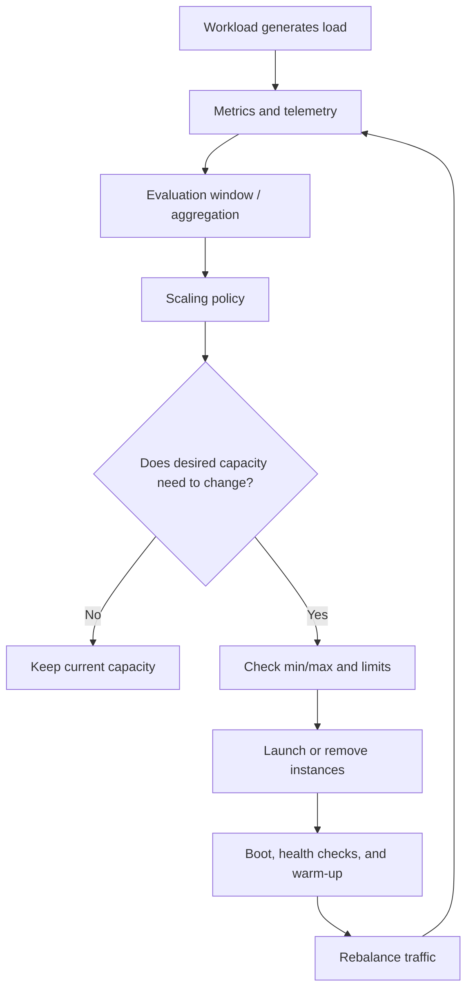
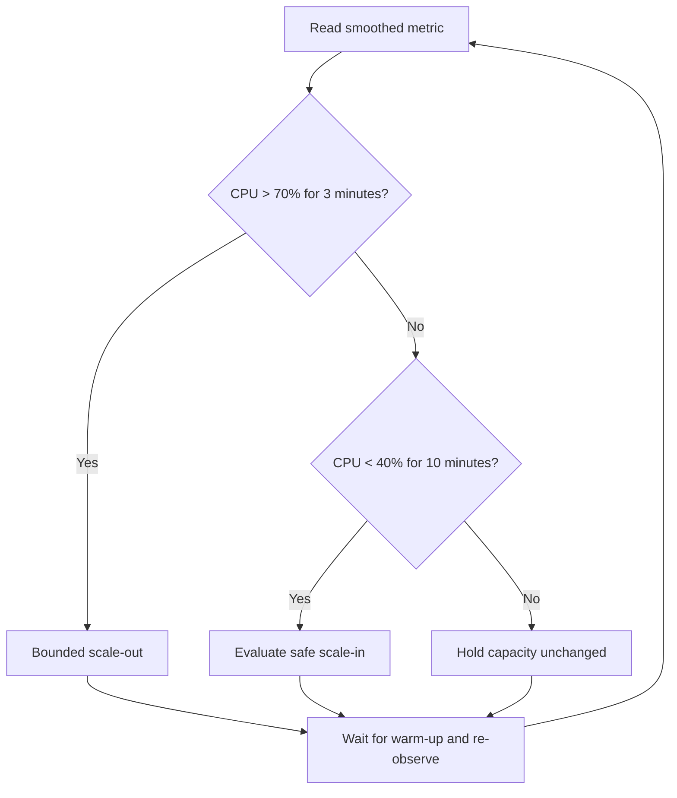

# Detecting Scaling Oscillation and Testing Policies Under Variable Load

## Learning objectives

After this lesson, you will be able to:

- Identify autoscaling oscillation (scaling oscillation or flapping) when a VM group repeatedly adds and removes instances.
- Distinguish oscillation caused by thresholds, noisy metrics, startup delays, cooldowns, warm-up, and genuine load fluctuations.
- Interpret workload and machine-group metrics to diagnose why a scaling policy overreacts or reacts too slowly.
- Design scale-out and scale-in rules with appropriate thresholds, stabilization windows, and step sizes.
- Plan autoscaling policy tests covering ramps, drops, spikes, periodic cycles, and multi-stage profiles.
- Evaluate policy quality via latency, error rate, capacity, instance change frequency, response time, and cost.
- Tune policies based on telemetry and roll out changes in controlled stages.

## 1. Autoscaling and the oscillation problem

Autoscaling automatically adjusts instance count or capacity to match workload demand. When load rises, the machine group adds capacity; when load falls, the group can remove instances to save cost. The autoscaling controller observes metrics or schedules, evaluates policies, and requests VM launches or terminations.

In practice, traffic rarely shifts smoothly. Requests can arrive in bursts, batch jobs run on schedules, caches experience cold starts, and new instances need boot and warm-up time. Metrics also have reporting lag, noise, and natural variance. If a policy reacts too sensitively or ignores system delays, the machine group can repeatedly expand and shrink capacity.

**Scaling oscillation** occurs when scaling decisions repeatedly reverse around a load boundary. For example:

- CPU crosses a threshold, so the autoscaler adds two VMs.
- New VMs start, traffic rebalances, and average CPU drops.
- The scale-in policy sees low CPU and removes VMs.
- Load on the remaining VMs rises again, CPU crosses the threshold, and scale-out triggers again.
- The cycle repeats even though actual aggregate demand barely changed.

This behavior is often called flapping when instance counts or states bounce back and forth frequently. It inflates costs, disrupts connections, stresses control planes, keeps caches cold, and prevents applications from stabilizing.

Not every instance-count change is harmful oscillation. When traffic genuinely cycles up and down, capacity adjustments are the intended behavior. Distinguish healthy adaptation from policies reversing repeatedly due to mismatched metrics, thresholds, or control timings.

### Example oscillation cycle

| Time | Average CPU | Desired capacity | Action |
|---|---:|---:|---|
| 10:00 | 78% | 4 | Scale out to 6 |
| 10:04 | 42% | 6 | Load spreads out, CPU drops |
| 10:07 | 31% | 6 | Scale in to 4 |
| 10:11 | 76% | 4 | Scale out to 6 |
| 10:15 | 40% | 6 | Cycle begins repeating |

This table illustrates a policy reacting too quickly to average CPU. To confirm root cause, inspect request rate, latency, requests per instance, startup duration, and per-machine metrics. A CPU drop after scale-out may indicate capacity met demand, or it may happen because traffic has not shifted to new VMs yet or metrics are computed over too short a window.

## 2. How does an autoscaling controller work?

An autoscaling controller typically includes:

1. **Metrics or schedules:** CPU, request rate, queue depth, latency, active connections, or expected load calendars.
2. **Evaluation window:** the time range and aggregation method used to evaluate the policy.
3. **Scaling policy:** conditions and magnitude of desired capacity changes.
4. **Capacity bounds:** min, max, and permitted instance limits.
5. **Cooldown/stabilization:** mechanisms throttling consecutive changes or delaying opposite-direction actions.
6. **Instance lifecycle:** launch, boot, health checks, warm-up, traffic admission, draining, and termination.
7. **Feedback:** post-change metrics are collected so the controller re-evaluates.

Conceptual diagram:



This is a feedback loop. Capacity changes affect metrics, which in turn drive the next decision. If the controller ignores delays and the impact of its own recent actions, it can overcorrect.

### 2.1. Delays in the control loop

From the moment load increases until new VMs actually relieve existing machines, multiple stages occur:

- Metrics are sampled and shipped to monitoring.
- The system waits for enough datapoints in the evaluation window.
- The autoscaler evaluates the policy and updates desired capacity.
- The control plane provisions the VMs.
- VMs boot and run cloud-init or startup scripts.
- The application loads configuration, connects to dependencies, and warms caches.
- Health checks pass and the load balancer begins routing traffic.

If this entire sequence takes several minutes, the policy must not assume new capacity appears the instant a scale-out command fires. If metrics stay elevated while VMs boot, the autoscaler may issue extra launch requests, causing overshoot.

### 2.2. Desired, current, and healthy capacity

Distinguish three concepts:

- **Desired capacity:** number of instances the autoscaler wants the group to have.
- **Current capacity:** number of instances currently existing or counted as part of the group by the platform.
- **Healthy/serving capacity:** number of instances ready to take load and actively serving requests.

During scale-out, desired might be 8 while current is 6 because two VMs are still booting, leaving serving capacity at 6. Evaluating only desired or current without checking serving capacity misestimates true load on live machines.

Similarly, during scale-in, a VM selected for removal may still be draining connections. Do not assume that capacity has left the pool until traffic drains away and shutdown finishes cleanly.

## 3. Common causes of scaling oscillation

### 3.1. Scale-out and scale-in thresholds too close together

If scale-out triggers above 60% CPU and scale-in triggers below 60% CPU, metrics hovering around 60% cause constant reversals. This reflects a lack of hysteresis.

For example, consecutive CPU readings of 59%, 61%, 58%, and 62% can cause the controller to launch and terminate machines endlessly if every datapoint immediately triggers an action.

The standard fix is separating the two thresholds, adding sustained confirmation windows, and capping step sizes. For instance, scale out when CPU exceeds 70% over a short window, yet scale in only when CPU stays below 40% for a longer window. Tune exact numbers to each workload.

### 3.2. Overly noisy or unrepresentative metrics

CPU can spike briefly due to garbage collection, backups, cron jobs, or startup tasks. A 30-second spike rarely justifies adding a VM. Conversely, average CPU may appear low even while individual instances saturate or one request path suffers high latency.

Unrepresentative metrics drive poor decisions:

- Average CPU masks a single hot instance.
- Aggregate request count hides varying per-request processing costs.
- Network bytes do not reflect request volume.
- Queue depth can grow because consumers are failing rather than lacking instances.
- Latency can climb due to a slow database despite spare compute.
- New instances lacking datapoints skew group aggregations.

Pick metrics tied closely to user-facing objectives or the workload's actual resource bottleneck.

### 3.3. Evaluation window too short

Short evaluation windows make policies react to transient jitter. Overly long windows make the system sluggish during sudden traffic ramps.

Match windows to workload dynamics and system response times. For bursty workloads, queue depth or request rate paired with a confirmation window works well. For steadier traffic, smoothed per-instance CPU or request rates can be effective.

### 3.4. Mismatched cooldown and stabilization settings

Cooldown is the period a policy suppresses or delays subsequent actions after a scaling event. A stabilization window is typically used to block premature reversals, particularly during scale-in.

If cooldown is too short, the autoscaler keeps acting before new VMs become ready. If too long, the system stays under-provisioned when load continues rising.

Naming and execution vary across providers. Some policies separate scale-out and scale-in cooldowns; others use stabilization windows or instance warm-up timers. Never assume these mechanisms share identical semantics.

### 3.5. Instance warm-up left unaccounted for

New VMs need time to boot and initialize applications before contributing full serving capacity. If the autoscaler treats a new VM as full capacity the moment its state switches to Running, subsequent scaling math breaks down.

Define explicitly when an instance counts as useful capacity:

- Has the VM finished booting?
- Are monitoring agents emitting metrics?
- Has the application loaded models/caches?
- Has the readiness check passed?
- Has the load balancer started routing traffic?
- Has the instance cleared warm-up so its metrics reflect steady state?

### 3.6. Overly aggressive scale-in

Scale-in immediately raises CPU on surviving machines. If a policy ignores post-removal load, the group bounces right back to scale-out. Scale-in also induces secondary turbulence via cold caches, connection reconnects, session migrations, or job transfers.

Generally, make scale-in more conservative: lower thresholds, longer confirmation windows, and smaller removal steps. For stateless, fast-starting workloads, scale-in can be tuned more flexibly after load testing.

### 3.7. Multiple policies controlling the same group

When multiple policies mutate desired capacity concurrently, combined behavior becomes unpredictable. Examples:

- A CPU policy scales out.
- A request-count policy scales in.
- A scheduled action forces capacity to a fixed number.
- External automation updates desired capacity.
- An operator manually edits min/max mid-test.

Clarify which policy holds final authority, how the platform reconciles concurrent policies, and precedence rules. Never let two independent controllers write to desired capacity without coordination.

### 3.8. Load changes induced by autoscaling itself

Scale-out can increase downstream traffic, cache misses, database connections, or concurrent consumers. Launching VMs can spike aggregate database connection pools and overload the database. As the app slows down, the autoscaler launches even more VMs, deepening the incident.

This creates a compute-dependency feedback loop. Pair compute autoscaling with connection limits, queues, rate limits, and capacity planning across databases, caches, networks, and dependencies.

## 4. Hysteresis: creating separation between scale-up and scale-down thresholds

Hysteresis uses distinct thresholds for opposing control directions to prevent continuous reversals around a single point.

Example:

- Scale out if average CPU stays above 70% for 3 minutes.
- Scale in if CPU stays below 40% continuously for 10 minutes.
- Between 40% and 70%, keep current capacity unchanged.

The gap between thresholds acts as a deadband. Minor metric jitter inside that band leaves machine counts steady.



Hysteresis alone does not eliminate every cause. With flawed metrics, excessive warm-up lags, or steep periodic cycles, oscillation can still occur. Combine hysteresis with proper evaluation windows, step caps, and testing.

### 4.1. Sizing the hysteresis band

Never pick thresholds by guesswork. Instead:

1. Collect metric history across normal and high-load periods.
2. Identify the metric range where the app meets SLOs.
3. Locate the load point where latency or error rates start climbing.
4. Set scale-out before the system reaches the unsafe zone.
5. Set scale-in lower, requiring sustained low load.
6. Simulate noisy metrics around both thresholds to confirm the policy does not flip-flop.

If target CPU is 60% yet latency climbs at 65%, scale-out must trigger before breaching that boundary. If normal CPU fluctuates between 35% and 55%, place the scale-in threshold below that band or pick a cleaner metric.

### 4.2. Scale-out and scale-in do not need to be symmetric

Scale-out and scale-in serve different objectives:

- Scale-out prioritizes protecting SLOs as load rises.
- Scale-in prioritizes cost savings while preserving capacity and preventing disruption.

Using a shorter reaction window for scale-out and a longer stabilization window for scale-in is common practice, balanced against cost and VM boot speed.

## 5. Selecting appropriate autoscaling metrics

CPU is convenient, yet unsuitable for every workload. Good policies rely on metrics directly tied to load or serving capacity.

| Workload type | Candidate metrics | Key considerations |
|---|---|---|
| Stateless web/API | Requests/second per instance, active requests, CPU, latency | Request costs vary; latency also reflects dependencies |
| Queue worker | Queue depth per worker, oldest message age, processing rate | Queue growth can stem from failing workers or producer bursts |
| Batch processing | Pending jobs, estimated completion time, worker utilization | Job execution durations can vary widely |
| Stream processing | Consumer lag, partition assignments, processing throughput | Partition count can cap maximum useful workers |
| Memory-heavy service | Memory pressure, working set, swap/OOM events | RAM rarely drops immediately when request rate falls |
| Network-heavy service | Network throughput per instance, packet rate | Bounded by NIC and instance bandwidth caps |
| GPU workload | GPU utilization, pending inferences/jobs, accelerator memory | Include GPU metrics and model initialization times |

### 5.1. Per-instance metrics

For evenly balanced workloads, requests per instance reflects demand better than aggregate request rate.

For example, if one instance reliably handles ~200 requests/second within the p95 latency SLO, 5 instances yield ~1,000 requests/second theoretically. Always validate experimentally because requests vary, caches start cold, and dependencies can bottleneck.

Metrics like backlog per worker also outperform raw queue depth when worker counts change dynamically.

### 5.2. Target metrics and target tracking

Target tracking keeps a metric near a target value—for example, holding average CPU near 55% or requests per instance near a benchmarked target.

Keep in mind:

- The metric must respond predictably as capacity changes.
- Telemetry must report continuously with acceptable lag.
- Adding instances must lower per-instance load when work is distributable.
- Avoid metrics dominated primarily by external dependencies.
- Setting the target too low wastes capacity; setting it too high leaves insufficient headroom.

Target tracking adjusts step sizes dynamically via platform algorithms. Never assume it always adds exactly one instance or behaves identically to step scaling.

### 5.3. Combining SLO guardrail metrics

Some systems require multiple signals:

- A primary scaling metric, such as requests per instance.
- A guardrail metric watching SLO health, such as p95 latency or error rate.
- Dependency metrics flagging saturated databases or queues.
- Capacity metrics tracking genuinely healthy, serving instances.

You can combine multiple policies or composite alarms, provided you understand how the platform merges actions. Avoid creating two conflicting policies.

## 6. Tuning cooldowns, warm-up, and stabilization

### 6.1. Instance warm-up

Warm-up is the duration a new instance needs to become a stable capacity unit. It may encompass:

- Booting the OS and starting agents.
- Pulling images or packages if needed.
- Starting the application process.
- Loading models, caches, or configuration datasets.
- Establishing connection pools.
- Passing readiness and starting to serve traffic.
- Stabilizing post-startup CPU/RAM spikes.

Measure warm-up from real telemetry rather than assuming OS boot time equals readiness. A VM may report Running in 30 seconds yet need another 2 minutes to load a model and serve requests cleanly.

### 6.2. Cooldown

Cooldown caps how often a policy acts within a window after a scaling event, preventing fresh decisions before prior changes show up in metrics.

Never use cooldowns as a band-aid for a broken policy. Overly long cooldowns starve capacity; overly short cooldowns launch extra VMs before earlier ones finish booting.

### 6.3. Scale-in stabilization

Scale-in stabilization (or equivalent delays) holds back capacity reductions across an observation window so brief metric dips do not trigger premature terminations.

For example, if CPU dips right after a batch job ends, the system waits before removing VMs. If load returns during the window, the scale-in decision cancels or adjusts depending on platform rules.

### 6.4. Reference configuration guidance

| Component | Design guidance |
|---|---|
| Scale-out evaluation | Short enough to catch rising load while filtering transient spikes |
| Scale-out cooldown | Aligned with new VM boot and warm-up times |
| Instance warm-up | Measured until the instance serves steadily |
| Scale-in threshold | Lower than scale-out threshold or separated by a deadband |
| Scale-in evaluation | Longer window to confirm sustained low load |
| Scale-in stabilization | Long enough to observe effects and prevent reversals |
| Step adjustment | Caps instances added or removed per action |
| Min/max | Protects baseline availability and caps cost/capacity |
| Health checks | Counts only instances genuinely ready to serve |
| Drain timeout | Long enough to finish active requests/connections per SLA |

Exact parameter names and behaviors differ across platforms. Check min/max limits, maximum wait caps, and evaluation order for your specific service.

## 7. Step scaling, target tracking, and scheduled/predictive scaling

### 7.1. Step scaling

Step scaling divides a metric into bands and assigns a capacity adjustment to each band.

Illustrative example:

| Average CPU | Action |
|---|---|
| Below 35% for 10 minutes | Remove 1 instance if above min |
| 35–65% | Hold steady |
| 65–80% for 3 minutes | Add 1 instance |
| Above 80% for 2 minutes | Add 2 instances, up to max |

Its strength is explicit control over step increments/decrements. Its drawback is tuning complexity; overly narrow bands or oversized steps can still cause oscillation.

### 7.2. Target tracking

Target tracking holds a metric near a target. It works well when the metric scales roughly linearly with per-instance demand, such as CPU or requests per instance on uniform workloads.

Evaluate:

- Does the target maintain SLOs during peak hours?
- When instances are added, does the metric drop as expected?
- Are there metric lags or missing datapoints?
- Does the target pin the group at excessively high capacity?
- Does scale-in happen too quickly during brief load dips?

### 7.3. Scheduled scaling

Scheduled scaling pre-provisions capacity ahead of known events, such as raising VM counts before business hours or batch windows. It eliminates boot lag for predictable traffic patterns.

Never leave static schedules unchecked against real demand. Scaling too early or too high wastes money. Pair a scheduled baseline with dynamic scaling to handle deviations from forecasts.

### 7.4. Predictive scaling

Predictive scaling uses historical trends or forecasting models to stage capacity ahead of expected demand. It helps with recurring cycles, though forecasts miss during marketing campaigns, anomalies, or shifting user behavior.

Keep dynamic scaling active as a reactive layer for forecast error, bounded by min/max limits. Track forecast accuracy, lead times, and over-provisioned capacity costs.

## 8. Testing policies under variable load

You cannot validate autoscaling with a single linear ramp-up. A policy that behaves smoothly during steady ramps can oscillate wildly under rapid ups and downs or bursts.

Testing goals:

- Verify scale-out triggers early enough to protect SLOs.
- Verify scale-in waits for sustained low load.
- Measure elapsed time from load increase until new capacity serves traffic.
- Catch excessive scale-out/scale-in events.
- Validate min/max bounds and capacity caps.
- Verify behavior under unexpected spikes or slow dependencies.
- Evaluate costs and idle headroom.

### 8.1. Load profiles to test

| Load pattern | Description | What to observe |
|---|---|---|
| Step-up | Sudden jump from low to high load | Scale-out latency and SLOs while waiting |
| Ramp-up | Gradual increase over time | Whether capacity grows smoothly and early enough |
| Step-down | Sudden drop in load | Whether scale-in waits for stability and avoids premature cuts |
| Burst | Brief spike returning to baseline | Whether policy avoids over-scaling for short spikes |
| Sawtooth | Repeated up-and-down cycles | Whether hysteresis prevents flapping |
| Oscillating/noisy | Load jittering around thresholds | Whether policy holds capacity steady inside deadband |
| Diurnal | Day/night traffic cycles | Whether scheduled/predictive scaling improves responsiveness |
| Mixed | Overlapping load patterns simultaneously | Whether policies conflict or dependencies overload |
| Dependency slowdown | Database/cache slows while requests continue | Whether autoscaler adds useless VMs and worsens dependency load |
| Instance startup delay | Artificially prolonged boot/warm-up in test | Whether policy accounts for unready capacity |

### 8.2. Test matrix

Run each scenario across multiple load levels and durations:

- Low baseline to verify minimum capacity.
- Normal load to measure baseline cost and headroom.
- Load hovering near the scale-out threshold.
- Sustained high load.
- Spikes shorter than the evaluation window.
- Up/down cycles crossing thresholds.
- Load dropping and bouncing back inside the scale-in stabilization window.
- Load exceeding max capacity to verify ceiling behavior.

Repeat runs to separate deterministic policy behavior from random noise. Keep application configuration, images, dependencies, and datasets identical across comparisons.

### 8.3. Sawtooth scenario

Example variable load profile:

| Stage | Target load | Duration |
|---|---:|---:|
| Baseline | 20% | 5 minutes |
| Ramp up | 80% | 4 minutes |
| Drop | 35% | 4 minutes |
| Ramp up | 75% | 4 minutes |
| Drop | 30% | 6 minutes |
| Baseline | 20% | 5 minutes |

Monitor instance counts, CPU, requests per instance, p95/p99 latency, and scaling durations. If the group scales up and down on every brief wave unnecessarily, tune thresholds and stabilization. If instance counts stay steady across minor swings while scaling out on sustained high load, the policy is likely behaving appropriately.

## 9. Generating controlled test load

Use load testing tools such as k6, Locust, JMeter, or internal tools to produce repeatable traffic. Run tests in staging or approved environments; never inject spikes into production without an approved test plan and designated owner.

### 9.1. k6 example with staged load

```javascript
import http from "k6/http";
import { check, sleep } from "k6";

export const options = {
  stages: [
    { duration: "2m", target: 10 },
    { duration: "3m", target: 40 },
    { duration: "4m", target: 80 },
    { duration: "3m", target: 20 },
    { duration: "3m", target: 10 }
  ],
  thresholds: {
    http_req_failed: ["rate<0.01"],
    http_req_duration: ["p(95)<500"]
  }
};

export default function () {
  const response = http.get(__ENV.TARGET_URL);
  check(response, {
    "status is 200": (r) => r.status === 200
  });
  sleep(1);
}
```

This is an illustrative example. `TARGET_URL` must point to a test endpoint backed by appropriate test data and dependencies. The 500 ms threshold and 1% error rate are examples—replace them with your system's SLOs. Virtual users do not equal requests/second; actual throughput depends on response times and `sleep` duration.

### 9.2. Generating cyclic load

Use repeated ramp-up and ramp-down stages to simulate sawtooth patterns. Keep endpoints and payloads consistent across comparison runs. When testing mixed heavy/light requests, isolate each class so you know which metric triggers scaling.

Never scale tests by sending unbounded uncontrolled traffic. Enforce caps on VUs, request rate, duration, timeouts, and automatic abort conditions if error rates or latency breach safety limits.

### 9.3. Testing queue-based scaling

For queue workers:

- Run a producer emitting messages at controlled rates.
- Vary producer rates across stages.
- Record queue depth, oldest message age, processing rate, and worker count.
- Inject slow or failing consumers to verify the autoscaler distinguishes missing workers from broken workers.
- Confirm zero lost or duplicate messages during scale-in.

Queue depth can climb due to heavy or poison messages. If the autoscaler checks only total queue depth, it can add workers indefinitely without clearing the backlog. Monitor oldest message age, processing throughput, and error rates by message type.

## 10. Metrics for evaluating autoscaling quality

Judge policies on service outcomes, capacity behavior, and cost—counting instance changes alone is insufficient.

| Category | Metrics | Meaning |
|---|---|---|
| User experience | p50/p95/p99 latency | How long users wait |
| Reliability | Error rate, timeouts, availability | Whether load spikes trigger failures |
| Demand | Request rate, queue depth, oldest message age | Real workload demand |
| Capacity | Desired/current/healthy instance counts | Whether enough serving machines exist |
| Resources | Per-instance CPU, RAM, disk, network | Whether machines are saturating |
| Scaling behavior | Scale-out/in counts, direction reversals | Whether flapping or over-frequent changes occur |
| Responsiveness | Time to scale, instance warm-up time | How quickly new capacity becomes useful |
| Efficiency | Average utilization, idle capacity | Whether excess capacity is wasted |
| Cost | Instance-hours, cost per request/job | Cost to serve the load |
| Dependencies | DB connections, cache hits, downstream latency | Whether compute scaling overloads dependencies |

### 10.1. Counting direction reversals

A simple measure of flapping is counting scaling direction reversals inside an observation window.

Examples:

- Scale-out -> scale-in -> scale-out within 15 minutes: two direction reversals.
- Multiple consecutive scale-outs as load climbs steadily: not necessarily oscillation.
- Multiple consecutive scale-ins as load falls steadily: may be healthy staged scale-in.

Track change counts, total instance-hours, and SLO stability together. Never apply a single arbitrary reversal limit across every workload.

### 10.2. Autoscaling response time

This can be broken into stages:

\[
T_{\text{useful capacity}} =
T_{\text{detect}} +
T_{\text{decision}} +
T_{\text{provision}} +
T_{\text{boot}} +
T_{\text{warm-up}} +
T_{\text{ready}}
\]

This is an investigative breakdown; stages may overlap depending on the platform. Measure from the instant load crosses the trigger condition until new instances actively serve traffic.

If this total duration exceeds how long the workload can tolerate peak stress, retain baseline capacity, use scheduled/predictive scaling, or pick faster-starting compute.

### 10.3. Cost and efficiency

Compute relative efficiency metrics:

\[
\text{Cost per request} =
\frac{\text{Compute cost in period}}{\text{Successful requests in period}}
\]

For workers:

\[
\text{Cost per job} =
\frac{\text{Compute cost in period}}{\text{Completed jobs}}
\]

Compare across identical workloads and SLOs. A policy yielding low cost per request while breaking error-rate SLOs is not an acceptable policy.

## 11. Policy tuning workflow

Once load tests produce telemetry, tune parameters in order:

1. **Verify metrics:** confirm source, units, aggregation, and sampling period.
2. **Verify workload:** confirm test traffic matches production request/job mixes.
3. **Verify warm-up:** confirm new instances count toward serving capacity at the right moment.
4. **Tune scale-out:** ensure fast enough reaction before SLOs degrade.
5. **Tune scale-in:** lengthen stabilization, lower thresholds, and shrink step sizes.
6. **Tune hysteresis:** size the deadband above normal metric noise.
7. **Tune cooldown/stabilization:** align with control-loop lag and boot times.
8. **Tune step size:** avoid adding or removing too many VMs at once.
9. **Check min/max:** confirm baseline sufficiency and quota/cost ceilings.
10. **Check dependencies:** prevent compute scaling from saturating databases or caches.
11. **Re-run the same scenario:** compare against baseline and document edits.
12. **Roll out gradually:** validate on a canary or small group before expanding.

Change only one parameter group per iteration so effects remain attributable. Changing metrics, thresholds, cooldowns, and min/max simultaneously obscures what actually helped or hurt.

### 11.1. Tuning example

Suppose an initial policy scales out above 60% CPU for 1 minute and scales in below 60% for 1 minute. Sawtooth tests show 8 direction reversals in 30 minutes.

Reviewing telemetry reveals natural CPU jitter around 60% and roughly 3 minutes of VM warm-up. The team tests a revised configuration:

- Scale out above 70% CPU for 3 minutes.
- Scale in below 40% CPU for 10 minutes.
- Add at most 2 VMs per scale-out.
- Remove at most 1 VM per scale-in.
- Count warm-up until readiness passes and metrics stabilize.
- Keep min capacity sufficient for baseline and cap max by quotas/cost.

Re-run the identical load profile. If error rates and latency meet SLOs, reversals drop, and costs stay reasonable, promote the new policy. These thresholds are illustrative only—never copy them verbatim to unrelated workloads.

## 12. Safety guardrails during testing

Load testing and autoscaling edits can incur significant spend or impact shared dependencies. Before running tests:

- Use staging or resource-capped environments.
- Set explicit min/max bounds and verify quotas.
- Cap VUs, request rates, and test duration.
- Define automatic stop thresholds when latency, errors, or dependency load exceed safety limits.
- Ensure tests never send real emails, process live payments, or mutate production data.
- Use synthetic datasets and resettable endpoints.
- Monitor spend and instance counts continuously during tests.
- Assign an active operator who knows how to abort the load generator immediately.
- Never run overlapping load tests without accounting for combined load.
- After testing, confirm the autoscaler returns to baseline with zero leftover test VMs or jobs.

### 12.1. Testing behavior at max capacity

Once demand exceeds max capacity, the autoscaler cannot add more VMs. Verify:

- Does desired capacity clamp accurately at max?
- Does a max-capacity-reached alert fire?
- Does the system rate-limit, queue, or shed load?
- How do latency and error rates behave?
- Do dependencies stay protected from overload?
- Are fallback responses or user-facing error notices in place?

Max capacity is not merely a cost cap; it is the boundary where overload protection must take over.

### 12.2. Testing scale-in and in-flight work

For stateful or worker workloads:

- Enable appropriate drain/termination hooks.
- Never terminate instances holding unique local data.
- Ensure jobs finish, checkpoint, or return safely to the queue.
- Use idempotency to handle retries safely.
- Monitor active connections and in-flight requests.
- Verify VMs do not terminate before shutdown finishes.

## 13. Design patterns to reduce oscillation

### 13.1. Maintaining baseline capacity

Keeping enough minimum instances to serve baseline load shortens reaction times when traffic climbs, reduces cold starts, and keeps caches warm.

Setting min capacity too high wastes money; setting it too low leaves the app exposed to scale-out delays. Balance baseline demand, SLOs, and cost.

### 13.2. Fast scale-out, cautious scale-in

A widely used pattern:

- Scale out decisively on strong evidence of sustained high load.
- Scale in only after prolonged low load while preserving post-removal headroom.
- Remove capacity in small steps.
- Drain before terminating.
- Keep spare reserve capacity during transitions.

This lowers capacity-shortage risk while keeping extra VMs slightly longer. Evaluate trade-offs using cost and SLOs.

### 13.3. Using queues to absorb bursts

For asynchronous workloads, queues buffer brief spikes while workers scale on backlog and message age, avoiding unnecessary VM launches for fleeting bursts.

However, queues do not erase latency SLAs. If jobs must complete within a deadline, scale on oldest message age or estimated drain time rather than raw queue depth alone.

### 13.4. Rate-limiting capacity changes

Some platforms cap how many instances change per action or enforce intervals between actions. Pick step sizes that avoid booting too many VMs simultaneously, which can trigger image pull storms, network congestion, database connection spikes, or quota hits.

### 13.5. Separating workloads

When one VM group serves multiple workloads with distinct profiles, aggregate metrics blur individual demand. Splitting groups by application, queue, or job class clarifies scaling signals.

Avoid splitting so finely that individual groups lack sufficient telemetry or suffer low utilization. Balance isolation against operational overhead.

### 13.6. Scheduled/predictive scaling for calendar load

For predictable peak hours, stage capacity ahead of load arrival while letting dynamic scaling handle real-time variance. Monitor forecast accuracy and early-provisioning cost.

## 14. Real-world example: API oscillating around a CPU threshold

An API uses an autoscaling group with min 2 and max 12. Initially, the policy scales out above 65% CPU and scales in below 65% CPU, using a 1-minute evaluation window. New VMs take roughly 4 minutes from launch to readiness.

During cyclic load testing, the team observes:

- CPU naturally fluctuates between 60% and 68%.
- The policy constantly changes desired capacity.
- Additional scaling decisions fire before booting VMs even start serving.
- As traffic shifts onto new machines, CPU drops below threshold and triggers scale-in.
- p95 request latency spikes wildly on every cycle.

The team analyzes and adjusts:

1. Switched to smoothed CPU paired with requests per instance.
2. Raised the scale-out threshold well above the scale-in threshold.
3. Required multiple consecutive high CPU datapoints before scaling out.
4. Set warm-up to match real launch-to-readiness duration.
5. Restricted scale-in to prolonged low periods, removing one VM at a time.
6. Scheduled min 3 during predictable high-baseline hours.
7. Verified max capacity against quotas and database connection caps.
8. Re-ran step-up, step-down, sawtooth, and burst tests.

Results were evaluated via p95/p99 latency, error rate, scale time, direction reversals, and instance-hours. When latency stabilized yet average instance counts rose too high, the team fine-tuned min capacity and targets; any change that cut cost at the expense of SLO compliance was rejected.

## 15. Common misconceptions

- **"CPU dropped after scale-out, so we should scale in immediately."** Wait for metrics to stabilize and verify remaining load after removing a machine.
- **"Longer cooldowns are always better."** Overly long cooldowns make the system sluggish; size them around warm-up and control-loop lag.
- **"CPU fits every workload."** Queue workers, memory-heavy, network-heavy, and GPU workloads often require other metrics.
- **"Desired capacity equals serving capacity."** Booting or unready VMs are not yet serving traffic.
- **"Scale-in should mirror scale-out symmetrically."** Scale-in needs greater caution to avoid overloading surviving machines and severing connections.
- **"One ramp-up test is enough."** You must also test bursts, step-downs, sawtooth waves, noisy load, and dependency slowdowns.
- **"Rising queue depth always requires more workers."** Failing consumers or poison messages inflate queues even when adding workers helps nothing.
- **"Adding VMs always speeds up the app."** Databases, caches, or networks can become the new bottleneck.
- **"Max capacity is just a technical cap."** It is an operational limit requiring alerts and overload-handling behavior.
- **"Stable autoscaling means static instance counts."** Groups should track real demand; the goal is meeting SLOs with reasonable change frequency and cost.
- **"Predictive scaling replaces dynamic scaling."** Forecasts contain errors; dynamic policies remain necessary for unexpected demand.
- **"Bigger load tests are always better."** Tests require caps, safe datasets, and abort criteria to avoid causing outages.

## 16. Testing and operations checklist

### Before testing

- [ ] Defined SLO targets and workload profiles.
- [ ] Verified metric sources, units, aggregations, and evaluation windows.
- [ ] Recorded current min, max, desired capacity, and active policies.
- [ ] Measured instance boot, warm-up, and readiness times.
- [ ] Documented cooldowns, stabilization windows, and step sizes.
- [ ] Checked quotas, zone capacity, dependencies, and test budget.
- [ ] Prepared step, ramp, burst, sawtooth, and step-down scenarios.
- [ ] Configured load caps and abort conditions.
- [ ] Prepared dashboards, logs, event streams, and an active observer.

### During testing

- [ ] Recorded target load vs. actual load over time.
- [ ] Monitored desired, current, and healthy capacity.
- [ ] Monitored CPU, RAM, queues, request rates, and latency.
- [ ] Logged timestamps whenever policies triggered scaling actions.
- [ ] Recorded VM boot, warm-up, and readiness durations.
- [ ] Counted scale-out events, scale-in events, and direction reversals.
- [ ] Watched dependencies and max capacity behavior.
- [ ] Aborted tests immediately if safety thresholds were breached.

### After testing

- [ ] Confirmed the group returned to baseline or target steady state.
- [ ] Verified no orphaned test VMs or jobs remained.
- [ ] Compared SLOs, costs, and capacity change counts.
- [ ] Diagnosed root causes of any oscillation.
- [ ] Changed only one parameter group per tuning iteration.
- [ ] Re-ran the same test scenarios for valid comparison.
- [ ] Documented final policies, test results, and known limits.
- [ ] Rolled out gradually and continued monitoring post-deployment.

## 17. Self-check

**Scenario 1:** CPU hovers around 60%, and both scale-out and scale-in policies use a 60% threshold. Why can the VM group flap?

**Hint:** Noisy metrics crossing a single shared threshold cause continuous reversals. Add hysteresis with separated scale-out and scale-in thresholds, confirmation windows, and step caps.

**Scenario 2:** The autoscaler requested 3 more VMs, yet latency remains high for the next 4 minutes. Should you keep scaling out immediately?

**Hint:** Inspect desired/current/healthy capacity, boot times, and warm-up. If new VMs are not serving yet, account for control-loop lag; also check whether databases or other dependencies are causing the latency.

**Scenario 3:** Queue depth rises rapidly, yet oldest message age stays flat and processing rate remains high. Do you necessarily need more workers?

**Hint:** Not necessarily. Producers may be emitting a short burst while workers keep pace. Check message SLAs and backlog trends before scaling.

**Scenario 4:** After scaling in one VM, CPU on remaining VMs jumps from 35% to 72% and the policy immediately scales back out. What should be tuned?

**Hint:** Scale-in fired too early or removed too much capacity. Lengthen low-load confirmation windows, shrink scale-in step sizes, and verify remaining headroom after removing one machine.

**Scenario 5:** A ramp-up load test meets SLOs, yet a sawtooth test causes 10 direction reversals in 20 minutes. What should you inspect?

**Hint:** Check hysteresis, evaluation windows, cooldowns, warm-up, metric aggregation, and multiple policies acting on the group. Re-run the exact same profile after tuning one parameter at a time.

**Scenario 6:** The compute autoscaler keeps adding workers, yet the queue keeps growing and database connections hit their limit. What should you do?

**Hint:** This points to a dependency bottleneck. Cap concurrency/connections, inspect database throughput, throttle producers or workers, and stop blindly scaling compute.

## Conclusion

Scaling oscillation occurs when an autoscaling control loop reacts too sensitively, lacks hysteresis, or ignores boot lag, warm-up times, and scale-in impact. Choose metrics aligned with true demand, separate scale-up and scale-down thresholds, tune evaluation and stabilization windows, and cap capacity step sizes. Test across diverse load shapes—including step, ramp, burst, sawtooth, and dependency slowdowns—while evaluating SLOs, serving capacity, direction reversals, scaling speed, and cost together. A well-tuned policy tracks real demand, keeps services stable, and behaves safely when hitting limits.
