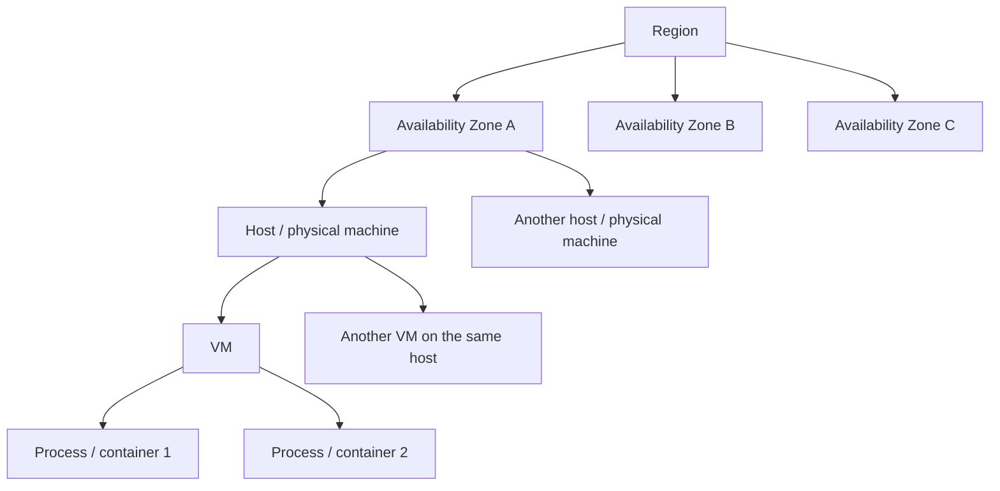
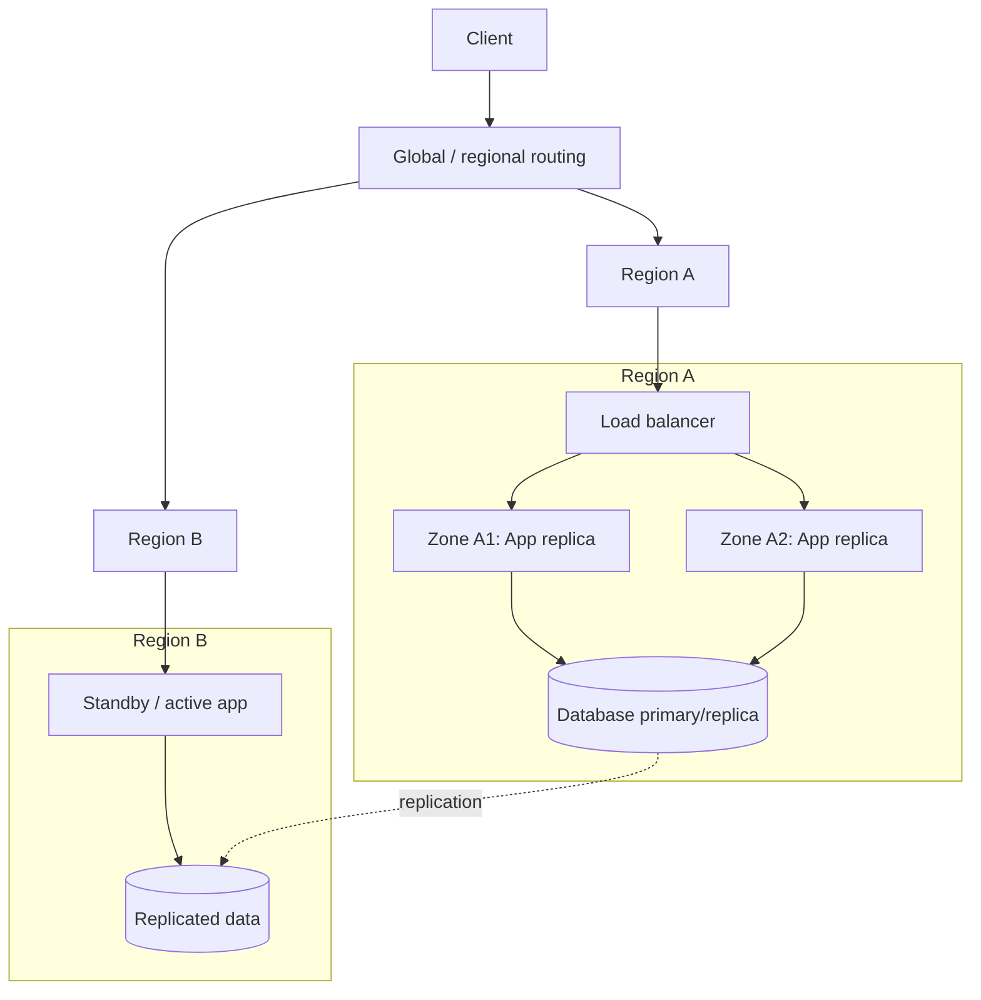

# Identifying Failure Domains at Process, Machine, Zone, and Region Levels

## Context: Knowing What a Failure Can Break

An application running in the cloud can consist of multiple processes, containers, VMs, networks, storage, and supporting services. Creating multiple replicas only increases availability when those replicas do not share a dependency on a single point of failure. If three VMs are all placed in the same availability zone, a zone-level outage can disconnect all three VMs at the same time. If multiple containers run on the same VM, a kernel or host failure can stop all containers. If multiple processes share a single database, a database outage can still render the entire application unavailable.

A **failure domain** is the scope of resources or components that can be affected together by a single outage or a common cause. Identifying failure domains helps design replica placement, limit blast radius, choose a failover strategy, and decide the required level of redundancy.

In the **CLOUD_CORE_SERVICES_COMPUTE** module, failure domains must be examined at a minimum of four levels: process, machine (VM/host), zone, and region. Each level has a different probability, impact scope, recovery time, and cost. A highly available architecture must distribute workloads and dependencies so that a fault in one domain does not eliminate total serving capacity.

## 1. Failure Domain, Fault, Failure, and Blast Radius

These terms are related but not synonymous:

- **Fault:** a cause or defect that can lead to an incident, such as a bug, misconfiguration, failed disk, or power loss.
- **Failure:** a state in which a component no longer performs its intended function, such as a process crash, an unbootable VM, or an unreachable zone.
- **Failure domain:** a group of components that can be affected together by a single fault or common event.
- **Blast radius:** the scope of users, workloads, data, or resources impacted when a failure occurs.
- **Fault tolerance:** the ability to continue providing functionality when one or more components encounter faults.
- **High availability (HA):** a design aimed at minimizing service unavailability, typically through redundancy, fault detection, and failover.

For example, a firewall misconfiguration can block an entire subnet. The fault is the misconfiguration; the failure is that the VMs in the subnet cannot receive requests; the failure domain may be the subnet or zone depending on the rule's scope; and the blast radius comprises the services and users depending on those VMs.

Failure domains are not solely physical boundaries. A shared credential, a control plane, a DNS zone, a release pipeline, or a shared IAM configuration can also create a logical failure domain. When evaluating HA, both infrastructure and operational/management dependencies must be reviewed.

## 2. Failure Domain Hierarchy



The diagram illustrates the nested relationships at a conceptual level. On cloud platforms, customers generally cannot see the exact physical host or rack where a VM runs. The provider manages this layer and may offer placement groups, anti-affinity, or host distribution mechanisms depending on the service.

### 2.1. Process-Level Failure Domain

This is the smallest scope among the levels considered. A process can fail due to a crash, deadlock, memory leak, unhandled exception, or exhaustion of file descriptors, thread pools, or connection pools. Containers often group one or more processes, yet a container is not a complete isolation boundary against underlying kernel or VM faults.

Characteristics:

- The impact scope can be limited to a single worker, process, or container.
- Can be restarted quickly by a process supervisor, container runtime, or orchestrator.
- Other processes on the same machine can continue operating if they do not share the exhausted resource or affected dependency.
- Faults in shared memory, kernel, filesystem, network namespace, or runtime can expand the impact beyond the process.

Example: a message-processing worker crashes when encountering a malformed payload. If the queue has multiple independent workers, the remaining workers can continue processing. Bounded retries, dead-letter queues, and idempotency are needed to prevent a poison message from causing continuous worker restarts or duplicate processing.

### 2.2. Machine-Level Failure Domain

At the machine level, a VM or server can experience guest OS errors, kernel panic, boot failure, filesystem corruption, disk exhaustion, NIC failure, a hung agent, or a physical host outage. Multiple processes/containers on the same machine can be lost simultaneously.

Characteristics:

- Restarting a process cannot recover service when the entire VM or host is down.
- A VM can be rebooted, recreated, or replaced with another instance.
- Data on the boot disk or local/ephemeral disk may be lost when replacing the machine.
- Different VMs may still share a host, rack, storage backend, network fabric, or control plane depending on the platform and placement configuration.

Two VMs with different IDs are not necessarily two independent failure domains. If they share a host or a storage/network dependency, a failure in the shared layer can still impact both. When host-level fault tolerance is required, use platform-supported placement/anti-affinity or distribution mechanisms and clearly understand their guarantee limits.

### 2.3. Availability-Zone-Level Failure Domain

An Availability Zone (AZ) is typically an independent infrastructure zone within a region, with separate power, networking, and facilities at a level defined by the provider. Distributing workloads across multiple AZs reduces the risk of a localized failure taking down the entire service.

Incidents that can affect a zone:

- Power loss or cooling failure in an infrastructure facility.
- Disruption to the zone's network fabric or internal connectivity.
- Storage or platform service issues scoped to the zone.
- Configuration changes or operational errors with zone-wide scope.

Zones are not always completely independent. Some managed services, DNS, identity, control planes, or storage may have cross-zone or region-wide dependencies. You must read the characteristics of each service and verify failure behavior rather than assuming all resources are isolated identically.

### 2.4. Region-Level Failure Domain

A region is a geographic scope containing multiple zones and typically has separate service infrastructure. Multi-region deployment reduces risk from broad outages affecting an entire region, regional configuration errors, prolonged connectivity loss, or disaster recovery requirements.

Regional incidents can include:

- Widespread connectivity loss to the region or simultaneous multi-zone failure.
- Outage of the region's control plane or shared regional services.
- Misconfigurations, IAM errors, or automation changes applied across the entire region.
- Data, replication, or dependency outages configured in only a single region.

Multi-region is more complex and costly than multi-zone. It requires addressing data replication, consistency, global routing, identity, secrets, DNS, quotas, spare capacity, and traffic shifting mechanisms. A second region that only exists on a diagram without tested data, capacity, or failover procedures is not reliable DR.

## 3. Identifying Practical Failure Domains in Architecture

To classify accurately, list all resources and ask: "If this component fails, which other components could fail at the same time or lose the ability to communicate?" The answer produces a dependency and failure domain map.

### 3.1. Processes and Containers

Common risks:

- Process crash or OOM kill.
- Deadlock, thread pool exhaustion, or blocked event loop.
- Container runtime failure or CrashLoopBackOff / continuous restarts.
- One pod exhausting CPU/memory or I/O and starving co-located workloads on the same node.
- Incorrect secrets/config causing multiple processes to crash simultaneously on startup.

Measures to limit blast radius:

- Separate workers or processes by role and reliability tier.
- Set appropriate CPU/memory requests and limits to prevent one workload from exhausting the node.
- Use liveness/readiness probes for their intended purpose; avoid overly aggressive probes that trigger continuous restarts.
- Design retries with backoff, retry limits, and dead-letter queues.
- Use circuit breakers, timeouts, and bulkheads so a failing dependency does not exhaust all thread/connection pools.
- Set concurrency and queue limits to apply backpressure.

A single restarting pod may be a minor incident if other replicas continue serving. However, if all replicas share an expired secret or pull a broken image, restarts happen across the board simultaneously. Therefore, process distribution must be paired with change control and shared-dependency management.

### 3.2. VMs, Hosts, and Machine Groups

When designing a VM fleet, distinguish between:

- **VM failure:** a single guest OS or instance fails.
- **Host failure:** a hypervisor or physical machine outage affects multiple VMs on the same host.
- **Rack/power/network failure:** multiple hosts in the same physical area are affected.
- **Placement failure:** VMs are placed in the same failure domain due to placement choices or missing spread options.

Cloud customers usually do not have permission to select exact physical hosts. Mechanisms such as spread placement, anti-affinity, dedicated hosts, or zone placement can be used if supported by the platform. These mechanisms have different goals and limits: spread distributes instances across multiple hosts; a dedicated host isolates the physical machine but does not inherently protect against zone failures; zone placement reduces zone risk but does not guarantee VMs in the same zone reside on different hosts.

For stateful VMs, determine where data resides. If data exists solely on ephemeral/local disk, recreating the VM can result in data loss. If using block volumes, inspect attach/failover semantics, multi-attach limits, and filesystem/database recovery capabilities. For file/object storage, understand zone/region dependencies and replication modes.

### 3.3. Zones and Dependent Services

A multi-AZ architecture must distribute all components required to serve requests:

- Compute instances or node pools.
- Load balancer targets/backends and network routes.
- Database replicas or cluster members.
- Appropriate caches, queues, brokers, and storage.
- Required NAT/egress, DNS resolvers, or endpoints.
- Quotas, secrets, identity, and control planes accessible during an outage.

Distributing web servers across three zones while keeping a single-node database in one zone still leaves a centralized point of failure. Similarly, if all backends call a single cache or route through a single NAT gateway, a failure in that dependency can bring down the service even while compute remains healthy.

Not every service needs three copies in three zones. The level of distribution must be based on criticality, RTO/RPO, fault tolerance, and cost. A low-criticality internal workload may accept restoring from backup; a payment API may require automatic failover and synchronous or semi-synchronous replicas.

### 3.4. Regions and Global Dependencies

In a multi-region design, beyond the compute and data planes, identify which dependencies sit outside the regional scope:

- Authoritative DNS or global traffic manager.
- Identity provider, certificate authority, and secret manager.
- Container/image registry, package repository, and CI/CD.
- Logging, monitoring, incident communication, and control plane.
- KMS/key management, backup catalog, and replication orchestration.
- Third-party APIs, payment providers, or SaaS services.

If both regions depend on the same unavailable identity provider, operators may be unable to log in to trigger failover. If the standby region lacks the latest images, packages, or secrets, workloads may fail to start. Emergency access methods, configuration copies, and operating procedures must be established for when the primary control plane is affected.

## 4. Shared Fate and Common-Cause Failure

Replicas only increase availability when their failures are sufficiently independent. A **common-cause failure** occurs when a single shared root cause damages multiple components simultaneously. This is why replica count alone does not prove HA.

Examples of common-cause failure:

- All replicas use the same image with a boot defect.
- A misconfigured rollout is deployed simultaneously to all zones.
- All VMs use the same credential that gets revoked.
- A firewall or IAM policy is applied across the entire fleet.
- All replicas write to the same failing storage backend.
- A single dependency such as a database, DNS, or external API goes down.
- An operator runs a destructive command across all regions due to the wrong context.

### 4.1. Mitigating Common-Cause Risk

- Roll out via canary/rings and limit the number of replicas modified in a single batch.
- Separate blast radius by account/project, environment, zone, or region where appropriate.
- Use immutable images/versions and retain the ability to roll back to a verified version.
- Use dedicated IAM roles, least privilege, and approvals for wide-scope operations.
- Maintain independent backups and retention protection for critical data.
- Maintain backup dependencies or degraded-mode capabilities.
- Validate network/DNS/IAM changes with policy tests and controlled rollouts.
- Test failures of shared dependencies, not just terminating a single VM.

### 4.2. Separating Logical Failure Domains

Separate cloud accounts are not always required for every workload. However, production and non-production environments should have clear permission and data boundaries; region-wide deployment permissions must be protected; and multi-region operations require target confirmation. Separating blast radius at the management layer reduces the impact of human error or compromised credentials.

## 5. Distributing Replicas Across Failure Domains

A fundamental principle is placing replicas in different domains matching the failure level to be tolerated. If the goal is tolerating process faults, run multiple processes/workers. If the goal is tolerating VM faults, place replicas across multiple VMs. If the goal is tolerating zone faults, distribute VMs and dependencies across multiple zones. If the goal is tolerating region faults, deploy and replicate data across independent regions.



This is a conceptual diagram. In practice, global routing, database replication, failover ownership, and consistency must be designed for the specific services in use.

### 5.1. Replica Placement

When running multiple replicas, verify:

- Are any replicas unexpectedly sharing a VM/host or zone?
- Is there enough capacity in the remaining domains if one domain is lost?
- Is the load balancer aware of the health of each zone/region?
- Do stateful replicas have appropriate quorum and replication topology?
- Are supporting components similarly distributed?
- Will the autoscaler keep trying to launch instances into an impaired or capacity-exhausted zone?

If the provider supports zone-aware load balancing or topology spread constraints, use them to maintain distribution. However, autoscaling and schedulers may fail to achieve the desired spread when quota or capacity in a zone is exhausted; alerts and fallback plans are necessary.

### 5.2. Active-Active and Active-Passive

**Active-active:** multiple domains serve traffic simultaneously under normal operations. This can improve capacity utilization and reduce switchover time, but requires handling data synchronization, conflicts, sessions, caching, and routing.

**Active-passive:** one primary domain serves traffic while a standby domain waits ready or runs at reduced capacity. This model is simpler for some stateful systems, but requires ensuring the standby has sufficient capacity, sufficiently fresh data, and a tested promotion procedure.

Active-active is not inherently better. If data cannot accept concurrent writes or the application cannot resolve conflicts, active-active can cause consistency errors. Active-passive also does not guarantee fast failover if the standby lacks quota, runs stale configurations, or must initialize many components from scratch.

## 6. Quantifying Availability and Independence

Availability is commonly expressed as the ratio of time a service is available over a measurement period:

\[
Availability = \frac{Uptime}{Uptime + Downtime}
\]

If a component has availability `A`, expected downtime in a 365-day year is estimated by:

\[
Downtime = (1-A)\times365\times24\times60\text{ minutes}
\]

| Availability | Equivalent Downtime in a 365-Day Year |
|---:|---:|
| 99% | approx. 3 days 15 hours 36 minutes |
| 99.9% | approx. 8 hours 45 minutes 36 seconds |
| 99.95% | approx. 4 hours 22 minutes 48 seconds |
| 99.99% | approx. 52 minutes 34 seconds |
| 99.999% | approx. 5 minutes 15 seconds |

These numbers are mathematical conversions, not provider SLA commitments. You must clearly define whether availability is measured by time or by request, whether maintenance windows are included, and how partial failures are counted.

### 6.1. Serial and Parallel Components

If every component on a request path must work, end-to-end availability can be bounded by the weakest component. For independent components arranged in series, overall availability is approximately the product of individual availabilities:

\[
A_{serial}=A_1\times A_2\times\cdots\times A_n
\]

For example, if three serial dependencies each have 99.9% availability and are independent, overall availability is approximately `0.999³ = 99.7003%`. This is a simplified model; in practice, dependencies may not be independent, and applications may employ caching, retries, or degraded modes.

For two independent replicas in a parallel model, the service only loses serving capability when both replicas fail simultaneously:

\[
A_{parallel}=1-(1-A_1)(1-A_2)
\]

If each replica has 99% availability and independent failures, the theoretical availability of the pair is 99.99%. However, if both replicas are affected by a shared dependency or common-cause failure, the independence assumption does not hold and actual availability is lower.

### 6.2. Availability Is Not Just Replica Count

Increasing from one to three replicas does not automatically raise availability according to the parallel formula. You must examine:

- Are failures truly independent?
- Does the load balancer detect and remove unhealthy replicas in time?
- Do remaining replicas have enough capacity?
- Can data still be read/written when one replica is lost?
- Is quorum or leader election involved?
- Could a shared dependency become a single point of failure?
- Are detection, switchover, and recovery times within targets?

## 7. RTO, RPO, and Recovery Strategies

Failure domains define what can be lost; RTO/RPO define how quickly the organization must recover and how much data loss is acceptable.

- **RTO (Recovery Time Objective):** the maximum acceptable time to restore service after an outage.
- **RPO (Recovery Point Objective):** the maximum acceptable data loss, typically expressed as a time window of data.

For example, an RTO of 30 minutes means the service must be restored within 30 minutes of an outage; an RPO of 5 minutes means recovered data may miss at most approximately the last 5 minutes of changes, according to an agreed measurement method.

### 7.1. Recovery Options

| Strategy | Description | Relative RTO/RPO | Cost and Complexity |
|---|---|---|---|
| Backup and restore | Restore from backups after an incident | RTO usually long; RPO follows backup schedule | Lower cost, requires restore testing |
| Pilot light | Keep minimal core components and required data/replication running | Medium RTO; RPO follows replication | Cost to maintain core and scaling procedures |
| Warm standby | Standby environment running at reduced capacity | Shorter RTO; RPO follows replication | Cost for standby and synchronization |
| Hot standby / active-passive | Standby environment nearly ready to take over | Short RTO; RPO depends on replication | Higher cost, requires promotion/fencing |
| Active-active | Multiple domains serving concurrently | Fast traffic shift possible; RPO depends on consistency | Complex data, conflict resolution, and routing |

Terminology and characteristics may vary across organizations and providers. What matters is accurately describing which parts are running, how data is synchronized, which steps are needed during failover, and how long it takes.

### 7.2. RPO Is Not Equal to Backup Frequency

Hourly backups do not guarantee a one-hour RPO if backups are inconsistent, miss their schedule, or cannot be restored. Near-real-time replication can reduce RPO, but it can also replicate accidental deletions or corrupted data. Immutable backups and point-in-time recovery procedures address failure modes that replication alone cannot solve.

### 7.3. RTO Encompasses the Entire Recovery Chain

RTO is not merely VM boot time. It must include time for detection, failover decision, capacity provisioning, data recovery, DNS/traffic switching, cache warming, application verification, and user communication. A runbook is only trustworthy when actual timings have been measured through drills.

## 8. Quorum, Replication, and Split-Brain

For distributed systems with multiple nodes, deciding which node is allowed to accept writes or act as leader must prevent two sides from both believing they are primary. This is the **split-brain** problem.

### 8.1. Quorum

Quorum is the minimum number of votes required for a decision to be accepted, such as leader election or committing data. For a cluster with `N` voting members, a majority quorum is typically:

\[
Q=\lfloor N/2\rfloor+1
\]

With three voting members, quorum is two. If one node is lost, the remaining two nodes can still achieve quorum. With only two voting members and a network partition between them, neither side holds a majority; this prevents both sides from claiming write authority, though it can reduce availability.

Quorum is not always simply the number of VMs. Some databases or consensus systems include witnesses/arbiters, learners, or non-voting members. You must understand the exact role of each member and its placement.

### 8.2. Placing Quorum Across Zones

If all three voting members are placed in a single zone, a zone outage can break the entire quorum. If each member is placed in a separate zone, the system can maintain a majority when one zone is lost, provided inter-zone networking remains intact and the topology is supported.

Across three zones, placing one member per zone is a common pattern for some quorum-based systems. However, cross-zone latency, network partitions, replica lag, and write availability during a zone outage must be evaluated. Do not apply the same topology blindly to every database or distributed system.

### 8.3. Fencing and Write Authority

During primary failover, the old node must be prevented from continuing to write after the new node is promoted. Fencing can use leases/epochs, quorum-backed leadership, revoking storage access, or platform-specific mechanisms. Without fencing, two primaries can write concurrently and cause split-brain or corruption.

Do not rely solely on "the old node stopped responding" to conclude it is down. A network partition may leave the node running while unable to reach the controller. The design needs mechanisms to establish resource ownership and block old writers from operating.

## 9. Failover and Failback Across Failure Domains

Failover is shifting workloads or traffic from a failed domain to a healthy domain. Failback is returning to the original domain or normal topology after the outage is resolved. Both actions require separate procedures; a rushed failback can trigger a second outage.

### 9.1. Basic Failover Steps

1. Detect and confirm the affected domain.
2. Determine the scope of remaining healthy data, compute, network, and dependencies.
3. Verify the standby domain has sufficient capacity, quota, and required configuration versions.
4. Ensure the old writer is fenced or cannot continue writing.
5. Promote replicas or start workloads according to the runbook.
6. Shift traffic using load balancers, routing policies, or DNS.
7. Warm caches, verify health, SLIs, and data integrity.
8. Monitor errors, replication lag, and load on the new domain.
9. Record recovery time, any data loss, and next steps.

### 9.2. DNS Failover and TTL Limits

DNS failover can direct clients to a different endpoint, but not all clients refresh DNS immediately after the TTL expires. Resolvers, browsers, JVMs, and applications may cache DNS according to their own policies. Already-open TCP connections also do not automatically migrate to the new endpoint.

For fast failover requirements, global load balancing, anycast, or an appropriate routing layer may be needed instead of changing DNS records alone. Regardless of method, convergence time must be tested from a real client's perspective.

### 9.3. Controlled Failback

Before switching back:

- Verify the original domain is stable and free of underlying faults.
- Synchronize data from the active domain back to the recovered domain.
- Establish the primary write source and prevent split-brain.
- Verify version/config compatibility and capacity.
- Shift traffic in batches or via canary where possible.
- Retain the ability to revert to the currently serving domain if failback encounters issues.

Some systems may continue operating in the standby region for an extended period rather than failing back immediately. The decision depends on cost, data, performance, and the risk of another switchover.

## 10. Capacity Planning When Losing a Failure Domain

HA does not only require replicas; the surviving replicas must have enough capacity to serve load after a domain is lost. If a system runs at 80% capacity per zone and one zone goes down, traffic shifting to the remaining zones can saturate them.

### 10.1. N+1 and Surviving a Domain Loss

N+1 describes having one extra unit of capacity beyond the minimum required. For distributed workloads, calculate based on the actual capacity of the surviving domains, not merely instance counts.

For example, a service needs 100 units of capacity to handle peak load. If deployed across two zones with 60 units per zone, total capacity is 120. When one zone is lost, the surviving zone has only 60 and cannot serve full peak load. To tolerate losing one zone, each zone needs sufficient capacity, or the system must accept degraded mode / load shedding.

A simple check:

```text
surviving_capacity = total_capacity - capacity_of_failed_domain
required_capacity_after_failure <= surviving_capacity
```

When multiple domains exist, calculate the worst-case scenario the design commits to tolerating—such as losing one VM, one host, or one AZ. Tolerating the simultaneous loss of two regions is not necessarily required if costs are prohibitive; clearly document assumptions and limits.

### 10.2. Autoscaling Does Not Replace Spare Capacity

Autoscaling can add instances when load increases, but it takes time to detect, schedule, provision VMs, boot, bootstrap, and warm caches. During a zone outage, capacity in surviving zones may be constrained by quotas or instance availability. Therefore:

- Maintain sufficient baseline capacity to cover scale-out time.
- Check quotas and capacity per zone/region.
- Configure autoscaling policies to avoid launching instances into an impaired domain.
- Verify load balancers only route traffic to healthy backends.
- Set scaling limits so downstream dependencies are not overwhelmed.
- Have degraded mode or admission control when capacity is insufficient.

### 10.3. Dependency Capacity

Compute is not the only tier that needs headroom. If the web tier doubles in scale after failover while the database can only handle previous load levels, the database becomes the new bottleneck. Check connection pools, storage IOPS, network throughput, queue consumers, caches, and external API limits under failure scenarios.

## 11. Architecture Examples by Failure Domain Level

### 11.1. Process-Fault-Tolerant Web Application

A single VM runs multiple worker processes behind a reverse proxy. When one worker crashes, a supervisor restarts it; the proxy removes the unhealthy worker and routes requests to other workers. Queues use retries/backoff and dead-letter queues so bad messages do not bring down the entire group.

Limitation: if the VM reboots or the host fails, all workers on the VM are lost. This design only addresses the process-level failure domain.

### 11.2. VM-Fault-Tolerant Web Application

Two or more VMs run the same application behind a load balancer. Sessions are stored in a shared session store or stateless tokens; business data resides in a separate database/storage tier. When one VM fails, the load balancer removes the instance and traffic routes to the remaining VMs.

Limitation: if the VMs share a zone or a single dependency, the design still cannot tolerate a failure of that zone or dependency.

### 11.3. Zone-Fault-Tolerant Web Application

VMs or container nodes are distributed across at least two zones. A load balancer distributes traffic to healthy backends across zones; databases and storage use appropriate replication or multi-zone mechanisms. When one zone fails, the surviving zone absorbs the traffic with spare capacity.

Limitation: a region-wide failure, region-wide misconfiguration, or regional dependency outage can still impact the entire service.

### 11.4. Region-Fault-Tolerant Service

The application has deployments in two regions. The database replicates data to the standby region; global routing shifts traffic when the primary region is unavailable. Secrets, images, networking, IAM, DNS, and operational procedures are all ready in the standby region.

Limitation: replication lag can cause data loss within RPO; failover may require database promotion and fencing; quotas/capacity in the standby region must be secured. Multi-region increases cost and operational requirements.

## 12. Failure Domains of State and Data

Compute can be recreated, but data is usually the hardest part to recover. When mapping failure domains, trace the data path separately:

- Are boot volumes and ephemeral/local disks lost with the VM/host?
- Can block volumes be reattached in another zone? Are there zone attachment restrictions?
- Can file shares be mounted across multiple zones/regions? Is replication enabled?
- What zone/region redundancy and consistency model does object storage provide?
- Is database replication synchronous or asynchronous?
- In which independent account, region, or failure domain are backups stored?
- Are encryption keys and backup metadata available if the primary region is lost?

### 12.1. Replication Does Not Replace Backup

Replication keeps a data copy up to date with the primary system and supports failover, but it can also propagate application bugs, accidental deletions, or ransomware. Backups with retention and point-in-time recovery allow restoring a state prior to data corruption.

Backups must be stored in a failure domain sufficiently independent from the source workload, deletion permissions must be restricted, and restores must be drilled. A backup in the same account, same region, and under the same administrative permissions can be affected by the same fault or malicious action.

### 12.2. Consistency and Replication Lag

Synchronous replication generally reduces the likelihood of losing committed data, but can increase write latency and depend on inter-domain connectivity. Asynchronous replication lowers write latency, but can lose unpropagated changes during failover.

Applications must define behavior when replication lag rises, when inter-region connectivity drops, or when the primary's state is ambiguous. Never promote a replica solely because it responds; verify data freshness, write authority, and fencing.

## 13. Testing Failure Domains and Resilience

An HA design is only reliable once its assumptions are verified. Testing should begin in safe environments, expand in scope gradually, and include clear abort criteria.

### 13.1. Types of Tests

| Test | Simulation | What to Verify |
|---|---|---|
| Process failure | Kill a worker/container | Supervisor/orchestrator restarts it; other replicas keep serving |
| VM failure | Stop/terminate a VM in test | Load balancer removes instance; traffic shifts to other machines |
| Host/placement failure | Use supported fault-injection tools or simulate node loss | Replicas are spread; surviving capacity handles load |
| Zone failure | Isolate traffic or simulate losing a zone in a test environment | App, data, network, and dependencies continue within RTO/RPO |
| Region failover | Controlled DR drill | Data, secrets, capacity, routing, and runbooks are ready |
| Dependency failure | Slow down or cut off database/cache/queue | Timeouts, retries, circuit breakers, and degraded mode work |
| Control-plane failure | Simulate loss of access to primary management tools | Fallback operational channels and emergency permissions work |

Do not intentionally shut down a production zone or region purely for testing without a plan, approvals, and blast-radius limits. Chaos engineering or fault injection can be used in dedicated environments first, followed by controlled production failover drills.

### 13.2. Evaluation Criteria

In each test, measure:

- Time to detect the incident (MTTD).
- Time to fail over and restore service (MTTR/RTO).
- Amount of data lost or data lag at recovery time (actual RPO).
- Request error rate, p95/p99 latency, and throughput during failover.
- Capacity and saturation in surviving domains.
- Number of manual steps, unclear instructions, and single-person dependencies.
- Ability to fail back and time to return the system to its intended topology.

### 13.3. Runbooks and Drills

A runbook must specify trigger conditions, decision makers, commands/consoles to use, fencing steps, data promotion steps, routing changes, SLI checks, communication steps, and completion criteria. Clearly document which actions are automated and which require approval.

Regular drills expose drift: expired credentials, stale images, insufficient quotas, invalid certificates, prolonged DNS caching, or unrestorable backups. After each drill, update actual RTO/RPO metrics and fix failing steps.

## 14. Common Misconceptions

**Having multiple processes means the application tolerates VM failure.** Processes on the same VM still fail together if the guest OS, host, network interface, or boot volume fails.

**Having multiple VMs means failure domains are already distributed.** VMs may share a zone, host placement, storage, or dependencies. Always check placement and shared dependencies.

**Multi-AZ only requires putting web servers in multiple zones.** Databases, queues, caches, storage, egress, and network paths can also become single points of failure.

**Three replicas always guarantee quorum.** Quorum depends on the number of voting members, placement, network partitions, and consensus mechanisms. Three members in the same zone can still lose quorum when that zone fails.

**Multi-region automatically guarantees DR.** Replicated data, capacity, quotas, secrets, identity, DNS, images, and runbooks are all required. Without failover testing, RTO/RPO are unverified.

**Replication replaces backups.** Replication can propagate accidental deletions or corrupted data. Independent backups and restore tests are still required.

**Autoscaling handles all outages.** Autoscaling has latency and depends on quotas, capacity, control plane, images, and dependencies. Baseline capacity is needed for failure scenarios.

**Failover is just changing DNS.** DNS caching, open connections, data promotion, fencing, and health verification all affect switchover time.

**Active-active is always better than active-passive.** Active-active requires managing consistency and conflicts; active-passive can be better suited for stateful or single-writer systems.

**Replica count determines availability.** Availability depends on independence, blast radius, capacity, dependencies, and detection/failover/recovery capabilities.

## 15. Process for Identifying Failure Domains for a Workload

Use the following process when designing or reviewing a service:

1. **Map the request path:** client, DNS, load balancer, process/container, VM, database, queue, storage, and external dependencies.
2. **Map the data path:** write locations, replication targets, backup locations, encryption keys, and restore targets.
3. **Tag domains for each component:** process, VM/host, zone, region, and shared service.
4. **List common-cause risks:** shared images/configs/IAM/DNS/secrets/registries/CI/CD or shared dependencies.
5. **Define failure scenarios to tolerate:** a process, a VM, a host, a zone, or a region.
6. **Set RTO/RPO targets:** determine acceptable recovery time and data loss.
7. **Choose the topology:** replica placement, quorum, active-active/passive, replication, and backups.
8. **Calculate post-failure capacity:** do surviving domains have enough resources and quotas?
9. **Define failover/failback:** health detection, fencing, promotion, traffic routing, and validation.
10. **Test and update:** run drills, measure actual RTO/RPO, update runbooks, and remediate weaknesses.

## 16. Example: Designing an Order API Across Two Zones and a Standby Region

Suppose an order API must tolerate a VM failure and a zone failure in the primary region. Recovery for a region loss is defined separately with a 60-minute RTO and a 5-minute RPO.

### 16.1. Primary Region

- A load balancer receives HTTPS and distributes traffic to application VMs/containers across two zones.
- Each zone runs multiple replicas; placement is spread to reduce the chance of sharing a host.
- Sessions and user data do not reside solely on boot disks.
- The database has a primary and replica using a multi-zone topology supported by the engine.
- Queues/caches have fault-tolerant configurations or appropriate recovery capabilities.
- Security groups allow backends to receive traffic only from the load balancer; health checks remove unhealthy targets.

### 16.2. Standby Region

- Tested images and IaC configurations are available.
- Standby capacity or confirmed quotas exist to scale within the target timeframe.
- The database replicates asynchronously with lag monitoring; independent backups are stored in another failure domain.
- Secrets, certificates, IAM roles, networking, DNS, and observability are ready.
- Runbooks describe promotion criteria, fencing the old primary, routing switchover, and data verification.

### 16.3. Handling Three Scenarios

| Scenario | Response | Results to Verify |
|---|---|---|
| One process/VM fails | Restart process or remove VM from targets; traffic goes to other replicas | Error rate recovers, remaining capacity is sufficient, and no local state is lost |
| One zone fails | Load balancer stops sending traffic to the impaired zone; surviving zone handles traffic | Surviving zone capacity meets load; database/queue continue operating |
| Primary region fails | Trigger DR, fence old primary, promote data in standby region, and switch traffic | RTO no more than 60 minutes, RPO no more than 5 minutes, application and data verified |

These targets are example assumptions. To prove them, both zone failover and region DR must be drilled in controlled environments, measuring actual timings and validating data after switchover.

## 17. Failure Domain Review Checklist

### Architecture and Placement

- [ ] Failure domains identified for process/container, VM/host, zone, and region.
- [ ] Replicas do not unexpectedly share a host/zone dependency.
- [ ] Load balancers, networking, storage, databases, queues, and caches evaluated alongside compute.
- [ ] Shared dependencies and common-cause failures cataloged.
- [ ] Blast-radius limits exist for rollouts, IAM, DNS, and network changes.

### Data and Recovery

- [ ] Durable data does not rely solely on boot/ephemeral disks.
- [ ] Replication topology, lag, consistency, and writer ownership are clearly understood.
- [ ] Fencing is in place to prevent split-brain when promoting a primary.
- [ ] Backups are independent, have retention, and have passed restore tests.
- [ ] RTO/RPO are defined and measured through drills.

### Capacity and Operations

- [ ] Surviving domains have sufficient capacity under committed failure scenarios.
- [ ] Quotas, instance capacity, networking, storage, and dependencies are sufficient for failover.
- [ ] Autoscaling delays and control-plane dependencies are accounted for.
- [ ] Runbooks cover health checks, fencing, promotion, routing, validation, and failback.
- [ ] Alerts exist for replica placement drift, replication lag, and capacity shortfalls.
- [ ] Process, VM, zone, and region failures have been drilled according to service criticality.

## Conclusion

Failure domains define the scope of components that can be affected together by an outage. Process failures can often be handled by restarting or replacing workers; VM/host failures require replicas on other machines; zone failures require distributing compute and dependencies across multiple zones; region failures require DR or multi-region setups with ready data, capacity, identity, networking, and routing. Multiple replicas only improve availability when they are sufficiently independent, retain enough capacity after losing a domain, and are backed by tested detection, fencing, failover, and failback procedures. Mapping failure domains alongside RTO/RPO, replication, backups, and drills enables designing compute with fault tolerance aligned to the service's criticality and cost.
