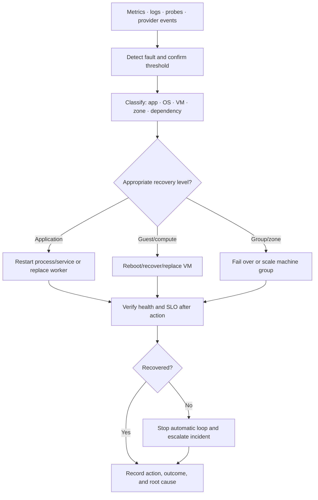

# Auto-Healing and Distinguishing Machine Repair from Application Restart

Auto-healing is the ability to automatically detect an unhealthy component, execute an appropriate recovery action, and verify that the service is operating again. In a cloud environment, that action may be simply restarting a process, restarting a service, rebooting a VM, recovering a VM onto another host, replacing an instance with a new machine, or shifting traffic to healthy replicas.

Choosing the wrong recovery level can worsen an incident. If only a single process is hung, rebooting the entire VM causes unnecessary disruption. If the host or guest OS is broken, restarting the application will not fix the root cause. For stateful workloads, replacing or rebooting a machine without protecting data can cause data loss or split-brain. Therefore, auto-healing must distinguish **application health**, **guest OS health**, and **compute infrastructure health**, then choose the smallest action capable of restoring the service.

## 1. Auto-Healing in Compute Architecture

A compute system has multiple layers working together to serve traffic. Each layer requires its own health signals and recovery mechanisms.

| Layer | Example Health Signals | Common Recovery Actions |
|---|---|---|
| Request/service | Error rate, latency, readiness, synthetic transactions | Remove backend from traffic, shift traffic, roll back release |
| Process/application | Process exit, deadlock, event loop lag, liveness failure | Restart process or service, replace worker |
| Container/Pod | Liveness/startup probe, OOMKilled, container exit | Restart container, create new Pod, reschedule |
| Guest OS | Kernel panic, filesystem error, missed agent heartbeat, OS check failure | Restart system service, reboot VM, boot recovery |
| VM/instance | System/instance status check, host failure, hardware event | Provider recovery, stop/start, replace instance |
| Machine group/zone | Healthy capacity, replicas/quorum, zone health | Scale out, failover, shift traffic to another fault domain |
| Dependency | Database health, queue age, storage availability | Fail over dependency, circuit breaker, shed load, or recover via runbook |

Auto-healing is not a single generic restart command for every error. It is a control loop: collect signals, determine scope, choose an action, observe the outcome, and halt or escalate if recovery fails.



## 2. Distinguishing Application Restart from Machine Repair

### Application Restart

An application restart stops and starts a process, service, or worker. It is appropriate when:

- A process crashes or exits abnormally.
- A worker is stuck while the OS and VM remain healthy.
- An application has a memory leak and lacks in-process self-recovery.
- A service needs to reload configuration after an approved change.
- A container needs to be recreated according to desired state.

Restarting an application is usually faster than rebooting a VM and preserves the kernel, network interfaces, volume attachments, and other system services. However, a restart cannot fix kernel, driver, filesystem, NIC, or host failures. It can also lose state held solely in process RAM.

### Machine Repair or Recovery

Machine repair addresses issues in the guest OS or compute layer. Depending on the fault, actions may include:

- Restarting a system service such as a network agent or cloud guest agent.
- Rebooting the guest OS to restore kernel/service state.
- Provider-managed VM recovery onto another host when a host failure occurs and the service supports it.
- Stopping and starting a VM when host reallocation is required or to complete maintenance.
- Provisioning a replacement VM from a golden image, attaching persistent data, and shifting traffic.
- Restoring or rebuilding the OS when the image/boot disk is corrupted.

Machine repair carries a larger impact scope. Rebooting loses RAM state and all open connections; stop/start may change dynamic public IPs or host placement; replacing may lose local/ephemeral disks. Therefore, identify data and dependencies before acting.

### Quick Comparison

| Criterion | Application Restart | Reboot/Recover VM | Replace VM |
|---|---|---|---|
| Scope | One process/service/container | Entire guest OS/instance | One instance replaced with another |
| Recovery time | Usually short | Usually longer due to boot and recovery | Depends on provisioning, bootstrap, and data |
| Impact on other processes | Usually none | All processes are stopped | All processes on the old machine are stopped |
| RAM state | State of restarted process is lost | All RAM state is lost | Not carried to new machine unless app persists it |
| Network connections | Connections of that process are closed | All VM connections are closed | Endpoint may change; requires traffic shifting |
| Local disk | Usually preserved | Usually preserved across reboots, depending on service | May not be transferred or preserved |
| Appropriate when | Isolated application fault | Guest OS fault or reboot required | VM/image/host cannot be safely recovered |

Specific behaviors depend on the provider, instance type, disk type, and recovery mechanism. Always verify behavior before automating actions that stop or replace machines.

## 3. Using Health Signals at the Right Layer

A good health signal should accurately reflect what needs to be recovered. If a probe only checks whether a process is alive, it does not prove requests can succeed. If a probe checks the database too aggressively, a slow database can trigger restarts across all backends even when processes are operating normally.

### Liveness

Liveness answers: is the process still running and capable of making progress? If liveness fails consecutively, the runtime or supervisor may restart the process/container.

Liveness should focus on internal process health, such as a blocked event loop or stalled worker. It should not depend on every external service, because a transient database outage could cause all processes to restart simultaneously and create extra load when the dependency recovers.

### Readiness

Readiness answers: can the instance accept new requests? When readiness fails, the load balancer or service discovery should stop sending traffic to that backend. A readiness failure does not necessarily mean the process should be restarted.

For example, an application loading a model, warming a cache, or waiting on a database connection pool may not be ready yet while still starting up normally. Marking it not-ready avoids failed requests without unnecessary restarts.

### Startup Probe

A startup probe is designed for slow-starting applications. It delays applying liveness/readiness checks per configuration until startup finishes. This prevents repeatedly restarting a process that legitimately takes time to initialize.

### Infrastructure Health Checks

Providers may expose system checks and instance/guest checks. System checks typically reflect host or underlying infrastructure health; instance checks reflect VM/guest responsiveness according to provider mechanisms. Names and semantics vary across platforms. Do not treat every red health check as the same failure type.

### Synthetic Checks and End-to-End Checks

A synthetic check executes a business flow from a client's perspective, such as a test login or reading a test record. It catches failures that internal probes might miss, but should not be used as a liveness probe if each check creates side effects or significant load.

## 4. Mapping Failure Types to Actions

| Observation | Possible Interpretation | Appropriate Initial Action |
|---|---|---|
| One process crashes, OS healthy | Application bug or bad input | Bounded process restart, preserve crash logs, and investigate |
| Liveness fails alongside unexplained readiness failures | Process may be hung | Restart container/service after threshold and cooldown |
| Readiness fails while liveness passes | Not yet ready to serve or dependency unavailable | Stop sending traffic, investigate dependency/startup; do not restart immediately |
| Container OOMKilled | Exceeded memory limit or memory leak | Collect memory metrics, adjust limits or fix leak; restart is only temporary mitigation |
| Guest OS check fails | OS/network/agent issue | Check console and provider diagnostics; consider reboot if identified |
| System/host check fails | Host or provider infrastructure issue | Use provider recovery/host replacement per service capabilities |
| VM fails to boot after update | Broken image/kernel/driver/boot config | Boot recovery mode or roll back image/kernel |
| A zone loses connectivity | Fault domain or network outage | Fail traffic over to healthy zones and verify capacity |
| Database slow, many backends not-ready | Shared dependency incident | Circuit breaker, load shedding, DB failover; avoid mass backend restarts |
| Multiple restarts with recurring failure | Root cause unresolved | Halt auto-restart loop, open incident, and escalate |

A single signal is rarely enough to justify replacing a VM. Combine probes, provider events, OS logs, metrics, and change history to identify the failing layer.

## 5. Auto-Restarting Processes with a Supervisor

A supervisor manages process lifecycles and can restart a process when it exits. On Linux, systemd is a common example.

Example unit file:

```ini
[Unit]
Description=Example application service
After=network-online.target
Wants=network-online.target

[Service]
Type=simple
User=app
WorkingDirectory=/opt/example-app
ExecStart=/opt/example-app/bin/server
Restart=on-failure
RestartSec=5s
StartLimitIntervalSec=300
StartLimitBurst=5
TimeoutStopSec=30s
KillSignal=SIGTERM

[Install]
WantedBy=multi-user.target
```

In this example, systemd restarts the service when the process exits with an error, waits 5 seconds between restarts, and caps the number of starts within a time window. Verify semantics for your systemd version and tune `StartLimit*` for the unit in use.

Administrative commands:

```bash
# Check status and logs
systemctl status example-app
journalctl -u example-app --since '15 minutes ago'

# Reload unit and restart service after a controlled change
sudo systemctl daemon-reload
sudo systemctl restart example-app
```

Never use an unbounded restart loop. If the application crashes due to bad config or an unavailable dependency, continuous restarts can flood logs, increase load, and hinder investigation. Limit retries, alert on failures, and retain necessary crash dumps/logs.

## 6. Auto-Healing in Containers and Kubernetes

Container runtimes can restart containers based on restart policies. Kubernetes uses controllers to maintain desired replica counts; kubelet uses probes to decide whether a container needs a restart or whether a Pod should receive traffic.

### Distinguishing the Three Kubernetes Probes

- `startupProbe`: gives the application time to start; while it has not succeeded, liveness and readiness checks do not run normally.
- `livenessProbe`: if it fails consecutively per configuration, kubelet may restart the container.
- `readinessProbe`: if it fails, the Pod is marked unready and normally removed from serving endpoints; the container is not necessarily restarted.

Example configuration:

```yaml
apiVersion: apps/v1
kind: Deployment
metadata:
  name: web-api
spec:
  replicas: 3
  selector:
    matchLabels:
      app: web-api
  template:
    metadata:
      labels:
        app: web-api
    spec:
      containers:
        - name: api
          image: example.invalid/web-api:v1
          ports:
            - containerPort: 8080
          startupProbe:
            httpGet:
              path: /startup
              port: 8080
            periodSeconds: 5
            failureThreshold: 36
          livenessProbe:
            httpGet:
              path: /live
              port: 8080
            periodSeconds: 10
            failureThreshold: 3
          readinessProbe:
            httpGet:
              path: /ready
              port: 8080
            periodSeconds: 5
            failureThreshold: 2
```

This is an illustrative configuration. Paths, timeouts, periods, and thresholds must reflect actual startup times, application behavior, and fault sensitivity. The image `example.invalid` is merely a placeholder, not a deployable image.

### Pod Repair vs. Node Repair

A Deployment/ReplicaSet creates a new Pod when a Pod is deleted or no longer matches the desired replica count. This replaces the workload instance; it does not fix a worker node's guest OS. If a node fails, node auto-repair or an autoscaling group is needed to replace the node. If the control plane or CNI/CSI is broken, creating new Pods may not help.

### Pod Disruption and Data

Before automatically evicting or deleting a Pod, check:

- Does the Pod hold local state or use `emptyDir`?
- Can its PersistentVolume detach/attach on another node?
- Does a PodDisruptionBudget protect minimum replica counts?
- Does the workload implement graceful shutdown, `preStop`, and a termination grace period?
- Does a StatefulSet have appropriate quorum, identity, and startup ordering?

Do not use a liveness probe to detect transient database errors and restart all Pods. Readiness probes and circuit breakers are usually better suited for dependency unavailability.

## 7. VM Auto-Recovery and Auto-Replacement

VMs may be monitored by the provider, an autoscaling group, or a configuration management system. Understand the exact action each mechanism performs.

### Provider Recovery

Some clouds offer automatic instance recovery when a host or hardware fault is detected. Depending on the service, the VM may restart on another healthy host while preserving attributes such as instance identity, private IP, or attached storage. Do not assume all instance types, accelerators, local disks, or dedicated hosts support recovery identically.

Provider recovery targets infrastructure faults that customers cannot fix inside the guest. It does not fix memory leaks, application misconfigurations, or filesystem data corruption.

### Auto-Reboot

A policy may reboot a VM when a guest health check fails for a period of time. Before enabling it, determine:

- Does the health signal distinguish host failure from guest failure?
- Will a reboot lose local data or in-flight transactions?
- Does the application have other replicas serving traffic?
- Are reboot limits and cooldowns configured?
- After rebooting, does a health check verify both OS and application recovery?

If the same error recurs after each reboot, the system should stop auto-rebooting and open an incident rather than looping indefinitely.

### Auto-Replacement via Autoscaling Group

For stateless VMs, an autoscaling group can replace an unhealthy instance with a fresh machine from a golden image. The flow typically includes:

1. Confirming the instance is unhealthy via appropriate health checks.
2. Stopping new traffic and deregistering the target.
3. Draining in-flight requests/jobs within limits.
4. Terminating the failed instance.
5. Launching a replacement instance from the standard launch template/image.
6. Running bootstrap, registering the target, and waiting for health checks.
7. Routing traffic only once the target is healthy.

Auto-replacement is often cleaner than repairing a configuration-drifted or damaged VM when the workload is stateless and data resides on durable storage.

## 8. Choosing Recovery Level by Workload Type

### Stateless Web/API

For stateless web/APIs, prioritize removing unhealthy backends from the load balancer and restarting the process or replacing the instance depending on failure scope. Multiple replicas across zones keep requests served while one machine recovers.

Sessions, uploads, and user data should reside in appropriate shared storage or services. If sessions live solely in RAM, application restarts or VM replacements will log users out or lose progress.

### Asynchronous Workers

Workers can be restarted or replaced if messages are unacknowledged and the queue supports redelivery. Design idempotent handlers so redelivered messages do not create duplicate side effects. For long jobs, checkpoint progress and acknowledge only after results are durably stored.

### Databases and Stateful Workloads

Databases need dedicated procedures. Restarting a process may trigger crash recovery; rebooting a VM can prolong recovery; replacing a VM requires safeguarding volumes, replicas, identity, and quorum. Never allow two nodes to believe they are primary and accept writes concurrently.

Before failover or replacement:

- Verify leader/primary and replication state.
- Use fencing or lease mechanisms to prevent the old node from continuing to write.
- Check quorum and eligible healthy replicas.
- Verify backups, transaction logs, and RPO.
- Attach volumes only under procedures guaranteeing single-writer ownership if storage does not support multi-writer.
- Verify consistency before opening traffic.

### GPUs and Long-Running Compute Workloads

GPU jobs or batch compute jobs can run for many hours. Restarting a process or replacing a VM loses progress without checkpoints. Save checkpoints periodically to persistent or object storage, record metadata for models, datasets, and runtime versions, and resume on a compatible instance.

## 9. Preventing Auto-Healing from Causing Larger Outages

An auto-healing system without guardrails can trigger restart storms, thundering herds, or widespread data loss.

### Thresholds and Confirmation Windows

Do not act on a single failed probe. Use failure thresholds, evaluation windows, and confirmation periods long enough to filter transient blips. Balance fast detection against false positives.

### Cooldowns and Retry Limits

Configure cooldowns between recovery actions, cap restarts/reboots within a time window, and allow stabilization time after a machine returns. If limits are exceeded, open an incident and stop automatic retries.

### Jitter and Backoff

If multiple instances fail together, do not restart all of them at once. Use jitter to stagger restarts, backoff to lengthen wait intervals, and concurrency limits on simultaneous recoveries. This avoids load spikes against databases, caches, registries, or control planes.

### Blast Radius and Concurrency Limits

Recover only a small percentage of instances per group or fault domain at a time. Retain sufficient healthy capacity before proceeding to the next batch. For stateful clusters, respect quorum and disruption budgets.

### Circuit Breakers for Remediation

If automated actions fail to improve health or metrics worsen, a circuit breaker must halt further remediation of that type. For example, if restarting an application 3 times in 10 minutes still leaves readiness failing, stop restarting and escalate to an incident. Tune counts and windows to the workload.

### Do Not Automate Destructive Actions Without Evidence

Terminating VMs, formatting disks, detaching volumes, deleting stateful Pods, or failing over databases are actions that can cause data loss. Automate them only when invariants, backups, fencing, and verified runbooks are in place. When fault type or data state is uncertain, prioritize alerting and human operator review.

## 10. Tiered Remediation Automation

Remediation can be designed in progressive tiers:

| Tier | Action | When to Apply |
|---|---|---|
| 0 | Log and alert | Insufficient evidence or action carries risk |
| 1 | Retry request/job or reconnect | Transient error, idempotent operation |
| 2 | Restart worker/process/service | Isolated process fault, OS healthy |
| 3 | Drain backend and replace container/Pod | Workload has replicas and durable data |
| 4 | Reboot/recover VM | Signs of guest/instance fault and reboot is safe |
| 5 | Replace VM or fail over zone | Unrecoverable instance or fault domain outage |
| 6 | Data restore or disaster recovery | Data corruption or full fault domain loss; requires dedicated procedures |

Not every system needs automation all the way to Tier 6. Higher tiers carry wider impact and stricter evidence requirements. Automation should stop at the highest tier the organization has tested and approved.

### Conceptual Remediation Policy Example

```yaml
healing_policy:
  application:
    trigger: liveness_failed
    consecutive_failures: 3
    action: restart_process
    max_attempts: 3
    cooldown_seconds: 300

  virtual_machine:
    trigger: guest_health_failed
    consecutive_failures: 5
    action: notify_and_assess
    auto_reboot: false

  instance_group:
    trigger: instance_unhealthy
    action: replace_instance
    max_unhealthy_replacements: 1
    require_healthy_capacity: true
```

This is illustrative configuration, not a provider schema. Real values must be derived from probe intervals, startup times, SLOs, replica counts, and platform behavior. The policy clearly separates bounded auto-restarts for process errors from requiring assessment before rebooting a VM.

## 11. Post-Recovery Verification

A remediation action is considered successful only once the service is genuinely serving again—not merely when the restart or replace command finishes.

Verify in order:

1. **Control plane:** is the VM/Pod/instance group in its desired state?
2. **Guest OS:** has the OS finished booting, and are filesystems mounted, NICs up, and agents running?
3. **Process/runtime:** is the service running, free of restart loops, and passing probes?
4. **Network:** are DNS, routes, TLS, load balancer, and dependency connections working?
5. **Application:** do smoke tests or synthetic transactions succeed?
6. **Data:** are queues, replication, transactions, and checkpoints consistent?
7. **SLO:** have error rate, p95/p99 latency, and throughput returned to target levels?

Maintain a post-recovery observation window to catch recurring faults. Do not close an incident the moment a health check first turns green.

## 12. Observing Auto-Healing Effectiveness

Track the following metrics:

| Metric | Meaning |
|---|---|
| Detection time | Time from fault onset until detection |
| Remediation start delay | Time from detection until recovery action begins |
| Recovery time | Time until the service is genuinely healthy again |
| Healing success rate | Percentage of automated actions that succeed in restoring health |
| Repeat failure rate | Percentage of failures that recur after remediation |
| Restart/reboot count | Number of process, container, or VM restarts |
| Replacement rate | Rate at which instances are replaced over a period |
| False positive rate | Percentage of actions triggered when the component was actually healthy |
| Data recovery point | Data loss or replication lag at recovery |
| SLO impact | Error budget consumed or downtime caused by incident/remediation |

A high healing success rate does not mean a healthy system if processes keep restarting to mask a memory leak. Track repeat failures, recovery time, and per-instance remediation counts to uncover underlying issues.

## 13. Practical Examples

### Example 1: Hung API Process on a Healthy VM

Synthetic checks report API timeouts. The VM passes system checks, CPU and RAM are normal, and SSH is accessible. Logs show the process event loop is no longer making progress.

Approach:

1. Remove the instance from load balancer traffic via readiness/target health.
2. Capture thread dumps, stack traces, or runtime diagnostics.
3. Restart the service within configured limits.
4. Wait for readiness to pass and run synthetic requests.
5. If the issue recurs, halt auto-restart and open an incident to investigate deadlocks or bugs.

Rebooting the VM is unnecessary because the OS and infrastructure are healthy.

### Example 2: Guest OS Unresponsive After Kernel Update

Multiple guest checks fail after a kernel update; console output shows a kernel panic. Restarting the application does nothing because the OS never boots far enough to start the service.

Approach:

1. Save console logs and identify the new kernel version.
2. Use a recovery workflow or boot the previous kernel entry.
3. Restore the VM from a known-good image/kernel if needed.
4. Check drivers, initramfs, and agents.
5. Return the VM to the pool only after both OS and application pass health checks.

This is a guest OS layer failure; remediation must repair or roll back the OS.

### Example 3: Host Failure on a Stateless VM

The provider reports a system check failure and a host failure event. The VM is in an autoscaling group, and application data lives in object storage and a managed database.

Approach:

1. Confirm the target is unhealthy and remove it from the load balancer.
2. Check whether the provider supports automatic recovery for that instance type.
3. If not recovered within the allowed time, the autoscaling group replaces the instance.
4. The new VM bootstraps from the standard image, registers as a target, and waits until healthy.
5. Verify traffic and SLOs before closing the event.

Replacement fits because the workload is stateless and data resides outside the VM.

### Example 4: Unresponsive Primary Database

Both application and database health checks fail. Restarting all application VMs would trigger a connection storm when the database returns. The proper workflow is triggering database failover via tested mechanisms, using circuit breakers to shed load, and bringing backends back only once the dependency is ready.

Never treat readiness failures caused by a dependency as a reason to auto-reboot VMs. That is a dependency-layer fault requiring remediation at the right layer.

## 14. Common Mistakes

- **Using one probe for everything:** liveness, readiness, and synthetic checks answer different questions.
- **Restarting applications when a dependency fails:** creates restart storms without fixing the database or network.
- **Rebooting a VM when only a process is hung:** widens disruption and drops unrelated connections.
- **Replacing VMs holding local data:** can lose un-transferred or un-checkpointed data.
- **Setting no restart limits:** misconfigurations or memory leaks cause infinite loops.
- **Restarting all replicas simultaneously:** the entire service can lose capacity at once.
- **Checking only control-plane status:** a `Running` VM does not mean the OS and application are healthy.
- **Not verifying after remediation:** the command succeeded yet the app remains broken or data is inconsistent.
- **Failing to preserve evidence:** losing logs and state needed for root cause analysis.
- **Auto-failing over stateful workloads without fencing:** can cause split-brain and concurrent writes.

## 15. Auto-Healing Design Checklist

**Health Signals:**

- [ ] Separate health checks exist for process, readiness, guest OS, and infrastructure as needed.
- [ ] Probes have appropriate timeouts, thresholds, and intervals.
- [ ] Transient dependency errors do not trigger mass restarts.
- [ ] Provider events and audit logs are available to distinguish host faults from guest faults.

**Remediation:**

- [ ] Choose the smallest action matching the failing layer.
- [ ] Process restarts have limits and cooldowns.
- [ ] VM reboots/recoveries have preconditions and fallback plans.
- [ ] Replacement is applied only when data and identity are safely managed.
- [ ] Concurrency limits, jitter, backoff, and circuit breakers are configured.
- [ ] Escalation triggers when repeated remediation fails.

**Data and Availability:**

- [ ] Stateless workloads do not depend on sole state in RAM/local disk.
- [ ] Stateful workloads have backups, replication, quorum, and fencing.
- [ ] Long jobs have checkpoints or idempotent redelivery mechanisms.
- [ ] Replicas span fault domains with spare capacity.

**Verification and Operations:**

- [ ] Post-action checks cover OS, runtime, network, application, and data.
- [ ] Track recovery time, repeat failures, and false positives.
- [ ] Record timelines, automated actions, and accountable owners.
- [ ] Drill process restarts, VM recovery, replacement, and dependency failures.
- [ ] A kill switch exists to pause automation when it causes unintended impact.

## Conclusion

Effective auto-healing begins with identifying the exact failing layer. Application restarts fit hung processes or services on a healthy VM; VM reboots or recovery fit guest OS/instance faults; replacement or failover fits unrecoverable machines or fault-domain outages. Use liveness to detect processes needing restarts, readiness to control traffic routing, and infrastructure health checks to assess machine health. Every remediation requires thresholds, cooldowns, retry limits, data protection, and post-action verification. For stateful workloads, quorum, fencing, backups, and consistency must be guaranteed before automatically replacing machines. Designing this way restores service rapidly without turning self-healing into a new source of outage.
