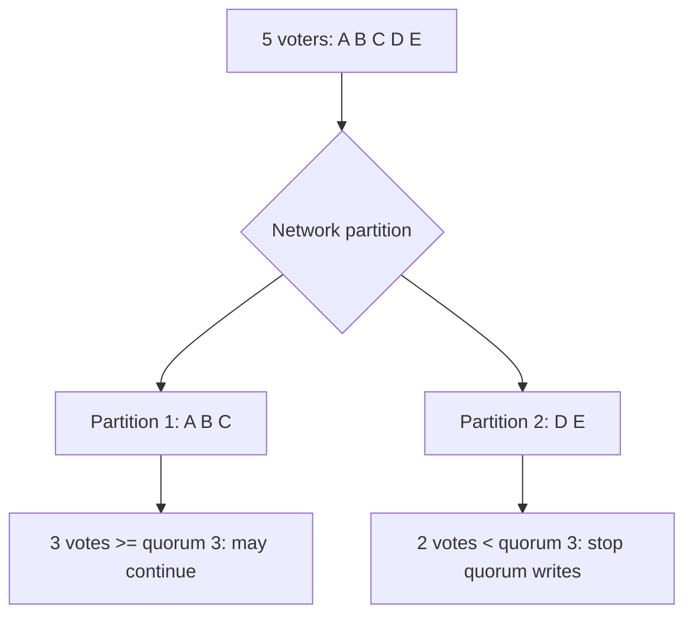
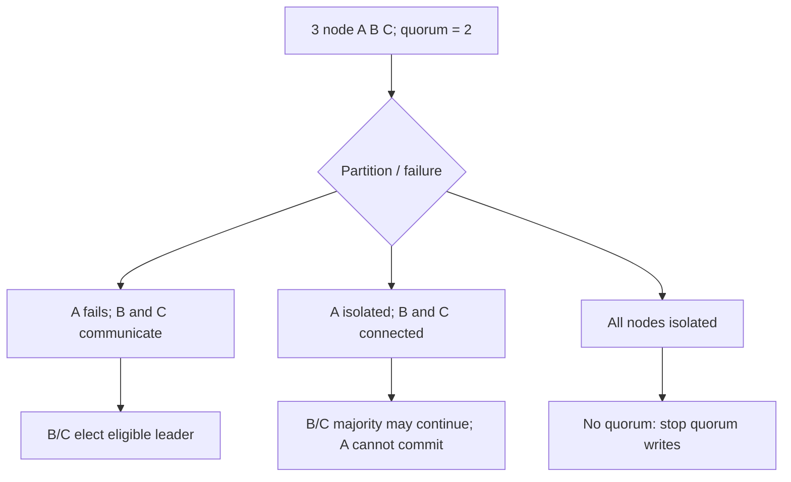

# Quorum, Split-Brain, and Constraints of Stateful Workloads

A virtual machine cluster may run multiple nodes to improve availability, yet when the network partitions or some nodes lose communication, the cluster must decide which node may continue writing data and which must stop. If both sides believe they hold the primary role, both may accept concurrent writes. This is a **split-brain** scenario and can cause data divergence or corruption.

Quorum helps a distributed cluster decide whether a group of nodes holds sufficient authority to keep operating. For stateful workloads, quorum must be paired with consensus mechanisms, fencing, leases or epochs, replication, and data recovery procedures. Simply having multiple VMs or multiple data copies is not enough to guarantee a safe system when faults occur.

## 1. Why Are Stateful Workloads Harder to Make Fault-Tolerant?

Stateless workloads can serve requests on any healthy instance if required configs and data reside in shared services. When a VM fails, the load balancer removes it from the pool and new requests route to another machine.

Stateful workloads maintain or mutate state that must be preserved across operations. Examples include:

- Databases storing transactions and business data.
- Distributed caches containing updated data that must stay consistent across nodes.
- File servers or cluster filesystems managing metadata and files accessed by multiple machines.
- Message brokers storing queues, offsets, and consumer state.
- VMs running legacy applications keeping sessions or temporary data on local disk.
- Batch processing systems saving checkpoints to resume after node replacement.

When a node fails, the system must determine which data was durably persisted, which node holds the newest copy, who holds write authority, and how to prevent two nodes from updating the same state concurrently. These decisions often matter more than how fast a VM restarts.

## 2. What Is Quorum?

**Quorum** is the minimum number of votes or minimum consensus condition a group of nodes must satisfy to perform a protected decision, such as leader election, membership changes, or permitting data writes. In a simple majority quorum model, a cluster of `N` voting members requires more than half of the votes:

\[
Q = \left\lfloor \frac{N}{2} \right\rfloor + 1
\]

Examples:

| Voting Members (N) | Majority Quorum (Q) | Members That Can Be Lost While Keeping Quorum |
|---:|---:|---:|
| 1 | 1 | 0 |
| 2 | 2 | 0 |
| 3 | 2 | 1 |
| 4 | 3 | 1 |
| 5 | 3 | 2 |
| 6 | 4 | 2 |
| 7 | 4 | 3 |

With majority quorum and assuming equal voting weight, a cluster can tolerate up to \(\lfloor (N-1)/2 \rfloor\) unavailable members and still maintain a majority. The cluster must have connectivity and eligible state for those votes to actually count; merely counting powered-on VMs is insufficient.

Quorum is not necessarily just a node count. Some systems include witnesses, arbiters, or voting members that do not store data. Some systems use weighted quorum, dynamic quorum, or custom membership rules. Thus, the majority formula establishes the core principle, while actual behavior must follow the product's documentation.

## 3. Why Is an Odd Number of Nodes Commonly Used?

With majority voting, three nodes require two votes and can lose one node. Four nodes require three votes and can also only lose one node. Hence, adding a fourth node does not increase the number of node failures tolerated compared to a three-node cluster in the simple model.

Five nodes still require only three votes and can lose two nodes. Seven nodes require four votes and can lose three nodes. That is why consensus clusters typically choose an odd number of voters to gain better fault tolerance per added vote.

However, node count is not the only factor. Seven voters placed in the same rack, the same AZ, or on the same power feed can still all be lost together from a single shared-domain fault. Distribute voters across independent fault domains and account for inter-domain latency.

## 4. The Two-Node Cluster Problem and Witnesses

Two nodes hold two votes. Majority is two, so if one node is lost or the two nodes cannot communicate, the surviving side lacks quorum. This is safe behavior, yet it sacrifices availability when a single node fails.

Some products support a **witness** or **arbiter** as a third voting member. A witness typically stores metadata or votes rather than a full copy of workload data. When one data node and the witness can communicate, they can form a two-of-three majority per the product's policy.

Conceptual example:

| Member | Role | Stores Workload Data? | Has Vote? |
|---|---|---:|---:|
| Node A | Data node | Yes | Yes |
| Node B | Data node | Yes | Yes |
| Witness | Arbiter/quorum witness | Typically no | Yes |

A witness does not replace a data replica. If Node A is lost while Node B and the witness remain alive, Node B can continue per system policy; if both data nodes are lost, the witness alone cannot serve data. How witness loss or network partitions are handled depends on the product and configuration.

Placing the witness in the same fault domain as a data node can negate its benefit. For example, if Node A and the witness share an AZ while Node B is in another AZ, losing the AZ containing A and the witness strips B of a majority. Place the witness in an independent fault domain when the architecture and provider support it, while weighing cost and latency.

## 5. What Is Split-Brain?

**Split-brain** occurs when two parts of a distributed system both act as though they are the valid cluster or both claim write authority over state that should have a single owner. This situation commonly arises after a network partition, heartbeat failure, misconfigured quorum, or failover missing a fencing step.

For example, two database nodes A and B are synchronizing. The network between them breaks. If both A and B self-promote to primary and continue accepting writes, the two branches can generate diverging data. When the network recovers, merging the two write histories may not be resolvable automatically.

Consequences can include:

- Two records with the same key holding different values.
- Transactions committed on one side that do not exist on the other.
- Files or metadata written concurrently from two nodes.
- Sequences, offsets, or job states duplicated or skipped.
- Replication failing to converge automatically and requiring manual recovery.
- Loss of data integrity even while both nodes report healthy.

Split-brain is an ownership and consensus failure, not merely a network failure. A system can experience a network partition without split-brain if quorum and fencing work properly. Conversely, a logic bug in failover can cause split-brain even when all nodes still have network connectivity.

## 6. Network Partitions and Failure Detection

A network partition is a condition where nodes cannot exchange information with another portion of the cluster. Causes include routing errors, firewalls, NICs, gateways, AZ outages, DNS issues, packet loss, or latency exceeding heartbeat timeouts.

A node that stops receiving heartbeats may be unable to distinguish whether its peer has shut down or is simply slow or unreachable over the network. Consequently, failure detectors generally make inferences based on timeouts and observed signals rather than absolute proof that the peer is dead.

Signals to cross-check:

- Heartbeat timeouts and membership changes.
- RTT, packet loss, retransmissions, and route state between nodes.
- CPU starvation or long runtime pauses delaying heartbeats.
- Cloud control plane telemetry showing whether the VM/NIC/AZ is operational.
- Disk latency or I/O stalls making processes unresponsive.
- Consensus logs showing leader elections, terms/epochs, and votes.

Do not shrink heartbeat timeouts too aggressively to speed up failover if the network exhibits jitter or workloads experience long pauses. Excessively short timeouts raise false positives and can trigger continuous elections. Excessively long timeouts slow recovery. Choose values based on real latency and RTO targets, then test under packet loss and node pauses.

## 7. How Majority Quorum Prevents Both Sides from Deciding

In a majority voting model with a fixed membership set, any two majority groups always share at least one common member. This creates an intersection across decisions and prevents two independent partitions from both achieving quorum.

With five voters, quorum is three. You cannot split five voters into two disjoint groups each holding three votes. If a partition splits them into a group of three and a group of two, the group of three can proceed while the group of two must halt quorum-requiring operations.

This is a conceptual model. Real systems must also handle membership changes, leader leases, terms, log replication, and node states. Never infer that whichever side has more VMs may always write; only valid voting members in the active configuration count.

## 8. Quorum in Consensus and the Role of the Leader

Consensus protocols such as Raft or Paxos help multiple nodes agree on a history of operations or update ordering. In Raft, a leader is elected within a term, and log entries must be replicated to a quorum before being considered committed per protocol rules.

A generalized flow:

1. Nodes exchange heartbeats and track terms/epochs.
2. When a leader is no longer observed, eligible nodes may start an election.
3. A candidate requires enough votes to become leader.
4. The leader sends log entries to followers.
5. An entry is considered committed when it meets the protocol's quorum condition.
6. New or recovering nodes synchronize logs according to consensus rules.

Never implement consensus by writing a custom heartbeat script and letting the node with the lower PID become primary. A correct protocol must handle concurrent elections, log divergence, membership, terms, persistence, timeouts, and asynchronous faults. Use a database or distributed system with proven consensus rather than rolling custom leader election for critical data.

Consensus quorum also does not automatically solve every storage issue. For instance, an application might commit logs across a majority of nodes while a shared storage volume still permits two hosts to write concurrently without fencing. Understand whether each layer enforces its own quorum.

## 9. Node Quorum vs. Data Read/Write Quorum

Some distributed databases or storage systems use read quorums and write quorums across data replicas. In a simple model with `N` replicas, read quorum `R` and write quorum `W` are often chosen so read and write sets overlap:

\[
R + W > N
\]

This condition helps a read observe at least one replica that received the latest write, under protocol and versioning assumptions. Some systems also require:

\[
W > \frac{N}{2}
\]

so two write quorums cannot be disjoint in a majority model. This is a theoretical model, not a universal configuration. Databases vary in replication factors, consistency levels, leader-based replication, conflict resolution, or per-partition quorums.

**Do not conflate** membership/election quorum with data read/write quorum. A cluster can have a quorum-elected leader yet still experience replication lag; a system with read/write quorums still needs to stop stale nodes from writing after losing authority. Always read the consistency semantics and failure behavior of the specific database/storage engine.

## 10. Fencing: Stopping Old Nodes from Continuing to Write

Quorum decides which side holds authority to continue under cluster policy. Yet an isolated node may still be running and unaware that it has lost authority. If that node still has a path to storage or clients, it can keep writing.

**Fencing** is the mechanism that blocks an old or unauthorized node from accessing protected resources. Common approaches include:

- **STONITH (Shoot The Other Node In The Head):** using an out-of-band management mechanism to power off or reset a suspected node.
- **Storage fencing:** revoking or locking volume access, reservations, or shared disk permissions for the old node.
- **Leases:** time-bounded ownership; a node must renew before continuing protected operations.
- **Epoch/fencing tokens:** each new grant increments a monotonic generation number; storage or target services reject operations carrying older tokens.
- **Network fencing:** blocking the old node's access paths to data services or clients via verified policies.

Fencing must be enforced where dangerous actions can be stopped. Merely updating status in a dashboard or sending a stop signal over the very network experiencing a partition may be insufficient.

Example with fencing tokens: Node A holds token 41. After failover, Node B is issued token 42. Storage accepts writes only from the latest token 42; any late writes arriving from A with token 41 are rejected. This works only if the storage or protection layer checks the token atomically and cannot be bypassed.

## 11. Leases, Epochs, and Clock Limitations

A lease grants time-bounded resource ownership. The leaseholder must renew it; once expired, it is no longer allowed to execute operations requiring that ownership. Leases can support leader election or distributed locks.

However, time-based leases must account for clock skew, long VM pauses, network delays, and scheduler stalls. A node can pause for an extended period, its lease expires, and then it resumes running unaware that ownership moved to another node. Without a fencing token or authority check at the destination resource, the old node can write after waking up.

Monotonically increasing epochs or terms distinguish generations of owners. Protected resources must reject commands from older epochs. Never use wall-clock timestamps as fencing tokens without strict ordering and uniqueness guarantees. Use counters/terms issued by a consensus system or mechanisms natively supported by the product.

## 12. Shared Storage and Filesystem Constraints

A cluster filesystem or shared block volume can be attached to multiple VMs. Seeing the same disk from multiple hosts does not mean they may mount and write concurrently using a standard filesystem.

Cases to distinguish:

- **Single-writer volume:** only one node may write at a time; failover requires detaching/fencing the old node before attaching to the new node.
- **Multi-attach block storage:** multiple VMs can attach the same volume where the service permits, yet the filesystem and application must support concurrent access.
- **Cluster filesystem:** uses a distributed lock manager, membership, and fencing to coordinate metadata/block access.
- **Object storage:** typically exposes object APIs and distinct semantics, not equivalent to a block device or POSIX shared filesystem.
- **Replicated storage:** multiple data copies require mechanisms to determine the latest version and handle split-brain.

If two VMs mount a non-cluster filesystem concurrently, metadata caching and write reordering can cause corruption. Before enabling multi-attach, verify volume type, filesystem, lock manager, reservations, and provider requirements.

## 13. Safe Database Replication and Promotion

Databases typically have a primary/leader accepting writes and one or more replicas. When the primary fails, a replica may be promoted. Yet promotion is safe only when the system ensures the old primary can no longer write and the new replica meets data requirements.

Questions to answer:

- Is replication synchronous or asynchronous?
- Up to which log sequence number/commit index has the newest replica received data?
- Are there transactions acknowledged on the primary that have not reached the replica?
- How does quorum or election select the new primary?
- By what mechanism is the old primary fenced?
- Can clients still write to the old endpoint if DNS or connection pools have not refreshed?
- Can partial data loss within RPO limits be tolerated?

Synchronous replication typically reduces the risk of losing acknowledged data, though it can increase latency and depends on responsive replicas. Asynchronous replication generally reduces write latency, yet un-replicated changes may be lost if the primary fails abruptly.

Not all databases use simple majority quorum. Some systems use witnesses, log shipping, synchronous standbys, consensus logs, or proprietary failover mechanisms. Use supported failover procedures and never promote a replica merely because the primary stops answering pings.

## 14. RPO, RTO, and Consistency During Failover

**RPO (Recovery Point Objective)** is the acceptable data loss measured by time or recovery point. **RTO (Recovery Time Objective)** is the target time to restore service. These two targets shape replication, quorum, headroom, and failover design.

| Strategy | Potential RPO | Key Considerations |
|---|---|---|
| Synchronous replication | Can approach 0 for committed writes per system semantics | Increases latency; requires sufficient responsive replicas and quorum handling |
| Asynchronous replication | Un-replicated writes may be lost | Lower latency; requires monitoring replication lag and accepting RPO |
| Periodic snapshots/backups | Depends on backup interval and clean copy timestamp | Slower recovery; requires restore testing |
| Log-based recovery | Can reduce data loss if logs are fully protected | Must preserve logs and verify transaction chains |

Zero RPO cannot be claimed simply because two replicas exist. Understand acknowledgement timing, durability guarantees, quorum commits, and the failure scope the system commits to surviving. Likewise, RTO is not merely VM startup time; it includes fault detection, leader election, fencing, mount/restore, warm-up, endpoint updates, and data verification.

## 15. Why Do Stateful Workloads Need Careful Placement?

Placing replicas across multiple AZs reduces the risk of losing a zone, though it can raise inter-replica latency. If a database requires synchronous cross-zone writes, every transaction may wait on an inter-zone network round trip. If nodes sit too close together, a single fault can take out multiple voters.

When planning placement, weigh:

- Distributing voters and replicas across independent fault domains.
- Inter-zone latency and its impact on the commit path.
- Network partitions, routes, and firewalls between nodes.
- Whether storage volumes are zone-scoped or regional.
- Where backups reside and whether recovery works if an entire zone is lost.
- Whether a witness is independent of the data nodes.
- Whether quotas and capacity allow launching replacement nodes in surviving zones.

Do not place all quorum voters in a single AZ merely to lower latency if the goal is surviving an AZ failure. Conversely, do not spread nodes too far apart if the workload cannot tolerate replication latency. Placement must reflect real failure domains and SLOs.

## 16. Handling Network Partitions and Suspected Split-Brain

When a cluster loses communication, operators should not run ad-hoc failover scripts independently. Follow a coordinated procedure with clear preconditions.

A generalized sequence:

1. Check cluster membership, current leader, term/epoch, and which nodes retain quorum.
2. Cross-check cloud control plane, network telemetry, heartbeats, and storage state to distinguish a dead node from a partition.
3. Verify which node holds write authority under current consensus/quorum.
4. If switching primary is required, fence the old node or verify old tokens/leases have expired at the destination resource.
5. Select an eligible replica based on log position, replication lag, and RPO policy.
6. Promote the new node using a mechanism supported by the database/cluster.
7. Update endpoints/service discovery/load balancers after confirming the new primary is ready.
8. Keep the old node isolated when it returns; forbid writes until it synchronizes and rejoins membership properly.
9. Verify data, transactions, replication, and application health.
10. Record the timeline, decisions, and evidence for root cause analysis.

If it is unclear which side holds quorum or the old primary cannot be fenced, prioritize halting writes to protect data integrity per the runbook. Pausing writes temporarily impacts availability, yet prevents creating two irreconcilable data histories.

## 17. Example: Three-Node Database Cluster Across Three AZs

Suppose a database uses three nodes A, B, and C, each holding one vote. Quorum is two. A is the current leader; B and C are followers.

**Case 1: A fails completely.** B and C still communicate and hold two votes. An eligible node can be elected as the new leader via consensus. Before opening writes, the system must verify committed logs and ensure Node A cannot accept writes when it recovers.

**Case 2: Network isolates A on one side, with B and C together.** B/C hold a majority and can proceed per protocol; A holds only one vote and cannot commit new writes. When A reconnects, it must follow the new leader/term and synchronize logs.

**Case 3: Network splits A+B from C.** A+B hold two votes while C holds one. Consensus establishes the valid leader on the majority side. C must never self-promote simply because it cannot see A/B.

**Case 4: All three nodes lose contact with one another.** Neither side holds quorum; the system must halt quorum-dependent operations until connectivity or membership is safely restored.

This example assumes three equal voters and majority protocol rules. Real databases also involve log freshness, election timeouts, synchronous commits, fencing, and membership rules.

## 18. Example: Two Data Nodes with a Witness

A legacy application runs on two VMs A and B using shared storage, with witness W acting as a third vote. When A fails, B and W remain connected. The cluster may grant authority to B under quorum policy; however, B must mount/write the shared volume only after confirming A is fenced or A's storage reservation has been revoked.

If B mounts the volume merely because A missed heartbeats, A might still be running in another partition and keep writing. When connectivity returns, both nodes may have modified the same filesystem or metadata. A witness settles voting quorum, but does not automatically fence storage.

In this model, test:

- Loss of one data node.
- Loss of the witness.
- Loss of network connectivity between the two data nodes while both still reach clients/storage.
- Loss of the AZ hosting one data node and the witness.
- Unresponsive storage control plane.
- Old node rebooting or rejoining the network after failover.

## 19. Special Constraints of Stateful Workloads

Stateful workloads must consider many factors beyond quorum:

- **Durability:** does acknowledged data survive losing a node or zone?
- **Consistency:** do reads after writes observe the latest data under the committed consistency level?
- **Replication lag:** is a replica fresh enough to be promoted?
- **Single-writer:** does the resource require only one node writing at a time?
- **Locking:** are distributed locks or file locks preserved across partitions?
- **Idempotency:** can client retries after timeouts create duplicate transactions?
- **Ordering:** do messages, transactions, or events preserve required ordering?
- **Local state:** can caches, sessions, temp files, and checkpoints be regenerated?
- **Backup/restore:** are independent copies stored and tested for recovery?

An application may implement quorum correctly yet still behave incorrectly if a client retries a committed transaction whose response was lost. Use idempotency keys, transaction IDs, or appropriate deduplication mechanisms to avoid duplicate business actions.

## 20. Do Not Confuse HA, Replication, and Backup

These three mechanisms serve distinct purposes:

| Mechanism | Primary Goal | Does Not Fully Protect Against |
|---|---|---|
| High availability/failover | Keep serving when a node or fault domain fails | Accidental deletion, replicated corruption, ransomware |
| Replication | Maintain data copies across nodes/zones | Logic bugs or accidental deletions propagating to replicas |
| Backup/point-in-time recovery | Restore to a state prior to an incident | Long restore times or untested backups |

A valid yet mistaken delete operation can replicate to every node almost immediately. Independent backups, immutable retention, and restore testing remain essential even when a cluster has quorum and synchronous replication.

## 21. Safely Testing Quorum and Split-Brain

Testing must occur in staging or approved drills with test data and rollback plans. Never arbitrarily block networks or stop voters in production just to see how the cluster reacts.

Scenarios to test:

1. Losing one node and verifying remaining quorum.
2. Network partition with a majority/minority split.
3. Partition leaving both sides connected to clients or storage.
4. Losing the witness/arbiter.
5. Old node returning after a new leader is elected.
6. Lease expiration during a VM pause or network delay.
7. Storage fencing failure or slow response.
8. Replica with heavy replication lag at failover time.
9. Membership changes while a node is unreachable.
10. Restoring from backup after bad writes or replicated corruption.

Monitor election counts, terms/epochs, quorum status, replication lag, rejected stale writes, fencing events, recovery time, error rates, and committed data. Testing passes only when two valid writers never coexist, data obeys RPO/consistency, and the application recovers within RTO.

## 22. Common Design Mistakes

- **Using two nodes without a witness and expecting single-node fault tolerance:** a two-of-two majority vanishes when one node is lost. Choose appropriate voter counts and witnesses.
- **Placing all voters in the same AZ:** one zone outage breaks quorum. Spread voters across independent fault domains.
- **Letting both sides self-promote on lost heartbeats:** causes split-brain. Use consensus and fencing.
- **Assuming a witness stores data:** witnesses typically only vote. Data replicas and backups are still required.
- **Relying solely on clock-based leases:** clock skew or VM pauses can let old nodes keep writing. Enforce epochs/fencing at the target resource.
- **Promoting a replica without checking replication lag:** can lose acknowledged data. Check log positions and RPO.
- **Forgetting to fence shared storage:** the old node can still write to the volume after failover. Revoke storage access before granting a new writer.
- **Confusing quorum with backup:** corruption or accidental deletions replicate. Maintain independent backups.
- **Setting heartbeat timeouts too low:** triggers false failures and continuous elections. Tune to real latency and pauses.
- **Not testing old node rejoin:** stale nodes can disrupt membership or write old data. Keep isolated and rejoin strictly per protocol.

## 23. Stateful Workload Design Checklist

- [ ] Identified where state resides: RAM, local disk, shared volume, database, or object storage.
- [ ] Identified voters, witnesses, quorum rules, and current membership.
- [ ] Voter count and placement tolerate target failure domains.
- [ ] Distinguished node quorum from data read/write quorum.
- [ ] Consensus/leader election uses a supported implementation with appropriate persistence.
- [ ] Fencing or epochs/tokens prevent old nodes from continuing to write.
- [ ] Shared storage enforces single-writer, locking, and fencing properly.
- [ ] Replication mode, lag, commit semantics, and RPO are clearly understood.
- [ ] Failover promotes only eligible replicas and only after fencing the old primary.
- [ ] Leases handle clock skew, pauses, and stale owners.
- [ ] Client retries include timeouts, backoff, and idempotency.
- [ ] Independent backups have retention and restore tests.
- [ ] Drilled partitions, witness loss, node rejoin, and storage faults.
- [ ] Actual RTO/RPO are measured and align with SLOs.

Quorum helps a distributed cluster select one eligible side to keep operating, while fencing prevents old nodes from continuing operations after losing authority. For stateful workloads, these two mechanisms must work together with replication, consistency, storage semantics, and backups. When failure domains are designed properly, network partitions are tested, and write authority is enforced at the data resource itself, systems can preserve integrity while recovering from outages.
