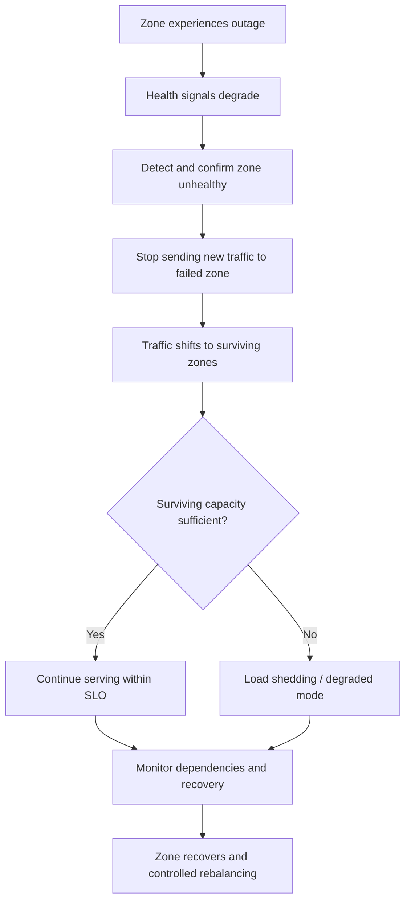

# Spare Capacity and Behavior During a Zone Loss

A system running across multiple Availability Zones (AZs) is truly highly available only when the surviving portion still has enough capacity to serve load after one zone goes down. Placing VMs, containers, or nodes across three zones only establishes fault dispersion; it does not prove the system has enough CPU, memory, connections, IP addresses, database capacity, or network bandwidth to keep operating when one zone disappears.

In the **CLOUD_CORE_SERVICES_COMPUTE** module, spare capacity must be sized from workload demand and service targets. Teams must know the peak load to serve, the safe capacity per instance, the zone count, shared dependencies, and the time needed to detect and shift traffic. This lesson focuses on N-1 zone design, traffic redistribution during a zone loss, commonly overlooked limits, and validating failover through controlled testing.

## Learning Objectives

After this lesson, you will be able to:

- Distinguish location redundancy from genuine spare capacity.
- Explain N, N+1, and N-1 in capacity planning, especially when losing a zone.
- Calculate the minimum instance count per zone so the surviving portion still meets target load.
- Identify headroom, safe capacity, failure capacity, and dependency limits.
- Analyze the impact of load balancers, routing, health checks, and networking when a zone fails.
- Size capacity for compute, databases, caches, queues, storage, NAT, and subnets.
- Distinguish zone failures, regional failures, and network partitions.
- Design degraded mode, load shedding, and recovery behavior when capacity is insufficient.
- Plan N-1 testing, run zone-loss drills, and measure results against SLOs.

## 1. Redundancy Is Not Synonymous with Sufficient Capacity

High availability (HA) is the ability to maintain a service at committed levels when some components fail. Fault tolerance describes the ability to keep operating when faults occur, sometimes uninterrupted or within minimal disruption bounds. Both require more than simply creating instance replicas.

Distinguish three questions:

1. **Are there replicas elsewhere?** Is the workload placed across multiple independent zones?
2. **Can traffic shift?** Do health checks, load balancers, DNS, or routing remove the failed zone and direct requests to healthy zones?
3. **Do surviving zones have enough capacity?** Can CPU, RAM, networking, databases, IPs, quotas, and dependent services handle the shifted load?

A system with 3 zones, each running 2 VMs, where normal load requires all 6 VMs to process, will lack capacity when one zone is lost. It has location redundancy, but not N-1 capacity.

### 1.1. Failure Domains and Availability Zones

A failure domain is the scope within which a single incident can affect multiple resources simultaneously. Cloud providers typically engineer AZs with isolated power, cooling, and networking to a defined degree. Specific naming, geographic span, and independence guarantees vary by provider and region.

Common failure domain levels:

- Process/container: process or container failure.
- VM/node: virtual machine or host failure.
- Rack/fault domain: physical infrastructure group failure.
- Availability Zone: outage affecting one infrastructure zone within a region.
- Region: broad outage affecting multiple AZs in a geographic area.
- Provider/control plane: outage of provider management services or APIs.

Spreading VMs across multiple AZs reduces the risk of a localized outage wiping out all compute. However, some dependencies may still concentrate in a single AZ or shared endpoint. Map failure domains across the request path, data path, and control plane.

### 1.2. Active-Active vs. Active-Standby

**Active-active:** multiple zones serve traffic under normal conditions. When one zone fails, surviving zones continue serving traffic. Capacity in each surviving zone must suffice to absorb the shifted load.

**Active-standby:** one or more standby zones do not carry full normal traffic, or carry only small/test traffic. When the primary zone fails, the standby activates. Account for startup time, scaling, data synchronization, and route switching; the standby must have genuinely available capacity.

| Criterion | Active-Active | Active-Standby |
|---|---|---|
| Normal capacity usage | Zones share load concurrently | Part of capacity waits or serves limited load |
| Transition on fault | Typically removes failed targets and redistributes | Activates standby, scales up, or promotes |
| Potential RTO | Low if capacity and routing are ready | Depends on activation and scale-up duration |
| Cost | Can be higher due to running active replicas | Can save compute if standby is smaller, but requires fast scaling |
| Data complexity | Requires handling consistency with multiple writers | Requires replication and promote/failover workflows |
| Primary risk | Surviving portion lacks capacity or shared dependency fails | Standby lacks capacity, suffers drift, or holds stale data |

Do not call a zone an HA standby if it is provisioned only after an incident begins and takes many minutes to spin up. In that case, RTO must include capacity provisioning, booting, warm-up, health checks, and traffic shifting.

## 2. N, N+1, and N-1 in Capacity Planning

These notations describe the relationship between baseline demand and spare capacity. Explicitly define `N` in every calculation to avoid ambiguity.

- **N:** minimum capacity required to serve target load under defined conditions.
- **N+1:** one extra unit of spare capacity beyond N, such as an additional node able to absorb load when another fails.
- **N-1:** the design continues meeting targets after losing one predefined unit. For zone resilience, the lost unit is an entire AZ.

N+1 at the node level does not automatically mean N-1 at the zone level. If all spare nodes reside in the same zone as active nodes, a zone outage can take out the spare capacity as well.

### 2.1. Instance-Level N+1 Example

Suppose a workload needs 5 VMs to serve normal load. Deploy 6 VMs, where one VM acts as spare. If any single VM fails and the remaining VMs absorb the load, the design achieves instance-level N+1.

Yet if all 6 VMs reside in a single AZ, losing that AZ eliminates all 6 VMs. Therefore, capacity must span multiple zones and be sized for zone-loss scenarios.

### 2.2. Zone-Level N-1 with Active-Active

Suppose there are `Z` zones and the system must tolerate losing any single zone. When one zone fails, `Z - 1` zones remain to serve load. If each instance has safe throughput `C_safe` and each zone runs `n` instances, the simple requirement is:

\[
(Z - 1) \times n \times C_{safe} \ge R
\]

Where:

- `Z` is the number of zones included in the design.
- `n` is the number of active instances per zone before the outage, assuming even distribution.
- `C_safe` is the safe capacity of one instance while still meeting the SLO.
- `R` is the target load to serve after losing one zone.

This yields the minimum instance count per zone:

\[
n \ge \left\lceil \frac{R}{(Z - 1) \times C_{safe}} \right\rceil
\]

If benchmarked reference capacity was measured at higher load than safe capacity, factor utilization into `C_safe`, or write:

\[
n \ge \left\lceil \frac{R}{(Z - 1) \times C \times U} \right\rceil
\]

`U` is the planned maximum utilization ratio, preserving headroom for fluctuations and avoiding operating near saturation.

### 2.3. Three-Zone N-1 Calculation Example

An API must serve 1,000 requests/second after losing one zone. Benchmarks show a single VM has a reference throughput of 100 requests/second; the team uses only 70% of that to preserve headroom, giving a safe capacity of 70 requests/second.

With three zones:

```text
Z = 3
R = 1,000 req/s
C = 100 req/s per VM
U = 0.70

n = ceil(1,000 / ((3 - 1) × 100 × 0.70))
  = ceil(1,000 / 140)
  = 8 VMs per zone
```

The design requires 24 VMs when all three zones are healthy. If one zone is lost, 16 VMs remain with a safe capacity of 16 × 70 = 1,120 requests/second, enough to serve 1,000 requests/second under benchmark assumptions.

If only 6 VMs per zone are deployed, losing one zone leaves 12 VMs with 840 requests/second of safe capacity. The system may stay up yet miss target load; explicitly classify whether that is an accepted degraded mode or a failure to meet N-1.

### 2.4. Uneven Capacity Distribution

The formula above assumes equal zone capacity and even traffic distribution. If zones have different instance counts, machine types, or quotas, compute surviving capacity for each failure scenario:

\[
\sum_{i \ne j} C_{i,safe} \ge R
\]

Where `j` is the lost zone. Check every possible `j`, not just the smallest or lowest-traffic zone if actual routing is uneven.

## 3. Headroom and Safe Capacity

Headroom is unused capacity reserved to absorb bursts, forecast error, instance losses, or performance degradation. Safe capacity is the verified throughput at which the workload still meets latency and error targets.

Do not calculate headroom from average CPU alone. A system at 45% average CPU can still run out of capacity if a database shard is saturated, connection pools are full, or a cross-zone network path is constrained.

### 3.1. Types of Headroom

- **Compute headroom:** available vCPU, memory, GPU, or worker concurrency.
- **Network headroom:** bandwidth, packet rate, NAT ports, connection tracking, and load balancer capacity.
- **Storage headroom:** IOPS, throughput, queue depth, capacity, and metadata/request quotas.
- **Address headroom:** free IP addresses in subnets to provision nodes/Pods/NICs.
- **Dependency headroom:** database connections, cache capacity, queue throughput, and API quotas.
- **Operational headroom:** capacity to scale, deploy, drain, and recover within target windows.

### 3.2. Utilization Target

A utilization target is the chosen operating ceiling for stability. No single fixed percentage fits every workload. CPU-bound services need different headroom than queue workers; databases and storage exhibit different saturation curves than stateless VMs.

Choose targets based on:

- The throughput/latency curve under increasing load.
- Burstiness and rate of traffic change.
- Time to detect, provision, and warm up new capacity.
- Variance across instances and zones.
- N-1 and failure scenario requirements.
- SLOs and degraded-mode options.

### 3.3. Never Substitute Theoretical Capacity for Benchmarks

Published vCPU, RAM, or bandwidth specs do not tell you safe requests/second. Benchmark with a request mix, payload profile, cache state, dependencies, and network path resembling production. Measure p50/p95/p99 latency, error rate, throughput, and saturation.

Take `C_safe` from the load region before latency or error rates breach thresholds—not from peak throughput while the system is already overloaded. If an instance serves 150 req/s while p99 breaches the SLO, do not use 150 as safe capacity.

## 4. What Happens When a Zone Fails?

A zone loss can be a total outage or a partial network impairment. Instances may become unresponsive, load balancers may lose reachability to targets, the control plane may fail to provision new resources, or only certain subnets/services may be impacted.

### 4.1. Typical Sequence of Events



### 4.2. Detection and Switchover Time

Failover is not instantaneous in every case. Total disruption time can include:

- Time for health checks to detect failure.
- Time to confirm state and update target health.
- Time for DNS/routing/load balancers to update paths.
- Time for clients to retry or establish new connections.
- Time for applications to restore sessions or reconnect dependencies.
- Time to scale additional capacity if surviving capacity is short.

RTO (Recovery Time Objective) is the target service recovery time. To meet RTO, measure this entire chain in drills—not merely how fast an API marks a target unhealthy.

### 4.3. Health Checks and False Positives

Overly slow health checks keep sending traffic into a failed zone. Overly sensitive health checks can evict healthy targets when a shared dependency slows down, shrinking remaining capacity further and triggering cascading failures.

Distinguish:

- **Liveness:** is the process alive and able to keep running?
- **Readiness:** is the instance eligible to accept new requests?
- **Dependency health:** are dependent databases, caches, or APIs working?
- **Zone health:** do multiple independent signals indicate a failure domain issue?

Do not let a single shared dependency error mark every instance in every zone unhealthy simultaneously if the app can still serve partial requests or needs to retain targets to avoid a failover loop. Design health checks around actual serving capability with appropriate confirmation thresholds.

### 4.4. Network Partitions and Asymmetric Failures

A zone might lose access to the database or load balancer while still reaching other services. Nodes may then disagree on zone state. This scenario is harder than total power loss because it introduces risks of split-brain, duplicate processing, or two sides claiming primary authority.

For stateful systems, enforce fencing, quorum, leases, or safe leader election. Never promote a replica solely because application health checks time out; ensure the old node cannot keep writing data when networking recovers.

## 5. Load Balancing During a Zone Loss

The load balancer must route traffic to healthy targets that still have capacity. Distribution behavior depends on cross-zone configuration, locality, target groups, and load balancer type.

### 5.1. Cross-Zone Load Balancing

With cross-zone load balancing, a load balancer node or frontend can distribute requests to targets across multiple zones. When one zone fails, targets in that zone are removed and traffic routes to healthy targets in surviving zones.

Benefits:

- Evenly distributes traffic across targets in all zones.
- Reduces scenarios where one zone has spare capacity while another starves, where routing and services support it.
- Simplifies uneven target counts across zones.

Considerations:

- Inter-zone traffic can increase latency and data transfer charges.
- When a zone fails, traffic per surviving target jumps sharply.
- If cross-zone is disabled or targets are routed zone-locally, each zone must have enough capacity for its assigned traffic.
- Understand the exact behavior of your specific load balancer; never assume all LB types share identical semantics.

### 5.2. Zone-Local Routing

Zone-local routing prefers sending requests to targets in the same zone as the frontend/client or traffic source. This reduces cross-zone latency and cost, yet requires sufficient capacity inside each zone and fallback logic when zone-local targets turn unhealthy.

If Zone A has only 2 targets yet receives most traffic due to client locality while Zone B has 8 targets, region-wide total capacity might look adequate while Zone A saturates. Measure traffic and target capacity per zone, not just region-wide totals.

### 5.3. DNS and Regional Routing

DNS failover or global traffic management can shift clients across endpoints/regions. This operates at a different layer than intra-region load balancing. DNS TTLs, resolver caches, and connection reuse mean traffic shifts are not necessarily immediate.

Losing one AZ within a region is typically handled by regional load balancers/services and target health. Losing an entire region requires a dedicated multi-region plan covering data, DNS, capacity, quotas, replication, and RTO/RPO.

### 5.4. Sticky Sessions and Connection Affinity

Sticky sessions pin clients to a chosen target or zone. When a zone fails, sessions may be lost or clients must reconnect. If critical session state lives in one instance's RAM, shifting traffic cannot recover that state.

Prefer shared session stores or stateless tokens where appropriate. If affinity is necessary, verify cookie/connection timeouts, failover behavior, and client ability to establish fresh sessions.

## 6. Capacity Sizing Across System Layers

N-1 is achieved only when the entire processing path retains sufficient capacity. API-tier capacity means little if the database, queue, or NAT still relies on the lost zone.

### 6.1. Compute Tier

For VMs, Pods, or workers, size:

- Instance counts and safe throughput per zone.
- CPU, RAM, GPU, local disk, and network bandwidth.
- Bootstrapping, image pull, startup, and readiness delays.
- vCPU/instance-type quotas in surviving zones.
- Ability to launch new instances when the provider experiences an AZ outage.
- Node pool and subnet IP capacity.

Never assume the autoscaler can launch extra VMs in surviving zones right in the middle of an outage. Quotas, capacity shortages, or control-plane APIs can cause scale-up failures. The strongest N-1 designs pre-provision required capacity in surviving zones.

### 6.2. Database and Data Tier

The database is typically the hardest part of N-1. Determine:

- Which zones host the primary and replicas?
- Is replication synchronous or asynchronous?
- What is the acceptable RPO?
- Is failover automatic or does promotion require manual steps?
- Does the connection endpoint update when the primary changes?
- Do surviving replicas have enough CPU, RAM, IOPS, and connections to absorb read/write load?
- Are there risks of split-brain or stale reads?

If a database has a primary in Zone A and a replica in Zone B, when A fails, Replica B must have enough capacity to serve the entire required workload. If it was sized only for light read traffic, write workloads may stall or degrade after promotion.

### 6.3. Cache

A cache may lose a shard, a replica, or all nodes in a zone. Evaluate:

- Replication and failover topology.
- Rebuild/warm-up time and cache hit ratio after failover.
- Hot keys, memory capacity, and eviction.
- Can the database withstand a sudden spike in cache misses?
- Will clients retry simultaneously when cache endpoints change?

Even though a cache is not durable truth, losing it can overwhelm the database. Database capacity sizing must account for cold-cache scenarios.

### 6.4. Queues and Streams

Queues/streams must consider partitions, replication, consumer ownership, ordering, and backlogs. Losing a zone can stop consumers, shift leaders, or trigger partition rebalances.

Monitor:

- Message durability and replication factor.
- Partition/leader placement across zones.
- Consumer group rebalance duration.
- Queue depth and oldest message age.
- Retries, visibility timeouts, and duplicate deliveries.
- Remaining broker/partition throughput after failure.

Scaling out workers will not help if the broker or partition has hit its ceiling. Use idempotency and duplicate handling because failover can redeliver messages.

### 6.5. Network, NAT, and Load Balancers

Losing a zone can force outbound traffic through NAT gateways, firewalls, egress proxies, or endpoints in other zones. Size:

- Bandwidth and packet rate on every path.
- Concurrent connections and port translation capacity.
- Route tables, security policies, and network appliance redundancy.
- Cross-zone data transfer and latency.
- Load balancer connection/target limits.
- DNS, service discovery, and private endpoint reachability.

If NAT relies on a single gateway in Zone A, workloads in B/C can lose outbound connectivity when A fails even while compute stays up. Network paths must have redundancy and proper routing fallbacks.

### 6.6. Subnets and IP Addresses

When launching extra Pods/VMs/NICs or replacing instances, subnets must have free addresses. A system with ample CPU and quotas yet exhausted subnet IPs cannot create new capacity.

The capacity plan must include:

- IPs for nodes, Pods, interfaces, load balancers, and endpoints.
- Reserve addresses for scale-out and rolling replacements.
- IP consumption per service/endpoint under your networking architecture.
- Per-zone CIDR allocation and subnet expansion options.

Monitor IP utilization and alert before a subnet nears exhaustion.

## 7. Distributing Capacity Across Zones

### 7.1. Even Distribution

If zones have equivalent capabilities and traffic distributes evenly, running the same instance count per zone simplifies N-1 math. Still, verify quotas, instance type availability, subnet sizes, and dependency placement in every zone.

### 7.2. Uneven Distribution

Some zones may have different quotas or capacities. Build a per-zone capacity table and calculate losing each zone individually:

| Zone | Instances | Safe Capacity per Instance | Total Safe Capacity |
|---|---:|---:|---:|
| A | 8 | 70 req/s | 560 req/s |
| B | 8 | 70 req/s | 560 req/s |
| C | 10 | 70 req/s | 700 req/s |

Total safe capacity is 1,820 req/s. Losing C leaves A+B with 1,120 req/s. Losing A or B leaves the other two zones with 1,260 req/s. If target load is 1,000 req/s, all cases pass under measured capacity assumptions. If per-instance capacity varies, calculate per zone rather than multiplying total count by a single constant.

### 7.3. Placement and Anti-Affinity

Spreading replicas across zones avoids concentrating failure domains. In Kubernetes, topology spread constraints or pod anti-affinity distribute Pods across zones/nodes. For VMs, instance groups set target capacity across multiple AZs.

Verify:

- Minimum replica count per zone.
- Topology spread and scheduler behavior when one zone becomes unavailable.
- Whether PodDisruptionBudgets or maintenance policies block failover/replacement.
- Whether node pools have sufficient capacity and instance types in surviving zones.
- Whether stateful replica placement aligns with quorum and latency.

Do not force the scheduler to maintain strict balance to the point where Pods cannot be scheduled during an incident. Policies should prioritize availability and capacity in degraded states.

## 8. Behavior When Surviving Capacity Is Insufficient

Not every workload can retain 100% of features during a zone loss. Design controlled load reduction rather than letting the entire system collapse.

### 8.1. Graceful Degradation

Graceful degradation trims secondary features or service quality while keeping critical capabilities running.

Examples:

- Pausing heavy reporting or bulk exports.
- Serving cached/stale reads for queries that do not strictly require fresh data.
- Reducing recommendation or analytics frequency.
- Throttling uploads/thumbnail generation to prioritize core transactions.
- Disabling non-essential features via feature flags.

Establish business priority order in advance. Never wait until an outage to decide which features to sacrifice.

### 8.2. Load Shedding and Admission Control

Load shedding drops or rejects excess load when capacity is short to protect the rest of the system. Admission control decides whether to accept new requests/jobs.

Measures:

- Rate limiting per client/tenant/API.
- Concurrency and queue-depth caps.
- Prioritizing critical requests or essential internal traffic.
- Returning retryable errors with `Retry-After` where appropriate.
- Failing fast instead of accepting requests only to time out much later.
- Enforcing retry budgets and exponential backoff with jitter.

If all clients retry simultaneously after failover, a retry storm can overload surviving zones. Enforce backoff, jitter, and retry limits on both clients and servers.

### 8.3. Using Queues to Absorb Bursts

Queues can hold asynchronous work that does not need immediate responses, letting workers process at surviving capacity. Yet queues do not create infinite capacity.

Set limits on:

- Queue depth and maximum message age.
- Producer rates or quotas.
- Consumer concurrency matching downstream capacity.
- Retry limits, visibility timeouts, and dead-letter queues.
- Expiration or priority for time-sensitive jobs.

During a zone loss, if consumer capacity drops by a third while producer rate stays flat, backlogs grow. Estimate queue drain time post-recovery and identify which messages have deadlines.

### 8.4. Separating Critical Paths from Best-Effort Workloads

Separate compute pools, queues, database resources, or priority classes for critical transactions versus background workloads. During failover, surviving capacity can be reserved for the critical path. If all workloads share an unpartitioned pool without quotas or priorities, batch jobs can starve transactional APIs.

## 9. RPO, RTO, and Consistency During a Zone Loss

Spare capacity only ensures requests can be processed; data must also remain consistent and available.

- **RTO:** maximum time to restore service after an outage.
- **RPO:** maximum data loss acceptable, measured as a time window prior to the outage.
- **Replication lag:** data delay between primary and replica.
- **Consistency:** rules governing when and in what order data becomes visible across replicas.

### 9.1. Synchronous Replication

Synchronous replication typically acknowledges writes only when configured sync conditions are met. It minimizes data loss while increasing write latency and relying on inter-zone networking. Some quorum configurations allow writes to continue while enough members survive; exact counts and behavior depend on the database/service.

### 9.2. Asynchronous Replication

Asynchronous replication lowers write latency, though replicas may not have received the latest transactions when a zone fails. RPO may be greater than zero. Applications must understand stale reads, un-replicated transactions, and reconciliation strategies.

### 9.3. Quorum and Split-Brain

Quorum-based clusters require enough members or votes to elect leaders and commit data. When losing one zone, the topology must retain quorum in surviving zones. Splitting members evenly across two zones leaves neither side with quorum if one side is lost.

Quorum design must examine:

- Number of voting members and placement across zones.
- Witnesses/arbiters if supported by the system.
- Network partitions and fencing.
- Leader election timeouts and recovery.
- Behavior when the impaired zone returns.

Never pick replica or quorum counts based solely on zone count; follow the database/consensus system's documentation and test actual failover.

## 10. Capacity Reservations and Quotas

A major risk is assuming new VMs can be created on demand in surviving zones during an outage. When many customers shift load out of an impaired zone simultaneously, capacity in remaining zones can tighten quickly.

### 10.1. Pre-Reserving Capacity

Ways to secure capacity:

- Maintain N-1 active capacity across operating zones.
- Use capacity reservations or resource commitments per service/provider where suitable.
- Maintain warm pools or pre-provisioned node pools not yet carrying traffic.
- Allocate sufficient quotas for instance counts, vCPUs, IPs, storage, and networking.
- Support multiple compatible instance families to improve capacity availability, after validating performance and licensing.

Reservations secure rights/availability under specific service terms; they do not automatically guarantee every dependency or network resource is sufficient. Carefully read zone scope, instance types, durations, and terms.

### 10.2. Quota Headroom

Quotas typically apply per account, region, zone, or resource type. The capacity plan must document:

- Current quotas and normal utilization.
- Required capacity when one zone is lost.
- Margin for concurrent rolling replacements and scale-out.
- Quota increase lead times and escalation procedures.
- Quotas for IPs, NICs, disks, load balancers, function concurrency, and API rate limits.

Never wait until drill day to request quota increases. Some adjustments require approvals or long lead times.

## 11. Detecting and Orchestrating Failover

Failover requires accurate signals, mutable routing, and safeguards against conflicting actions.

### 11.1. Multi-Layer Health Signals

Combine:

- Load balancer target health.
- Instance/Pod readiness and node health.
- Network reachability between zones and dependencies.
- Error rates, timeouts, and connection failures.
- Provider metrics on AZ/service health.
- Synthetic probes from multiple vantage points.

A single probe from one zone can mistake a local network glitch for a full-zone outage. Use multiple observation points and provider health signals when available.

### 11.2. Automatic vs. Manual Failover

Automatic failover is fast yet needs guardrails against false positives or split-brain. Manual failover can be safer for certain databases/stateful workloads yet raises RTO.

Choose automatic vs. manual based on:

- How reliably a zone failure can be identified.
- Safety of promotion/leader election.
- Ability to roll back or fail back.
- Impact of an erroneous trigger.
- RTO and operational requirements.

### 11.3. Avoiding Failover Loops

Failover loops occur when oscillating health signals bounce traffic back and forth. Reduce risk with:

- Confirmation thresholds and stabilization windows.
- Hysteresis between healthy and unhealthy transitions.
- Rate limits on switchovers within a time window.
- A single clear source of truth for orchestration state.
- Audit events and alerts for every failover/failback.

## 12. Recovery and Failback After a Zone Recovers

A zone coming back online does not mean full traffic should immediately return to it. Instances may need reboots, data replicas may lag, caches may be cold, and network routes need stabilization.

Recovery procedure:

1. Confirm provider/zone stability across multiple signals.
2. Check network, storage, instance, and dependency health.
3. Synchronize data and verify replication lag is within bounds.
4. Start/recreate instances, verify readiness, and warm up caches.
5. Register targets without immediately shifting full traffic.
6. Ramp traffic gradually while monitoring latency, errors, connections, and resources.
7. Rebalance capacity/partitions if necessary.
8. Confirm return to baseline and close the incident with evidence.

Failing back too early can cause a second outage. In some architectures, continuing to operate on surviving zones until the next maintenance window is safer.

## 13. Design Example: Multi-Zone API

Suppose an order service has a peak load of 1,000 req/s running across three AZs. Each VM has a reference throughput of 100 req/s; maximum planned utilization is 70%, or 70 req/s safe capacity. The API is stateless, the load balancer distributes cross-zone, and the database supports multi-AZ replicas/failover.

### 13.1. Compute Capacity

Minimum VMs per zone to survive losing one zone:

```text
n = ceil(1,000 / (2 × 70))
  = 8 VMs per zone
```

Deploy 8 VMs/zone for 24 VMs total. When one zone fails, the surviving 16 VMs provide 1,120 req/s of safe capacity, leaving 120 req/s of headroom at measured capacity levels.

### 13.2. Checking Dependencies

If each VM opens up to 40 database connections, total potential connections under normal operation equal 24 × 40 = 960. When one zone fails, the surviving 16 VMs can still open 640 connections. The database must support matching connection limits and processing capacity; otherwise, the API tier meets N-1 while the database fails.

If the database replica supports only 500 connections, reduce per-VM pool sizes, introduce a connection proxy, or scale database capacity. Never assume 640 connections are safe merely because compute has headroom.

### 13.3. Networking and IP Addresses

Each zone's subnet needs enough addresses for 8 VMs, rolling replacements, nodes/interfaces, and associated endpoints. NAT/egress must handle outbound connections from 16 VMs when traffic shifts. The load balancer must route only to healthy targets and stop sending requests into the impaired zone.

### 13.4. Degraded Mode Behavior

If an incident drops remaining capacity below 1,000 req/s, the system prioritizes:

1. Critical order read and write APIs.
2. Transaction status queries.
3. Background tasks with imminent deadlines.
4. Deferrable reporting, exports, and analytics.

Rate limits and queues protect the database. Clients receive retryable responses with backoff when requests cannot be accepted. Degraded-mode SLOs and communication templates are defined beforehand.

## 14. N-1 Testing and Zone-Loss Drills

Paper designs do not prove failover. Run controlled drills to validate detection, routing, capacity, and recovery.

### 14.1. Test Scenarios

- One VM/node failure in each zone.
- Complete loss of one zone.
- Network partition between one zone and the database/load balancer.
- Subnet IP exhaustion or inability to provision new instances in a zone.
- Loss of the zone hosting the primary database and replica promotion.
- Loss of a zone for queue brokers/partitions.
- Inoperable NAT/egress endpoint in one zone.
- Traffic spike coinciding with a zone failure.
- Zone recovery and failback.

### 14.2. What to Measure During Drills

- Time to detect the fault and confirm the zone unhealthy.
- Time to remove targets and shift traffic.
- Successful throughput during and after failover.
- p50/p95/p99 latency, error rate, timeouts, and retry rate.
- CPU/RAM/network/IOPS/queues in surviving zones.
- Database connections, replication lag, failover duration, and data loss.
- Quota/IP/scale-up failures and capacity reservation usage.
- Time to return to baseline and failback.

### 14.3. Pass/Fail Criteria

Example criteria:

- After losing one zone, the service still serves at least its defined target load.
- p95/p99 latency stays within degraded SLO bounds for no longer than permitted.
- Error rates and timeouts stay within the scenario's error budget.
- No transactions are lost beyond RPO and no unintended duplicate side effects occur.
- Dependencies do not saturate under shifted traffic.
- Recovery/failback completes within RTO.

Exact thresholds must be set by service owners. Merely stating "the service stays online" is too weak if requests cannot complete or data becomes inconsistent.

### 14.4. Drill Safety

Run drills in staging or during production game days with clear scope, operational sign-off, and abort plans. Start with one target or a small traffic slice, verify alerts, and only then test larger failure domains. Never induce production zone faults without an impact plan, owner, and rollback path.

## 15. Dashboards and Alerting for N-1 Capacity

Dashboards must show both aggregate capacity and per-zone capacity. A region-wide chart can mask a single zone nearing saturation.

Metric groups:

**Per-Zone Compute**

- Desired, current, healthy, and ready instances/replicas.
- CPU, memory, throttling, run queues, and OOM events.
- Throughput/instance and utilization versus `C_safe`.
- Pending VMs/Pods, startup duration, and autoscaling events.

**Traffic and Networking**

- Request rate per zone and target.
- Cross-zone traffic, network latency, and packet loss.
- Load balancer healthy/unhealthy targets and connection counts.
- NAT port/connection usage, bandwidth, and egress errors.
- Subnet IP utilization.

**Dependencies and Data**

- Database connections, CPU, IOPS, lock waits, and replication lag.
- Cache hit ratio, memory, shard health, and failover status.
- Queue depth, oldest message age, and partition/consumer lag.
- Storage request rate, latency, and throughput.

**SLOs and Orchestration**

- p50/p95/p99 latency, error rates, and timeouts.
- Actual RTO/RPO from the most recent drill.
- Zone health signals and failover/failback state.
- Remaining N-1 capacity headroom across each zone-loss scenario.

## 16. Common Mistakes

| Mistake | Consequence | Fix |
|---|---|---|
| Only placing replicas in multiple zones | Surviving zones may lack capacity | Size capacity after removing one zone |
| Confusing node N+1 with zone N-1 | Spare capacity may share the same failure domain | Allocate capacity per zone and model every scenario |
| Relying on autoscaling to build all outage capacity | Quota/capacity shortages make scale-up fail or lag | Pre-provision N-1 capacity and quota headroom |
| Sizing compute only | Databases, NAT, queues, or subnets become bottlenecks | Size all dependencies and network paths |
| Watching only region-wide average CPU | A single zone or shard can saturate | Build per-zone/target/partition dashboards and alerts |
| Overly sensitive health checks | Evicts healthy targets and causes cascading failures | Separate liveness/readiness/dependency/zone health |
| Ignoring connection draining | In-flight requests are dropped during failover/scale-in | Enforce graceful shutdown and clear timeouts |
| Ignoring replication lag | Promoting a stale replica loses or misses data | Define RPO, consistency, and test promotion |
| Assuming DNS failover is instantaneous | Resolver caches and connection reuse delay switchover | Measure TTLs, client retries, and actual RTO |
| Ignoring subnet IPs and quotas | Cannot replace nodes/Pods during an outage | Plan IP addressing and quotas per zone |
| Failing back the instant a zone returns | Recurring errors, unsynced data, or cold caches | Rejoin, sync, warm up, and ramp traffic gradually |
| Having no degraded mode | Overload crashes the entire service | Prioritize critical paths, load shedding, and queues |

## 17. Production Design Checklist

**Failure Domains and Targets**

- [ ] Defined zone count and failure scenarios to tolerate.
- [ ] Distinguished AZ failures from region failures and network partitions.
- [ ] Defined RTO, RPO, normal SLOs, and degraded-mode SLOs.
- [ ] Decided active-active vs. active-standby with documented rationale.

**Capacity and Placement**

- [ ] Benchmarked `C_safe` on representative workloads.
- [ ] Calculated N-1 for every zone that could be lost.
- [ ] Reserved headroom for bursts and traffic variance.
- [ ] Verified quotas, reservations, instance families, and subnet IPs.
- [ ] Spread compute across zones and verified scheduler/placement behavior.
- [ ] Sized capacity for databases, caches, queues, NAT, storage, and load balancers.

**Failover and Data**

- [ ] Health checks separate liveness, readiness, and dependency health.
- [ ] Routing removes failed targets and redistributes traffic properly.
- [ ] Sessions/state do not rely on a single instance/zone when HA is required.
- [ ] Data-tier replication, quorum, fencing, and failover have been tested.
- [ ] Retries, timeouts, idempotency, and load shedding are designed.
- [ ] Scale-in/drain/shutdown do not drop in-flight requests or jobs.

**Testing and Operations**

- [ ] Drilled losing one zone and measured actual RTO/RPO.
- [ ] Tested peak load concurrently with a zone failure.
- [ ] Dashboards display per-zone capacity and saturation.
- [ ] Alerts trigger on low N-1 headroom or insufficient quotas.
- [ ] Runbooks cover failover, degraded mode, recovery, and failback.
- [ ] Accountable owners, drill cadence, and post-change architecture reviews exist.

## 18. Conclusion

A multi-zone design achieves N-1 only when surviving zones retain sufficient capacity and all dependencies keep operating after losing any single zone within scope. Derive safe capacity from benchmarks, distribute evenly or model per zone, keep headroom, and audit compute, data, networking, IPs, quotas, and supporting services.

When a zone fails, health signals and routing must drop failed targets, traffic must shift to surviving capacity, and the system needs degraded mode if capacity runs short. Database replication, quorum, connections, NAT, queues, and caches can make or break failover. Drilling zone loss, measuring RTO/RPO, latency, error rates, and surviving capacity is how you verify the design before a real outage hits.

## Key Terms

| Term | Meaning |
|---|---|
| Availability Zone (AZ) | A failure domain within a region engineered to reduce fault correlation with other zones. |
| Failure domain | The scope of resources that can be impacted together by a single incident. |
| N capacity | Minimum capacity needed to serve target load. |
| N+1 | One extra unit of spare capacity beyond baseline N. |
| N-1 | Ability to keep meeting targets after losing one defined unit/failure domain. |
| Headroom | Unused spare capacity reserved to absorb bursts or faults. |
| Safe capacity | Verified throughput while still meeting latency/error targets. |
| Active-active | Multiple zones serving normal traffic concurrently. |
| Active-standby | One zone/capacity group waiting or serving limited load to take over on failure. |
| Cross-zone load balancing | Distributing traffic across targets in multiple zones. |
| RTO | Target time to restore service. |
| RPO | Maximum acceptable data loss measured in time. |
| Replication lag | Data delay between primary and replica. |
| Quorum | Minimum votes/members needed for a cluster to make safe decisions. |
| Split-brain | State where multiple nodes/groups believe they are primary or write owners. |
| Load shedding | Proactively dropping or rejecting part of load to protect remaining service capacity. |
| Graceful degradation | Controlled reduction of features/quality when capacity or dependencies degrade. |
| Connection draining | Stopping new connections and letting open ones finish before removing a target. |
