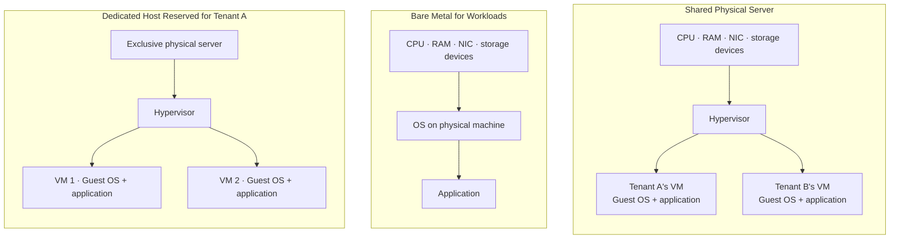

# Virtual Machines, Bare Metal, and Dedicated Hosts: Control and Isolation Levels

In cloud computing infrastructure, an application can run on a virtual machine (VM), on a bare-metal physical server, or on VMs placed inside a dedicated host. All three deployment options provide CPU, memory, storage, and networking capacity, but they differ in virtualization layers, hardware sharing, level of control, and operational responsibilities.

No single option is always better than the other two. VMs are typically well suited when flexible provisioning and rapid scaling are required. Bare metal is useful when workloads require direct hardware access or deep OS-level control. A dedicated host is appropriate when a physical server must be reserved exclusively for one customer, such as for software licensing compliance or controlling VM placement. To choose correctly, you must clearly distinguish between **how a workload uses hardware** and **how the provider allocates hardware to the customer**.

## 1. The Three Models and Core Differences

### Virtual Machine (VM)

A VM is a software-emulated computer running on a physical server. A hypervisor layer partitions the server's resources into logical machines. Each VM has virtual CPUs (vCPUs), memory, storage devices, and virtual network interfaces; inside the VM runs its own guest operating system (guest OS) and applications.

In the standard cloud model, multiple VMs belonging to different customers can run on the same physical server. The hypervisor is responsible for scheduling vCPUs, mapping memory, and isolating VMs. Customers typically manage the guest OS, applications, data, network configuration, and access controls; the provider manages the physical server and the virtualization layer.

VMs establish a clear operational boundary: you can create, clone, reboot, snapshot, or delete a machine without directly interacting with the physical server. This makes it easy to automate deployments, spin up test environments, and scale with load. In return, customers depend on the virtual device types, configuration limits, and features offered by the VM platform.

### Bare Metal

Bare metal is a physical server used directly by workloads through an operating system installed on that machine, without a customer-facing hypervisor dividing the machine into VMs between the application and hardware. Customers generally get deeper control over the kernel, drivers, schedulers, NUMA configuration, PCIe devices, and certain server performance features.

In cloud bare-metal services, the provider may still manage power, firmware, remote management controllers (BMC), out-of-band networks, provisioning workflows, and hardware monitoring. The platform may also use virtualization at the network or storage layer. Thus, "bare metal" describes how compute is delivered to the workload—it does not mean the surrounding infrastructure uses zero virtualization or that the provider relinquishes all hardware management.

Bare metal typically grants a single customer exclusive use of a physical server for the rental period. It reduces intermediate layers in the execution path and prevents multi-tenant CPU contention on the same host. However, the customer takes on greater responsibility for the OS, patching, configuration, monitoring, redundancy, and service recovery.

### Dedicated Host

A dedicated host is a physical server reserved exclusively for a single customer. The customer typically deploys one or more VMs on that host and may be given details about the host, socket count, physical core count, or VM placement. The provider still manages the hardware lifecycle and underlying platform layer under the service agreement.

The defining aspect of a dedicated host is **exclusive allocation of the physical server**, not necessarily running applications directly on hardware. Customers can continue using the hypervisor and VMs as before, except those VMs are placed on hosts dedicated to that tenant. Some platforms also support placement controls to keep related VMs on the same host or on designated hosts.

Dedicated hosts are often useful when software is licensed per socket, physical core, or server; when you must prove hardware is not shared with other tenants; or when you need control over VM placement. Having a dedicated host does not automatically grant the customer permission to modify firmware, access the BMC, or control every hardware component. Those permissions depend on the service and provider agreement.

## 2. Deployment Architecture

The following diagram illustrates the position of the operating system and hypervisor across the three models. A dedicated host is a physical server allocation attribute; on that host, the customer can still run a hypervisor and multiple VMs.

The diagram simplifies the architecture to highlight execution boundaries. A provider may deploy additional management layers, virtual networking, distributed storage, encryption, or monitoring outside the blocks shown above.

Two commonly confused concepts must be separated:

- **VM vs. bare metal** describes how compute is provided to the workload: a logical machine via a hypervisor, or an OS running directly on a physical machine.
- **Shared host vs. dedicated host** describes how physical servers are allocated across customers. A VM can run on either a shared host or a dedicated host.

Therefore, VM does not automatically mean shared host; a VM on a dedicated host is still a VM. Similarly, bare metal is typically a dedicated physical machine, though exact service definitions and operations should be checked in the specific product documentation.

## 3. Comparing Control and Isolation Levels

| Criterion | VM on Shared Host | Bare Metal | VM on Dedicated Host |
|---|---|---|---|
| Provisioned unit | Logical computer | Physical server | Logical computer on a reserved physical server |
| Hypervisor in workload execution path | Yes | Typically no customer-used hypervisor partitioning the machine | Yes |
| Server shared with other tenants | Possible | Typically no | No on the reserved host |
| Guest OS control | High within the VM scope | High over the directly installed OS | High within the VM scope |
| Hardware and topology control | Limited to VM features | Usually deepest | Better visibility and placement control than shared VMs; hardware access still varies by provider |
| Rapid creation/deletion | Typically very good | Depends on physical server provisioning time | Typically good for VMs, bounded by dedicated host capacity |
| OS administration responsibility | Customer manages guest OS | Customer manages OS on physical machine | Customer manages guest OS; provider manages host and hypervisor per service |
| Cost at low utilization | Usually easy to scale down VM size | May still pay for the entire server | May pay for the entire host even if partially used |

### Hardware Control

VMs provide stable, easily automated virtual hardware. The provider decides how vCPUs map to physical cores, how memory is allocated, virtual NIC types, and I/O limits. Some services let you pick CPU families, memory-optimized profiles, GPU acceleration, SR-IOV, or pinning; these features bring VMs closer to direct hardware performance while remaining within platform boundaries.

Bare metal gives operations teams deeper control over how the OS uses CPUs and devices. For instance, applications can configure CPU affinity, huge pages, NUMA locality, kernel modules, or specialized drivers. Actual control still depends on granted permissions: customers may not be permitted to change BIOS, firmware, or out-of-band management settings.

Dedicated hosts provide control over VM placement and host exclusivity. This is a significant advantage when you need to know what machine type VMs run on or bind workloads to a specific host. Still, a dedicated host does not turn a VM into bare metal; applications still run inside a guest OS through a virtualization layer.

### Tenant Isolation and Security Boundaries

VMs rely on the hypervisor to isolate memory, virtual CPUs, and devices between guests. This is the standard cloud isolation model and fits most enterprise applications. However, VMs on a shared host may still share certain physical resources like CPU caches, memory bandwidth, PCIe, NICs, or storage devices. Hypervisors and hardware must be patched, configured, and monitored to reduce risks from isolation flaws or platform-layer vulnerabilities.

Dedicated hosts eliminate other tenants running workloads on the same reserved physical server. This reduces risks associated with host sharing and supports hardware-location control requirements. However, VMs on the same host still share that host's resources and still depend on the hypervisor. Networking, DNS, storage, management, backup, or cloud control plane services may also remain shared services.

Bare metal reduces reliance on a hypervisor in the execution path and generally avoids other tenants contending for CPU or memory on the same server. Even so, a bare-metal server may still depend on shared networks and storage, remote management systems, firmware, and provider operational processes. Bare metal also does not inherently protect applications from misconfiguration, malware, kernel vulnerabilities, overly broad permissions, or network flaws.

Therefore, physical isolation only solves part of the security problem. When evaluating compliance requirements, clearly define what needs isolation (CPU, memory, host, network, storage, or data), tenant scope, provider staff access, encryption, auditing, key management, and compliance evidence. Do not treat a "dedicated" or "bare metal" label alone as sufficient proof of compliance.

## 4. Performance and Predictability

You should not assume every VM is slower than bare metal by a fixed percentage. Modern hypervisors use hardware-assisted virtualization, so overhead can be small for many workloads. Differences become more noticeable when applications are sensitive to I/O latency, high-rate packet processing, specialized hardware access, or require exact CPU and memory placement.

Factors to evaluate include:

- **CPU:** core count, clock speed, CPU architecture, SMT, contention levels, and pinning support. A vCPU does not necessarily correspond to a continuously dedicated physical core.
- **Memory:** capacity, bandwidth, NUMA nodes, huge pages, and remote node memory access. For large workloads, improper CPU and RAM placement can increase latency.
- **Network:** bandwidth, packets-per-second, latency, jitter, NIC queues, and support for SR-IOV or dedicated network devices.
- **Storage:** IOPS, throughput, latency, stability under heavy load, caching, and the path from application to storage device.
- **Consistency:** performance variance over time, during host contention, maintenance events, or scaling operations.

Bare metal typically has an edge when directly utilizing devices, tuning the kernel, or achieving stable single-machine physical performance. Dedicated hosts improve predictability by eliminating other tenants' workloads on the same host, though VM performance remains influenced by the hypervisor, VM config, and shared services. VMs on shared hosts can perform well if you pick the right instance family, sizing, and provider performance tiers.

For meaningful comparisons, run benchmarks with realistic data and traffic patterns. Measure throughput, p50/p95/p99 latency, CPU utilization, memory bandwidth, IOPS, packet loss, and cost per unit of work. A single synthetic CPU benchmark is not enough to choose a platform for a database or low-latency networking system.

## 5. Cost and Operational Responsibilities

VMs typically allow choosing small configurations, scaling up or down, and autoscaling with demand. Billing can be based on runtime, instance size, or usage depending on the service. This is advantageous for variable loads where autoscaling or off-hours shutdown schedules in dev environments can be utilized.

Dedicated hosts are usually billed per host or reserved physical capacity. If only a small fraction of resources is used, cost per workload can be high. When multiple steady workloads share the host, higher utilization can offset the dedication cost. Software licensing must also be factored in: some commercial licenses charge per socket or physical core, making host visibility and core counting more predictable for total licensing cost. Licensing rules must be confirmed directly with the software vendor.

Bare metal typically requires paying for the physical machine's capacity while allocated, even when load drops. Operations teams must also invest effort in OS installation, kernel and driver updates, hardware monitoring, capacity management, backups, hardware replacement workflows, and deployment automation. These costs must be included in total cost of ownership (TCO) alongside server rental fees.

| Responsibility Area | VM | Bare Metal | Dedicated Host Running VMs |
|---|---|---|---|
| Servers, power, cooling, hardware replacement | Provider | Provider | Provider |
| Hypervisor and host management layer | Provider | No customer-used hypervisor in execution path; physical management platform still operated by provider | Provider per service model |
| Workload OS | Customer manages guest OS | Customer manages OS installed on physical server | Customer manages guest OS |
| Applications, data, IAM, and in-workload config | Customer | Customer | Customer |
| App redundancy, backup, and recovery | Customer designs per service used | Customer designs in coordination with service capabilities | Customer designs per service used |

The table above describes a typical division of responsibilities. Service contracts may shift these boundaries, especially for managed bare-metal services or services with OS support. Always read the provider's SLA and shared responsibility documentation before going to production.

## 6. When Should You Choose Each Model?

### Choose VMs When You Need Flexibility and Fast Scaling

VMs are a reasonable default for most web apps, APIs, background services, CI/CD environments, dev servers, and standard enterprise systems. Each component can use a tailored profile; operations teams can build golden images, automate deployments, replace failed instances, and scale horizontally when traffic grows.

Example: an e-commerce service can run its frontend and APIs on VMs in an autoscaling group. When traffic surges, the system adds VMs; when load drops, it scales in. This avoids maintaining a large physical server just for peak hours.

### Choose Bare Metal When Workloads Need Deep Control

Bare metal suits high-performance databases requiring NUMA and I/O tuning, HPC workloads, packet processing, accelerators, or legacy apps tied to specific drivers and kernels. It is also useful when you need to remove the hypervisor from the execution path to measure and tune low-level performance.

Example: a packet-processing system may require NICs with specific hardware offloads, CPU affinity, and huge pages to sustain high throughput. If VMs do not provide sufficient access or predictable performance, bare metal is worth testing.

### Choose Dedicated Hosts When You Need Exclusive Servers While Keeping VMs

Dedicated hosts fit applications with per-socket/core licensing rules, requirements not to share hardware with other tenants, or VM placement control needs. They preserve existing VM-based operations, images, snapshots, and automation while providing clearer host allocation boundaries.

Example: an enterprise running commercial database software licensed by physical cores can place database VMs on dedicated hosts. Operations tracks core counts and host locations for license compliance while still deploying and backing up workloads at the VM level.

### Combining Multiple Models

A system does not need to force every component onto the same infrastructure type. You can use VMs for web and API tiers needing rapid scaling; dedicated hosts for software with licensing constraints; and bare metal for data- or network-intensive workloads with special performance demands. Components still communicate over private networks, APIs, queues, or shared storage systems.

When combining models, account for cross-tier network latency, redundancy plans, encryption in transit, cross-environment monitoring, and consistent deployment pipelines. Running one component on bare metal does not automatically make the whole system highly available; you still need multi-node designs, data replication, and failover procedures.

## 7. Selection Process

You can follow this sequence to decide rather than picking by service name:

1. **Identify mandatory constraints.** Check compliance, software licensing, data residency, CPU/GPU types, drivers, kernel, and tenant isolation requirements. If an isolated physical host is mandatory, VMs on shared hosts will not qualify.
2. **Measure workload characteristics.** Gather CPU, RAM, IOPS, network throughput, packets-per-second, and latency distributions. Identify whether bottlenecks lie in CPU, memory, network, or storage.
3. **Determine required control level.** If guest OS and virtual resources suffice, VMs may be enough. If host exclusivity and placement are needed, consider dedicated hosts. If direct OS and device control are required, evaluate bare metal.
4. **Assess operational capability.** Check whether your team can handle patching, drivers, monitoring, backups, server replacement, scaling, and physical-level recovery. Higher control typically brings higher responsibility.
5. **Calculate total cost of ownership.** Include compute, storage, network, licenses, redundancy overhead, operational staffing, and idle capacity. Compare cost per transaction or per completed unit of work.
6. **Prototype and validate.** Run representative workloads on viable options, measure normal and peak performance, test host or node failure behavior, and only then finalize the architecture.

A preliminary decision matrix:

| Primary Need | First Option to Evaluate | What to Verify |
|---|---|---|
| General apps, variable traffic, needs autoscaling | VM | VM limits, CPU family, SLA, and load-based cost |
| Software billed per socket or physical core | Dedicated host | Licensing rules, core counting method, and dedicated host proof |
| Needs direct kernel, driver, NUMA, or NIC control | Bare metal | Hardware access rights, supported devices, and operational duties |
| Needs host separation from other tenants while keeping VM workflows | Dedicated host | Scope of dedication, placement, and shared services outside the host |
| Needs frequent spin-up/tear-down test environments | VM | Standard images, automation, and resource reclamation |
| Needs high performance with unknown bottlenecks | Benchmark VM first, then compare dedicated host/bare metal | Measure on real workloads, not marketing specs |

## 8. Common Misconceptions

- **"VMs are always slower than bare metal."** Not true in all cases. For many workloads, virtualization overhead is small; configuration, I/O, contention, and tuning determine actual results.
- **"Dedicated host means applications run directly on the physical machine."** Not necessarily. Dedicated hosts typically let you deploy VMs on an exclusive physical server.
- **"Bare metal means zero virtualization anywhere."** Incorrect. Workloads may use an OS directly on physical hardware while cloud networking, storage, or the control plane remain virtualized.
- **"A dedicated host guarantees compliance."** A dedicated host only addresses hardware isolation within a defined scope. Compliance also depends on data, identity, encryption, networking, processes, and audit evidence.
- **"Having root access means controlling all hardware."** OS admin privileges do not equate to controlling firmware, BMC, network switches, or server replacement workflows.
- **"Bare metal is always cheaper if performance is higher."** You must compare cost per unit of work and include idle hardware, labor, redundancy, and licensing.

## Conclusion

VMs optimize flexibility and automation; bare metal optimizes direct control over the OS and hardware; dedicated hosts reserve physical servers for one tenant while still allowing VMs. When designing cloud compute infrastructure, first establish isolation, performance, licensing, and operational requirements, then verify via benchmarks and TCO. In many systems, combining all three models per workload produces a better-balanced architecture.
