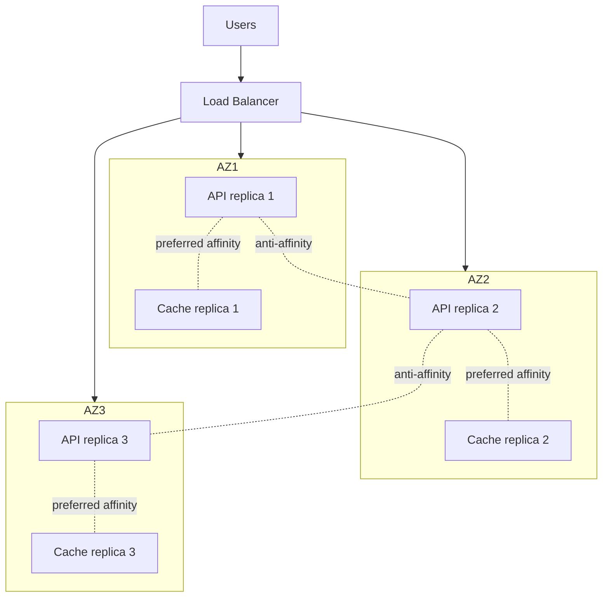

# Machine Placement, Affinity, and Anti-Affinity Between Workloads

When deploying an application in the cloud, choosing the number of virtual machines or containers only solves half the problem. The system must also decide **where each workload will run**: on which physical server, node, node pool, rack, or availability zone. Two workloads may run close together to cut latency and speed up data exchange; conversely, replicas of the same service may need to be separated so a single failure does not take them down simultaneously.

The rules describing those placement relationships are commonly called **affinity** and **anti-affinity**. They are part of cloud compute infrastructure architecture alongside choosing VMs, containers, or serverless; allocating CPU and memory; designing networking; security; scaling; availability; and cost optimization. Understanding placement rules properly helps a system balance performance, fault tolerance, and resource efficiency.

## 1. What Is Placement?

**Workload placement** is the process by which a scheduler or infrastructure platform selects a location to run a workload. A workload can be a virtual machine (VM), container, Kubernetes Pod, background worker, or a group of interdependent services.

Cloud infrastructure typically has multiple placement tiers:

| Placement Tier | Meaning | Example Design Goal |
|---|---|---|
| Region | Geographic area of the provider | Meet residency requirements, user latency, and disaster recovery |
| Availability Zone (AZ) | Relatively independent availability zone within a region | Reduce the risk of multiple replicas being impacted by a single AZ outage |
| Zone or failure domain | Fault scope used by the platform to partition resources; exact meaning depends on provider | Spread workloads across failure domains |
| Rack or server group | Set of servers that may share power, networking, or physical infrastructure | Isolate failures at the rack level and reduce resource contention |
| Physical host | Physical server running the hypervisor or container runtime | Place VMs or Pods on different servers |
| Node or node pool | Compute host managed by the container scheduler; node pools group nodes with similar specs or purposes | Choose appropriate CPU, RAM, GPU, architecture, or workload group |

Not every platform lets users inspect or control every tier. Providers may abstract racks and hosts, exposing only AZs or placement groups. Therefore, use the exact topology attributes offered by the platform, and do not assume two VMs with different IDs automatically sit on different racks or in different data centers.

### Placement Must Satisfy Multiple Conditions

Schedulers typically must find a location that simultaneously satisfies:

- **Resources:** the node has enough CPU, memory, ephemeral storage, GPU, or specialized resources requested by the workload.
- **Compatibility:** OS, CPU architecture, hypervisor, accelerators, and runtime meet workload requirements.
- **Topology:** the workload is placed on or kept off the specified hosts, nodes, zones, or regions per policy.
- **Networking and data:** the location can reach dependent services, storage volumes, and required endpoints with suitable latency.
- **Security and compliance:** the workload runs only on authorized machine groups or regions, such as dedicated nodes or regions meeting data residency rules.
- **Operations:** the location retains enough capacity during node maintenance, an AZ outage, or system scaling.

Placement is therefore not merely packing containers onto available machines. It is an architectural decision directly affecting performance, availability, security, and cost.

## 2. Affinity: Placing Related Workloads Close Together

**Affinity** is a rule that prefers or requires placing a workload in a location relative to another workload or a set of infrastructure attributes. Common goals are lowering latency, increasing data locality, or keeping collaborating components within the same location domain.

For example, an image-processing service frequently reads data from a local cache. Placing the two workloads close together reduces network round-trip times. A workload needing a GPU can also be constrained to nodes carrying a matching GPU label.

Two rule categories must be distinguished:

**Node affinity** selects nodes based on node labels or attributes. Example: run only on nodes with `accelerator=nvidia` or `workload-tier=compute`.

**Workload affinity** chooses placement relative to other workloads. Example: co-locate an API Pod on the same node as a cache Pod with a specific label, or place a group of VMs within the same platform-supported placement domain.

Affinity can be:

- **Hard constraint:** if no location satisfies the rule, the workload is not scheduled. This fits when the condition is a functional, security, or compatibility requirement.
- **Soft preference:** the scheduler tries to honor it but can pick another location if current resources or conditions do not allow it. This usually fits when the goal is performance optimization.

Do not use hard affinity merely to keep workloads closer together. When preferred nodes run out of resources, hard rules can leave workloads stuck pending even when other nodes could run them.

### When Should You Use Affinity?

Affinity helps in cases with clear, measurable locality benefits:

1. **Reduce latency between chatty components.** A worker and a cache can prefer the same node or zone if exchange traffic is high.
2. **Increase data locality.** A data-processing workload can prefer running near the volumes or storage services it accesses heavily, if the platform exposes that topology.
3. **Select matching hardware.** ML workloads may need GPU nodes; high-performance compute workloads may need specific CPUs or architectures.
4. **Separate resource pools by purpose.** Latency-sensitive services can prefer high-performance node pools, while batch jobs run on cost-optimized node pools.

Affinity does not automatically guarantee low latency. Networks can still congest, CPU and memory can still face contention, and physical topology may be hidden by the platform. After applying rules, measure real latency and check behavior as load grows.

## 3. Anti-Affinity: Separating Workloads to Reduce Shared Failure Impact

**Anti-affinity** is a rule that requires or prefers placing related workloads in different locations. The primary goal is preventing a single failure from taking out multiple replicas of the same service.

Suppose an API has three replicas. If all three run on one physical host, a power or hardware failure on that host can bring down the whole service. If the three replicas are spread across three hosts, one host failure typically affects only one replica. If they are further spread across multiple AZs, the system can better withstand certain AZ-level outages.

Anti-affinity is commonly applied at several levels:

| Separation Scope | What It Mitigates | Conditions to Verify |
|---|---|---|
| Different host or node | Hardware fault, reboot, or maintenance of one machine | Sufficient nodes and capacity to place replicas |
| Different rack or failure domain | Power, switch, or shared infrastructure domain failure | Whether the platform exposes rack/failure domain topology |
| Different AZ | Broad outage within an availability zone | Whether the app, data, and network support multi-AZ operation |
| Different region | Regional outage or disaster recovery needs | Data replication, routing, RTO/RPO, and cross-region costs |

Separation at one level does not imply separation at a higher level. Three Pods on three different nodes in the same AZ can still all fail together if that AZ loses connectivity. Similarly, three VMs on different hosts in the same rack can still be impacted by a rack failure.

### Hard and Soft Anti-Affinity

Hard anti-affinity forbids related workloads from sharing the same topology domain. This is appropriate when losing one domain could wipe out all replicas or when isolation is mandatory.

Soft anti-affinity merely prefers spreading. When a cluster lacks nodes, the scheduler can still co-locate workloads to keep the service running. This improves schedulability, though isolation drops under resource scarcity.

An overly strict anti-affinity policy can backfire. For example, a service has five replicas while the cluster has only three nodes. If two replicas are strictly forbidden on the same node, two Pods will fail to schedule. Decide clearly whether the system prioritizes replica count, isolation level, or degrading one when resources are scarce.

## 4. Distinguishing Affinity, Anti-Affinity, and Topology Spread

These three mechanisms are related but solve different problems:

| Mechanism | Question the Rule Answers | Example |
|---|---|---|
| Node affinity | Which nodes is the workload allowed or preferred to run on? | Pick only nodes with GPUs |
| Pod/workload affinity | Which workloads should or must this workload sit near? | Place worker near cache |
| Pod/workload anti-affinity | Which workloads must or should this workload avoid sharing a location with? | Do not place two API replicas on the same host |
| Topology spread | How evenly should replicas distribute across topology domains? | Spread three replicas across three AZs with max skew of one |

Anti-affinity typically defines what to avoid, whereas topology spread defines desired distribution across multiple domains. For services with many replicas, topology spread often expresses balancing goals more cleanly than enumerating pairwise pod separation rules.

## 5. Kubernetes Examples

Kubernetes provides `nodeSelector`, `nodeAffinity`, `podAffinity`, `podAntiAffinity`, and `topologySpreadConstraints` to control Pod placement. The examples below illustrate common patterns; topology label names must match your cluster's actual labels.

### 5.1. Run Only on GPU Nodes

Nodes are labeled `accelerator=nvidia` by administrators. A Pod can require nodes carrying this label:

```yaml
apiVersion: v1
kind: Pod
metadata:
  name: image-inference
  labels:
    app: image-inference
spec:
  nodeSelector:
    accelerator: nvidia
  containers:
    - name: inference
      image: example/image-inference:1.0
      resources:
        requests:
          cpu: "2"
          memory: "4Gi"
        limits:
          nvidia.com/gpu: 1
```

`nodeSelector` is a simple mandatory constraint. To express multiple conditions, operators, or preferences, use `nodeAffinity`. Labels only pick suitable nodes; to expose GPU hardware to a container, the node needs a device plugin advertising the extended resource and the Pod must request that resource. Exact resource names depend on the GPU type and plugin. Node labels must be managed reliably, and permissions to modify node labels should be restricted via RBAC and admission policies.

### 5.2. Prefer Placing an API Near Its Cache

Suppose cache Pods carry label `app: product-cache`. The API can prefer scheduling onto the same node as the cache:

```yaml
apiVersion: apps/v1
kind: Deployment
metadata:
  name: product-api
spec:
  replicas: 3
  selector:
    matchLabels:
      app: product-api
  template:
    metadata:
      labels:
        app: product-api
    spec:
      affinity:
        podAffinity:
          preferredDuringSchedulingIgnoredDuringExecution:
            - weight: 80
              podAffinityTerm:
                topologyKey: kubernetes.io/hostname
                labelSelector:
                  matchLabels:
                    app: product-cache
      containers:
        - name: api
          image: example/product-api:1.0
          resources:
            requests:
              cpu: "500m"
              memory: "512Mi"
```

Here, `kubernetes.io/hostname` sets node-level topology. The `preferred` keyword makes it a soft preference; if matching nodes lack capacity, the Pod can still land elsewhere. Confirm the cache actually runs on target nodes and measure whether co-location improves latency.

### 5.3. Spread API Replicas Across Nodes and AZs

For services needing high availability, you can prefer placing replicas on different hosts while enforcing balanced distribution across AZs. The example below uses soft anti-affinity by hostname and hard topology spread by zone:

```yaml
apiVersion: apps/v1
kind: Deployment
metadata:
  name: checkout-api
spec:
  replicas: 3
  selector:
    matchLabels:
      app: checkout-api
  template:
    metadata:
      labels:
        app: checkout-api
    spec:
      affinity:
        podAntiAffinity:
          preferredDuringSchedulingIgnoredDuringExecution:
            - weight: 100
              podAffinityTerm:
                topologyKey: kubernetes.io/hostname
                labelSelector:
                  matchLabels:
                    app: checkout-api
      topologySpreadConstraints:
        - maxSkew: 1
          topologyKey: topology.kubernetes.io/zone
          whenUnsatisfiable: DoNotSchedule
          labelSelector:
            matchLabels:
              app: checkout-api
      containers:
        - name: api
          image: example/checkout-api:1.0
          ports:
            - containerPort: 8080
          resources:
            requests:
              cpu: "500m"
              memory: "512Mi"
```

In this example:

- `replicas: 3` requests three Pods.
- Anti-affinity prefers placing Pods on different nodes. Because it is `preferred`, Kubernetes can still co-locate if needed.
- `topologyKey: topology.kubernetes.io/zone` tells the scheduler to treat zone labels as the distribution boundary.
- `maxSkew: 1` caps the Pod count imbalance across eligible zones at one.
- `DoNotSchedule` prevents scheduling a Pod if placement would violate the spread constraint.

For this configuration to work, nodes must carry accurate zone labels and the cluster must have capacity across zones. If a zone lacks matching nodes or CPU/RAM, Pods can remain `Pending`. In real deployments, verify zone counts, topology labels, available capacity, and behavior when a zone is lost.

Understand `requiredDuringSchedulingIgnoredDuringExecution` and `preferredDuringSchedulingIgnoredDuringExecution` properly: rules are evaluated when scheduling the Pod. The `IgnoredDuringExecution` suffix means topology changes after a Pod is already running do not automatically evict or move the Pod solely because the rule is no longer satisfied.

## 6. Placement in VM and Cloud Services

For VMs, providers typically offer placement policies or placement groups. Specific names and capabilities vary across platforms, yet generally address three goals:

- **Cluster or concentrated:** place VMs physically close in infrastructure to optimize latency or throughput between them. Suitable for distributed workloads exchanging heavy traffic, though shared failure domains must be evaluated.
- **Spread or distributed:** place VMs across different hosts or failure domains to improve fault tolerance. Suitable for independent service replicas.
- **Partition:** divide VMs into logical partitions; VMs within one partition may share a failure domain while partitions are isolated per platform specifications. Useful for large distributed systems needing bounded blast radius.

Before choosing a policy, read provider limits: max VMs per group, region/AZ scope, supported instance types, resource caps, and host maintenance behavior. Do not assume a group named "spread" guarantees multi-AZ separation if platform docs only commit to host separation within one AZ.

With managed container services, placement control may be restricted to node pools, zones, and scheduler policies. With serverless, users usually do not control hosts or nodes; instead, design availability via instance counts, concurrency settings, data partitioning, timeouts, retries, and dependency resilience.

## 7. Design Example: Multi-Replica E-Commerce Service

Suppose a system has an order-processing API, a product cache, and background workers. A placement strategy might look like:

| Workload | Placement Policy | Rationale |
|---|---|---|
| API replicas | Spread across multiple nodes and AZs | A single node or AZ failure must not take down the entire API |
| Product cache | Run multiple replicas; prefer proximity to API within the same zone if measurements show benefit | Lower read latency while avoiding a single cache as a single point of failure |
| Background workers | Run on dedicated node pool or cost-optimized nodes; enforce resource limits | Prevent batch jobs from starving latency-sensitive API CPU/RAM |
| Database | Use DBMS or data service HA/replication mechanisms; check primary and replica topology | Application placement does not replace data availability and consistency |

Suppose the API has three replicas spread across three AZs. If one AZ fails, the remaining two AZs need enough CPU and memory to handle shifted load. Thus, the design must reserve **spare capacity**; spreading replicas without failover headroom still leaves the system overloaded during an outage.

The cache can sit near the API to cut latency, yet cache replicas must also be spread to prevent a single fault from wiping out all caches. If the cache stores only rebuildable data, the system can tolerate rewarming after an outage. If the cache holds critical state or sole copies of data, reconsider its role and use durable storage mechanisms.

Background workers typically tolerate higher latency than APIs. Moving workers to a dedicated node pool limits interference from CPU-intensive jobs. However, separate node pools can increase cost and leave idle resources; weigh autoscaling, priority classes, and resource limits instead of hard-splitting every workload.

## 8. Impact on CPU, Memory, Network, Storage, Security, and Cost

### CPU and Memory

Affinity can pack workloads onto a subset of nodes, improving utilization and cutting network hops. Yet over-packing creates CPU or memory hotspots. Anti-affinity distributes load, though it can increase required node counts and reduce bin-packing efficiency.

When evaluating placement, examine container `requests` and `limits`, actual usage, CPU throttling, memory pressure, and per-node utilization. A node with spare CPU but insufficient RAM still cannot accept a Pod; cluster-wide free capacity does not guarantee any single node qualifies.

### Network

Co-locating chatty workloads on the same node or zone can cut latency and cross-zone traffic. In return, concentrating them in one failure domain widens blast radius if that node or zone fails. Measure latency, throughput, packet loss, and cross-zone/cross-region transfer costs to choose the right placement balance.

### Storage

Volumes may be bound to a specific zone or have topology constraints. A Pod using that volume must be scheduled on a node able to attach the volume. If anti-affinity or topology spread forces a Pod into another zone where storage lacks cross-zone access, the Pod may fail to start. For stateful workloads, verify PersistentVolume topology, StorageClass settings, replication mechanisms, and failover procedures before setting placement rules.

### Security and Isolation

Node affinity, taints, and tolerations can steer sensitive workloads onto dedicated node pools. For instance, workloads handling sensitive data run only on nodes with appropriate access controls. However, node labels and scheduler rules are only one layer of control; you still need IAM/RBAC, network policies, encryption, secret management, patching, and node hardening. Anti-affinity can also reduce infrastructure sharing risks between workloads, though it does not replace security boundaries.

### Cost

Spreading workloads across nodes, AZs, or regions generally boosts fault tolerance, yet can require more machines, generate cross-zone data transfer charges, and increase replica storage costs. Consolidating workloads can boost utilization while increasing shared-failure and resource-contention risk. Choose spread levels based on SLOs, RTO/RPO, and business outage impact, then evaluate costs both in normal operation and when a failure domain goes offline.

## 9. Process for Designing Placement Policies

Apply the following process for VMs, containers, or node pools:

1. **Define service objectives.** Document latency and availability SLOs, RTO/RPO, peak traffic, compliance rules, and budget.
2. **Map workloads and dependencies.** Identify components needing low-latency communication, components needing separation, and data with fixed topology.
3. **Choose the right topology domain.** Decide whether proximity or separation applies at the node, host, rack, AZ, or region level. Use the smallest scope that meets goals without ignoring larger failure domains.
4. **Distinguish hard constraints from soft preferences.** Use hard constraints only for mandatory requirements. Performance optimizations should usually start as soft preferences and be validated with metrics.
5. **Verify capacity and schedulability.** Account for CPU, RAM, GPU, storage, node counts, and spare capacity when losing one node or one AZ.
6. **Test failure scenarios.** Exercise node drains, node failures, zone losses, traffic spikes, and resource scarcity. Observe whether Pods/VMs reschedule per policy.
7. **Monitor and refine.** Track workload distribution, per-node utilization, latency, scheduling errors, cross-zone costs, and SLO compliance. Adjust as topology or load evolves.

The diagram below shows how a service can combine two goals: keeping dependencies close for performance while spreading critical replicas across failure domains.



The diagram is a conceptual model: actual distribution still depends on per-AZ capacity, the scheduler, storage configuration, and how the application handles losing a replica or an entire AZ.

## 10. Common Design Mistakes

**Separating nodes while forgetting AZs.** Replicas on different hosts in the same AZ can still go down together during an AZ outage. Explicitly define the failure domains your SLO must survive.

**Setting hard anti-affinity without enough nodes.** Pods get stuck `Pending` despite aggregate cluster capacity. Check per-node constraints and topology domain counts; consider soft preferences or adding capacity.

**Overly tight affinity for minor gains.** An unmeasured latency improvement can hinder scaling or recovery. Start with preferences and verify with metrics.

**Ignoring volume topology.** A Pod is directed to another zone while its volume attaches only in the original zone. Design storage and placement together.

**Equating spread replicas with HA.** Applications also need health checks, readiness probes, load balancing, bounded retries, dependency failure handling, data replication, and spare capacity.

**Using placement as the sole security boundary.** Run location does not replace authentication, authorization, encryption, network policies, or hardening.

**Skipping tests under resource scarcity.** Policies may work in a healthy cluster yet fail during node maintenance or an AZ loss. Test graceful degradation scenarios.

## 11. Pre-Production Checklist

- [ ] Identified which workloads need proximity and which need separation.
- [ ] Selected the right topology level: node, host, rack, AZ, or region.
- [ ] Separated mandatory constraints from soft preferences.
- [ ] Verified adequate CPU, memory, GPU, storage, and node counts.
- [ ] Verified topology labels and placement attributes provided by the platform.
- [ ] Checked that volumes, networking, and dependent services align with planned locations.
- [ ] Budgeted spare capacity for losing one node or one AZ.
- [ ] Tested node drains, failure domain outages, and resource contention scenarios.
- [ ] Configured monitoring for scheduling failures, workload spread, latency, and cost.
- [ ] Reviewed policies whenever replica counts, topology, or traffic patterns change.

## 12. Conclusion

Affinity places related workloads close together to improve locality, latency, or hardware utilization. Anti-affinity separates workloads to limit shared failure impact. Node affinity selects where workloads are allowed to run; topology spread controls even distribution of replicas across topology domains.

No single placement policy fits every workload. Sound decisions start from SLOs, dependency graphs, and target failure domains, then balance CPU, memory, networking, storage, security, and cost. A configuration is truly suitable only when it continues meeting targets under heavy load, resource contention, and infrastructure failures.
