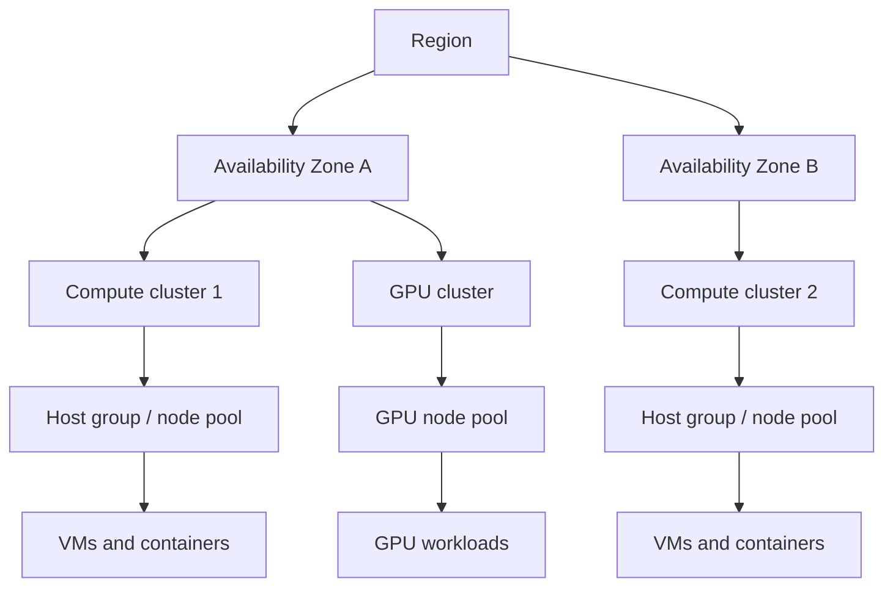
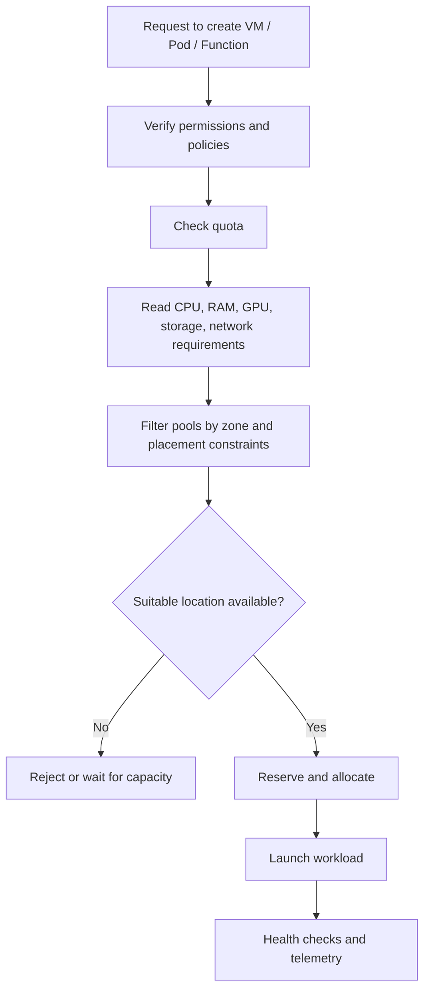

# Capacity Pools, Resource Quotas, and Actual Allocability

## Context: Having Quota Does Not Guarantee You Can Provision Resources

When deploying virtual machines, pods, or serverless functions, users typically declare CPU, memory, storage, networking, and replica counts. The platform must check multiple conditions before turning that request into running resources: whether the account has remaining quota, whether the pool has enough capacity, whether a suitable host or node exists, and whether constraints around region, CPU architecture, GPU, networking, or policies are met.

Three concepts must be distinguished:

- **Capacity pool:** a collection of resources managed and allocated within a defined scope, such as a server cluster, node pool, availability zone, or GPU server group.
- **Quota:** the consumption ceiling an account, project, namespace, or user group is allowed to use per resource type.
- **Actual allocation:** the scheduler or allocator finding suitable resources and assigning them to a workload at request time.

Quota states the maximum a user is allowed to request. Capacity states how much capacity the platform holds within a scope. Actual allocability depends simultaneously on both, along with placement rules and real-time system state. A project with remaining quota may still fail to create a VM because the pool lacks suitable capacity. Conversely, a cluster with ample CPU and RAM will still reject requests if the account has hit its quota.

In the **CLOUD_CORE_SERVICES_COMPUTE** module, understanding this relationship accurately helps choose compute models, plan CPU and memory, design node pools, scale loads, ensure availability, and control operational costs.

## 1. Capacity Pools and Capacity Layers

### 1.1. What Is a Capacity Pool?

A capacity pool groups resources that can be evaluated together when allocating workloads. Pool boundaries depend on platform architecture. A provider may organize pools by availability zone, machine family, CPU generation, hypervisor cluster, or specialized server groups. In Kubernetes, a node pool typically groups worker nodes with similar configurations and scaling policies. A serverless platform may manage internal execution pools that users do not see directly.

A pool can be described by several attributes:

- Geographic and fault scope: region, availability zone, cluster, or rack.
- Capacity type: general-purpose CPU, compute-optimized CPU, high-memory, GPU, accelerators, or local SSD machines.
- Capacity per dimension: vCPU, RAM, GPU, disk space, IOPS, network throughput, and execution slots.
- Usage rules: permitted tenants, allowed workloads, overcommit ratios, reservations, and safety headroom.
- Scaling policies: min/max node counts, instance types that can be added, and time for new capacity to become ready.

Not all resources are interchangeable. A pool with 100 free vCPUs but no GPUs cannot satisfy a workload requiring a GPU. Two pools with identical vCPU counts but differing CPU architectures, deployment zones, network speeds, or storage types may also be non-equivalent to an application.

### 1.2. Capacity Concepts to Separate

| Concept | Meaning | Example |
|---|---|---|
| Installed / physical capacity | Total hardware capacity installed in the system | Total physical CPU cores and RAM across hosts |
| Platform-reserved capacity | Portion reserved for hypervisor, host OS, daemons, and platform services | CPU/RAM excluded from the scheduler for tenant workloads |
| Allocatable capacity | Capacity the platform permits allocating after subtracting system reserves | CPU and RAM the scheduler can consider |
| Committed / allocated capacity | Capacity already consumed by workloads or reservations per pool policy | Resources assigned to VMs or pods |
| Nominal free capacity | Remaining allocatable capacity via aggregate calculation | Allocatable minus committed capacity |
| Schedulable capacity | Remaining capacity that actually matches specific placement requirements | A single node with enough CPU, RAM, and GPU for a pod |
| Safety headroom | Buffer reserved for traffic spikes, node failures, upgrades, or demand variance | N+1 capacity or 15% reserve per internal policy |

A general formula for capacity available to consider for a new request is:

```text
nominal_free = allocatable_capacity - committed_capacity
usable_for_new_workload = nominal_free - safety_headroom
```

In this calculation, `committed_capacity` must be defined consistently with pool policy. If reservations are already included in committed capacity, do not subtract reservations a second time. `usable_for_new_workload` remains an aggregate figure; the scheduler must still check resource types, placement, and workload constraints.

### 1.3. Pools Are Often Hierarchical

A system can have pools at the region, cluster, host group, and node levels. A request sent to a region may be further restricted to a specific availability zone, machine type, and node group. Capacity in a parent pool does not automatically imply every child pool has room.



The diagram shows a conceptual hierarchy. Actual naming and tier depth vary across providers and platforms.

## 2. Quota: How Much Is a User Allowed to Consume?

Quota caps resource consumption for an administrative scope. That scope may be an organization, account, project, subscription, namespace, or tenant. Quotas enable controlled sharing of common infrastructure, prevent one group from exhausting resources, and support budgeting, security, and capacity planning.

Common quotas include:

- Total vCPUs or instance counts per machine family.
- Total RAM, VM counts, node counts, or pod counts.
- GPU or accelerator counts by type.
- Volume capacity, volume count, snapshots, or configurable IOPS.
- IP addresses, load balancers, public IPs, or network resources.
- Invocation rates, max concurrency, memory per invocation, or serverless function counts.

Quotas can apply at multiple levels. For example, an organization has a 500 vCPU quota, a project has a 100 vCPU quota, and a namespace has a 20 vCPU ResourceQuota. Workload creation must respect all quotas along the allocation path. A child-level limit can be tighter than its parent's quota.

### 2.1. Quota Is Not a Capacity Reservation

Quota is typically a **consumption ceiling**. It does not necessarily pre-reserve physical CPU or RAM for an account. If a project is granted a 100 vCPU quota, it means the project can consume up to that amount when other conditions permit; it does not mean 100 vCPUs are held exclusively in a pool.

A **capacity reservation** sets aside capacity within a specific scope to increase the likelihood resources are available when needed. Reservations usually bind to an instance type, zone, duration, or consumer. Terms, duration, and cost depend on the platform. Having quota without a reservation can still run into capacity shortages; having a reservation while out of quota may also block provisioning if quotas are still enforced.

| Mechanism | Question Answered | Primary Guarantee |
|---|---|---|
| Quota | How much is the account allowed to use at most? | Caps consumption rights per administrative scope |
| Capacity pool | What capacity exists within this scope? | Resource pool the system can allocate from |
| Reservation | What capacity has been pre-reserved for a specific target? | Priority or right to consume capacity per reservation terms |
| Request | How much minimum resource does the workload need to schedule? | Demand used for placement or allocation decisions |
| Limit | How much maximum resource is the workload allowed to consume? | Execution or configuration cap per platform mechanism |

### 2.2. Quotas, Requests, and Limits in Containers

In Kubernetes, container `requests` are used for pod scheduling and serve as the basis for certain quota calculations. `limits` enforce runtime resource ceilings, with enforcement varying by resource type. CPU limits are typically enforced via throttling; exceeding a memory limit can trigger an OOM kill. `ResourceQuota` caps aggregate consumption or object counts within a namespace.

Example quota for namespace `payments`:

```yaml
apiVersion: v1
kind: ResourceQuota
metadata:
  name: payments-compute-budget
  namespace: payments
spec:
  hard:
    requests.cpu: "20"
    requests.memory: 40Gi
    limits.cpu: "40"
    limits.memory: 80Gi
    pods: "50"
```

This quota caps total CPU requests at 20 cores, total memory requests at 40 GiB, total CPU limits at 40 cores, total memory limits at 80 GiB, and max pods at 50 in the namespace. It does not carve out 20 physical CPU cores or 40 GiB of physical RAM exclusively for the namespace. The scheduler must still find nodes with matching capacity for each pod.

Pods declare corresponding requests and limits, for example:

```yaml
apiVersion: v1
kind: Pod
metadata:
  name: invoice-worker
  namespace: payments
spec:
  containers:
    - name: worker
      image: example.invalid/invoice-worker:v1
      resources:
        requests:
          cpu: "1"
          memory: 2Gi
        limits:
          cpu: "2"
          memory: 4Gi
```

With this spec, the scheduler treats the pod as needing 1 CPU and 2 GiB of memory when picking a node; the container may burst up to its limits if the node and runtime permit. Setting limits higher than requests does not make the scheduler reserve the full difference the way it reserves requests. Check how active quotas account for requests versus limits.

## 3. Actual Allocability: From Request to Running Location

When a user submits a request to create a VM or deploy a workload, the platform typically runs a sequence of checks. Internal names and ordering vary, but logical steps generally include:

1. **Authentication and policy:** verify identity, permissions, project, region, and security policies.
2. **Quota check:** calculate current usage and check whether the request exceeds account, project, or namespace limits.
3. **Resource profile resolution:** translate VM flavor, pod requests, or function settings into CPU, RAM, GPU, storage, network, and mandatory attributes.
4. **Pool and location filtering:** exclude pools, hosts, or nodes failing zone, CPU architecture, GPU type, capacity, affinity, taint, license, or policy requirements.
5. **Placement feasibility:** check all resource dimensions simultaneously on a single host/node or across the scope permitted for that workload type.
6. **Commit and provision:** record the required allocation or reservation, then initialize the VM, container, or execution environment.
7. **Operational verification:** verify the workload starts, passes health checks, and can receive traffic.



A request succeeds only when all mandatory steps pass. An API accepting a request may merely indicate intake; `pending`, `provisioning`, or `scheduling` states can persist until the system finds placement and finishes initialization.

## 4. Why Allocation Can Fail Even When Aggregate Capacity Remains

### 4.1. Resources Are Multi-Dimensional

Workloads usually require multiple resource types simultaneously. A host with spare CPU but zero RAM cannot accept a memory-heavy VM. A node with spare CPU and RAM but lacking the right GPU model cannot run a pod needing that GPU. A VM might require minimum disk size, IOPS, or network bandwidth that the current pool cannot supply.

For additive resources, the theoretical maximum replica count can be bounded by the tightest dimension:

```text
N_max <= min(
  floor(free_cpu / request_cpu),
  floor(free_memory / request_memory),
  floor(free_gpu / request_gpu),
  floor(free_storage / request_storage)
)
```

This is only an initial arithmetic upper bound. Actual capacity can be lower due to system reserves, quotas, headroom, single-node co-location requirements, pod count caps, topology, or other constraints. Discrete resources like whole GPUs, PCIe devices, or IP addresses must be allocated in whole units and cannot always be split arbitrarily.

In the formula, include only dimensions where the workload has a request greater than 0; omit unrequested dimensions to avoid division by zero. For discrete or node-bound resources, check placement directly instead of relying on aggregate division.

### 4.2. Resource Fragmentation

Suppose a pool has four hosts. After subtracting system reserves and existing workloads, remaining free capacity per host is:

| Host | Free CPU | Free RAM |
|---|---:|---:|
| Host A | 6 vCPU | 8 GiB |
| Host B | 4 vCPU | 24 GiB |
| Host C | 8 vCPU | 16 GiB |
| Host D | 2 vCPU | 28 GiB |
| **Total** | **20 vCPU** | **76 GiB** |

A VM requests 8 vCPUs and 32 GiB RAM. Total pool capacity has 20 vCPUs and 76 GiB free, exceeding the request on both dimensions. However, no single host has at least 8 vCPUs and 32 GiB RAM simultaneously. If the VM must run on one host, the request still cannot be allocated. Capacity is fractured into pieces incompatible with the request shape; this is resource fragmentation.

For containers, a pod typically must also fit on a single node satisfying all its requests. A cluster may have plenty of total CPU and RAM while no individual node satisfies both. Distributed workloads built for multiple replicas can span nodes, yet each replica must still fit on a single node.

### 4.3. Placement Constraints Narrow the Pool

A request can be restricted to a small subset of capacity by:

- Specific availability zone or region for latency, data sovereignty, or availability.
- Specific CPU architecture, instruction set, chip generation, or instance type.
- Exact GPU/accelerator model, count, or device-sharing configuration.
- Local SSDs, volume types, minimum IOPS, or network throughput.
- Affinity/anti-affinity, topology spread, rack, or host group rules.
- Taints/tolerations, licenses, confidential computing, or security policies.
- Per-host/per-node instance, pod, or workload count limits.

Therefore, do not look at free CPU/RAM across an entire region and assume a request can run. Verify capacity inside the exact pool the workload is permitted to use.

### 4.4. Overcommit and Resource Commitment Levels

Some platforms allow total vCPUs assigned to VMs to exceed physical core counts. This is called **CPU overcommit**. It leverages the fact that many workloads do not consume CPU continuously at the same time. When multiple VMs demand CPU concurrently, the host can experience contention, increasing wait times and latency.

Memory overcommit carries different risks. Hypervisors or OSes may use ballooning, compression, or swap to handle pressure, yet if concurrent memory demand exceeds real capacity, performance can drop sharply or workloads can fail. GPUs and specialized hardware generally have tighter sharing limits. Overcommit policies and quota accounting differ across providers; do not assume a universal ratio across pools.

When assessing capacity, clarify whether metrics represent **physical**, **allocated**, **committed**, or **overcommit-adjusted allocatable** capacity. A pool may show free vCPUs on paper while real-world performance is insufficient due to high contention.

## 5. Calculation Example: Quota Remaining, Pool Insufficient

Suppose a development team uses a compute pool in one availability zone. Current metrics:

- The pool has 4 hosts, each advertised with 16 vCPUs and 64 GiB RAM.
- After subtracting system reserves, total allocatable capacity is 56 vCPUs and 224 GiB RAM.
- Existing workloads have committed 40 vCPUs and 160 GiB RAM.
- Aggregate nominal free capacity is 16 vCPUs and 64 GiB RAM.
- Operational policy reserves 4 vCPUs and 16 GiB RAM as headroom.
- The project has 24 vCPUs and 96 GiB RAM remaining in quota.

A new request asks for 12 vCPUs and 48 GiB RAM. Quota is sufficient since the request is below remaining quota. The pool also has nominal free capacity larger than the request. After reserving headroom, the pool has 12 vCPUs and 48 GiB RAM available to consider. Yet if that capacity is fragmented across hosts and the VM must fit on a single host, the scheduler still cannot place it.

This example shows why three distinct layers must be checked:

1. **Consumption rights:** does project quota allow adding 12 vCPUs and 48 GiB RAM?
2. **Pool capacity:** after committed capacity and headroom, does the pool have enough capacity in every dimension?
3. **Matching placement:** does a specific host/node satisfy all resource dimensions and placement constraints simultaneously?

If any of the three answers is no, the request can be rejected or queued. Raising quota fixes only the first layer. Adding hosts or scaling a node pool can fix the second layer, though new capacity takes time to provision and must still satisfy the third layer.

## 6. Capacity Across Compute Models

### 6.1. Virtual Machines

In VM infrastructure, capacity is typically tied to host clusters, instance families, and availability zones. The allocator must find a host with enough CPU, RAM, and auxiliary resources to place the entire VM. Constraints like CPU generation, NUMA topology, local disks, network interfaces, or licenses can shrink the set of eligible hosts.

VM quotas may cap total instances, total vCPUs, RAM, volumes, or public IPs for a project. That quota does not reserve dedicated hosts. When capacity must be guaranteed for a critical rollout, evaluate platform reservations or capacity commitments, confirming they match the exact zone, machine type, and duration needed.

### 6.2. Containers and Kubernetes

In Kubernetes, cluster capacity comes from `allocatable` resources on worker nodes. The scheduler compares pod requests against remaining allocatable capacity per node, alongside taints, affinity, topology, and device constraints. DaemonSets, system pods, and existing pod requests reduce room for new pods.

A node pool autoscaler can add nodes when pods fail to schedule due to insufficient resources, provided it is configured to recognize those requests and can still provision instances. Autoscalers can be blocked by cloud quotas, node pool max limits, provider capacity shortages, exhausted subnet IPs, or machine types unavailable in that zone.

### 6.3. Serverless

In serverless, users typically do not see underlying hosts or execution pools. Capacity manifests indirectly through concurrency limits, concurrent invocations, concurrency scale-up rates, cold-start initialization times, request quotas, and per-invocation memory or CPU limits.

A function with a high concurrency quota does not guarantee every request executes instantly if the platform enforces burst scaling rate limits, the region lacks capacity, or downstream dependencies choke. When handling traffic bursts, inspect concurrency quotas, scaling rate limits, cold starts, throttling, and limits on downstream services called by the function.

## 7. Capacity Planning and Headroom

Capacity planning should be based on peak-hour demand and plausible failure scenarios rather than average utilization alone. A practical workflow includes:

1. **Measure current demand:** collect CPU, memory working set, GPU, IOPS, throughput, network, replica counts, and concurrency over time.
2. **Identify peaks and trends:** separate short spikes, daily/weekly cycles, seasonal peaks, and organic growth rates.
3. **Translate load to requests:** estimate needed VMs/pods/functions, per-replica requests, and backend service limits.
4. **Select pool scope:** decide region, zones, instance families, node pools, and hardware specs.
5. **Reserve headroom:** account for host/node failures, maintenance, upgrades, rollout surge capacity, and forecast error.
6. **Verify quotas:** ensure quotas at all levels cover target load, including during scale-out or instance replacement.
7. **Validate scalability:** test scale-out, scale-in, node replacement, and failure recovery in a controlled environment.

### 7.1. Headroom and N+1

Headroom is capacity held in reserve to absorb traffic fluctuations or outages. Required headroom depends on workload traits, capacity provisioning time, and availability targets. Workloads with rapid traffic spikes or slow startup times generally need more reserve than workloads that can queue and process gradually.

An N+1 design reserves enough extra capacity to sustain target load when one failure unit—such as one host or one node—is lost. In heterogeneous node pools, do not merely sum total CPU/RAM; simulate losing the largest node or an entire zone to verify remaining nodes satisfy both capacity and placement rules.

### 7.2. Autoscaling Does Not Create Capacity Instantly

Autoscaling adjusts workload or node counts based on metrics and policies. However, scale-out has latency: metrics must be collected, controllers must decide, cloud APIs create VMs, nodes boot, agents join the cluster, images pull, and apps pass health checks. If a traffic surge arrives faster than this pipeline, the system can still face capacity shortfalls initially.

To reduce risk, keep minimum replicas or nodes, use scheduled scaling for predictable peaks, hold reservations for critical workloads, optimize startup times, and align scale limits with quotas. Test under realistic load to measure the time from detecting shortage until new replicas become ready.

## 8. Monitoring and Diagnosing Allocation Failures

When a resource creation request fails, read the error codes and events from the right layer instead of blindly raising quotas or adding nodes.

| Symptom | Possible Cause | Where to Inspect |
|---|---|---|
| `QuotaExceeded` or limit exceeded message | Hit account/project/namespace quota or resource-type quota | Quota utilization, scope, pending requests, and parent quotas |
| `InsufficientCapacity` or no matching instance available | Pool or zone lacks capacity for requested machine type | Zonal capacity, instance family, reservations, and provider status |
| Pod `Pending`, event `Insufficient cpu` | No node has enough allocatable CPU for the request | Pod requests, node allocatable, existing requests, daemons, and node pool |
| Pod `Pending`, event `Insufficient memory` | Insufficient contiguous RAM on individual nodes | Memory requests, allocatable, working set, and fragmentation |
| Pod unscheduled despite free cluster resources | Taints, affinity, topology, pod caps, or missing devices | Scheduler events, node labels, taints, topology, and device plugins |
| Autoscaler not adding nodes | Hit max nodes, cloud quota, insufficient capacity, out of IPs, or autoscaler config | Autoscaler events, cloud quotas, subnet IPs, node pool, and zonal capacity |
| Serverless throttling | Exceeded concurrency, request rate, or scaling rate limits | Concurrency metrics, quotas, scaling policy, and init times |

Follow an orderly troubleshooting sequence:

1. Record the error message, request ID, timestamp, region, and resource type.
2. Check quotas at every tier and active consumption counting toward quotas.
3. Verify pool availability in the exact zone, instance type, CPU/RAM/GPU profile, and reservations.
4. Inspect scheduler events or placement reasons to pinpoint which dimension is short.
5. Evaluate constraints that can be safely relaxed, such as zone, affinity, or instance family.
6. If capacity is genuinely scarce, consider expanding the pool, switching pools, reserving capacity, or adjusting rollout timing.
7. After allocation, verify the workload runs cleanly and monitor performance rather than stopping at creation status.

Do not relax zone, security, or hardware constraints if they exist for compliance or performance reasons. Evaluate any relaxation against application objectives.

## 9. Optimizing Utilization and Cost

Excess capacity drives up costs, while pools running near saturation increase provisioning wait times and cut fault tolerance. The goal is balancing utilization, headroom, and responsiveness.

Common practices include:

- **Right-sizing:** tune CPU and RAM to observed metrics while keeping sufficient margin for peaks.
- **Separating pools by profile:** keep GPUs, high-memory, or local SSD workloads in tailored pools so general workloads do not tie up costly hardware.
- **Reducing fragmentation:** standardize a few resource profiles, match node sizes to workload shapes, and distribute workloads across nodes where architecture allows.
- **Controlled autoscaling:** configure appropriate min/max bounds, scale-up thresholds, stabilization windows, and scale-in policies.
- **Reclaiming idle resources:** clean up unused VMs, volumes, IPs, nodes, and test environments.
- **Setting quotas with accountability:** quotas too low cause outages; quotas too high mask true capacity demand and weaken fair sharing.
- **Tracking reservation cost:** keep dedicated reservations only when availability or predictability value outweighs ongoing cost.

When measuring efficiency, track utilization, allocation ratios, quota usage, pending times, allocation success rates, throttling counts, and cost per unit of work together. Low CPU utilization does not automatically mean a pool is wasteful if RAM, GPU, or failover reserve is the actual constraining factor.

## 10. Common Misconceptions

**Having remaining quota guarantees VM creation.** Quota only grants consumption permission. Pools may lack capacity or matching hosts.

**Plenty of aggregate free CPU and RAM means any request can schedule.** Schedulers need a single location meeting all dimensions and placement constraints simultaneously. Fragmentation can block large requests.

**Quota is the same as a reservation.** Quota is a consumption cap. Reservations hold capacity under specific scope and terms.

**Allocated vCPUs equal idle physical cores.** Overcommit and contention can make real performance differ from allocated vCPU counts.

**Autoscaling solves every capacity shortage.** Autoscalers remain bounded by quotas, max node counts, provider capacity, subnet IPs, startup latency, and placement constraints.

**Only CPU utilization needs monitoring.** Memory, GPU, IOPS, bandwidth, pod counts, concurrency, and topology can be the true bottleneck.

## Conclusion

Capacity pools describe where and what kind of capacity can be allocated; quotas cap consumption for an administrative scope; actual allocability depends simultaneously on quota, remaining pool capacity, reservations, headroom, and placement conditions at request time. When designing or operating compute services, evaluate usage rights, aggregate capacity, and schedulable placement separately. Combining multi-dimensional resource metrics with headroom planning, autoscaling, and allocation error diagnostics enables systems to scale reliably while using budgets efficiently.
