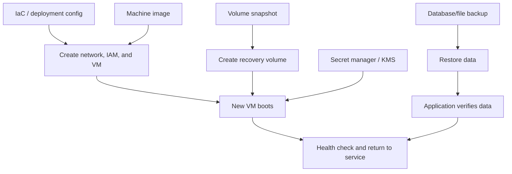

# Distinguishing Snapshots, Images, Data Backups, and Deployment Configurations

## Learning Objectives

After this lesson, you will be able to:

- Explain the purpose and scope of snapshots, machine images, data backups, and deployment configurations.
- Distinguish the protected data, recovery methods, and limitations of each artifact type.
- Choose an appropriate consistency approach for VMs, filesystems, databases, and running applications.
- Combine images, snapshots, backups, and Infrastructure as Code (IaC) to recover a complete workload.
- Design retention policies, encryption, access permissions, and independent copies.
- Define RPO and RTO and perform periodic restore tests.
- Plan VM or workload migrations across zones, regions, or cloud providers while maintaining data consistency.

## 1. Why Distinguish Between Copy Types?

When a VM fails, having a single file or disk copy may not be enough to restore the service. A complete system typically consists of:

- Operating system, bootloader, drivers, and installed software.
- Application data, databases, uploaded files, and retained logs.
- Infrastructure configuration such as networks, subnets, firewalls, load balancers, disks, and IAM.
- Secrets, certificates, encryption keys, and workload identities.
- Dependencies between components, such as APIs, databases, queues, and object storage.

Different artifact types protect different parts. Snapshots usually record the block state of a volume at a point in time. Machine images package a machine template to create new VMs. Data backups protect business content according to a recovery policy. Deployment configurations describe how to recreate infrastructure and application settings.

Confusing these types can lead an organization into situations such as:

- Having a snapshot without knowing how to recreate the VM, network, or identity.
- Having a fresh image while the external database has lost data.
- Having a database backup without compatible configurations, secrets, or application versions.
- Having IaC without any data to restore.
- Having backups whose encryption keys were deleted, making them unreadable.
- Having artifacts that were never test-restored, only to discover missing permissions or the wrong recovery order during an incident.

A reliable recovery strategy must clearly define each artifact type, the relationships among them, and how to verify results.

## 2. What Is a Snapshot?

A **snapshot** is a record of the state of a volume or storage device at a specific point in time. In the cloud, snapshots are typically created at the block storage layer. The service captures block contents at the moment of capture and allows creating new volumes or restoring data from that state.

Snapshots are commonly useful for:

- Creating a restore point before OS patching or configuration changes.
- Recovering a volume after filesystem corruption or accidental deletion.
- Cloning a volume into a test environment.
- Serving as a basis for images or volume copies depending on platform capabilities.
- Supporting block-level data recovery.

### 2.1. What Does a Snapshot Capture?

A volume snapshot usually represents the state of blocks managed by the storage service at creation time. It does not inherently understand the meaning of the data inside.

For example, a database volume snapshot may capture:

- Blocks containing data files.
- Blocks containing transaction logs or write-ahead logs.
- Filesystem metadata.
- Changes written to the volume at the time of the snapshot.

The snapshot does not inherently know which transactions have committed, which files the application is actively updating, or whether the database is logically consistent. Therefore, you must distinguish snapshot consistency levels.

### 2.2. Crash-Consistent Snapshots

A crash-consistent snapshot resembles the storage state after a sudden power loss or hard reset. Blocks already written to storage are preserved according to the service's mechanism; data still in RAM or unflushed caches may be absent.

The operating system and applications may need to run recovery upon boot:

- Filesystem journal replay.
- Database crash recovery from transaction logs.
- Application checks and handling of partially written files.
- Rollback of uncommitted transactions.

Crash consistency is often sufficient for workloads with robust journaling and recovery mechanisms, but it does not guarantee full logical application consistency. If multiple volumes are snapshotted individually without a consistency-group mechanism, their capture timestamps may differ.

### 2.3. Filesystem-Consistent and Application-Consistent Snapshots

A **filesystem-consistent snapshot** attempts to bring the filesystem to a consistently recoverable state before capture—for example, flushing data and metadata, pausing writes, or briefly freezing the filesystem.

An **application-consistent snapshot** coordinates with the application to ensure data is in a valid state for recovery. Techniques may include:

- Database checkpoints or backup hooks.
- Briefly pausing writes.
- Flushing transaction logs.
- Using Volume Shadow Copy Service (VSS) on Windows when supported by the application and writers.
- Using multi-volume group snapshot mechanisms that support application consistency.

Not every snapshot service automatically produces application-consistent snapshots. Verify agents, guest integrations, application hooks, and service limits. If a hook fails, the snapshot may fall back to crash-consistent only.

### 2.4. Single-Volume vs. Multi-Volume Snapshots

A VM may use multiple volumes:

- Boot volume containing the OS.
- Data volume containing business files.
- Log volume containing transaction logs.
- Dedicated volumes for databases or caches.

If each volume is snapshotted at a different moment, the data may not align. For instance, a database writes transaction logs on volume A and data files on volume B. Snapshotting A at 10:00:00 and B at 10:00:15 may not reflect the same transactional point.

If the platform supports group snapshots or coordinated snapshots, use that mechanism for volumes requiring consistency. Otherwise, coordinate with the application, quiesce writes, or use native backup tools to guarantee recoverable data.

### 2.5. Snapshots Are Usually Incremental

Many block storage services store snapshots incrementally: the first snapshot captures baseline data, and subsequent snapshots store only changed blocks according to the service's mechanism.

Benefits:

- Reduces the amount of data written per snapshot.
- Can save storage space and time.
- Supports creating multiple scheduled restore points.

However, capacity billing, dependency chains, and deletion behavior vary by provider. A snapshot presented as incremental does not mean users must manually stitch snapshot files together to restore. The service typically manages chains and metadata. Read platform documentation before deleting old snapshots or changing retention.

### 2.6. Limitations of Snapshots

Snapshots typically do not replace data backups or a DR plan because:

- They may reside in the same account, admin boundary, or failure domain as the source volume.
- They may depend on encryption keys or KMS permissions.
- They do not necessarily include network, IAM, load balancer, or secret configurations.
- They may exclude local/ephemeral disks.
- They do not automatically guarantee application consistency.
- They can be accidentally deleted or wiped by a privileged attacker alongside source data.
- They may only be restorable within supported regions or services.

A snapshot is a block-layer recovery tool. Place it within a broader backup strategy.

## 3. What Is a Machine Image?

A **machine image** is a template used to launch new VMs. Depending on the platform, an image may include a boot disk, one or more data disks, boot metadata, and required OS configurations.

Images are commonly used to:

- Standardize OS and base software.
- Launch new VMs quickly and consistently.
- Deploy the same application version across multiple instances.
- Recover machines from a tested template.
- Build golden images through patching and hardening pipelines.

Platform-specific names include Amazon Machine Image (AMI), Azure VM image, or Compute Engine machine image. Scope and packaging differ slightly across services.

### 3.1. What Does an Image Typically Contain?

An image may include:

- Operating system and boot configuration.
- Kernel, drivers, packages, and runtimes.
- Monitoring, security, and configuration management agents.
- Installed application software or artifacts.
- Non-sensitive default configurations.
- References to snapshots or disk images per the provider's mechanism.

Images do not necessarily contain all business data. Active databases, uploaded files, object storage, and data outside the VM usually need separate backups.

### 3.2. Golden Images

A golden image is a standardized image that has been tested and approved for use in a specific environment.

Image-building pipelines typically involve:

1. Selecting a supported OS and version.
2. Applying security patches.
3. Installing required runtimes, agents, and packages.
4. Applying hardening and baseline configurations.
5. Removing secrets, credentials, machine-specific identities, and test data.
6. Standardizing cloud-init, startup scripts, or bootstrap mechanisms.
7. Scanning for vulnerabilities and verifying artifacts.
8. Booting a test VM from the image.
9. Verifying networking, storage, identity, monitoring, and the application.
10. Versioning, recording metadata, and publishing the image.

Images should have explicit versions, such as **api-linux-2026.11.3**. Avoid modifying a published image without bumping its version, as it makes deployments non-reproducible.

### 3.3. Do Not Package Long-Lived Secrets into Images

An image can be copied across many VMs, projects, or regions. If it contains access keys, passwords, private keys, or long-lived tokens, every VM launched from that image risks sharing the same secret.

Instead:

- Use workload identity so VMs authenticate natively.
- Fetch secrets from a secret manager at runtime when needed.
- Provision per-instance certificates or credentials if required by the architecture.
- Clear shell history, temporary files, and sensitive build artifacts before capturing the image.
- Verify the image contains no tokens in logs, environment variables, or caches.

### 3.4. Images Are Not Data Backups

An image recreates the machine environment, but it does not guarantee recovery of data generated after the image was built. If last month's image holds the right application version while today's database has changed, the image cannot recover newer transactions.

Likewise, an image backed by disk snapshots should not automatically be treated as a complete application backup. Verify which disks and data the image includes, what consistency level was used, and whether it can be restored across regions or accounts.

## 4. What Is a Data Backup?

A **data backup** is a copy created to restore data contents or application state according to a defined recovery objective. Backups can operate at the file, filesystem, database, object storage, volume, or application level.

Backups typically focus on the question: *If data is deleted, corrupted, encrypted by ransomware, or altered erroneously, to what point in time and how quickly can we restore it?*

Common backup types:

- **File-level backup:** copies selected files/directories.
- **Filesystem/volume backup:** backs up data at the filesystem or block level.
- **Database-native backup:** uses database engine mechanisms to protect data files, transaction logs, and metadata.
- **Object backup/versioning:** preserves object versions or independent copies.
- **Application-aware backup:** coordinates with the application to produce consistent copies.
- **Configuration/state backup:** preserves configuration state or business metadata needed for recovery.

### 4.1. Full, Incremental, and Differential Backups

| Type | How It Works | Advantages | Considerations |
|---|---|---|---|
| Full backup | Copies all data within the selected scope | Simpler restore | Consumes time, storage, and bandwidth |
| Incremental backup | Copies changes since the most recent backup | Reduces data per run | Restore may require full plus incremental chain |
| Differential backup | Copies changes since the most recent full backup | Restore needs full and latest differential | Differential grows until the next full backup |

Not every backup service uses strictly these three patterns; some use forever-incremental, synthetic fulls, or deduplication. Check how your service builds recovery points and executes restores.

### 4.2. Database Backups and Point-in-Time Recovery

Databases require engine-appropriate backup methods. A raw copy of data files captured while the database is writing may be unusable without transaction logs or the corresponding recovery mechanism.

Common mechanisms:

- Full database backups.
- Differential or incremental backups depending on the engine.
- Transaction log backups.
- Write-ahead log (WAL) archiving.
- Binary logs or change logs.
- Point-in-time recovery (PITR) built on a full backup and log chain.

PITR allows recovery to a specific timestamp within the retention window if an intact base backup and continuous logs exist. If a log segment is missing or the base backup is corrupted, the recoverable range may be restricted.

For example, a database backup at 02:00 with transaction logs retained until 14:00 can allow recovery close to 13:42, provided the engine, log chain, and service support it. Do not assume PITR is always accurate to the exact second; check log shipping latency, granularity, and platform limits.

### 4.3. Application-Consistent Backups

For multi-component applications, backups must coordinate across:

- Databases.
- Object storage or uploaded files.
- Queues and message state.
- Configuration and schemas.
- Encryption keys or key references.
- Session or job state if required.

A database backup and an object backup taken at different times can produce dangling references—for example, a database record pointing to an object not yet present in the object backup. Choose one of the following strategies:

- Pause writes while capturing the recovery point.
- Use versioning and timestamps/cursors to align data sources.
- Use application checkpoints or snapshot orchestration.
- Design data so it can be recovered and reconciled afterward.

## 5. What Is Deployment Configuration?

**Deployment configuration** describes how to provision and configure infrastructure, operating systems, and applications so a workload can run again consistently.

It may include:

- Infrastructure as Code (IaC): Terraform, Bicep, CloudFormation, or similar tools.
- Templates/manifests for VMs, instance groups, load balancers, and disks.
- Networking: VPC/VNet, subnets, routes, firewalls/security groups, DNS.
- IAM: roles, service accounts, managed identities, and policies.
- Bootstrap: cloud-init, startup scripts, extensions, or configuration management.
- Application: deployment manifests, package versions, container image digests.
- Monitoring: agents, alerts, dashboards, and log routing.
- Backup policies, retention, and schedules.
- Secret/certificate references and key IDs.

Deployment configuration recreates the environment. It does not contain business data generated at runtime unless that data is explicitly managed as a separate artifact.

### 5.1. IaC and Runtime Configuration

Distinguish between:

- **IaC:** declares the infrastructure resources that must exist.
- **Configuration management:** installs and configures OS, packages, and services.
- **Application deployment:** releases application versions and runtime settings.
- **Secret management:** stores and distributes secrets.
- **Data backup:** protects data generated while the system operates.

These layers relate closely but have different lifecycles and access controls. An IaC repository can define a database instance, but it does not replace backups of the data inside that database.

### 5.2. Storing Configuration and Secrets Safely

Non-sensitive configuration can live in version control, such as instance types, subnet references, replica counts, and package versions. Store secrets in a secret manager or access-controlled system, keeping only references in IaC.

Never commit private keys, passwords, tokens, or long-lived credentials to repositories. If a secret ever appeared in Git history, deleting the file in a new commit is not enough; assess exposure scope, revoke/rotate the secret, and sanitize history per procedure.

## 6. Comparing Snapshots, Images, Backups, and Deployment Configurations

| Criterion | Snapshot | Machine Image | Data Backup | Deployment Configuration |
|---|---|---|---|---|
| Purpose | Capture volume state at a point in time | Create new VMs from a machine template | Recover business or application data | Recreate infrastructure and settings |
| Scope | Blocks of a volume or volume group | OS, boot disk, software, and service metadata | Files, databases, objects, volumes, or app state | Network, IAM, VMs, load balancers, policies, bootstrap |
| Can boot a VM? | Usually requires creating a volume and attaching to a VM or building an image | Usually yes, depending on image type | Not necessarily | Not directly |
| App consistency | Can be crash-consistent; requires coordination for app-consistent | Depends on build process and disk state | Can be application-aware or database-native | Not a runtime data copy |
| Frequency | Before changes or on schedule | On platform release | Based on RPO and retention | Based on config changes and version control |
| Recovery | Create volume from snapshot | Launch new VM from image | Restore files/databases/objects to a recovery point | Apply IaC and bootstrap |
| Key risks | Inconsistency, key/region dependency, same-account deletion | Outdated image, embedded secrets, missing runtime data | Corrupted backup, missing logs, unrestorable | Drift, missing secret references, or external dependencies |
| Best suited for | Fast block/volume recovery | Standardizing and replacing VMs | Data protection and PITR | Repeatable environment recreation |

No single artifact type replaces the other three. Recovering a VM-based system typically combines images or snapshots with deployment configurations and data backups.

## 7. Combining Artifacts to Recover a Workload

Consider an API with these components:

- A group of VMs running the API.
- A database on a VM or managed database service.
- Object storage holding customer files.
- Load balancer and networking.
- Secret manager and KMS.
- Monitoring and alerting.

When an API VM fails, you can launch a new VM from an approved image, apply IaC to attach networking and identity, and have the app fetch secrets from the secret manager. If the VM holds local state that must be kept, restore its volume from a snapshot or backup. If the database is corrupted, recover it using database backups and transaction logs. Object storage needs versioning or independent backups.

Conceptual diagram:

Not every scenario needs snapshots. If VMs are stateless and data resides in databases/object storage, you can launch fresh VMs from images and configuration. For database VMs, recover data using a consistent method and verify transaction logs before admitting traffic.

### 7.1. Reference Recovery Sequence

1. Assess incident scope and recovery objectives.
2. Select an RPO-compliant recovery point.
3. Verify snapshots, images, backups, and configurations are accessible.
4. Check encryption keys, IAM, and restore permissions.
5. Provision networking and dependent resources via IaC.
6. Launch VMs from images or restore volumes from snapshots.
7. Restore databases/files/objects in dependency order.
8. Configure identities, secrets, and certificates.
9. Run filesystem checks, database integrity checks, and application health checks.
10. Shift traffic after readiness and business tests pass.
11. Monitor errors, latency, and integrity post-recovery.
12. Record actual RPO/RTO and update runbooks.

## 8. RPO, RTO, and Backup Policies

Two critical metrics in backup design:

- **RPO (Recovery Point Objective):** the maximum amount of data an organization can afford to lose, measured as a time interval. A 15-minute RPO means the organization aims to recover data to a point no older than roughly 15 minutes before the incident, within system capabilities.
- **RTO (Recovery Time Objective):** the target time to restore a service to a usable level after a disruption.

Examples:

| Workload | Target RPO | Target RTO | Suggested Protection |
|---|---|---:|---|
| Stateless API | Requests replayable; data lives outside VM | 30 minutes | Standard image, IaC, deployment pipeline |
| Transactional database | 5 minutes | 1 hour | Full backups, log backups/PITR, replicas, and restore drills |
| Internal file store | 24 hours | 8 hours | Scheduled file/object backups, versioning |
| Batch worker | By checkpoint/job | 2 hours | Durable queue, checkpoints, image, and IaC |

These are illustrative targets, not defaults. RPO/RTO must be agreed upon by data owners, business stakeholders, and operations teams.

### 8.1. Backup Frequency and RPO

If you back up only once every 24 hours, theoretical RPO can approach 24 hours if an incident strikes right before the next backup. Databases needing low RPO require more frequent log backups or replication.

Distinguish between:

- Backup schedule: how often recovery points are initiated.
- Backup completion time: when the copy actually finishes.
- Replication lag: the delay between source data and replica.
- Recovery point: the data timestamp that can be restored.
- Actual RPO: measured data loss observed in tests or incidents.

Do not claim RPO compliance based solely on backup schedules. Verify completed copies, continuous logs, and actual restorability.

### 8.2. RTO and Recovery Time

RTO encompasses multiple steps:

- Incident detection and triage.
- Approval or DR activation.
- Accessing artifacts and keys.
- Provisioning infrastructure, VMs, and volumes.
- Restoring data.
- Checking integrity and application health.
- Shifting traffic and confirming user access.

If restoring 2 TiB of data takes 4 hours, spinning up a VM in 5 minutes will not achieve a 30-minute RTO. Benchmark restores and pre-stage networking/IAM, images, and capacity.

## 9. Retention, Independent Copies, and Tamper Protection

Backups are only valuable if they still exist, remain accessible, and can be decrypted. Policies should include:

- **Retention:** how long recovery points are kept.
- **Versioning:** preserving multiple versions of objects or artifacts.
- **Immutability/WORM:** preventing modification or deletion during a lock period via service controls.
- **Cross-account/project copy:** copies in a separate administrative boundary.
- **Cross-region copy:** copies in another geographic region for regional outage recovery.
- **Offline/isolated copy:** copies isolated from operational environments when defending against ransomware.
- **Encryption:** encrypting backup data and managing keys independently and recoverably.
- **Access control:** separating permissions to create, read, restore, and delete backups.

A common guiding rule is 3-2-1: maintain at least three copies of data, on two different media types or storage domains, with one copy in another location. Some organizations extend this to 3-2-1-1-0, adding one offline/immutable copy and requiring zero errors in restore testing. Treat this as design guidance to adapt to risk and cost.

Never allow a single admin account to delete VMs, snapshots, backups, and encryption keys simultaneously without controls. Use dedicated backup accounts, separated delete permissions, MFA, approvals, and audit logs where supported.

## 10. Encryption and Artifact Access Controls

Snapshots, images, and backups can contain sensitive data. Clarify:

- Are artifacts encrypted by default?
- Are provider-managed keys or customer-managed keys used?
- When copying across regions/accounts, is a target-side key required?
- Which principals or grants does the restore service need?
- Can anyone with snapshot read access create volumes or images from it?
- Who is allowed to share images, snapshots, or backups?
- Are older keys still required for long-term recovery points?

If using CMKs, backups become unrestorable if the key is disabled, deleted, or has its policy revoked. Keep required keys and permissions intact throughout the full retention period. Test restores using the identity intended for actual incident recovery, not just an overly privileged admin account.

Avoid placing secrets inside images or backups outside necessary scope. If a backup contains secrets, apply protection at least equal to or stricter than the source data.

## 11. Cloud Provider Differences

All major providers offer snapshot, image, and backup concepts, but packaging, consistency, access controls, and restore features differ.

| Concept | AWS (Example) | Azure (Example) | Google Cloud (Example) |
|---|---|---|---|
| Snapshot | EBS snapshot | Managed disk snapshot | Persistent Disk snapshot |
| Machine image | AMI | Azure VM image | Compute Engine machine image |
| Backup service | AWS Backup and workload-specific backup services | Azure Backup | Backup and DR or corresponding service backup mechanisms |
| IaC | CloudFormation, Terraform | Bicep, ARM, Terraform | Terraform and active IaC tools |
| Application consistency | Agents/hooks and service-dependent workload integrations | VSS and workload-dependent application-aware backup | Agents/hooks and workload-dependent service integrations |

Product names and feature scopes evolve over time. This table helps map service families rather than asserting strict feature parity.

### 11.1. What to Check When Selecting a Service

- Does the snapshot service support consistent multi-disk groups?
- Can snapshots be copied across regions or accounts?
- Does the image capture all required disks or only the boot disk?
- Is application-consistent backup supported for your OS/database?
- Are PITR and retention locks available?
- Can restores target a different subscription/project/account?
- Is the same encryption key type or a target-region key required?
- What are the quotas, restore throughput, and recovery costs?

Never select a service based solely on the word "backup" in its name. Evaluate recovery points, data scope, restore capabilities, and operational limits.

## 12. Testing Restores and Verifying Data Integrity

A backup job reporting success only proves copy creation completed per the service's criteria. It does not prove the application can run from that copy.

### 12.1. Restore Drills

A drill should include:

1. Selecting a recovery point based on the scenario.
2. Using the dedicated restore identity to access artifacts.
3. Creating an isolated network to avoid IP conflicts or live traffic leakage.
4. Restoring the VM/volume/database/object into the test environment.
5. Running checksums or application integrity tools.
6. Starting the application and checking dependencies.
7. Executing synthetic transactions or business queries.
8. Measuring each phase's duration and total RTO.
9. Identifying the newest data point and calculating actual RPO.
10. Logging errors, missing permissions, and updating runbooks.

### 12.2. Verifying Integrity

Depending on the data type, you can use:

- File checksums/hashes.
- Database consistency checks or native validation tools.
- Record counts, monetary totals, or business invariant comparisons.
- Object versions and metadata checks.
- Transaction log/WAL chain checks.
- Confirming the application can read data and execute test transactions.

Do not stop at verifying that a VM boots. A VM may boot while its database failed to recover properly, certificates expired, or the app cannot reach dependencies.

### 12.3. Testing Diverse Scenarios

- Accidental deletion of a file or object.
- Filesystem or volume corruption.
- Database corruption or erroneous writes.
- Loss of a single VM.
- Loss of a zone or region.
- Compromised operations account with source artifacts deleted.
- Disabled encryption key or modified key policy.
- Faulty new image requiring rollback to a previous image.
- Out-of-band IaC changes (configuration drift).

## 13. Migrating VMs and Workloads

Workload migration can mean moving a VM to another host/zone, another region, another project/account, or another cloud provider. Migration artifacts may include images, snapshots, data backups, and deployment configurations.

### 13.1. Distinguishing Migration Approaches

- **Rehost:** moving machines or workloads nearly as-is to new infrastructure.
- **Rebuild:** provisioning fresh VMs from standard images and redeploying applications.
- **Backup/restore migration:** backing up data at the source and restoring at the target.
- **Replication migration:** continuously or periodically syncing changes, then cutting over.
- **Refactor:** changing application architecture during the move.

Snapshots can help copy data blocks, but they do not automatically migrate networking, IAM, DNS, quotas, or dependent services. Images may require format conversion, driver updates, or boot adjustments. IaC must be adapted to the target platform's resource model.

### 13.2. Reference Migration Process

1. Inventory VMs, disks, networks, identities, secrets, databases, and dependencies.
2. Define RPO/RTO targets and the cutover window.
3. Choose rehost, rebuild, backup/restore, or replication.
4. Verify CPU architecture, firmware, boot mode, driver, and OS license compatibility.
5. Prepare networking, IAM, KMS, quotas, and capacity at the target.
6. Create appropriate images or snapshots/backups.
7. Sync initial data and ongoing changes.
8. Test the application at the target inside an isolated network.
9. Pause writes or switch to read-only mode at cutover.
10. Sync the final delta and verify consistency.
11. Switch DNS/load balancer/traffic to the target.
12. Monitor error rates, latency, data, and dependencies.
13. Retain the source for an agreed rollback window before retiring per policy.

### 13.3. Rollback

A migration plan must define conditions for returning to the source. If the system has already accepted new writes at the target, rolling back is not as simple as flipping DNS back, because data on the two sides will diverge.

Specify:

- When writes close on the source.
- How final data synchronization runs.
- When writes open on the target.
- How data is reconciled after cutover.
- How new transactions are handled if rollback becomes necessary.
- Who holds authority to trigger rollback.
- How long source resources are retained.

If safe reverse synchronization is impossible, establish a clear go/no-go checkpoint before opening writes on the target or commit to an explicit reconciliation procedure.

## 14. Practical Example: Recovering an API and Database After an Incident

An e-commerce system has API VMs, a database VM, and object storage holding product images. Operations must recover after the database volume becomes corrupted.

Available artifacts:

- Golden images for API and database OS.
- Periodic snapshots for the database volume.
- Nightly database-native full backups.
- Transaction log backups every 5 minutes.
- Versioning on object storage.
- IaC describing networks, security groups, load balancers, and VMs.
- Secret manager storing credentials and certificates.
- CMK encrypting volumes and backups.

Recovery workflow:

1. Identify the corrupted database volume and incident timestamp.
2. Select the latest full backup and valid transaction log chain meeting RPO.
3. Provision an isolated network using IaC.
4. Launch the database VM from the golden image.
5. Create a recovery volume from snapshot if needed for forensics or as a restore source.
6. Restore the database-native backup and replay transaction logs up to the chosen recovery point.
7. Verify database consistency and reconcile critical records.
8. Attach workload identity, retrieve secrets from the secret manager, and confirm KMS access.
9. Launch API VMs from the approved image.
10. Connect to the recovered database and matching object storage versions.
11. Run synthetic checkout flows in the isolated environment.
12. Shift traffic once readiness and business validation pass.
13. Record actual RPO/RTO and update runbooks.

In this example, snapshots aid block/volume recovery or investigation, database backups and transaction logs restore consistent data, images recreate VMs, and IaC rebuilds networking and resources. No single artifact alone suffices to restore the entire service.

## 15. Common Misconceptions

- **Snapshots are complete backups.** Snapshots primarily record volume state; evaluate consistency, isolation, retention, and restorability.
- **Images contain the latest data.** Images reflect state at creation time; runtime data changing afterward requires separate backups.
- **Having an image means the whole VM can be recovered.** Data disks, networks, IAM, secrets, licenses, or dependencies may still be missing.
- **Backing up a database just means copying data files.** Databases may require native backups, transaction logs, and engine recovery steps.
- **Incremental backups cannot restore if prior copies are missing.** Services may manage chains automatically; understand provider semantics rather than manually assembling files.
- **Snapshotting multiple volumes simultaneously is application-consistent.** Simultaneous timing alone does not guarantee transaction consistency.
- **A successful backup means it can be restored.** Run restore drills and verify data.
- **IaC replaces backups.** IaC recreates resources, not business data.
- **Same-region storage is enough for disaster recovery.** Regional or account incidents can impact both source and copies; use appropriately isolated copies.
- **Deleting old keys does not affect backups.** Recovery points encrypted with old keys become unreadable if those keys are deleted.
- **Migration finishes once DNS is updated.** You must handle data sync, dependency checks, cutover, and rollback.
- **A booted restored VM means the application is recovered.** Verify databases, secrets, networking, health checks, and business transactions.

## 16. Backup and Recovery Design Checklist

### Artifact Classification

- [ ] Catalog snapshots for each volume and volume group.
- [ ] Identify approved images and supported versions.
- [ ] Identify file/database/object/application backups.
- [ ] Store IaC, bootstrap scripts, manifests, and runtime configs in version control.
- [ ] Separate secrets from images and repositories; store references to a secret manager.
- [ ] Document which artifacts hold sensitive data and their corresponding encryption keys.

### Protection Policies

- [ ] Define RPO/RTO by workload and data owner.
- [ ] Choose backup frequency and retention based on RPO.
- [ ] Enable versioning/immutability or independent copies where appropriate.
- [ ] Replicate copies to another account/project or region if needed.
- [ ] Separate permissions for creating, restoring, and deleting backups.
- [ ] Ensure KMS keys remain available throughout retention.
- [ ] Monitor backup jobs, logs, and failure alerts.

### Recoverability

- [ ] Test restoring snapshots into volumes.
- [ ] Launch VMs from images in a test environment.
- [ ] Restore databases and replay logs to a recovery point.
- [ ] Restore objects/files and verify checksums.
- [ ] Apply IaC inside an isolated environment.
- [ ] Verify identities, secrets, certificates, and networking.
- [ ] Measure actual RPO/RTO.
- [ ] Drill migration cutover and rollback.
- [ ] Update runbooks after every drill.

## 17. Self-Check

**Scenario 1:** A database VM has two volumes: one for data files and one for transaction logs. Should you take two separate snapshots at different times and treat them as a consistent recovery point?

**Hint:** Do not assume so. Use coordinated/group snapshots if supported by the platform, or coordinate database checkpoints/quiescing. For critical databases, prefer native backups and transaction logs per engine guidelines.

**Scenario 2:** A golden image was created a month ago. The database and uploaded files have changed substantially since then. Can the image be used to recover the latest data?

**Hint:** No. An image recreates the machine environment as of its build time; databases and uploaded files require separate backups or replication.

**Scenario 3:** A backup job reports Success, but no restore has ever been attempted. Can the organization conclude it meets RPO/RTO?

**Hint:** Not yet. Conduct restore drills and verify log chains, KMS permissions, integrity, and actual timings.

**Scenario 4:** IaC can recreate VMs, subnets, and load balancers. Why are database backups still necessary?

**Hint:** IaC only describes resources and configuration. It does not contain transactions or business data generated after the system runs.

**Scenario 5:** A snapshot is encrypted with a CMK. What must be checked before deleting an old CMK?

**Hint:** List all volumes, snapshots, images, backups, and cross-region/cross-account copies still depending on the key; check re-wrap/re-encrypt capabilities and restorability. Never delete a key while recovery points still need it.

**Scenario 6:** After migration, the target application works and the database has accepted some new transactions. Operations wants to roll back to the source. What is the risk?

**Hint:** Data at source and target may diverge. A reverse synchronization or reconciliation process, write-freeze boundary, and rollback criteria must be defined before shifting traffic.

## Conclusion

Snapshots, machine images, data backups, and deployment configurations serve distinct recovery layers. Snapshots restore block-level volume state; images recreate VMs from machine templates; backups protect business data by recovery points; IaC and deployment configurations rebuild infrastructure and application setup. A reliable plan combines them with RPO/RTO targets, consistency, retention, encryption, access controls, and independent copies. Test restores and migrations regularly, verify recovered data, and record actual timings to ensure systems can recover when incidents strike.
