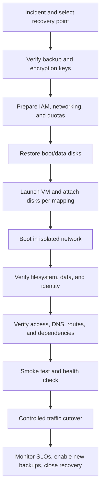

# Recovering Machines Along with Disks, Access Permissions, and Network Connectivity

## 1. Recovering a Machine Means Recovering Its Entire Dependency System

When a VM fails, is accidentally deleted, suffers OS corruption, or needs to move to another cloud region, merely spinning up a machine with the same CPU and RAM is not enough for the service to function. The machine also requires the right boot disk version, data disks with intact data, usable encryption keys, workload identity, access permissions, network interfaces, subnets, routes, firewalls, and DNS. Missing a single component can prevent the machine from booting, mounting data, fetching secrets, or reaching dependencies.

Recovering a machine is therefore a coordinated process across compute, storage, identity, and networking. You must determine the target recovery state, select the right backup point, rebuild resources in order, verify data safety, and only return the machine to service after thorough validation.

In the **CLOUD_CORE_SERVICES_COMPUTE** module, this topic connects directly to VM deployment and operations, CPU/memory/network configuration, security, availability, and cost optimization. This lesson focuses on scenarios for recovering a machine together with its disks, access permissions, and network connections.

After this lesson, learners will be able to:

- Distinguish recovery via snapshots, backups, images, replicas, and rebuilding from standard configuration.
- Map boot disks, data disks, encryption keys, and mount points prior to restoring.
- Restore machine identity, IAM roles/service accounts, admin accounts, and secrets securely.
- Recreate NICs, subnets, routes, firewalls, IPs, DNS, and load balancer membership.
- Execute ordered recovery and verify data and services before cutover.
- Establish rollback plans, verify RTO/RPO, and rehearse procedures.

## 2. Defining Recovery Objectives and Scope

### 2.1. Common Scenarios

Machine recovery can be triggered by many situations:

- Corrupted boot disk or an OS that fails to boot.
- Accidentally deleted VM or faulty compute configuration.
- Detached data disk, filesystem corruption, or need to roll back to an earlier point.
- Zone/region outage requiring the machine to be stood up in another zone or region.
- Workload migration to a new instance type, subnet, or account.
- Malware infection or suspected compromise, requiring rebuilding from a clean image and restoring verified data.
- Scheduled DR testing or periodic recovery drills.

Each scenario has distinct requirements. If only the VM failed while its data disks remain healthy, you can launch a new VM and reattach the volumes. If the boot disk was damaged by malware, do not blindly boot an unverified snapshot as-is. If an entire region is down, you also need networking, identity, keys, and dependencies in the target region.

### 2.2. Defining RTO and RPO

**Recovery Time Objective (RTO)** is the maximum acceptable time to restore a service. **Recovery Point Objective (RPO)** is the tolerable data loss, usually expressed as the time interval between the last recoverable data point and the incident timestamp.

For example, a 15-minute RPO means the organization accepts restoring data to a point no older than roughly 15 minutes before the incident, if backup/replication mechanisms support it. A 2-hour RTO means functionality must be restored within 2 hours under the agreed measurement method.

RTO/RPO must apply to the service or data flow, not just a single VM. A machine might boot in 10 minutes while the service remains down if the database, keys, DNS, or access permissions take another hour.

### 2.3. Distinguishing Copy Types

| Mechanism | What Can Be Recovered? | Key Considerations |
|---|---|---|
| VM image / machine image | Machine configuration and usually boot disk; may include data disks depending on creation method | Does not include all external volumes, NICs, IAM, or dependencies by default |
| Disk snapshot | State of a single volume at a point in time | May be only crash-consistent unless the application is quiesced |
| Application-consistent backup | Data prepared in an application-consistent state | Requires agents/hooks and verification of backup job success |
| File/database backup | Recoverable files or logical data | Requires compatible OS, engine, and environment to restore |
| Replica / standby | Continuously or near-continuously updated copy | Can replicate errors or deletions; requires a promote/failover procedure |
| Infrastructure as Code | Resource declarations for recreation | Does not replace data backups and secrets |

Do not treat an image as a complete copy of the entire environment. Verify which disks the image includes, which settings are preserved, and which resources must be recreated separately.

### 2.4. Selecting a Recovery Point

Select the backup point based on when the incident started, when data became corrupted, and RPO requirements. The newest point is not necessarily the best if the backup ran after data was already encrypted or accidentally deleted.

Check:

- Backup start and completion timestamps.
- Job status and backup integrity.
- Whether the application/database was quiesced or flushed.
- Relationships across snapshotted volumes.
- Whether encryption keys and decryption permissions remain usable.
- Retention, immutability policies, and cross-account/cross-region copies.
- Results of the most recent restore test.

If a clean point cannot be confirmed with certainty, isolate the recovered instance for inspection before allowing connections to production systems.

## 3. Mapping Resources Before Recovery

### 3.1. Profile of a VM

Before an incident occurs, each workload should maintain a minimum resource profile:

| Group | Information to Record |
|---|---|
| Compute | Instance family/size, CPU architecture, firmware/boot mode, placement, zone |
| Boot disk | Volume ID, size, type, encryption key, snapshot/image, boot order |
| Data disk | Volume ID, size, type, mount point, filesystem, UUID, encryption key |
| Identity | Instance profile/role, service account/managed identity, machine identity, certificates |
| Access | SSH/RDP method, local admin, break-glass, bastion/session manager |
| Network | VPC/VNet, subnet, NIC, private/public IP, routes, security policy, DNS |
| Dependencies | Databases, storage, secret manager, KMS, monitoring, load balancers |
| Operations | Backup policy, RTO/RPO, owner, runbook, monitoring, maintenance window |

Store this information in an access-controlled inventory or CMDB. Never store plaintext passwords, private keys, or secrets in the profile.

### 3.2. Boot Disks and Data Disks

The **boot disk** contains the bootloader, kernel, operating system, agents, and potentially the application. **Data disks** hold application data, databases, logs, or user files. A machine can have multiple data disks with dedicated attachment order and mount points.

When restoring, identify which disks must be restored from snapshots, which can be kept intact, and which can be regenerated. Never attach a boot disk snapshot into a data disk slot or vice versa.

### 3.3. Consistency Across Multiple Volumes

An application may store part of its data on volume A and the rest on volume B. Snapshotting two volumes at different times can leave data inconsistent. For databases, back up via engine-native mechanisms or coordinated consistency-group snapshots.

Before restoring multiple volumes, verify:

- Which volumes store data, logs, WAL/transaction logs, and metadata.
- Whether snapshot order or grouping shares a single point in time.
- Whether the application must pause/quiesce before backup creation.
- How to replay transaction logs or journals after restore.
- How to verify consistency after mounting.

### 3.4. Device Mapping and Mount Points

Block device names can change across instance types, hypervisors, or reboots. Never rely on assuming `/dev/sdf` will always be a specific data volume. On Linux, use filesystem UUIDs or labels in `/etc/fstab` where appropriate; verify using `lsblk`, `blkid`, and `findmnt`.

Reference `/etc/fstab` example:

```fstab
UUID=1111-2222  /srv/app-data  ext4  defaults,nofail  0  2
```

The UUID here is purely illustrative. Before using it, verify the actual UUID of the restored volume. Depending on the workload, `nofail` can let the machine boot if a data disk temporarily fails to attach, but it may also allow the application to start without data. For mandatory data volumes, configure service dependencies so the application does not start until the mount point is ready.

### 3.5. Volume Size and Performance

Restoring a volume of the same capacity does not guarantee identical performance. Volume types, IOPS, throughput, burst balance, queue depth, encryption, and instance limits may differ in a new region or instance family.

After restoring, verify:

- Capacity, filesystem, and mount points.
- Provisioned IOPS/throughput and instance caps.
- Encryption key and volume state.
- Read/write latency and queue depth under representative load.
- New snapshot/backup policies applied after transition.

## 4. Preparing Identity and Access Permissions

### 4.1. Distinguishing User Identities and Machine Identities

Operators use personal identities for access and administration. Machines or workloads use dedicated identities to call cloud APIs, fetch secrets, read object storage, or connect to other services. Manage these two identity classes separately.

When launching a replacement VM, do not assume every permission from the old machine transfers automatically. Attach the proper instance role, service account, or managed identity per platform. Grant least-privilege permissions scoped by resource and environment.

### 4.2. IAM Roles, Service Accounts, and Managed Identities

Workload identities are typically attached to VMs via instance profiles, service accounts, managed identities, or equivalent mechanisms. During recovery:

1. Identify the old machine's identity and the permissions it genuinely needs.
2. Verify that identity exists and is permitted in the target account/project/region.
3. Attach the role or new identity under least-privilege policies.
4. Verify trust policies, audiences, token endpoints, and resource access permissions.
5. Check access logs and `AccessDenied`/`PermissionDenied` errors.

Never embed long-lived access keys into images, user-data, startup scripts, or config files. Prefer short-lived, platform-issued credentials that rotate automatically.

### 4.3. Data Decryption Permissions

Encrypted volume snapshots or backups require the appropriate KMS/Key Vault/Cloud KMS key. You may need to grant permissions to the compute service identity or restore operator to create volumes from snapshots and attach them to the machine.

Verify the key is enabled, not scheduled for deletion, allows decrypt/re-encrypt in its policy, and is available in the target account/region. Snapshots copied to another region may require re-encryption with a target-region key. Do not grant key administration privileges broader than recovery requires.

### 4.4. Admin Accounts and Emergency Access

Restoring SSH/RDP access requires considering:

- Individual accounts or centrally managed administrative accounts.
- MFA, bastions, or session managers.
- SSH keys/certificates and credential lifecycles.
- Windows domain membership, local administrators, and RDP policies.
- Break-glass access with approval, alerting, and post-incident auditing.

Do not open public SSH/RDP purely for quick recovery when a private management path exists. If temporary access must be opened, restrict source IPs, duration, and tie it to a ticket; close it immediately after access verification.

### 4.5. Machine Identity, Host Keys, and Certificates

When cloning a boot disk, certain OS-level identifiers may be copied—such as machine IDs, SSH host keys, agent IDs, or certificates. Running both the old machine and the clone concurrently with the same identity can confuse logs, trust relationships, or configuration management systems.

Deciding whether to preserve or regenerate machine identity depends on the objective:

- **Replacing the exact same machine:** you may retain certain logical identifiers to preserve service registration, provided the old machine is stopped or fenced before the new one activates.
- **Launching a new machine in parallel:** generate a unique machine identity, new host keys, and new certificates per standard procedure.
- **Recovering a suspected compromised machine:** do not trust old credentials or host keys; rebuild from a clean image, rotate secrets/certificates, and inspect for persistence.

Do not blindly delete or regenerate all OS identity files without understanding how cloud agents, domain joins, and configuration management tools depend on them.

## 5. Preparing Network Connectivity

### 5.1. Recreating the Network Context

The new VM must be placed into the proper network context:

- VPC/VNet or network project.
- Subnet and availability zone/zone.
- Network interface and private IP.
- Public IP or NAT path if strictly necessary.
- Route tables, gateways, and peering/transit connections.
- Security groups, firewall rules, and network ACLs.
- Private/public DNS, resolvers, and service discovery.
- Load balancer target groups, health checks, and backend ports.
- VPC endpoints/private endpoints for secrets, storage, KMS, and management.

Do not assume network interfaces, MAC addresses, IPs, or NIC identifiers transfer intact across every instance type or zone. Some platforms restrict NIC attachment by zone, instance type, or instance state.

### 5.2. Private IPs and Public IPs

If services or external systems depend on a fixed private IP, verify the address has been released and can be assigned to the new machine. Never start two machines using the same IP within the same subnet.

A public IP may be an independent resource or attached to a NIC/instance per the cloud provider's model. Check whether to reassign the old address, allocate a new one, or update DNS. If the IP changes, verify partner allowlists, firewalls, and client caches.

### 5.3. Routes and Firewalls

Verify both outbound and return paths. A correct outbound route missing a return route causes timeouts. Security groups/firewalls must permit:

- Management traffic from bastion/VPN/session managers.
- Application traffic from load balancers or service meshes.
- Connections to required databases, caches, queues, and dependencies.
- DNS, NTP, repositories, telemetry, and management endpoints.
- Necessary egress, following least privilege.

Avoid opening `0.0.0.0/0` or `::/0` to management ports as a temporary workaround. With stateless network ACLs, account for ephemeral ports and return traffic.

### 5.4. DNS and Service Discovery

DNS may map hostnames, service names, or load balancer endpoints. After restoring, verify whether old records still point to the right address, whether TTLs and caches affect cutover, and whether private zones are associated with the target VPC/VNet.

If changing IPs, update records through a controlled procedure. Do not delete old records until confirming the new machine is healthy and clients can resolve the new name. For DNS failover, verify health checks, TTLs, and failback behavior.

### 5.5. Load Balancers and Traffic Cutover

Test the recovered machine inside a dedicated target group or while isolated from user traffic first. When ready, register the target, wait for health checks to stabilize, run smoke tests, and shift traffic incrementally.

For stateful backends, ensure the old machine stops accepting writes before promoting the new one. If both run and write to the same dataset, split-brain or corruption can occur. Use appropriate fencing, locking, or leader election mechanisms.

## 6. Recommended Recovery Sequence

Execution order should adapt to architecture, though a common flow is:



### 6.1. Step 1 – Open a Recovery Record

Record the incident/change ID, owner, RTO/RPO targets, source machine, source region/zone, target region/zone, planned recovery point, and approver. Determine whether the old machine is still running or stopped.

If the old machine can still write data, define an explicit freeze or fencing point to avoid two active writers. For databases, follow a dedicated failover procedure.

### 6.2. Step 2 – Verify Backups and Keys

Check backup success, timestamp, volume list, consistency group, and keys. Confirm the restore identity has permissions to read snapshots, decrypt, and create volumes. If keys or permissions are missing, halt before provisioning machines to avoid creating unusable resources.

### 6.3. Step 3 – Prepare Network and IAM

Create or verify subnets, routes, security policies, DNS, endpoints, and roles. Open only the connections needed for bootstrap and administration. When recovering in an isolated environment, establish controlled inspection access without admitting production traffic.

### 6.4. Step 4 – Restore Volumes

Create the boot disk from the appropriate image/snapshot and data disks from selected recovery points. Set matching size, type, encryption, and zone. Document volume IDs against intended mount points. For multi-disk sets, preserve the consistency group and restore order.

### 6.5. Step 5 – Launch VM and Attach Disks

Select an instance type compatible with the CPU architecture, boot mode, drivers, network interfaces, and workload. Attach the boot disk in the proper slot and attach data disks per the recorded mapping. Assign the least-privilege workload identity and a NIC in the target subnet.

If the platform disallows attaching a volume in its current state, follow the provider's attach/detach rules. Never force-detach a volume still actively used by the old machine without confirming filesystem and write state.

### 6.6. Step 6 – Boot in Controlled Mode

Boot the machine in the recovery subnet or under a restricted security policy. Inspect console output, boot logs, cloud-init, agents, drivers, filesystems, and mount points. Do not add the machine to the load balancer at this stage.

If the machine fails to boot, check boot mode, architecture, drivers, initramfs, bootloader, disk mapping, and decryption permissions. Keep original snapshots intact so alternative recovery paths remain open.

### 6.7. Step 7 – Verify Data and Identity

Inspect filesystems read-only first if corruption is suspected. Verify UUIDs, mount points, owners/permissions, sample data, and application logs. Check machine identity, host keys, certificates, cloud agents, and the workload role.

Do not let the application write production data before confirming the correct volumes and recovery point. When recovering a database, run engine recovery/consistency checks and verify replication/log replay per vendor instructions.

### 6.8. Step 8 – Verify Network and Dependencies

Check IP addresses, routes, DNS, firewalls, NAT/endpoints, and dependency connectivity. Test both ingress from load balancers and egress to databases, caches, secret managers, KMS, and telemetry.

Log in via approved admin paths and verify IAM roles and application permissions. Never grant broad permissions just to bypass access errors; identify the exact missing policy or endpoint.

### 6.9. Step 9 – Smoke Test and Cutover

Run read-only smoke tests or safe synthetic transactions. Verify health checks, logs, metrics, latency, access permissions, and business functionality. Once criteria pass, register the machine in the target group or update DNS/routes step by step.

If writes occur, ensure only one machine holds write authority at cutover. Monitor error rates, queues, database consistency, and clients still hitting old addresses.

### 6.10. Step 10 – Finalize and Establish New Protection

Once stable, take a fresh backup from the recovered machine, verify monitoring/alerts, and update inventory and runbooks. Revoke temporary permissions, remove temporary rules, clean up test resources per approval, and record actual timings against RTO/RPO.

## 7. Post-Attachment Disk Verification

### 7.1. Verifying Block Devices

On Linux, common read-only commands include:

```bash
lsblk -o NAME,SIZE,TYPE,FSTYPE,UUID,MOUNTPOINTS
blkid
findmnt
df -hT
df -i
```

Cross-check outputs against the mapping profile. Device names may differ from the source machine; UUIDs and filesystems help identify volumes, though actual data must still be verified before mounting read-write.

### 7.2. Mounting and Filesystems

If the filesystem is clean and the volume matches, mount it at the intended mount point per the runbook. If corruption is suspected, do not mount read-write immediately; create a working copy and run filesystem-appropriate check/repair tools. Certain repair tools can alter metadata and destroy data if misused.

Check `/etc/fstab` to avoid mounting the wrong UUID. For volumes mandatory to the application, configure service dependencies so the application starts only after mounting succeeds. For optional volumes, define explicit failure behavior.

### 7.3. File Permissions and Ownership

After restoring, UID/GID, ACLs, SELinux contexts, or Windows ACLs may mismatch if the target machine uses a different image or domain. Verify permissions on data directories and service accounts. Avoid running `chmod -R 777` or mass-changing ownership as a quick fix; that over-exposes permissions and breaks security posture.

### 7.4. Windows Volumes

On Windows, inspect disks in Disk Management or PowerShell for Online/Offline state, drive letters, volume labels, filesystems, and ACLs. Never initialize or format a newly restored disk if the OS reports it unrecognized; doing so overwrites metadata on the data volume.

If drive letters change, update application, service, and scheduled task configurations per procedure. For domain-joined VMs, verify the secure channel and domain policies before launching applications.

## 8. Restoring Access Permissions and Authentication

### 8.1. Administrative Access

Check sequentially:

1. Did the machine receive the right NIC and IP address?
2. Do routes and firewalls allow management sources?
3. Can the bastion/VPN/session manager reach the new machine?
4. Is the SSH/RDP service running and listening on the expected interface/port?
5. Are users, groups, certificates, or domain policies accurate?
6. Are MFA and audit logging working?

For SSH, verify the host key fingerprint when reusing an IP or DNS name. Clients may warn about host key changes; verify the change over a trusted channel before updating `known_hosts`. Never disable host key checking to bypass warnings.

### 8.2. Workload Identity

Verify the application can retrieve short-lived tokens from the metadata/identity endpoint. Confirm the role can read secrets, decrypt data, write logs, or call APIs within expected scope. Check clock skew, since time-bound tokens can be rejected if clocks drift.

### 8.3. Secrets and Certificates

Never restore secrets from old system backups if compromise is suspected. Rotate at-risk credentials, update certificates, and verify trust chains. If certificates are bound to old hostnames/IPs, reissue or reconfigure them for the new identity.

### 8.4. Auditing Least Privilege

The recovered machine should only hold permissions required by the workload. Never attach account/project-wide admin roles to resolve access errors. Inspect `AccessDenied` logs, resource policies, key policies, trust relationships, network endpoint policies, and token scopes.

## 9. Detailed Network Connectivity Recovery

### 9.1. Inspecting Addresses and Interfaces

```bash
ip -br address
ip route
ip neigh
ss -lntup
```

These commands inspect addresses, routes, neighbors, and listening sockets. On Windows, use `Get-NetIPConfiguration`, `Get-NetRoute`, and `Get-NetTCPConnection` with appropriate privileges.

### 9.2. Testing Paths to Dependencies

Verify DNS first, then TCP/TLS connectivity, and finally application authentication. Example:

```bash
getent hosts db.internal.example
nc -vz db.internal.example 5432
curl -v --connect-timeout 3 https://secrets.internal.example/health
```

Hostnames and ports shown here are examples. `nc` or `curl -v` only test part of the path; a successful connection does not prove the application has sufficient permissions or consistent data. Redact sensitive tokens/headers before saving command output.

### 9.3. Routes, NAT, and Private Endpoints

The new machine may reside in a different subnet, meaning routes to databases or management services differ from the old machine. Check route tables, peering, transit gateways, VPN/Direct Connect/ExpressRoute, or equivalent hybrid links.

If the machine accesses cloud APIs over private endpoints, associate the endpoint with the target network and confirm DNS private zones resolve accurately. When using NAT, verify egress policies, port capacity, and partner allowlists.

### 9.4. Security Policies and Segmentation

Maintain environment-based network segmentation. A recovered production machine should never be temporarily placed in a permissive dev subnet. If a dedicated recovery network is used, open only flows needed for administration, KMS, backups, logging, and dependencies during testing.

After cutover, review and revoke temporary rules. Check both IPv4 and IPv6 if the workload uses both; a policy restricting only IPv4 may leave ports exposed over IPv6.

## 10. Migrating Machines Across Zones, Regions, or Accounts

### 10.1. Differences Between Restore and Migration

Restore typically returns resources to a prior state within the same or equivalent environment. Migration moves a workload to a new location or platform, potentially changing instance types, networks, identities, keys, and addresses.

Not every resource ID can be preserved. NICs, subnets, security groups, roles, keys, and IPs are usually scoped to an account/region or zone. Build a mapping from source resources to target resources instead of assuming an exact copy is possible.

### 10.2. Compute Compatibility

Check CPU architecture (x86_64/Arm), boot mode (BIOS/UEFI), drivers, device passthrough, GPU models, virtualization types, licensing, and instance family requirements. An image created on one machine family may fail to boot or run properly on another if drivers/initramfs are incompatible.

### 10.3. Migrating Disks and Encryption

Snapshots may need to be copied to the target region/account, shared via permissions, or re-encrypted with a new key. Verify key policies and copy/restore service permissions. Target volume size and type must satisfy both performance and quotas.

### 10.4. Migrating Networks

Create subnets, routes, security policies, endpoints, DNS, and hybrid connectivity in the target region. Determine new IPs and update allowlists and TTLs. If IPs must be preserved, verify the platform's address migration mechanisms and supported scope.

### 10.5. Migrating Identities

Create or map workload identities in the target account/project. Never copy long-lived credentials. Verify trust policies, resource policies, secret access, key decryption, and auditing. For cloned machines, ensure unique machine identities if running in parallel.

### 10.6. Cutover and Rollback

You can use blue/green: stand up machines in the target region, sync data, validate, shift traffic incrementally, and then cut over completely. For writable data, define the freeze window, replication lag, and write-authority transition point. Rollback plans must specify how to return traffic to the source and sync post-cutover writes; otherwise, rolling back risks losing transactions.

## 11. Security and Integrity During Recovery

### 11.1. Isolating Suspect Recoveries

If an incident involves malware or intrusion, restoring an old snapshot directly into the production network can reintroduce persistence or exposed credentials. Stand up the machine in an isolated subnet, block unnecessary egress, scan images/disks, and verify backup provenance before connecting data or users.

### 11.2. Protecting Backups and Keys

Backups require encryption, least-privilege access, retention, and tamper-resistant copies per policy. Separate permissions to create, delete, and restore backups where appropriate. Test key recoverability alongside data; encrypted backups with lost keys may be unusable.

### 11.3. Preventing Split-Brain

Never allow both source and recovered machines to accept writes against the same dataset unless the application supports multi-writer. Use fencing, leases, quorum, or controlled promotion. Before bringing the new machine live, confirm the old machine is stopped, isolated, or stripped of write access.

### 11.4. Auditing and Evidence

Record who requested the restore, who approved it, backup IDs, snapshot IDs, keys, volume mappings, roles, NICs, IPs, security rules, and cutover timestamps. Store logs centrally, protect them from tampering, and keep secrets out of incident records.

## 12. Post-Recovery Verification

### 12.1. Verifying Compute and Boot

- VM is running with no abnormal host events.
- Boot logs show no kernel, driver, or filesystem errors.
- Cloud agents, monitoring agents, and security agents are active.
- CPU/RAM/network match workload and instance type requirements.
- Clocks are synchronized and certificates/tokens have not expired.

### 12.2. Verifying Storage and Data

- Boot/data disks use the expected volumes and encryption keys.
- Filesystems, UUIDs, mount points, owners, and ACLs match.
- Data falls within RPO and meets application consistency.
- Database recovery/replay is complete with no split-brain.
- IOPS, throughput, and latency meet requirements.

### 12.3. Verifying Identity and Access

- Workload identity matches the expected account/project and role.
- Application retrieves secrets/tokens securely.
- Operators connect via bastion/VPN/session manager.
- SSH/RDP, domain membership, certificates, and audit logs function.
- No unnecessary temporary credentials or permissions remain.

### 12.4. Verifying Network and Applications

- NICs, subnets, IPs, routes, and firewalls are accurate.
- DNS resolves properly and load balancer health checks pass.
- Dependency connections work bidirectionally.
- Smoke tests and synthetic tests pass.
- Error rates, latency, throughput, queues, and business metrics are stable.

### 12.5. Verifying New Backups

After recovery, confirm backup schedules are enabled on the new machine, new volumes, and target region. Check retention, encryption, destinations, and backup-failure alerts. A newly recovered machine left outside backup policies creates a fresh protection gap.

## 13. Practical Examples

### Example 1: Corrupted Boot Disk, Intact Data Disk

A Linux VM running an internal application fails to boot due to boot disk filesystem corruption. The data disk holding application data remains healthy.

**Approach:** verify boot disk backups and data disk state; create a new boot disk from a clean image or verified snapshot; launch a replacement VM with a compatible architecture; attach the existing data disk per mapping; boot in a recovery subnet.

**Verification:** check UUID/mount points, directory permissions, service configs, workload identity, and routes to the database. Run smoke tests before adding to the load balancer. If the old machine is still running, shut it down or fence it before allowing the new machine to write data.

### Example 2: Recovering an Encrypted VM to Another Region

A VM must be recovered in a backup region after a primary region outage. Both boot and data disks are encrypted with a source-region key.

**Approach:** select a clean recovery point; copy snapshots using supported mechanisms; re-encrypt with a target-region key; verify key policies and restore permissions; create volumes in the target zone; launch a VM with a compatible instance type.

**Verification:** create the workload role in the target account/region, configure subnets/routes/firewalls/private endpoints, and update DNS and allowlists. Test admin access, secret manager, database, and logging before cutover. Measure actual RTO and verify data against RPO.

### Example 3: Recovered Machine Cannot Reach Database

The VM booted, the data disk mounted properly, and the app is active, yet requests time out calling the database.

**Analysis:** compare source and target subnets; inspect routes, security groups/firewalls, DNS private zones, database allowlists, and network endpoints. Verify roles/secrets if TCP connects successfully but authentication fails.

**Remediation:** fix the exact rule or route per least privilege, test connectivity and a lightweight query, then run smoke tests. Never expose the database to the Internet or grant broad admin roles to bypass errors.

### Example 4: Cloning a Machine Creates Duplicate Machine Identity

A VM was cloned from a snapshot to run alongside the old machine. Both machines share the same machine ID or SSH host key, confusing management systems and users.

**Approach:** isolate the cloned machine, determine which identifiers must stay and which must be regenerated. Use image/cloud-init procedures to generate a unique machine identity and host keys, re-register agents/certificates, and update inventory.

**Verification:** verify logs distinguish the two machines, SSH host key fingerprints match, workload identity is not conflated, and the old machine lacks write permissions if replacement is the goal.

## 14. Sample Recovery Checklist and Record

### 14.1. Recovery Record

```yaml
recovery:
  incident_id: INC-0000
  service: compute-workload
  owner: platform-team
  source:
    account: source-account
    region: source-region
    instance_id: source-instance
  target:
    account: target-account
    region: target-region
    zone: target-zone
  objectives:
    rto_minutes: 120
    rpo_minutes: 15
  recovery_point:
    backup_id: backup-0000
    timestamp_utc: "2026-11-22T02:00:00Z"
    consistency: application-consistent
  disks:
    - role: boot
      snapshot_id: snap-boot
      target_size_gib: 80
      encrypted: true
    - role: data
      snapshot_id: snap-data
      target_size_gib: 500
      mount_point: /srv/app-data
      encrypted: true
  identity:
    workload_role: app-recovery-role
    admin_access: session-manager
  network:
    vpc_or_vnet: recovery-network
    subnet: private-app-subnet
    security_policy: app-recovery-policy
    dns_name: app.internal.example
  validation:
    - boot_ok
    - disks_mounted
    - identity_verified
    - dependencies_reachable
    - application_smoke_test
```

This is a reference structure, not a direct schema for a specific cloud provider. Never store secrets, private keys, or tokens inside a recovery record.

### 14.2. Pre-Restore Checklist

- [ ] Opened incident/change record and identified owner and approver.
- [ ] Defined RTO, RPO, and data scope to recover.
- [ ] Selected a clean recovery point and verified backup status.
- [ ] Mapped boot/data disks, UUIDs, mount points, and encryption keys.
- [ ] Verified compute compatibility, quotas, region, and zone.
- [ ] Prepared IAM/workload identity and least-privilege decryption permissions.
- [ ] Prepared subnets, NICs, routes, firewalls, DNS, and admin paths.
- [ ] Decided how to fence/stop the old machine to prevent split-brain.

### 14.3. Post-Restore Checklist

- [ ] VM booted cleanly; agents and drivers are active.
- [ ] Disks match expected volumes, filesystems, and mount points.
- [ ] Data is consistent and satisfies RPO.
- [ ] Encryption/key policies and access permissions work.
- [ ] Machine identity, host keys, and certificates cause no duplication.
- [ ] NICs, IPs, routes, firewalls, DNS, and endpoints are accurate.
- [ ] Operators and workloads authenticate via properly scoped IAM.
- [ ] Dependencies, health checks, and smoke tests pass.
- [ ] Cutover occurs only after the new machine passes criteria and the old machine is fenced.
- [ ] SLOs are stable, new backups are active, and temporary resources are revoked.
- [ ] Actual RTO/RPO, evidence, and action items are documented.

## 15. Common Mistakes

- **Restoring only the boot disk:** forgetting data disks, mount points, or transaction log volumes.
- **Assuming an image includes all resources:** images usually lack NICs, IAM, DNS, and dependencies.
- **Picking the latest backup without inspection:** backups may contain corrupted or encrypted data.
- **Snapshotting multiple volumes at different timestamps:** related data may become inconsistent.
- **Forgetting encryption keys:** restored volumes cannot decrypt or attach.
- **Relying on fixed device names:** device names may shift after launching a new VM.
- **Mounting the wrong filesystem:** risks writing to the wrong volume or corrupting data.
- **Cloning machine identity as well:** host keys, agent IDs, or certificates collide when running in parallel.
- **Copying long-lived credentials:** increases secret exposure risk and hinders revocation.
- **Configuring only ingress:** forgetting routes/egress to databases, KMS, DNS, or logging.
- **Adding the machine to the load balancer too early:** traffic arrives before data and dependencies are ready.
- **Allowing two machines to write concurrently:** causes split-brain or corruption.
- **Failing to re-enable backup policies after recovery:** leaves the new machine unprotected in the next cycle.
- **Skipping drills:** procedures may miss RTO even when individual steps appear sound.

## 16. Conclusion

Recovering a compute machine requires restoring the exact state of compute, boot/data disks, encryption keys, workload identity, admin access, and network paths. Start with a resource profile and recovery point; verify backup consistency; prepare IAM and networking; restore and attach volumes with exact mappings; boot in a controlled environment; and validate data, access permissions, routes, DNS, and dependencies.

Only cut over when the new machine passes health checks and smoke tests, data meets RPO, permissions are properly scoped, and the old machine is fenced if duplicate writes pose a risk. Afterward, re-establish backups, monitoring, inventory, and runbooks. Regular drills verify that procedures meet RTO/RPO under real-world conditions.
