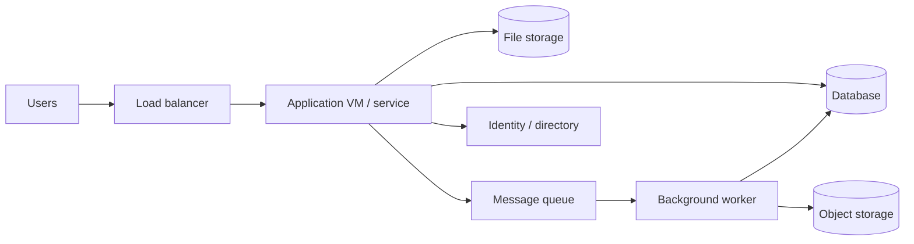

# Migrating Workloads Using Rehost, Replatform, or Refactor

Migrating workloads to the cloud is the process of moving applications, servers, data, and dependencies from an existing environment to a target environment. There are multiple approaches, ranging from moving virtual machines nearly as-is onto new infrastructure to changing the underlying runtime platform or redesigning the application. Three common strategies are **rehost**, **replatform**, and **refactor**.

Strategy choice affects project timeline, cost, application change scope, cutover risk, and realizable cloud benefits. Rehost typically delivers fast migration with minimal changes; replatform adjusts certain foundational components to leverage managed services; refactor alters architecture or source code more deeply to improve scalability, reliability, and delivery velocity.

No single strategy fits every workload. Decisions must weigh business objectives, application state, dependencies, data requirements, team skills, deadlines, budgets, and acceptable downtime.

## 1. The Three Primary Migration Strategies

| Strategy | How It Works | Change Level | Common Goals |
|---|---|---|---|
| Rehost | Moves VMs or applications nearly as-is to cloud infrastructure | Low | Exit data centers quickly, reduce aging hardware dependency |
| Replatform | Migrates workloads while modifying select platform components | Medium | Reduce operational toil, leverage cloud services without a full rewrite |
| Refactor | Redesigns or significantly modifies code, data, and architecture | High | Achieve better scalability, automation, resilience, or change velocity |

### Rehost: Moving As-Is

Rehost is commonly called lift-and-shift. Virtual machines or applications move to equivalent cloud VMs while preserving most of the OS, runtime, middleware, and application configuration. Transfers can use image import/export, block-level replication, migration tools, or reinstalling identical configurations on target machines.

Advantages:

- Faster execution when exiting data centers or retiring end-of-life hardware.
- Minimal code changes, reducing application regression scope.
- Retains familiar operational processes and tools initially.
- Establishes a baseline for phased modernization once workloads run stably in the cloud.

Limitations:

- Carries over legacy configurations, outdated OS versions, hard-to-upgrade dependencies, and technical debt.
- Does not automatically leverage autoscaling, managed databases, object storage, or cloud-native services.
- Instances sized for legacy environments may be oversized or poorly matched to cloud billing models.
- Networking, identity, backups, monitoring, and security still need redesigning for the new environment.

Rehost fits when applications are hard to modify, migration timelines are tight, vendors do not support refactoring, or the organization wants to limit change risk in the initial wave. After rehosting, plan optimizations and decommission legacy configs no longer needed.

### Replatform: Controlled Platform Adjustments

Replatform keeps most business logic intact while swapping specific foundational components to cut operational toil or improve performance. Examples:

- Moving self-managed databases on VMs to a managed database service.
- Moving applications from VMs to containers while preserving service structure and most source code.
- Migrating shared files to an appropriate storage service and updating mounts or access paths.
- Replacing self-managed load balancers with cloud load balancing services.
- Moving backups, logging, or secrets to centrally managed services.
- Upgrading OS or runtime versions while keeping application interfaces unchanged.

Advantages:

- Reduces patching, backup, upgrade, and maintenance work on managed components.
- Captures partial cloud benefits without rewriting the entire application.
- Creates an opportunity to standardize identity, monitoring, deployment, and security.

Limitations:

- Requires checking API, driver, extension, protocol version compatibility, and target service limits.
- Data may require transformation or prolonged synchronization.
- Some legacy system features lack direct equivalents on managed services.
- New service charges and data transfer fees may diverge from initial estimates.

Replatform fits when application architecture remains viable, yet a few foundational components consume excessive operational effort or block cloud goals.

### Refactor: Redesigning or Re-Architecting

Refactor substantially changes how an application is built, deployed, or scaled. Work may include splitting monoliths into services, externalizing state into shared stores, designing API/event contracts, modifying data models, moving workloads onto container orchestration, or shifting processing into serverless functions.

Examples:

- Extracting long-running report generation into asynchronous queue-backed workers.
- Moving in-memory sessions to stateless tokens or shared session stores.
- Splitting modules with distinct load profiles so they scale independently.
- Replacing synchronous file sharing with object storage and event-driven processing.
- Redesigning database access, caching, and retries for stronger dependency resilience.
- Moving batch jobs onto container/job models or suitable serverless services.

Advantages:

- Can improve scalability, independent deployments, and resilience.
- Reduces coupling to legacy operating systems or middleware.
- Creates opportunities to automate CI/CD, testing, and observability.
- Enables cost optimization aligned with actual demand rather than keeping machines idle-running.

Limitations:

- Large scope, longer timelines, and substantially heavier testing needs.
- Introduces changes across data, APIs, business workflows, and team skill sets.
- Migration risk spikes if re-architecting, moving data, and switching environments simultaneously.
- Benefits materialize only when design, operations, and team capabilities keep pace with the new model.

Refactor fits when current architectural limits block business objectives or long-term gains justify transformation costs.

## 2. Comparing Strategies for Selection

| Criterion | Rehost | Replatform | Refactor |
|---|---|---|---|
| Initial timeline | Usually short | Medium | Usually long |
| Code changes | Little or none | Low to moderate | Moderate to extensive |
| Platform changes | Low | Selective | Potentially far-reaching |
| Application change risk | Lower | Medium | Higher unless phased |
| Cloud-native benefits | Limited initially | Partial | Potentially high |
| Testing needs | Regression and environment compatibility | Regression, service, and data compatibility | Functional, integration, load, resilience, and data testing |
| Required skills | Infrastructure, OS, networking, migration | Infrastructure and managed services | Application architecture, data, platform, and automation |

Never pick a strategy purely for technological trendiness. A stable application slated for retirement rarely justifies refactoring. Conversely, a core system burdened with heavy architectural debt may warrant domain-by-domain refactoring rather than lifting and paying ongoing operational penalties.

## 3. Assessing Workloads Before Deciding

Profile each workload before choosing rehost, replatform, or refactor. Assessment data should cover:

- Business and technical owners, user base, and criticality.
- Operating systems, runtime versions, middleware, packages, and licenses.
- CPU, RAM, disk IOPS/throughput, network throughput, and peak concurrency.
- Data volume, growth rate, backup duration, and restore requirements.
- Dependencies on databases, queues, file shares, DNS, LDAP/identity, APIs, and external systems.
- Protocols, ports, firewalls, certificates, DNS names, and IP allowlists.
- Availability, RTO, RPO, latency, and maintenance window requirements.
- Security regulations, personal data, data residency, and audit mandates.
- Current costs vs. projected cloud costs, including compute, storage, networking, licensing, and operations.
- Vendor constraints, contracts, end-of-support dates, and replacement roadmaps.

Distinguish averages from peaks. A VM averaging 15% CPU that spikes to 90% during batch runs requires different capacity planning than a steady workload. Measure across a business cycle long enough to capture batches, month-end close, seasonal peaks, and backup windows.

### Mapping Dependencies

A workload rarely stands alone. Before migrating, map communication flows between the application and surrounding components. For example, a web tier calls internal APIs, APIs query a database, read a file share, publish messages, and authenticate via a directory service.

Dependency diagrams clarify migration ordering, firewall rules, DNS, data movement, and testing strategies. If the application moves first while the database stays in the data center, design network connectivity, latency budgets, encryption, and data transfer costs for the hybrid phase.

## 4. Practical Decision Matrix

Use these questions to guide choices:

| Question | Leans Toward Rehost | Leans Toward Replatform | Leans Toward Refactor |
|---|---|---|---|
| Urgent data center exit deadline? | Yes | Possibly | Poor fit for whole systems |
| App hard to modify or unsupported by vendor? | Good fit | If target platform is compatible | High risk |
| Heavy ops toil on a component with a managed equivalent? | Under-leveraged | Good fit | May be needed if API/logic must change deeply |
| Current architecture blocks scaling or deploys? | Only changes hosting location | Partially addresses | Good fit |
| Need to alter data models or communication patterns? | Not suitable | Limited | Good fit |
| Team has time and skills for modernization? | Minimal required | Requires platform skills | Requires stronger design and ops maturity |

A practical technique is scoring each workload across business value, migration urgency, technical complexity, data sensitivity, dependency complexity, and expected cloud benefit. Scores only support discussion; explicitly document assumptions and decision owners.

## 5. Common Phases of a Migration Project

Regardless of strategy, projects typically follow these stages:

1. **Discover:** inventory applications, servers, data, dependencies, performance, and costs.
2. **Assess:** evaluate readiness, compatibility, risks, migration strategy, and business case.
3. **Design:** architect landing zone, networking, identity, security, compute, storage, backups, and monitoring.
4. **Plan waves:** group workloads by dependencies, criticality, risk level, and cutover windows.
5. **Prepare:** build target environments, quotas, images, automation, migration tooling, and runbooks.
6. **Migrate:** replicate machines/data, deploy configurations, or transform applications.
7. **Validate:** test functionality, data integrity, security, performance, operations, and recovery.
8. **Cut over:** shift traffic or users to the target environment per plan.
9. **Stabilize:** monitor errors, latency, costs, capacity, and user support.
10. **Optimize/decommission:** rightsize instances, finalize documentation, and retire source resources when criteria pass.

Avoid lumping every workload into one massive wave when dependencies and criticality differ. Smaller migration waves let teams learn between waves, shrink blast radius, and refine runbooks.

## 6. Designing the Landing Zone Before Migrating

A landing zone is the foundational cloud environment prepared to receive workloads. At minimum, define:

- Accounts/subscriptions/projects and separation of production, non-production, and shared services.
- VPC/VNet, subnets, routes, VPN/private connectivity, DNS, and IP addressing plans.
- IAM/roles, federated identity, MFA, service identities, and break-glass permissions.
- Security groups/NSGs, firewalls, vulnerability management, and OS baselines.
- Approved images, patching, secret management, and certificate lifecycles.
- Logging, metrics, tracing, audit trails, and alerting.
- Backup policies, encryption keys, retention, and restore procedures.
- Tagging, budgets, cost allocation, and quotas.
- IaC, CI/CD, configuration management, and deployment permissions.

Moving VMs before the landing zone is ready forces teams to retrofit networking, IAM, logging, and backups post-cutover. Post-migration fixes easily introduce drift and security gaps.

## 7. VM Rehost Process

Rehosting can use image-based migration, block replication, or clean reinstallation on target VMs. General workflow:

1. Select instance types based on actual CPU, RAM, disk, and network metrics; avoid blindly copying oversized legacy specs.
2. Verify OS versions are cloud-supported or upgrade beforehand.
3. Check BIOS/UEFI, boot mode, drivers, kernel modules, guest agents, and CPU architecture.
4. Prepare target subnets, security groups, routes, DNS, IAM, and storage.
5. Install migration agents or configure replication; measure bandwidth and initial sync duration.
6. Test-boot copies in an isolated network to check boot, drivers, services, licenses, and the application.
7. Schedule the cutover window; pause writes or quiesce the application per plan.
8. Sync the final delta, confirm replication completion, and switch endpoints/traffic.
9. Verify functionality, data, monitoring, backups, and dependency connectivity.
10. Retain source machines for the agreed rollback window, then decommission under change control.

### Technical Risks of Rehosting

- NICs and interface names may change, breaking static IP configs or guest-level firewalls.
- MAC addresses, machine identities, host keys, or agent IDs may collide if images are cloned improperly.
- Licenses bound to hardware fingerprints may require reactivation.
- Clocks, DNS, routes, MTU, and firewalls may differ from the legacy environment.
- Disk mappings, boot partitions, filesystems, and drivers may be incompatible.
- Applications may hardcode old IPs, share paths, or unmigrated service names.

Therefore, a cloned VM booting cleanly does not prove migration succeeded. Validate full request paths and end-to-end application behavior.

## 8. Replatform Process

Replatforming swaps one or a few components while preserving core application behavior and contracts. For example, moving a database from a self-managed VM to a managed database.

The workflow should include:

1. Select the component to replace and define expected benefits: less patching, higher HA, lower backup toil, or better performance.
2. Compare versions, extensions, collations, encodings, stored procedures, drivers, and target service limits.
3. Verify network paths, private endpoints, DNS, TLS, authentication, and database permissions.
4. Design data migration: dump/restore, native replication, change data capture, or supported migration tools.
5. Dry-run on representative data copies; compare row counts, checksums, schemas, and query behavior.
6. Check connection pools, timeouts, retries, transactions, and connection caps on the new service.
7. Execute cutover in the scheduled window; lock or throttle writes if needed for final sync.
8. Update connection strings/secrets/DNS and verify the app connects to the new endpoint.
9. Monitor latency, errors, replication lag, storage, backups, and failover on the target service.
10. Keep a viable rollback path until data and operations are verified.

When switching to a managed database, certain OS-level admin privileges or extensions may disappear. Check whether legacy jobs like cron backups, log rotation, replication scripts, and monitoring agents are replaced by managed capabilities or must stay in the application layer.

## 9. Phased Refactor Process

Refactoring does not require rewriting the entire application in one shot. An incremental approach lowers risk:

- Pick a capability or bounded context with relatively clear seams.
- Isolate interfaces behind stable APIs or message contracts.
- Migrate data or data ownership piece by piece.
- Run the new version alongside the legacy version within controlled boundaries.
- Use canaries, shadow traffic, or feature flags to validate behavior.
- Shift traffic gradually while watching SLOs.
- Remove legacy components once confirmed free of remaining consumers or required data.

Useful patterns include:

- **Strangler pattern:** place a facade/gateway in front of the legacy system, gradually routing capabilities to new services.
- **Anti-corruption layer:** translate models/protocols between new services and legacy systems to avoid leaking legacy concepts.
- **Outbox pattern:** write business changes and events in the same local transaction, then publish events to avoid database-broker drift.
- **Expand-and-contract:** expand schemas/APIs so old and new versions coexist, migrate consumers, then remove old fields or contracts.
- **Branch by abstraction:** introduce a stable abstraction to swap implementations incrementally.

Refactoring requires testing contracts, data consistency, idempotency, ordering, retries, and observability. When splitting services, establish clear data ownership; if two services write to the same table or share mutable state without rules, complexity increases rather than decreases.

## 10. Data Migration and Consistency Control

Data is typically the hardest part of migration. Distinguish regenerable data, synchronizable data, write-freeze data, and data bound by regulatory retention.

Common data migration methods:

- **Offline copy:** pause writes, copy all data, verify, then open the target system. Simple, though downtime scales with volume and transfer throughput.
- **Snapshot plus delta:** take an initial snapshot, copy the baseline, then sync subsequent changes.
- **Continuous replication/CDC:** stream changes continuously to shrink write-freeze windows; requires monitoring replication lag and transaction ordering.
- **Application-level migration:** the application writes to the new system or dual-writes to both under a controlled protocol.

Dual-writing risks divergence if a write succeeds on one system and fails on the other. If used, enforce idempotency, reconciliation, and explicit partial-failure handling. Never assume sending the same request to two databases is inherently safe migration.

### Verifying Data

Before and after migration, validate:

- Record/object counts and storage size by table, partition, or bucket.
- Checksums or hashes per batch/partition where practical.
- Schemas, indexes, constraints, collations, and encodings.
- Latest committed transactions and replication lag.
- Sequences, identities, offsets, checkpoints, and timestamps.
- Access permissions, encryption, retention, and auditing.
- Representative business queries and reconciliation reports.

A single full-database checksum can take too long or fail if data mutates continuously. Compare by partition, watermark, or consistent snapshot. Log discrepancies and resolve them before shifting full traffic.

## 11. Planning Downtime and Cutover

Cutover is the moment primary workloads or traffic shift from source to target. Plans must specify start preconditions, steps, durations, owners, success criteria, and abort triggers.

A basic cutover checklist:

1. Confirm the target environment passed smoke tests and security checks.
2. Announce the maintenance window and freeze unrelated changes.
3. Lower DNS TTL beforehand if switching via DNS and safe to do so.
4. Put the source application into maintenance/read-only mode or stop writes per plan.
5. Wait for in-flight transactions to finish and sync the final data delta.
6. Confirm watermarks/replication lag meet criteria.
7. Update DNS, routes, load balancers, or connection strings.
8. Run smoke tests, check data, and confirm new requests arrive at the target.
9. Monitor error rates, latency, queues, databases, and business transactions.
10. Record a go or rollback decision against agreed thresholds.

Low DNS TTLs do not guarantee instant client cutover; resolvers, connection pools, and keep-alive connections may pin old endpoints. If IP allowlists, certificates, or callback URLs apply, update them in sync.

## 12. Designing Rollback and Return Conditions

Design rollback before cutover. With rehost, failing back to the source machine can be straightforward if the source remained intact and accepted no new writes. With databases or refactors, rollback is harder because target-side data may have changed.

Define in advance:

- Error, latency, data mismatch, or business failure thresholds that abort cutover.
- Who holds authority to call rollback and within what time window.
- How long source machines, legacy databases, and old endpoints stay online.
- Whether reverse replication or a reverse sync mechanism exists.
- How to prevent both systems from accepting concurrent writes during rollback.
- How transactions created after cutover are handled.
- Conditions for closing the rollback window and declaring steady-state operations.

Once the target accepts writes, you cannot simply flip DNS back to the source and expect accurate data. You need tested reverse replication, delta exports, or reconciliation procedures. Without safe reverse sync, it may be safer to keep the target as primary and fix forward rather than rolling back blindly.

## 13. Post-Migration Testing

Testing must validate both the application and the cloud platform:

| Test Category | Coverage |
|---|---|
| Functional | Login flows, create/update paths, reporting, and business integrations |
| Data integrity | Record counts, checksums, transactions, schemas, files, and objects |
| Performance | Throughput, p95/p99 latency, CPU, RAM, disk, network, and connection pools |
| Resilience | VM restarts, backend loss, dependency timeouts, failover, and recovery |
| Security | IAM, network policies, encryption, secrets, patches, audits, and vulnerability scans |
| Operations | Monitoring, alerts, logs, backups, restores, access, and runbooks |
| Cost | Instance sizing, storage, licensing, data transfer, and managed service charges |

Do not test only under light load. Run representative load, peak bursts, and soak tests long enough to catch leaks, queue buildup, cache warm-up gaps, or connection limits. If migration changed instance types, CPU architectures, or storage tiers, benchmark identical workloads before and after.

## 14. Security During Migration

During migration, data passes through agents, staging storage, network tunnels, and temporary accounts. Enforce strict controls throughout:

- Encrypt data in transit and at rest; verify certificates and endpoints.
- Use dedicated migration identities with scoped read/write permissions, and revoke them afterward.
- Never embed credentials in scripts, images, logs, or unencrypted config files.
- Restrict network sources allowed to bridge source, staging, and target environments.
- Audit snapshots, exports, copies, imports, and permission changes.
- Protect staging data and dumps with tight retention; securely purge once obsolete.
- Verify encryption keys, key policies, and decryption permissions in the target environment.
- Scan images, packages, and artifacts before promoting to production.
- Handle certificates, SSH host keys, machine identities, and agent IDs to avoid duplicate clones.

If residency or compliance rules govern the data, verify regions, snapshot/backup locations, log destinations, and transfer routes before starting migration.

## 15. Estimating Costs and Benefits

Never compare cloud VM list prices directly against legacy server hardware alone. Calculate Total Cost of Ownership (TCO) across:

- Compute: VMs, container platforms, serverless execution, and standby capacity.
- Storage: block, file, object, snapshots, backups, and IOPS/throughput.
- Network: data transfer, cross-zone traffic, VPNs, NAT, private connectivity, and egress.
- Managed services: databases, caches, queues, monitoring, and support tiers.
- Licensing: OS, database, middleware, and commercial software.
- Migration: tooling, staging capacity, data transfer, and engineering labor.
- Operations: patching, backups, incident response, on-call, and platform engineering.
- Temporary double-running costs while source and target overlap.

Rehost can shorten timelines without reducing ongoing costs if oversized VMs run 24/7. Replatform can raise managed service spend while cutting maintenance labor. Refactor demands higher upfront investment yet lowers change costs or enables elastic scaling. Compare over an adequate horizon and factor in downtime risk.

## 16. Organizing Migrations into Waves

Do not group workloads purely by department. Group by dependencies and migration readiness. A wave can gather loosely coupled applications sharing compatible maintenance windows and risk profiles.

Example wave structure:

| Wave | Workload Type | Goal |
|---|---|---|
| Pilot | Dev/test or low-criticality internal apps | Validate landing zone, tooling, and runbooks |
| Wave 1 | Stateless web/APIs with few dependencies | Validate networking, images, load balancing, and monitoring |
| Wave 2 | Workers and integration services | Validate queues, retries, secrets, and data flows |
| Wave 3 | Databases or stateful workloads | Execute data movement, replication, RPO/RTO, and failover |
| Wave 4 | Complex legacy systems | Apply custom strategies, replatform/refactor, or temporarily retain |

Exact ordering follows dependencies. For example, if a shared database underpins several APIs, prepare database connectivity and migration plans before moving dependent APIs. A pilot should be representative enough to surface real issues without risking the most critical system.

## 17. Example: Selecting Strategies for Three Workloads

Suppose an organization runs three workloads:

| Workload | Current State | Initial Fit Strategy | Rationale |
|---|---|---|---|
| Vendor-managed ERP | Runs on VMs; vendor certifies only specific OS/DB configs | Rehost | Preserves compatibility and avoids unsupported changes |
| Internal API & self-managed DB | Stateless API; DB has a compatible managed equivalent | Replatform | Move API to cloud VMs and DB to managed service to cut ops toil |
| Monolithic order system | Hard to scale, slow deploys, synchronous batch jobs | Phased refactor | Extract async workers and independently scaling capabilities over time |

A program might rehost the ERP first to meet the data center exit, replatform the API/DB after compatibility testing, and gradually refactor high-value capabilities out of the monolith. Strategies coexist across a migration portfolio, and a single workload may rehost first before replatforming or refactoring later.

## 18. Common Mistakes

- **Choosing rehost for every app:** lifts unnecessary technical debt and bloated costs. Assess each workload individually.
- **Refactoring everything before exiting the data center:** bloats scope and delays timelines. Split into migrate-then-modernize phases.
- **Treating replatform as a simple endpoint swap:** managed services impose distinct limits, extensions, and semantics. Test compatibility and data.
- **Skipping dependency mapping:** moving one piece breaks connectivity for others. Map flows and sequence waves accordingly.
- **Sizing from legacy hardware specs:** preserves oversized instances or under-provisions capacity. Use real metrics and benchmarks.
- **Skipping pre-cutover clone boot tests:** driver, boot, license, or network bugs surface only during the maintenance window. Run rehearsals.
- **Mishandling final data sync:** leaves source and target out of sync. Track watermarks/lag and enforce a write freeze.
- **Rolling back via DNS alone:** post-cutover writes will not magically return to the source. Design reverse sync or forward recovery.
- **Skipping post-migration security/backup checks:** workloads run yet lack safe operational baselines. Verify IAM, logging, encryption, and restores.
- **Decommissioning the source too early:** eliminates reconciliation or rollback options. Retire only after sign-off and retention windows close.

## 19. Pre-, During-, and Post-Migration Checklists

**Pre-Migration**

- [ ] Business/technical owners and clear migration goals assigned.
- [ ] OS, runtimes, licenses, dependencies, data, and peak loads inventoried.
- [ ] Rehost, replatform, or refactor chosen with documented assumptions and rationale.
- [ ] Landing zone, networking, IAM, security, images, logging, and backups ready.
- [ ] Data movement, downtime, cutover, and rollback plans finalized.
- [ ] Quotas, capacity, costs, and region/residency rules verified.
- [ ] Migration rehearsed in a representative environment.

**During Cutover**

- [ ] Coordinator, checklist, and communication channels active.
- [ ] Unplanned changes frozen and controlled.
- [ ] Source frozen/quiesced per plan.
- [ ] Delta replication and data consistency verified.
- [ ] DNS/routes/load balancers/secrets switched accurately.
- [ ] Smoke tests and business checks pass before opening full traffic.
- [ ] Go or rollback decision made against predefined thresholds.

**Post-Migration**

- [ ] Error rates, latency, capacity, logs, and dependencies monitored.
- [ ] New backups running and restore tests passing.
- [ ] IAM, firewalls, encryption, audits, and vulnerability scans verified.
- [ ] Actual spend compared against business case and sizing optimized.
- [ ] Documentation, diagrams, runbooks, and ownership updated.
- [ ] Source decommissioned only after sign-off, retention, and rollback window expiry.

## 20. Choosing Your Strategy: Conclusion

Rehost moves workloads quickly with minimal changes, replatform adjusts the platform layer to leverage cloud services, and refactor deeply reshapes architecture or code to resolve long-term constraints. Strong migration programs blend all three strategies per workload characteristics and execute across phased waves.

Success means more than a VM booting in the cloud. Workloads must preserve data integrity, connect properly to dependencies, meet SLOs, support backup/restore, stay secure, provide observability, and operate within sustainable costs. Thorough pre-migration assessment, rehearsals, criteria-driven cutover, and realistic rollback plans minimize risk from start to finish.
