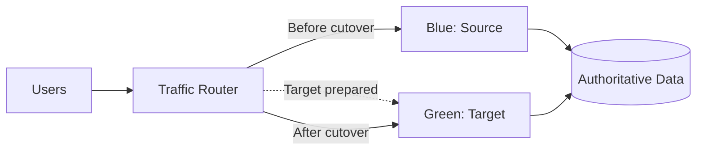
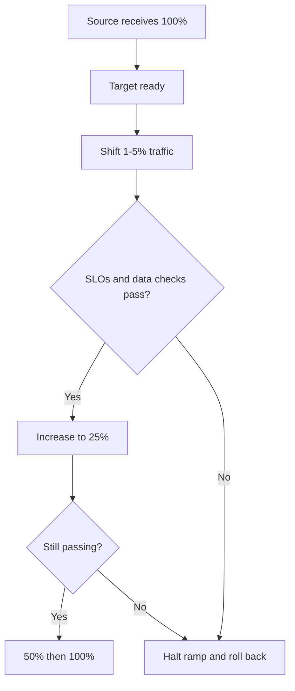
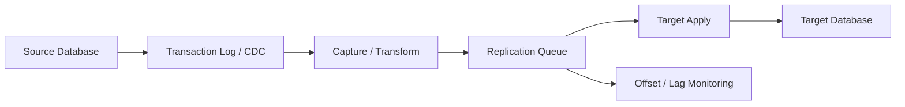

# Planning Cutover, Data Synchronization, and Rollback

Migrating a workload to a new VM, container platform, another region, or a managed service is rarely hardest when provisioning the target infrastructure. The major risk lies in the moment live traffic transitions to the new environment: data may be out of sync, in-flight requests may write to two places, DNS/load balancers may shift unevenly, and rolling back may lose transactions written on the target.

Within the **CLOUD_CORE_SERVICES_COMPUTE** module, a cutover plan must tie compute, networking, storage, identity, databases, backups, and observability into a controllable workflow. A safe migration must establish the authoritative data source, synchronization method, target readiness criteria, traffic cutover timing, acceptable thresholds, and rollback path if errors arise. This lesson guides you through building that plan from preparation through cutover, verification, and closure.

## Learning Objectives

After this lesson, you will be able to:

- Distinguish migration, replication, synchronization, cutover, rollback, and failback.
- Select a cutover strategy aligned with downtime, RTO, RPO, and workload compatibility.
- Prepare source/target environments, dependencies, networking, identity, DNS, and traffic switching plans.
- Combine full data copies with incremental sync or Change Data Capture (CDC).
- Evaluate consistency, replication lag, ordering, duplicate events, and data reconciliation.
- Design schema/application compatibility so source and target coexist during transition.
- Build a cutover runbook with checkpoints, owners, Go/No-Go criteria, and rollback triggers.
- Distinguish rollback before target writes from rollback after data divergence.
- Test migrations, measure outcomes, and capture completion evidence.

## 1. Key Concepts in a Migration

Migration is the process of moving workloads, data, or both from a source environment to a target environment. Cutover is the point or sequence of steps transferring primary serving authority from source to target. Rollback returns the service to its previous operational state when post-cutover conditions fail. Data synchronization brings data between source and target to an identical state according to defined rules.

| Term | Meaning | Example |
|---|---|---|
| Source | The currently operating system and typically the initial authoritative data source | Existing VM/database |
| Target | The environment that will receive the workload or data | New cluster or managed database |
| Replication | Copying changes from one system to another | Database log replication |
| CDC | Capturing data changes from transaction logs or change streams | Continuously streaming inserts/updates/deletes |
| Initial load/full copy | Copying the initial baseline data snapshot | Database export/import or bulk object copy |
| Incremental sync | Syncing changes occurring after the initial copy | Watermark-based delta sync |
| Cutover | Shifting primary traffic or write authority to the target | Switching load balancer backends |
| Rollback | Returning to the source or a prior safe state | Routing traffic back to source after data verification |
| Reconciliation | Comparing two systems to detect discrepancies | Comparing record counts and checksums |
| Write freeze | Temporarily pausing writes to establish a final sync point | Blocking new transactions during cutover |
| Reverse replication | Syncing changes from target back to source | Preparing rollback after target accepts writes |

### 1.1. Distinguishing Rollback and Failback

Rollback typically means returning to the source or previous version during the same migration or incident. Failback typically refers to returning operations to the primary environment after a secondary environment served during an outage. Both may use similar mechanics, though their goals, data states, and approvals differ.

Never treat switching DNS back to the source as a complete rollback. If the target accepted new transactions, the source may lack data. You need reverse sync, reconciliation, or an approved data-loss boundary within RPO.

### 1.2. Defining Migration Scope

Before picking tools, document explicitly:

- Which workloads move: APIs, workers, databases, caches, files/objects, batch jobs, or the entire stack.
- Where source and target reside: same VM platform, different AZs, different regions, container platforms, or managed services.
- Which data must move and its criticality level.
- Connections, DNS, certificates, secrets, IAM roles, firewalls, and endpoints requiring updates.
- Maximum downtime, RTO, RPO, and SLOs during the transition window.
- Rollback scope and how long the source stays recoverable.
- Technical owner, business owner, Go/No-Go decision-maker, and incident communication channels.

## 2. Selecting a Cutover Strategy

No single cutover method fits every workload. Selection depends on parallel run capability, continuous sync feasibility, allowable downtime, and rollback complexity.

### 2.1. Big-Bang Cutover

Big-bang cutover moves all traffic within a single maintenance window:

1. Stop new writes on the source.
2. Drain in-flight requests/jobs.
3. Sync the final data delta.
4. Validate the target.
5. Shift traffic and open writes on the target.

Advantages include simple control flow and avoiding prolonged dual-environment operations. Drawbacks are concentrated downtime, high pressure during the cutover window, and difficult rollback once the target accepts new writes.

Fits workloads tolerant of maintenance downtime, moderate data sizes, or fast, well-rehearsed final syncs.

### 2.2. Blue-Green Cutover

Blue-green maintains two similar environments: blue is the active source; green is the deployed and tested target. Traffic shifts from blue to green via a load balancer, router, or DNS.



Blue-green lets you validate the target before cutting over and enables rapid routing switches. However, if both environments share one database or write to separate databases, establish explicit data ownership. Never let blue and green write to the same data concurrently without conflict resolution.

### 2.3. Canary or Weighted Traffic Shifting

Canary shifts a small traffic slice to the target, observes behavior, then gradually increases weight:



Canary shrinks blast radius on failure, but requires traffic segmentation, per-version telemetry, and fast rollback capability. Traffic percentage does not always equal write volume; account for request mix and tenant distribution.

### 2.4. Shadow Traffic

Shadow traffic mirrors copies of requests to the target for observation without returning target responses to users. This helps compare performance or read outputs, provided duplicate side effects are prevented.

Shadow only safe requests or point at a read-only/sandboxed target. Never replay payment commands, email sends, order creations, or real mutations without side-effect suppression.

### 2.5. Choosing a Strategy by Condition

| Condition | Usually Suitable Strategy | Risks to Manage |
|---|---|---|
| Downtime acceptable, small dataset | Big-bang | Maintenance window and final sync |
| Target can run in parallel, fast traffic switch | Blue-green | Data ownership, sessions, and reverse path |
| Need to reduce risk via gradual traffic ramp | Canary/traffic shifting | Per-version metrics and phased rollback |
| Want to test target logic without user impact | Shadow | Side effects, sensitive data, and extra load |
| Large database, minimal downtime | Full copy + CDC + short cutover | Replication lag, consistency, and write freeze |

## 3. Planning Source and Target

Cutover is safe only when the target is compatible with the application, data, and dependencies. A target that boots cleanly is not automatically production-ready.

### 3.1. Component Inventory

Catalog:

- VMs/instances, container images, runtimes, OS, kernels, and CPU architectures.
- Database engines/versions, schemas, extensions, collations, timezones, and encodings.
- Volumes, filesystems, object storage, file permissions, and encryption keys.
- DNS records, IPs, load balancers, routes, firewalls, NAT, and private endpoints.
- IAM roles, service accounts, secrets, certificates, and KMS keys.
- Queues, streams, caches, schedulers, cron jobs, and background workers.
- Monitoring, logging, alerting, tracing, backups, and restore policies.
- Licenses, quotas, capacity reservations, and third-party services.

### 3.2. Compatibility Checks

Differences that can break migration:

- Differing CPU architectures or instruction sets.
- Incompatible OS/runtime/library versions.
- Database versions or extensions lacking support for current schemas.
- Differing filesystem semantics, case sensitivity, file ownership, or permissions.
- Differing timestamps/timezones, collations, or character encodings.
- Differing network MTU, DNS resolution, TLS policies, or certificate chains.
- Differing IAM permissions and identity mappings.
- Lower storage performance, IOPS, or throughput than source.

Run compatibility tests with representative data. Never conclude workload compatibility solely because an image or container starts.

### 3.3. Target Capacity

The target must hold sufficient capacity for cutover load and steady-state operations. Account for CPU, memory, network, storage, database connections, queue consumers, and headroom. Under canary, the target still needs capacity to ramp traffic; under blue-green, expect dual-environment costs during overlap.

### 3.4. Network and Identity Readiness

Before cutover:

- Confirm source and target resolve DNS properly and reach required dependencies.
- Verify firewalls/security groups, routes, and network policies.
- Verify TLS certificates, hostname verification, and mTLS if used.
- Confirm service accounts/roles hold proper permissions without relying on old long-lived credentials.
- Confirm secrets are synced securely with a rotation plan.
- Verify outbound egress, NAT, and private endpoints.

Never open overly broad firewall rules just to make migration work. Scope rules by source, destination, port, and expiration; revoke temporary rules after cutover.

## 4. Data Synchronization: Full Copy and Incremental Sync

For large databases or object stores, copying everything right before cutover can take hours. A standard pattern performs an initial copy followed by continuous synchronization of ongoing changes.

### 4.1. Full Copy / Initial Load

Full copy establishes the initial dataset on the target:

- Databases: snapshots, backup/restore, dump/load, or native migration services.
- Object storage: bulk copies, replication rules, or batch transfers.
- Filesystems: snapshots, block replication, or file-level copies.
- VMs: images/snapshots, disk replication, or rehost tooling.

Record the exact snapshot timestamp, watermark, transaction ID, or log position so you know the exact point in time the target dataset represents. Without a clear marker, identifying subsequent changes becomes error-prone.

### 4.2. Incremental Sync

Incremental sync transfers changes made after the full copy. Mechanisms include:

- Database transaction logs/binlogs/WALs or CDC streams.
- Managed database change feeds.
- Object versioning/event notifications.
- File modification metadata or block-level replication.
- Queues/event logs with offsets and sufficient retention.

Each mechanism has specific semantics for ordering, duplicates, deletions, and checkpoints. Understand how updates/deletes, multi-table transactions, and schema changes are handled.

### 4.3. Change Data Capture (CDC)

CDC reads changes from transaction logs or change streams and applies them to the target. Typical pipeline:



When deploying CDC, verify:

- Which log position capture begins from.
- Whether transaction boundaries and commit order are preserved.
- Whether target applies are idempotent.
- How duplicates/retries are handled.
- How schema changes propagate and apply in order.
- Whether source log retention lasts long enough if the target falls behind.
- What happens when CDC connectors restart or lose offsets.

### 4.4. Replication Lag and Watermarks

Replication lag is the delay between a source mutation and when the target applies it. It can be measured in time, bytes/log positions, or pending event counts.

Do not monitor only average lag. Track:

- Current lag and trend direction.
- Oldest unapplied change or oldest event age.
- Remaining source log retention.
- Apply throughput vs. change generation rate.
- Transform errors, retries, dead-letters, and checkpoints.

A watermark marks how far data has synchronized—such as a transaction log position, sequence number, or timestamp with clear semantics. Wall-clock timestamps alone may fail under clock skew or concurrent transactions sharing timestamps.

### 4.5. Syncing Objects and Files

Object/file migration must handle:

- New objects, overwritten objects, and deleted objects.
- Versioning, metadata, ACLs/permissions, and encryption keys.
- In-progress multipart uploads and open files being written.
- Symbolic links, ownership, timestamps, and file modes on filesystems.
- Content checksums, sizes, and object counts.
- Object lifecycle/retention policies and legal holds.

A successful copy job does not prove objects match. Verify using appropriate checksums, version IDs, or manifests. If the source keeps writing, run incremental passes or freeze writes prior to final verification.

## 5. Data Consistency and Reconciliation

Data synchronization must include proof that the target matches the source at a defined point. Checking total record counts alone can miss corrupted partitions or altered row contents.

### 5.1. Verification Levels

| Check | Detects | Limitations |
|---|---|---|
| Row/object count | Missing or extra items | Misses content differences when counts match |
| Checksum/hash | Content mismatches | Requires consistent algorithms and canonical representation |
| Partition/key-range aggregates | Localized drift | Requires well-chosen partitions and can consume resources |
| Referential integrity | Broken foreign keys or relationships | Does not replace business validation |
| Business invariants | Invalid state or monetary/inventory totals | Requires exact business rule definitions |
| Sample read comparisons | Differences across sampled records | Sampling does not prove full dataset parity |

### 5.2. Canonicalization Before Hashing

Hashes work only when identical data serializes identically. Before comparing, normalize:

- Field/column order.
- String encoding and normalization.
- Timezones and timestamp precision.
- Decimal precision and NULL representation.
- Compression/container metadata when comparing objects.
- Record ordering when hashing batches.

Never hash dumps with non-deterministic row order or differing formatting and mistake differences for corruption. Build deterministic manifest/partition checksums.

### 5.3. Partition-Level Reconciliation

For large datasets, partition by tenant, date, shard, or key range. Record per partition:

- Source count and target count.
- Checksum or aggregate values.
- Latest watermark.
- Pass/fail status and discrepancy count.
- Owner and verification timestamp.

If one partition drifts, isolate and resync that partition. Avoid overwriting the entire target when only a subset diverges.

### 5.4. Business Validation

Beyond technical checksums, check business invariants:

- Order counts by status.
- Monetary totals by currency and transaction date.
- Non-negative inventory and zero duplicate transactions.
- Valid customer/order/payment relationships.
- Processed vs. pending message counts.
- Referenced files opening cleanly with correct owners/permissions.

Run business validation against aligned snapshots or watermarks on both source and target. Comparing data across different timestamps produces false mismatches.

## 6. Preparing Application Compatibility During Transition

Old and new application versions may coexist during migration. Incompatible schema, event, or API changes can prevent source and target from reading each other's data.

### 6.1. Expand-Contract Schema Migration

For schema changes, follow expand-contract:

1. **Expand:** add new columns/tables/indexes in a backward-compatible way.
2. **Deploy compatible code:** deploy versions capable of reading/writing both old and new structures during transition.
3. **Backfill:** populate old data into the new structure and reconcile.
4. **Switch reads/writes:** shift logic to the new structure once backfilled completely.
5. **Contract:** drop old columns/tables only after no version depends on them and the rollback window closes.

Never drop or alter column types actively used by the source before confirming the source no longer needs them. Rolling back code to an earlier version will break if the schema was already contracted.

### 6.2. API and Event Compatibility

If source and target share queues or event buses:

- Maintain backward-compatible schemas during transition.
- Use schema versioning/registries where appropriate.
- Old consumers must ignore unknown fields or apply safe defaults.
- New producers must not emit events unreadable by old consumers while both remain active.
- Define consumer group/partition ownership to prevent duplicate processing.

### 6.3. Dual-Write and Dual-Read

Dual-write sends the same mutation to both source and target. While it can shorten cutover, ensuring atomicity across two independent systems is hard. A write succeeding on source and failing on target causes divergence; retries risk duplicates.

Use dual-write only with explicit mechanisms like transactional outboxes, idempotency keys, reconciliation, and per-side error handling. Avoid casual dual-writes to two databases without a clear system of record.

Dual-read queries both sides to compare results or fall back. Control side effects, consistency, and extra load. If the two sides sit at different watermarks, differing read results are not necessarily bugs.

## 7. Phased Cutover Runbook

Runbooks must specify sequence, owners, estimated duration, exact commands/console actions, checkpoints, and abort triggers. Every critical step requires verification evidence.

### 7.1. Preparation Phase (T- Days/Hours)

- Confirm source/target, data scope, and dependencies.
- Create restorable backups/snapshots and verify recoverability.
- Provision the target and verify capacity, networking, IAM, secrets, and certificates.
- Deploy target applications without admitting production traffic.
- Execute the full copy and enable incremental sync/CDC.
- Monitor replication lag, error rates, and data reconciliation.
- Rehearse cutover and rollback in staging or a rehearsal environment.
- Prepare dashboards, alerts, runbooks, contact rosters, and emergency access.
- Announce the maintenance window and freeze unrelated changes.

### 7.2. Pre-Cutover Phase

Right before the window:

1. Confirm all owners and decision-makers are online.
2. Confirm target health and sufficient capacity.
3. Verify valid source backups/snapshots exist.
4. Confirm CDC is running, lag is within bounds, and log retention is sufficient.
5. Confirm DNS/load balancer switching and return paths work.
6. Confirm client timeouts/retries tolerate the transition window.
7. Capture baseline SLOs, throughput, error rates, and business metrics.

If any critical precondition fails, halt cutover and call No-Go. Never force progress by skipping data validation or rollback readiness.

### 7.3. Write Freeze and Final Sync Phase

To establish a consistent data boundary:

1. Stop or throttle write producers.
2. Drain in-flight requests and transactions.
3. Pause workers/consumers or drain queues per procedure.
4. Confirm zero uncommitted transactions remain on source.
5. Record the final log position/watermark.
6. Wait for CDC/incremental sync to apply through that watermark on target.
7. Run required count/checksum/business validation checks.
8. Record results and approver sign-off.

If a full system freeze is impossible, enforce an explicit consistency protocol: transaction boundaries, fencing tokens, write ownership, or event barriers. Simply waiting for lag to near zero is insufficient while writes continue unabated.

### 7.4. Traffic Cutover Phase

Once the target is validated:

- Switch backends/load balancers or DNS per the chosen strategy.
- For canary, raise weights across checkpoints with adequate observation intervals.
- Watch p50/p95/p99 latency, error rates, saturation, connections, and dependencies.
- Confirm traffic genuinely hits the target via release/cluster/region tags.
- Keep the source blocked from writes or read-only per plan.
- Open target writes only once primary write authority and data ownership are unambiguous.

### 7.5. Post-Cutover Verification Phase

- Execute smoke tests and synthetic transactions.
- Test login, read/write paths, upload/download, queues, and background jobs.
- Reconcile transaction counts, states, and key aggregates.
- Inspect alerts, logs, traces, and audit events.
- Monitor reverse replication/sync if maintaining a rollback path.
- Confirm no stray legacy clients or workers continue writing to the source.
- Record the exact timestamp when the target became authoritative writer.

### 7.6. Closure Phase

Close migration only when:

- SLOs remain stable throughout the observation window.
- Data validation passes with no critical sync backlog.
- Routes, identities, and dependencies are cleanly transitioned.
- Target backup/restore policies are active.
- Monitoring and alerts have assigned owners.
- The rollback window is formally closed by the authorized lead.
- Source is retained, scaled down, or decommissioned per approved plan.

## 8. Go/No-Go Decisions and Cutover Criteria

Go/No-Go decisions must rest on measurable criteria rather than "things look fine."

| Category | Example Go Criteria | No-Go Triggers |
|---|---|---|
| Target health | All critical health/readiness checks pass | Target restarts, unhealthy, or missing dependencies |
| Capacity | Headroom exists for target load and bursts | CPU/RAM/connections/network near saturation |
| Data sync | Lag below threshold, watermark reached, validation passes | Growing lag, CDC errors, or checksum/business mismatch |
| Networking | DNS, TLS, routes, firewalls, and egress tested | Clients fail to reach target or invalid certificates |
| Identity | Roles/secrets properly scoped and auditable | Missing permissions or unmanaged credentials |
| Observability | Dashboards/alerts and release tags active | Cannot distinguish source/target or missing alerts |
| Rollback | Runbook, owner, and data path rehearsed | No plan to handle new writes on target |
| Business | Owner signs off on smoke tests/workflows | Critical transactions or flows fail |

Set concrete workload-specific thresholds for lag, error rates, latency, data drift, and observation duration. The table illustrates structure, not universal production numbers.

## 9. Designing Rollback Before and After Target Accepts Writes

Rollback is easiest before the target becomes authoritative writer. Once the target processes new transactions, data can diverge and returning to source requires reverse sync or reconciliation.

### 9.1. Rollback Before Opening Target Writes

If the target has accepted no production writes:

1. Stop sending new traffic to the target.
2. Route traffic back to the source.
3. Confirm the source still holds the latest data and can accept writes.
4. Resume workers/producers and queues in order.
5. Check SLOs and reconcile requests during the transition window.
6. Retain the target for investigation without wiping logs/telemetry.

This path is straightforward because the source remains the authoritative dataset.

### 9.2. Rollback After Target Accepts Writes

Once the target has processed new transactions, you cannot simply flip traffic back to source. Execute one of the pre-planned strategies:

- **Reverse replication:** sync changes from target back to source, then switch write authority.
- **Forward fix:** keep the target live and patch forward if rollback carries higher data risk.
- **Restore/replay:** restore source from backup/snapshot, then replay logs/events written since that point.
- **Reconciliation/manual recovery:** reconcile and merge diverged records via business procedures.

Each approach differs in duration, RPO, and risk. Reverse replication requires compatible schemas and replication direction; not every tool supports safe direction reversal.

### 9.3. Preventing Data Split-Brain

Never allow both source and target to accept independent writes unless using a multi-writer architecture with conflict resolution. During rollback:

1. Fence or revoke write permissions on the outgoing primary.
2. Designate one authoritative data source at the switch point.
3. Wait for reverse sync or replay to finish.
4. Reconcile data and resolve conflicts.
5. Shift routing and open writes on the chosen primary.
6. Monitor for duplicates, missing transactions, and ordering issues.

If safe reverse sync is unavailable, keeping the target as primary and fixing forward may be safer than rolling back.

### 9.4. Rollback Triggers

Examples of pre-defined triggers:

- Error rate breaches threshold across consecutive windows.
- p95/p99 latency breaches SLO for a set duration.
- CDC/replication lag breaches threshold or data mismatch appears.
- Database connections, CPU, memory, or queues saturate.
- Business transactions corrupt, duplicate, or drop data.
- A critical dependency fails to operate.
- RTO/RPO risks breaching targets.

Triggers must distinguish issues fixable quickly on target from failures mandating rollback. Define observation windows, owners, and decision authority to prevent conflicting traffic changes by different responders.

## 10. DNS, Load Balancers, and Connections During Cutover

Switching DNS or backends does not move every client instantaneously. Resolver caches, connection pools, keep-alive sockets, mobile clients, and proxies may stick to old addresses.

### 10.1. DNS Cutover

Before migration:

- Inspect existing records, TTLs, and authoritative DNS.
- Lower TTLs ahead of cutover if needed and allow old caches to expire.
- Check split-horizon/private DNS and internal resolvers.
- Prepare rollback records and verify update permissions.
- Measure actual propagation across multiple networks/clients.

Low TTLs do not guarantee every client updates on schedule. Some resolvers or apps cache beyond TTL, and active TCP sockets do not drop simply because DNS changed.

### 10.2. Load Balancer Cutover

Shifting backends behind a load balancer generally controls traffic ratios better than DNS. Check:

- Target health/readiness.
- Connection draining and idle timeouts.
- Sticky sessions and cookie domains.
- WebSockets/gRPC/long-lived connections.
- Forwarded headers, client IPs, and TLS termination.
- Load balancer retry policies and timeouts.

For canary rollouts, tag logs/metrics/traces with release/target labels to separate source vs. target traffic.

### 10.3. Client Retries and Idempotency

During cutover windows, clients may time out and retry even after the server processed the request. Use idempotency keys on writes, configure retries with exponential backoff/jitter, and deduplicate across source/target where possible.

Never retry infinitely or retry every error blindly. A request committed on source whose response dropped may be retried against target—creating duplicate transactions without idempotency.

## 11. Cutover Across Compute Models

### 11.1. VM to VM or Different Instance Types

Key steps:

- Launch target VMs from verified images/configs.
- Sync volumes/files/databases using appropriate methods.
- Install agents, identities, certificates, secrets, and monitoring.
- Verify networking, firewalls, DNS, and storage performance.
- Run smoke/load tests and validate startup behavior.
- Switch target groups or IPs/routes per plan.
- Retain source for rollback until data and operations stabilize.

If using disk snapshots, verify application consistency. Snapshots taken while databases write may only be crash-consistent; use database-aware backups or quiesce/write-freeze when strict consistency is required.

### 11.2. VM to Containers/Kubernetes

Beyond data, migrate:

- Environment variables/configuration and secrets.
- Persistent volumes and storage classes.
- Service discovery, ingress, network policies, and identities.
- CPU/memory requests/limits and readiness/liveness probes.
- CronJobs, workers, queue consumers, and graceful shutdown.
- Logging, metrics, tracing, and autoscaling policies.

Source VMs and target Pods can coexist during canary, provided write ownership is clear and two consumers do not compete over the same queue without explicit partitioning/ownership.

### 11.3. Cross-Region Migration

Region migrations introduce extra factors:

- Data transfer duration/cost and available bandwidth.
- Inter-region replication lag and consistency.
- DNS/global traffic management and client locality.
- KMS keys, secrets, certificates, and identity federation.
- Quotas, instance capacity, and services unavailable in the target region.
- Data residency, compliance, and storage mandates.
- Backup/restore locations and independent recoverability.

Rehearse with representative data to measure real copy durations. Never assume nominal link bandwidth holds throughout the migration window.

### 11.4. Database Engine or Version Migration

Database migrations can alter types, collations, query plans, transaction semantics, isolation levels, indexes, and extensions. Perform:

- Schema compatibility assessment.
- Query/application compatibility testing.
- Full load and CDC rehearsals.
- Sequence/identity, trigger, stored procedure, and permission validation.
- Transaction boundary, isolation, and replication semantics checks.
- Data reconciliation and performance benchmarks.

If the target database cannot ingest CDC from the source, expect longer downtime or a specialized conversion pipeline. Never choose a sync tool solely because it lists a popular engine; verify exact versions and features.

## 12. Migration Testing and Rehearsals

Migration rehearsals must use the same procedures, tools, and configurations planned for production. Use anonymized or synthetic datasets matching production size and distribution.

### 12.1. Test Cases

- Full copy duration and throughput.
- CDC start position, lag, retries, and recovery after connector restarts.
- Schema changes occurring mid-replication.
- Duplicate/out-of-order events and idempotency.
- Write freeze, final sync, and validation duration.
- DNS/load balancer propagation and client connection reuse.
- Rollback before target accepts writes.
- Rollback after target processes sample transactions.
- Restore/replay or reverse replication.
- Load tests and soak tests on the target.

### 12.2. Capturing Evidence

Record:

- Total volume and record/object counts.
- Full copy, incremental sync, and final sync durations.
- Replication lag over time and final watermark.
- Count/checksum/business validation results.
- Cutover start/end, traffic weights, and DNS/LB changes.
- Error rates, p50/p95/p99 latency, throughput, and saturation.
- Count of new target transactions and rollback path state.
- Actual RTO/RPO and manual steps required.

Evidence must include timestamps, environment, tool versions, operators, and outcomes—not merely a single screenshot after completion.

## 13. Practical Example: Moving an Order Service to a New Target

An order service runs on VMs and a source database. The target is a container platform and managed database in the same region. Goals: minimal downtime, zero lost committed transactions, and ability to roll back if the target misses SLOs.

### 13.1. Strategy

- Pre-deploy API/workers on the target without live traffic.
- Run initial database data copy.
- Enable CDC from source to target.
- Run shadow reads and reconcile results.
- At cutover, pause writes, drain queues, and wait for CDC to reach the final watermark.
- Verify business invariants, then switch traffic.
- Open writes on the target and keep the source read-only during the rollback window.

### 13.2. Cutover Checkpoints

| Checkpoint | Criteria | Owner |
|---|---|---|
| C1 – Target ready | API/workers healthy; networking/identity/secrets pass | Platform team |
| C2 – Data sync ready | CDC running, lag under threshold, initial load passes | Database team |
| C3 – Freeze | Producers stop writes; active transactions finish | Application team |
| C4 – Final sync | Source watermark fully applied on target | Database team |
| C5 – Validation | Counts/checksums and business invariants pass | Data/business owner |
| C6 – Traffic switch | Load balancer/DNS switched per plan | Network/platform team |
| C7 – Service validation | Smoke tests, SLOs, and error rates pass | Service owner |
| C8 – Close/rollback decision | Observation window ends and owner approves | Incident/change lead |

### 13.3. Rollback Plan

If C7 fails before target opens writes, shift traffic back to source because source remains authoritative. If failures occur after target accepts new writes, stop writes, record the final watermark, and run rehearsed reverse replication or replay. Reopen writes on source only after validating data and fencing the target.

If reverse replication is unavailable or target schema diverged incompatibly, weigh fixing forward on target instead of rolling back blindly, guided by RPO, fault severity, and transaction preservation.

## 14. Sample Runbook

Store runbooks in the organization's change management system and adapt to specific tooling. Condensed version:

```text
MIGRATION: orders-api-v2
SOURCE: vm-api + source-db
TARGET: k8s-api + managed-db
CHANGE WINDOW: <approved-window>
OWNER: <service-owner>
DECISION MAKER: <change-lead>

PRE-CHECK
[ ] Backup/restore verified
[ ] Target health and capacity verified
[ ] Network, IAM, secrets and certificates verified
[ ] Full load completed
[ ] CDC healthy and lag below agreed threshold
[ ] Rehearsal and rollback tested

CUTOVER
[ ] Announce maintenance / start change window
[ ] Stop writes and drain active requests/jobs
[ ] Record final source watermark
[ ] Wait for target apply to watermark
[ ] Run reconciliation and business validation
[ ] Switch traffic using approved routing plan
[ ] Enable target writes and run smoke tests

DECISION
[ ] GO: SLO, errors and data validation meet criteria
[ ] NO-GO: stop traffic increase and execute rollback/forward-fix decision

ROLLBACK
[ ] Fence non-authoritative writer
[ ] Determine whether target accepted new writes
[ ] Reverse-sync/replay/reconcile if required
[ ] Verify data and open writes on selected primary
[ ] Restore traffic and monitor SLO

CLOSE
[ ] Confirm backup and monitoring on target
[ ] Record evidence and actual RTO/RPO
[ ] Close rollback window with approval
[ ] Decommission source only after retention/approval
```

Replace placeholders with exact timestamps, owners, concrete commands, and rehearsed thresholds before production execution.

## 15. Common Mistakes

| Mistake | Consequence | Fix |
|---|---|---|
| Full copy alone then switching traffic | Changes occurring during copy are lost | Use incremental sync/CDC or write freeze |
| Skipping watermark tracking | Unknown sync boundary on target | Record log positions/sequences and final watermark |
| Checking row counts only | Content or business links may still be wrong | Use partition checksums and business invariants |
| Letting source and target write independently | Data divergence, duplicates, and split-brain | Enforce single write owner, fencing, and controlled reverse sync |
| Switching DNS assuming instant client cutover | Resolver/connection caches keep hitting source | Plan TTL, connection draining, and measure live traffic |
| Never rehearsing post-write rollback | No safe way to preserve new transactions | Rehearse reverse replication/replay and reconciliation |
| Contracting schemas too early | Old code/source breaks on rollback | Use expand-contract and keep old schema during rollback window |
| Testing only API health endpoints | Workers, queues, files, and batch jobs fail silently | Smoke-test all critical workflows |
| Underestimating target capacity | Cutover succeeds then target collapses | Benchmark and load-test before switching |
| Skipping secret/certificate/identity checks | App boots yet fails to reach dependencies | Preflight permissions, TLS, egress, and audits |
| Non-idempotent retries | Duplicate transactions during timeout windows | Use idempotency keys, deduplication, and retry budgets |
| Deleting source right after cutover | Lose rollback path and forensic evidence | Retain source per rollback/retention policy |

## 16. Production Checklist

**Scope and Strategy**

- [ ] Identified source, target, workloads, data owners, and dependencies.
- [ ] Selected big-bang, blue-green, canary, or other suitable strategy.
- [ ] Defined downtime, RTO, RPO, SLOs, and rollback window.
- [ ] Assigned owners, change lead, and Go/No-Go decision-maker.

**Target Readiness**

- [ ] Compute/storage/network capacity meets targets.
- [ ] IAM, secrets, certificates, DNS, firewalls, and endpoints verified.
- [ ] Runtimes, images, schemas, OS, and dependencies compatible.
- [ ] Monitoring, alerts, logs, and traces distinguish source vs. target.

**Data Synchronization**

- [ ] Full copy carries an explicit timestamp/snapshot/watermark.
- [ ] Incremental sync/CDC runs with lag monitoring.
- [ ] Updates, deletes, ordering, duplicates, and schema changes handled.
- [ ] Counts, checksums, partition reconciliation, and business checks defined.
- [ ] Write freeze/final sync rehearsed.

**Cutover and Rollback**

- [ ] Step-by-step runbook, owners, checkpoints, and Go/No-Go criteria ready.
- [ ] Traffic switching and target traffic verification confirmed.
- [ ] Client retries/idempotency and connection draining checked.
- [ ] Rollback before target writes tested.
- [ ] Reverse sync/replay/reconciliation after target writes tested.
- [ ] Fencing enforces a single authoritative writer.
- [ ] Source retained throughout the rollback window without premature retirement.

**Migration Closure**

- [ ] SLOs and business checks pass during observation window.
- [ ] Target backup/restore verified.
- [ ] Actual RTO/RPO and cutover durations recorded.
- [ ] Evidence, change logs, and decisions archived.
- [ ] Rollback window formally closed with approval.
- [ ] Source decommissioned per retention and change policies.

## 17. Conclusion

Cutover is a structured transition of serving authority and data ownership—not merely a DNS change or load balancer update. Prepare the target, run initial data copies, synchronize ongoing changes via CDC/incremental sync, track watermarks, and reconcile data before shifting traffic. Schemas, identities, networking, queues, workers, and dependencies must remain compatible throughout coexistence.

Design rollback before migration starts. Before the target accepts new writes, returning to the source is straightforward. Once the target processes writes, handle diverged data through reverse replication, replay, or reconciliation while ensuring only one system holds write authority. Rehearsals, clear Go/No-Go gates, owner-assigned runbooks, and verification evidence make cutover controllable, repeatable, and safely recoverable.

## Key Glossary

| Term | Meaning |
|---|---|
| Migration | Moving workloads, data, or services to a target environment. |
| Cutover | Shifting serving authority/traffic or primary write ownership to the target. |
| Rollback | Returning to a prior environment/state using a data-preserving procedure. |
| Full copy / initial load | Copying the entire baseline dataset initially. |
| Incremental sync | Syncing changes generated after the initial copy. |
| CDC | Change Data Capture; capturing and streaming changes from logs or change streams. |
| Watermark | A marker indicating up to what point data has synchronized. |
| Replication lag | Delay between a source change and when the target applies it. |
| Reconciliation | Comparing two systems to detect and resolve discrepancies. |
| Write freeze | Temporarily pausing writes to establish a consistent final sync point. |
| Blue-green deployment | Maintaining two environments and switching traffic between them. |
| Canary release | Shifting a traffic slice to the target and ramping based on observed results. |
| Shadow traffic | Mirroring requests to the target for testing without returning responses to users. |
| Dual-write | Writing the same operation to two systems; requires atomicity and divergence handling. |
| Reverse replication | Syncing changes from the target back to the source. |
| Fencing | Preventing a deposed primary system/node from continuing to write. |
| Expand-contract | Evolving schemas through a compatible phase before removing old structures. |
| Go/No-Go | Decision to proceed or abort cutover based on predefined criteria. |
