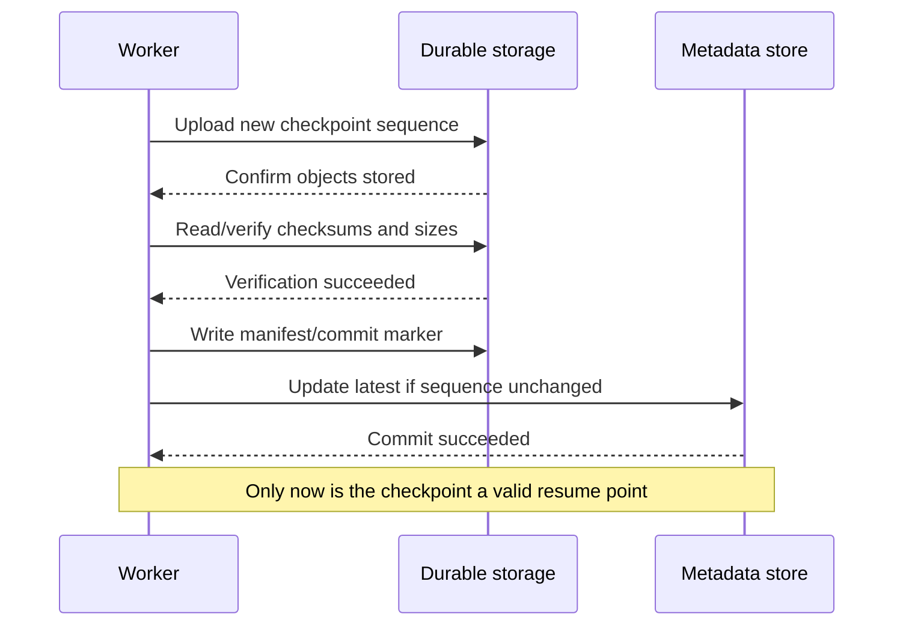

# Checkpointing, Retries, and Task Progress Recovery

Interruptible compute—such as Spot/Preemptible VMs or workers running on spare capacity—typically costs less, but does not guarantee that machines will survive until work completes. The provider can reclaim instances when capacity is needed elsewhere, when runtime limits expire, or during platform events. If an application keeps progress only in RAM or on local disk, a single reclamation can wipe out hours of computation.

To use this compute tier for long-running workloads, applications must persist progress to durable storage, recognize when to stop, resume from the latest checkpoint, and handle a segment of work being executed more than once. **Checkpointing protects progress; retries recover incomplete work; idempotency prevents duplicate side effects.** All three mechanisms must be designed together.

## 1. Why Are Checkpointing and Retries Needed?

With regular VMs, operators can expect machines to stay up for the allocated duration. With reclaimable capacity, applications should treat interruptions as a normal event in the workload lifecycle.

Scenarios that can stop a task before completion:

- The provider reclaims Spot/Preemptible VMs to reallocate capacity.
- An instance is stopped or replaced due to maintenance, host failure, or runtime limits.
- A container/Pod is evicted when a node is reclaimed or needs draining.
- A worker process crashes, a VM reboots, or a node loses connectivity.
- A queue consumer loses its lease or fails to acknowledge a message on time.
- A job is canceled by an operator, a deadline, or a configuration change.

If a task does not save progress, the next run may have to start from scratch. When work is split into multiple parts, checkpoints let you rerun only the incomplete portion. Retries let the scheduler or queue re-dispatch the failed part; idempotency ensures receiving the same part again does not produce duplicate results or corrupt data.

### Examples of Suitable Workloads

- Batch ETL processing millions of records by partition.
- Video or image rendering by frame/chunk.
- Machine learning model training by epoch or batch.
- Scientific computing, simulations, and parameter sweeps.
- Workers processing messages or files from a queue.
- Distributed builds/tests that can be split into independent tasks.

Workloads with hard-to-save state, continuous low-latency requirements, or an inability to resume after disruption may be unsuitable for reclaimable capacity without an appropriate orchestration and state-persistence layer.

## 2. Distinguishing Checkpointing, Retries, and Resume

| Mechanism | Question answered | Role |
|---|---|---|
| Checkpoint | How far did it get and what state is needed? | Saves progress along with recoverable state |
| Retry | When will incomplete work be rerun? | Retries after transient failures or interruptions |
| Resume | From what state does the new run start? | Reads a valid checkpoint and continues the remainder |
| Idempotency | What if the same work runs multiple times? | Prevents duplicate side effects |
| Reconciliation | Which results were actually committed? | Reconciles checkpoints, outputs, and scheduler state |

A checkpoint is more than storing a percentage number. It must contain enough information to reconstruct computational state, identify processed inputs, record code/schema versions, and track committed outputs. Retries must never assume the previous run produced no side effects; they must check commit state or use idempotency keys.

## 3. Designing Resumable Work Units

Before designing the checkpoint format, break the workload into units with clear boundaries. The larger a task is, the more work can be lost upon reclamation.

### Splitting by Partition or Chunk

For example, an ETL job processing 100 million records can split by key range or partition. Each worker claims a piece, reads input data, produces outputs, and records completed pieces. If a worker is reclaimed, the scheduler only needs to reassign uncommitted partitions.

For video rendering, split by time segment or frame range. For training, split by batch or epoch and save optimizer state, scheduler state, and random number generator state if exact reproducibility is needed. For simulations, split by seed or parameter range so each unit can run independently.

### Choosing Chunk Size

Chunks that are too large lose substantial progress when an interruption hits. Chunks that are too small increase scheduling, file-opening, metadata-writing, and checkpoint-commit overhead.

Choose chunk size based on:

- Average processing time and variance per chunk.
- Observed interruption frequency for that capacity tier.
- Time to write and reload checkpoints.
- Worker startup and dependency initialization cost.
- Job deadline and acceptable progress RPO.

For example, if a chunk typically takes 20 minutes but checkpoints are written only every 2 hours, an interruption can lose nearly 2 hours of work. If each chunk takes 1 minute but the scheduler takes several seconds to dispatch tasks, overhead can become significant. Measure empirically to pick the balance point.

### Commit Boundaries

A work unit should have clear states, such as `PENDING`, `RUNNING`, `COMMITTED`, `RETRYABLE_FAILED`, or `PERMANENT_FAILED`. Mark `COMMITTED` only after outputs are durably written and verified. Workers should never declare completion merely because computation finished in RAM.

## 4. What Should a Checkpoint Store?

Checkpoint contents depend on the workload, but typically require enough information to identify the job, reconstruct state, and verify compatibility.

| Field | Purpose |
|---|---|
| Job ID / task ID | Identifies the work to resume |
| Partition/chunk ID | Identifies the input slice being processed |
| Input version or snapshot ID | Ensures the new run reads the same logical dataset |
| Processed offset/cursor/range | Identifies where to continue |
| Application state | Algorithm state, accumulators, model weights, or needed progress |
| Code/build version | Identifies the program version that wrote the checkpoint |
| Schema/format version | Supports reading and migrating checkpoints |
| Dependency/config version | Reconstructs critical processing configuration |
| Output reference | Location of generated or committed outputs |
| Checksum/size | Detects corrupted or truncated checkpoints |
| Created time and sequence | Selects the latest valid checkpoint and prevents regressions |
| Attempt/worker ID | Aids investigation and detects stale workers |

Do not store secrets, access tokens, or private keys in checkpoints. If state contains sensitive data, apply encryption, access controls, and retention matching the source data.

### Checkpoints Must Be Cross-Version Compatible

New workers may run a different code version than the worker that created the checkpoint. The checkpoint format needs versioning and compatibility rules. If a schema changes incompatibly, perform a controlled migration or rerun the work from a safe boundary.

Never silently parse an old checkpoint with a new structure and ignore unknown fields. You can write a new checkpoint after migrating, keeping the old one until resume succeeds.

## 5. Storing Checkpoints Durably

Local RAM and local/ephemeral disks are typically lost when an instance is reclaimed. Therefore, critical checkpoints must be saved to a service that exists independently of the worker, such as object storage, persistent block storage, a database, or a dedicated checkpointing system.

### Comparing Storage Locations

| Storage location | Advantages | Risks / caveats |
|---|---|---|
| Worker RAM | Very fast | Lost when process/VM stops |
| Local/ephemeral disk | Fast writes, good for scratch | Can be lost on instance reclamation or host replacement |
| Persistent block volume | Can survive reboots or detach/attach per service | Can be bound by zone, attachment time, and single-writer limits |
| Object storage | Durable, highly scalable, decoupled from VM lifecycle | Must manage object versions, upload completion, and consistency workflows |
| Database/metadata store | Easy state updates and task claiming | Can become a bottleneck; needs transactions/conditional writes |
| Shared filesystem | Supports multi-worker read/write per filesystem semantics | Must handle locking, throughput, and failure domains |

Local disk remains useful as scratch space for computation or staging temporary checkpoints. Afterward, upload the complete artifact to durable storage and publish the checkpoint only once the upload succeeds.

### Never Overwrite a Good Checkpoint with an Incomplete One

A safe pattern is to write the new checkpoint under a distinct key/filename, verify its checksum and size, and then update the manifest or `latest` pointer conditionally. If the worker is reclaimed mid-upload, the old checkpoint remains intact.

With filesystems supporting atomic rename, you can write a temporary file on the same filesystem, flush data, and rename it to the final name. However, atomic rename on a local disk only protects local integrity; it does not keep data alive after the VM is reclaimed. The final artifact must still be shipped to durable storage.

## 6. Safe Checkpoint Writing: Data First, Manifest Last

For multi-file checkpoints, never update files one by one in place at `latest` while another worker might read mid-upload. Use a dedicated directory/prefix per checkpoint sequence, upload all components, verify them, and write the manifest/commit marker last.

Reference workflow:

1. Create a new checkpoint sequence, e.g., `job-42/partition-7/checkpoint-00018/`.
2. Write state, offsets, and output metadata into separate objects.
3. Complete uploads and wait for storage confirmation.
4. Verify checksums, sizes, and schema version.
5. Write a manifest listing all objects and their checksums.
6. Update the active checkpoint pointer via compare-and-swap or conditional write.
7. Resuming workers read only checkpoints with a valid manifest/commit marker.



If a worker dies before updating the manifest, the incomplete checkpoint is ignored. If it dies after the manifest commits, the next worker can resume from the new version. Clean up temporary/orphaned objects via a separate lifecycle policy once they are guaranteed unreferenced.

### Preventing Checkpoint Regression

Two workers can accidentally process the same partition due to lease expiration or message redelivery. If the old worker finishes late and overwrites a newer checkpoint, progress can regress. Use monotonically increasing sequences, generation numbers, leases/fencing tokens, or conditional updates so only the worker holding current ownership can commit.

## 7. When Should Checkpoints Be Created?

Scheduled checkpoints bound potential lost work. Additionally, create checkpoints at logical boundaries or ahead of events that could stop workers.

### Periodic Checkpoints

Create checkpoints after a fixed time interval or after a set number of work units. Frequency must balance overhead against acceptable lost progress.

### Work-Boundary Checkpoints

Create checkpoints after completing a partition, batch, epoch, frame range, or transaction group. These are usually the easiest points to recover from because inputs and outputs have clean boundaries.

### Checkpoints on Interruption Notice

Some platforms emit a notice before reclaiming an instance via a metadata endpoint, event service, guest agent, or in-guest signal. Applications can receive the notice and initiate graceful shutdown: stop accepting new work, save a checkpoint, flush logs, and exit.

Notices can be very brief, delayed, or missing altogether if the VM drops unexpectedly. Therefore, never wait for an interruption notice to write your first checkpoint. Maintain periodic checkpoints so the system can still recover without warning.

### Checkpoints Before Major Changes

Create a checkpoint before:

- Updating images, kernels, drivers, or runtimes.
- Changing algorithm configuration or state schemas.
- Migrating workloads to another machine family.
- Starting an expensive computation phase.
- Performing operations that could discard in-RAM state.

## 8. Choosing Checkpoint Interval by Progress RPO

For compute workloads, you can treat the checkpoint interval as the progress RPO. If a checkpoint succeeds every 15 minutes, when a worker is suddenly reclaimed, the work requiring rerun typically does not exceed the time since the last checkpoint, plus uncommitted work and copy upload latency.

However, checkpointing too often also consumes time and resources. Suppose:

- **C** is the time required to create and save one checkpoint.
- **T** is the interval between two checkpoints.
- **M** is the mean time between interruptions/failures.

A classic estimate for the optimal interval under a simple random failure model is:

\[
T_{opt} \approx \sqrt{2CM}
\]

This formula is only a starting point to reason about overhead versus lost-progress risk; it assumes a relatively steady failure rate, nearly constant checkpoint cost, and omits practical factors such as restart time, price/capacity volatility, and deadlines. For Spot/Preemptible compute, use actual interruption data per instance family/region and empirical tests to calibrate.

### Calculation Example

Suppose checkpointing takes 2 minutes and mean time between interruptions is 20 hours. By the simple formula:

\[
T_{opt} \approx \sqrt{2 \times 2 \times 1200}
\approx 69.3\text{ minutes}
\]

This is not a mandatory schedule. If progress RPO requires at most 20 minutes, set a shorter interval or checkpoint by chunk. If checkpointing consumes heavy I/O, reduce state size or store deltas to lower overhead.

## 9. Retries: Classifying Errors Before Retrying

Not every error should be retried. Retrying transient errors helps systems recover; retrying permanent configuration or data errors just repeats failures and wastes capacity.

### Typically Retryable Errors

- Interruption/spot termination or lost worker.
- Temporary network timeouts, connection resets, or service throttling.
- APIs returning recoverable 429/5xx errors.
- Node/VM capacity unavailability where the scheduler can try another zone/family.
- Worker process crash from an unknown error, once logs and checkpoints are preserved.

### Errors Typically Requiring Remediation Before Retry

- Invalid input or missing required data.
- Permission denied or expired credentials due to misconfigured identity.
- Checkpoint incompatible with schema/code without a migration path.
- Output violating business constraints.
- Job exceeding resource limits due to misconfiguration, unresolvable by another identical instance.
- Deterministic logic bugs causing the same input to crash at the same step every time.

Systems can classify errors into `RETRYABLE`, `PERMANENT`, and `NEEDS_REVIEW`. Unknown errors may be retried a limited number of times, while retaining crash logs and alerting when thresholds are crossed.

## 10. Exponential Backoff, Jitter, and Retry Budgets

Immediate retries can cause many workers to hammer a failing dependency simultaneously, creating a retry storm. Exponential backoff increases wait time after each failure; jitter adds randomness so workers do not retry in lockstep.

Example formula:

\[
delay_n = \min(delay_{max}, delay_{base} \times 2^n) + jitter
\]

In practical implementations, full jitter can be used:

\[
delay_n \sim U(0, \min(delay_{max}, delay_{base} \times 2^n))
\]

Where $n$ is the number of retries already attempted. Set retry caps, total retry duration limits, and job deadlines. Once the retry budget is exhausted, move the task to a dead-letter queue or an intervention state.

### Pseudocode Example

```python
import random
import time

def retry_delay(attempt, base_seconds=2, max_seconds=120):
    ceiling = min(max_seconds, base_seconds * (2 ** attempt))
    return random.uniform(0, ceiling)

def run_with_retry(task, max_attempts=6):
    for attempt in range(max_attempts):
        try:
            return execute_idempotently(task)
        except RetryableError:
            if attempt == max_attempts - 1:
                raise
            time.sleep(retry_delay(attempt))
```

This is illustrative pseudocode. In real workers, avoid blocking the process sleeping for long periods if the queue/scheduler can manage retry delays. Classify specific exceptions, record attempt counts, and ensure `execute_idempotently` genuinely prevents duplicate side effects.

### Retry Budgets

A retry budget limits the count of retries or total retry time within a window. It protects dependencies and stops a failing task from consuming capacity indefinitely. Track retry rate, attempt distribution, dead-letter counts, and time from first attempt to success.

## 11. Idempotency and Handling Duplicate Side Effects

In distributed systems, a worker may complete an operation but lose connectivity before sending an acknowledgement. The queue will redeliver the message even though the side effect already occurred. Therefore, retries must be designed around at-least-once semantics and idempotency.

### Idempotency Keys

Construct a stable key from the job and work-unit identifiers, for example:

```text
idempotency_key = job_id + ":" + partition_id + ":" + operation_version
```

When performing a side effect, the system checks whether the key has already been committed. If a result already exists, return the prior result instead of re-executing. Keys must remain stable across retries and never be randomly generated per attempt.

### Writing Outputs to Deterministic Names

With object storage, write outputs to deterministic keys derived from job/partition/version. Retrying workers overwrite the same logical key with identical content or create a separate artifact version and commit a manifest. Avoid creating new output files with random names on every retry if downstream consumers would treat them as distinct results.

### Transactions for Database Data

If outputs and task states reside in the same database, updating the result and setting status `COMMITTED` inside a single transaction prevents half-finished states. If outputs live in a separate system, use patterns such as outbox, commit markers, deduplication tables, or reconciliation; never assume automatic distributed transactions.

### At-Least-Once vs. Exactly-Once

Many queues and schedulers guarantee at-least-once delivery, meaning messages can repeat. End-to-end exactly-once typically requires transactions or deduplication across all side effects, not just queue settings. Designing for idempotency is usually more practical and verifiable than assuming each task executes strictly once.

## 12. Synchronizing Checkpoints with Outputs and Input Acknowledgements

A subtle bug occurs when a checkpoint is written before outputs, or acknowledgement happens before data commits.

For example, a worker reads a message, updates the checkpoint as "processed," and then writes the output. If the worker is reclaimed between the two steps, the next run skips the message even though the output does not exist. Conversely, if output is written but the checkpoint is not updated, the message is redelivered and may create duplicate output.

General safety sequence:

1. Process input scoped by a stable idempotency key.
2. Write output to durable storage.
3. Verify output has committed.
4. Write checkpoint/commit marker or task status via conditional operation.
5. Only acknowledge input or release the lease after commit completes.

If outputs and checkpoints live in the same transactional store, use a transaction. If they live in two separate systems, design reconciliation to handle cases where one side committed while the other did not update.

### Task State Example

```text
PENDING
  -> CLAIMED(attempt=1, lease_token=A)
  -> OUTPUT_WRITTEN(idempotency_key=job-42:part-7:v2)
  -> COMMITTED(checkpoint_seq=18)

If worker is lost before COMMITTED:
  lease expires -> CLAIMED(attempt=2, lease_token=B)
  new worker checks idempotency_key
  if output exists and is valid -> finalize commit
  if no output exists -> rerun work unit
```

Lease tokens or fencing tokens prevent an old worker from writing state after task ownership has transferred to a new worker.

## 13. Receiving Interruption Notices and Graceful Shutdown

Some interruptible capacity types provide an advance signal before reclaiming an instance. Signals may arrive via metadata services, event APIs, guest agents, orchestration events, or OS signals depending on provider and runtime.

Upon receiving the signal:

1. Mark the worker to reject new tasks.
2. Stop polling the queue or receiving new messages.
3. Quickly finish an about-to-commit unit if sufficient time remains.
4. Save the latest checkpoint and upload it to durable storage.
5. Flush logs/metrics and record attempt status.
6. Release the lease or allow it to expire safely.
7. Exit the process before the deadline if possible.

Do not assume notices always arrive or always give enough time to save all state. Set periodic checkpoints and design deadline-bounded shutdowns. If checkpointing takes longer than the warning window, save only pre-staged state or stop at a safe chunk boundary.

### Handling SIGTERM in Containers/VMs

Orchestrators typically send SIGTERM before terminating a container and wait for the termination grace period. Applications must catch the signal, flip readiness to false, stop accepting new work, and checkpoint. If the process fails to exit before the deadline, the runtime can send SIGKILL and cleanup cannot complete.

Pseudocode example:

```python
import signal
import threading

stop_requested = threading.Event()

def handle_shutdown(signum, frame):
    stop_requested.set()

signal.signal(signal.SIGTERM, handle_shutdown)
signal.signal(signal.SIGINT, handle_shutdown)

while not stop_requested.is_set():
    task = claim_next_task(timeout=1)
    if task is None:
        continue
    process_until_safe_checkpoint(task, stop_requested)

save_final_checkpoint_if_needed()
flush_logs_and_exit()
```

This is an illustrative structure; the task-processing function must enforce timeouts, idempotency, and lease-release logic. Signal handlers should do as little work as possible; set a stop flag and let the main thread finish cleanup safely.

## 14. Resuming and Recovering Progress

When a new worker picks up an interrupted task, it must select the latest **committed and compatible** checkpoint, verify data integrity, and continue from a safe boundary.

Resume workflow:

1. Receive the job/task ID and confirm the task is not already fully committed.
2. Read the active checkpoint manifest or metadata.
3. Verify checksum, schema version, code version, and input version.
4. Confirm outputs of committed chunks still exist.
5. Load state, offset/cursor, or optimizer state.
6. Verify the worker holds the current lease/generation.
7. Continue the unfinished portion.
8. Commit new checkpoints with monotonically increasing sequences.

If a checkpoint is invalid, never silently resume from a guessed offset. Move the task into a recovery state, try the prior checkpoint, or rerun the chunk from the start if operations are idempotent.

### Resume vs. Restart from Scratch

Restarting from scratch fits small tasks with low rerun cost and no hard-to-reverse side effects. Resuming fits long or expensive tasks, provided state can be serialized and remains compatible. Some algorithms cannot recover accurately from stripped-down state; save random seeds, optimizer momentum, scheduler state, or other internal state as needed.

## 15. Coordinating Retries and Placement Across Capacity Types

If a Spot/Preemptible VM is reclaimed, the scheduler can retry on another instance, another zone, or another capacity tier. To raise completion probability:

- Declare multiple compatible machine families if the workload does not depend on specific hardware.
- Allow multiple zones/regions if data and latency/sovereignty requirements permit.
- Use stabler fallback capacity for near-deadline work or after multiple retries.
- Cap concurrent workers according to downstream dependency limits.
- Prioritize tasks near completion or near deadlines if fairness policies allow.
- Avoid letting all workers depend on a single pool/zone prone to simultaneous reclamation.

### Distinguishing Task Retries from Instance Replacement

A worker process can restart on the same VM; a scheduler can launch a new worker on another VM; an autoscaling group can replace the VM; a queue can redeliver the message. These mechanisms operate at different scopes. Designate a single retry authority to avoid multiple layers retrying concurrently and multiplying attempts unexpectedly.

### Limiting Concurrent Retries

When an interruption wave hits multiple instances, all tasks can flood back into the queue at once. Use concurrency limits, backoff, jitter, and rate limits to stop the scheduler from launching too many new workers and overloading registries, storage, or databases.

## 16. Managing Checkpoints and Retention

Checkpoints are usually written far more frequently than long-term data backups. You do not need to keep every checkpoint forever.

A policy might:

- Retain the latest committed checkpoint per partition.
- Retain one or a few prior checkpoints to roll back if a new one is corrupted.
- Retain checkpoints at major epoch/batch boundaries.
- Retain manifests and output references for the job's lifecycle.
- Delete temporary/orphaned checkpoints after a safety window.
- Retain the final checkpoint longer if needed for auditing or reproducibility.

Never delete old checkpoints before the new one is verified and confirmed resumable. For active jobs, use locks/leases or reference counts so lifecycle rules do not delete a checkpoint currently being read by a worker.

### Checkpoints Do Not Replace Backups

Checkpoints help resume a task; backups protect data and state over longer horizons. If object storage or the database storing checkpoints is accidentally deleted, appropriate versioning/backups are needed. If the input dataset changes, old checkpoints may no longer reproduce results even if the checkpoint files still exist.

## 17. Observing Interruptions, Retries, and Progress

To evaluate reliability, monitor both compute events and task lifecycle metrics.

| Metric | Meaning |
|---|---|
| Interruption count/rate | Frequency of instance or worker reclamations |
| Time to checkpoint | Duration to create and persist a checkpoint |
| Checkpoint age | Age of the latest committed checkpoint |
| Checkpoint success/failure | Checkpoint completion rate and failure causes |
| Lost work duration | Estimated compute time requiring rerun |
| Resume success rate | Percentage of tasks successfully resuming from checkpoints |
| Retry attempts per task | Retry counts and attempt distribution |
| Duplicate suppression count | Duplicate side effects blocked by idempotency |
| Queue age/backlog | Pending work and queue wait time |
| Completion rate | Rate at which tasks finish |
| Cost per completed unit | Actual cost per completed task/partition |
| Dead-letter/permanent failure | Tasks unable to retry automatically |

Logs should include job ID, task/partition ID, attempt, worker ID, checkpoint sequence, code version, and interruption reason. Do not log sensitive state or tokens. Synchronize timestamps to correlate provider events, worker logs, and queue history.

### Useful Alerts

- No new successful checkpoint within a window exceeding progress RPO.
- Unusual spike in interruption rate in a zone/family.
- Retry attempts rising without corresponding rise in completion rate.
- Checkpoint upload latency growing or checksum failures.
- Resume failures caused by schema/version mismatches.
- Queue age exceeding deadlines despite increased worker counts.
- Multiple tasks producing duplicate outputs or triggering deduplication.
- Cost per unit of work increasing after switching to interruptible capacity.

## 18. Example: Partitioned Data-Processing Workers

Suppose a data analytics job has 500 partitions. Each partition is processed independently and outputs are saved as objects. Workers can be reclaimed at any time.

Design:

1. Scheduler creates tasks with a stable key `job_id + partition_id + input_version`.
2. Worker claims a task using a time-bounded lease and fencing token.
3. Worker reads the latest committed checkpoint for the partition.
4. Worker processes a small batch and writes outputs to deterministic keys.
5. Worker verifies outputs, writes a manifest, and commits the offset/checkpoint.
6. Repeat until the partition finishes.
7. If an interruption occurs, the worker stops claiming new batches and saves a checkpoint if time permits.
8. If the worker vanishes abruptly, the lease expires and the scheduler assigns the task to another worker.
9. The new worker checks the idempotency key, resumes from the valid checkpoint, and skips committed outputs.
10. Once all partitions finish, the job aggregator verifies manifests before marking the job complete.

This design bounds rework to the most recent uncommitted batch. It also avoids marking the job complete merely because all workers exited; the aggregator must verify committed results for every partition.

## 19. Example: Model Training on Interruptible GPUs

Training jobs can run for hours or days. Checkpoints must capture enough state to continue optimization, not just model weights.

Information typically saved:

- Model parameters/weights.
- Optimizer state, such as momentum or adaptive moments.
- Learning rate scheduler state.
- Epoch and batch/global step.
- Random number generator state if reproducibility is required.
- Data sampler/shuffle state or a deterministic way to determine the next batch.
- Mixed-precision scaler state if used by the framework.
- Framework version, CUDA/driver version, and training configuration.

Checkpoints should be written to persistent/object storage. When an interruption notice arrives, the training loop can finish the current batch if safe and save a checkpoint. Do not necessarily wait for the end of an epoch if epochs are very long; step-based checkpointing limits rework.

When resuming on a different GPU family, verify framework compatibility, drivers, precision modes, and memory capacity. A checkpoint may load successfully while performance or numerical behavior shifts on different hardware; validate before continuing production training.

## 20. Troubleshooting Checkpoints and Retries

| Symptom | Possible cause | Investigation path |
|---|---|---|
| Worker reclaimed and restarts from scratch | No durable checkpoint or scheduler cannot find manifest | Check checkpoint path, commit marker, and task metadata |
| Checkpoint file exists but cannot resume | Incomplete upload, bad checksum, or incompatible schema | Check manifest, checksum, and versions |
| Progress regresses after retry | Stale worker overwrote newer checkpoint | Check sequence, lease/fencing token, and conditional writes |
| Duplicated outputs | Non-idempotent side effects or wrong ack/commit order | Check idempotency keys, output keys, and transactions |
| Repeated retries on the same error | Permanent error classified as transient | Check exception classification, retry budget, and dead-letter flow |
| Many workers retrying simultaneously | Missing backoff/jitter or widespread interruption | Check retry timing, concurrency limits, and queue rate |
| Checkpointing too slow | Large state, I/O contention, or synchronous uploads | Measure serialization/upload, delta checkpoints, and storage throughput |
| New checkpoint corrupts old one | Overwriting the same key before completion | Use versioned paths and write manifest commit last |
| Job completes but outputs are missing | Marked complete before all partitions committed | Check aggregator and per-partition manifests |
| Resumed run diverges from initial run | Missing RNG/sampler/optimizer state or changed inputs | Save complete state and input version |

### Investigation Workflow

1. Identify the interruption reason from provider, scheduler, or container events.
2. Find the task ID, latest attempt, and worker ID.
3. Verify the latest checkpoint has a valid manifest/commit marker.
4. Verify checksum, schema, and input version.
5. Reconcile committed outputs against the checkpoint offset.
6. Inspect lease, fencing token, and retry history.
7. Run resume in a test environment or on a small partition.
8. Mark the task complete only once outputs and metadata are verified.

## 21. Checkpoint and Retry Design Checklist

**Workload and chunking:**

- [ ] Work is split into chunks/partitions with clear boundaries.
- [ ] Processing time per chunk fits interruption risk and overhead.
- [ ] Task states and commit boundaries are defined.
- [ ] Inputs are versioned/snapshotted so resumed runs read the same logical data.

**Checkpoints:**

- [ ] Checkpoints include state, offset, versions, and output references.
- [ ] Critical checkpoints are stored outside RAM / local ephemeral disk.
- [ ] Distinct sequences/versions and manifests/commit markers are used.
- [ ] Checksums, schemas, and readability are verified.
- [ ] Stale workers cannot regress checkpoints after losing their lease.
- [ ] Periodic checkpoints run alongside interruption notice handling when provided.

**Retries and idempotency:**

- [ ] Retryable errors are distinguished from permanent errors.
- [ ] Exponential backoff, jitter, retry budgets, and deadlines are configured.
- [ ] Side effects use idempotency keys or deduplication.
- [ ] Outputs are committed before inputs are acknowledged.
- [ ] Dead-letter queues or manual review exist for tasks exceeding retry limits.

**Operations and recovery:**

- [ ] Scheduler can rerun tasks on compatible capacity/zones.
- [ ] Graceful shutdown exists without depending solely on notices.
- [ ] Concurrency limits prevent retry storms.
- [ ] Checkpoint age, retry rate, resume success, and lost work are tracked.
- [ ] Restore/resume tests cover sudden worker kills.
- [ ] Retention never deletes checkpoints that are still referenced.

## Conclusion

Workloads running on interruptible compute must treat interruptions as a normal part of their lifecycle. Split work into chunks, save durable checkpoints using commit markers, checkpoint periodically as well as on stop signals, and use retries with backoff to resume from the latest point. Idempotency, leases/fencing, and committing outputs before acknowledging prevent duplicate side effects or progress regression. Finally, measure checkpoint age, retry rate, resume success, and cost per unit of work to prove the workload tolerates interruptions while hitting time and cost targets.
