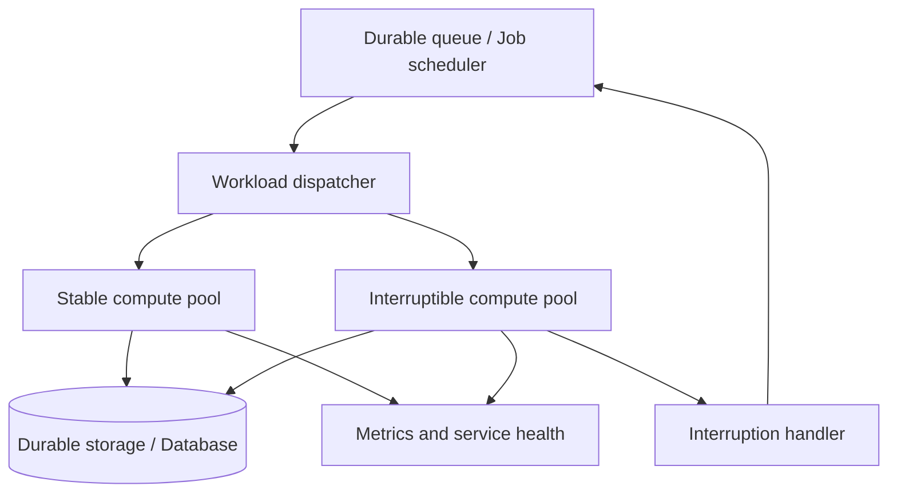

# Combining Stable and Interruptible Capacity

## 1. Why Combine Both Capacity Types?

Cloud compute workloads often have demand that fluctuates over time. An API may need enough machines to serve baseline load and maintain SLOs at all times, whereas a batch-processing system can leverage hundreds of extra VMs or workers when jobs arrive. Relying solely on stable-priced capacity forces organizations to pay for costlier resources across peak windows. Relying solely on interruptible capacity risks losing resources right when the provider needs to reclaim machines.

A hybrid architecture uses **stable capacity** as the foundation guaranteeing minimum service levels and **interruptible capacity** to scale opportunistically. Stable capacity typically comes from on-demand instances, committed capacity reservations, or organization-controlled standby resources. Interruptible capacity typically consists of Spot/Preemptible VMs or nodes offered at lower prices where the provider retains reclamation rights.

The core principle is partitioning workloads by interruption tolerance. Interactive requests, database primaries, or services requiring continuous uptime belong on stable capacity. Batch jobs, stateless workers, rendering, checkpointed data processing, or rerunnable tasks usually fit interruptible capacity. Many systems can run the same workload across both tiers, provided it is clear which portion must always be guaranteed and which portion can fluctuate.

Within the **CLOUD_CORE_SERVICES_COMPUTE** module, this model connects VM, container, and serverless choices with scaling, availability, CPU/memory/network sizing, and operational cost optimization.

After this lesson, learners will be able to:

- Distinguish stable capacity from interruptible capacity.
- Identify which workloads suit Spot/Preemptible compute.
- Calculate baseline capacity, flexible capacity, and required headroom.
- Design checkpoints, retries, queues, and reclamation event handling.
- Combine both capacity types in instance groups, Kubernetes, and batch schedulers.
- Reduce concentration risk by machine type, zone, quota, or time of day.
- Measure actual cost, interruption rate, and completed-work efficiency.

## 2. Two Capacity Categories

### 2.1. Stable Capacity

Stable capacity consists of resources an organization can rely on to meet baseline demand under designed operating conditions. It may be on-demand VMs, actual capacity reservations holding physical slots, or pre-maintained node pools. Reserved Instances or committed-use discounts on some platforms primarily provide pricing discounts; count them as guaranteed capacity only when the specific product and terms explicitly include a capacity commitment.

Common characteristics:

- Higher provisioning and retention reliability compared to interruptible capacity, per service terms.
- Suitable for workloads with strict availability or latency requirements.
- Higher unit cost in some pricing models compared to Spot/Preemptible resources.
- Still susceptible to hardware failures, zone outages, or service incidents; "stable" does not mean immune to failure.

Stable capacity should be sized high enough to sustain core functions if all interruptible capacity disappears. For multi-zone services, calculate the baseline assuming the loss of a zone or fault domain, not just normal operating conditions.

### 2.2. Interruptible Capacity

Interruptible capacity consists of lower-priced or flexibly provisioned resources that the provider can reclaim when balancing capacity. Common names include Spot Instances, Spot VMs, Preemptible VMs, or interruptible nodes.

Characteristics:

- Prices can be substantially lower than regular instance types, though savings vary by machine type, region, time, and provider policy.
- Continuous survival until workload completion is not guaranteed.
- Can be reclaimed due to capacity demand, market shifts, or service policy.
- Advance notice duration, shutdown behavior, and replacement availability vary by provider and product.
- Best suited for tasks that can resume, retry, checkpoint, or finish quickly.

Never assume all Spot/Preemptible VMs share the same warning window or always send warnings. Design around the contract and documentation of the exact service, while tolerating machines disappearing faster than expected.

### 2.3. Comparison

| Criterion | Stable capacity | Interruptible capacity |
|---|---|---|
| Purpose | Guarantee baseline and core services | Supplement capacity at lower cost |
| Lifespan | More predictable, per SLA/service terms | Can be reclaimed anytime per policy |
| Price | Typically higher per unit in some models | Typically lower, though variable and unguaranteed |
| Suitable workloads | Core APIs, databases, control planes, non-interruptible tasks | Batch, stateless workers, rendering, analytics, CI, checkpointed jobs |
| Failure handling | HA, failover, retries, and standard replacement | Requires interruption handling, checkpoints, and capacity fallback |
| Management | Load forecasting, redundancy, availability zones | Diversify machine types/zones, track interruptions and pool capacity |

Stable capacity can still fail; interruptible capacity can still run for long stretches. The difference lies in commitment guarantees and reclamation rights—not that one is always healthy and the other always failing.

## 3. Classifying Workloads Before Selecting Capacity

### 3.1. Workloads That Should Not Depend on Interruptible Capacity

Exercise caution before placing interruptible capacity on:

- Database primaries or sole state-holding nodes.
- Orchestration services, control planes, or cluster management components.
- Synchronous APIs with strict latency/availability SLOs lacking an adequate stable baseline.
- Non-idempotent data writes lacking proper transactions/recovery.
- Systems holding leases, quorums, or leader roles without fencing/failover mechanisms.
- Components that cannot be recreated quickly or lack valid backups/checkpoints.

You can use interruptible capacity for a subset of replicas or auxiliary tasks if the architecture maintains enough stable capacity to keep the service running when those instances are reclaimed.

### 3.2. Suitable Workloads

| Workload | Suitability | Design conditions |
|---|---|---|
| Batch ETL | High | Partitioned, checkpointed, retried, and results persisted durably |
| Image/video rendering | High | Split by frame/tile, write partial outputs, and rerun missing parts |
| CI build/test | High | Stateless runners, artifacts stored off-instance, and jobs re-queueable |
| Distributed training | Medium to high | Framework supports checkpoints, elastic workers, or checkpoint restarts |
| Queue consumers | High | Timely message acks, idempotency, visibility timeouts, and DLQs |
| Stateless web/API | Conditional | Stable baseline covers minimum load; interruptible replicas only supplement |
| Database primary | Low | Use only when engine/architecture has verified fault tolerance and clear policy |
| Development/test | High | Can pause, recreate, and notify users |

### 3.3. Assessing Interruption Tolerance

Before moving a workload to interruptible capacity, answer:

1. Can the work stop mid-execution?
2. Does in-flight state live on the machine or in durable storage?
3. Can it checkpoint and recover on a different machine type?
4. Can tasks rerun without generating duplicate data?
5. Are there deadlines or SLAs where rerunning renders results useless?
6. If all interruptible capacity vanishes, does the stable portion sustain core functionality?
7. Can the system queue work and wait for capacity to return?

If questions regarding state, idempotency, and baseline remain unanswered, do not migrate critical workloads to this model yet.

## 4. Splitting Baseline and Burst Capacity

### 4.1. Determining the Baseline

The baseline is the stable compute required to serve normal load and satisfy service targets. Base it on:

- Normal load and minimum load that must be sustained.
- Availability, latency, and throughput SLOs.
- Capacity required during a single node or zone failure.
- Time needed to provision new capacity.
- Resources needed for health checks, maintenance, and deployments.
- Downstream dependency limits such as databases, caches, networks, and quotas.

Do not size the baseline solely from average CPU utilization. A service might use low CPU yet require multiple replicas for geographic distribution, connection pools, or fault tolerance. A worker may not serve real-time requests yet still need enough baseline to meet queue deadlines.

### 4.2. Calculating Required Capacity

Let:

- $D$: expected compute demand at the evaluated point in time.
- $B$: stable baseline capacity.
- $S$: active interruptible capacity.
- $H$: headroom or required buffer.

Demand coverage can be approximated as:

\[
D \leq B + S
\]

However, to withstand loss of interruptible capacity, the baseline alone must sustain critical load:

\[
D_{critical} + H \leq B
\]

Flexible load can be allocated to interruptible capacity:

\[
D_{flexible} \leq S + B_{spare}
\]

Where $B_{spare}$ is leftover stable capacity after serving critical demand. These formulas are planning models; use consistent capacity units such as vCPUs, worker slots, requests/s, or GPU accelerators.

### 4.3. Baseline and Burst Calculation Example

An image-processing service needs 100 worker slots at peak hours. Of those, 40 slots process high-priority tasks with short deadlines; the remaining 60 slots process tasks that can wait or rerun. Operations keeps 20 additional headroom slots to absorb spikes and partial failures.

A simple plan:

- Stable capacity: 60 slots (40 critical slots + 20 headroom slots).
- Target interruptible capacity: up to 40 supplementary slots when available.
- When interruptible capacity drops to zero, the system still sustains high-priority tasks; flexible tasks stay queued.

You do not need to back all 100 worker slots with stable resources if flexible task deadlines tolerate waiting. Conversely, if every task must finish immediately, raise the baseline or adjust service commitments.

### 4.4. Planning by Reclamation Scenario

Model at least three scenarios:

| Scenario | Interruptible capacity | Desired behavior |
|---|---:|---|
| Normal | Sufficient | Burst workload drains fast; queue stays small |
| Partial reclamation | Partially reduced | Queue grows in a controlled manner; critical workload still served |
| Full reclamation | 0 | Stable baseline preserves core functions; flexible jobs wait or retry |

For multi-zone services, add scenarios for losing a zone or running out of capacity in an instance family. Never assume interruptible capacity in another zone can always be provisioned instantly.

## 5. Architecture for Stable and Interruptible Pools

### 5.1. Separating Pools by Role

A common architecture uses two pools:

- **Stable pool:** runs minimum replicas, orchestration services, high-priority tasks, and components that cannot drop abruptly.
- **Interruptible pool:** accepts stoppable, retryable, or checkpointable workloads; scales up or down with availability and pricing.

Separating pools lets you apply distinct policies, autoscaling, health checks, quotas, and permissions. Still, workloads must share appropriate queues, storage, or service discovery. Never store sole copies of state on interruptible nodes.



### 5.2. Job Classification and Prioritization

The scheduler should tag jobs with metadata:

- Priority or service class.
- Deadline and expected runtime.
- Checkpoint/retry capability.
- CPU, RAM, GPU, disk, and network requirements.
- Eligible pools: stable, interruptible, or both.
- Max retry count and expiration policy.

Critical jobs can be pinned to the stable pool. Flexible jobs can prefer the interruptible pool while allowing fallback to the stable pool if headroom and budget permit. Prevent low-priority jobs from starving stable capacity.

### 5.3. Separating Permissions and Resource Limits

Stable and interruptible pools may need distinct IAM roles, network policies, security groups, or service accounts. Apply least privilege per workload tier. Cap aggregate CPU/RAM/GPU, connections, and concurrency so the interruptible pool cannot overload shared dependencies.

### 5.4. Diversifying Machine Types and Zones

Interruptible capacity may be unavailable in a specific instance family or zone. Improve provisioning odds by:

- Selecting multiple instance types with equivalent performance.
- Supporting multiple CPU/RAM sizes suited to the job.
- Spreading across multiple availability zones if data and networking permit.
- Avoiding tight coupling to a single accelerator model or CPU generation.
- Using capacity-optimized or diversified allocation policies if supported by the service.

Do not diversify to the point of breaking workload performance or compatibility. Verify CPU architecture, instruction sets, GPU drivers, memory, local storage, and network throughput before adding a machine type to the pool.

## 6. Handling Interruption Events

### 6.1. Lifecycle of an Interruption

Providers may emit warnings or metadata indicating an instance is about to be reclaimed. The system should capture events via supported mechanisms, identify affected resources, and initiate graceful handling.

A general flow:

1. Receive interruption notice or detect instance unavailability.
2. Mark the node/worker to stop accepting new jobs.
3. Identify running jobs and checkpoint readiness.
4. Flush required state to durable storage.
5. Finish, checkpoint, or requeue jobs.
6. Close connections, emit telemetry, and leave the pool.
7. Scheduler provisions replacement capacity if needed.

Advance notice is only an opportunity to reduce damage. Never rely entirely on notices always arriving or giving sufficient processing time.

### 6.2. Handling Missing Notices

Instances can drop abruptly due to host failures, network partitions, or reclamation mechanisms with insufficient lead time. Therefore:

- Save checkpoints periodically, not only upon interruption.
- Keep job state and queues off the instance's local disk.
- Use leases or visibility timeouts to detect lost workers.
- Design jobs to be idempotent so they can rerun.
- Enforce bounded retries and dead-letter queues.
- Monitor worker heartbeats and job progress externally.

### 6.3. Graceful Shutdown

Upon receiving a termination signal, workers should stop accepting new jobs, complete or checkpoint running jobs, flush logs/metrics, and close connections. Enforce an overall timeout so shutdown never hangs.

Never attempt to finish a long job if remaining time is insufficient. Checkpoint instead and let the scheduler continue on another worker. For non-checkpointable jobs, stop and restart from scratch if cost and deadlines permit.

### 6.4. Never Rely on Local Ephemeral State

Local SSDs, temporary disks, or instance filesystems can vanish when an instance is reclaimed. Store checkpoints, artifacts, inputs, and job states in object storage, databases, or shared storage with appropriate durability. Local caches can be rebuilt; unique data must never reside exclusively on interruptible machines.

## 7. Checkpointing, Retries, and Idempotency

### 7.1. What Is a Checkpoint?

A checkpoint is a state record sufficient to resume work from a recent point rather than restarting from scratch. Checkpoint contents depend on the workload:

- ETL: completed partitions, offsets, watermarks, and transform state.
- Rendering: completed frames/tiles, render parameters, and output checksums.
- Training: model weights, optimizer state, scheduler state, random seed, and training step.
- Simulation: simulation state, timestep, and required inputs.
- Queue worker: job ID, processing step, and durably stored intermediate results.

Checkpoints need versions, timestamps, checksums, and code/model/schema metadata to verify compatibility.

### 7.2. Choosing a Checkpoint Interval

Checkpointing too often increases I/O, network, and storage costs; checkpointing too rarely loses substantial work upon reclamation. Choose the interval based on acceptable rework time and interruption probability.

If a job runs for hours and a checkpoint takes 30 seconds, checkpointing every 10 minutes makes far more sense than every few seconds. However, if each step generates irreproducible data, checkpoint more frequently or commit per step.

A simple evaluation compares checkpoint cost against expected rework. The optimal model depends on interruption probability, checkpoint write time, restart time, and resource costs.

### 7.3. Atomic Checkpoints

Never overwrite the latest valid checkpoint with an in-progress write. A safe workflow can:

1. Write the new checkpoint to a temporary object/key.
2. Flush and verify checksum/size.
3. Write complete metadata.
4. Update the pointer or manifest to reference the new checkpoint.
5. Only then mark the previous checkpoint eligible for retention expiry.

If a worker dies mid-step, the scheduler can still rely on the previous complete checkpoint.

### 7.4. Idempotency and Deduplication

When a worker is reclaimed, messages can be redelivered. Tasks must be idempotent or use idempotency keys so reruns do not create duplicate transactions. For multi-step processing, persist progress and outputs using appropriate transactions or state machines.

For example, before issuing a payment, check whether the job ID is already completed; use a stable idempotency key across retries. Never generate a fresh key on each retry because the receiving service will treat it as a separate transaction.

### 7.5. Retry Budgets and Dead-Letter Queues

Retries must not be infinite. Configure maximum attempts, exponential backoff, jitter, and deadlines. If a job repeatedly fails due to bad inputs or unavailable dependencies, move it to a dead-letter queue for investigation. Distinguish interruption retries from application bugs to avoid futile reruns.

## 8. Autoscaling and Capacity Allocation

### 8.1. Stable Baseline Does Not Scale Down on Interruptible Surplus

The stable pool must maintain enough minimum capacity for core load. Never shrink the stable baseline simply because the interruptible pool currently has abundant machines; lower-cost machines can be reclaimed simultaneously.

A policy can scale the stable pool based on baseline load or SLOs, while the interruptible pool scales based on flexible backlog up to a pre-calculated cap. When interruptible capacity drops, the scheduler holds jobs in the queue or shifts a subset to stable if headroom remains.

### 8.2. Scaling Out the Interruptible Pool

Scale-out can trigger on queue depth, message age, job count, or CPU. Before adding machines, check quotas, machine types, and zone availability. Never scale beyond downstream dependency limits or cost budgets.

If interruptible capacity is unavailable, keep jobs pending and let the scheduler retry with backoff. Avoid tight high-frequency instance request loops.

### 8.3. Scaling In and Rebalancing

When load drops, prioritize terminating interruptible instances after draining jobs. With instance groups, use lifecycle hooks or termination handlers to handle running jobs. With Kubernetes, cordon nodes and evict movable workloads; however, stateful jobs or local data must checkpoint first.

If the provider emits a rebalance recommendation, treat it as a signal to proactively shift workloads to another pool. Do not wait until the final interruption notice to begin draining.

### 8.4. Capacity Fallback

When interruptible capacity is unavailable or reclaimed, options include:

- Wait in the queue if deadlines allow.
- Shift jobs to the stable pool if capacity and budget remain.
- Switch to other tested instance types/zones.
- Lower concurrency or split jobs into smaller chunks.
- Pause accepting low-priority jobs.
- Reject gracefully if the system cannot meet deadlines.

Fallback must be bounded. If the entire workload shifts onto the stable pool at once, databases, quotas, or budgets can blow past plans. Predefine which portion of load is allowed to fall back.

## 9. Combining in VM Instance Groups

### 9.1. Two Separate Instance Groups

You can create one stable instance group and one separate Spot/Preemptible group. The stable group maintains minimum size; the interruptible group scales from 0 to max based on queue or workload. Separating groups simplifies configuring distinct launch templates, health checks, lifecycles, and allocation strategies.

### 9.2. Mixed Instance Policies

Some platforms support mixed instance groups combining stable and Spot capacity within a single group. Policies can specify ratios or priorities between the two types. Carefully review behavior around Spot shortages, rebalancing, replacement, and scale-in.

When using a mixed group, verify that the stable portion genuinely sustains the baseline under how the policy allocates capacity. A percentage split does not automatically guarantee an exact stable machine count when instance types vary in size.

### 9.3. Diversification

Select multiple compatible instance types and multiple zones to reduce reliance on any single capacity pool. Use allocation strategies that prioritize capacity availability rather than lowest price alone, when supported by the service.

Verify each machine type meets CPU, RAM, network, local disk, and architecture requirements. A cheaper machine with poor performance can lengthen jobs and raise total cost.

### 9.4. Interruption Handling

Use the provider's lifecycle notifications or metadata/event services to receive reclamation warnings. Upon receiving an event, mark the instance to stop accepting new jobs, checkpoint, and exit safely. Run an external watchdog to detect cases where an instance drops without sending an event.

## 10. Combining in Kubernetes

### 10.1. Node Pools by Stability Class

Separate stable and interruptible node pools. Apply labels and taints so the scheduler knows which nodes fit which workloads. Example:

```yaml
apiVersion: v1
kind: Node
metadata:
  name: interruptible-node-01
  labels:
    capacity-class: interruptible
    workload-tier: batch
  annotations:
    example.com/interruption-aware: "true"
spec:
  taints:
    - key: capacity-class
      value: interruptible
      effect: NoSchedule
```

This illustrates the label/taint structure; `Node` objects are normally managed by kubelet/cloud controllers and should not be manually created in production clusters.

Batch Pods can declare tolerations and node affinity to run on the interruptible pool. Critical API Pods should prefer the stable pool or require stable capacity via node affinity/taint policies.

### 10.2. Batch Workload Example

```yaml
apiVersion: apps/v1
kind: Deployment
metadata:
  name: image-worker
spec:
  replicas: 4
  selector:
    matchLabels:
      app: image-worker
  template:
    metadata:
      labels:
        app: image-worker
    spec:
      terminationGracePeriodSeconds: 90
      tolerations:
        - key: capacity-class
          operator: Equal
          value: interruptible
          effect: NoSchedule
      affinity:
        nodeAffinity:
          preferredDuringSchedulingIgnoredDuringExecution:
            - weight: 100
              preference:
                matchExpressions:
                  - key: capacity-class
                    operator: In
                    values: [interruptible]
      containers:
        - name: worker
          image: example.invalid/image-worker:v1
          lifecycle:
            preStop:
              exec:
                command: ["/app/worker", "drain"]
```

This example prefers interruptible nodes; in production, clearly define fallback to the stable pool, how the scheduler handles missing nodes, and how the worker checkpoints on `SIGTERM`. `preStop` is only one part of graceful shutdown; the application must contain logic to stop accepting jobs and save state.

### 10.3. Node Termination Handlers

Kubernetes does not natively understand every cloud provider's interruption events. You may need a node termination handler or controller that ingests events, cordons nodes, drains Pods, and updates status. Exact tooling depends on the platform.

Draining must account for PodDisruptionBudgets, DaemonSets, local storage, and grace periods. PDBs protect against voluntary disruptions within Kubernetes control, but cannot stop providers from abruptly reclaiming nodes or guarantee enough drain time. Therefore, checkpointing and retries remain essential.

### 10.4. Separating Control Plane and Critical Workloads

Never place cluster management components, internal DNS, core ingress, or the sole interruption event handler onto an interruptible pool. If the controller handling events is reclaimed alongside worker nodes, the system may fail to coordinate draining.

## 11. Distributed and GPU Workloads

### 11.1. Splitting Jobs into Independent Units

Split large jobs into independent partitions, shards, frames, or tasks. Each unit has clear IDs, inputs/outputs, and can rerun. The scheduler distributes units across stable and interruptible workers by priority.

If a distributed job requires multiple simultaneous nodes, losing one node can fail the whole job. Use frameworks supporting elastic membership, worker replacement, or full-job checkpointing; otherwise consider running synchronous jobs on stable capacity.

### 11.2. Checkpointing for GPU Training

Training jobs can save model weights, optimizer state, learning rate scheduler, random state, epoch/step, and distributed data positions. Saving only model weights may not suffice to resume equivalent training because optimizer and random states are lost.

Write checkpoints to object storage or shared durable storage, verify checksums, and verify loading across different GPU/driver types. Checkpoint frequency should balance write time against potential lost compute.

### 11.3. Accelerator Capacity

Interruptible GPU capacity can be scarcer than CPU capacity and depends on GPU model, VRAM, interconnects, and zones. Diversification must check CUDA/runtime compatibility, drivers, frameworks, and collective communication requirements.

Never move a job to a different GPU purely because it has the same accelerator count. Performance, VRAM, and topology can differ; benchmark and validate outputs. When GPU capacity is unavailable, jobs should wait or run on stable GPUs if deadlines and budget allow.

## 12. Cost and Economic Efficiency

### 12.1. Cheap Hourly Price Does Not Mean Low Completion Cost

Interruptible VMs may have lower hourly prices, yet interruptions force reruns, add checkpoint/storage overhead, or prolong completion times. Evaluate cost by **completed outcomes**, not hourly compute rates alone.

Items to include:

- Compute hours across stable and interruptible pools.
- Lost work and rerun duration.
- Checkpoint storage, requests, and network transfer.
- Queue delays and missed-deadline costs.
- Stable fallback costs when interruptible capacity is unavailable.
- Operational costs for schedulers, interruption handlers, and observability.

### 12.2. Expected Cost

A simple model:

\[
C_{total} = C_{stable} + C_{interruptible} + C_{checkpoint} + C_{retry} + C_{fallback}
\]

To compare against a stable-only baseline, compute total cost for the same completed work volume and identical deadline targets. If interruptions are too frequent, checkpoints too heavy, or fallback constant, net savings can shrink markedly.

### 12.3. Measuring Efficiency per Workload

Track:

- Job completion rate on interruptible capacity.
- Interruption rate by machine type, zone, and time of day.
- Notice-to-termination lead time when notices exist.
- Rework volume and checkpoint recovery duration.
- Queue age, deadline misses, and completion latency.
- Cost per completed job or processed data unit.
- Fallback rate to the stable pool.

Do not measure Spot hours consumed alone. A cheap pool with high job failure rates may deliver zero economic benefit.

### 12.4. Budgets and Guardrails

Set max size limits, quotas, and budgets on the interruptible pool. Alert when stable fallback rises abnormally or interruptible capacity stays unavailable for extended periods. If workloads are non-urgent, throttle processing speed rather than expanding the stable pool over budget.

## 13. Security, Data, and Operations

### 13.1. Durable Data

Never keep unique data on boot disks or local ephemeral disks of interruptible instances. Use object storage, databases, shared volumes, or queue services with appropriate durability. Separate inputs, checkpoints, and outputs so workers can be rebuilt cleanly.

### 13.2. Identity and Least Privilege

Interruptible workers only need permissions to read inputs, write checkpoints/outputs, and update job status. Do not grant cluster admin permissions or backup deletion rights unnecessarily. Credentials should be short-lived and issued via workload identity.

### 13.3. Networking and Dependencies

Place workers in appropriate subnets and security policies. If jobs can dispatch across multiple zones, ensure paths to storage and queues work across those zones. Factor in cross-zone/region traffic costs and latency when placing compute near data.

### 13.4. Logging and Auditing

Log job ID, instance ID, capacity class, zone, checkpoint version, and interruption events. Never log secrets or sensitive data. When a worker disappears suddenly, external telemetry must identify which jobs need retrying.

## 14. Real-World Examples

### Example 1: Batch ETL Combining Stable and Spot Workers

An ETL pipeline must process 10 TB of data daily. The deadline allows 6 hours. The system keeps 20 stable worker slots to sustain minimum progress and scales up to 80 additional interruptible slots when capacity is available.

**Design:** split data by partition; each partition has durable state; workers write temporary outputs and commit a manifest upon completion. Upon interruption, workers stop claiming new partitions and checkpoint progress. On sudden loss, the scheduler reassigns uncommitted partitions.

**Fallback:** if Spot capacity drops, the 20 stable workers continue processing; remaining backlog waits or drains more slowly. Dashboards track oldest partition age, throughput, interruption rate, and cost per TB.

### Example 2: Stateless API Using Spot for Supplementary Capacity

An API has a baseline of 6 stable VMs, sufficient to hold SLOs under baseline traffic. During campaign traffic spikes, the autoscaler adds up to 10 Spot VMs. The API holds no local machine state and any request can route to another replica.

**Design:** readiness/health checks before taking traffic, connection draining on interruption, and sessions/data stored in shared services. The stable pool still covers priority load if Spot is reclaimed; otherwise the system engages rate limiting or degraded mode.

**Controls:** max Spot replicas are capped by database connection budgets and quotas. Monitor error rates, latency, healthy target counts, and stable capacity headroom.

### Example 3: Checkpointed GPU Training

A training job runs on Spot GPUs for many hours. The framework saves model, optimizer, scheduler, and step to object storage at a tested interval.

**Design:** on notice, the job stops pulling new batches, completes an atomic checkpoint, and exits. Without notice on node loss, the orchestrator restarts from the latest complete checkpoint. Jobs carry run IDs and checkpoint versions to prevent overwriting state across runs.

**Fallback:** when Spot GPUs are scarce, the job waits or shifts to stable GPUs if deadlines allow. Measure average lost work and checkpoint cost to tune cadence.

### Example 4: CI Runners on Interruptible Capacity

A development team uses interruptible runners for builds/tests. Runners hold no unique source or artifacts on local disk; the pipeline can spin up new runners and rerun jobs.

**Design:** jobs are split small, critical artifacts and caches live in shared storage, and tests have timeouts and retry budgets. When a runner is reclaimed, the system marks the job interrupted and re-queues it.

**Controls:** never infinitely retry code-induced test failures; distinguish interruptions from test failures. Track runner wait times, job retries, cost per successful pipeline, and Spot availability rates.

## 15. Common Pitfalls

- **Using interruptible capacity for the core baseline:** the entire service can lose capacity during provider reclamations.
- **Assuming notices always arrive:** instances can vanish without sufficient handling time.
- **Checkpointing only on notice:** sudden failures wipe out all progress since the prior checkpoint.
- **Storing state on local disk:** data vanishes along with the instance.
- **Missing idempotency:** job retries can create duplicate data or transactions.
- **Unbounded retries:** inflate queues, costs, and dependency load.
- **Concentrating on one instance type/zone:** capacity shortages hit when that specific pool dries up.
- **Shifting the entire workload to stable when Spot drops:** blows past quotas, connection limits, and budgets.
- **Treating PDBs as anti-eviction guarantees:** provider disruptions can bypass PDB protections.
- **Failing to separate the control plane from the interruptible pool:** losing event-handling nodes breaks draining workflows.
- **Comparing hourly compute prices only:** omits checkpoints, retries, deadlines, and fallback.
- **Not measuring job completion:** unclear whether savings translate into completed outcomes.

## 16. Implementation Checklist

### Classification and Capacity Planning

- [ ] Workloads are classified by interruption tolerance and deadlines.
- [ ] Stable baseline suffices to sustain core functions when interruptible capacity is 0.
- [ ] Headroom, zone loss, and dependency limits are accounted for.
- [ ] Max interruptible capacity is capped per quotas, network, and budget.
- [ ] Instance types/zones are diversified within compatible bounds.

### Workload Design

- [ ] Jobs can be split, retried, or checkpointed.
- [ ] Inputs, checkpoints, and outputs reside on durable storage.
- [ ] Jobs have stable IDs and idempotent handling.
- [ ] Retries use backoff, jitter, caps, and DLQs.
- [ ] Workers perform graceful shutdown and stop accepting new work when draining.
- [ ] Critical workloads do not depend on the interruptible pool.

### Platform Integration

- [ ] Instance groups / node pools separate stable and interruptible tiers.
- [ ] Interruption events are ingested, with watchdogs for sudden losses.
- [ ] Scheduler supports pending, requeue, fallback, and priority.
- [ ] Limits of PDBs, lifecycle hooks, and termination grace periods are properly understood.
- [ ] Control plane and event handlers run on stable capacity.

### Operations and Cost

- [ ] Interruption rate, checkpoint recovery, and job completion are monitored.
- [ ] Stable headroom, Spot availability, queue age, and fallback rate are monitored.
- [ ] Cost per completed job or unit of work is measured.
- [ ] Partial and total loss of interruptible capacity have been rehearsed.
- [ ] RTO/deadlines and data policies are verified after reruns.
- [ ] Savings are periodically reviewed after accounting for retries, checkpoints, and operations.

## 17. Conclusion

Combining stable capacity with interruptible capacity balances availability and cost. The stable pool guarantees the baseline for core functions; the interruptible pool supplies burst capacity for stoppable, retryable, or checkpointable workloads. Partitioning must rest on SLOs, deadlines, recovery capability, and dependency limits.

Sound design persists state outside instances, checkpoints periodically, handles interruption notices while tolerating sudden machine loss, enforces idempotency, and bounds retries. Diversification, controlled fallback, interruption monitoring, and measuring cost per completed job keep the model operating reliably. Rehearse a total loss of interruptible capacity before relying on it in production.
