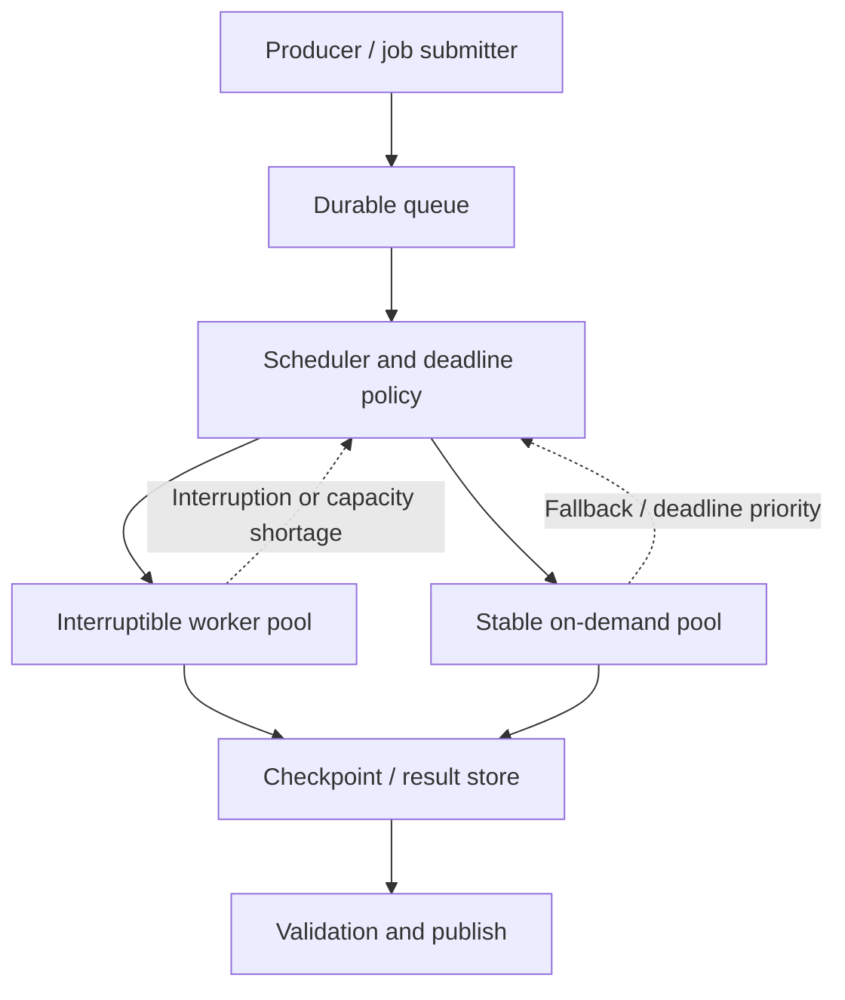

# Evaluating True Cost Accounting for Interruptions and Completion Time

## Learning Objectives

After this lesson, you will be able to:

- Distinguish the hourly rental price of interruptible compute from the total cost to complete one unit of work successfully.
- Identify hidden costs from checkpointing, restarts, lost computation, storage, data transfer, orchestration, and standby capacity.
- Estimate the probability of completing before a deadline and expected completion time when instances can be reclaimed.
- Choose a checkpoint interval aligned with checkpoint creation time and interruption frequency.
- Compare interruptible compute against on-demand by cost per successful job, p95 duration, and on-time completion rate.
- Design a strategy combining stable capacity with lower-cost reclaimable capacity.
- Test cost models using operational telemetry and adjust decisions for real workloads.

## 1. Low Rental Price Does Not Guarantee Low Total Cost

Interruptible compute is compute capacity offered at a lower price or under reclaimable terms. Depending on the provider, the service may be called Spot, Preemptible, or an equivalent name. The provider retains the right to reclaim instances when capacity is needed, when service policies shift, or under published terms.

The hourly price is often attractive, yet a job running on an instance can be interrupted before completion. If the job must restart from scratch, the organization has paid for lost compute time. Even if the job checkpoints, there remain costs for writing checkpoints, restoring state, starting processes, and reprocessing uncommitted data.

Therefore, the right economic question is not merely:

- How much cheaper is one hour of interruptible compute than one hour of on-demand?

It must also be:

- How many actual compute hours are required to finish one job successfully?
- How long does the job take in wall-clock time, including waiting for capacity and retries?
- How much work misses deadlines or must fall back to higher-priced capacity?
- What is the total cost per completed job?

**Cost per successful job** is a useful metric for comparison. An option with a low rental rate that frequently loses progress, retries repeatedly, or misses SLAs can cost more than a stable option.

### Intuitive Example

A task requires 8 hours of useful computation:

- On-demand costs \$0.40/hour and runs continuously for 8 hours.
- Interruptible costs \$0.12/hour, yet the job can be reclaimed, needs checkpointing, and may have to rerun.

Comparing rental rates alone makes interruptible look 70% cheaper. Yet that comparison ignores rerun hours, checkpointing, storage, data transfer, and wait time for new machines. Total resource consumption to achieve the same output must be calculated.

## 2. Defining the Comparison Unit Before Calculating Cost

Two options can only be compared fairly when they produce the same outcome with equivalent quality and constraints.

A unit of work can be:

- A completed ETL job producing the expected output dataset.
- A successfully exported rendered frame.
- A batch of one million processed records.
- A training run reaching a target checkpoint or quality metric.
- A completed CI test suite producing valid artifacts.
- A video transcoding task finished at the required resolution and quality.

Do not compare purely by instance-hours if VM types, CPUs, memory, disk performance, GPUs, or software differ. A cheaper instance may process slower, driving total consumed hours upward.

### 2.1. Normalizing the Workload

Before comparing, fix or record:

- Input data size and contents.
- Application, library, and algorithm versions.
- CPU, RAM, disk, network, and accelerator configurations.
- Worker count, concurrency level, and batch size.
- Output quality criteria.
- Deadlines and priority levels.
- Checkpointing, retry, and resume mechanisms.
- Cache state, preloaded data, and dependencies.

If interruptible compute uses a different instance type than on-demand, benchmark real throughput. Compare cost per completed unit of work rather than hourly rates alone.

## 3. Components of Total Cost

The total cost of an interruptible job generally includes far more components than the VM rate.

| Component | Example | Why it arises |
|---|---|---|
| Compute | Instances, GPUs, accelerators | Charged for runtime, including interrupted runs |
| Lost work | CPU/GPU time from last checkpoint to reclamation | Unsaved computation must be redone |
| Checkpoint | CPU, I/O, and time to write state | Persists progress to resume after interruption |
| Restore/resume | Reading checkpoints, rebuilding processes and caches | Restores state before resuming processing |
| Provisioning/wait | Waiting for capacity, creating VMs, booting, warm-up | Job cannot process yet despite being scheduled |
| Storage | Volumes, object storage, snapshots, logs, artifacts | Holds checkpoints, temporary data, and outputs |
| Data transfer | Reading inputs, copying checkpoints, egress | Moving data across VMs, zones, regions, or services |
| Orchestration | Schedulers, queues, workflow engines, control planes | Managing retries, leases, checkpoints, and job lifecycles |
| Fallback capacity | Shifting to on-demand or another pool | Protecting deadlines when interruptible capacity runs short |
| Idle/overlap | Standby VMs, wait time, two workers running concurrently | Creating redundancy to boost on-time completion odds |
| License/support | Commercial software, OS, or accelerator licenses | May bill per time, core, or instance |
| Operations | Monitoring, logging, alerting, incident handling | Tracking interruptions and coordinating recovery |

Some items are direct cloud charges, while others are opportunity or operational costs. When modeling, state clearly which items hit the cloud bill and which map to internal operational costs.

### 3.1. General Formula

\[
C_{\text{success}} =
\frac{
C_{\text{compute}} +
C_{\text{checkpoint}} +
C_{\text{restore}} +
C_{\text{storage}} +
C_{\text{transfer}} +
C_{\text{orchestration}} +
C_{\text{fallback}} +
C_{\text{other}}
}{
N_{\text{successful jobs}}
}
\]

Where:

- \(C_{\text{success}}\): average cost per successful job.
- \(C_{\text{compute}}\): total compute cost across all runs.
- \(C_{\text{checkpoint}}\): cost of creating checkpoints.
- \(C_{\text{restore}}\): cost of re-initialization and recovery.
- \(C_{\text{fallback}}\): cost of replacement capacity.
- \(N_{\text{successful jobs}}\): count of jobs that complete and pass result validation.

If any jobs fail permanently, their costs remain in the numerator without increasing the denominator. That is why completion rate must be tracked alongside cost.

### 3.2. Cost Per Unit of Work

If jobs vary in size, cost per job can mislead. In that case, use cost per unit of output:

\[
C_{\text{unit}} =
\frac{\text{Total compute and operational cost}}
{\text{Count of valid output units}}
\]

Examples: USD per valid GB of ETL output, per rendered frame, per million records, or per hour of transcoded video. Output units must have clear quality criteria.

## 4. Interruption Probability and Completion Time

An interruptible instance can run for some duration before reclamation. To estimate risk, use the observed interruption rate of the capacity pool.

Let:

- \(\lambda\): average interruption rate per running hour, under an approximate model.
- \(t\): continuous duration the job needs to run.
- \(P(\text{survive } t)\): probability the instance suffers no interruption during that duration.

Assuming interruptions follow a Poisson process with constant hazard, survival probability is:

\[
P(\text{survive } t) = e^{-\lambda t}
\]

Probability of being interrupted at least once is:

\[
P(\text{interrupt before } t) = 1 - e^{-\lambda t}
\]

This model illustrates the effect of runtime and interruption rate, but it is only an approximation. In reality, interruption rates vary by instance type, zone, time of day, market demand, and provider policy. Never treat \(\lambda\) as a fixed constant across every pool or future window.

### 4.1. Example Completion Probability Without Checkpointing

A job needs 4 continuous hours. Historical data shows the pool has an interruption rate of 0.1 per running hour.

\[
P(\text{survive } 4) = e^{-0.1 \times 4} \approx 0.670
\]

Probability of interruption before completion:

\[
1 - 0.670 = 0.330
\]

Under this simple model, roughly 33% of attempts may suffer an interruption before the job finishes. The longer the job, the higher the likelihood of needing to rerun.

Do not use the probability above as an SLA commitment. Examine empirical distributions, sample sizes, times of day, and specific pools.

### 4.2. Expected Completion Time When Restarting from Scratch

For a job without checkpoints, assume each attempt restarts from scratch and interruptions have constant hazard \(\lambda\). Expected completion time under the exponential model is:

\[
E[T] = \frac{e^{\lambda t} - 1}{\lambda}
\]

In the example \(t=4\) hours and \(\lambda=0.1\) per hour:

\[
E[T] = \frac{e^{0.4} - 1}{0.1} \approx 4.92 \text{ hours}
\]

Expected runtime rises from 4 hours of useful compute to roughly 4.92 hours, excluding VM provisioning wait time, booting, data loading, and post-completion validation.

This formula assumes independent attempts, constant interruption rate, and each interruption discarding all progress. If jobs have checkpoints or providers give notice windows, use a more appropriate model.

### 4.3. Completion Time Is Not Just Compute Time

Wall-clock completion time should include:

\[
T_{\text{wall}} =
T_{\text{queue}} +
T_{\text{provision}} +
T_{\text{boot}} +
T_{\text{warm-up}} +
T_{\text{useful work}} +
T_{\text{checkpoint}} +
T_{\text{retry}} +
T_{\text{finalize}}
\]

A job requiring 8 hours of useful compute that waits 30 minutes for a pool, boots in 3 minutes, loads data for 10 minutes, and retries twice can take over 9 hours of wall-clock time.

When workloads have deadlines, measure p50, p95, and p99 percentiles of wall-clock completion time. Averages can hide tail jobs stretched severely by capacity shortages or repeated interruptions.

## 5. Checkpointing Reduces Lost Work

Checkpoints store enough state for a job to resume from a completed point. When an instance is reclaimed, the scheduler can spin up a new worker, load the checkpoint, and continue the remainder.

Checkpoints can contain:

- Processed position or offset.
- Durably written intermediate results.
- Model, optimizer, and random seed state.
- Completed file segments.
- Metadata, versions, and checksums.
- Workflow state or committed steps.

Checkpoints must be stored somewhere that survives VM reclamation, such as object storage or persistent volumes with an independent lifecycle. Storing checkpoints on the instance's local/ephemeral disk prevents recovery if the disk disappears with the VM.

### 5.1. Checkpointing Costs

Checkpoints are not free:

- Writing state consumes I/O and time.
- It may pause or slow down computation.
- Creates objects/files and metadata.
- Consumes storage capacity across retained versions.
- May incur data transfer charges.
- Resuming requires reading, decoding, and restoring state.
- Checkpointing too frequently shrinks the share of useful runtime.

Checkpointing too rarely loses substantial progress upon interruption. Checkpointing too often drives overhead up. Find an interval suited to checkpoint creation time and interruption risk.

### 5.2. Estimating the Checkpoint Interval

An approximate model for a workload with interruption rate \(\lambda\) and checkpoint creation duration \(c\):

\[
O(\tau) \approx \frac{c}{\tau} + \frac{\lambda \tau}{2}
\]

Where:

- \(\tau\): time interval between two checkpoints.
- \(c/\tau\): overhead fraction spent creating checkpoints.
- \(\lambda\tau/2\): expected fraction of work lost to interruptions, assuming interruptions occur uniformly within a checkpoint cycle.

The checkpoint interval minimizing approximate overhead is:

\[
\tau^* \approx \sqrt{\frac{2c}{\lambda}}
\]

This is a simple model to pick a starting point for experimentation, not a guaranteed optimum for every system. It assumes steady hazard, relatively constant checkpoint duration, exact job resumption, and small overhead relative to compute duration.

### 5.3. Example of Choosing a Checkpoint Interval

Suppose:

- Time to create one checkpoint \(c = 2\) minutes, or 0.033 hours.
- Historical interruption rate \(\lambda = 0.08\) per hour.

\[
\tau^* \approx \sqrt{\frac{2 \times 0.033}{0.08}}
\approx 0.91 \text{ hours}
\]

A starting point could be checkpointing roughly every 55 minutes. Then test intervals of 30, 45, 60, and 90 minutes, measuring actual overhead, interruption counts, lost work, and completion time.

If checkpointing takes 10 minutes instead of 2 minutes, the approximate optimal interval lengthens. If the pool suffers more frequent interruptions, shorten the interval. For workloads able to persist state very quickly, more frequent checkpoints can make sense.

### 5.4. Checkpoints Must Be Consistent and Versioned

An inconsistent checkpoint can cause a job to resume incorrectly or corrupt data. You must:

1. Pause or synchronize participating workers at a safe point.
2. Flush required state.
3. Write the checkpoint to durable object/storage.
4. Verify checksums and metadata.
5. Mark the checkpoint complete only after data is durably persisted.
6. Record application, schema, and checkpoint format versions.
7. Retain the prior checkpoint until the new checkpoint is verified.

Never overwrite the last good checkpoint with an incomplete new write. Write to a temporary location, then publish/rename or flip a manifest pointer once data is complete.

## 6. Calculating Actual Cost for a Job

Use a model based on runtime and ancillary charges:

\[
C_{\text{job}} =
H_{\text{compute}} \times R_{\text{hour}}
+ C_{\text{storage}}
+ C_{\text{transfer}}
+ C_{\text{checkpoint}}
+ C_{\text{orchestration}}
+ C_{\text{fallback}}
\]

Where \(H_{\text{compute}}\) is total billed compute hours across all attempts, including lost work. \(R_{\text{hour}}\) is the hourly rate corresponding to the instance type and usage window.

If the service bills per second, minute, provisioned capacity, or another unit, use the actual billing unit. Never assume all providers round hours or meter usage identically.

### 6.1. Cost Per Successful Job

\[
C_{\text{success}} =
\frac{\sum C_{\text{all attempts}} + C_{\text{shared overhead}}}
{N_{\text{completed and validated}}}
\]

Shared overhead such as schedulers, monitoring, or baseline capacity can be allocated by job count, compute time, or usage share. Apply a consistent allocation method when comparing.

If a job fails or outputs fail validation, do not count it as a successful job. If a job finishes past its deadline, track it separately since it may fail to deliver business value.

### 6.2. Cost Per On-Time Successful Job

For deadline-bound workloads, use:

\[
C_{\text{on-time}} =
\frac{\text{Total cost of runs and associated capacity}}
{\text{Count of valid jobs completed before deadline}}
\]

A policy may yield many successful jobs where most miss the deadline. In that scenario, cost per successful job looks good while cost per on-time successful job is very high—or undefined if zero jobs meet the deadline.

## 7. Checkpointed Cost Calculation Example

A batch job needs 8 hours of useful compute. Compare two options:

- On-demand: \$0.40/hour.
- Interruptible: \$0.12/hour.
- Checkpointing takes 2 minutes, performed once per hour.
- Estimated interruption rate is 0.08 per hour.
- Checkpoint storage, transfer, and orchestration costs are estimated separately.

Using the earlier approximate model, overhead from checkpointing and lost work is roughly:

\[
O \approx \frac{0.033}{1} + \frac{0.08 \times 1}{2}
= 0.073
\]

That is roughly 7.3% over useful work under the model's assumptions. Across 8 hours of work, extra time is estimated at ~0.59 hours. Equivalent wall-clock compute is roughly 8.59 hours, excluding queue/provisioning wait and finalization.

| Item | On-demand | Interruptible |
|---|---:|---:|
| Useful compute hours | 8.00 | 8.00 |
| Estimated billed hours | 8.00 | 8.59 |
| Hourly rate | \$0.40 | \$0.12 |
| Compute cost | \$3.20 | \$1.03 |
| Checkpoint storage/transfer/orchestration | \$0.00 in example | \$0.28 |
| Estimated total cost | \$3.20 | \$1.31 |
| Cost savings vs. on-demand | — | Roughly 59% |

This is an illustrative model, not a forecast of provider prices or interruption rates. Ancillary costs for on-demand can also differ; the table assumes them negligible or accounted for separately. If the job is reclaimed more frequently, waits long for capacity, or falls back to on-demand, outcomes can shift markedly.

### 7.1. When Does the Discount Stop Being Attractive?

Suppose the interruptible price is 30% of on-demand. If total billed compute hours rise to 1.8x due to retries and lost work, relative compute cost becomes:

\[
0.30 \times 1.8 = 0.54
\]

Compute itself is still 46% cheaper before ancillary costs. However, if checkpointing, storage, transfer, orchestration, and fallback add 0.6x of the on-demand cost, total relative cost reaches 1.14. At that point, interruptible is more expensive.

What matters is measuring the total cost of completed outcomes, not inferring efficiency from nominal discounts.

## 8. Completion Time and Deadlines

Workloads may accept longer completion times to cut costs, or require finishing before a fixed deadline. These two goals lead to different decisions.

### 8.1. Workloads Without Tight Deadlines

Examples include overnight batch rendering or ETL running within a wide window. Interruptible compute can fit well if:

- Jobs split into small tasks.
- Progress is checkpointed or tasks can rerun.
- Queues hold jobs durably.
- Sufficient time exists to wait for pool capacity.
- Failed tasks do not discard completed results.

For these workloads, cost per successful job may outweigh p50 completion time, though you must still set a maximum time limit to avoid indefinite stalls.

### 8.2. Workloads with Deadlines

Examples include data pipelines that must finish before 06:00 for reporting, or models needed before a release cutoff.

Measure:

- Probability the job finishes before the deadline.
- p95/p99 wall-clock time.
- Capacity wait time.
- Interruption counts.
- Rate of fallback transitions.
- Cost incurred when falling back.

You can use interruptible capacity early in the window, then shift remaining work to on-demand as the deadline nears. This captures savings when capacity is plentiful and protects deadlines as slack shrinks.

### 8.3. Deadline-Aware Fallback

A reference strategy:

1. Start jobs on the interruptible pool.
2. Checkpoint more frequently as the deadline approaches or critical progress grows.
3. Estimate remaining runtime from observed throughput.
4. If remaining time exceeds budget or pools repeatedly reclaim, switch to stable capacity.
5. Preserve idempotency so two workers cannot double-commit outputs.
6. Publish results only after validation.

Never wait until right on top of the deadline to fall back. Reserve enough margin to provision on-demand, restore checkpoints, and finish remaining work.

## 9. Selecting Workloads Suited to Interruptible Compute

| Workload | Suitability | Rationale and conditions |
|---|---|---|
| Partitioned batch ETL | High | Each partition retries independently and persists durable output |
| Frame/tile rendering | High | Completed frames or tiles are kept; remainder reruns |
| CI build/test | High | Jobs can rerun; artifacts stored off-VM |
| Checkpointed ML training | High to medium | Requires model/optimizer checkpoints and tested resume |
| Segmented media transcoding | High | Independent segments; manifest assembled upon completion |
| Stateless queue workers | High | Jobs acked after commit; leases and retries properly designed |
| Stateless APIs with fallback | Medium | Can use supplementary capacity, but must hold a stable baseline |
| Real-time GPU inference | Low to medium | Interruptions impact latency and availability; requires standby pools |
| Database primary | Low | Continuous write state, complex failover and consistency |
| Singleton control plane | Low | Instance loss can disrupt the entire system |
| In-RAM sessions | Low | VM loss drops user state if not externalized |

Suitability does not depend solely on the workload's label. An API can use interruptible nodes if stateless, backed by an on-demand baseline, and fast to replace; a batch job may be unsuitable if it mutates non-rollbackable data directly.

## 10. Splitting Jobs to Reduce Risk

A 12-hour job can lose significant progress when interrupted. Splitting it into 120 six-minute tasks—each with independent outputs—means the scheduler only needs to retry incomplete tasks.

Task design should:

- Have well-defined inputs and outputs.
- Carry a unique ID.
- Rerun without creating duplicate side effects.
- Persist results durably before marking complete.
- Enforce timeouts and retry limits.
- Run on a different instance type or pool if needed.
- Record metadata tracking which tasks finished.

### 10.1. Task Granularity

Tasks that are too large lose too much progress upon interruption. Tasks that are too small inflate scheduling, queuing, startup, and metadata overhead.

Choose task size by measuring:

- Average and p95 processing duration.
- Startup overhead per task.
- Checkpoint/commit cost.
- Pool interruption rate.
- Parallelism potential.
- Overall deadline.

For example, if startup takes 20 seconds and processing takes 10 seconds, overhead dominates. If a task runs 6 hours without checkpoints, rework risk is high. Benchmark several sizes to find the balance.

### 10.2. Queues Do Not Provide Exactly-Once Automatically

Queues typically provide at-least-once delivery or equivalent semantics. A worker can be reclaimed after writing output but before acknowledging the message. When redelivered, the task may execute again.

Use:

- Per-job/task idempotency keys.
- Conditional writes or unique constraints.
- Leases/visibility timeouts sized to processing duration.
- Fencing tokens or generation numbers when workers can overlap.
- Staging temporary outputs with atomic publish steps.
- Acknowledging only after results are durable.

Never rely on VM memory to know whether a task completed.

## 11. Diversifying Capacity Pools

An interruptible pool can run low on capacity or see rising interruption rates. Relying on a single instance type in one zone exposes workloads whenever that pool becomes unavailable.

Diversify across:

- Multiple instance families with equivalent performance.
- Multiple VM sizes.
- Multiple permitted zones or regions.
- Multiple pools/market segments if supported by the provider.
- Compatible CPU architectures.
- On-demand or reserved fallback capacity.

Verify application compatibility across all pools: CPU instruction sets, RAM, GPUs, local storage, network performance, drivers, and licensing.

### 11.1. Never Pick Only the Lowest-Priced Pool

The cheapest pool may have scarce capacity or high interruption rates. A slightly pricier yet steadier pool can finish jobs faster and cheaper per outcome.

Pool ranking should weigh:

- Live price at execution time.
- Provisioning fulfillment rate.
- Provisioning wait time.
- Historical interruption rate.
- Job completion time.
- Data transfer and checkpoint costs.
- Fallback rate.
- Hardware compatibility and performance.

Do not infer interruption probability solely from spot price. Lower prices and reclamation risk both relate to supply and demand, yet they are not identical quantities.

## 12. Combining Interruptible and Stable Capacity

A practical architecture often uses multiple capacity tiers:

- **Base capacity:** on-demand or reserved to guarantee minimum load.
- **Burst capacity:** interruptible to handle flexible load.
- **Fallback capacity:** on-demand or alternate pools when interruptible falls short.
- **Queue:** absorbs bursts and decouples submission time from execution time.
- **Checkpoint store:** persists state independently of VM lifecycles.
- **Scheduler:** selects pools, handles retries, and enforces deadlines.

Reference diagram:

The scheduler must prevent two workers from writing final results for the same task simultaneously. Use leases, fencing tokens, and conditional commits. During fallback transitions, the old worker may not have received an interruption notice or may be in an indeterminate state; protect data with idempotency.

### 12.1. Fallback Rules

Shift to the stable pool when:

- Remaining time is less than the remaining budget.
- Interruption counts exceed a threshold.
- Capacity cannot be acquired within max wait time.
- Pool interruption rate spikes sharply.
- Checkpoints fail to restore.
- Jobs are high-priority or cannot tolerate delays.

Design fallback ahead of time with quotas and standby capacity. If every job switches to on-demand simultaneously during a spot crunch, the system can hit quotas or exceed planned spend.

## 13. Measuring Interruptions and Cost from Telemetry

To build an accurate model, every job needs an ID and timestamps:

- Submitted time.
- Queue wait start/end.
- Provision request and instance ready.
- Job start, checkpoint start/end.
- Interruption notice or termination event.
- Resume start/end.
- Job success/failure.
- Output validation and publish.
- Fallback decision.

### 13.1. Metrics to Collect

| Category | Metric | Purpose |
|---|---|---|
| Capacity | Provision success rate, queue wait, instance startup time | Measure ability to acquire machines |
| Interruption | Count, rate by pool/type/zone, instance lifespan | Estimate reclamation risk |
| Progress | Useful work, checkpoint age, lost work duration | Measure lost work |
| Recovery | Resume duration, retry count, restore failures | Measure recovery cost |
| Completion | Success rate, p50/p95/p99 wall time, deadline misses | Measure outcomes and timing |
| Cost | Compute, storage, transfer, orchestration, fallback | Calculate total cost |
| Efficiency | Cost per successful job/unit, cost per on-time job | Compare strategies |
| Quality | Validation failures, duplicate outputs, data corruption | Ensure valid outputs |

### 13.2. Measuring Interruption Rate Properly

Do not count reclaimed instances alone. You need the denominator of total actual running instance-hours in the same pool over the same window:

\[
\lambda_{\text{observed}} =
\frac{\text{Number of interruptions}}
{\text{Total observed instance-hours}}
\]

This is the interruption rate per instance-hour under the team's measurement definition. If a pool spans multiple VM types or zones, segment the data. A small pool with few samples can exhibit highly volatile rates.

Record exact event types: provider interruption, instance crash, application bug, network outage, user termination, or quota exhaustion. Never lump every VM stop into provider interruptions.

### 13.3. Tracking Cost by Pool and Job

Attach tags or labels:

- Job ID and workflow ID.
- Pool name, instance family, and zone.
- Interruptible/on-demand.
- Checkpoint version.
- Team, project, and cost center.
- Retry attempt and fallback reason.

This lets you attribute cost per job and identify top-performing pools. Avoid placing sensitive data or user info inside tags.

## 14. Testing Cost Models and Recovery Capability

Never drop historical pricing and interruption rates straight into a plan without testing. Test how the application behaves under reclamation.

### 14.1. Test Scenarios

- Job finishes normally with zero interruptions.
- Interruption right after starting.
- Interruption right before checkpointing.
- Interruption right after checkpointing.
- Corrupted or incomplete checkpoint write.
- Sudden instance loss with no notice.
- Inability to provision new instances for a window.
- Simultaneous reclamation of multiple workers.
- Queue redelivering the same task twice.
- Fallback to on-demand as a deadline nears.
- Restoring checkpoints onto a different instance type.
- Job exceeding retry limits.

### 14.2. Fault Injection

Intentionally terminate test instances or send scripted shutdown signals to simulate interruptions. If the provider emits interruption notices, verify the application receives and handles them; also test zero-notice termination.

Measure:

- Time from notice to checkpoint completion.
- Checkpoint success rate.
- Work lost on abrupt stop.
- Resume duration.
- Count of duplicate task executions.
- Final completion rate.
- Total cost per outcome.

Never inject faults into production workloads without an approved plan, blast-radius bounds, and abort criteria.

### 14.3. Comparing Multiple Strategies

Run the same workload under:

1. On-demand without checkpoints.
2. Interruptible without checkpoints.
3. Interruptible with multiple checkpoint intervals.
4. Interruptible combined with fallback.
5. Job split into small tasks.
6. Multiple diversified interruptible pools.

Compare on identical inputs, output quality, and deadlines. Record cost, p50/p95 completion time, success rate, deadline misses, and lost work.

## 15. Real-World Example: Overnight ETL Pipeline

An ETL pipeline must process 12 TB of data before 06:00. Work is split into 240 independent partitions. Outputs write to object storage and are published after validation.

Operations tests two strategies:

**Strategy A: on-demand only**

- Stable capacity with minimal interruptions.
- More predictable completion times.
- Compute billed at on-demand rates.
- Few interruption-driven retries, though application errors still require handling.

**Strategy B: interruptible with fallback**

- Scheduler dispatches most partitions to the interruptible pool.
- Each partition maintains durable state and an idempotency key.
- Workers acknowledge only after outputs are written and verified.
- If an instance is reclaimed, partitions return to the queue.
- As 06:00 approaches, unfinished partitions shift to on-demand.
- Outputs publish only after all partitions complete and pass global validation.

The team measures cost per successful partition, total pipeline cost, p95 duration, retry count, lost work, and fallback share. If interruptible cuts compute spend yet delays too many partitions, Strategy B may miss reporting requirements. In that case, raise base capacity, trigger fallback earlier, or adjust partition sizing.

## 16. Risks That Distort Cost Models

- **Time-varying interruption rates:** historical data does not guarantee identical future rates.
- **Unavailable capacity:** jobs can stall in queues despite low prices.
- **Diversified pools with differing performance:** runtime hours cannot be compared directly.
- **Overly large checkpoints:** read/write time can consume a major share of job runtime.
- **Inconsistent checkpoints:** resuming can corrupt outputs or lose data.
- **Retry storms:** many jobs retrying together spike storage, queue, and dependency load.
- **Mass fallback:** on-demand spend can surge abruptly or hit quotas.
- **Data transfer:** large checkpoints and inputs can drive network fees past compute savings.
- **Licensing constraints:** software may bill per core/instance despite cheap compute.
- **Deadline misses:** a successful job that finishes too late may hold zero business value.
- **Billing granularity:** start/stop metering and rounding vary by service.
- **Management overhead:** high interruption churn creates real operational effort.

## 17. Decision Workflow

Follow this workflow for each workload:

1. Define successful outcomes and deadlines.
2. Measure useful runtime, p95 latency, and variance.
3. Determine whether jobs can split, checkpoint, or resume.
4. Confirm durable data and outputs live outside VM lifecycles.
5. Gather pricing, capacity availability, and interruption history per pool.
6. Estimate lost work, retries, checkpoints, storage, and transfer.
7. Calculate cost per successful job and cost per on-time job.
8. Compare against on-demand at identical quality and deadlines.
9. Design base capacity, interruptible burst, and fallback.
10. Run fault injection and load tests.
11. Cap retries, capacity wait times, and maximum spend.
12. Roll out in phases, monitor, and update the model.

### 17.1. Decision Matrix

| Workload condition | Recommended path |
|---|---|
| Short, independent jobs with cheap retries | Prioritize testing interruptible |
| Long jobs with fast checkpoints and reliable resume | Interruptible with checkpoints |
| Long, non-checkpointable jobs with wide deadlines | Use only if interruption risk and expected cost remain acceptable |
| Long, non-checkpointable jobs with tight deadlines | On-demand or hybrid with stable capacity |
| Real-time workloads needing steady latency | Maintain stable capacity; use interruptible for non-essential parts if viable |
| Highly volatile interruptible capacity | Diversify pools and add fallback |
| High checkpoint/transfer costs | Re-benchmark or adjust task granularity |
| Outputs with hard-to-reverse side effects | Require idempotency, transactional commits, and retry controls first |

## 18. Practical Cost Evaluation Checklist

### Before Selecting Pools

- [ ] Defined successful job completion and output quality.
- [ ] Defined deadlines and acceptable lateness.
- [ ] Measured useful compute time and wall-clock completion.
- [ ] Verified retry, checkpoint, and resume capabilities.
- [ ] Confirmed durable data resides outside VMs.
- [ ] Gathered pricing and interruption history by instance family/zone.
- [ ] Checked capacity availability, quotas, and fallback.
- [ ] Calculated storage, transfer, licensing, and orchestration costs.

### During Job Design

- [ ] Split jobs into smaller tasks where appropriate.
- [ ] Chose checkpoint intervals based on write duration and interruption rate.
- [ ] Versioned checkpoints and verified checksums.
- [ ] Used idempotency keys and safe output commits.
- [ ] Set retry limits, backoff, and deadlines.
- [ ] Never acknowledge jobs before results are durably stored.
- [ ] Ensured resume works across compatible instance types.

### During Operations

- [ ] Track interruption rates per pool.
- [ ] Measure queue wait, provisioning, boot, and warm-up times.
- [ ] Record lost work and resume duration.
- [ ] Track success rates, p95/p99 durations, and deadline misses.
- [ ] Compute cost per successful job and cost per on-time job.
- [ ] Track fallback rate and induced spend.
- [ ] Test abrupt interruptions and failed checkpoints.
- [ ] Revisit the model whenever pricing, pools, or workloads shift.

## 19. Self-Check

**Scenario 1:** An interruptible instance is 70% cheaper than on-demand, yet jobs typically rerun 1.8x. Is looking at the hourly price alone enough to conclude savings?

**Hint:** No. Multiply the price by total billed compute hours, then add checkpointing, storage, transfer, orchestration, and fallback. Compare cost per successful job.

**Scenario 2:** A job runs 6 hours without checkpoints. The pool's interruption rate rises during peak demand. What risk must be evaluated?

**Hint:** Probability of uninterrupted completion drops as runtime lengthens and hazard rises. Consider splitting tasks, checkpointing, or stable capacity.

**Scenario 3:** Checkpointing takes 8 minutes yet runs every 5 minutes. What can happen?

**Hint:** Checkpoint overhead can exceed useful compute time. Measure real write durations and pick an interval aligned with interruption risk.

**Scenario 4:** A worker finishes writing outputs but is reclaimed before acknowledging the queue. The message redelivers and another worker runs it again. What mechanisms are needed?

**Hint:** Idempotency keys, conditional commits, or unique constraints so reruns do not create duplicate outputs; acknowledge only after state is durable.

**Scenario 5:** Interruptible compute has a low cost per successful job, yet p95 completion time exceeds the deadline. Should you choose it?

**Hint:** No, if the deadline is a hard requirement. Increase the stable baseline, trigger fallback earlier, or use on-demand for deadline-bound work.

**Scenario 6:** One pool offers the lowest price yet has long VM provisioning wait times and high interruption rates. How do you compare it against a pricier pool?

**Hint:** Compare completion times, on-time probability, lost work, retries, fallback, and total cost per identical output unit. Lowest price does not equal highest efficiency.

## Conclusion

Evaluating interruptible compute must rest on the cost to produce a valid outcome and realistic completion times. Account for lost compute, checkpointing, resuming, storage, transfer, orchestration, and fallback; use interruption history to estimate risk without treating it as a future guarantee. Short, independent, or checkpointed jobs generally fit better; tight-deadline workloads or hard-to-recover state require stable capacity or hybrid strategies. Validate decisions via fault injection and by measuring p95/p99 completion times, success rates, and cost per successful job across each pool.
