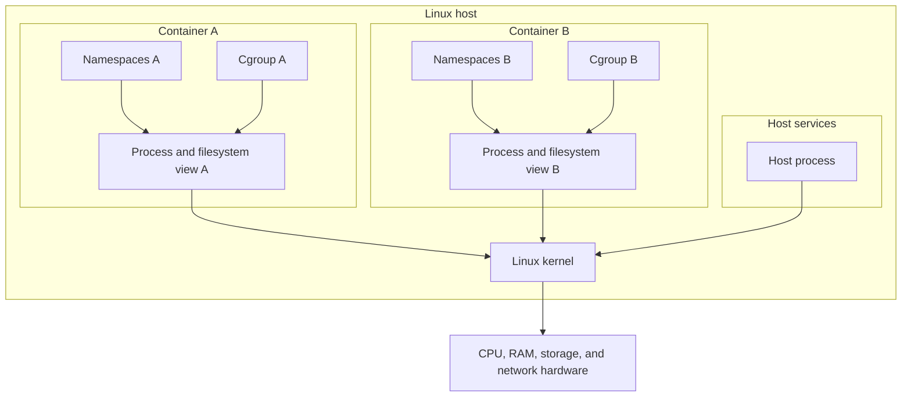

# Namespaces, Cgroups, and Host Isolation Boundaries

## Learning Objectives

After this lesson, you will be able to:

- Explain how Linux namespaces isolate views of processes, networking, filesystems, users, and system resources.
- Distinguish namespaces from cgroups: namespaces control what processes can see; cgroups group processes to meter and control resource usage.
- Identify common namespaces and the role of each type.
- Read the cgroup v2 structure and understand limits for CPU, memory, processes, and I/O.
- Inspect a container's namespaces and cgroups on Linux.
- Understand what containers isolate and what they still share with the host.
- Combine namespaces, cgroups, Linux capabilities, seccomp, LSMs, and user namespaces to strengthen security.
- Assess the risks of privileged containers, host mounts, and administrative socket access.
- Distinguish container isolation levels from virtual machines and sandboxed runtimes.

## 1. How Do Containers Isolate Processes?

A container is a way to package and run an application along with its dependencies in an environment with controlled resource boundaries and access permissions. On Linux, standard containers do not boot their own kernel. Processes inside a container still use the host kernel, while the kernel provides mechanisms to restrict their visibility, resources, and privileges.

The two foundational mechanisms are:

- **Namespaces:** create separate views for a group of processes, such as process lists, hostnames, network interfaces, mount points, or user IDs.
- **Cgroups (control groups):** group processes to monitor and enforce limits or weights on CPU, RAM, I/O, process counts, and several other resources.

Conceptually:

- Namespaces answer: "What can this process see?"
- Cgroups answer: "How many resources may this group of processes use, and how much is it consuming?"

These two mechanisms work together to form a container environment. They do not replace all other security layers. The runtime can also configure mounts, capabilities, seccomp, Linux Security Modules (LSMs), user namespaces, and device policies.

### 1.1. High-Level Model



Containers have separate namespaces and cgroups, yet they still issue system calls to the same host kernel. If the kernel has a critical vulnerability or is exploited, multiple containers and the host can be affected together. This is a key distinction between standard containers and VMs that run their own guest kernel.

### 1.2. A Container Is Not a Lightweight Virtual Machine

| Characteristic | Standard Linux Container | Virtual Machine |
|---|---|---|
| Kernel | Shares the host kernel | Has its own guest kernel |
| Startup | Typically fast, mainly starting processes | Must boot a guest operating system |
| Process isolation | Namespaces and kernel mechanisms | Hypervisor and guest kernel |
| Resource limits | Cgroups and host/orchestrator policies | Virtual vCPU, RAM, disk, and network |
| Inner OS | Image user space must be compatible with host kernel | Can run a separate guest OS kernel |
| Deployment density | Typically high | Typically incurs additional overhead per guest OS |
| Security boundary | Shared kernel; requires runtime hardening | Separate hypervisor/VM boundary; still requires guest and hypervisor hardening |

Containers are well-suited for packaging and deploying applications consistently. VMs provide a separate kernel boundary and support different operating systems or kernels. A system can run containers inside VMs to combine both isolation approaches.

## 2. What Is a Linux Namespace?

A namespace is a kernel mechanism that creates an isolated scope of visibility for processes. Processes in the same namespace see a shared set of resources or identifiers; processes in another namespace can have a different view.

When a runtime creates a container, it can create one or more new namespaces and place the application processes inside them. Some namespaces can be shared across multiple containers; for example, containers in the same Kubernetes Pod typically share a network namespace.

Common Linux namespace types:

| Namespace | What view does it isolate? | Example |
|---|---|---|
| PID | Process IDs and the process tree | Processes inside a container have their own PID 1 |
| Mount (mnt) | Mount points and filesystem view | Container has its own root filesystem |
| Network (net) | Network devices, routes, sockets, ports, and firewall context | Container has its own interfaces and IP |
| UTS | Hostname and domain name | Container has its own hostname |
| IPC | System V IPC and POSIX message queues | Restricts IPC sharing across groups |
| User | User IDs and group IDs | UID 0 inside the container can map to an unprivileged UID on the host |
| Cgroup | View of cgroup paths | Processes can see a restricted cgroup tree |
| Time | Certain system clocks | Can adjust clock offsets in supported namespaces |

The cgroup namespace does not replace cgroup controllers. It primarily isolates the view of the cgroup structure; enforcing CPU or RAM limits is still performed by the cgroup hierarchy and controllers.

### 2.1. PID Namespace

A PID namespace creates an isolated process tree. The first process in a PID namespace typically sees PID 1 and acts as the container's init process. Other processes in the namespace are numbered relative to that namespace.

Example:

- On the host, the application process has PID 24870.
- Inside the container, the same process may be shown as PID 1.
- Processes in container A cannot by default see all processes of container B through their separate PID namespace view.

PID 1 inside a container is responsible for handling signals and reaping orphaned child processes. If an application runs directly as PID 1 without proper signal handling and child reaping, shutdown may be unclean. Many images use a minimal init or an appropriate runtime to handle this role.

A PID namespace does not prevent a host administrator from observing processes. The host has a broader view and can inspect processes with system tools.

### 2.2. Mount Namespace

A mount namespace provides a dedicated mount table for a group of processes. The runtime typically sets up the container's root filesystem, mounts required directories, and limits which paths are visible.

Related concepts:

- **Root filesystem:** the directory tree that container processes see as `/`.
- **Bind mount:** attaches a path from the host into the container.
- **Volume:** a data area managed independently of the container lifecycle.
- **Mount propagation:** specifies whether mount/unmount events propagate across mount namespaces.
- **Read-only mount:** allows reads while preventing writes through that mount.

A mount namespace does not automatically guarantee data safety. Mounting `/var/run/docker.sock`, a directory containing secrets, or the entire host filesystem into a container with write permissions can give container processes significant influence over the host. Mount permissions and scope are part of the security boundary.

### 2.3. Network Namespace

A network namespace can have:

- Its own network interfaces.
- Its own IP addresses and routes.
- Its own socket and port tables.
- Its own firewall/network stack rules within supported scope.
- Its own loopback interface.

A container can use a veth pair to connect its network namespace to a host bridge or network device. The runtime or CNI plugin configures addresses, routes, NAT, and policies.

Port 8080 can be used simultaneously by multiple containers if they reside in separate network namespaces. However, when publishing ports onto the same host address/port, conflicts must be avoided and access policies controlled.

A network namespace does not automatically encrypt traffic or authenticate peers. Firewalls, network policies, TLS, and proper identity mechanisms are still required.

### 2.4. User Namespace

A user namespace maps UIDs/GIDs inside the namespace to UIDs/GIDs on the host. This allows a process to run with UID 0 inside the container while being mapped to an unprivileged UID on the host, if the runtime configures user namespace mapping.

Benefits:

- Reduces impact if a container process is compromised as root inside its namespace.
- Separates user identities between the container and the host.
- Enables rootless container runtimes.

Note that a user namespace does not eliminate all risks by itself. Mounts, capabilities, system calls, and shared resources still need to be restricted. Certain kernel features or volumes may have limitations when user namespace/rootless mode is enabled.

### 2.5. UTS, IPC, and Time Namespaces

- UTS namespaces allow setting a distinct hostname so applications can identify their environment.
- IPC namespaces isolate certain inter-process communication mechanisms such as System V IPC and POSIX message queues.
- Time namespaces support offsets for certain clocks; they do not create an independent hardware clock and do not mean every time-related operation is isolated from the host.

These namespaces are mentioned less often than PID, mount, and network, but they can matter for legacy applications or environments needing strict identity and IPC controls.

## 3. What Is a Cgroup?

A cgroup is a Linux kernel mechanism for organizing processes into groups whose resource consumption can be metered and controlled. Cgroups support hierarchies: a parent group can contain child groups, and limits at the parent level constrain the aggregate resources available to its children.

Example:

- One cgroup for the entire API service.
- Child cgroups for individual containers.
- Separate cgroups for databases, agents, and logging systems.
- A parent cgroup setting an overall limit so workloads cannot exhaust host resources.

Cgroups are typically managed by the runtime and system managers such as systemd. Operators rarely need to write cgroup files manually in production; Docker, Podman, containerd, Kubernetes, and systemd typically configure them.

### 3.1. Cgroup v1 and v2

Linux previously used cgroup v1 with multiple separate hierarchies/controllers. Cgroup v2 provides a unified hierarchy and a more consistent controller interface.

| Aspect | Cgroup v1 | Cgroup v2 |
|---|---|---|
| Hierarchy | Can have multiple hierarchies | Single unified hierarchy |
| Controllers | Can attach to different hierarchies | Controllers are enabled and distributed down a unified tree |
| Interface | Many differing filenames and semantics | More consistent interface |
| Delegation | Can be complex | Clearer delegation rules |
| Adoption | Legacy systems or compatibility setups | Standard across modern Linux distros and platforms |

Do not assume every host already uses cgroup v2. Check the cgroup filesystem and kernel configuration before running commands or reading metrics. Some environments still run hybrid or v1 mode for compatibility.

### 3.2. Cgroup Hierarchy

A cgroup v2 tree might look like:

```text
/sys/fs/cgroup/
├── system.slice/
│   ├── docker-<container-a>.scope/
│   └── containerd.service/
├── user.slice/
└── workload.slice/
    ├── api.service/
    │   ├── container-a/
    │   └── container-b/
    └── worker.service/
        └── worker-1/
```

Actual paths depend on systemd, the runtime, and the deployment setup. In cgroup v2, `cgroup.controllers` indicates which controllers are available at that level; `cgroup.subtree_control` controls which controllers are delegated to child groups according to hierarchy rules.

Do not manually edit controller files on a running production host without understanding parent/child structure, delegation permissions, and effects on the service manager. Prefer configuring them through the runtime or orchestrator.

## 4. Which Resources Do Cgroups Control?

Common controllers in cgroup v2:

| Controller | Resource | Common files/metrics |
|---|---|---|
| cpu | CPU time, weight, and quota | `cpu.weight`, `cpu.max`, `cpu.stat` |
| cpuset | Allowed CPUs and NUMA nodes | `cpuset.cpus`, `cpuset.mems` |
| memory | Memory and swap | `memory.current`, `memory.high`, `memory.max`, `memory.events` |
| io | Per-device I/O limits and weights | `io.weight`, `io.max`, `io.stat` |
| pids | Number of processes/tasks | `pids.current`, `pids.max`, `pids.events` |
| hugetlb | HugeTLB pages | `hugetlb.*` |
| rdma | RDMA resources if kernel/device supports them | `rdma.*` |
| misc | Miscellaneous kernel-supported resources | `misc.*` |

Available filenames and controllers depend on the kernel. Not every system enables every controller.

### 4.1. CPU: Weight and Quota

Cgroup v2 has two key concepts:

- `cpu.weight`: relative weight when groups contend for CPU. A higher weight gives a group a larger share of CPU during contention; it is not an absolute cap.
- `cpu.max`: CPU quota within a period. Typically formatted as `MAX PERIOD` in microseconds; the value `max` indicates no quota at that level.

Example:

```text
cpu.weight = 200
cpu.max    = 50000 100000
```

This illustrative `cpu.max` value sets a 50,000 µs quota per 100,000 µs period, equivalent to roughly 0.5 CPU on average over the period. This is a quota limit, not pinning the process to half of a specific core.

Distinguish between:

- CPU weight affects relative sharing under contention.
- CPU quota caps total CPU time within a period.
- CPU affinity/cpuset specifies which CPUs a process may run on.
- CPU usage measures how much CPU has been consumed.

A container with too low a CPU limit can experience throttling. Low observed average CPU utilization does not always mean the application has spare capacity; the quota may be exhausted in short bursts, increasing latency.

### 4.2. Memory: current, high, and max

Common files:

- `memory.current`: amount of memory currently charged to the cgroup.
- `memory.high`: pressure threshold; exceeding it can cause the kernel to throttle and reclaim more aggressively.
- `memory.max`: hard limit of the memory cgroup.
- `memory.events`: event counters such as `high`, `max`, `oom`, and `oom_kill`.
- `memory.stat`: memory breakdown by type.
- `memory.swap.max`: separate swap limit in cgroup v2 if supported by the controller and configuration.

`memory.max` is not the same as a runtime's heap limit. For example, a Java heap might be configured at 2 GiB while the container memory limit is 2 GiB; native memory, thread stacks, direct buffers, and page cache still require additional RAM. When total memory exceeds the limit, the kernel may invoke OOM handling and kill processes in the cgroup according to policy.

Monitor `memory.current`, `memory.events`, OOM kills, and memory pressure alongside application metrics. Do not check a single process's RSS alone and assume the whole container has enough RAM.

### 4.3. I/O: Weight and Max

The cgroup v2 `io` controller supports:

- `io.weight`: relative weight among I/O groups when supported by the device and scheduler.
- `io.max`: read/write bytes per second or IOPS limits by device `major:minor`.
- `io.stat`: per-device I/O statistics.

Cgroup I/O limits can help when one container generates heavy disk load and impacts other workloads. However, enforcement depends on the device type, kernel, block layer, and storage backend. With network block storage or specialized filesystems, verify actual behavior rather than assuming every limit applies uniformly.

### 4.4. PIDs Controller

`pids.max` caps the number of tasks/processes in a cgroup. It prevents a container from spawning excessive processes or threads and exhausting host resources.

When the limit is reached, creating new processes or threads can fail. Applications may exhibit fork errors, thread creation failures, or workers failing to start. Check `pids.current`, `pids.max`, and `pids.events` when investigating.

## 5. Namespaces and Cgroups Complement Each Other

Namespaces and cgroups solve two different problems:

| Question | Namespace | Cgroup |
|---|---|---|
| Which processes does the container see? | PID namespace | Does not govern PID visibility |
| Which interfaces and routes does the container see? | Network namespace | Can meter/limit related resources, does not create a network view |
| Which filesystem does the container see? | Mount namespace and mount policy | Can limit I/O, does not determine the directory tree |
| How much CPU does the container use? | Not its primary role | CPU controller |
| How much RAM does the container use? | Not its primary role | Memory controller |
| How many processes at most can the container create? | PID namespace isolates visibility | PIDs controller enforces the limit |
| Which host UID does container root map to? | User namespace | Does not map user identity |

For example, a container has its own PID namespace and therefore sees only its own processes. At the same time, its cgroup caps CPU at 2 CPUs and RAM at 1 GiB. Namespaces do not enforce CPU limits; cgroups do not create isolated process lists.

### 5.1. Neither Is a Complete Security Boundary

Namespaces and cgroups are essential primitives, but a secure container also requires:

- Running with an unprivileged user whenever possible.
- Appropriate user namespace/rootless mode.
- Dropping unnecessary Linux capabilities.
- A seccomp profile restricting system calls.
- An LSM such as SELinux or AppArmor.
- A read-only root filesystem where appropriate.
- Restricting mounts and devices.
- Avoiding arbitrary host namespace sharing.
- Restricting networking and secrets.
- Keeping the kernel, runtime, and images updated.

Cgroups primarily manage resources; they do not prevent a process from accessing data if filesystem permissions or capabilities allow it. Namespaces isolate visibility; they do not authenticate or encrypt data on their own.

## 6. Isolation Boundaries Between Container and Host

A standard container shares the kernel with the host. Therefore, the effective boundary is formed by multiple layers:

1. **Process view:** PID namespace and other namespaces.
2. **Filesystem view:** mount namespace, root filesystem, bind mounts, and volumes.
3. **Identity:** user namespace, UID/GID, Linux capabilities.
4. **System calls:** seccomp filters and LSM policies.
5. **Resource control:** cgroups.
6. **Network:** network namespace, firewall, routing, and network policies.
7. **Runtime/orchestrator:** container configuration, administrative permissions, and lifecycle.
8. **Host:** kernel, drivers, runtime, daemons, devices, and administrative data.

### 6.1. How Much of the Host Can a Container See?

Visibility depends on configuration. A default container may not see host processes due to its PID namespace, but using the host PID namespace expands that view. Similarly:

- Using host networking shares the host's network namespace.
- Using host IPC can share the IPC namespace.
- Bind-mounting a host path makes that path appear inside the container.
- Attaching `/dev` or host devices can expand hardware interaction capabilities.
- Mounting a runtime socket such as the Docker socket can grant broad control over containers and the host.

There is no rule that "a container can never access the host." Always inspect the specific namespaces, mounts, users, capabilities, and sockets granted.

### 6.2. Why Are Privileged Containers Dangerous?

Privileged mode typically grants broad capabilities and device access while relaxing several restrictions that the runtime applies by default. The exact impact depends on the runtime and configuration.

Risks include:

- Processes hold far more kernel privileges than necessary.
- Potential access to host devices or filesystems.
- Potential weakening of seccomp/LSM or runtime restrictions.
- If an application is compromised, the blast radius can expand significantly.
- A container can affect the host or other workloads.

Use privileged mode only when there is a clear, controlled, and risk-assessed technical requirement. For specific needs such as accessing a single device, prefer granting only that specific device and required capability instead of enabling all privileges.

### 6.3. The Docker Socket and Administrative Privileges

The Docker daemon control socket typically allows clients to instruct the daemon to create containers, mount host paths, and configure privileges. If an untrusted container has this socket mounted, anyone with access inside the container can use the daemon to launch workloads with very high privileges on the host.

Therefore:

- Never mount the Docker socket into regular application containers.
- Do not treat a runtime socket as a harmless configuration file.
- If runtime control is needed, use an API/proxy with authorization and a narrow operation scope.
- Protect the daemon socket with appropriate file permissions and authentication mechanisms.
- Audit containers that mount sensitive sockets or host paths.

## 7. Additional Security Layers

### 7.1. Linux Capabilities

Linux capabilities split traditional administrative privileges into smaller units. Runtimes typically drop many capabilities by default and retain only required ones.

For example, a typical web application rarely needs `CAP_SYS_ADMIN`. This capability has a very broad scope and can significantly increase risk if granted to a container.

Principles:

- Drop all unnecessary capabilities.
- Add back only specific capabilities after identifying the required syscall or operation.
- Avoid using privileged mode as a quick fix for permission errors.
- Inspect a process's effective capabilities during troubleshooting.

### 7.2. Seccomp

A seccomp filter restricts which system calls a process is allowed to invoke. The container runtime can apply a default profile or a custom profile.

Seccomp reduces the attack surface if an application is exploited. However, an overly strict profile can cause an application to fail at startup or when using libraries that invoke disallowed syscalls.

Test profiles per workload, watch for `EPERM`/`ENOSYS` errors, and version-control your profiles.

### 7.3. Linux Security Modules

SELinux and AppArmor provide additional access control policies. They can restrict which paths processes can read/write, which sockets they can use, or how they interact with system objects.

- SELinux typically uses labels and policies.
- AppArmor typically attaches profiles by path and behavior.
- Enforcing-mode policies can deny an action even if the UID inside the container holds corresponding Unix permissions.

When a container cannot access a file, check mode bits, UID/GID mapping, mount options, and LSM logs.

### 7.4. Rootless Containers

Rootless mode runs the runtime or container without requiring a global management daemon running as root in the traditional model. User namespaces can map inner UIDs/GIDs to subordinate IDs on the host.

Advantages:

- Reduces privileges of both the runtime and the workload.
- Limits impact if the application is compromised.
- Useful for development environments and selected production workloads.

Limitations may include privileged low ports, certain network modes, devices, filesystems, storage drivers, and specific kernel features. Verify compatibility before moving to production.

### 7.5. Read-Only Filesystems and Minimal Mounts

A read-only root filesystem reduces the ability to modify binaries or system configuration while a container is running. Applications can mount dedicated writable paths such as `/tmp`, caches, or required data directories.

Good design practices:

- Mount only the host paths or volumes genuinely required.
- Use read-only mounts for configuration and data that do not need writes.
- Separate persistent data from temporary container filesystems.
- Avoid mounting directories containing credentials or administrative sockets.
- Restrict access permissions by appropriate UID/GID.

## 8. Inspecting a Process's Namespaces

Linux exposes namespace information via `/proc`. The following commands are for observation and do not modify system configuration.

### 8.1. Viewing the Current Shell's Namespaces

```bash
# List namespaces of the current shell process
ls -l /proc/self/ns

# Display the identifying inode for each namespace
readlink /proc/self/ns/pid
readlink /proc/self/ns/mnt
readlink /proc/self/ns/net
readlink /proc/self/ns/user
readlink /proc/self/ns/cgroup

# List namespaces and processes
lsns
```

Values such as `pid:[402653xxxx]` are namespace-identifying inodes. Two processes with the same inode for a given namespace type generally belong to the same namespace.

### 8.2. Comparing Host and Container

Obtain the container process's PID on the host and inspect it:

```bash
# Replace PID with the host PID of the process to inspect
PID=24870

# Namespaces of the process
sudo ls -l /proc/$PID/ns

# Namespaces of the current shell (host or container)
ls -l /proc/self/ns

# Cgroup path of the process
cat /proc/$PID/cgroup
```

Not every namespace has to have a different inode from the host in every setup. A container may intentionally share certain namespaces with the host or with another container.

### 8.3. Using nsenter to Observe from a Process's Namespace

`nsenter` lets you run a program inside the namespaces of a chosen process. It is a powerful administrative tool; use appropriate permissions and perform read-only observation when diagnosing issues.

```bash
# View network interfaces from the process's network namespace
sudo nsenter -t 24870 -n ip -br address

# View routes in that network namespace
sudo nsenter -t 24870 -n ip route

# View mounts in that mount namespace
sudo nsenter -t 24870 -m findmnt
```

`-n` selects the network namespace, and `-m` selects the mount namespace. Additional namespaces can be combined as needed. Before running any impactful command, verify the target PID and namespaces.

### 8.4. Experimenting with Namespace Creation in a Lab

The `unshare` command can create new namespaces for a child process. The example below creates UTS and PID namespaces to observe isolated PIDs; it requires appropriate privileges and kernel support.

```bash
# Run only on a lab machine for learning
sudo unshare --uts --pid --fork --mount-proc sh

# Inside the new shell:
hostname lab-container
echo "PIDs in namespace:"
ps -ef
exit
```

After exiting, the shell returns to the original namespace. Do not run experimental commands on production hosts without understanding permissions, mount propagation, and side effects.

## 9. Inspecting Cgroup v2

### 9.1. Determining Which Cgroup Version the System Uses

```bash
# Check the cgroup filesystem type
stat -fc %T /sys/fs/cgroup

# View available controllers at root
cat /sys/fs/cgroup/cgroup.controllers

# View the cgroup path of the current shell
cat /proc/self/cgroup

# View cgroup mounts
findmnt -t cgroup,cgroup2
```

If `stat` prints `cgroup2fs`, the system has unified cgroup v2 mounted at that path. If multiple separate cgroup mounts appear, the system may be running v1 or hybrid mode.

### 9.2. Finding a Container's Cgroup

On the host, obtain the container's host PID and check:

```bash
PID=24870
cat /proc/$PID/cgroup
```

In cgroup v2, the file typically looks like `0::/path/to/group`. Use the corresponding path under `/sys/fs/cgroup` to view controllers and metrics if permissions allow.

The runtime may use a systemd slice/scope or a custom path. Tools like `systemd-cgls`, `systemctl status`, and `docker inspect`/`podman inspect` help map containers to their cgroups.

### 9.3. Reading CPU and Memory

```bash
# Replace with the actual cgroup path
CG=/sys/fs/cgroup/workload.slice/api.service/container-a

# CPU quota, weight, and usage statistics
cat "$CG/cpu.max"
cat "$CG/cpu.weight"
cat "$CG/cpu.stat"

# Current memory, high/max thresholds, and events
cat "$CG/memory.current"
cat "$CG/memory.high"
cat "$CG/memory.max"
cat "$CG/memory.events"
```

Some files may not exist if a controller is not enabled or the cgroup path differs. Do not modify files merely to make an example work; verify enabled controllers and administrative permissions first.

### 9.4. Reading I/O and Process Counts

```bash
# Per-device I/O
cat "$CG/io.stat"

# I/O limits if supported by the controller
cat "$CG/io.max"
cat "$CG/io.weight"

# Process/task counts and limits
cat "$CG/pids.current"
cat "$CG/pids.max"
cat "$CG/pids.events"
```

To interpret `io.stat`, correlate device `major:minor` numbers with `lsblk` or block device metadata. `pids.current` counts tasks according to kernel semantics, which can include threads; do not assume it only counts processes shown by `ps`.

## 10. Observing Containers with Docker and Podman

Runtimes provide friendlier interfaces than reading cgroup files directly.

### 10.1. Docker

```bash
# List containers
docker ps

# View namespace, mount, and resource limit configuration
docker inspect <container-name-or-id>

# View CPU, memory, network, and block I/O
docker stats

# View processes inside the container
docker top <container-name-or-id>

# View logs
docker logs --tail 100 <container-name-or-id>
```

`docker stats` is handy for quick inspection, though metrics and formatting can vary across cgroup v1/v2, runtimes, and platforms. For precise investigation, cross-check against cgroup metrics on the host.

### 10.2. Resource Limit Example

A test container can be started with CPU and RAM limits:

```bash
# Lab example; demo image must exist and perform no sensitive actions
docker run --rm \
  --cpus="1.5" \
  --memory="512m" \
  --pids-limit=128 \
  --name=resource-lab \
  demo-image:latest
```

These flags illustrate limits of roughly 1.5 CPUs, 512 MiB of memory, and up to 128 PIDs/tasks per the runtime. Check exact syntax and behavior against your Docker/daemon version. Do not apply directly to production workloads without benchmarking and setting safe thresholds.

### 10.3. Podman and Rootless

Podman supports running rootless containers in many Linux configurations. You can use `podman inspect`, `podman stats`, and `podman info` to check runtime settings, resource limits, and user namespace configuration.

Rootless mode can leverage cgroup v2 delegation to manage resources. If systemd does not grant delegation or controllers are not enabled for the user slice, certain limits may not take effect as expected. Check runtime warnings and cgroup paths instead of assuming all flags are enforced.

## 11. Namespaces and Cgroups in Kubernetes

Kubernetes uses the container runtime and Linux kernel primitives to isolate containers. A Pod is the fundamental deployment unit and can share certain namespaces among containers in the same Pod.

Typically:

- Containers in the same Pod share a network namespace, IP, and port space.
- Containers can communicate over localhost.
- Pod volumes can be mounted into multiple containers.
- The PID namespace can be shared if `shareProcessNamespace` is enabled.
- Other namespaces depend on the runtime and Pod configuration.

### 11.1. Requests and Limits

In Kubernetes:

- **CPU request** influences how the scheduler places Pods on nodes and can affect CPU weight under contention.
- **CPU limit** caps CPU time via cgroups, typically causing throttling when the quota is exceeded.
- **Memory request** is used in scheduling and can affect QoS.
- **Memory limit** sets the memory cap; exceeding it can lead to an OOM kill.
- **Ephemeral-storage request/limit** controls temporary storage capacity at the Kubernetes level; this is not a cgroup memory controller.

Example manifest:

```yaml
apiVersion: v1
kind: Pod
metadata:
  name: resource-demo
spec:
  containers:
    - name: app
      image: demo-image:latest
      resources:
        requests:
          cpu: "500m"
          memory: "256Mi"
        limits:
          cpu: "1"
          memory: "512Mi"
```

This example asks the scheduler to reserve 0.5 CPU and 256 MiB of memory as requests while capping the container at 1 CPU and 512 MiB of memory. These are illustrative values; size according to real load and monitor throttling/OOM events.

### 11.2. QoS Classes

Kubernetes classifies Pods into three main QoS classes:

- **Guaranteed:** every eligible container in the Pod has equal requests and limits for both CPU and memory.
- **Burstable:** at least one request or limit is set, without meeting Guaranteed criteria.
- **BestEffort:** no CPU or memory requests/limits are specified.

QoS affects how kubelet and the kernel handle resource pressure, especially when a node runs short of memory. QoS does not replace setting proper resource requests/limits and does not guarantee fixed performance for a Pod.

### 11.3. Inspecting Resources and Cgroups in Kubernetes

```bash
# Pod status and node placement
kubectl get pods -o wide

# Detailed requests/limits, events, and container status
kubectl describe pod resource-demo

# Resource usage metrics if a metrics pipeline is available
kubectl top pod resource-demo
kubectl top node

# View manifest and resource declarations
kubectl get pod resource-demo -o yaml
```

`kubectl top` depends on a metrics pipeline and is not a full profiling tool. When CPU throttling or OOM occurs, inspect container status, restart counts, events, node pressure, and cgroup/host metrics.

## 12. Interpreting Symptoms of Misconfigured Namespaces or Cgroups

| Symptom | Possible Cause | Investigation Direction |
|---|---|---|
| Process inside container sees PID 1 different from host | Separate PID namespace | Compare `/proc/<pid>/ns` and `/proc/<pid>/status` |
| Application cannot resolve DNS | Network namespace, DNS config, or policy | Check routes, `resolv.conf`, DNS, and network policies |
| Port works inside container but unreachable from host | Port not published or firewall/NAT | Check port mapping, listener, and firewall |
| Container CPU is throttled | Low CPU quota/limit or workload burst | Check `cpu.max`, `cpu.stat`, runtime stats |
| Container is OOM-killed even though host has free RAM | Memory cgroup limit reached | Check `memory.events`, `memory.max`, and container status |
| Fork/new thread creation fails | PIDs limit or OS resource limit | Check `pids.current`, `pids.max`, `ulimit` |
| Disk latency rises when one container runs batch jobs | I/O contention or cgroup I/O policy | Check `io.stat`, device latency, and workload |
| Container reads unexpected host data | Broad bind mount or file permissions | Inspect `docker inspect`, mounts, and UID/GID |
| Container has excessive privileges | Privileged/capabilities/host namespace | Check security context and runtime config |
| Root in container has unexpected write access | User namespace/mount mapping or host path | Check UID mapping, mounts, and LSM |
| Process does not stop when container stops | PID 1 not handling signals or child processes | Check entrypoint, init, and signal handling |

### 12.1. CPU Throttling

A CPU limit can cause throttling even when overall host CPU is idle, because the cgroup's quota is exhausted within a period. When investigating:

- Compare CPU usage against throttled time/periods in `cpu.stat`.
- Check Kubernetes requests/limits or runtime parameters.
- Review latency over time and concurrency levels.
- Evaluate whether to raise the limit, reduce concurrency, or optimize the application.

Do not simply raise the CPU limit if the node is already overcommitted or if a downstream dependency is the actual bottleneck.

### 12.2. OOM in Containers

The memory cgroup can OOM-kill a process inside a container when its limit is hit. The host may still have free RAM, yet the container is not permitted to use it under policy.

Check:

- `memory.current`, `memory.max`, and `memory.events`.
- Container exit code/reason and restart count.
- Heap, native memory, thread count, and caches.
- Pod memory limit and node memory pressure.
- Which process was killed and when.

Increasing the memory limit may help, but first check for leaks, memory spikes, or mis-sizing. If all containers get higher limits without node capacity, the node can suffer memory pressure or host-level OOMs.

## 13. Security Boundaries: Containers, VMs, and Sandboxes

Because containers share the host kernel, workload trust levels must be evaluated against the deployment environment.

### 13.1. When Standard Containers Fit

Standard containers are typically appropriate when:

- Workloads belong to the same organization or trust domain.
- The host kernel is actively managed and patched.
- The runtime applies sensible namespaces, cgroups, and security policies.
- Containers are not granted broad host privileges.
- Image and dependency provenance is controlled.
- Secrets and data follow least-privilege principles.

### 13.2. When Stronger Boundaries Are Needed

For untrusted, multi-tenant, or user-submitted code workloads, stronger isolation layers may be needed:

- **Dedicated VM:** separate guest kernel and hypervisor boundary.
- **MicroVM:** minimal VM reducing boot time and footprint compared to traditional VMs on some platforms.
- **Sandboxed runtime:** such as gVisor or Kata Containers, adding syscall or VM-level isolation depending on the runtime.
- **Dedicated node/host:** separates workloads by trust level or compliance requirements.

These solutions carry trade-offs in latency, overhead, compatibility, operations, and cost. No option is automatically secure if misconfigured.

### 13.3. Boundary Comparison Table

| Model | Kernel | Primary Boundary | Common Use Cases |
|---|---|---|---|
| Standard container | Shared host kernel | Namespaces, cgroups, and kernel policies | Applications within the same trust domain |
| Rootless container | Shared host kernel | User namespace and more restricted host privileges | Workloads not needing host root |
| Sandboxed container | Varies by runtime; may add intermediate kernel/VM | Syscall or VM sandbox | Workloads with varying trust levels |
| VM | Separate guest kernel | Hypervisor and guest OS | Multi-tenant or requiring a different OS/kernel |
| MicroVM | Separate guest kernel in a minimal VM | Hypervisor with smaller footprint in some designs | Short-lived, high-density sandboxed workloads |

Do not interpret this table as an absolute security ranking. Outcomes depend on the hypervisor, kernel, runtime, configuration, patching, and threat model.

## 14. Practical Example: Constraining an Image-Processing Container

A team runs an API and an image-processing worker on the same Linux host. The worker can consume heavy CPU and RAM when processing large images, increasing API latency.

The operations team designs the setup as follows:

1. Run the API and worker in separate containers.
2. Use separate PID, mount, and network namespaces via the runtime.
3. Place the worker in a cgroup with an appropriate CPU quota and memory limit.
4. Set a PIDs limit to prevent the worker from spawning too many threads.
5. Mount the input directory read-only and the output directory separately.
6. Run the worker under an unprivileged UID.
7. Drop unnecessary capabilities and apply seccomp/LSM per the runtime.
8. Monitor CPU throttling, memory events, queue depth, and API p95 latency.
9. Load-test with varying image sizes and concurrency levels.
10. Tune CPU/memory limits based on throughput and SLOs.

If the worker gets OOM-killed, the team inspects peak memory, image dimensions, and concurrency before raising limits. If CPU throttling slows processing, the team evaluates the quota, worker count, and host capacity limits. The API still needs sufficient baseline resources to serve requests while the worker is busy.

### 14.1. When the Worker Runs Untrusted Code

If users can upload arbitrary plugins or scripts for image processing, standard containers sharing the host kernel may not provide an adequate boundary. The team should consider a sandboxed runtime or separate VM/microVM, restricting network egress, execution duration, input/output sizes, and data access permissions.

## 15. Namespace and Cgroup Configuration Checklist

### Before Running Containers

- [ ] Determine which namespaces the container needs isolated and which can be shared.
- [ ] Verify PID, mount, network, IPC, UTS, and user namespaces.
- [ ] Identify the cgroup version and available controllers.
- [ ] Set appropriate CPU requests/limits or weights/quotas.
- [ ] Set memory limits and monitor OOM events.
- [ ] Set a PIDs limit if the workload can spawn many processes/threads.
- [ ] Assess I/O limits and storage contention.
- [ ] Review root filesystem, bind mounts, and volumes.
- [ ] Avoid privileged mode and host namespaces when unnecessary.
- [ ] Drop unneeded capabilities and apply seccomp/LSM.
- [ ] Never mount runtime sockets or sensitive host paths into application containers.
- [ ] Use an unprivileged UID or rootless mode when compatible.

### During Operations

- [ ] Monitor CPU usage and throttling.
- [ ] Monitor current/peak memory and OOM events.
- [ ] Monitor PIDs, file descriptors, and thread counts.
- [ ] Monitor I/O and networking per workload.
- [ ] Inspect container restarts, exit reasons, and kernel events.
- [ ] Correlate runtime metrics with cgroup and host metrics.
- [ ] Verify image, kernel, and runtime patch levels.
- [ ] Review mounts, capabilities, seccomp, and LSM after every change.
- [ ] Test resource limits under peak load.
- [ ] Identify which workloads require VMs or stronger sandboxes.

## 16. Common Misconceptions

- **Namespaces and cgroups are the same mechanism.** Namespaces isolate visibility; cgroups meter and control resources.
- **Containers have their own kernel.** Standard Linux containers share the host kernel.
- **PID namespaces hide processes from the host.** The host still retains broader administrative visibility.
- **Network namespaces secure traffic automatically.** They provide an isolated network view; firewalls, policies, and TLS are still necessary.
- **Cgroups are a security boundary.** Cgroups primarily manage resources and do not replace access controls.
- **CPU weight is a CPU limit.** Weight is a relative share under contention; quota caps CPU time.
- **If the host has free RAM, a container cannot OOM.** The memory cgroup can OOM-kill a container even when the host has free RAM.
- **Container root equals host root in every setup.** User namespaces can map UIDs; capabilities and policies also restrict privileges.
- **Privileged mode only grants device access.** It can expand many privileges and increase host risk.
- **A read-only root filesystem makes all data immutable.** Writable volumes or bind mounts can still be modified if permitted.
- **All containers in a Pod share a PID namespace.** The network namespace is typically shared; PID namespace sharing requires explicit configuration.
- **Cgroup v2 always exposes every controller.** Controllers depend on the kernel, hierarchy, delegation, and runtime configuration.
- **`docker stats` shows the whole picture.** Correlate with cgroup, host, and application metrics to find root causes.

## 17. Self-Check

**Scenario 1:** A process has PID 1 inside a container but PID 24870 on the host. Why don't these two values conflict?

**Hint:** The process runs in an isolated PID namespace. PID 1 is its identifier inside the container's namespace; the host sees the same process with its host PID.

**Scenario 2:** A container sees its own `eth0` interface and IP address, yet the host still manages its connectivity. What mechanism makes this work?

**Hint:** A network namespace creates a separate network view; the runtime can connect the container interface to the host using a veth pair, bridge, routing, or CNI.

**Scenario 3:** A container experiences CPU throttling even though host CPU is mostly idle. What should you inspect?

**Hint:** Inspect `cpu.max`, `cpu.stat`, runtime CPU limits, or Kubernetes limits. The cgroup's quota can be exhausted even when the host has spare CPU.

**Scenario 4:** The host has free RAM, yet a container is OOMKilled. Why?

**Hint:** The container has its own memory cgroup limit. Upon exceeding `memory.max`, the kernel can OOM-kill within the cgroup even if the host has unallocated RAM.

**Scenario 5:** A containerized application only needs to read a single configuration file on the host. Should you mount the host's entire `/etc` directory into the container?

**Hint:** No. Mount only the specific file or directory needed, prefer read-only, and restrict UID/GID. Broad mounts expose excessive host data to the application.

**Scenario 6:** A platform runs arbitrary customer-submitted code across multiple tenants. Do standard containers provide a sufficient trust boundary?

**Hint:** Evaluate the threat model. Because containers share the host kernel, untrusted workloads may require a sandboxed runtime, microVM, or dedicated VM along with strict network and resource policies.

## Conclusion

Namespaces and cgroups are the two core primitives that build container environments on Linux. Namespaces isolate views of processes, mounts, networking, users, and system resources; cgroups meter and cap CPU, memory, I/O, PIDs, and other kernel-supported resources. Containers still share the host kernel, so effective security boundaries require combining user namespaces, capabilities, seccomp, LSMs, minimal mounts, network policies, and secure runtime configurations. Inspect both namespaces and cgroups when diagnosing incidents, and choose containers, sandboxes, or VMs based on workload trust levels and isolation requirements.
