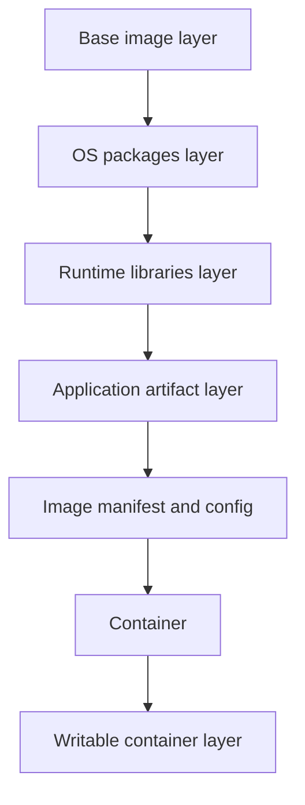

# Minimal Image Design and Build Layer Optimization

A container image is an immutable package containing an application and the components required to run it: the runtime, libraries, default configuration, and supporting files. An oversized image increases build, transfer, storage, and workload startup times. Images containing unnecessary compilers, package managers, source code, or debugging tools also enlarge the attack surface and make content governance harder.

Good image design achieves three goals simultaneously: **packaging only what the runtime needs**, **leveraging caching for fast and consistent builds**, and **keeping the build process reproducible, inspectable, and safely updatable**. A small image is a benefit, not the sole criterion; compatibility, observability, security updates, and supply chain integrity matter just as much.

## 1. Images and Build Layers

An OCI container image is typically represented by a manifest, a config, and a set of layers. Each layer holds filesystem changes produced during the build. Layers are content-addressed and can be shared across multiple images when their contents match.

A Dockerfile consists of instructions such as `FROM`, `WORKDIR`, `COPY`, `ADD`, `RUN`, `ENV`, `USER`, and `ENTRYPOINT`. Many instructions produce a corresponding layer or metadata in the image. When a container runs, image layers are mounted read-only and the runtime creates a separate writable layer for the container; data that must persist long-term should live in a volume or an appropriate storage service.



The diagram illustrates the filesystem layers conceptually. An actual image may have more or fewer layers depending on the build method, base image, and packaging tools. Metadata such as `ENV`, `USER`, or `ENTRYPOINT` are written into the image config and do not necessarily create filesystem layers.

### Why Do Layers Matter?

- **Reuse:** multiple images can share base layers, reducing data downloaded if those layers already exist on the node.
- **Build caching:** if inputs and instructions have not changed, the builder can reuse the previous step's result.
- **Distribution:** images are transferred layer by layer; small changes in the final layer avoid re-transferring existing earlier layers.
- **History and inspection:** `docker history` helps inspect image build steps and layer sizes, though it does not replace inspecting actual contents.

A layer cannot be removed from the final image merely by deleting files in a subsequent `RUN` instruction. For example, installing packages in an early layer and deleting caches in the next layer leaves the package data inside the earlier layer. Therefore, installation and cleanup of temporary files should occur within the same `RUN` when reducing image size is the goal.

## 2. Choosing the Right Base Image

The base image is the starting point of a Dockerfile. This choice affects size, system libraries, compatibility, update cadence, and ease of incident troubleshooting.

| Base Image Type | Characteristics | When to Consider |
|---|---|---|
| Full distribution image | Many packages and system utilities | Applications needing diverse OS libraries or tools |
| Slim/minimal distribution | Retains core components, strips unneeded packages | Workloads needing familiar Linux ecosystem compatibility with smaller size |
| Alpine | Lightweight, uses musl libc and BusyBox | Applications tested for compatibility with musl and Alpine packages |
| Distroless | Contains only runtime and libraries needed to run the app, typically no shell/package manager | Production workloads aiming to minimize attack surface |
| `scratch` | Empty image | Static binaries or images fully self-contained with all required dependencies |

Do not choose a base image based solely on download size. Alpine uses musl instead of glibc; some native binaries, extensions, or libraries compiled against glibc may not run directly. Distroless images lack a shell, so interactive debugging requires dedicated tools or workflows. `scratch` provides no CA certificates, timezone data, user database, or system libraries; the application must bring everything it needs.

### Prefer Trusted Image Sources

- Select official images or organization-maintained images from approved sources.
- Verify the publisher, repository, CPU architecture, update schedule, and support policy.
- Prefer base images with timely security patches and transparent release processes.
- Avoid floating tags like `latest` in production builds because the same tag can point to different content on the next build.
- Pin specific versions; for strict reproducibility requirements, pin verified manifest/image digests.
- Schedule rebuilds to pick up new base image and system library patches.

Pinning digests locks down input content, but it also prevents images from automatically receiving upstream patches. Combine pinning with advisory tracking and proactive digest updates.

## 3. Include Only What the Runtime Needs in the Final Image

Production images should contain only what the application needs to launch and process work. Typically excluded from the final image:

- Compilers, build tools, and package managers used only at build time.
- Source code, test fixtures, documentation, and sample files unneeded at runtime.
- Package manager caches, downloaded archives, and intermediate objects.
- Debuggers, editors, utility shells, or admin tools unused at runtime.
- Credentials, private keys, `.env` files, or environment-specific configs.
- Build logs, test reports, and unnecessary intermediate artifacts.

However, do not blindly strip system libraries required at runtime. For example, a native application may depend on `libssl`, CA certificates, the timezone database, or fonts. For Java, the runtime needs an appropriate JRE, a CA trust store, and any native libraries used by JNI. For Node.js, Python, or .NET, retain the corresponding runtime and production packages.

Identify runtime dependencies from manifests/build outputs, inspect binary linkage, and run smoke tests against the final image. A successful build in the builder image does not prove the runtime image contains every required library.

## 4. Multi-Stage Builds: Separating Build and Runtime Environments

Multi-stage builds allow multiple `FROM` instructions in one Dockerfile. An earlier stage can contain compilers, SDKs, package managers, and source code; the final stage copies only the built artifacts into the runtime image.

Benefits:

- Compilers and build tools never appear in the production image.
- The final image contains only the artifact and required runtime dependencies.
- Different base images can be used for building and running.
- Easy separation of test, build, and packaging stages by target.
- Reduces both size and attack surface of the final image.

Example for a Java application packaged as an executable JAR:

```dockerfile
# syntax=docker/dockerfile:1.7

ARG BUILD_IMAGE=maven:3.9-eclipse-temurin-21
ARG RUNTIME_IMAGE=eclipse-temurin:21-jre

FROM ${BUILD_IMAGE} AS build
WORKDIR /workspace

# Copy manifest first to cache dependency layer
COPY pom.xml mvnw ./
COPY .mvn/ .mvn/
RUN chmod +x mvnw && ./mvnw -B -ntp dependency:go-offline

# Source changes frequently so copy after dependencies
COPY src/ src/
RUN ./mvnw -B -ntp package -DskipTests \
    && mkdir -p /out \
    && cp target/*.jar /out/app.jar

FROM ${RUNTIME_IMAGE} AS runtime
WORKDIR /app
COPY --from=build --chown=10001:10001 /out/app.jar /app/app.jar
USER 10001:10001
ENTRYPOINT ["java", "-jar", "/app/app.jar"]
```

In this example, the `build` stage holds Maven and the JDK; the `runtime` stage receives only the JAR file and JRE. `COPY --from=build` does not carry the builder's entire filesystem into the final image. `USER` runs the application with an unprivileged UID/GID; verify that writable directories, temporary directories, and file permissions match the application's requirements.

Project-specific adjustments to consider:

- `target/*.jar` may match multiple artifacts if the project emits both a main JAR and auxiliary JARs; copy the exact output filename.
- Maven Wrapper requires its wrapper files and repository configuration; if the wrapper must download the distribution, the build step needs network access or a corresponding cache.
- `dependency:go-offline` may not download every dynamically resolved plugin or artifact; verify with actual builds.
- `-DskipTests` only illustrates the packaging step. CI should run tests in a dedicated stage or job before publishing the image.
- Base images in this example use tags for readability; production should pin audited versions and digests alongside an update cadence.

## 5. Optimizing Instruction Order for Caching

Builders generally cache results per instruction and its associated inputs. If a copied file changes, subsequent steps may have to re-run. Therefore, place less frequently changing inputs earlier and frequently changing inputs later.

For a Java application, an effective order is typically:

1. Select the base image and declare non-sensitive build arguments.
2. Set `WORKDIR`.
3. Copy `pom.xml`, Maven Wrapper, and dependency configuration.
4. Download or prepare dependencies.
5. Copy source code.
6. Compile, test, and package the artifact.
7. Copy the artifact into the runtime stage.

If source code changes on every commit while the dependency manifest remains unchanged, the builder can reuse the dependency-download layer. Copying the entire source tree before running `dependency:go-offline` causes every source change to invalidate the dependency cache.

### Inefficient Ordering Example

```dockerfile
FROM maven:3.9-eclipse-temurin-21
WORKDIR /workspace
COPY . .
RUN ./mvnw -B -ntp dependency:go-offline
RUN ./mvnw -B -ntp package
```

### Better Cache-Friendly Ordering Example

```dockerfile
FROM maven:3.9-eclipse-temurin-21
WORKDIR /workspace
COPY pom.xml mvnw ./
COPY .mvn/ .mvn/
RUN chmod +x mvnw && ./mvnw -B -ntp dependency:go-offline
COPY src/ src/
RUN ./mvnw -B -ntp package
```

These two examples only illustrate ordering. For multi-module Maven projects, copy all dependent module POMs before fetching dependencies. For Gradle, copy `settings.gradle`, build scripts, version catalogs, and lockfiles before source code. Ensure the build does not depend on files omitted from the context.

Caches can be invalidated by changes to the base image, build arguments, copied files, instructions, or builder environment. Never assume caching always hits; inspect build output to see which steps were reused.

## 6. Combining Package Installation and Cleanup in One Layer

For Debian/Ubuntu-based images, installing packages and removing the package index in the same `RUN` prevents leaving cache files in that instruction's final layer:

```dockerfile
RUN apt-get update \
    && apt-get install -y --no-install-recommends ca-certificates tzdata \
    && rm -rf /var/lib/apt/lists/*
```

Do not split `apt-get update` and `apt-get install` into two independent layers if your goal is reproducible builds and avoiding stale package indexes. Combining commands in a single instruction refreshes the package index immediately prior to installation.

For Alpine, you can use:

```dockerfile
RUN apk add --no-cache ca-certificates tzdata
```

Install only genuinely required runtime packages. Do not install compilers or headers in the runtime stage unless the application compiles code on the fly. For packages with specific versions or repositories, pin according to distribution policy and update in a controlled manner.

Do not run `apt-get upgrade` arbitrarily in every build without version management and testing. A safer workflow updates to a patched base image, rebuilds the image, runs tests, and releases a new artifact.

## 7. Using `.dockerignore` to Shrink the Build Context

Docker sends the build context to the builder. If the context includes `.git`, `node_modules`, `target`, `dist`, logs, backups, or large datasets, context transfer time and caching can degrade. More importantly, secret files could accidentally enter the context and get copied into the image.

Example `.dockerignore`:

```text
.git
.idea
.vscode
**/target
**/build
node_modules
coverage
*.log
*.tmp
.env
.env.*
*.pem
*.key
secrets/
```

This is a starter list and must be tailored per project. Do not exclude required manifests, lockfiles, or build configurations. If a file is needed in the build, include it intentionally and verify it contains no secrets.

`.dockerignore` reduces the data sent to the builder and stops unwanted files from slipping into `COPY . .` commands. It does not replace secret management; credentials must still be provisioned via dedicated build/runtime mechanisms.

## 8. Copy Only Required Artifacts

`COPY` should explicitly specify the required files or directories. Avoid copying the entire repository into the runtime stage. For example:

```dockerfile
COPY --from=build /out/app.jar /app/app.jar
```

For Node.js applications, install production dependencies cleanly in the runtime stage or copy a pruned directory; exclude npm caches and dev dependencies unless needed. For Python, use a virtual environment or wheels built in an earlier stage, then copy the appropriate runtime packages.

Distinguishing `COPY` and `ADD`:

- Use `COPY` for ordinary file copies because its semantics are explicit.
- `ADD` adds extra behaviors such as extracting certain local archives and supporting URLs in specific cases; use it only when you actually need those behaviors.
- Do not use `ADD` URLs to fetch unverified dependencies. Download artifacts in a build step with checksum/signature verification, or use a package manager and lockfiles.

`COPY --chown=user:group` sets ownership during copy, avoiding an extra `RUN chown` step that creates another layer. For files needing execute permissions, set permissions intentionally; never use `chmod 777` to work around permission errors.

## 9. BuildKit Cache Mounts for Dependencies

BuildKit supports cache mounts to persist package manager caches across builds without baking those caches into image layers.

Maven example:

```dockerfile
# syntax=docker/dockerfile:1.7
FROM maven:3.9-eclipse-temurin-21 AS build
WORKDIR /workspace
COPY pom.xml mvnw ./
COPY .mvn/ .mvn/
RUN chmod +x mvnw
RUN --mount=type=cache,target=/root/.m2 \
    ./mvnw -B -ntp dependency:go-offline

COPY src/ src/
RUN --mount=type=cache,target=/root/.m2 \
    ./mvnw -B -ntp package -DskipTests
```

Cache mounts are useful because previously downloaded dependencies can be reused on subsequent builds, even when the build step's layer must re-execute. A cache mount is builder-side helper storage, not content copied into the final image. Caches can be purged or unshared across builders; builds must still succeed when the cache is empty.

For npm, pip, or Gradle, target the tool's actual cache directory. Using caches does not replace lockfiles, checksums, or package source verification.

## 10. Secrets During Build

Do not pass credentials via `ARG`, `ENV`, or `COPY` secret files into the image. Values can persist in metadata, layers, build history, caches, or saved artifacts.

BuildKit supports secret mounts so a build command can read a temporary secret:

```dockerfile
RUN --mount=type=secret,id=maven_settings,target=/root/.m2/settings.xml \
    --mount=type=cache,target=/root/.m2/repository \
    ./mvnw -B -ntp dependency:go-offline
```

Supply the secret at build time, for example:

```bash
docker build --secret id=maven_settings,src=./settings.xml -t orders-api:dev .
```

Here, `settings.xml` holds credentials for an internal repository; do not commit that file to source control or include it in the build context. Secret mounts prevent writing secrets into layers, yet build commands can still accidentally print secrets to logs or copy contents into artifacts. Restrict permissions, avoid `set -x`, and audit build scripts.

Runtime secrets must also be injected via a secret manager or approved runtime mechanism rather than baked into the image. Images should be reusable across environments without embedding production-specific credentials.

## 11. Keeping Runtime Images Small Yet Operable

Minimal images typically omit shells, package managers, and debugging tools. While this shrinks the attack surface, it changes how incidents are investigated.

Principles to apply:

- Write logs to stdout/stderr for platform collection instead of requiring shell access to read log files.
- Export metrics and traces via managed endpoints or agents.
- Use ephemeral debug containers or dedicated debug images in controlled environments when supported by the platform.
- Never use debug images as the default production image.
- Expose health/readiness endpoints or checks compatible with the runtime.
- Store persistent data outside the container's writable layer.
- Verify write permissions on `/tmp`, cache directories, and application paths when running non-root with a read-only filesystem.

Do not install SSH servers or permanent debuggers in every production image merely for convenience. Designing an audited, least-privilege debugging workflow is safer.

## 12. Running Applications as an Unprivileged User

A container is not automatically safe just because a process runs inside one. If an application runs as root, application bugs or vulnerabilities can have greater impact inside the container and occasionally affect the host if the runtime is misconfigured.

In a Dockerfile, declare an unprivileged user:

```dockerfile
WORKDIR /app
COPY --chown=10001:10001 app.jar /app/app.jar
USER 10001:10001
ENTRYPOINT ["java", "-jar", "/app/app.jar"]
```

Numeric UID/GIDs reduce reliance on `/etc/passwd` in minimal runtimes, though some applications or libraries may expect a username, home directory, or NSS lookup. Test actual behavior and create the user/group in the image if needed.

At runtime, combine controls such as dropping unnecessary Linux capabilities, enabling `no-new-privileges`, using a read-only root filesystem, and enforcing CPU/RAM limits. These are runtime/orchestrator configurations, not just Dockerfile attributes. Provide writable volumes or `tmpfs` for paths the application genuinely needs to write to.

## 13. Using `ENTRYPOINT` and `CMD` Correctly

Use exec form for the main process:

```dockerfile
ENTRYPOINT ["java", "-jar", "/app/app.jar"]
```

Exec form lets the application process receive signals directly, supporting clean shutdown/graceful termination. Shell form such as `ENTRYPOINT java -jar app.jar` typically runs via a shell, which can complicate signal forwarding and PID 1 handling.

`ENTRYPOINT` defines the main executable; `CMD` can supply default arguments or a default command depending on how they are combined. Do not run a long-lived task in the background while keeping the container alive with an unrelated dummy process. A container's lifecycle should be tied to its primary workload process.

## 14. Reproducible Builds and Dependency Pinning

Even a small image built from floating dependencies can change unexpectedly. Reproducible builds ensure artifacts can be recreated from identical source and defined inputs.

Practices:

- Pin base images by approved version/digest.
- Commit lockfiles or dependency constraints appropriate for the ecosystem.
- Use trusted package repositories and verify checksums/signatures when available.
- Avoid downloading unverified binaries from unpinned URLs.
- Record source commit, build ID, builder version, and target platform.
- Keep environment configuration out of the image; inject it at runtime.
- Normalize locale, timezone, and build environment variables when reproducibility requires it.
- Ensure build processes do not rely on hidden files or local credentials on a developer machine.

Reproducibility does not mean freezing old dependencies forever. Maintain a tested upgrade workflow and periodic rebuilds to pick up security patches.

## 15. Multi-Platform Images and CPU Architectures

A single image can support multiple architectures such as `linux/amd64` and `linux/arm64` via a manifest list/index. Builders can target multiple platforms:

```bash
docker buildx build \
  --platform linux/amd64,linux/arm64 \
  -t registry.example.com/commerce/orders-api:1.4.0 \
  --push .
```

The command above illustrates Buildx and a registry. Multi-architecture builds require base images supporting the target platforms, and all binaries/native dependencies must also be compatible. Building on a different architecture may require QEMU emulation or native builders; emulation can be slow and is not always suitable for benchmarking.

Changing `--platform` alone does not make an application compatible. Check JNI/native libraries, binary packages, cryptographic providers, agents, drivers, and runtimes. For multi-platform images, verify that the manifest index points to the correct artifact for each architecture.

## 16. Inspecting Image Size and Layers

Useful commands:

```bash
# Build image
docker build -t orders-api:dev .

# List images and sizes
docker image ls orders-api

# View layer/instruction history
docker history orders-api:dev

# View image metadata
docker image inspect orders-api:dev
```

`docker history` helps spot large layers, such as a layer copying the entire source tree or installing excessive packages. `docker image inspect` displays config, architecture, user, entrypoint, and metadata. Displayed sizes may reflect compressed versus uncompressed sizes depending on the command and tool; when evaluating transfer costs, measure the actual bytes stored and transferred by the registry.

Layer analysis tools such as `dive` can uncover large files, duplicate files, or files deleted in later layers that still occupy space in earlier layers. Use these findings to fix specific instructions rather than blindly merging every command just to reduce layer count.

## 17. Reducing Size Without Hurting Build Maintainability

Commonly effective techniques:

- Use multi-stage builds to keep compilers and build dependencies out of the runtime.
- Pick a small, compatible, actively updated base image.
- Copy only required artifacts and runtime files.
- Use `.dockerignore` to keep unrelated files out of the build context.
- Install minimal packages; clean caches in the same `RUN`.
- Use cache mounts for package manager and compiler caches.
- Avoid installing numerous utility packages solely for production debugging.
- Exclude tests, source maps, or documentation if unneeded at runtime.
- Compress artifacts when appropriate, while measuring decompression CPU and startup-time trade-offs.
- Separate build/test/debug images from production images.

Do not shrink images by removing CA certificates, timezone data, locales, or native libraries required by the application. Saving a few megabytes while breaking TLS, time handling, or encoding creates far greater operational risk.

## 18. Image Supply Chain Security

An image is a deployment artifact and must be managed as part of the software supply chain.

Recommended safeguards:

- Scan base images and application packages for vulnerabilities before release.
- Generate an SBOM (Software Bill of Materials) to track included components and versions.
- Record build provenance/attestation to trace source, builder, and build parameters.
- Sign images or artifacts per organizational policy and verify signatures prior to deployment.
- Restrict registry push/pull permissions; use short-lived identities where possible.
- Never place secrets or sensitive data in layers, labels, build args, or logs.
- Use private registries with appropriate retention and replication policies.
- Rebuild when base images or dependencies receive patches; do not merely scan stale images and ignore them.
- Deploy images by digest to guarantee the exact tested artifact runs.

Vulnerability scanning detects packages with known CVEs, though it does not by itself prove exploitability. Combine severity, reachability, exploitability, patch availability, and risk acceptance policies.

## 19. Image Build and Release Workflow

A baseline pipeline might include:

1. Check out source at a specific commit.
2. Lint the Dockerfile, `.dockerignore`, and dependency manifests.
3. Run unit/integration tests and source quality checks.
4. Build using a managed builder, leveraging caching safely.
5. Produce the runtime image via a multi-stage build.
6. Validate image size, user, entrypoint, architecture, and unexpected files.
7. Scan the image, generating SBOM and provenance.
8. Sign the image and push to the registry.
9. Deploy by digest to staging/canary.
10. Run smoke tests and verify health, logs, metrics, and performance.
11. Promote the exact digest to production according to release policy.
12. Monitor base image patches and rebuild on schedule or upon security advisories.

Builder caches accelerate pipelines, yet they must be treated as pipeline inputs. Do not use caches from untrusted sources to build production artifacts without verification policies. Also ensure secret mounts and build logs do not leak credentials.

## 20. Minimal Dockerfile Example for a Go Binary

For a statically built Go binary requiring no external libraries, `scratch` can serve as the runtime stage:

```dockerfile
FROM golang:1.23 AS build
WORKDIR /src
COPY go.mod go.sum ./
RUN go mod download
COPY . .
RUN CGO_ENABLED=0 GOOS=linux go build -trimpath -ldflags="-s -w" -o /out/service ./cmd/service

FROM scratch
COPY --from=build /out/service /service
USER 65532:65532
ENTRYPOINT ["/service"]
```

This example fits only when the binary truly needs no dynamic libraries or other system files. If the application makes HTTPS calls, you may need to copy a CA certificate bundle into the runtime image. If it needs a timezone database, templates, or static assets, copy those files explicitly. `CGO_ENABLED=0` can affect native library support; test functionality before adopting it.

In production, pin the builder image digest and verify the binary matches the target architecture. A `scratch` image has no shell, so you cannot run `sh`, `ls`, or a package manager inside the container; design logging and debugging accordingly.

## 21. Measuring Optimization Impact

Evaluate changes across multiple metrics:

| Metric | Why Measure It |
|---|---|
| Image compressed size | Estimates registry storage and transfer volume |
| Build duration | Evaluates caching and pipeline efficiency |
| Cache hit rate | Shows whether dependency/build steps are reused |
| Pull duration | Impacts scale-out and rollout speed |
| Container startup time | Measures time from container creation to readiness |
| CVE/package count | Tracks package surface area and patch posture |
| Runtime memory/CPU | Ensures minimal images do not increase runtime resource usage |
| Failure rate | Catches missing libraries or environment discrepancies |

Compare using the same builder, network, cache state, and target platform. Initial cold builds without cache are slower than subsequent builds; measure both cold and warm builds. If a smaller image starts slower due to decompression or cache misses, evaluate the overall trade-off.

## 22. Common Mistakes

- **Picking the smallest base image without checking compatibility:** the app fails due to musl/glibc, missing CA certs, or native libraries. Test the final image.
- **Using a single stage for build and runtime:** compilers, source code, and build packages leak into production. Use multi-stage builds.
- **Copying the entire repository too early:** dependency caches invalidate constantly and the context bloats. Copy manifests first, source later.
- **Deleting files in a later layer to shrink the image:** data remains in the earlier layer. Install and clean up in the same `RUN`, or use multi-stage builds.
- **Using the `latest` tag:** builds can change unpredictably. Pin versions/digests and maintain an update schedule.
- **Passing secrets via ARG/ENV or COPY:** secrets can persist in image metadata/layers. Use secret mounts and a secret manager.
- **Installing shells/debuggers in every production image:** increases package count and attack surface. Use separate debug images or ephemeral debug tooling.
- **Running processes as root:** increases blast radius if exploited. Use unprivileged UID/GIDs and verify write permissions.
- **Optimizing layer count alone:** merging everything makes Dockerfiles hard to cache and hard to read. Optimize around dependencies and cache invalidation.
- **Skipping image scans/SBOMs:** leaves artifact contents unknown. Integrate supply chain checks into the pipeline.

## 23. Minimal Image Design Checklist

- [ ] Base image comes from a trusted source with an explicit version and managed digest.
- [ ] OS, libc, CPU architecture, and native dependency compatibility are verified.
- [ ] Runtime stage contains only required artifacts, runtime, and libraries.
- [ ] Compilers, build tools, source code, and test dependencies stay out of production images.
- [ ] Dockerfile copies manifests/lockfiles before source code to maximize caching.
- [ ] Package indexes and temporary caches are cleaned in the same installation layer where appropriate.
- [ ] `.dockerignore` excludes `.git`, build outputs, logs, and sensitive files.
- [ ] No secrets appear in ARG, ENV, layers, labels, or build logs.
- [ ] BuildKit cache mounts are used appropriately and builds still succeed with an empty cache.
- [ ] `COPY` transfers only needed artifacts; ownership and permissions are explicitly set.
- [ ] Processes run non-root; entrypoint uses exec form and supports graceful shutdown.
- [ ] CA certificates, timezone data, native libraries, and required writable paths are verified.
- [ ] Images include SBOM, vulnerability scans, and provenance/signatures per policy.
- [ ] Image size, build time, cache hits, pull/startup time, and runtime behavior are measured.
- [ ] A workflow exists for rebuilds, base image updates, and digest-based rollbacks.

Designing minimal images means choosing the right base image, separating build from runtime, copying only necessary artifacts, and structuring instructions for cache reuse. Combined with dependency pinning, secret management, non-root execution, and supply chain controls, images become lighter, faster to distribute, and more reliable in containerized compute environments.
