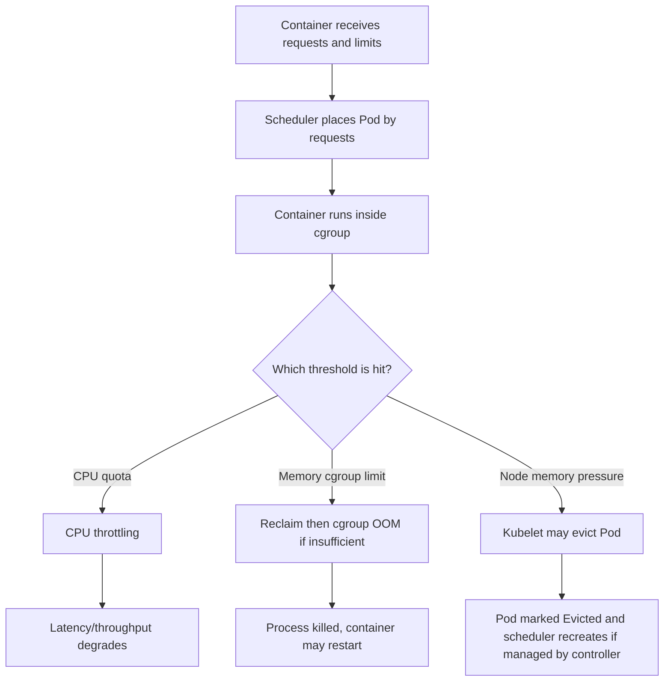

# CPU Limits, Memory Limits, and Throttling or OOM Behavior

Containers share CPU, memory, and other node resources with other workloads. Resource requests and resource limits help the platform schedule, allocate, and cap each container's consumption. Setting them too low can cause CPU throttling or kernel termination due to out-of-memory conditions; setting them too high reduces workload density on nodes and drives up operating costs.

In the **CLOUD_CORE_SERVICES_COMPUTE** module, configuring CPU and memory should be grounded in workload characteristics, measured metrics, and latency/availability targets. This lesson explains how Linux control groups (cgroups) enforce limits, how Kubernetes uses requests and limits, the differences among throttling, OOM kills, and eviction, and how to size, monitor, and troubleshoot with practical examples.

## Learning Objectives

After this lesson, you will be able to:

- Distinguish between CPU requests, CPU limits, memory requests, and memory limits.
- Explain how cgroups restrict container CPU time and memory.
- Identify CPU throttling, container OOM kills, and node-pressure eviction.
- Understand Kubernetes QoS classes and how requests/limits affect scheduling, eviction, and autoscaling.
- Calculate CPU in millicores, memory in MiB/GiB, and derive thresholds from benchmark data.
- Configure resources for CPU-bound, memory-bound, latency-sensitive, and bursty workloads.
- Read metrics, events, and Pod status to diagnose throttling/OOM root causes.
- Tune JVM settings, sidecars, worker concurrency, and autoscaling to avoid misconfigured limits.
- Establish workflows for testing, alerting, and handling resource pressure in production.

## 1. Requests and Limits Solve Two Different Problems

When running multiple containers on a node, the scheduler must decide which container goes where, while the kernel must enforce limits once the container is running. These two stages require two distinct types of information.

- **Requests** describe how many resources a workload needs accounted for during scheduling. The scheduler sums requests to decide whether a node has enough capacity to accept a Pod.
- **Limits** set the maximum usage a container is permitted under runtime/kernel enforcement. For CPU, a limit typically creates a CPU time quota; for memory, exceeding the limit can trigger an OOM kill.

A request is not a fixed reservation of idle usage, and a CPU request does not automatically dedicate a physical core. Likewise, a limit is not a guarantee that the application will always receive that amount of CPU; it is a usage ceiling.

| Attribute | CPU | Memory |
|---|---|---|
| Request | Used for scheduling and determining relative weight during CPU contention | Used for scheduling and serves as a key baseline when evaluating pressure/eviction |
| Limit | CPU time ceiling; can cause throttling when quota is exhausted | Cgroup memory ceiling; exceeding it can trigger an OOM kill |
| Under resource scarcity | Processes typically run slower while waiting for CPU | May face reclaim, OOM kill, or Pod eviction depending on pressure type |
| Can burst? | Can use spare CPU up to the quota and sharing mechanism | Can use up to the memory limit; no safe burst above the hard limit |

### 1.1. CPU Is Measured in Cores and Millicores

In Kubernetes, CPU is expressed in cores or millicores:

- `1` CPU corresponds to one logical core in Kubernetes scheduling units.
- `500m` corresponds to 0.5 CPU.
- `250m` corresponds to 0.25 CPU.
- `100m` corresponds to 0.1 CPU.
- `1500m` corresponds to 1.5 CPUs.

For example, a container with a request of `500m` is counted by the scheduler as needing half a CPU. If its limit is `1`, the container can consume up to roughly one CPU of quota within an execution period. This is not a promise that the container runs exclusively on one dedicated core.

### 1.2. Memory Uses Bytes, MiB, and GiB

Kubernetes accepts both decimal and binary suffixes:

| Unit | Value |
|---|---:|
| `1K` | 1,000 bytes |
| `1M` | 1,000,000 bytes |
| `1G` | 1,000,000,000 bytes |
| `1Ki` | 1,024 bytes |
| `1Mi` | 1,048,576 bytes |
| `1Gi` | 1,073,741,824 bytes |

For memory, prefer `Mi`/`Gi` to avoid confusion between base-10 and base-2 units. For instance, `512Mi` is 512 × 1,048,576 bytes, whereas `512M` is 512,000,000 bytes.

## 2. How Do Linux Cgroups Enforce Container Limits?

Containers do not have their own kernel. The runtime spawns processes inside namespaces and places them into control groups (cgroups). Cgroups allow the kernel to track, allocate, and cap resources for a group of processes.

On Linux, Kubernetes and container runtimes typically use cgroups v1 or v2 depending on the kernel, runtime, and node configuration. Filenames and metrics can differ, but the core model remains the same: CPU is governed via quotas/weights, while memory is tracked and capped per process group.

### 2.1. CPU Quota and CPU Weight

A CPU quota caps the amount of CPU time a cgroup may consume within a period. Illustrative example using a 100 ms period:

```text
CPU limit:       1.5 CPU
Period:          100 ms
Quota:           150 ms CPU time / 100 ms wall time
```

A container can run across multiple cores in parallel during part of the period and then get throttled once its quota is exhausted. Consequently, a multithreaded application can burn through its quota early in the period even if its minute-level average CPU usage stays below 100% of one core.

CPU weight/shares determine relative priority when cgroups contend for CPU. Requests generally map to relative weights. When a node has idle CPU, a container can consume above its request unless capped by a limit or another quota. When the node is busy, workloads with higher weights tend to receive a larger share of CPU according to the kernel scheduler.

In cgroups v2, you encounter interfaces such as `cpu.max` and `cpu.weight`; cgroups v1 typically exposes `cpu.cfs_quota_us`, `cpu.cfs_period_us`, and `cpu.shares`. Do not edit cgroup files directly on a Kubernetes node managed by kubelet unless conducting controlled diagnostics.

### 2.2. Memory Cgroups

The memory controller tracks memory charged to processes in a cgroup and can enforce limits. In cgroups v2, common interfaces include `memory.current`, `memory.max`, `memory.high`, and `memory.events`; cgroups v1 uses corresponding files such as `memory.usage_in_bytes` and `memory.limit_in_bytes`.

Accounted memory is not just the Java heap or a single process's RSS. It can include anonymous memory, page cache, and other memory charged to the cgroup. Measuring heap or a single RSS number alone can miss actual memory consumption.

When a cgroup approaches its limit, the kernel may attempt to reclaim memory. If it cannot reclaim enough, the cgroup OOM killer may terminate one or more processes in the cgroup to bring usage back within bounds. The killed process may be the main process or a child process; if PID 1 in the container exits, the runtime typically marks the container as stopped.

### 2.3. Namespaces Do Not Create Extra Resources

PID, mount, and network namespaces establish visibility boundaries between containers. They do not multiply physical CPU or memory. Two containers on the same node still compete for the node's CPU, memory bandwidth, caches, I/O, and network.

## 3. CPU Requests, CPU Limits, and Throttling

CPU is a time-shareable resource. When a workload needs more CPU than its allocated quota, the kernel can pause running threads in the cgroup until the next quota period. This phenomenon is called CPU throttling.

### 3.1. Requests Affect Scheduling and CPU Sharing

Suppose a node has 8 allocatable CPUs:

| Pod | CPU request | CPU limit |
|---|---:|---:|
| API A | 1 CPU | 2 CPU |
| API B | 2 CPU | 2 CPU |
| Worker C | 500m | 1 CPU |

The scheduler sums requests to 3.5 CPUs. It can place additional workloads as long as total requests stay within allocatable capacity and other scheduling constraints are met. Limits are not summed in standard request accounting, so total limits on a node can exceed physical CPUs. This is intentional CPU overcommit; performance under concurrent load must be tested.

### 3.2. CPU Limits Create Quotas

Consider a container with request `500m` and limit `1`:

- The scheduler accounts for the container needing 0.5 CPU.
- When idle CPU is available, the container can run above 0.5 CPU.
- The quota caps total CPU time at roughly one CPU per period.
- Once the quota is consumed, threads can be throttled until the next period.

If the limit is set below real demand, the container can be throttled even while the node has plenty of idle CPU. This is a common reason an application exhibits low average CPU usage alongside high latency.

### 3.3. Why Does Throttling Increase Latency?

A single request may involve multiple cooperating threads: request-handling threads, business logic threads, GC threads, I/O completion threads, or worker pools. If the cgroup exhausts its quota, threads must wait. That waiting time adds directly to response latency.

Throttling disproportionately hurts:

- Latency-sensitive APIs with tight deadlines.
- Bursty workloads where many requests arrive simultaneously.
- Thread-heavy runtimes such as the JVM or multithreaded native applications.
- Workloads performing GC, JIT compilation, or compression/encryption.
- Containers running multiple processes, since all processes share the container's quota; sidecars are separate containers and typically have their own quotas, yet still contend for CPU on the same node.

### 3.4. Signs of CPU Throttling

- `container_cpu_cfs_throttled_periods_total` rises rapidly relative to `container_cpu_cfs_periods_total`.
- `container_cpu_cfs_throttled_seconds_total` climbs while request latency spikes.
- CPU usage plateaus around the limit while runnable threads or the run queue grow.
- Throughput stops scaling even as queued requests increase.
- p95/p99 latency spikes during bursts while average CPU stays modest.

CFS metric names may vary or be absent on certain kernel/cgroups v2 versions, runtimes, or managed Kubernetes offerings. Verify actual metrics emitted by kubelet/cAdvisor and your cluster runtime.

### 3.5. When Should You Set a CPU Limit?

CPU limits are useful for capping maximum consumption and protecting a node from one workload monopolizing all CPUs. However, setting limits too low causes throttling and inflates tail latency. Some production platforms set explicit CPU requests while omitting CPU limits for latency-sensitive workloads, pairing this with node-level quotas, capacity planning, and proper isolation. This is an operational trade-off, not a universal rule for every cluster.

If policy mandates CPU limits on every container, benchmark under burst load and pick a limit high enough to avoid throttling at target load. If omitting CPU limits, enforce guardrails around total requests, node capacity, priority, and noisy neighbors.

## 4. Memory Requests, Memory Limits, and OOM

Memory differs from CPU because memory actively held by a process cannot simply be time-sliced like CPU cycles. When memory runs short, the kernel can reclaim caches, swap if enabled/configured, or terminate processes to protect the system.

### 4.1. Memory Requests Are Used for Scheduling

The scheduler sums Pod memory requests to check whether a node has sufficient capacity. Requests do not cap the container at that level. A container with request `512Mi` and limit `1Gi` can consume more than `512Mi` if the node has free memory and the cgroup limit permits.

However, if many Pods routinely exceed their requests, the node can hit memory pressure even though the scheduler calculated that summed requests fit inside allocatable capacity. Because memory cannot be reclaimed as effortlessly as CPU time, setting requests far below actual steady usage increases eviction and node OOM risk.

### 4.2. Memory Limits Are Hard Ceilings

Suppose a container has a memory limit of `1Gi`. As total cgroup-accounted memory approaches the limit, the kernel may reclaim some pages. If new allocations cannot be satisfied, a cgroup OOM can occur and terminate processes.

A memory limit never expands automatically just because the node has spare RAM. A container can OOM at `1Gi` even with abundant free memory on the node because its own cgroup limit was breached.

### 4.3. OOMKilled vs. Node-Pressure Eviction

Two events are frequently confused:

| Phenomenon | Cause | Typical Symptoms | Scope |
|---|---|---|---|
| Container/cgroup OOM kill | Cgroup exceeds memory limit or cannot satisfy allocation within cgroup bounds | Container termination reason may be `OOMKilled`; `oom`/`oom_kill` counters increment | One or more processes in the container/cgroup |
| Node-level OOM | Node exhausts memory and kernel must pick processes to kill | Kernel logs record node OOM; multiple workloads may be impacted | Entire node |
| Kubelet eviction due to memory pressure | Kubelet proactively evicts Pods to return the node to a safe threshold | Pod reason/event is typically `Evicted`, noting node pressure | Selected Pod on the node |

A container can be OOMKilled while the node has free RAM because its own memory limit was hit. Conversely, a Pod can be evicted even before its container reaches its limit if the node overall lacks memory. Inspect exact statuses and events instead of treating every restart as the same kind of OOM.

### 4.4. OOM Is Not Just a Full Heap

In a JVM, container memory can include:

- Java heap.
- Metaspace and class metadata.
- Thread stacks.
- Direct buffers and native allocations.
- JIT code cache.
- JNI/native libraries.
- Memory-mapped files and accounted page cache.

Setting `-Xmx` equal to the memory limit allows non-heap allocations to push total cgroup memory past the limit. Leave headroom for native memory, thread stacks, runtime overhead, and traffic fluctuations.

For Python, Node.js, Go, or native applications, likewise distinguish runtime heap from total process/cgroup memory. Native extensions, buffers, `mmap`, and caches can push total memory well above the heap reported by a profiler.

### 4.5. Memory Leaks vs. Memory Spikes

Steadily rising memory can stem from leaks, unbounded caches, queue backlogs, object retention, or fragmentation. Memory spikes can result from large batches, oversized payloads, concurrent requests, or launching many workers simultaneously.

Distinguish the two patterns:

- **Leak:** usage climbs over time and never returns to baseline after load subsides.
- **Spike:** usage jumps briefly during an operation, then drops once processing completes or GC/reclaim runs.

Raising the limit buys temporary headroom but never fixes a leak. If a leak exists, the container simply OOMs later.

## 5. QoS Classes in Kubernetes

Kubernetes assigns a Quality of Service (QoS) class to a Pod based on the requests and limits configured across its containers. The QoS class influences prioritization under node resource scarcity; it does not replace capacity planning and never guarantees a Pod will never be killed.

### 5.1. Guaranteed

A Pod is `Guaranteed` when every container specifies both CPU and memory requests and limits, and request equals limit for each corresponding resource. Example:

```yaml
resources:
  requests:
    cpu: "1"
    memory: "1Gi"
  limits:
    cpu: "1"
    memory: "1Gi"
```

`Guaranteed` receives stronger protection in certain node-pressure scenarios and suits workloads needing predictable resource profiles. The trade-off is that requested but unused resources still occupy scheduling capacity, reducing bin packing. Setting CPU limit equal to request can also cause throttling if the workload needs to burst beyond that level.

### 5.2. Burstable

A Pod is `Burstable` when at least one request or limit is set without meeting `Guaranteed` criteria. For example, requests lower than limits:

```yaml
resources:
  requests:
    cpu: "500m"
    memory: "512Mi"
  limits:
    cpu: "2"
    memory: "1Gi"
```

`Burstable` fits workloads whose baseline is lower than their peak. Containers can consume above their requests within allowed limits, provided the node has capacity and memory requests reflect realistic steady usage closely enough.

### 5.3. BestEffort

A Pod with no CPU or memory requests/limits declared on any of its containers is classified as `BestEffort`:

```yaml
containers:
  - name: worker
    image: example/worker:1.0
```

`BestEffort` can suit easily disposable workloads or test environments, but it is inappropriate for critical production services. Under node pressure, this class generally has the lowest priority.

### 5.4. QoS Is Not the Sole Eviction Order

Under node pressure, kubelet also considers Pod priority and actual usage relative to requests. `BestEffort` Pods are typically targeted first; `Burstable` Pods exceeding their requests may be targeted before Pods staying within requests; `Guaranteed` Pods and `Burstable` Pods below requests generally receive better protection in several scenarios. Exact behavior depends on the pressure type, priorities, and Kubernetes version.

Do not use QoS class as the sole reason to set every request equal to its limit. Choose requests and limits based on workload behavior, scheduling goals, burst needs, and memory pressure.

## 6. CPU Throttling, OOM, and Eviction in the Pod Lifecycle



### 6.1. When CPU Is Throttled

The container typically stays in the `Running` state. There may be no restarts or obvious events. The application simply slows down, request queues build up, or timeouts occur. Therefore, throttling and latency metrics are essential—never rely on Pod status alone.

### 6.2. When a Container Is OOMKilled

The container may restart depending on `restartPolicy` and its controller. In Kubernetes, inspect `lastState.terminated.reason` and `exitCode`; the runtime typically records `OOMKilled` when a process/container is terminated due to OOM. Repeated restarts can transition the Pod into `CrashLoopBackOff`.

### 6.3. When a Pod Is Evicted

A Pod evicted by kubelet may terminate with reason `Evicted`; a Deployment, ReplicaSet, or StatefulSet can spin up a replacement Pod. If all nodes lack memory or requests exceed node capacity, the new Pod may stay `Pending` or face repeated eviction.

## 7. How to Choose CPU Requests and Limits

Do not pick CPU values from a developer laptop core count or a single point-in-time CPU reading. Measure across request rates, concurrency, payloads, dependencies, and peak hours.

### 7.1. CPU Sizing Process

1. Run a representative workload in a production-like environment.
2. Collect per-container CPU usage across multiple load levels.
3. Record throughput, p95/p99 latency, error rate, and queue depth.
4. Identify the point where adding CPU stops improving throughput or latency due to other bottlenecks.
5. Choose a request sufficient for the scheduler to place the workload stably under node contention.
6. Choose a limit aligned with isolation policy and burst needs; if setting a limit, verify zero harmful throttling at peak.
7. Re-test with sidecars, autoscaling, and multiple co-located Pods on the node.

### 7.2. CPU Sizing Example

Suppose an API handles a normal load of 300 requests/second with p95 CPU usage at 420m and short bursts up to 800m. Benchmarks show that at 500m, p99 latency begins climbing during bursts; at 1 CPU, latency remains within SLO.

A starting configuration might be:

```yaml
resources:
  requests:
    cpu: "500m"
  limits:
    cpu: "1"
```

A `500m` request tells the scheduler the workload needs roughly half a CPU in node capacity planning. A limit of `1` allows bursting up to roughly one CPU while still throttling if the cgroup exhausts its quota. This is a starting point for testing, not a universal default for every API.

If p99 latency still rises alongside throttled periods, raise the CPU limit or remove it if policy permits. If CPU usage is low yet latency is high, investigate databases, locks, networking, GC pauses, and thread pools before adding CPU.

### 7.3. Do Not Set Requests Mechanically from Averages

Setting CPU requests too low lets the scheduler pack too many workloads onto a node, causing CPU contention. Setting requests too high hurts bin packing, increases node counts, and raises costs. Consider p50/p95 usage, concurrency, criticality, and burst patterns.

CPU usage changes rapidly; use histograms and time series alongside benchmarks. A daily average can hide a 5-minute burst that breaks p99 SLOs.

## 8. How to Choose Memory Requests and Limits

Memory requires more conservative sizing than CPU because exceeding a limit can trigger an OOM kill. Measure total cgroup memory under representative load, not just the runtime heap or a single process's RSS.

### 8.1. Memory Sizing Process

1. Measure baseline after application warm-up completes.
2. Run peak traffic, batch jobs, cache warm-ups, and background tasks.
3. Collect peak cgroup memory and per-container working set.
4. Inspect native memory, thread counts, page cache, and memory-backed volumes.
5. Estimate reasonable growth and a safety margin for bursts.
6. Pick a memory request reflecting steady/expected usage so the scheduler does not severely overcommit.
7. Pick a memory limit above the measured peak with adequate headroom.
8. Run soak tests and monitor OOM counters and restarts.

### 8.2. Memory Sizing Example

An API has a typical memory working set around 430Mi, peaks at 680Mi under representative load, and exhibits roughly 15% cache/native variance. Applying a 25% margin above measured peak:

\[
680\ Mi \times 1.25 = 850\ Mi
\]

You might set the limit to `1Gi` for headroom and start the request at `768Mi` if metrics and node capacity show that is reasonable. Validate in a production-like load test; if actual memory routinely exceeds the request, the scheduler may overcommit nodes.

```yaml
resources:
  requests:
    memory: "768Mi"
  limits:
    memory: "1Gi"
```

### 8.3. JVM and Memory Limits

Never set the Java heap equal to the entire container memory limit. For example, a `1Gi` container limit with `-Xmx1g` can push total memory over the limit once metaspace, thread stacks, direct buffers, JIT code cache, and native libraries are included.

An illustrative budget breakdown:

```text
Container memory limit: 1 GiB
Heap max:               650 MiB
Non-heap/native budget: 250 MiB
Safety margin:          124 MiB
```

These numbers only illustrate how to partition the budget. Use a modern container-aware JVM, enable Native Memory Tracking where helpful, and benchmark thread counts, direct buffers, GC, and heap occupancy. Never copy `MaxRAMPercentage` or `Xmx` settings between applications without validating total memory.

### 8.4. How Much Lower Should Memory Request Be Than Limit?

The gap between request and limit represents the burst headroom a container can use if the node has spare memory. Too wide a gap allows the scheduler to pack many Pods based on small requests, all of which grow during peak load. That pushes the node into memory pressure and evictions.

For memory-sensitive workloads, keep requests close to recurring peak demand or non-reclaimable usage. For workloads with easily reclaimable caches and well-understood behavior, requests can sit below limits while monitoring node pressure and evictions.

## 9. Practical Kubernetes Configurations

### 9.1. Pod with Requests and Limits

```yaml
apiVersion: v1
kind: Pod
metadata:
  name: api-resource-example
spec:
  containers:
    - name: api
      image: example/api:1.0
      resources:
        requests:
          cpu: "500m"
          memory: "768Mi"
        limits:
          cpu: "1"
          memory: "1Gi"
```

This Pod falls into `Burstable` because requests and limits differ. The scheduler accounts for 500m CPU and 768Mi memory; cgroups cap CPU at 1 CPU and memory at 1Gi.

### 9.2. Guaranteed Pod

```yaml
apiVersion: v1
kind: Pod
metadata:
  name: critical-api
spec:
  containers:
    - name: api
      image: example/api:1.0
      resources:
        requests:
          cpu: "2"
          memory: "2Gi"
        limits:
          cpu: "2"
          memory: "2Gi"
```

If every container in the Pod satisfies request-equals-limit for both CPU and memory, the Pod qualifies as `Guaranteed`. Check sidecars and other containers too; a single container failing the condition changes the Pod's QoS class.

### 9.3. LimitRange and ResourceQuota

`LimitRange` can enforce default requests/limits or min/max bounds per container within a namespace. `ResourceQuota` caps aggregate requests/limits or object counts within a namespace. Both help organizations enforce guardrails, though bad defaults can starve or over-allocate workloads.

If you specify a limit without a request, Kubernetes typically defaults the request to match the limit unless another admission/defaulting mechanism supplies one. If a request exceeds its limit, the container spec is invalid and the Pod will not be accepted as expected. Inspect the admitted Pod spec to verify the final values used by the scheduler and kubelet.

When a Pod fails creation due to quota, inspect namespace events and quotas. When requests exceed node allocatable capacity, a Pod can remain `Pending` even if node CPU usage looks low; the scheduler checks requests against allocatable capacity, not `kubectl top`.

## 10. Docker and Container Runtimes

Kubernetes is an orchestration layer; Docker and container runtimes can also set resource limits directly.

Docker example:

```bash
docker run --name api \
  --cpus="1.5" \
  --memory="1g" \
  example/api:1.0
```

- `--cpus="1.5"` sets a CPU limit equivalent to roughly 1.5 CPUs via runtime/cgroup controls.
- `--memory="1g"` sets the container memory limit.
- The runtime translates these flags into Linux cgroup controls.

Swap options and semantics vary across Docker Engine, containerd, host OS, and kernel configurations. Verify with `docker inspect`, `docker stats`, and actual cgroup files instead of assuming identical defaults across environments.

## 11. Observing CPU and Memory

Accurate diagnosis requires combining application metrics, container metrics, Pod state, and node events. A node-level aggregate CPU chart alone cannot tell you whether a container is being throttled.

### 11.1. CPU Metrics

- CPU usage in cores/seconds.
- CPU usage relative to requests and limits.
- Throttled periods and throttled seconds.
- Runnable threads, run queue, and context switches.
- Request rate, throughput, and p95/p99 latency.
- CPU consumed by sidecars, proxies, log agents, and runtime processes.

Common PromQL query using cAdvisor metrics:

```promql
rate(container_cpu_usage_seconds_total[5m])
```

A value near `1` corresponds to roughly one CPU core used on average over the 5-minute window. Queries may need filtering for empty container names, pause containers, and namespace/pod/container labels.

The ratio of throttled periods can be estimated with:

```promql
rate(container_cpu_cfs_throttled_periods_total[5m])
/
rate(container_cpu_cfs_periods_total[5m])
```

This is the fraction of periods experiencing throttling out of total periods, not the percentage of CPU time lost. Read it alongside `throttled_seconds`, CPU usage, and latency. Metric names and availability can vary with cgroups version and scraping setup.

### 11.2. Memory Metrics

- Cgroup memory usage/current and memory limit.
- Per-container working set and RSS.
- Runtime heap/non-heap/native memory.
- OOM events, OOM kill counts, and container restarts.
- Node available memory, memory pressure, and eviction events.
- Memory-backed `emptyDir` or `tmpfs` usage.

cAdvisor metric example:

```promql
container_memory_working_set_bytes
```

Working set is widely used to observe active memory, though it does not equal full cgroup accounting or the application heap. Cross-check with cgroup `memory.current`, limits, and runtime metrics.

### 11.3. Monitoring in Kubernetes

```bash
kubectl top pod -n production --containers
kubectl describe pod api-resource-example -n production
kubectl get pod api-resource-example -n production -o yaml
kubectl get events -n production --sort-by=.lastTimestamp
```

- `kubectl top` gives a near-real-time snapshot of usage; it does not replace time-series history.
- `describe` displays events, container states, and restart reasons.
- YAML reveals requests/limits, node assignment, and `lastState`.
- Events surface `OOMKilled`, `Evicted`, `FailedScheduling`, or quota violations.

### 11.4. Useful Alerts

- Memory usage approaching the limit over consecutive evaluation windows.
- Rising OOM kill counters or abnormal container restarts.
- Rising CPU throttling coinciding with p95/p99 latency breaching SLOs.
- Sustained high CPU usage accompanied by growing runnable queues.
- Pods stuck `Pending` due to insufficient CPU/memory or quota.
- Node memory pressure, evictions, and low allocatable headroom.
- HPA failing to scale despite rising latency due to misconfigured metrics or requests.

Avoid setting generic static alerts at 80% CPU or 80% memory for every workload. Combine thresholds with trends, duration, error budgets, and user impact.

## 12. CPU/Memory Requests and Autoscaling

Resource requests affect how the Horizontal Pod Autoscaler (HPA) computes CPU utilization. For CPU utilization targets, percentages are calculated relative to the CPU request. If a request is missing or misconfigured, HPA cannot compute utilization as expected.

Example: a Pod has a CPU request of `500m` and uses `400m`, yielding roughly 80% utilization of its request. If the request is raised to `1`, that same 400m usage drops to 40%. Changing requests can alter scaling behavior even when workload traffic is unchanged.

Memory-based scaling requires extra caution:

- Memory rarely drops immediately when traffic falls because caches or heaps retain allocations.
- Adding replicas can duplicate caches and increase cluster-wide memory usage.
- Scale-out does not fix a memory leak.
- Memory utilization relative to request does not necessarily reflect request-processing capacity.

For memory-bound workloads, consider VPA to adjust requests/limits from historical usage, while understanding update modes and the Pod restarts required when applying changes. Combining HPA and VPA on the same CPU/memory metrics for one workload requires careful design to avoid conflicting control loops.

## 13. Sidecars, Init Containers, and Pod-Level Budgeting

A Pod may include an application container, a service mesh proxy, log/metrics agents, and other sidecars. The scheduler calculates Pod resource totals based on container specs and the Kubernetes version's init container / restartable sidecar semantics. Never size only the application container while ignoring auxiliary containers.

Example:

| Container | CPU request | Memory request |
|---|---:|---:|
| API | 500m | 768Mi |
| Proxy sidecar | 100m | 128Mi |
| Log sidecar | 50m | 96Mi |
| Total concurrently running containers | 650m | 992Mi |

Sidecars can consume significant CPU/memory as TLS, logging, or tracing load grows. When a Pod experiences OOM or throttling, break down metrics per container to see which component consumes the resources.

## 14. Troubleshooting CPU Throttling

When throttling appears, do not blindly raise the limit right away. Verify which container is throttled, when it occurs, what workload is running, and whether latency correlates.

Workflow:

1. Identify the affected Pod/container and rising throttling metrics.
2. Compare CPU usage, requests, limits, node contention, and run queues.
3. Inspect request rate, concurrency, thread pools, GC, compression, and dependencies.
4. Load-test with the current limit and higher limit tiers.
5. If the limit is the bottleneck, raise or remove the limit per approved policy.
6. If the request is too low, adjust the request so the scheduler distributes Pods appropriately.
7. Review HPA targets, since changing requests alters utilization percentages.
8. Monitor p95/p99 latency, throughput, and cost after the change.

Remediation options:

- Increase the CPU limit if quotas are capping the workload and nodes have capacity.
- Increase the CPU request if the workload consistently needs more CPU and faces contention.
- Optimize algorithms, serialization, compression, queries, and lock contention.
- Tune concurrency/thread pools to avoid spawning excessive runnable threads.
- Isolate heavy batch workloads from latency-sensitive APIs.
- Scale out if the application parallelizes well and downstream dependencies have headroom.

## 15. Troubleshooting OOM and Memory Pressure

### 15.1. When a Container Is OOMKilled

1. Identify the exact container and restart timestamp.
2. Check `lastState.terminated.reason`, exit code, and events.
3. Correlate cgroup memory usage/limits, OOM counters, and application metrics.
4. Inspect heap dumps or core dumps if safely configured with adequate storage.
5. Analyze leaks, spikes, caches, concurrency, native allocations, and payloads.
6. Adjust memory requests/limits based on measured peaks and node capacity.
7. Run a soak test to confirm OOMs do not recur.

### 15.2. When a Pod Is Evicted

- Check the node `MemoryPressure` condition and kubelet events.
- Review Pod priority, QoS, requests, and usage at eviction time.
- Compare summed requests against node allocatable capacity.
- Check whether other Pods or DaemonSets show abnormal memory growth.
- Inspect memory-backed volumes, page cache, and system-reserved settings.
- Adjust requests, workload density, node sizes, or autoscaling.

### 15.3. Do Not Raise Limits Indefinitely

Raising memory limits can suppress OOMs briefly, but it reduces how many Pods fit on a node and can push the node into memory pressure. If the root cause is a leak, the issue will return. Pair limit tuning with profilers, heap/native memory analysis, bounded caches, and concurrency controls.

## 16. Common Configuration Mistakes

| Mistake | Consequence | Fix |
|---|---|---|
| CPU request too low | Scheduler overpacks Pods, causing CPU contention | Measure usage and adjust requests |
| CPU limit too low | Throttling, elevated p95/p99 latency | Benchmark limits and monitor throttle metrics |
| CPU request equals limit for every workload | Blocks bursting, hurts bin packing if set high | Choose based on profile and desired QoS |
| Omitting memory request | Scheduler miscalculates capacity needs | Set requests from usage data |
| Memory request far below peak | Node pressure and evictions | Base requests on steady/appropriate peak demand |
| Memory limit equals Java heap | OOM from native/non-heap memory | Budget for the entire cgroup |
| Memory limit too high | One container can trigger node pressure | Set limits with headroom and capacity guardrails |
| Relying solely on `kubectl top` | Misses bursts and OOM history | Use time series, events, and cgroup metrics |
| Ignoring sidecars | Pod consumes more than budgeted | Budget per container and for the full Pod |
| Using CPU HPA without requests | Utilization fails to compute as expected | Declare CPU requests and verify metrics API |
| Scaling replicas during a memory leak | Multiplies the leak and total memory | Fix the leak, caches, or concurrency |
| Confusing `OOMKilled` with `Evicted` | Investigates the wrong layer | Check termination reason, events, and node conditions |

## 17. End-to-End Example: API and Worker on Kubernetes

A system runs a low-latency API alongside a batch-processing worker. The API experiences brief bursts, while the worker runs longer tasks with sustained high CPU.

### 17.1. API Deployment

```yaml
apiVersion: apps/v1
kind: Deployment
metadata:
  name: orders-api
spec:
  replicas: 3
  selector:
    matchLabels:
      app: orders-api
  template:
    metadata:
      labels:
        app: orders-api
    spec:
      containers:
        - name: api
          image: example/orders-api:2.0
          ports:
            - containerPort: 8080
          resources:
            requests:
              cpu: "500m"
              memory: "768Mi"
            limits:
              cpu: "1500m"
              memory: "1Gi"
          readinessProbe:
            httpGet:
              path: /ready
              port: 8080
```

The API requests 500m so the scheduler budgets its baseline, can burst up to 1.5 CPUs if node capacity permits, and has memory capped at 1Gi. The readiness probe keeps unready Pods from receiving traffic; it does not by itself prevent OOMs or throttling.

### 17.2. Worker Deployment

```yaml
apiVersion: apps/v1
kind: Deployment
metadata:
  name: report-worker
spec:
  replicas: 2
  selector:
    matchLabels:
      app: report-worker
  template:
    metadata:
      labels:
        app: report-worker
    spec:
      containers:
        - name: worker
          image: example/report-worker:2.0
          resources:
            requests:
              cpu: "1"
              memory: "1Gi"
            limits:
              cpu: "2"
              memory: "2Gi"
```

The worker has a higher CPU request because it performs batch processing. When immediate response is unnecessary, limit concurrency and use a queue to control work volume. If the worker is throttled, job duration increases; if it OOMs, checkpointing and idempotency are needed so jobs resume safely after a restart.

### 17.3. Post-Deployment Evaluation

- Measure API p95/p99 latency and throttled periods during peak hours.
- Measure API peak memory after warm-up and cache growth.
- Track worker CPU time per job, peak memory, and retry counts.
- Compare summed requests against node allocatable capacity.
- Check node memory pressure when both API and worker peak together.
- Tune replicas, requests/limits, and node pools after load testing.

## 18. Production Checklist

**Sizing and scheduling**

- [ ] CPU requests are based on representative load and node contention.
- [ ] CPU limits are benchmarked or omitted with explicit justification.
- [ ] Memory requests reflect real demand without severely overcommitting the scheduler.
- [ ] Memory limits leave headroom for peaks, native memory, and runtime overhead.
- [ ] Total Pod requests plus system-reserved stay within node allocatable capacity.
- [ ] Sidecars, init containers, and memory-backed volumes are included in the budget.

**Observability and operations**

- [ ] CPU usage, throttling, memory usage/limits, and OOM metrics are collected.
- [ ] Dashboards track p95/p99 latency, throughput, error rates, and queue depth.
- [ ] Alerts exist for `OOMKilled`, `Evicted`, restart loops, and node pressure.
- [ ] Teams can distinguish cgroup OOMs from node-level OOMs and kubelet evictions.
- [ ] HPA has appropriate requests aligned with CPU utilization metrics.
- [ ] VPA/HPA interactions are tested to prevent conflicting scaling loops.

**Testing**

- [ ] CPU-bound and burst traffic load tests completed.
- [ ] Memory soak tests completed to uncover leaks.
- [ ] Memory spikes tested to verify behavior near the limit.
- [ ] Restarts, readiness, and retries verified after OOMs.
- [ ] Workers implement checkpointing/idempotency if jobs can be interrupted.
- [ ] Baselines recorded before and after resource adjustments.

## 19. Conclusion

CPU and memory requests guide the scheduler when placing Pods; CPU and memory limits govern runtime consumption inside containers. Setting a CPU limit too low causes cgroup throttling even when the node has idle CPU. Setting a memory limit too low triggers kernel process termination (`OOMKilled`), while node memory pressure can cause kubelet to evict Pods even before individual containers hit their limits.

Size resources from benchmarks and production telemetry, account for sidecars, runtime overhead, and native memory, monitor throttling, OOMs, and evictions, and tune around latency, availability, and cost goals. Evaluate QoS classes, HPA, VPA, and node allocatable capacity together so resource policies match real workload behavior.

## Key Terms to Remember

| Term | Meaning |
|---|---|
| CPU request | Amount of CPU factored into scheduling and relative sharing weight under contention. |
| CPU limit | Ceiling on CPU time a cgroup may consume per quota period. |
| Memory request | Amount of memory the scheduler accounts for when placing a Pod and a key threshold under pressure. |
| Memory limit | Cgroup memory ceiling; exceeding it can trigger an OOM kill. |
| cgroup | Linux control group used to group and control process resource usage. |
| CPU throttling | Kernel pausing a cgroup after exhausting its CPU quota within a period. |
| OOM | Out of Memory; inability to satisfy a memory allocation request. |
| OOMKilled | Status indicating a container/process was terminated due to OOM. |
| Eviction | Kubelet proactively removing a Pod from a node due to resource pressure or other eviction conditions. |
| QoS | Quality of Service class: Guaranteed, Burstable, or BestEffort in Kubernetes. |
| Node allocatable | Node capacity available for workloads after subtracting system/kubelet reservations. |
| CPU quota | Maximum CPU time granted within a period. |
| CPU weight/shares | Relative priority weight when cgroups contend for CPU. |
| Working set | Estimate of actively used memory, commonly used for container monitoring. |
| Native memory | Off-heap memory allocated by runtimes, libraries, or OS processes. |
| Memory pressure | State where a node or cgroup lacks memory and must reclaim, OOM-kill, or evict. |
