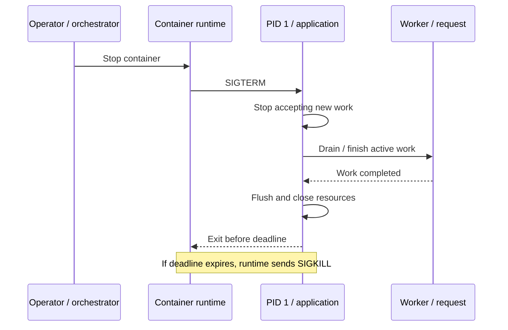
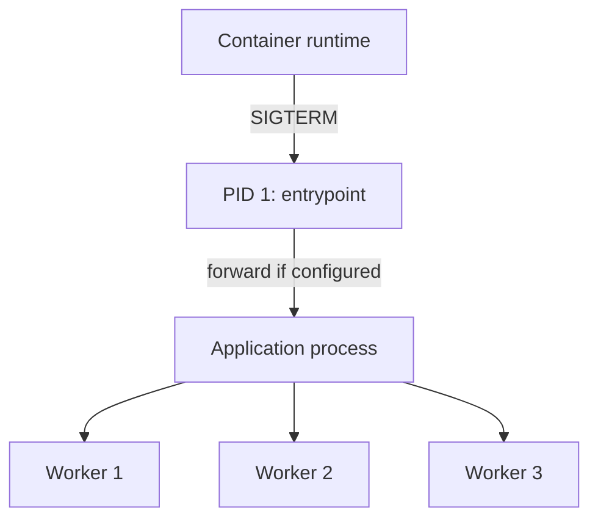

# Signals, PID 1, and Graceful Container Shutdown

## Context: Container Exit Does Not Mean Processes Stopped Safely

Containers are typically created to run an application or a related group of processes. When a container is stopped, the runtime sends a signal to the main process asking the application to terminate. If the application fails to receive the signal, fails to forward signals to child workers, or fails to finish writing data before the deadline, the runtime can force termination with `SIGKILL`. The consequences can include dropped in-flight requests, duplicate message processing, unflushed files, unclosed connections, and inconsistent state.

Inside a Linux container, the main process usually holds PID 1 within the container's PID namespace. PID 1 carries special responsibilities: it receives signals from the runtime, manages child process lifecycles, and must reap terminated child processes (zombie reaping). How `ENTRYPOINT`/`CMD` are written, how shells launch the application, and how the application handles `SIGTERM` determine whether a container shuts down properly.

In the **CLOUD_CORE_SERVICES_COMPUTE** module, understanding signals and PID 1 helps you build proper images, operate containers reliably on Docker and Kubernetes, reduce errors during deployments and scale-in events, and protect data during shutdown.

## 1. Processes and Signals in Linux

A process is a running instance of a program. Every process has a PID (Process ID), state, address space, file descriptors, permissions, and parent/child relationships. A process can spawn multiple child processes to run workers, shell commands, or auxiliary tasks.

A signal is an asynchronous notification sent by the kernel or another process to a process or thread. Signals can instruct a process to terminate, pause, resume, or handle an event. Some signals can be caught, blocked, or ignored by the application; signals like `SIGKILL` and `SIGSTOP` cannot be caught or ignored.

Common signals encountered when operating containers:

| Signal | Common Number on Linux | Meaning | Can Be Custom-Handled? |
|---|---:|---|---|
| `SIGTERM` | 15 | Request orderly termination | Yes |
| `SIGINT` | 2 | Interrupt, typically Ctrl+C | Yes |
| `SIGQUIT` | 3 | Request termination and typically produce a core dump by default | Yes |
| `SIGKILL` | 9 | Force immediate termination | No |
| `SIGSTOP` | 19 (x86/Linux) | Pause process | No |
| `SIGCONT` | 18 (x86/Linux) | Resume a stopped process | Catchable, but cannot prevent resumption |
| `SIGHUP` | 1 | Hangup; many applications use it to reload config | Yes |
| `SIGCHLD` | 17 (x86/Linux) | Notify that a child process changed state | Yes |

Signal numbers can vary across architectures or operating systems; always use signal names instead of hardcoding numbers. Default behavior depends on each signal. For instance, `SIGTERM` defaults to terminating the process, whereas `SIGCHLD` defaults to being ignored in action while remaining essential for reaping child processes.

### 1.1. Sending Signals via Commands

On Linux, you can use `kill` to send a signal to a PID:

```bash
# Request process 123 to terminate gracefully
kill -TERM 123

# Common equivalent shorthand
kill -15 123

# Force termination if process does not respond
kill -KILL 123

# Inspect processes and PID/PPID relationships
ps -o pid,ppid,stat,cmd -p 1
ps -ef
```

Despite its name, `kill` sends a signal; it does not inherently mean "delete the process immediately." `SIGTERM` is a termination request allowing cleanup. `SIGKILL` terminates the process without giving the application a chance to run cleanup handlers.

### 1.2. Signals Are Not Synchronous Function Calls

A signal can arrive at any point while an application is executing code. Handlers must be safe and brief. In many runtimes, a handler should simply set a shutdown flag or wake an event loop; flushing data, closing connections, and awaiting workers should happen on the normal execution path.

Avoid complex, blocking, or unsafe operations inside low-level signal handlers. For example, in C/C++, many library functions are not async-signal-safe; calling them directly from a handler can cause deadlocks or undefined state.

## 2. PID Namespaces and the Role of PID 1

Containers typically run inside an isolated PID namespace. Processes visible inside the namespace have namespace-local PIDs; the first process in the namespace usually receives PID 1. On the host, that same process can carry a different PID.

Example:

```text
Host PID namespace                 Container PID namespace
-------------------               ------------------------
PID 1: host init                   PID 1: application/init
PID 820: container runtime shim
PID 945: container process  ------> PID 1: app
PID 946: app worker                PID 2: worker
```

A container PID does not have to equal the host PID. The PID namespace provides an isolated view and process scope, yet processes still share the host kernel. Consequently, PID 1 inside a container carries special responsibilities within that namespace.

### 2.1. PID 1 Has Two Crucial Responsibilities

**Receiving and handling signals:** the runtime typically sends stop signals to the container's main process. If PID 1 lacks an appropriate handler or fails to forward signals to child processes, the application may keep running until the grace period expires and `SIGKILL` strikes.

**Reaping child processes:** when a parent process exits before its children, surviving children become orphans and are adopted within the PID namespace. PID 1 or an appropriate subreaper must call `wait()` to reap terminated child processes. Otherwise, terminated processes linger as zombies.

### 2.2. Special Signal Behavior of PID 1

Linux applies a special rule to PID 1 in any PID namespace: signals whose default action is process termination do not automatically terminate PID 1 unless the process explicitly registers a handler; `SIGKILL` and `SIGSTOP` remain the uncatchable, unignorable exceptions. This protects the init process from accidental termination. Therefore, an application running directly as PID 1 without a `SIGTERM` handler may ignore stop signals from the container runtime instead of exiting.

Never rely on default behavior for shutdown design. An application running as PID 1 must explicitly handle signals or sit behind a lightweight init process capable of forwarding signals and reaping children.

### 2.3. Zombie and Orphan Processes

- **Orphan process:** a child process still running after its parent exited. It gets adopted by another process, typically PID 1 or a subreaper.
- **Zombie process:** a terminated child process whose process table entry remains because its parent has not called `wait()`/`waitpid()` to collect its exit status.

Zombies no longer execute and typically consume no CPU, yet each occupies a process table entry. Accumulating zombies can exhaust PID/process limits. A PID 1 that fails to reap children properly can cause long-lived containers to accumulate zombies.

Inspecting zombie processes:

```bash
ps -eo pid,ppid,stat,cmd | awk '$3 ~ /Z/ { print }'
```

In `ps` output, state `Z` indicates a zombie. The proper fix is updating the parent/PID 1 to reap children; sending `SIGKILL` to a zombie does nothing because the process has already exited.

## 3. Why Must PID 1 Forward Signals and Reap Child Processes?

A container may run an application directly or launch a shell/script as the parent process that subsequently starts the application. When the runtime sends a signal, it goes to the main process. If the main process is a shell that does not forward signals, child applications may never receive the shutdown request.

### 3.1. Error-Prone Launch Patterns

Shell script example:

```sh
#!/bin/sh

./start-server &
./start-metrics-agent
wait
```

If the script is PID 1, the server is a child process. When the container receives `SIGTERM`, the shell receives the signal but does not automatically forward it to all child processes. Without explicit `trap`/forwarding logic, the server keeps running until the runtime force-kills the container.

Another common mistake is launching an app from a shell without `exec`:

```sh
#!/bin/sh
node server.js
```

Here, the shell remains the parent process and Node.js is a child. Without signal forwarding, the runtime delivers signals to the shell rather than directly to Node.js.

### 3.2. Using `exec` to Replace the Shell with the Application

In shell scripts, `exec` replaces the current shell process with the specified program. The PID stays the same, so the application becomes the main process:

```sh
#!/bin/sh
set -e

# Prepare required configuration or directories here
exec node server.js
```

After `exec`, the shell no longer exists as a separate process. Node.js inherits PID 1 and receives signals directly from the runtime. The application must still implement `SIGTERM` handling to stop workers and close connections cleanly.

### 3.3. Using Exec Form in a Dockerfile

Dockerfiles support two main forms for `ENTRYPOINT` and `CMD`:

**Exec form** uses a JSON array:

```dockerfile
FROM node:22-alpine
WORKDIR /app
COPY package*.json ./
RUN npm ci --omit=dev
COPY . .

ENTRYPOINT ["node", "server.js"]
```

In exec form, the runtime launches the executable directly; Node.js becomes the container's main process. This is generally the right choice for containerized applications.

**Shell form** runs via the default shell:

```dockerfile
FROM node:22-alpine
WORKDIR /app
COPY . .

ENTRYPOINT node server.js
```

Shell form typically runs through `/bin/sh -c`. The shell can become PID 1 while the application runs as a child process. Signal forwarding depends on the shell and command execution details; never assume signals will reach the application.

If a shell is needed to expand environment variables or run multiple setup steps, use a script ending with `exec`:

```dockerfile
COPY docker-entrypoint.sh /usr/local/bin/
RUN chmod +x /usr/local/bin/docker-entrypoint.sh
ENTRYPOINT ["/usr/local/bin/docker-entrypoint.sh"]
CMD ["node", "server.js"]
```

```sh
#!/bin/sh
set -eu

# Run brief preparation steps if needed
exec "$@"
```

This script replaces itself with the command passed via `CMD` or runtime arguments, making the application PID 1.

### 3.4. Distinguishing ENTRYPOINT and CMD

- `ENTRYPOINT` defines the image's main executable.
- `CMD` supplies the default command or default arguments to `ENTRYPOINT`.
- With exec form, `ENTRYPOINT ["app"]` and `CMD ["--port", "8080"]` combine into `app --port 8080`.
- Arguments passed to `docker run image ...` override `CMD`.

Example:

```dockerfile
ENTRYPOINT ["python", "-m", "http.server"]
CMD ["8080"]
```

The Python application runs directly as the main process. When the runtime sends `SIGTERM`, Python receives the signal and handles it per application logic.

## 4. Minimal Init Processes Inside Containers

Not every application is designed to act as PID 1 or manage multiple child processes. When a container must run a program that spawns child processes, a minimal init process can sit in front of the application.

A suitable init process typically provides:

- Forwarding signals to child processes or process groups as designed.
- Reaping orphaned/zombie child processes.
- Tracking exit status and exiting cleanly when the main application stops.
- A tiny footprint and predictable behavior.

Common tools include `tini` and `dumb-init`. Docker also offers `--init` to inject a lightweight runtime-provided init process, depending on the deployment platform.

### 4.1. Example Using Tini

```dockerfile
FROM node:22-alpine
RUN apk add --no-cache tini
WORKDIR /app
COPY package*.json ./
RUN npm ci --omit=dev
COPY . .

ENTRYPOINT ["/sbin/tini", "--"]
CMD ["node", "server.js"]
```

In this example, Tini runs as PID 1, manages child processes, and forwards signals as supported; Node.js runs as a child. Tini's exact path depends on the image/package; verify the executable location in your chosen base image.

### 4.2. When Is an Init Shim Needed?

Consider an init shim when:

- The application spawns multiple child processes and does not reap them itself.
- The container runs a shell wrapper or multiple child processes.
- A legacy application was not designed to be PID 1.
- Consistent handling of orphans and zombies is required.

If a container runs only a single foreground application that already handles signals and child processes properly, an init shim may be unnecessary. Avoid adding complex supervisor layers without a clear need.

### 4.3. Init Shims Do Not Replace Application Graceful Shutdown

An init process forwards signals and reaps processes, but it knows nothing about your application's business logic. It does not know how to stop accepting requests, commit transactions, drain queues, or flush buffers. The application must still implement an appropriate shutdown lifecycle.

## 5. Graceful Shutdown: Stopping in an Orderly Manner

Graceful shutdown is the process where an application stops accepting new work, finishes or cleanly cancels in-flight work, releases resources, and exits before the deadline. The goal is minimizing failed requests, partial data writes, and duplicate message processing during container replacement or scale-in.

A typical sequence:

1. Receive `SIGTERM` and transition application state to `SHUTTING_DOWN`.
2. Mark the instance unready so load balancers/orchestrators stop sending new requests.
3. Stop polling or accepting new messages/jobs from queues or schedulers.
4. Wait for in-flight requests to finish within a bounded timeout.
5. Commit or roll back transactions according to business rules.
6. Flush buffers, write checkpoints, or persist required state.
7. Close connection pools, listeners, consumers, and clients.
8. Stop child workers and reap processes.
9. Log final shutdown status and exit with an appropriate exit code.

Not every application follows this exact order. A worker might stop polling first, finish its current message, and then close the database pool. A web server might stop accepting new connections while keeping active connections open for a drain window.

### 5.1. Idempotency and In-Flight Work

Graceful shutdown cannot guarantee every task finishes: processes can be killed, hosts can lose power, or grace periods can expire. Therefore, jobs and messages must be safe to retry:

- Use idempotency keys or deduplication for operations with side effects.
- Acknowledge (ACK) messages only after results are durably committed.
- Set visibility timeouts/leases aligned with processing time.
- Save checkpoints for long-running jobs when possible.
- Use transactions or the outbox pattern when updating databases and emitting events.
- Configure dead-letter queues and retry caps for poison payloads.

## 6. SIGTERM and SIGKILL in the Container Lifecycle

`SIGTERM` requests an orderly shutdown. The runtime waits for a configurable grace period before sending `SIGKILL`. `SIGKILL` terminates the process immediately without allowing cleanup handlers, `finally` blocks, or shutdown hooks to run.



### 6.1. Shutdown Timeouts

The grace period must be long enough to drain normal work, yet short enough not to stall rollouts or scale-in operations. Estimate it as:

```text
shutdown_budget = readiness_propagation
                + max_inflight_work_drain
                + resource_cleanup
                + safety_margin
```

For instance, suppose an application needs 5 seconds for traffic removal, up to 20 seconds to complete in-flight requests, and 5 seconds to close connections. Start testing with a grace period safely above the 30-second sum, then calibrate under realistic load.

If the timeout is shorter than normal processing time, valid in-flight requests get severed. If the timeout is too long, deployments and scale-in slow down and rollouts can overrun time budgets. Measure p95/p99 drain duration rather than guessing a default.

### 6.2. STOPSIGNAL in Dockerfiles

A Docker image can declare which signal is sent on stop:

```dockerfile
STOPSIGNAL SIGTERM
ENTRYPOINT ["/app/server"]
```

`SIGTERM` is the standard choice. Use another signal only if both application and runtime are consistently configured for it. `STOPSIGNAL` does not replace an application handler; if the process ignores that signal, the container will still be force-killed after timeout.

### 6.3. Docker `stop` and `kill`

```bash
# Send the default stop signal and wait for the runtime's default timeout
docker stop orders-api

# Wait up to 45 seconds before forcing termination
docker stop --time 45 orders-api

# Send a specific signal, such as SIGTERM
docker kill --signal=SIGTERM orders-api

# Force immediate termination; use only when necessary
docker kill --signal=SIGKILL orders-api
```

`docker stop` sends the configured stop signal (defaulting to `SIGTERM`), waits for the grace period, and sends `SIGKILL` if the container has not exited. `docker kill` defaults to `SIGKILL`, though `--signal` can specify another signal.

Never use default `docker kill` as a routine deployment step for stateful applications. Use `docker stop` or orchestrator graceful termination, and inspect logs and exit codes afterward.

## 7. Implementing Signal Handlers in Applications

Signal handlers must integrate with the application lifecycle. A handler should not immediately call `exit()` on `SIGTERM`; instead, flip state, stop accepting new work, and wait for cleanup within a deadline.

### 7.1. Node.js HTTP Server Example

This example illustrates the core steps: readiness turns false, the server stops accepting new connections, the queue consumer stops polling, in-flight work drains, and the database pool closes.

```javascript
let shuttingDown = false;

app.get("/ready", (_req, res) => {
  if (shuttingDown) {
    return res.status(503).send("shutting down");
  }
  res.status(200).send("ready");
});

async function shutdown(signal) {
  if (shuttingDown) return;
  shuttingDown = true;
  console.log(`received ${signal}; starting graceful shutdown`);

  // Give the load balancer/orchestrator time to propagate readiness state.
  await new Promise((resolve) => setTimeout(resolve, 3000));

  // Stop accepting new jobs before draining in-flight work.
  await queueConsumer.stopReceiving();

  // Stop accepting new HTTP connections and await active requests.
  await new Promise((resolve, reject) => {
    server.close((error) => error ? reject(error) : resolve());
  });

  // Drain active jobs and close dependencies.
  await queueConsumer.drain({ timeoutMs: 15000 });
  await databasePool.end();

  console.log("graceful shutdown complete");
}

process.on("SIGTERM", () => {
  shutdown("SIGTERM").catch((error) => {
    console.error("shutdown failed", error);
    process.exitCode = 1;
  });
});

process.on("SIGINT", () => {
  shutdown("SIGINT").catch((error) => {
    console.error("shutdown failed", error);
    process.exitCode = 1;
  });
});
```

This is a skeleton that must be adapted to your Node.js version, HTTP server, queue client, and database driver. Include an overall deadline: if draining does not finish before the grace period, the runtime will send `SIGKILL`. In real applications, add timeouts/cancellation per step and ensure cleanup is idempotent.

### 7.2. Python Example with a Shutdown Event

In Python, a signal handler can set a flag or `Event`; the main loop checks the flag and runs cleanup in the normal control flow:

```python
import signal
import threading

shutdown_requested = threading.Event()

def request_shutdown(signum, _frame):
    print(f"received signal {signum}")
    shutdown_requested.set()

signal.signal(signal.SIGTERM, request_shutdown)
signal.signal(signal.SIGINT, request_shutdown)

def main():
    start_http_server()
    start_workers()

    while not shutdown_requested.wait(timeout=0.5):
        run_periodic_tasks()

    mark_not_ready()
    stop_accepting_new_jobs()
    drain_inflight_jobs(timeout_seconds=20)
    close_database_pool()
    close_message_consumer()

if __name__ == "__main__":
    main()
```

Do not execute full cleanup inside the signal handler itself. With web frameworks, use the framework's official lifecycle hooks or shutdown APIs to stop listeners and workers cleanly.

### 7.3. Go HTTP Server Example

Go can use `signal.NotifyContext` to cancel a context on signal arrival and `http.Server.Shutdown` to wait for active requests:

```go
ctx, stop := signal.NotifyContext(
    context.Background(), syscall.SIGTERM, syscall.SIGINT,
)
defer stop()

server := &http.Server{Addr: ":8080", Handler: handler}
go func() {
    if err := server.ListenAndServe(); err != nil && err != http.ErrServerClosed {
        log.Printf("server error: %v", err)
    }
}()

<-ctx.Done()

shutdownCtx, cancel := context.WithTimeout(context.Background(), 25*time.Second)
defer cancel()

if err := server.Shutdown(shutdownCtx); err != nil {
    log.Printf("graceful shutdown failed: %v", err)
    _ = server.Close()
}
```

This snippet requires the corresponding imports (`context`, `log`, `net/http`, `os/signal`, `syscall`, `time`). In real systems, also shut down background workers and dependencies before exiting; `Server.Shutdown` only handles the HTTP server.

## 8. Kubernetes Termination Lifecycle

Kubernetes manages Pod and container lifecycles through kubelet. When a Pod is deleted or replaced during a rollout, Kubernetes executes a termination sequence with a grace period.

Conceptually, the sequence includes:

1. The Pod is marked Terminating; endpoint controllers update endpoints to stop routing new traffic to the Pod via Service mechanisms.
2. If a `preStop` hook is configured, kubelet executes it inside the container.
3. After the hook completes, kubelet sends the stop signal (typically `SIGTERM`) to the container's main process.
4. The application performs graceful shutdown within the remaining time.
5. When `terminationGracePeriodSeconds` expires while the process is still running, kubelet/runtime force-kills it with `SIGKILL`.

EndpointSlice/load balancer updates and hook execution happen asynchronously across distributed components; never assume incoming traffic stops the instant the application receives `SIGTERM`. Applications need readiness/drain logic and properly matched timeouts.

### 8.1. `terminationGracePeriodSeconds`

A Pod can declare its grace period:

```yaml
apiVersion: v1
kind: Pod
metadata:
  name: orders-api
spec:
  terminationGracePeriodSeconds: 45
  containers:
    - name: app
      image: example/orders-api:1.4.0
      ports:
        - name: http
          containerPort: 8080
```

The default is typically 30 seconds if unspecified. This window includes `preStop` hook execution; hooks consume the grace period rather than receiving extra time on top. If a hook is still running near expiration, kubelet may grant a tiny extension in certain cases, though you should never rely on it.

### 8.2. `preStop` Hook

`preStop` is useful to tell an application to start draining before kubelet sends the stop signal. Example HTTP hook calling an internal admin endpoint:

```yaml
apiVersion: v1
kind: Pod
metadata:
  name: orders-api
spec:
  terminationGracePeriodSeconds: 45
  containers:
    - name: app
      image: example/orders-api:1.4.0
      lifecycle:
        preStop:
          httpGet:
            path: /internal/drain
            port: 8081
            scheme: HTTP
```

The `/internal/drain` endpoint must be secured and reachable only from trusted container/lifecycle contexts. It can flip readiness to false, stop accepting new work, and begin draining. Once the hook finishes, kubelet sends `SIGTERM`; the application should handle signals idempotently and continue cleanup if still in progress.

Never use `preStop: sleep 30` as a blind default. Sleeping simply delays `SIGTERM`, burns grace period budget, and does not guarantee load balancers have stopped sending traffic. If propagation delay is needed, measure actual times and coordinate readiness/endpoint draining.

### 8.3. Readiness, Liveness, and Shutdown

- Readiness should report not-ready while shutting down so Services stop selecting the Pod as a backend.
- Liveness verifies the process is alive; it should not fail merely because the app is draining if that causes kubelet to restart the container mid-shutdown.
- Startup probes protect slow-starting applications from premature liveness failures.

Probes need appropriate timeouts, periods, and failure thresholds. If readiness depends heavily on transient downstream dependencies, a brief dependency blip can pull all replicas out of Service. Design probes to reflect the application's actual ability to serve requests.

### 8.4. Rolling Updates and PodDisruptionBudget

During rolling updates, Kubernetes replaces Pods according to the Deployment strategy. Applications must finish draining within the grace period to minimize failed requests. `maxUnavailable`, `maxSurge`, readiness probes, and `PodDisruptionBudget` (PDB) govern how many replicas can be disrupted concurrently.

PDBs primarily constrain voluntary disruptions via the eviction API; they do not prevent involuntary failures such as node crashes or zone outages. Do not treat PDBs as a substitute for spare capacity or graceful shutdown.

## 9. Which Process in the Container Receives the Signal?

The container runtime typically delivers the stop signal to the container's main process (PID 1). The runtime does not automatically understand the application's process tree and does not necessarily signal every child process.



If PID 1 is the application and the application manages workers, it must shut down workers properly. If PID 1 is an init shim, the shim forwards signals per its design and reaps children. If PID 1 is a shell wrapper, ensure it uses `exec`, `trap`/forwarding, or a proper init process.

### 9.1. Process Groups and Multiple Processes

Linux organizes processes into sessions and process groups. Some applications manage multiple child processes and need to signal the whole process group. However, the runtime signaling PID 1 does not mean the entire process group automatically receives the same signal.

When a container genuinely requires multiple independent processes, use a dedicated process supervisor/init designed for that role or split responsibilities into separate containers. If using an init shim with process-group forwarding options, check documentation for your exact version and test behavior when new child processes spawn.

### 9.2. Running Docker with an Init Process

With the Docker CLI, you can instruct the runtime to inject a lightweight init process:

```bash
docker run --init --name worker worker-image:1.0
```

`--init` resolves basic signal forwarding and zombie reaping issues. The application must still implement graceful shutdown logic; `--init` does not automatically stop accepting requests, flush buffers, or finish transactions on the application's behalf.

## 10. Graceful Shutdown by Workload Type

### 10.1. HTTP/API Servers

- Switch readiness to false to stop receiving new traffic.
- Stop accepting new connections while letting active requests finish within a deadline.
- For keep-alive/HTTP/2, handle connection draining and open streams cleanly.
- Close WebSockets or send reconnect notices if required by the protocol.
- Close database/cache/client pools after requests finish.
- Return an exit code reflecting shutdown outcome.

Requests outliving the grace period need deadlines, cancellation, or background continuation. Never hold a container open indefinitely just because one client refuses to close a connection.

### 10.2. Queue Consumers and Workers

- Stop polling/subscribing for new messages.
- Never ACK an in-flight message before results are committed.
- Wait for active jobs to complete within bounds.
- If time runs out, let the lease/visibility timeout expire so the message can be retried.
- Ensure handlers are idempotent so retries do not create duplicate side effects.
- Close consumers and connections after draining.

### 10.3. Batch Jobs and Scheduled Tasks

Batch jobs may need checkpoints to resume from the latest progress after an interruption. For non-checkpointable jobs, use an adequate deadline or run in workloads able to complete before termination. Avoid jobs longer than allowed shutdown windows without resume support.

### 10.4. Stateful Services

Databases, brokers, and stateful services must shut down following product-specific protocols. Flush WALs/journals, sync replicas, close listeners, and verify quorum/leader state. Never issue `SIGKILL` routinely or manually delete data files before the process finishes shutting down.

## 11. Timeout Design and Load Balancer Coordination

Shutdown timeouts must align across layers:

| Layer | Relevant Settings | Goal |
|---|---|---|
| Application | Request deadline, drain timeout, worker timeout | Complete or cleanly cancel active work |
| Readiness | Probe period, timeout, failure threshold | Mark instance ineligible for new work |
| Load balancer | Deregistration delay, connection draining | Stop routing new requests and drain open connections |
| Container runtime | Stop timeout / grace period | Give app time to exit before `SIGKILL` |
| Kubernetes Pod | `terminationGracePeriodSeconds`, `preStop` | Coordinate lifecycle and termination window |

Timeouts must maintain sensible relationships. For example, if a load balancer keeps connections open for 60 seconds while the container only has a 30-second grace period, the app can be killed while connections are still draining. Conversely, if the application timeout exceeds the entire grace period, cleanup cannot complete.

Illustrative API configuration:

```text
Readiness propagation:       5 seconds
Load balancer drain window:  25 seconds
Application request drain:   20 seconds
Resource cleanup:             5 seconds
Pod termination grace:       40 seconds
```

This example only illustrates timeout relationships. In practice, measure endpoint propagation latency, longest supported request duration, concurrent connections, and the resource cost of keeping Pods terminating.

### 11.1. Do Not Rely Solely on `sleep`

A `sleep` inside an entrypoint or `preStop` provides a buffer, yet it never proves traffic has stopped or workers have drained. Prefer observable readiness, endpoint draining, and application drain signals. If waiting for propagation is unavoidable, measure real propagation times and bound the wait.

## 12. Exit Codes and Diagnosing Killed Containers

When a container stops, inspect exit codes, OOM status, events, and logs to distinguish normal exit, runtime kill, or kernel OOM kill.

```bash
# Inspect status, exit code, and OOMKilled flag
docker inspect --format '{{.State.Status}} {{.State.ExitCode}} {{.State.OOMKilled}}' orders-api

# Inspect logs around termination time
docker logs --tail 200 orders-api

# Inspect recent runtime events
docker events --since 10m
```

Common exit codes:

- `0`: process exited successfully per application convention.
- `143`: typically `128 + 15`, indicating termination via `SIGTERM`.
- `137`: typically `128 + 9`, indicating termination via `SIGKILL`, which may be grace-period expiration or OOM kill.

Exit codes are only clues. `137` does not prove OOM by itself; check `OOMKilled`, kernel logs, container events, and memory metrics. Similarly, `143` does not prove business cleanup finished; inspect cleanup logs and data state.

With Kubernetes:

```bash
# Inspect status and container restart reasons
kubectl describe pod orders-api-xxxxx

# View current and previous container logs
kubectl logs orders-api-xxxxx -c app
kubectl logs orders-api-xxxxx -c app --previous

# View namespace events
kubectl get events --sort-by=.lastTimestamp
```

Look for `OOMKilled`, `Error`, `Killing`, probe failures, evictions, and when the Pod entered Terminating. Correlate timestamps with application logs to verify whether the handler received the signal.

## 13. Common Issues and Fixes

| Symptom | Possible Cause | Fix |
|---|---|---|
| Container waits the entire timeout before stopping | PID 1 ignores/fails to forward `SIGTERM` or app hangs | Inspect PID tree, use exec form/`exec`, add handler, measure cleanup |
| App never receives `SIGTERM` | Shell is PID 1 and does not forward signals | Use exec form, `exec` in wrapper, or an init shim |
| Child workers keep running after app exits | Child processes/process groups unmanaged | Explicitly stop workers, use a suitable supervisor/init, reap children |
| Zombie processes accumulate | PID 1 fails to `wait()` on exited children | Fix app reaping or use an init shim with reaping |
| Exit code 137 | `SIGKILL` from timeout, OOM, or manual kill | Check `OOMKilled`, grace period, memory, and events |
| Failed requests during rollout | Insufficient readiness/connection draining or early exit | Mark not-ready, align LB draining, tune grace period from metrics |
| Duplicate queue message processing | Worker killed before ACK/commit or non-idempotent handler | ACK after commit, idempotency keys, visibility timeout, DLQ |
| Database reports incomplete transactions | Process killed mid-transaction | Graceful transaction handling, deadlines, recovery protocols |
| Pod stuck Terminating too long | Hook or request drain hung, or oversized grace period | Inspect hooks, in-flight requests, finalizers, and per-step timeouts |
| Liveness probe restarts Pod during drain | Probe interprets shutdown as liveness failure | Keep liveness tied to process health; use readiness for traffic |

## 14. Testing Shutdown Before Production

Shutdown should be tested as a normal operational path, not just when the application is idle.

### 14.1. Test Scenarios

1. Start the container and verify either the application or the init shim is PID 1.
2. Send a long-running request with a known duration.
3. While the request is in flight, run `docker stop --time` or delete the Pod under the expected grace period.
4. Verify the application stops accepting new requests and completes or cleanly cancels the active request per policy.
5. Verify queue consumers stop pulling new jobs and in-flight messages are not prematurely ACKed.
6. Verify database transactions, log flushing, and connection closing.
7. Confirm no orphaned child processes linger and no zombies accumulate.
8. Inspect exit code, shutdown duration, and error metrics.
9. Repeat under high load, slow dependencies, and near grace-period exhaustion.
10. Test timeout expiration to verify safe system recovery after `SIGKILL`.

### 14.2. Acceptance Criteria

- Application receives the stop signal and logs shutdown start time.
- Readiness turns false before the instance leaves the traffic pool.
- In-flight requests/jobs complete or retry safely.
- Process exits within the grace period under supported load.
- No unexpected zombie or orphan processes accumulate.
- No committed data is lost.
- Containers/Pods are replaced and new instances become Ready.
- Metrics/logs can detect slow shutdowns or forced kills.

### 14.3. Measuring Shutdown Timing

Record timestamps:

- `t0`: runtime/orchestrator initiates termination.
- `t1`: application receives `SIGTERM`.
- `t2`: readiness turns false and traffic draining begins.
- `t3`: last in-flight request/job finishes or hands off.
- `t4`: dependencies close and process exits.

From these, compute signal delivery latency (`t1 - t0`), drain duration (`t3 - t2`), and cleanup duration (`t4 - t3`). If `t4` exceeds the grace period, optimize cleanup or tune timeouts after verifying impact.

## 15. Anti-Patterns to Avoid

**Running a shell as PID 1 without forwarding signals.** The runtime sends `SIGTERM` to the shell, while the child app never learns it should stop. Use exec form or `exec` at the end of entrypoints.

**Using `SIGKILL` as routine shutdown.** `SIGKILL` skips cleanup. Reserve it for processes failing to exit after the grace period or evaluated emergency actions.

**Calling `process.exit()` immediately on signal.** Immediate exit abandons active requests, buffers, transactions, and workers. Start draining and exit only after cleanup.

**Assuming an init shim handles business logic.** An init shim forwards signals and reaps children; the application must still stop accepting work, finish transactions, and close dependencies.

**Putting long `sleep` calls in entrypoints or `preStop`.** Sleeping burns grace period without proving traffic stopped or work drained. Use observable readiness and endpoint draining.

**Letting workers ACK before committing data.** If killed between ACK and commit, messages can be lost. ACK only after results are durably stored per system semantics.

**Increasing the grace period indefinitely to mask shutdown bugs.** Long windows stall rollouts and tie up resources. Find the blocked cleanup step, add deadlines, and measure drain times.

**Using liveness probes instead of readiness to steer traffic.** Liveness failures can restart containers mid-drain. Readiness controls traffic admission; liveness reflects whether the process must be restarted.

**Assuming container PID 1 equals host PID.** PID namespaces create separate views; inspect both inside the container and on the host when troubleshooting.

## 16. Runbook When a Container Fails to Stop Cleanly

When a container or Pod exhausts its grace period and is force-killed, investigate in order:

1. Identify the container, Pod, image version, node, and termination timestamp.
2. Inspect PID 1 inside the image or the process tree while the container is running.
3. Verify `ENTRYPOINT`, `CMD`, shell wrappers, and `exec` usage.
4. Check logs to confirm whether the application recorded `SIGTERM`/`SIGINT`.
5. Identify which shutdown step stalled: requests, queues, transactions, threads, child processes, or dependencies.
6. Inspect grace period, `preStop`, load balancer drain, and request timeouts.
7. Check exit codes, OOM status, runtime events, and kernel events.
8. Compare drain duration against real load and request profiles.
9. Fix handlers/timeouts or add an init shim if PID 1/child reaping is at fault.
10. Re-run shutdown tests before broad rollout.

Never simply raise timeouts without identifying root cause. If a dependency hangs indefinitely, a longer timeout merely delays failure; add deadlines and cancellation to every cleanup step.

## 17. Design and Operations Checklist

### Processes and PID 1

- [ ] Identify which process runs as PID 1 in the container.
- [ ] `ENTRYPOINT`/`CMD` use exec form or a wrapper ending in `exec`.
- [ ] PID 1 registers handlers for required termination signals.
- [ ] Child processes are managed, signaled, and reaped.
- [ ] An init shim is used when the application does not reap children itself.

### Graceful Shutdown

- [ ] `SIGTERM` initiates shutdown state and is logged.
- [ ] Readiness transitions to false before stopping service.
- [ ] In-flight requests, streams, and jobs drain or cancel cleanly.
- [ ] Queue messages are ACKed only after commit, and handlers are idempotent.
- [ ] Transactions, buffers, files, and connection pools close in order.
- [ ] Every step has a timeout; total duration fits within the grace period.
- [ ] `SIGKILL` serves only as a final fallback after deadline expiration.

### Docker/Kubernetes

- [ ] Docker stop signal and timeout match application needs.
- [ ] `STOPSIGNAL` is set explicitly if the app requires a non-default signal.
- [ ] Kubernetes `terminationGracePeriodSeconds` covers `preStop`, draining, and cleanup.
- [ ] `preStop` serves a concrete purpose and avoids wasting grace period on arbitrary sleeps.
- [ ] Readiness, liveness, and startup probes have distinct roles and calibrated thresholds.
- [ ] Load balancer connection draining aligns with shutdown duration.
- [ ] Rolling updates, PDBs, and capacity ensure other Pods serve traffic while one terminates.

### Testing and Observability

- [ ] Stopping has been tested with active requests/jobs in flight.
- [ ] Exit codes, `OOMKilled`, runtime events, and application logs are checked.
- [ ] No zombie or orphan processes accumulate.
- [ ] Time from signal delivery to process exit is measured.
- [ ] Slow dependencies and grace-period expiration scenarios have been tested.
- [ ] Alerts exist for shutdown timeouts, restart loops, and prolonged terminations.

## Conclusion

Signals are Linux's mechanism for notifying processes; `SIGTERM` enables orderly termination, whereas `SIGKILL` forces immediate stop. The PID 1 process in a container's PID namespace receives stop signals from the runtime and bears critical responsibility for child process management; shell wrappers omitting `exec` or signal forwarding can prevent child applications from stopping cleanly. Safe containers implement graceful shutdown: flipping readiness, halting new work intake, draining requests/jobs, finishing transactions, closing dependencies, and exiting before the grace period expires. Docker stop timeouts, Kubernetes `preStop`, `terminationGracePeriodSeconds`, readiness probes, and load balancer draining must all work in harmony. Testing shutdown under load and monitoring exit codes and logs surfaces issues well before production rollout.
