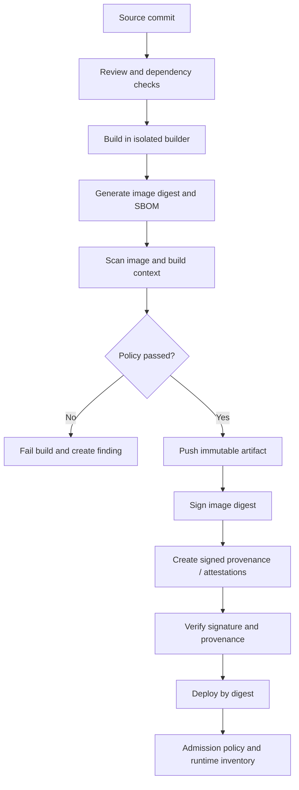

# Registries, Image Scanning, Signing, and Software Provenance

## 1. Why Protect Container Images?

A container image packages an application together with the runtime, libraries, and files needed to run a workload. An image can be built once and deployed across multiple environments: developer laptops, CI, staging, production, or multiple clusters. Because an image passes through many systems and may be reused for a long time, it becomes a critical link in the software supply chain.

If an image comes from an untrusted registry, contains critical vulnerabilities, accidentally bundles secrets, or is tampered with after inspection, workloads can execute malicious code or become exploitable. Without knowing which source, build tool, and identity produced an image, operations teams struggle to verify integrity during an incident.

Image protection workflows must combine multiple layers:

- **Registry:** stores, distributes, and controls access to images.
- **Scanning:** detects vulnerabilities, secrets, risky misconfigurations, and unsafe components.
- **SBOM:** inventories the software components contained inside an artifact.
- **Signing:** attests that an image digest was signed by a trusted identity or key.
- **Provenance/attestation:** records verifiable evidence of the source, builder, and process that produced the image.
- **Policy enforcement:** permits only policy-compliant images to be deployed.

Within the **CLOUD_CORE_SERVICES_COMPUTE** module, these controls safeguard images used to deploy VM/container workloads, scale services, and operate cloud compute. This lesson focuses on registries, image scanning, signing, and provenance so images entering production are traceable and verifiable.

After this lesson, learners will be able to:

- Explain the roles of OCI images, registries, tags, and digests.
- Design a registry with authentication, authorization, TLS, retention, and auditing.
- Scan images to detect CVEs, secrets, and inappropriate components.
- Generate and consume SBOMs for images.
- Sign images by digest and verify signatures prior to deployment.
- Verify provenance/attestations and bind images to source/build identities.
- Integrate policy checks into CI/CD and cluster admission control.
- Handle newly disclosed vulnerabilities, revoke artifacts, and investigate suspicious images.

## 2. Images, Registries, Tags, and Digests

### 2.1. What Is an OCI Image?

The OCI (Open Container Initiative) defines open specifications for container images and runtimes. An OCI image is typically described by a manifest, a config, and a set of layers. The manifest references blobs by digest; the config stores metadata such as entrypoint, environment, user, and build history; layers contain filesystem changes.

Registries distribute these manifests and blobs. When a container runtime pulls an image, it fetches the manifest and downloads the required layers. Layers can be shared across multiple images to reduce transfer and storage volume.

### 2.2. Registries Store and Distribute Artifacts

A container registry can be:

- An organization's private registry or a cloud provider registry.
- A public registry for sharing images.
- A proxy/cache registry caching upstream images.
- A registry running in an internal or air-gapped environment.
- An artifact registry supporting both container images and OCI artifacts such as SBOMs, signatures, or attestations.

Registries typically provide namespaces/repositories, authentication, authorization, TLS, audit logs, retention, replication, vulnerability scanning, and tag controls. Exact features depend on the product; never assume every registry enforces the same policy types.

### 2.3. Tags Can Change; Digests Identify Content

Example image reference:

```text
registry.example.com/platform/orders-api:1.8.2
```

`1.8.2` is a tag. A registry may allow this tag to be updated to point to a different manifest unless immutable tags are enabled. Thus, tags are convenient for humans yet insufficient to guarantee immutable content.

A digest is the hash of a manifest or index, typically formatted as:

```text
registry.example.com/platform/orders-api@sha256:0123456789abcdef...
```

When deploying by digest, the runtime pulls the exact content matching that digest. Even if the tag is repointed to another image, the digest reference still identifies the original artifact.

Operational rules:

- Use meaningful tags for lookup, such as semantic versions or build numbers.
- Use digests in production deployment manifests to lock down exact content.
- Enable immutable tags when release workflows require tags never to be overwritten.
- Store mappings linking source commit, build ID, tag, and digest.
- Never use `latest` as the sole identifier for a production release.

### 2.4. Multi-Architecture Images

A single tag can point to an image index/manifest list holding multiple per-architecture manifests, such as `linux/amd64` and `linux/arm64`. The runtime selects the manifest matching the node.

When signing, scanning, or deploying multi-architecture images, know whether you are operating on the index digest or an individual platform manifest digest. Some tools display multiple digests; policies must verify the exact object referenced at deployment time. Validate images across every architecture in your fleet, as native dependencies or binaries can differ.

### 2.5. An Image Is Not Just Its Final Filesystem

Layers are immutable, and later layers can mask or delete files created in earlier layers. For instance, a secret added in an early layer and deleted in a later layer can still remain inside the image's historical layers. Therefore, keep secrets out of the build context and every layer; deleting files in a subsequent layer is not a safe remediation.

Likewise, packages removed from the final filesystem may still reside in earlier layers. Scanners analyze metadata and layers differently. Understand your scanner's detection scope and never rely on a single scan result to conclude all historical layers are clean.

## 3. Designing and Operating a Registry

### 3.1. Organizing Repositories and Namespaces

Organize repositories by owning team or deployment boundary, for example:

```text
registry.example.com/
  platform/orders-api
  platform/payment-worker
  data/etl-runner
  base/java-runtime
  base/python-runtime
```

Repository names should remain stable and reflect ownership. Avoid creating a new repository per build; versions and build IDs belong in tags and digests. Clearly distinguish base images, application images, and internal tooling images.

### 3.2. Authentication and Authorization

Authentication verifies which user or workload is accessing the registry. Authorization determines which actions that identity may perform.

Apply least privilege:

- Developers can pull required images; push permissions should be scoped by repository or team.
- CI builders may only push into their project's namespace and attach required metadata.
- Production clusters only need pull access for approved images.
- Registry admin accounts require narrow scope, MFA, and auditing.
- Robot accounts or automated tokens need explicit lifetimes, scopes, and rotation mechanisms.

Never share a single broad-push credential across developers, CI, and production nodes. Separating permissions limits blast radius if a credential is compromised.

### 3.3. TLS and Network Connectivity

Use HTTPS/TLS for all client-to-registry connections. If an internal registry uses a private CA, install the trust chain on builders and runtime nodes via certificate management procedures. Never disable TLS verification to work around certificate errors in production.

Verify network paths from:

- CI runners to the registry for image pushes.
- Kubernetes nodes or VM runtimes to the registry for image pulls.
- Scanners and signing services to the registry to read manifests/blobs and write results.
- The registry to its object storage or backing storage.

For private registries, verify DNS, routing, firewalls, proxies, private endpoints, and egress rules. When a node fails to pull an image, distinguish authentication failures, TLS errors, DNS issues, quota/rate limits, and missing network routes.

### 3.4. Retention, Immutability, and Garbage Collection

Registries need retention policies balancing rollback capability against storage costs. Never delete images based purely on age if they are still deployed or needed for recovery.

A policy might retain:

- Currently deployed production releases and several recent rollback versions.
- Images referenced by active deployments or supported releases.
- SBOMs, signatures, and provenance linked to retained artifacts.
- Pinned base images used by supported build pipelines.

Immutable tags prevent overwriting release tags. Garbage collection must understand manifests, shared blobs, and linked artifacts; careless deletion can make a running image unpullable when a new node spins up.

### 3.5. Replication and Availability

For multi-region workloads, consider replication or pull-through caches to cut latency and reduce dependence on a single registry endpoint. Confirm whether replication includes OCI referrers, signatures, SBOMs, and attestations or only image manifests/layers.

Include registries and caches in DR planning. A cluster can keep running already-pulled containers, yet scaling out or replacing nodes requires pulling images fresh. A registry outage can break rollouts and autoscaling even while existing Pods stay up.

### 3.6. Auditing and Change Control

Log who pushes, pulls, deletes, alters tags, modifies policies, or creates tokens. For production images, record timestamps, digests, actors, source repositories, and build IDs. Audit logs help investigate tag mutations or unexpected images.

## 4. Image Scanning and Vulnerability Management

### 4.1. Categories of Issues to Scan

Image scanning can uncover multiple risk categories:

| Category | Examples | Remediation Direction |
|---|---|---|
| OS package CVEs | Vulnerable OpenSSL, glibc, or OS packages | Update base image/packages and rebuild |
| Language dependencies | Java, npm, Python, or Go libraries with CVEs | Upgrade versions, swap dependencies, or apply mitigations |
| Secrets | API keys, private keys, tokens, or passwords in layers or files | Revoke/rotate secrets, remove from source/build context, rebuild image |
| Misconfigurations | Running as root, extra packages/debug tools, overly broad file modes | Fix Dockerfile and runtime policies |
| Malware/suspicious files | Unexpected binaries or malware indicators | Quarantine image, investigate source/build, replace with clean artifact |
| License/compliance | Dependencies carrying disallowed licenses | Replace dependency or seek policy exception |

Scanners cannot prove an application is completely secure. They detect issues strictly within the scope of the tool's vulnerability feeds, rules, and analysis methods.

### 4.2. CVEs and Severity

A CVE identifies a publicly disclosed vulnerability. Tools pair CVEs with severity ratings, package versions, patch availability, and exploit metadata. Never prioritize solely by CVSS score.

During triage, evaluate:

- Is the package actually present and invoked at runtime?
- Does the installed version fall within the affected range?
- Is there a public exploit or evidence of active exploitation?
- Is the component reachable from the network or untrusted input?
- Does a patch or fixed version exist?
- Does the vulnerability affect features actually used?
- Which environment runs the image, and what is its exposure?

A high-severity CVE in an unused package carries a different practical risk than a remote code execution flaw in a public request-handling library. Still, never dismiss findings merely because a package looks rarely used without evidence of reachability and impact.

### 4.3. Multi-Stage Scanning

Scan across multiple lifecycle stages:

1. **Source/dependency scan:** inspect dependency manifests and lockfiles before building.
2. **Build-context scan:** detect secrets, risky configs, and files that should never be packaged.
3. **Image scan:** scan the built image prior to release.
4. **Registry rescan:** rescan stored images whenever vulnerability databases update or new CVEs emerge.
5. **Deployment/runtime inventory:** identify which digests are running in clusters or VMs to prioritize remediation.

An image clean at build time can become vulnerable once a new CVE is published. Scanning must therefore continue after push and after deployment.

### 4.4. Scanning Example with Trivy

Illustrative command to scan an image:

```bash
trivy image --scanners vuln,secret --severity HIGH,CRITICAL --exit-code 1 \
  registry.example.com/platform/orders-api:1.8.2
```

This command exits non-zero when issues matching the selected severities are found. Flags vary across Trivy versions, configurations, and data feeds; verify and pin the tool version in CI for reproducible results.

You can also scan filesystems or IaC separately for secrets and misconfigurations before building images. Do not scan only the final image and assume secrets in the build context will always be caught.

### 4.5. Scanning Example with Grype

```bash
grype registry.example.com/platform/orders-api:1.8.2 \
  --fail-on high
```

This illustrates failing a pipeline on a severity threshold. Grype and other scanners differ in data sources, package detection, and findings. Save reports in machine-readable formats such as JSON or SARIF when supported for longitudinal comparison.

### 4.6. False Positives and Exceptions

Scanners may report inapplicable vulnerabilities due to backported distro patches, misidentified binaries, or unreachable dependencies. Exceptions should:

- Specify the exact image digest, package, CVE, and rationale.
- Include an approver and an expiration date.
- Document mitigations and supporting evidence.
- Be re-evaluated whenever scanner databases or the image change.

Never create permanent package-wide allowlists or blanket-ignore all high-severity findings. Keep exceptions narrow and auditable.

### 4.7. Secret Scanning

Secrets can hide in source code, `.env` files, build arguments, environment metadata, config files, or layers. If a secret was ever committed or baked into an image, deleting it from the current filesystem does not make the old credential safe.

When a secret is detected:

1. Identify the credential type, scope, and potential exposure window.
2. Revoke or rotate the credential at the issuing system.
3. Inspect audit logs for signs of unauthorized use.
4. Remove the secret from source/build context and the Dockerfile.
5. Rebuild a clean image, rescan, and release a new digest.
6. Delete or restrict access to old artifacts per policy while preserving needed forensic evidence.

Never just delete the offending line and keep using the old credential.

## 5. Reducing the Image Attack Surface

### 5.1. Intentional Base Image Selection

Pick base images from trusted publishers with clear update cadences and support policies. Consider minimal or distroless images when the application does not require a shell or package manager at runtime. Smaller images reduce maintenance overhead, though small size alone does not guarantee security.

Verify:

- Publisher identity and release source.
- Architecture and runtime compatibility.
- Security patch cadence.
- Available SBOMs and scan reports.
- Digest/version pinned in builds.
- Support policy and end-of-life dates.

Avoid `latest` tags for production base images when reproducibility matters. Pin managed versions or digests and update deliberately as patches arrive.

### 5.2. Multi-Stage Builds

Multi-stage builds keep compilers, package managers, and build tools in build stages, copying only needed artifacts to the runtime stage. This shrinks both size and attack surface.

```dockerfile
FROM golang:1.24 AS build
WORKDIR /src
COPY go.mod go.sum ./
RUN go mod download
COPY . .
RUN CGO_ENABLED=0 go build -trimpath -o /out/orders-api ./cmd/orders-api

FROM gcr.io/distroless/static-debian12:nonroot
COPY --from=build /out/orders-api /orders-api
USER nonroot:nonroot
ENTRYPOINT ["/orders-api"]
```

This is an illustrative example; real pipelines should pin digests for both build and runtime images, pick the project's target Go version, and verify binary compatibility. Keep secret files and unnecessary repository contents out of the build context.

### 5.3. Running Non-Root

If the application does not need root privileges, specify an unprivileged user in the image or runtime security context. Check directory write permissions, ports, capabilities, and volumes. Running non-root limits impact if the application is exploited.

### 5.4. Removing Unnecessary Packages and Tools

Avoid installing compilers, debuggers, utility shells, or package managers in runtime images unless required. When diagnostics are needed, use ephemeral debug containers or approved separate tooling rather than shipping extra tools in production images.

### 5.5. Never Bake Secrets into Images

Never use `ARG` or `ENV` to embed credentials in images. Pass build secrets via builder secret mount mechanisms so they exist only during the needed step and are never written to layers. Supply runtime secrets via a secret manager or workload identity.

`.dockerignore` should exclude unnecessary files such as `.git`, `.env`, private keys, credential files, caches, and local artifacts. This reduces exposure risk, though CI still requires secret scanning.

## 6. SBOM – Software Bill of Materials

### 6.1. What Is an SBOM?

An SBOM is an inventory of software components included in an artifact. For container images, an SBOM can list OS packages, language libraries, versions, origins, and dependency relationships. SBOMs tell operations teams exactly what is inside an image when a new CVE, license issue, or investigation arises.

Two widely used formats are SPDX and CycloneDX. They differ in schema, granularity, and tooling support. Choose the format aligned with your organization's scanners, registry, compliance needs, and analysis tools.

### 6.2. Bind SBOMs to the Image Digest

An SBOM is useful only if you know precisely which artifact it describes. Bind the SBOM to the image digest, generation timestamp, tool/version, and build identity. If a tag is moved to a different image, the old SBOM must never represent the new image.

An SBOM can be stored as a release artifact file or as an OCI artifact/referrer attached to the image. Confirm your registry supports storing and replicating linked artifacts.

### 6.3. Generating an SBOM

Example generating an SBOM with Syft:

```bash
syft registry.example.com/platform/orders-api:1.8.2 \
  -o cyclonedx-json=orders-api.sbom.json
```

SPDX output can be used if required by your workflow. Pin the Syft version and record generation metadata for reproducibility. SBOM completeness depends on the tool's package detection; static binaries, custom-built packages, or stripped metadata may not be detected completely.

### 6.4. Using SBOMs to Respond to New CVEs

When a new CVE drops, query SBOMs to pinpoint which digests contain the affected package. Cross-reference those digests against the running workload inventory, prioritizing production or network-exposed services.

An SBOM does not prove an image is secure. It provides an inventory to combine with vulnerability databases, runtime context, and policies.

## 7. Image Signing and Signature Verification

### 7.1. What Problem Does Signing Solve?

Digital signatures bind cryptographic authenticity to an artifact's digest. If image contents change, the digest changes, and the old signature no longer verifies against the new image.

Signatures let consumers verify:

- Was the image signed by a trusted identity or key?
- Does the signature match the digest being deployed?
- Is the certificate or key valid under trust policy?
- Was the artifact produced by an authorized workflow or identity, if policy enforces identity binding?

Signing alone does not prove source code is bug-free, scanners missed nothing, or the builder wasn't compromised. It proves a specific artifact was signed by a specific identity/key under the configured trust model.

### 7.2. Signing by Digest

Sign the digest after building and pushing the image. Never sign a mutable tag without locking down the underlying digest. Release workflows should record the digest alongside the release record.

Example with Cosign:

```bash
cosign sign --yes registry.example.com/platform/orders-api@sha256:0123456789abcdef...
```

The digest above is a placeholder. In real pipelines, capture the digest returned by the registry or build tool rather than typing it manually or guessing from a tag. Exact signing flags depend on key-based vs. keyless mode and trust configuration.

### 7.3. Key-Based Signing

With key-based signing, protect private keys in a KMS, HSM, or dedicated secret system. Never store private keys in source repositories, images, logs, or long-lived plaintext environment variables.

Manage:

- Key usage permissions and authorized signing identities.
- Key rotation, backups, and revocation.
- Audit logs for every signing event.
- Incident procedures if a key or signer is compromised.
- Distribution of trust roots and public keys to verifiers.

If a key is compromised, identify all artifacts signed during the exposure window, revoke trust per policy, and re-release clean artifacts.

### 7.4. Keyless Signing

Keyless signing uses identities authenticated via an identity/OIDC provider to issue short-lived certificates instead of managing long-lived private keys. Verifiers check the certificate identity, issuer, and transparency log or equivalent proof mechanism.

Do not merely check "signature valid." Policy must bind specific identities such as allowed repositories, workflows, branches, or issuers. A signature from an unrelated workflow or untrusted repository must be rejected.

### 7.5. Verifying Signatures

Example verifying a keyless-signed image with Cosign:

```bash
cosign verify \
  --certificate-identity "https://github.com/example-org/orders-api/.github/workflows/release.yml@refs/heads/main" \
  --certificate-oidc-issuer "https://token.actions.githubusercontent.com" \
  registry.example.com/platform/orders-api@sha256:0123456789abcdef...
```

The identity and issuer here are examples. Substitute your organization's trusted CI identity values. Exact syntax and verification flags vary with Cosign versions and certificate types.

For key-based signing, configure public keys or trust bundles according to organizational standards. Never accept an image simply because signature metadata exists; verify the cryptographic signature and trust policy.

### 7.6. Managing Signatures During Image Copy/Replication

When copying an image to another registry or region, signatures and attestations may not automatically follow. Some registries store them as OCI referrers/artifacts; some workflows require copying them explicitly. After replication, re-verify digests, signatures, SBOMs, and provenance in the destination registry.

## 8. Provenance and Attestations

### 8.1. What Is Provenance?

Provenance describes how an artifact was produced. A provenance record can capture:

- Source repository and commit.
- Builder or CI workflow that ran the build.
- Build timestamp and parameters.
- Base images and input dependencies/materials.
- Build steps or workflow type.
- Digest of the output artifact.
- Execution identity and build environment.

This metadata traces an image back to its source and build pipeline. When an unexpected image appears in production, security teams can cross-check its digest against release records and build identities.

### 8.2. Attestations

An attestation is a structured statement about an artifact, bound to a subject digest and typically signed. Attestations can represent SBOMs, provenance, test/scan results, or build policies.

Verify both the signature and the contents of an attestation. An attestation signed by a trusted identity that names an unauthorized source commit must still be rejected by policy.

### 8.3. SLSA and in-toto

SLSA is a framework for strengthening software supply chain integrity, in which provenance plays a central role. in-toto provides a model for describing and verifying steps across a supply chain.

Do not claim "SLSA compliant" without defining the target level, builder requirements, and verifiable evidence. Actual assurance depends on how builds are structured, source protection, builder isolation, dependency management, and provenance verification.

### 8.4. Verifying Provenance

At deployment or admission time, policy can require:

- Subject digest matches the deployed image.
- Source repository belongs to an authorized organization.
- Commit resides on a protected branch/tag or approved release.
- Builder identity belongs to a trusted CI workflow.
- Build did not run on an arbitrary environment or unmanaged runner.
- Input materials/base images satisfy allowlists or policy.
- Attestations are validly signed and unrevoked under trust policy.

Verifying provenance without binding it to the exact digest and identity is insufficient to prevent image substitution.

## 9. Integrating Scanning, Signing, and Provenance into CI/CD

### 9.1. Recommended Pipeline



Exact ordering can vary by builder and registry. What matters is that all evidence binds to the final digest and is verified before the image reaches sensitive environments.

### 9.2. Input Controls

Before building:

- Review source code and Dockerfile changes.
- Pin dependencies using lockfiles or checksums.
- Pin base images by version/digest per policy.
- Scan source, dependencies, and build context.
- Check for secrets, license compliance, and IaC issues.
- Scope CI token and runner permissions tightly.

### 9.3. Building in Isolated Environments

Builders should hold minimal privileges, use isolated workspaces, and have zero access to production credentials. Avoid running untrusted build scripts on runners authorized to push official images or sign artifacts.

Separate untrusted pull-request builds from release workflows. Only protected workflows should hold credentials to sign and publish production artifacts.

### 9.4. Scanning and Policy Gates

Policies might require:

- Zero unaddressed Critical CVEs.
- High CVEs either patched or covered by a time-bound exception.
- Zero known secrets in the image.
- Non-root execution or approved justification.
- Base image on allowlist and not end-of-life.
- SBOM generated and bound to the digest.
- Valid build provenance.

Thresholds must balance risk against operational feasibility. Blocking every CVE immediately with no exception workflow pushes teams toward disabling scanners. Maintain clear ownership, remediation SLAs, and false-positive workflows.

### 9.5. Push, Sign, and Publish Release Records

After passing scans, push the image to the release repository, capture the resulting digest, and sign that digest. Generate provenance/attestations, SBOMs, and release records all referencing the exact same digest. Never release solely by mutable tag.

### 9.6. Verify Before Deploying

Deployment pipelines should verify:

1. The image reference uses an approved digest.
2. Signatures are valid and issued by a trusted signer identity.
3. Provenance points to an authorized source, commit, and builder.
4. SBOMs or scan reports match the digest.
5. The image has not been revoked or blocked by policy following new CVEs.

Record verification results in deployment logs for audit traceability.

## 10. Admission Control in Kubernetes

### 10.1. Why Enforce Checks at the Cluster?

CI/CD can verify images before deployment, yet clusters can also receive workloads from manual `kubectl` commands, secondary GitOps controllers, or external integrations. Admission control inspects workload creation/update requests before Kubernetes persists the object.

Policies can reject images lacking digests, images from unapproved registries, unsigned images, or images failing provenance requirements.

### 10.2. Policy Implementation Options

Depending on architecture, you can use:

- Dedicated admission controllers for signature/attestation verification.
- Policy engines such as Kyverno or OPA Gatekeeper with appropriate integrations.
- Registry policies paired with deployment controllers.
- Runtime security platforms featuring image verification or inventorying.

Never assume Kubernetes verifies OCI signatures natively out of the box. Install and configure admission components, trust roots, identity policies, caching, and failure modes explicitly.

### 10.3. What Should Policies Check?

- Allow only approved registries and repositories.
- Require production images to be referenced by digest.
- Require valid signatures matching the digest and allowed signer identities.
- Require provenance from trusted repositories, commits, and builders.
- Require SBOM and scan evidence per policy.
- Block revoked images or images exceeding vulnerability thresholds.

### 10.4. Fail-Closed vs. Fail-Open

Fail-closed rejects deployments when the admission verifier cannot verify; this maximizes security but can halt rollouts during registry or verifier outages. Fail-open permits deployments when the verifier errors; this preserves deployment velocity at the cost of potentially bypassing policy.

Choose behavior based on risk posture and design for availability: run multiple verifier replicas, configure bounded result caching, provide registry redundancy, set alerts, and maintain audited break-glass procedures. Break-glass exceptions must be time-bound, narrowly scoped, and reviewed afterward.

### 10.5. Inspect Both Init Containers and Sidecars

Policies must cover every container image in a `PodSpec`—including application containers, init containers, sidecars, and ephemeral/debug containers as supported by the admission solution. Checking only the primary container allows untrusted images to enter the same Pod.

## 11. Tracking Images After Deployment

### 11.1. Digest-Based Inventory

Maintain an inventory recording cluster/namespace/workload, image reference, digest, node architecture, deployment timestamp, source commit, and release ID. Use digests to identify running images unambiguously.

An inventory rapidly answers: which running images contain a newly disclosed CVE, which workloads run end-of-life base images, and which clusters still run a revoked digest.

### 11.2. Continuous Vulnerability Management

When vulnerability databases update:

1. Rescan images in the registry.
2. Locate digests containing affected packages.
3. Cross-reference against the runtime inventory.
4. Assess severity, exploitability, and exposure.
5. Open tickets/incidents per SLA.
6. Rebuild images from patched base images/dependencies.
7. Scan, sign, and release new digests.
8. Roll out safely and confirm old versions have been replaced.

Never simply delete an image from the registry and assume running workloads are remediated. Existing containers continue running the old image until replaced.

### 11.3. Revoking Images and Signers

If a malicious image or compromised signer is discovered, block the digest/repository or signer in policy, halt rollouts, identify running workloads, and deploy clean builds. Revoking a signature does not automatically terminate running containers; action must occur at the orchestration/runtime layer.

Preserve evidence—digests, signatures, provenance, build logs, and registry audit trails—for incident investigation. Do not delete artifacts before forensic and retention requirements are checked.

### 11.4. Drift and Stale Images

Monitor workloads still running old digests after newer releases ship. Catch overly stale pinned images, tags pointing to wrong digests, or out-of-band deployments bypassing GitOps. Policies should enforce image support lifetimes and regular refresh cadences.

## 12. End-to-End Practical Example

### 12.1. Building and Pushing the Image

Example using Docker Buildx:

```bash
docker buildx build \
  --platform linux/amd64,linux/arm64 \
  --tag registry.example.com/platform/orders-api:1.8.2 \
  --push .
```

This builds a multi-platform image and pushes it to the registry. In real pipelines, pin the builder version, base image digests, and dependencies; enable SBOM/provenance generation if supported by the builder; and capture the index digest returned by the registry.

### 12.2. Scanning the Image and Saving the SBOM

```bash
trivy image --severity HIGH,CRITICAL --exit-code 1 \
  registry.example.com/platform/orders-api:1.8.2

syft registry.example.com/platform/orders-api:1.8.2 \
  -o spdx-json=orders-api.spdx.json
```

The pipeline must guarantee both commands inspect the exact same digest. In strict workflows, resolve the tag to a digest first, then pass that digest to scanning, SBOM generation, signing, and deployment.

### 12.3. Signing the Digest and Verifying

```bash
cosign sign --yes registry.example.com/platform/orders-api@sha256:0123456789abcdef...

cosign verify \
  --certificate-identity "https://github.com/example-org/orders-api/.github/workflows/release.yml@refs/heads/main" \
  --certificate-oidc-issuer "https://token.actions.githubusercontent.com" \
  registry.example.com/platform/orders-api@sha256:0123456789abcdef...
```

The digest, identity, and issuer are illustrative values. In practice, take the digest returned by the push step, use the protected release workflow's identity, and pin the Cosign version.

### 12.4. Deploying by Digest

```yaml
apiVersion: apps/v1
kind: Deployment
metadata:
  name: orders-api
spec:
  replicas: 3
  selector:
    matchLabels:
      app: orders-api
  template:
    metadata:
      labels:
        app: orders-api
    spec:
      containers:
        - name: orders-api
          image: registry.example.com/platform/orders-api@sha256:0123456789abcdef...
          ports:
            - name: http
              containerPort: 8080
          securityContext:
            runAsNonRoot: true
            allowPrivilegeEscalation: false
            readOnlyRootFilesystem: true
```

This manifest illustrates digest pinning and baseline security context settings. The digest must be the real signed and verified image/index digest. The application may require a writable volume for `/tmp` or data directories; do not enable `readOnlyRootFilesystem` before provisioning required writable mounts.

### 12.5. Resulting Release Record

A release record might contain:

| Field | Example |
|---|---|
| Repository | `platform/orders-api` |
| Tag | `1.8.2` |
| Digest | `sha256:...` |
| Source commit | Reviewed commit |
| Builder identity | Protected release workflow |
| SBOM | SPDX/CycloneDX artifact bound to digest |
| Scan result | Report and policy decision |
| Signature | Signer identity/key reference |
| Provenance | Attestation referencing subject digest |
| Deployment | Cluster, namespace, release ID, and timestamp |

Never store secrets or private keys in a release record. Store links to an evidence store protected with appropriate access controls.

## 13. Troubleshooting Common Issues

### 13.1. Pod Reports `ImagePullBackOff`

Check in order:

1. Do the image reference, repository, and tag/digest exist?
2. Does the node have DNS resolution and a route to the registry?
3. Are TLS certificates and trust chains valid?
4. Does the `imagePullSecret` or node identity have pull permission?
5. Is the registry hitting rate limits, quotas, or an outage?
6. Does the image match the node's CPU architecture?

Never embed registry credentials in public manifests. Use managed secrets or workload/node identities with scoped pull permissions.

### 13.2. Scan Detects a Critical CVE

Identify the running digest, affected package, and version; evaluate exploitability and exposure. If a patch exists, update the base/dependency, rebuild, and rescan. If no patch exists yet, apply time-bound mitigations, track upstream fixes, and prioritize exposed workloads.

Never merely alter a tag or mark findings false positive without evidence. When an exception is necessary, bind it to the exact digest, package, CVE, and expiration date.

### 13.3. Signature Fails Verification

Verify whether the digest matches the signed image; whether signatures/referrers were copied to the destination registry; whether the signer identity and OIDC issuer match policy; whether certificates/Rekor or trust roots are reachable; and whether keys were rotated or revoked.

Never disable verification in production simply to push a rollout through. Use policy-governed break-glass procedures in emergencies and record full evidence, approvers, and expiration windows.

### 13.4. Missing or Untrusted Provenance

Check whether the builder generated provenance, whether the attestation binds to the exact digest, whether the workflow ran from a protected source/branch, and whether the signer identity is trusted. When evidence is missing, rebuild through a managed pipeline rather than fabricating unauthenticated metadata.

### 13.5. Registry Unavailable

Check the registry endpoint, DNS, TLS, storage backend, quotas, and authentication. For critical workloads, use tested replication/caching and keep essential images close to workloads. Do not rely on caches lacking retention controls or visibility into which digests are cached.

## 14. Policy Governance and Responsibilities

### 14.1. Role Separation

- **Developer:** selects dependencies, updates Dockerfiles, remediates application findings, and keeps secrets out of images.
- **Build/platform team:** manages builders, base images, registries, signing identities, and provenance.
- **Security team:** defines severity policies, trust roots, exception criteria, and incident response.
- **Operations/SRE:** enforces admission control, deployment inventory, rollouts, and revoked image remediation.
- **Service owner:** assesses business impact and prioritizes patching against SLOs.

### 14.2. Minimum Production Policy

A baseline policy might require:

1. Pull only from approved registries/repositories.
2. Deploy production workloads by digest, not solely by mutable tags.
3. Images carry valid signatures from trusted signers.
4. Provenance binds to the digest and originates from a protected release workflow.
5. SBOMs are generated and stored alongside releases.
6. Zero known secrets in artifacts.
7. CVEs above threshold must be patched or covered by a time-bound exception.
8. Runtime images run non-root with restricted capabilities whenever the application permits.
9. Registry auditing, deployment inventorying, and continuous rescanning are enabled.
10. Procedures exist to revoke digests/signers and replace running workloads.

Tailor this baseline to workload criticality, platform capabilities, and risk appetite. Policies must have clear owners and reviewed change workflows.

### 14.3. Controlled Exceptions

An exception should document:

- Specific rule or finding exempted.
- Target image digest and applicable environment.
- Technical justification and supporting evidence.
- Compensating mitigations.
- Approver and remediation owner.
- Expiration date and revocation conditions.

Avoid blanket exceptions across an entire repository or signer that would effectively neutralize the policy.

## 15. Common Mistakes

- **Relying solely on tags:** tags can be overwritten, making deployments non-reproducible.
- **Trusting every image in an internal registry:** private registries can still suffer compromised credentials or accidental pushes.
- **Scanning only at build time:** new CVEs emerge after images ship.
- **Looking only at severity:** ignores exploitability, exposure, and runtime context.
- **Scanning only the final filesystem:** secrets or packages can linger in historical layers.
- **Deleting a secret from a Dockerfile without rotating:** the old credential may already be compromised.
- **Signing tags instead of digests:** fails to bind signatures to immutable content.
- **Checking only that a signature exists:** omits verifying signer identity and trust policies.
- **Trusting provenance without checking contents:** attestations could originate from unauthorized builders or sources.
- **Unbound SBOMs without digests:** impossible to tell which exact image the component list describes.
- **Copying images while omitting referrers:** signatures, SBOMs, or provenance are missing at the destination registry.
- **Validating only the primary container:** misses untrusted init containers or sidecars.
- **Making the admission verifier a single point of failure:** registry/verifier outages can block cluster-wide rollouts.
- **Deleting images from the registry to mitigate an incident:** running containers keep executing and forensic evidence may be lost.
- **Lacking a digest-level runtime inventory:** impossible to pinpoint which workloads run an affected artifact.

## 16. Implementation Checklist

### Registry

- [ ] Repositories have clear owners, namespaces, and naming conventions.
- [ ] TLS, authentication, and authorization are enabled.
- [ ] CI, developers, and production pulls use separate credentials/identities.
- [ ] Release tags are protected against overwriting where needed.
- [ ] Retention preserves currently deployed images and rollback versions.
- [ ] Replication/caching covers both images and linked signatures/attestations.
- [ ] Audit logs record pushes, pulls, deletions, tag updates, and policy changes.

### Images and Scanning

- [ ] Base images come from approved sources with pinned versions/digests.
- [ ] Build context excludes secrets and unnecessary files.
- [ ] Images use multi-stage builds and minimal runtimes as appropriate.
- [ ] Images are scanned for CVEs and secrets prior to release.
- [ ] Findings have owners, SLAs, documented exceptions, and evidence.
- [ ] Registry images are rescanned when vulnerability databases update.
- [ ] SBOMs are generated, stored, and bound to image digests.

### Signing and Provenance

- [ ] Images are signed by actual digest after build/push.
- [ ] Signing keys or keyless identities are secured.
- [ ] Trust policies bind signer identities and issuers.
- [ ] Provenance records source, commit, builder, and input materials.
- [ ] Attestations are signed and bound to the exact subject digest.
- [ ] Copy/replication workflows preserve evidence or re-verify at destination.

### Deployment and Runtime

- [ ] Production manifests reference images by digest.
- [ ] CI/CD verifies signatures, provenance, SBOMs, and scan policies.
- [ ] Admission control inspects every container in `PodSpec`.
- [ ] Runtime inventory tracks digests per cluster and namespace.
- [ ] Workflows exist to revoke images/signers and roll out clean builds.
- [ ] Availability plans cover registries and admission verifiers.

## 17. Conclusion

Registries ensure images are stored and distributed under access control; scanning detects vulnerabilities and risky contents; SBOMs inventory included components; signatures prove a digest was signed by a trusted identity or key; and provenance records the source and workflow that built the artifact. All of this evidence must bind to the same immutable digest to remain verifiable.

Integrating checks into CI/CD blocks non-compliant artifacts before release. Admission control protects clusters against out-of-band deployments bypassing pipelines. After deployment, digest inventories and continuous rescanning pinpoint affected workloads whenever new vulnerabilities appear. Combining registry security, image scanning, signing, provenance, and runtime enforcement establishes a container image lifecycle that is traceable, verifiable, and continuously improvable.
