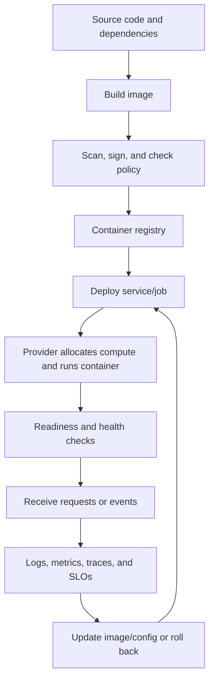

# Operational Responsibility Boundaries in Serverless Container Models

Serverless containers are a container execution model in which users do not manually manage servers or worker nodes in the traditional way. Users supply the image, runtime configuration, and resource requirements; the platform handles compute provisioning, container orchestration, replacing failed infrastructure, and typically autoscaling instance counts with load. This model reduces server management toil, but does not eliminate application operational responsibilities.

Responsibility boundaries must be clearly defined: **the provider manages the abstracted infrastructure; the platform team manages service configuration and guardrails; the application team owns the image, source code, data, access permissions, and workload behavior**. Exact scope varies by product. One service may manage both nodes and runtime, while another still requires customers to manage clusters, networking, or certain security components.

## 1. What Are Serverless Containers?

Serverless containers let you deploy applications packaged as container images without directly provisioning, patching, and operating worker VMs. The platform can automatically:

- Provision compute on incoming requests, events, or workloads.
- Launch containers from the specified image.
- Adjust running instance counts based on concurrency, requests, or metrics.
- Replace failed instances or containers.
- Integrate with logging, monitoring, registries, networking, and identity.
- Reclaim capacity when the workload no longer needs resources.

Some platforms launch containers only on incoming requests and scale to zero; others maintain minimum capacity or run services continuously. Some support jobs/tasks that run to completion, while others primarily target short-lived HTTP requests or events. Always verify runtime duration limits, CPU/RAM ceilings, concurrency, filesystem behavior, networking, and pricing for the specific product.

### Serverless Does Not Mean No Servers

Compute still runs on physical servers or VMs on the provider's side. What changes is that customers no longer directly manage node lifecycles. The provider owns the infrastructure layer covered by the service; customers must still engineer applications for fault handling, scaling, security, and cost.

### Serverless Containers vs. Adjacent Models

| Model | What Users Typically Manage | What the Platform Typically Manages |
|---|---|---|
| Self-managed VMs | OS, patches, runtime, container engine, scheduler, and application | Physical infrastructure and virtualization |
| Self-managed Kubernetes | Cluster, nodes, control plane or most operational configs, workloads | Varies by service; may manage only underlying VM infrastructure |
| Managed Kubernetes | Workloads, policies, node pools, and delegated configurations | Control plane and part of cluster/node lifecycle |
| Serverless containers | Image, app config, identity, data, and workload behavior | Compute provisioning, runtime orchestration, and scaling within service scope |
| Serverless functions | Function code, event bindings, permissions, and data | Function runtime, host provisioning, and function-model scaling |

This is a generalized model. Some services carry similar labels yet differ in responsibility boundaries and degree of control.

## 2. The Shared Responsibility Model

Shared responsibility defines how security and operational duties are split among the cloud provider, the platform team, and the application team. Never rely on the "serverless" label alone to assume the provider handles everything.

### Cloud Provider

The provider is typically responsible for platform components managed by the service, such as:

- Data centers, power, cooling, and physical hardware.
- Underlying hosts, virtualization, or compute substrate.
- Service-provided runtime orchestration and scheduling.
- Replacing failed host or container infrastructure.
- Patching and securing managed service components per service commitments.
- Tenant isolation and control plane protection within product boundaries.
- Managed networking and storage infrastructure used by the service.

Customers must still read the service's SLA, security documentation, and responsibility matrix. For instance, a provider may patch the host OS while holding no responsibility for updating libraries inside customer images.

### Platform or Cloud Foundation Team

In organizations with a platform team, that team typically owns:

- Selecting appropriate serverless container services and establishing baselines.
- Configuring projects/accounts, regions, network integrations, and policies.
- Building IaC templates, pipelines, registries, and standard release workflows.
- Managing default IAM/RBAC, secret integrations, logging, and monitoring.
- Setting quotas, budgets, concurrency caps, and cost guardrails.
- Defining image scanning, signing, provenance, and vulnerability remediation workflows.
- Maintaining documentation, runbooks, and supporting application teams.

The platform team does not automatically own every application deployed onto the platform. Clearly designate who is the service owner and who handles application-layer incidents.

### Application Team / Workload Owner

The application team typically owns:

- Source code, dependencies, libraries, and container images.
- Process configuration, ports, commands, environment variables, and health endpoints.
- CPU/RAM requests, concurrency, timeouts, and processing limits.
- Data access permissions, secrets, workload identities, and authorization logic.
- Input validation, error handling, retries, idempotency, and graceful shutdown.
- Schemas, backups, retention, and recovery of application-owned data.
- Logs, metrics, traces, and alerts reflecting application SLOs.
- Performance, runtime compatibility, and security testing prior to release.

### Reference Responsibility Matrix

| Area | Provider | Platform Team | Application Owner |
|---|---|---|---|
| Data centers and host hardware | Responsible | Monitors commitments | No direct management |
| Host OS / managed runtime | Per service scope | Configures within exposed options | Tracks application compatibility |
| Container image | Provides execution substrate | Provides registry/pipeline/scan baselines | Builds, patches, tests, and releases |
| App code and dependencies | Not managed | Provides standards | Responsible |
| Underlying networking | Managed layer per product | Delegated VPC/VNet, connectors, policies, routes | Ports, protocols, and application flows |
| IAM and workload identity | Provides primitives | Designs role baselines and grants permissions | Requests least privilege and secures access logic |
| Secrets | Provides storage service if available | Configures integrations and policies | Uses secrets safely, rotates, never logs them |
| Autoscaling | Provides mechanism | Sets quotas/guardrails and defaults | Chooses concurrency, timeouts, and tests behavior |
| Application data | Secures managed services per contract | Establishes platform backup policies if delegated | Data model, backup requirements, and restore tests |
| Observability | Service infrastructure metrics | Shared log/metric platform and retention | App telemetry, SLOs, and alerts |
| Incidents | Underlying service incidents | Coordinates platform/network/identity | Analyzes app, data, and restores functionality |

This matrix must be tailored to contracts, services, and organizational structure. Multiple parties may collaborate on an item, but one owner must remain ultimately accountable.

## 3. Boundaries Across Technical Layers

### Infrastructure and Hosts

With serverless containers, the provider typically manages physical servers, the host OS, and the underlying virtualization/container runtime layer. Customers do not select per-node kernel patches or SSH into hosts to install arbitrary agents. In return, customers accept restrictions on kernel capabilities, privileged mode, device access, filesystems, and host customization.

The platform team must verify regions, availability, quotas, network boundaries, and SLAs. Application owners need to know these limits when picking native libraries, image architectures, and state storage strategies.

### Container Runtime and Images

The provider may run containers on a managed runtime, yet customer-supplied images remain the customer's responsibility. Images must:

- Use supported base images receiving security updates.
- Contain the exact binaries, dependencies, and CPU architectures supported by the service.
- Never bundle secrets or long-lived credentials.
- Run as a non-privileged user whenever the application allows.
- Declare ports, commands, health behavior, and signal handling accurately.
- Be scanned for vulnerabilities and signed or provenance-verified per policy.
- Stay appropriately sized to minimize pull times and cold starts.

The platform team can supply approved base images and scanning pipelines; application owners are responsible for updating dependencies and publishing patched images when vulnerabilities appear.

### Networking

The provider manages the network fabric and certain internal connectivity components. The platform team typically designs VPCs/VNets, subnets, egress, private endpoints, DNS integration, and firewall policies. Application owners declare listening ports, protocols, hostnames, TLS behavior, and downstream dependencies the app must reach.

Never assume a container gets a static IP or accepts direct inbound connections. Many services expose endpoints through an ingress, load balancer, gateway, or service URL. Applications should handle connection resets, DNS refreshes, and timeouts gracefully.

### Storage and Filesystem

A container's writable filesystem is usually ephemeral or scoped to the instance lifecycle. During scale-to-zero, restarts, or container replacement, local data can vanish. Providers may offer volume mounts or shared filesystems, though durability, performance, and concurrent-access semantics depend on the service.

Application owners must decide which data requires durability and use appropriate databases, object storage, or volumes. Platform teams provide policies, encryption, network access, and backup integrations within their management scope.

### Identity and Secrets

The provider supplies identity primitives and metadata/service identities. The platform team configures roles, trust boundaries, and secret manager integrations. Application owners request only necessary permissions and never bake access keys into images, source code, or unprotected environment variables.

Separate deployer permissions from container runtime permissions. A CI/CD pipeline may need permission to push images and update services; the running container only needs permission to read a specific bucket or call a specific API.

## 4. Deployment Lifecycle and Responsibilities at Each Step

During build, application owners manage dependencies and image contents; the platform team supplies pipelines, registries, and policies. During deploy, the platform team governs templates, IAM, and network baselines; application owners declare runtime configs and verify smoke tests. At runtime, the provider manages infrastructure; application owners monitor workload behavior and resolve logic bugs. When releasing new versions, the application team owns application rollbacks, while the platform supports rolling back platform configs when changes fall under their scope.

## 5. Images, Supply Chain, and Security Vulnerabilities

Provider-managed hosts do not make customer images secure by default. Images can carry outdated packages, malicious dependencies, default root users, or committed secrets.

### Application Owner Responsibilities

- Use base images with clear provenance.
- Update OS packages, runtimes, and libraries inside images.
- Pin dependency versions and create reproducible builds.
- Strip unnecessary compilers, caches, and tools from production images when appropriate.
- Avoid running containers as root unless required.
- Scan images prior to deployment and remediate vulnerabilities according to severity.
- Rebuild images when patches ship; never patch only running containers.

### Platform Team Responsibilities

- Provide controlled registries with scoped push/pull permissions.
- Enforce image scanning, signature verification, or admission policies where supported.
- Maintain standard base images and notify teams when images reach end-of-life.
- Flag untrusted images or deployments relying on inappropriate mutable tags.
- Define an exception workflow with explicit owners and expiration dates.

### Using Image Digests

Tags like `latest` can resolve to different contents on a subsequent pull. In production, pin images by digest or immutable policy-enforced tags to know the exact deployed artifact. When updating, release new digests through the pipeline and retain version history for rollbacks.

## 6. Scaling, Concurrency, and Cold Starts

The provider usually executes the scaling mechanism, while customers decide the configuration and application behavior.

### What the Platform May Manage

- Creating or reclaiming container instances.
- Dispatching requests/events to active instances.
- Tracking concurrency and metrics within service capabilities.
- Allocating capacity within available quotas and regions.
- Replacing failed instances/containers via managed mechanisms.

### What Application Owners Must Design

- Determine safe per-instance concurrency.
- Handle concurrent requests, shared state, and connection pools.
- Configure timeouts, retries, and backpressure.
- Optimize for fast startup and accurate readiness.
- Avoid storing sessions or critical unique data solely in RAM or local disk.
- Handle scale-in, `SIGTERM`, and in-flight requests.
- Test traffic bursts, cold starts, and scale-to-zero behavior.

### Cold Starts

A cold start is the latency incurred when a service must boot a new container before handling a request. It can include compute allocation, image pulling, filesystem mounting, runtime startup, secret/config loading, connection setup, and cache warming.

Cold starts can be reduced by:

- Shrinking image sizes and removing unnecessary layers.
- Deferring heavy startup work if it can be delayed safely.
- Configuring appropriate timeouts and retries for dependency connections.
- Keeping minimum warm instances/capacity when SLOs demand low latency and budget permits.
- Selecting regions close to dependencies and users.
- Measuring provisioning, image pull, and application initialization times separately.

### Concurrency and Dependencies

Raising concurrency can cut the number of running containers but multiplies concurrent requests hitting databases, caches, or external APIs. Application owners must benchmark safe concurrency and cap pools/limits; platform teams must enforce overall quotas to prevent one service from exhausting shared capacity.

## 7. Availability and Fault Handling

Managed container services can automatically replace containers or hosts, but do not automatically make an application highly available. Availability depends on replica counts, zone distribution, dependencies, data architecture, and release practices.

### Provider Responsibilities

- Maintain infrastructure and control planes per SLA.
- Execute restart/replacement mechanisms as designed by the service.
- Publish maintenance windows, quotas, and service limits.
- Expose platform health metrics and events.

### Platform Team Responsibilities

- Configure regions, zones, ingress, and network baselines.
- Set quotas, min/max capacity bounds, and deployment policies.
- Design centralized logging/metrics and platform-level alerts.
- Maintain runbooks for quota, networking, identity, and registry failures.

### Application Owner Responsibilities

- Design stateless services or externalize state outside containers.
- Handle retries, idempotency, and duplicate events.
- Use readiness and liveness probes properly.
- Implement timeouts, graceful shutdown, and backpressure.
- Define SLOs, alerts, and test failover scenarios.
- Manage backward-compatible data migrations during rolling deployments.

### Health Checks Do Not Replace Functional Verification

An endpoint returning `200 OK` proves only that a single check passed. It does not prove users can log in, pay, or complete transactions. Combine instance-level readiness with service-level synthetic transactions and experience-level SLO metrics.

## 8. Data, Backups, and Recovery

Containers are meant to be replaceable. Application data must live in systems with appropriate durability and backups.

Application owners must define:

- Which data is the source of truth.
- Which data is merely a cache or can be recomputed.
- RPO/RTO targets and retention for databases, objects, and files.
- How transactions behave when a container is terminated.
- Data restoration procedures and regular restore testing.
- Schema compatibility across application versions.

Platform teams may supply databases, object storage, volume services, backup vaults, and encryption policies. However, logical data recovery and consistency validation usually belong to the service owner, unless a managed database contract explicitly assigns restore operations to the provider.

Never store critical data in a container's writable layer assuming it will survive restarts. For long-running jobs, checkpoint progress to durable storage and enforce retry/idempotency logic.

## 9. Observability: Who Monitors What?

Providers typically emit metrics on instance counts, service status, quotas, or control plane errors. Platform teams aggregate infrastructure telemetry and provide observability tooling. Application owners must instrument telemetry describing service functionality and quality.

| Signal | Provider / Platform | Application Owner |
|---|---|---|
| Service / instance state | Managed service and container status | Verifies app is genuinely ready |
| CPU / RAM / concurrency | Platform metrics per service capability | Assesses saturation and tunes limits |
| Request latency | Selected ingress/target metrics | Analyzes app processing, p95/p99, and SLOs |
| Application errors | May report status/transport errors | Classifies exceptions, business errors, and dependency failures |
| Logs | Supplies base pipeline and retention | Emits structured logs, correlation IDs, zero secrets |
| Traces | Collection infrastructure if configured | Instruments code and propagates context |
| Cost | Billing and usage data | Tags service metadata, tracks cost per request/job |

### Minimum Metrics to Measure

- Request rate, error rate, and p95/p99 latency.
- Container startup duration, cold starts, and restart counts.
- CPU, memory, throttling, and concurrency.
- Queue depth and oldest message age for event-driven workloads.
- Dependency latency, connection pools, and retry rates.
- Running instance counts, min/max bounds, and quota utilization.
- Cost per request, job, or workload unit.

Never rely solely on `Running` status or container counts. A container can be running while returning errors; a service can pass health checks while latency breaches SLOs.

## 10. Identity, Networking, and Secret Management

Serverless containers typically run using a provider-issued workload identity or service account. Runtime permissions must be separated from deployment permissions.

### Workload Identity

The platform team sets up trust relationships and role baselines. Application owners identify required resources and request least-privilege permissions. Avoid embedding long-lived keys in images or configs. When the provider supports short-lived tokens, prefer that mechanism.

### Secrets

Secrets should be fetched from a secret manager or secure integration. Never place secrets in Dockerfile `ARG` instructions, image layers, source code, logs, or metric labels. Application owners manage rotation compatible with active connections; platform teams govern secret service permissions and access paths.

### Network Egress and Ingress

The platform team manages network boundaries, private access, firewalls, DNS, and egress policies per architecture. Application owners declare required destinations, ports, and protocols. Broad egress widens data exfiltration risks and raises network transfer costs.

If a workload needs private database access, verify VPC connectors/integrations, routes, DNS, TLS, and security rules. Never assume every serverless container can reach private subnets by default.

## 11. Quotas, Service Limits, and Capacity Planning

Providers enforce quotas on instance counts, CPU/RAM, concurrency, request rates, networking, and resource creation rates. Platform teams manage org-wide quotas and capacity strategies; application owners estimate demand from traffic profiles and test against limits.

Before production:

- Check quotas per region, project, and account.
- Confirm per-container CPU/RAM limits and maximum replica counts.
- Check maximum execution duration and image size limits.
- Verify ephemeral storage, volume mount, and networking limits.
- Check concurrency, request timeout, and request body size limits.
- Define behavior when quotas exhaust or the provider faces capacity shortages.

Never treat autoscaling as infinite. When hitting max capacity or quotas, applications need backpressure, queuing, graceful degradation, or controlled error responses.

## 12. Cost and Optimization Responsibilities

Serverless containers typically bill by allocated resources, execution duration, requests, concurrency, or related components. Scale-to-zero cuts idle spend but increases cold starts; keeping minimum instances improves latency but incurs charges during low traffic.

### Provider

The provider publishes usage metering rules, SKUs, discounts, free tiers, network charges, and billing exports. The provider is responsible for accurate billing per the published service model.

### Platform Team

The platform team establishes budgets, quotas, tagging policies, dashboards, and guardrails. They may supply default templates to avoid oversized CPU/memory allocations or excessive log retention.

### Application Owner

The application owner optimizes image size, startup duration, memory footprint, concurrency, request duration, and dependency call counts. Track cost per request/job to measure efficiency. Do not increase memory merely to shave CPU time unless overall cost or latency improves.

### Easily Overlooked Cost Drivers

- Container runtime duration or provisioned concurrency.
- Image registry storage and image transfer.
- Log/trace volume and retention.
- Egress, inter-region transfer, and private connectivity.
- Database connections, caches, and queues driven up by scale-out.
- Persistent storage, snapshots, and backups.
- Idle minimum instances or warm pools.

## 13. Safe Deployment and Release Practices

Serverless containers do not automatically guarantee safe releases. You need a pipeline that validates artifacts, configurations, and rollbacks.

### Reference Pipeline

1. Build the image from reviewed source code.
2. Pin dependencies and base images.
3. Scan for vulnerabilities and generate provenance/signatures if required by policy.
4. Push the image to a controlled registry.
5. Deploy to test/staging using an explicit digest.
6. Run smoke tests, load tests, and network/identity checks.
7. Roll out a canary or traffic split if supported by the service.
8. Monitor error rates, latency, restarts, and cost.
9. Promote or roll back against predefined criteria.

### Application Rollbacks vs. Platform Rollbacks

Application image/config rollbacks are typically executed by the application owner through the pipeline. Rolling back network policies, runtime configurations, or service-level settings may require the platform team. If data schema changes break backward compatibility, rolling back the image alone may not suffice; use a migration strategy supporting both old and new versions during transitions.

## 14. Incident Management and Escalation

During incidents, determine whether the fault lies with the provider, the platform, or the application. Misrouting slows recovery.

| Symptom | First Investigation Path | Typical Primary Owner |
|---|---|---|
| Provider reports outage or control plane errors | Service health, status events, request IDs | Provider in coordination with platform |
| Multiple workloads lose private network connectivity | Routes, connectors, DNS, firewalls, and recent network changes | Platform / network team |
| New image crashes immediately on start | Entrypoint, architecture, dependencies, permissions | Application owner |
| Container OOM or CPU throttling | Memory profile, resource allocation, and workload pattern | Application owner, platform assists on quotas |
| Fails to scale up despite rising requests | Max capacity, quotas, metrics, and autoscaling config | Platform and application owner |
| Database slows after containers scale out | Connection pools, queries, downstream saturation | Database/service owner and application owner |
| Secrets inaccessible | Identity bindings, roles, secret policies, and audit logs | Platform/security and application owner |
| Missing logs or traces | Telemetry pipeline and instrumentation | Platform/observability and application owner |

### Information to Gather When Opening a Provider Support Ticket

- Project/account, region, and service/resource ID.
- Start timestamp, timezone, and blast radius.
- Request IDs, operation IDs, and error codes if available.
- Deployment revision/image digest and most recent changes.
- Sanitized metrics, logs, and reproduction steps (stripped of sensitive data).
- Impact on SLOs, requests, and data.

Application owners must never attach secrets, customer data, or tokens to support tickets. The platform team should define support channels and escalation priorities aligned with SLAs.

## 15. Things You Should Never Assume the Provider Owns

Common misconceptions:

- **"Serverless means the provider patches every package."** Providers patch managed hosts/runtimes; packages inside images are usually updated by customers.
- **"If a container fails, the provider fixes the app."** The platform can restart or replace instances; code and config bugs remain the application owner's job.
- **"Data inside containers is always preserved."** The writable layer can be ephemeral; persistent data belongs in appropriate storage.
- **"Autoscaling automatically protects the database."** Adding containers can overwhelm databases; app owners must bound concurrency and connections.
- **"Project IAM is good enough for every container."** Runtime identities need dedicated, least-privilege permissions.
- **"The provider guarantees application SLOs."** Underlying service SLAs do not replace end-to-end application SLOs.
- **"Default logs are enough to debug."** Apps need structured logs, traces, and business metrics.
- **"Scale-to-zero has no trade-offs."** It can increase cold starts and delay the first event or request.

## 16. Example Responsibility Split for a Serverless Container API

A product team deploys an order-processing API. The image is built by a pipeline, runs on a serverless container service, and accesses a private database and object storage.

| Task | Owner | How Teams Coordinate |
|---|---|---|
| Hosts, base runtime, and replacing failed hosts | Provider | Track service status and SLA |
| Project, network connectors, and private routes | Platform | Provision endpoints and policies for the service |
| Container image and dependencies | Application | Build, scan, pin digests, and patch vulnerabilities |
| Workload identity | Platform + application | Platform creates roles; app requests least privilege and tests |
| Database backups / PITR | Database / platform per management model | Application validates RPO/RTO and business restores |
| Readiness, timeouts, and concurrency | Application | Platform supplies templates and aggregate limits |
| Log pipeline | Platform | Application emits structured logs and traces |
| API SLOs and alerts | Application | Platform provides supporting infrastructure metrics |
| Budgets, quotas, and cost dashboards | Platform + application | Platform sets guardrails; app optimizes cost per request |
| Provider / network / app incidents | By fault layer | One incident commander coordinates owners |

### Illustrative Troubleshooting Flow

If the API returns 5xx errors after a release:

1. Application owner inspects the image digest, logs, traces, and recent changes.
2. If errors appear only on the new revision, roll back the image/config via the pipeline.
3. If all revisions lose database connectivity together, inspect dependencies, identity, and networking.
4. Platform team verifies private routes, connectors, secret policies, and service events.
5. If the provider confirms a managed service outage, the platform team opens a ticket with request IDs and coordinates workarounds.
6. After recovery, the application owner runs smoke tests and verifies SLOs; the platform team updates the incident timeline.

Having the provider replace a container does not end an incident if the API still returns errors or transaction data is inconsistent.

## 17. Responsibility Boundary Checklist

**Before selecting a service:**

- [ ] Determined to what degree the service manages hosts, runtimes, nodes, and control plane.
- [ ] Reviewed SLAs, quotas, CPU/RAM limits, timeouts, and filesystem behavior.
- [ ] Identified which networking, storage, and identity components customers must still configure.
- [ ] Assigned ownership for provider support and incident handling.

**Before deploying a workload:**

- [ ] Defined owner, service, environment, and on-call channel.
- [ ] Verified base image, dependencies, and architecture compatibility.
- [ ] Image scanned, digest-pinned, and free of embedded secrets.
- [ ] Runtime identity configured with least privilege.
- [ ] Persistent data stored outside the writable container layer.
- [ ] Readiness/liveness, timeouts, concurrency, and graceful shutdown configured.
- [ ] Network paths, DNS, TLS, and egress verified.

**In ongoing operations:**

- [ ] Application-level SLOs, logs, metrics, traces, and alerts in place.
- [ ] Budgets, quotas, and cost-per-unit dashboards active.
- [ ] Backup/restore procedures and data recovery tested against RPO/RTO.
- [ ] Release, canary, and rollback pipelines operational.
- [ ] Runbook classifies provider, platform, and application incidents.
- [ ] Responsibility matrix reviewed whenever services or organizational structures change.

## Conclusion

Serverless containers reduce host management and compute lifecycle toil, yet do not hand total application operational responsibility over to the provider. The provider manages infrastructure and runtime within service scope; the platform team establishes networking, identity, pipelines, quotas, guardrails, and baseline observability; the application owner manages images, dependencies, data, runtime permissions, health behavior, SLOs, and workload cost. Assign explicit owners for every layer, validate boundaries against SLAs and product docs, and build pipelines, backups, scaling, and incident runbooks around those boundaries. When every party understands its share, application teams gain serverless simplicity without sacrificing security, reliability, or cost control.
