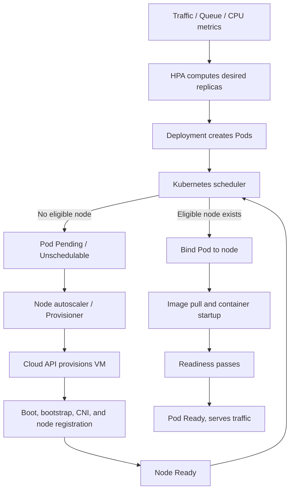
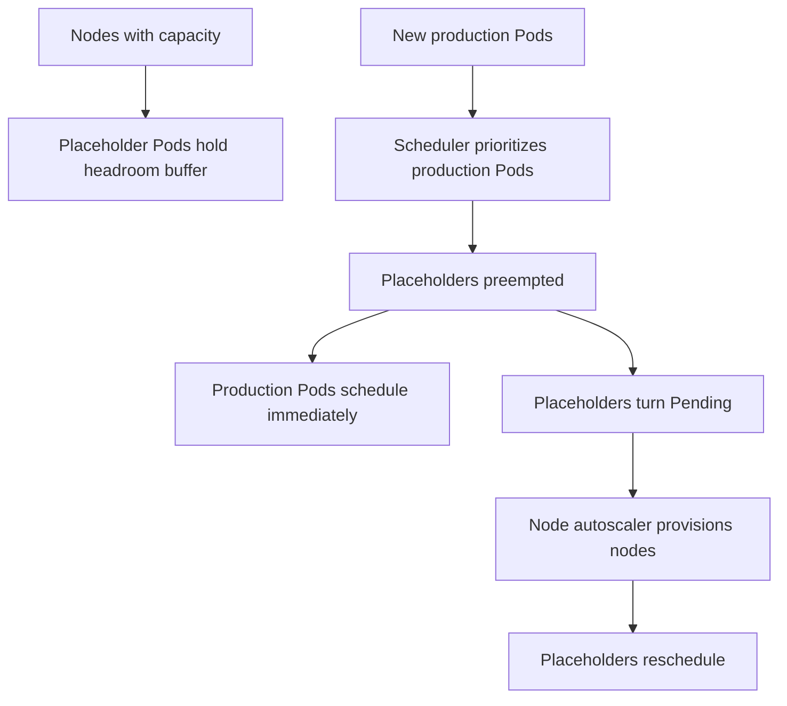

# Synchronizing Pod Scaling Speed with Node Provisioning Time

Kubernetes can create additional Pods within seconds, yet if the cluster has no suitable CPU or memory remaining, new Pods must wait for a node to be provisioned. The elapsed time from detecting a capacity shortfall until a Pod is actually Ready can stretch across the autoscaler, cloud APIs, VM boot, node bootstrapping, CNI initialization, image pulls, and application startup. Scaling replicas based solely on current load without accounting for this delay can continually spawn Pending Pods while APIs stay overloaded or queue backlogs keep growing.

In the **CLOUD_CORE_SERVICES_COMPUTE** module, Kubernetes scalability depends on coordination among the Horizontal Pod Autoscaler (HPA), the scheduler, Cluster Autoscaler or a node provisioner such as Karpenter, the cloud provider, and application readiness. This lesson explains those control loops, how to measure end-to-end scaling latency, how to maintain headroom, how to tune scale-up/scale-down rates, and how to load-test fast-ramping workloads so Pods become ready on time.

## Learning Objectives

After this lesson, you will be able to:

- Describe the control chain from load metrics to Ready Pods on newly provisioned nodes.
- Distinguish HPA, the Kubernetes scheduler, Cluster Autoscaler, and node provisioners.
- Break down the components that contribute to node provisioning time and Pod startup time.
- Estimate the capacity gap and backlog accumulated while waiting for new nodes.
- Configure HPA `behavior`, minimum replicas, stabilization windows, and scaling policies.
- Design node headroom, overprovisioning, warm pools, scheduled scaling, and predictive capacity.
- Optimize Pod requests, topology, images, bootstrapping, and readiness to reduce scale-out latency.
- Distinguish scale-up and scale-down behavior; avoid autoscaling oscillation or premature node removal.
- Monitor HPA, Pending Pods, node provisioning, queue backlogs, and trigger-to-Ready latency.
- Build load tests and runbooks to verify scaling meets SLOs.

## 1. Why Must Pod Scaling Speed Match Node Provisioning Speed?

Multiple Kubernetes components participate in scaling. Each component has its own state and response latency:

- HPA adjusts desired replica counts based on metrics.
- The controller creates new Pods to match the replica count.
- The scheduler searches for eligible nodes based on requests, affinity, taints, topology, and allocatable resources.
- If no suitable node exists, Pods enter `Pending`/`Unschedulable` state.
- The node autoscaler detects unschedulable Pods and requests additional capacity.
- The cloud provider creates a VM/node; the node boots, joins the cluster, and starts system components.
- The scheduler places Pods onto the new node; the kubelet pulls images and starts containers.
- Readiness probes confirm the application is ready to receive traffic.

HPA can raise desired replicas much faster than nodes can be created. This is not necessarily an error: Pending Pods are the very signal the node autoscaler uses to add capacity. Problems arise when this delay exceeds the time window the system can tolerate load above current capacity.

### 1.1. Independent Control Loops



HPA does not provision nodes directly. The node autoscaler does not inherently know every business requirement; it reacts to unschedulable Pods or capacity policies. Consequently, HPA, the scheduler, and the node autoscaler must be configured compatibly.

### 1.2. Desired Replicas vs. Ready Replicas

Distinguish these states:

- **Desired replicas:** the number of Pods requested by the Deployment/ReplicaSet/HPA.
- **Scheduled/Bound Pods:** Pods assigned by the scheduler to a node.
- **Running Pods:** containers have started, though the application may not be ready yet.
- **Ready Pods:** Pods passing readiness checks and eligible to receive traffic via Service/EndpointSlice.

A dashboard showing only desired replicas can mislead operators into thinking capacity has already increased. Track both Ready replicas and the elapsed time from replica request to Pod Ready.

## 2. Latency from Autoscaling Trigger to Pod Ready

End-to-end scaling duration is not just VM boot time. It spans sequential stages, some of which can overlap or retry upon failure.

### 2.1. Components of Scaling Latency

| Stage | What Happens? | Causes of Delay |
|---|---|---|
| Metric collection | Metrics adapter/metrics server gathers data | Scrape interval, metric delay, slow queries |
| HPA evaluation | HPA computes desired replicas | Sync period, tolerance, stabilization, and policies |
| Pod creation | Deployment/ReplicaSet creates Pods | API server load, admission webhooks, quotas |
| Scheduling detection | Scheduler attempts to place Pods | Scheduler queue, filter plugins, topology constraints |
| Node provisioning | Autoscaler requests a new node | Cloud API latency, quotas, capacity shortages, rate limits |
| VM boot/bootstrap | VM boots, installs node agents, configures runtime | OS image, startup scripts, package downloads, disk init |
| Node registration | Kubelet registers and node becomes Ready | CNI, kube-proxy, CSI, certificates, networking |
| Pod scheduling | Scheduler binds Pods onto the new node | Requests, taints, affinity, IP and volume constraints |
| Image pull | Pulls image and unpacks layers | Large images, slow registry, missing cache, throttling |
| Application startup | Process initializes, connects dependencies, warms caches | Runtime init, migrations, DNS/TLS, dependencies |
| Readiness | Probe succeeds and endpoints publish | Long startup, misconfigured probes, unready dependencies |

This can be approximated as:

\[
T_{ready}=T_{metric}+T_{HPA}+T_{schedule-detect}+T_{provision}+T_{node-ready}+T_{image}+T_{app}
\]

In practice, several durations overlap. The formula helps identify which stages to measure rather than assuming strict sequentiality in every step.

### 2.2. Measure Node Provisioning Time and Pod Startup Time Separately

Measure two distinct intervals:

- **Node provisioning time:** from when the autoscaler requests a node until the node is Ready and able to accept Pods.
- **Pod startup time:** from when a Pod is created or scheduled until the container/application is Ready.

If nodes turn Ready quickly yet Pods stay Pending, look at requests, taints, affinity, volumes, subnet IPs, or resource fragmentation. If Pods are Bound yet slow to turn Ready, inspect image pulls, init containers, startup probes, the application, and dependencies.

### 2.3. Use Percentiles Rather Than Averages Alone

Node boot and image pull times fluctuate across instance families, zones, registries, and time of day. A 45-second average does not guarantee p95 is near 45 seconds. Record p50/p95/p99 for:

- Trigger-to-node-Ready.
- Trigger-to-Pod-Scheduled.
- Pod-created-to-container-started.
- Container-started-to-Ready.
- HPA metric-observed-to-desired-replica-updated.

Size headroom using tail latency in critical load scenarios rather than idle-environment averages.

## 3. How HPA Controls Pod Counts

HPA adjusts a workload's replica count based on metrics. For resource metrics like CPU utilization, HPA compares current usage against a target relative to requests.

### 3.1. Basic Replica Formula

For a simple utilization metric, HPA estimates:

\[
DesiredReplicas=\left\lceil CurrentReplicas\times\frac{CurrentMetric}{TargetMetric}\right\rceil
\]

For example, a Deployment has 4 Pods, average CPU utilization is 90%, and target is 60%:

```text
Desired = ceil(4 × 90 / 60)
        = ceil(6)
        = 6 replicas
```

This is the general formula. HPA also applies tolerance, min/max bounds, missing-metric rules, readiness handling, and scaling `behavior`. When multiple metrics are configured, HPA typically picks the largest replica count proposed across valid metrics.

### 3.2. CPU Utilization Depends on CPU Requests

If a container requests `500m` and uses `400m`, utilization is about 80% of request. If the request changes to `1` CPU while usage stays constant, utilization becomes about 40%. Changing requests therefore alters how HPA scales even when application load has not changed.

Without valid CPU requests, HPA cannot compute CPU utilization as expected for the relevant container. Verify resource requests on all relevant containers and confirm the metrics API is healthy.

### 3.3. Choosing the Right Metric for Each Workload

| Workload | Recommended Metric | Rationale |
|---|---|---|
| CPU-bound API | CPU utilization or CPU per Pod | CPU closely tracks processing capacity |
| Latency-sensitive API | Request rate per Pod, concurrency, custom metrics | CPU can lag behind queueing and latency spikes |
| Queue worker | Queue depth, oldest message age, arrival/completion rate | Backlog directly shows consumption falling behind |
| Stream consumer | Consumer lag / partition lag | Replica count must align with partitions and throughput |
| Memory-heavy service | Memory working set or business metrics | Low CPU does not mean spare memory capacity |
| Batch job | Pending jobs, job duration, deadlines | Goal is completing the backlog before deadlines |

Latency can be an important signal, though avoid overscaling on latency caused by a slow downstream dependency. If the database is the bottleneck, adding Pods can overload the database further.

### 3.4. HPA Does Not Know How Long New Nodes Take to Become Ready

HPA calculates replicas from metrics and policies; it has no built-in mechanism to pause until new nodes are Ready before requesting more replicas. If load keeps rising, HPA can continue raising desired replicas while earlier Pods remain Pending.

That is why you must combine:

- `minReplicas` large enough for baseline load and short bursts.
- Node headroom or warm capacity.
- Scaling policies tuned to the workload's velocity.
- Queuing/backpressure to absorb temporary capacity shortfalls.
- A node autoscaler capable of detecting unschedulable Pods.
- Alerts when the desired/ready gap persists.

## 4. Node Autoscalers: Cluster Autoscaler and Karpenter

A node autoscaler expands worker node infrastructure so Pods have places to run. Two common implementations are Cluster Autoscaler and Karpenter. Specific details vary by cloud provider and version, but the general role is translating Pod demand into node capacity.

### 4.1. Cluster Autoscaler

Cluster Autoscaler watches unschedulable Pods and evaluates whether scaling up a configured node group allows those Pods to be placed. If so, it asks the cloud provider to increase the node count in the matching group.

Common characteristics:

- Scales pre-configured node groups.
- Requires defined min/max sizes and matching node templates.
- Pods must be marked unschedulable due to insufficient resources or matching node conditions.
- Can use expanders to choose among multiple eligible node groups.
- Scale-down evaluates whether a node can be safely drained and Pods relocated.

If a node group lacks suitable instance types, hits quotas, or faces zone capacity shortages, Cluster Autoscaler cannot provision the desired nodes. Check autoscaler logs/events and cloud provider status.

### 4.2. Karpenter

Karpenter watches unscheduled Pods and can provision matching nodes from instance/capacity options declared in `NodePool`/`NodeClass` configurations per provider. Selection can adapt flexibly across CPU, memory, architecture, zone, capacity type, and Pod requirements.

Common characteristics:

- Can pick from diverse instance types matching Pod requirements rather than scaling a single fixed node group.
- `NodePool` requirements and limits define what capacity may be provisioned.
- Provisioning is still governed by cloud quotas, instance availability, subnets, security groups, and provider APIs.
- Disruption/consolidation can replace nodes to optimize utilization and cost.
- PodDisruptionBudgets, termination grace periods, and workload constraints affect node replacement.

Karpenter does not eliminate boot or image pull latency. New nodes still need to initialize and register before accepting Pods. Track real provisioning time rather than treating `NodeClaim`/`Node` object creation as usable capacity.

### 4.3. High-Level Comparison

| Criterion | Cluster Autoscaler | Karpenter |
|---|---|---|
| Scaling unit | Node group / managed group | Nodes provisioned per `NodePool`/`NodeClass` |
| Instance selection | Typically tied to node group config | Flexibly chooses across matching instance types |
| Trigger | Unschedulable Pods satisfiable by a node group | Unschedulable Pods matching a `NodePool` |
| Scale-down | Removes underutilized nodes if Pods can move | Policy-driven consolidation/disruption |
| Dependencies | Provider integration, node groups, and quotas | Provider API, `NodePool`/`NodeClass`, quotas, and capacity |
| What to check | Node group max, expanders, scale-down blockers | Requirements, limits, disruption budgets, instance flexibility |

Do not choose a tool solely on advertised speed. Measure end-to-end latency in your own cluster and workloads, including provider resource provisioning time.

## 5. Calculating the Capacity Gap While Waiting for Nodes

If load grows faster than available capacity, the system experiences a capacity deficit. For queue workers, the deficit appears as backlog; for synchronous APIs, it appears as queueing, higher latency, timeouts, and errors.

### 5.1. Capacity Formula

Suppose one Pod safely processes `μ` requests/second and must serve an arrival rate `λ`. Minimum Pods required at target utilization `U`:

\[
N_{required}=\left\lceil\frac{\lambda}{\mu\times U}\right\rceil
\]

Where `U` is less than 1 to preserve headroom. Measure `μ` at your latency/error target, not peak throughput when the system is already saturated.

### 5.2. Backlog Accumulated During Provisioning

For queue-driven workloads, if arrival rate `λ` exceeds current completion rate `S`, backlog grows roughly as:

\[
\Delta Q=\max(0,\lambda-S)\times T_{delay}
\]

`T_delay` is the time from detecting the capacity shortfall until new Pods are truly Ready and processing jobs. This formula ignores time-varying bursts, retries, and queue bounds; use it for initial estimation.

### 5.3. Queue Worker Example

One Pod safely processes 20 jobs/second. Arrival rate jumps from 100 to 300 jobs/second. Five Pods are currently running, giving a current service rate of roughly 100 jobs/second. Node provisioning plus image pull and startup takes 90 seconds.

```text
New arrival rate:       300 jobs/s
Current service rate:   100 jobs/s
Capacity gap:           200 jobs/s
Provisioning delay:     90 s

Approximate backlog growth:
200 × 90 = 18,000 jobs
```

After adding 10 Pods, 15 Pods give a theoretical service rate of 300 jobs/second. However, to preserve 20% headroom, capacity needs to exceed 300 jobs/second; at least 19 Pods are required via `ceil(300 / (20 × 0.8))`. In addition, the queue must be able to hold 18,000 jobs, and consumers/downstreams must tolerate the drain rate once new capacity arrives.

### 5.4. Synchronous APIs Without a Queue

For synchronous APIs, you cannot assume requests can wait 90 seconds. When a capacity gap appears:

- Request queues in load balancers, proxies, and applications grow.
- p95/p99 latency climbs before CPU reaches 100%.
- Timeouts and retries amplify effective load.
- Connection pools and databases can saturate.

Typical mitigations include keeping sufficient baseline replicas/headroom for short bursts, applying rate limiting/admission control, optimizing startup, and offloading non-synchronous tasks to queues.

## 6. Maintaining Headroom to Avoid Waiting on Every New Node

Node autoscaling is essential for sustained growth, but is not always fast enough for sudden spikes. Headroom lets new Pods schedule immediately while the node provisioner brings additional capacity online.

### 6.1. Minimum Replicas

Set HPA `minReplicas` high enough to handle baseline traffic and common short bursts. Minimum replicas also keep runtimes and caches warm, reducing cold starts. Setting it too high, however, increases idle cost and can tie up database connections.

Determine the minimum from:

- Lowest hourly/daily baseline load.
- Capacity required to survive losing one Pod or one zone.
- p95 node provisioning time.
- Expected burst magnitude during that provisioning window.
- Acceptable SLO and cost balance.

### 6.2. Overprovisioning with Placeholder Pods

Some clusters deploy low-priority placeholder Pods to pre-reserve a buffer of node capacity. When high-priority production Pods arrive, the scheduler preempts placeholders; the evicted placeholders become Pending and trigger the node autoscaler to add nodes.

Concept:



Placeholders cut wait times for critical workloads, but require governing priorities, quotas, costs, and reserved resources. Do not use placeholders to bypass quota limits or replace proper capacity planning.

### 6.3. Warm Pools and Standby Node Pools

Warm pools hold pre-provisioned or nearly bootstrapped VMs/nodes that do not yet run full workloads. When needed, they can enter the cluster faster than provisioning VMs from scratch.

Check:

- Are warm-pool nodes already registered and Ready?
- Are CNI, CSI, security agents, and certificates initialized?
- Can they accept workload Pods immediately, or must labels/taints change first?
- Are subnet IPs and quotas sufficient for the standby pool?
- Is the cost of idle standby nodes lower than the risk of a capacity shortfall?

Warm pools can become stale if images or node configurations are not refreshed. Establish a refresh cycle and drift checks.

### 6.4. Scheduled and Predictive Scaling

If load follows a schedule, scale nodes/replicas ahead of peak hours. For instance, if a batch job starts at 08:00, begin provisioning capacity at 07:30 based on p95 provisioning time and warm-up duration.

Predictive scaling can forecast load from history, but requires fallbacks when forecasts miss. Never scale exclusively to the exact forecast; keep a safety margin and reactive metric-based scaling.

## 7. Optimizing Pods So the Scheduler and Node Autoscaler Can Respond

A node autoscaler can only pick a node if the Pod can actually schedule onto it. Overly tight or inaccurate Pod configurations can leave the autoscaler unable to find a matching node type.

### 7.1. Resource Requests Must Be Accurate

The scheduler relies on requests to compute required resources. If requests are too high, nodes run out of allocatable slots despite low real usage. If requests are too low, too many Pods pack onto one node and contend for CPU/memory under load.

Calibrate requests from benchmarks and production telemetry. Include sidecars, init containers, ephemeral storage, and workload-specific limits.

### 7.2. Affinity, Taints, and Topology Spread

The following constraints restrict which nodes are eligible:

- `nodeSelector` and required node affinity.
- Taints/tolerations.
- Pod anti-affinity and topology spread constraints.
- Zone/region requirements.
- Architecture, GPUs, local SSDs, or accelerators.
- PVC zone binding and storage topology.

If a Pod can only run on one instance family or one zone, the autoscaler cannot fall back to other nodes even when cluster-wide capacity exists. Use preferred affinity when strict rules are unnecessary, and provision compatible node pools for specialized workloads.

### 7.3. Quotas, IPs, and Storage

New nodes may fail to provision or fail to accept Pods if:

- vCPU, instance family, or GPU quotas are exhausted.
- Subnets run out of IP addresses.
- Network interfaces or Pod IP capacity are exhausted.
- Storage classes/PVCs do not support the new zone.
- Cloud APIs throttle requests or an instance type faces stockouts.
- `NodePool`/`NodeGroup` maximum size is reached.

Capacity plans must include quotas and networking, not just aggregate CPU/RAM.

## 8. Reducing Node Boot and Bootstrap Time

Node provisioning latency can be shortened by pre-baking images and configurations rather than downloading dependencies during scale-out.

### 8.1. Golden Images and Node Images

Prepare node images with the runtime, agents, required bootstrap certificates, and core packages pre-installed. Golden images eliminate internet package downloads inside startup scripts.

Manage:

- Image versioning and security patching schedules.
- `kubelet`/container runtime configurations compatible with the cluster.
- Monitoring, logging, security agents, and CNI prerequisites.
- Image rollback capability if new nodes fail to reach Ready.
- Periodic rebuilds to prevent stale images or package drift.

### 8.2. Idempotent and Concise Bootstrapping

Bootstrapping should be safe to re-run and execute only the minimal steps required for a node to join the cluster. Avoid downloading hundreds of megabytes of packages or running non-essential tasks on every node boot.

Move non-essential setup into the image build or controlled DaemonSets. Measure step-by-step timings in `cloud-init`/user-data and node initialization logs.

### 8.3. CNI, CSI, and Node Readiness

Node `Ready` depends on more than VM boot. CNI must allocate Pod networking; CSI may need to attach/mount volumes; `kubelet` must register and update node conditions. If a node reports `Ready` before CNI assigns Pod IPs, workloads still cannot serve traffic.

Monitor:

- Node `Ready` transition time.
- CNI DaemonSet readiness and IPAM allocation.
- CSI attach/mount latency.
- `kube-proxy`/eBPF dataplane readiness.
- DNS/service discovery reachability.

## 9. Reducing Image Pull and Application Startup Time

Once a node is Ready, Pods still have to pull images and initialize the application.

### 9.1. Optimizing Images

- Use multi-stage builds to strip compilers and build tools from runtime images.
- Eliminate unnecessary layers and dependencies.
- Pick suitable base images, apply security patches, and pin versions.
- Avoid oversized images or invalidating every layer on every release.
- Use registries close to the cluster and configure authentication/caching properly.
- Monitor registry throttling and image pull errors.

### 9.2. Image Pre-Pulling

A DaemonSet or node initialization step can pre-pull frequently used images. This cuts image pull delay when Pods start, at the cost of extra node prep time, bandwidth, and disk usage. Pre-pull only critical images, prune old images, and budget container filesystem space.

### 9.3. Startup and Readiness

Applications should:

- Avoid running heavy schema migrations inside every replica's startup path.
- Connect to dependencies with retry backoff and jitter.
- Warm caches in a manner that caps load on backends.
- Use startup probes for slow-starting applications.
- Pass readiness only when the instance can genuinely serve requests.
- Avoid overly sensitive liveness probes that cause restart loops when a dependency slows down.

Passing readiness too early sends traffic to cold instances; passing readiness too late delays usable capacity. Measure from container start to readiness success and tune probes to real application behavior.

## 10. Configuring HPA to React at the Right Speed

HPA `behavior` lets you tune scale-up and scale-down rates via stabilization windows and scaling policies.

### 10.1. Example HPA with Fast Scale-Up and Conservative Scale-Down

```yaml
apiVersion: autoscaling/v2
kind: HorizontalPodAutoscaler
metadata:
  name: orders-api
  namespace: production
spec:
  scaleTargetRef:
    apiVersion: apps/v1
    kind: Deployment
    name: orders-api
  minReplicas: 6
  maxReplicas: 60
  metrics:
    - type: Resource
      resource:
        name: cpu
        target:
          type: Utilization
          averageUtilization: 60
  behavior:
    scaleUp:
      stabilizationWindowSeconds: 0
      selectPolicy: Max
      policies:
        - type: Percent
          value: 100
          periodSeconds: 30
        - type: Pods
          value: 10
          periodSeconds: 30
    scaleDown:
      stabilizationWindowSeconds: 300
      selectPolicy: Min
      policies:
        - type: Percent
          value: 20
          periodSeconds: 60
```

In this example, HPA keeps at least 6 replicas, can scale up rapidly using the larger policy, and waits through a 300-second stabilization window before scaling down. This configuration is illustrative; tune it according to HPA sync period, metric latency, node provisioning time, traffic patterns, and cost.

### 10.2. Do Not Scale Replicas Faster Than the System Can Absorb

Aggressive scale-up can spawn numerous Pending Pods and trigger mass node provisioning. That works when the autoscaler and cloud quotas can keep up, but can also create sudden load bursts on registries, the API server, databases, and networks.

Pair policies with:

- Min replicas/headroom.
- `NodePool`/`NodeGroup` limits and quotas.
- Rate limits on bootstrapping, image pulls, and dependency connections.
- Queuing/backpressure.
- Alerts when Pending Pods or provisioning durations exceed thresholds.

### 10.3. Multiple Metrics and External Metrics

HPA can evaluate multiple metrics—resource, custom, or external. For queue workers, scaling on queue depth or oldest message age typically reflects demand much more directly than CPU.

When using custom metrics, check the metrics adapter, metric freshness, label cardinality, and missing-metric behavior. Stale metrics can stall HPA or pin replicas at the wrong level.

## 11. Scale-Down Must Align with the Node Lifecycle

Scaling down too aggressively can terminate Pods right before load returns or right after nodes finish provisioning. If HPA drops replicas at the same time Cluster Autoscaler/Karpenter terminates nodes, the cluster can oscillate between scarcity and excess capacity.

### 11.1. HPA Stabilization Window

The scale-down stabilization window holds higher replica counts for a set interval after metrics drop. It smooths out brief dips and reduces oscillation.

Choose the window based on:

- Traffic or batch cycles.
- Node provisioning and startup latency.
- Metric reporting delay.
- Request/job drain durations.
- Acceptable idle capacity cost.

### 11.2. Node Scale-Down and Consolidation

Cluster Autoscaler can remove underutilized nodes if Pods can relocate. Karpenter can consolidate or replace nodes according to disruption policies. Before deleting a node, ensure Pods can reschedule without violating PDBs or stateful constraints.

Common blockers:

- PodDisruptionBudgets blocking eviction.
- Pods using local storage or node-local state.
- Required anti-affinity or topology constraints.
- DaemonSets or system Pods disallowed from moving by policy.
- Zone-bound PVCs or volumes.
- Nodes annotated as unsafe to drain.

### 11.3. Graceful Termination

When a Pod terminates:

1. Endpoints/readiness transition to stop receiving new traffic.
2. Services/load balancers stop routing new requests subject to propagation delay.
3. The application finishes in-flight requests within `terminationGracePeriodSeconds`.
4. Workers stop pulling new jobs and either finish or return in-progress jobs to the queue.
5. The application flushes data/logs and closes connections.
6. The node drains and terminates once Pods have exited cleanly.

Set `terminationGracePeriodSeconds`, `preStop` hooks, and application shutdown timeouts appropriately. Do not put arbitrary long sleeps in hooks without measuring; account for endpoint propagation delay and long-lived connections.

## 12. Aligning HPA with the Node Autoscaler

The two controllers pursue different targets. HPA decides Pod count; the node autoscaler decides node count. Configuration must ensure created Pods trigger the right node pool and new nodes can actually host those Pods.

### 12.1. Verify the Node Pool Can Host the Pods

- Sufficient allocatable CPU/memory after subtracting `system-reserved` and DaemonSets.
- Instance types have matching architecture, GPUs, or local storage.
- Labels, taints, and tolerations align.
- Zones/subnets have available IPs and capacity.
- `NodeGroup`/`NodePool` min/max bounds do not block scale-up.
- Cloud quotas and provider capacity remain available.
- PVC/storage topology is compatible.

### 12.2. Avoid Sizing Requests Too Close to Node Capacity

If a node has 8 allocatable CPUs and each Pod requests 4 CPUs, at most two Pods fit. However, DaemonSets, system workloads, and topology constraints can reduce the real limit even further. Calculate allocatable capacity after overhead rather than using the VM's nominal vCPU count.

### 12.3. Avoid Node Fragmentation

Node fragmentation occurs when total free CPU/RAM looks sufficient across the cluster, yet no single node has enough contiguous resources for a Pod. For example, 2 CPUs might be scattered across several nodes while a Pod needs 3 CPUs. The node autoscaler can add a new node if it recognizes the demand, though Pod constraints or pool limits may block provisioning.

Reduce fragmentation by:

- Standardizing on a few common request profiles.
- Selecting instance families well-suited to the workload mix.
- Avoiding inflated requests far above actual usage.
- Using controlled consolidation.
- Separating GPU/memory-heavy workloads from general-purpose pools.

## 13. Capacity Buffers and Policies for Different Workloads

Not every workload needs the same scaling velocity. Categorize workloads by latency objectives and queueability.

| Workload | Capacity Strategy |
|---|---|
| Low-latency transactional API | Higher min replicas, warm nodes, fast scale-up, queues/limits protecting downstreams |
| Standard stateless web app | Request/CPU HPA, node autoscaling, moderate headroom |
| Queue worker | Scale on backlog/oldest age, let queue absorb provisioning delay |
| Deadline-driven batch | Scheduled capacity ahead of run time, standby worker pool |
| GPU inference | Retain baseline GPU capacity or reservations if needed, scale on concurrency and model warm-up |
| CI/ephemeral | Flexible scaling, tolerate longer startup, use Spot where suitable |
| Memory-heavy stateful | Stable baseline, controlled scaling, do not rely on rapid node bursting |

### 13.1. Separating Critical and Best-Effort Workloads

Use `PriorityClass`, dedicated node pools, quotas, and admission controls so critical workloads secure capacity when needed. Best-effort/batch workloads can be preempted or wait longer.

Priority does not manufacture extra resources. If the entire cluster lacks capacity and headroom, priority only decides who runs first.

### 13.2. Capping Aggregate Concurrency

When HPA scales up Pods, total connections or concurrency hitting downstreams rise proportionally. For example, 20 Pods each opening 50 database connections can create 1,000 connections. Budget connection pools and concurrency limits against maximum replicas and database capacity.

## 14. Observability for the Scaling Process

Dashboards should answer: how many Pods did HPA request, can those Pods schedule, how long does node provisioning take, and when does new capacity actually start serving traffic?

### 14.1. HPA and Pod Metrics

- HPA current replicas and desired replicas.
- Current metric, target metric, and metric freshness.
- Pending/unschedulable Pod count and Pending duration.
- Scheduled, Running, Ready, and available replicas.
- Pod startup duration and readiness failures.
- Container restarts, image pull errors, and init container durations.

### 14.2. Node Autoscaler Metrics

- `NodeGroup`/`NodePool` desired, current, min, and max counts.
- Scale-up and scale-down event counts.
- Provisioning requests, failures, and retries.
- Time-to-node-Ready p50/p95/p99.
- Node allocatable capacity, utilization, and fragmentation.
- Quotas, capacity shortages, subnet IP availability, and cloud API errors.
- Node disruptions, drain durations, and consolidation events.

### 14.3. Application and Queue Metrics

- Request arrival rate and completion rate.
- p50/p95/p99 latency and error rate.
- In-flight requests, concurrency, and connection pool wait times.
- Queue depth, oldest message age, and consumer lag.
- Job completion times and deadline misses.
- Database/cache saturation and retry rates.

### 14.4. Scaling SLOs

You can define internal SLOs such as:

- 95% of scale-out Pod requests reach Ready within a measured target duration.
- Pending Pod age does not exceed a threshold for prolonged periods.
- Queue oldest-message age stays below business deadlines.
- API p99 stays within limits during node provisioning windows.
- Node scale-up failure rate stays below operational thresholds.

Exact thresholds must come from your cluster and workloads. Do not copy generic numbers off the Internet as default SLOs.

## 15. Investigation Workflow When Pods Stay Pending Under Rising Load

When HPA has increased desired replicas yet Pods are not Ready:

1. Check HPA: current/desired replicas, metrics, targets, events, and conditions.
2. Check Pending Pods: run `kubectl describe pod` to inspect scheduler events.
3. If `Insufficient cpu/memory`, check node allocatable capacity, requests, and fragmentation.
4. If taints/affinity/topology fail, check node pool/`NodePool` requirements.
5. Check whether the node autoscaler sees the unschedulable Pods and why it is not scaling.
6. Check cloud quotas, instance capacity, subnet IPs, and provider API errors.
7. If nodes are Ready yet Pods stay Pending, inspect CNI, PVCs, volume zones, and scheduler constraints.
8. If Pods are Running yet not Ready, inspect image pulls, init containers, startup/readiness probes, and dependencies.
9. Compare each stage's timing against p95 provisioning/startup baselines.
10. Apply headroom, scheduled capacity, or startup latency reductions if provisioning delay is the root cause.

Common inspection commands:

```bash
kubectl get hpa -n production
kubectl describe hpa orders-api -n production
kubectl get pods -n production -o wide
kubectl describe pod <pending-pod> -n production
kubectl get events -n production --sort-by=.lastTimestamp
kubectl get nodes -o wide
kubectl describe node <node-name>
```

Adjust resource names, namespaces, and permissions to match your cluster. Cluster Autoscaler/Karpenter and cloud provider logs typically live in their respective system namespaces.

## 16. Practical Exercise: HPA and Node Provisioning for an API

An API has a baseline load of 500 requests/second and a forecasted peak of 2,000 requests/second. One Pod safely processes 100 requests/second within latency targets. HPA scales replicas on CPU or request rate; new nodes take a p95 of 120 seconds from request until Pods are Ready.

### 16.1. Calculating Baseline and Peak

Targeting 70% utilization:

```text
Planned safe Pod capacity = 100 × 0.70 = 70 req/s

Baseline replicas = ceil(500 / 70) = 8
Peak replicas     = ceil(2,000 / 70) = 29
```

Holding only 8 Pods leaves a 120-second deficit that can sharply spike API latency and errors during sudden surges. You can set `minReplicas` above baseline if spikes are abrupt, or keep warm node capacity so new Pods launch faster.

### 16.2. Calculating Node Headroom

Suppose each node fits 4 API Pods after subtracting system/DaemonSet overhead. Growing from 8 to 29 Pods requires 21 additional Pods—at least 6 nodes if every node holds 4 empty slots. If the cluster only has 2 free slots, you must provision nodes for the remaining 19 Pods.

Never divide total CPU by node vCPU alone. Factor in Pod requests, sidecars, DaemonSets, memory, topology spread, and IP capacity.

### 16.3. Response Plan

- Maintain 8 Pods or the benchmarked baseline.
- Keep node headroom covering a portion of peak demand if budget allows.
- Configure responsive HPA scale-up when request rate crosses targets.
- Let the node autoscaler add nodes whenever Pods become unschedulable.
- Pre-warm images and streamline bootstrapping to cut p95 Pod Ready time.
- Rate-limit or queue non-critical work during the capacity gap.
- Scale down slower than scale-up, and only after load stabilizes.

### 16.4. Verification

Run a sudden-ramp load test and record when HPA updates desired replicas, Pod Pending duration, node Ready time, and Pod Ready time. Verify API p95/p99 latency during the initial 120 seconds and after new capacity joins. Repeat across zones and instance types to uncover provider capacity variance.

## 17. Common Mistakes

| Mistake | Consequence | Fix |
|---|---|---|
| Raising only HPA `maxReplicas` | Pods go Pending with no nodes | Align HPA with node autoscaler and quotas |
| Assuming node `Ready` means Pod `Ready` | Image pulls, startup, or readiness can still lag | Measure every end-to-end milestone |
| Using CPU metrics for queue workers | Scales late while backlog grows and CPU stays low | Scale on queue depth/oldest age or custom metrics |
| Setting `minReplicas` too low | Forced to wait for new nodes on every burst | Keep baseline/headroom matching SLOs |
| Setting requests too high | Node fragmentation and inefficient scale-up | Right-size from benchmarks |
| Setting requests too low | Node overcommitment and contention at peak | Set requests to steady-state demand |
| Setting `NodePool`/`NodeGroup` max too low | Autoscaler cannot add capacity | Verify max limits and quotas before peak |
| Forgetting subnet IPs or CNI | VMs turn Ready yet Pods lack networking | Budget IP capacity and CNI readiness |
| Oversized container images | Prolonged Pod startup delays | Optimize images, registries, and pre-pulling |
| Readiness probe passes too early | Traffic hits un-warmed Pods | Tie readiness to true serving readiness |
| Scaling down too fast | Nodes terminate right before the next burst | Use stabilization windows and cooldowns |
| Overly tight PDBs | Nodes cannot drain, stalling scale-down | Design PDBs around availability and replica counts |
| Ignoring downstream connection limits | Databases/caches overload after scale-out | Budget concurrency against `maxReplicas` |
| Never measuring p95 provisioning | Average-based headroom falls short | Track p50/p95/p99 by zone and instance type |

## 18. Production Checklist

**Autoscaling Design**

- [ ] HPA metrics reflect the true workload bottleneck.
- [ ] CPU requests are sensibly sized if HPA scales on CPU utilization.
- [ ] Min/max replicas and scale-up/scale-down `behavior` are defined.
- [ ] Headroom or warm capacity covers bursts during provisioning delays.
- [ ] Queues/backpressure/rate limits align with capacity wait times.

**Node Provisioning**

- [ ] Cluster Autoscaler/Karpenter detects unschedulable Pods.
- [ ] `NodeGroup`/`NodePool` min/max, requirements, and disruption policies are configured properly.
- [ ] Cloud quotas, instance availability, and capacity reservations are verified.
- [ ] Subnet IPs, CNI, CSI, and storage topology have adequate capacity.
- [ ] Bootstrapping, node images, and node registration times are measured.

**Pod Startup**

- [ ] Requests/limits and scheduling constraints are accurate.
- [ ] Image size and registry pull time are optimized.
- [ ] Startup/readiness/liveness probes have accurate semantics.
- [ ] Application warm-up and dependency connections use backoff.
- [ ] Sidecars, init containers, and volume mounts fit within the startup budget.

**Scale-Down and Operations**

- [ ] HPA stabilization and node consolidation do not conflict.
- [ ] PDBs and graceful termination allow safe node drains.
- [ ] Workers stop accepting new jobs and finish/requeue in-flight jobs properly.
- [ ] Dashboards track desired vs. ready replicas, Pending age, and node provisioning latency.
- [ ] Alerts fire on quota exhaustion, autoscaler failures, or node provisioning failures.

**Testing**

- [ ] Gradual ramps and sudden bursts have been tested.
- [ ] p50/p95/p99 latency from trigger to Pod Ready has been measured.
- [ ] Node pool quota/capacity exhaustion and near-full subnets have been tested.
- [ ] Queue backlog or API SLOs during node wait windows have been verified.
- [ ] Scale-down, node drains, and immediate load resurgence after scale-down have been tested.

## 19. Conclusion

HPA can spawn Pods rapidly, but serving capacity only grows once Pods are scheduled, nodes reach Ready, images are pulled, applications start up, and readiness probes succeed. Therefore, measure the entire interval from metric trigger to Pod Ready and understand the distinct roles of HPA, the scheduler, Cluster Autoscaler/Karpenter, the cloud provider, and the application itself.

To handle bursts, maintain appropriate baseline/min replicas and node headroom, apply scheduled/predictive capacity for predictable cycles, and optimize requests, bootstrapping, images, and readiness. Keep scale-down conservative and coordinated with drains, PDBs, and consolidation. Finally, validate everything with load tests and dashboards tracking desired-versus-ready counts, Pending age, provisioning p95/p99, queue backlogs, latency, and error rates so Pod scaling speed stays synchronized with node provisioning speed.

## Key Terms

| Term | Meaning |
|---|---|
| HPA | Horizontal Pod Autoscaler; adjusts replica counts based on metrics. |
| Cluster Autoscaler | Component that adjusts node counts in node groups when Pods are unschedulable or nodes can scale down. |
| Karpenter | Node provisioner that selects and provisions nodes from `NodePool`/`NodeClass` specs to fit Pod requirements. |
| Node provisioning time | Elapsed time from requesting a new node until the node is Ready to accept Pods. |
| Pod startup time | Elapsed time from Pod creation/scheduling until the application is Ready. |
| Desired replicas | Replica count requested by a controller/HPA. |
| Ready replicas | Number of Pods ready to serve traffic. |
| Unschedulable Pod | A Pod the scheduler cannot yet bind to an eligible node. |
| Capacity gap | Deficit between required load capacity and currently available capacity. |
| Headroom | Spare reserve capacity for absorbing bursts or failures during scale-out. |
| Overprovisioning | Maintaining buffer capacity above immediate demand to cut wait times. |
| Warm pool | Pre-prepared nodes/VMs ready to enter service faster. |
| Placeholder Pod | Low-priority Pod holding reserve capacity that yields to higher-priority workloads. |
| Stabilization window | Interval smoothing metric fluctuations before altering replicas, especially useful during scale-down. |
| Node fragmentation | Remaining free resources scattered across nodes so a Pod cannot fit any single existing node. |
| Readiness probe | Check verifying whether an application is ready to accept traffic. |
| PDB | PodDisruptionBudget; caps simultaneous Pod disruptions from voluntary disruptions. |
| Consolidation | Rebalancing workloads and removing surplus nodes to optimize capacity and cost. |
