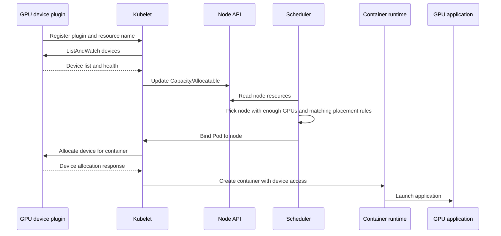

# GPUs, Device Plugins, and Accelerator Scheduling

## Learning Objectives

After this lesson, you will be able to:

- Explain how Kubernetes discovers GPUs and accelerators through device plugins.
- Describe the device registration lifecycle across the plugin, kubelet, Node, and scheduler.
- Distinguish drivers, container runtimes, device plugins, and the GPU Operator.
- Declare extended resources in a Pod and understand request/limit rules for GPUs.
- Schedule Pods onto the right nodes using resources, labels, taints, tolerations, and topology.
- Distinguish whole-GPU allocation, MIG, time-slicing, and other device-sharing models.
- Identify requirements for multi-GPU workloads and distributed training.
- Inspect device health, metrics, allocation errors, and GPU issues in a cluster.
- Design security, quota, priority, and cost policies for accelerator workloads.

## 1. What Are GPUs Used for in Kubernetes?

A GPU (Graphics Processing Unit) is a processor capable of executing many calculations in parallel. Beyond graphics, GPUs power machine learning, inference, image/video processing, scientific simulation, data analytics, and specialized compute workloads.

Kubernetes can schedule workloads using GPUs or other accelerators such as FPGAs, cryptographic cards, specialized NICs, or AI processors. To do so, the cluster needs to know:

- Which nodes have the devices.
- How many allocatable device resource units are available.
- Which containers request devices.
- Which devices have been assigned to a container.
- Whether the devices are healthy and ready.
- Whether the workload is compatible with the device type, driver, topology, and software stack.

CPU and memory are standard resources managed directly by Kubernetes via the scheduler and kubelet. GPUs are typically exposed to the cluster as **extended resources** advertised by a vendor device plugin. The plugin connects vendor hardware to the kubelet, while the scheduler uses the advertised resource count on the Node to choose a suitable host.

### 1.1. Why Not Just Declare GPUs Like CPU?

A GPU is not simply a pool of CPU that can be sliced into millicores. Devices have distinct characteristics:

- A physical GPU may be assigned exclusively as a whole unit to one container.
- Some GPUs support hardware partitioning, such as MIG on compatible NVIDIA models.
- Some plugins support time-slicing or vendor-specific sharing mechanisms.
- GPUs have device memory, compute capabilities, and driver/runtime compatibility constraints.
- Multiple GPUs on the same node may have different NVLink, PCIe, or NUMA topologies.
- A workload may require multiple GPUs at once or multi-node coordination.

The default Kubernetes scheduler sees only the name and integer count of extended resources; it does not inherently understand VRAM size, current GPU utilization, CUDA compatibility, or interconnect performance between devices. Those requirements must be expressed via labels, plugin configuration, policies, scheduler extensions, or appropriate orchestration frameworks.

## 2. GPU Allocation Architecture in a Cluster

A GPU deployment typically involves these components:

1. **GPU hardware:** GPUs or accelerators attached to the node.
2. **Host driver:** vendor driver installed on the node and compatible with the kernel.
3. **Container runtime integration:** runtime configuration granting containers access to devices and required libraries.
4. **Device plugin:** process running on the node that detects devices and registers extended resources with kubelet.
5. **Kubelet:** manages node devices, receives plugin updates, and performs device allocation when starting containers.
6. **Node status:** advertises Capacity and Allocatable resources to the scheduler.
7. **Scheduler:** picks a node with sufficient available resources while satisfying other Pod constraints.
8. **Application container:** runs the GPU workload.

### 2.1. Registration and Allocation Flow



This is a conceptual flow. Exact communication details and configuration vary across Kubernetes versions, runtimes, and vendor plugins. The key point is that the scheduler selects nodes based on advertised resources, while the device plugin handles discovery and device allocation on the node.

### 2.2. What Does a Device Plugin Do?

The Kubernetes Device Plugin API lets vendors or operators provide plugins running on each node equipped with devices. Plugins are typically deployed as a DaemonSet and perform the following:

- Discover eligible devices on the host.
- Register with kubelet over a Unix domain socket inside kubelet's device-plugin directory.
- Advertise a resource name, such as `nvidia.com/gpu`.
- Stream the device list via `ListAndWatch`.
- Report device health as `Healthy` or `Unhealthy`.
- Handle device allocation requests for containers via `Allocate`.
- Optionally run device-preparation hooks prior to container startup if supported by the plugin and API.

Kubelet uses plugin updates to update node resource status and coordinates with the runtime when creating containers. A device plugin is not a custom scheduler and does not decide which Pod runs first.

### 2.3. A Device Plugin Does Not Replace Drivers

Distinguish each component:

| Component | Role |
|---|---|
| GPU driver | Enables the host kernel and hardware device to communicate |
| Container runtime/toolkit | Configures containers to access device nodes and required libraries |
| Device plugin | Discovers devices, registers resources, and allocates devices to kubelet |
| GPU Operator or node management stack | Can automate installing/managing drivers, toolkits, plugins, monitoring, and related components |
| Kubernetes scheduler | Picks nodes based on resources and Pod constraints |
| Application framework | Uses the GPU via libraries such as CUDA, ROCm, or matching runtimes |

Installing a device plugin without matching drivers or runtime integration will not make GPUs work. Conversely, `nvidia-smi` working on the host does not guarantee Pods will receive GPUs properly.

## 3. Extended Resources and How Kubernetes Represents GPUs

A device plugin registers a domain-qualified resource name, such as:

- `nvidia.com/gpu`
- `amd.com/gpu`
- `vendor.example/accelerator`

The exact name is defined by the plugin and vendor. This resource appears in Node status under Capacity and Allocatable.

### 3.1. Capacity and Allocatable

- **Capacity:** total resources advertised by the node.
- **Allocatable:** resources available for Pods after accounting for system reservations or operational limits.

For example, a node might advertise:

```text
Capacity:
  cpu: 64
  memory: 512Gi
  nvidia.com/gpu: 4

Allocatable:
  cpu: 60
  memory: 480Gi
  nvidia.com/gpu: 4
```

These numbers are illustrative. GPU allocatable may be lower than capacity if the plugin exposes only a subset of devices or uses a specific sharing configuration. CPU and memory can be reduced by `system-reserved`, `kube-reserved`, or eviction thresholds.

### 3.2. Extended Resource Request and Limit Rules

For device-style extended resources, Kubernetes does not overcommit them the way CPU can be overcommitted. Typically:

- Pods declare GPUs in `limits`.
- If only `limits` is declared, Kubernetes uses that value as the `request`.
- If both `requests` and `limits` are declared, both values must be equal for extended resources.
- Device counts must generally be whole integers.
- The scheduler only places a Pod on nodes with enough unallocated device units.

For example, a container requesting `nvidia.com/gpu: 1` claims one GPU resource unit advertised by the plugin. Two Pods each requesting one GPU cannot share a node with only 1 allocatable GPU total, unless the plugin configures a sharing mode and advertises multiple logical resource units.

Do not confuse GPU resource count with GPU memory. `nvidia.com/gpu: 1` normally represents one advertised device unit, not a guarantee of how many GiB of VRAM the Pod needs.

## 4. Declaring a Pod That Uses a GPU

Example Job using one NVIDIA GPU on nodes with a matching accelerator label:

```yaml
apiVersion: batch/v1
kind: Job
metadata:
  name: gpu-inference-test
spec:
  backoffLimit: 2
  template:
    metadata:
      labels:
        app: gpu-inference-test
    spec:
      restartPolicy: Never
      nodeSelector:
        accelerator: nvidia-a100
      tolerations:
        - key: accelerator
          operator: Equal
          value: nvidia
          effect: NoSchedule
      containers:
        - name: inference
          image: registry.example.com/ml/inference:1.0
          command: ["python", "serve.py"]
          resources:
            requests:
              cpu: "4"
              memory: "16Gi"
            limits:
              cpu: "8"
              memory: "24Gi"
              nvidia.com/gpu: 1
```

Values and images are illustrative; replace them with tested images and actual cluster labels.

In this manifest:

- `nvidia.com/gpu: 1` requests one GPU unit advertised by the device plugin.
- CPU and memory declare their own requests and limits.
- `nodeSelector` restricts the Pod to nodes carrying `accelerator=nvidia-a100`.
- `tolerations` allows the Pod onto nodes carrying the matching taint.
- `backoffLimit` bounds how many times the Job retries upon failure.

The `accelerator` label in this example is a cluster convention. Do not assume every cluster uses this label. Inspect the actual labels provided by Node Feature Discovery, GPU Operator, or your node provisioning process.

### 4.1. Why Declare GPUs Only in `limits`?

For extended resources, the limit serves as the request when `requests` is omitted. The following configuration is valid under standard rules:

```yaml
resources:
  limits:
    nvidia.com/gpu: 1
```

If you declare both, their values must match:

```yaml
resources:
  requests:
    nvidia.com/gpu: 1
  limits:
    nvidia.com/gpu: 1
```

Do not write `requests: nvidia.com/gpu: 0.5` expecting half a GPU under the standard native extended resource model. To partition or share GPUs, configure the plugin and hardware mechanism such as MIG or time-slicing.

## 5. GPU Scheduling: What Does the Scheduler Evaluate?

The scheduler must find a node satisfying both GPU resources and every other constraint on the Pod. A node having a GPU does not automatically make it suitable for a workload.

Common criteria:

- Sufficient free extended resources on the node.
- Node labels matching the GPU type, architecture, or driver.
- Pod tolerating node taints.
- Node affinity or topology rules satisfied.
- Sufficient remaining CPU, RAM, ephemeral storage, and other resources.
- Node is neither cordoned nor unready.
- Runtime, plugin, and drivers are ready.
- Quota and admission policies permit the Pod to use accelerators.

### 5.1. Node Labels and Node Affinity

Labels can classify nodes by GPU type, for example:

```bash
kubectl label node gpu-node-01 accelerator=nvidia-a100
kubectl get nodes -L accelerator
```

In production, hardware labels should be managed by Node Feature Discovery, GPU Operator, or controlled provisioning automation. Do not allow workload users to arbitrarily attach privileged node labels to bypass placement policies.

When more expressive rules than `nodeSelector` are needed, use `nodeAffinity` to pick node groups by labels—for example, preferring higher GPU memory or a compatible architecture. Labels are only metadata; they do not prove drivers and devices are healthy. Pair labels with allocatable resources and health checks.

### 5.2. Taints and Tolerations

GPU nodes are expensive and usually reserved for specialized workloads. Operators can taint nodes so regular Pods do not accidentally consume them:

```bash
kubectl taint nodes gpu-node-01 accelerator=nvidia:NoSchedule
```

Only Pods with matching tolerations are considered for those nodes. A toleration only lets a Pod pass the taint barrier; it does not force the Pod onto the GPU node. Pair it with `nodeSelector` or `nodeAffinity` to target the right node group.

Common effects:

- `NoSchedule`: blocks scheduling new Pods without a matching toleration.
- `PreferNoSchedule`: tries to avoid the node, though not a hard block.
- `NoExecute`: can also evict running Pods, subject to tolerations and `tolerationSeconds`.

Avoid overly broad tolerations that tolerate every taint unless a workload genuinely needs it.

### 5.3. The Scheduler Does Not Understand Every GPU Attribute Automatically

The default Kubernetes scheduler knows extended resource counts and declared constraints. It does not necessarily know:

- Free VRAM at runtime.
- Current GPU utilization.
- CUDA compute capability required by the application.
- Whether GPUs have NVLink between them.
- Actual PCIe/NUMA bandwidth.
- Whether GPUs are being shared via time-slicing.
- Whether a model actually fits in GPU memory.

If those attributes affect workload execution, express them via labels/resource classes, policies, device plugins, topology-aware allocation, or scheduler extensions. Do not treat GPU utilization metrics as a scheduler-reservable resource unless the cluster explicitly integrates such a mechanism.

## 6. From Scheduled Pod to Container Seeing the GPU

Once a Pod is bound to a node, kubelet coordinates with the device plugin to expose the device to the container.

General flow:

1. Scheduler selects a node with enough allocatable GPUs.
2. Pod is bound to the node.
3. Kubelet inspects the container's device requests.
4. Kubelet calls the device plugin's `Allocate`.
5. The plugin returns the configuration needed for the runtime to expose the device.
6. The runtime starts the container with required device nodes, mounts, environment variables, or annotations.
7. The application loads libraries and accesses the GPU.

Different plugins return device nodes, mounts, environment variables, or annotations. Exact mechanics depend on the API and runtime integration.

### 6.1. Verifying from Inside a Container

With an image containing NVIDIA utilities and a compatible runtime, you can inspect:

```bash
nvidia-smi
```

If `nvidia-smi` runs inside the container and displays the allocated device, that is a good sign, though it does not prove expected workload performance. Also verify that the framework detects the GPU, driver/runtime versions match, VRAM is sufficient, compute utilization behaves as expected, and inference/training completes properly.

Not every application image includes `nvidia-smi`. Missing that binary in an image does not prove the GPU is absent. Test using your framework or an administrator-approved diagnostic image.

## 7. Device Plugin Health and Node Status

Device plugins monitor devices and report health updates. When a device turns `Unhealthy`, kubelet can update node resources so the scheduler stops assigning that device to new workloads.

States to distinguish:

- Plugin not registered yet: GPU resources may not appear on the Node.
- Plugin registered but detected zero devices: resource count may be `0`.
- Unhealthy device: device may be dropped from allocatable or excluded from allocation.
- Driver error: plugin may fail to initialize or access devices.
- Plugin restart: kubelet may need to re-register and resync state.
- Disconnected node: resource status may go stale until the control plane receives updates.

Device plugin health does not replace application health checks. A GPU can report `Healthy` while a model fails due to insufficient VRAM, driver mismatch, or library errors.

### 7.1. Inspecting Node Resources

```bash
kubectl describe node gpu-node-01
```

Under `Capacity` and `Allocatable`, check the resource name advertised by the plugin, such as `nvidia.com/gpu`. Also inspect `Conditions`, `Events`, `Taints`, and `Labels`.

To quickly view nodes with the `accelerator` label:

```bash
kubectl get nodes -L accelerator
```

If the resource is missing, inspect plugin Pods, plugin logs, host drivers, and the kubelet registration socket before editing workload manifests.

## 8. Whole GPUs, MIG, and Time-Slicing

Not every workload needs an entire physical GPU. Some platforms support partitioning or sharing, with distinct semantics and isolation levels.

### 8.1. Whole-GPU Allocation

This is the simplest model: one GPU unit is allocated exclusively to one container at a time per the plugin's resource count.

Advantages:

- Relatively straightforward scheduling and control.
- Avoids direct sharing contention between multiple containers on the same GPU.
- Fits workloads requiring the device's full memory or compute capacity.

Limitations:

- Small workloads may underutilize the GPU.
- Concurrent Pods are bounded by physical device count.
- Expensive GPUs sit idle between intermittent jobs.

### 8.2. MIG (Multi-Instance GPU)

Certain NVIDIA GPUs support MIG, partitioning a physical GPU into multiple GPU instances with hardware-partitioned resources according to supported profiles.

Depending on GPU model and configuration, MIG provides compute and memory partitions with stronger hardware isolation than time-slicing. The device plugin can expose partitions as separate extended resources or according to the chosen configuration mode.

Keep in mind:

- MIG is only available on supported GPUs and permitted profiles.
- Partition sizes differ in compute and memory capacity.
- Changing MIG layouts may require draining workloads and reconfiguring the node.
- Applications must fit within the partition's memory and compute slice.
- Resource names and advertisement behavior depend on plugin/operator versions.

MIG is valuable when splitting GPUs into smaller units with clearer hardware boundaries, though profiles and capacity require careful management.

### 8.3. Time-Slicing

Time-slicing lets multiple workloads share a GPU by time-sharing execution or using vendor/runtime-supported sharing. A plugin can advertise multiple logical resource units per physical GPU.

Advantages:

- Increases GPU utilization for small or intermittent workloads.
- Raises Pod density per node.
- Reduces GPU idle time when individual jobs use little compute.

Limitations:

- Multiple workloads contend for compute and memory bandwidth.
- Does not inherently provide VRAM isolation or fault isolation like hardware partitioning.
- One workload can degrade tail latency for another.
- The scheduler sees multiple logical units without understanding actual runtime contention.
- Requires measuring throughput and tail latency under concurrent load.

Time-slicing does not turn an 80 GiB GPU into four isolated 20 GiB GPUs. Never assume device memory is hard-partitioned or strictly guaranteed unless the underlying mechanism explicitly provides it.

### 8.4. MIG, Time-Slicing, and Whole GPU

| Criterion | Whole GPU | MIG | Time-Slicing |
|---|---|---|---|
| Allocation unit | Physical GPU | Profile-based GPU partition | Logical unit advertised by plugin |
| Hardware isolation | Per physical device | Hardware-partitioned on supported GPUs | Generally lower than MIG |
| Compute sharing | Not shared under basic policy | Dedicated slice per profile | Multiple workloads share execution time |
| VRAM | Full allocated GPU | Partition capacity | No dedicated VRAM isolation by default |
| Pod density | Lower | Higher depending on layout | Can be high |
| Best fit | Large training/inference needing steady capacity | Multiple small jobs needing clear partitions | Light, bursty workloads accepting contention |
| Primary risk | Waste under low utilization | Profile management and compatibility | Contention and unstable latency |

MPS (Multi-Process Service) is another NVIDIA execution-sharing mechanism in certain environments. It differs from MIG and time-slicing; Kubernetes integration depends on specific runtimes, plugins, and configurations. Consult vendor documentation before choosing it.

## 9. Scheduling by GPU Type and Hardware Traits

A cluster may contain multiple generations and models of accelerators. A workload may require:

- Minimum GPU memory.
- Specific compute capability or architecture.
- Compatible driver and CUDA/ROCm versions.
- NVLink or high-speed interconnects.
- Many GPUs on the same node.
- RDMA or high inter-node network bandwidth.
- Sufficient CPU and RAM to feed data to the GPUs.

### 9.1. Node Feature Discovery and Hardware Labels

Node Feature Discovery (NFD) can detect hardware traits and label nodes automatically. Vendor operators can also attach labels for GPU model, driver version, or device status.

Environment-specific example labels:

```text
accelerator.vendor=nvidia
accelerator.model=a100
accelerator.memory=80gb
accelerator.partition=mig
```

These labels merely illustrate a naming convention. Always inspect the real labels in your cluster. Never hand-create labels claiming VRAM or capabilities without verification, because the scheduler trusts that metadata.

### 9.2. Node Affinity

Use `nodeAffinity` to choose nodes by GPU model or hardware attributes, paired with extended resource requests to ensure free GPUs exist.

Conceptual example:

```yaml
affinity:
  nodeAffinity:
    requiredDuringSchedulingIgnoredDuringExecution:
      nodeSelectorTerms:
        - matchExpressions:
            - key: accelerator.model
              operator: In
              values:
                - a100
                - h100
```

Affinity checks labels only. It does not replace requesting `nvidia.com/gpu`, nor does it validate application-driver compatibility. Rely only on labels managed by trusted cluster automation.

### 9.3. Topology and NUMA

On nodes with multiple CPU sockets, NUMA nodes, and multiple GPUs, device locality affects memory access latency and bandwidth. One GPU may sit closer to a particular NUMA node than another.

Relevant mechanisms include:

- CPU Manager policies for aligned CPU allocation.
- Topology Manager coordinating hints from CPU, device, and memory managers.
- Device plugins providing topology hints when supported.
- Node affinity and workload placement picking nodes with suitable topology.

Topology-aware allocation can boost performance for workloads sensitive to PCIe/NUMA bandwidth. However, enabling a policy does not guarantee optimal performance by itself; measure latency, throughput, and real hardware layout.

## 10. Multi-GPU Workloads and Distributed Training

A Pod can request multiple GPUs on the same node, for example:

```yaml
resources:
  limits:
    nvidia.com/gpu: 4
```

This requires a node with four available device units simultaneously. The default scheduler does not automatically guarantee NVLink connectivity or optimal interconnect topology among those GPUs unless expressed through plugins/policies.

### 10.1. Multi-GPU on a Single Node

Frameworks can span multiple GPUs to shard models or batches. Verify:

- Actual number of GPUs exposed to the container.
- Device visibility and ordering.
- VRAM per GPU.
- NVLink/PCIe interconnects.
- Host CPU and memory sufficient for data loading.
- Compatible NCCL or collective communication libraries for NVIDIA.
- Container image driver/runtime compatibility.

Do not assume `nvidia.com/gpu: 4` guarantees four GPUs on an optimal interconnect topology. When performance depends on interconnects, inspect node topology and use topology-aware placement.

### 10.2. Distributed Training Across Multiple Nodes

Distributed training needs more than GPUs alone:

- Schedulers or queues must allocate Pod/worker groups together.
- Inter-node networking needs sufficient throughput and low latency.
- RDMA or specialized fabrics may be required.
- Workloads need rendezvous, rank, world size, and node-failure handling.
- Datasets and checkpoints must live on shared or accessible storage.
- Gang scheduling or group admission avoids allocating half the workers and deadlocking.

The default Kubernetes scheduler schedules one Pod at a time; it does not enforce gang-scheduling semantics across a distributed job. Use an appropriate Job controller/operator, batch scheduler, or queue/admission framework supporting job groups. Verify the tool's exact semantics before production rollout.

### 10.3. Multi-Tenant GPU Sharing

When multiple teams share GPUs, define:

- Who is permitted whole GPUs vs. partitions.
- Namespace `ResourceQuota` for extended resources.
- `PriorityClass` and preemption policies.
- Taints/tolerations separating node groups.
- Maximum job counts and run durations.
- Queuing, fairness, and chargeback policies.
- Handling of Pods holding GPUs while idle.

`ResourceQuota` can cap extended resources per namespace when supported by cluster configuration. Quotas do not physically partition GPUs; they govern how many declared resource units can be requested.

## 11. GPU Operator and Node Lifecycle Management

Operating GPU clusters requires maintaining compatibility across kernel, driver, runtime, plugin, and application libraries. Changing one component can break workload startup or device detection.

A vendor operator can automate parts of this stack:

- Installing or managing drivers.
- Configuring the container toolkit/runtime.
- Deploying the device plugin.
- Deploying Node Feature Discovery.
- Exposing GPU monitoring exporters.
- Managing MIG or GPU features according to product capabilities.

Not every operator manages every layer in every environment. Some clusters bake drivers into the node OS image and use the operator solely for plugins and monitoring. Clarify which layers are managed by the node image, the operator, or the platform team.

### 11.1. Safe Upgrade Procedure

1. Verify the compatibility matrix across kernel, driver, runtime, plugin, and frameworks.
2. Test on a dedicated canary GPU node.
3. Cordon the node to block new Pods.
4. Drain workloads according to checkpointing and disruption policies.
5. Update driver/runtime/plugin in vendor-supported order.
6. Reboot if required by the procedure.
7. Verify the device plugin re-registers and Node Allocatable reports GPUs.
8. Run a GPU smoke test.
9. Uncordon the node and watch metrics.
10. Roll out gradually to remaining nodes.

Driver upgrades disrupt every GPU workload on the node. Budget time for drains, checkpointing, and spare capacity.

## 12. Inspecting and Monitoring GPUs

### 12.1. Inspecting Nodes and Plugins

Useful commands:

```bash
# List nodes and GPU labels
kubectl get nodes -L accelerator

# View Capacity, Allocatable, taints, and node events
kubectl describe node gpu-node-01

# View system Pods on nodes
kubectl get pods -n kube-system -o wide

# View GPU Pods and scheduling status
kubectl get pods -A -o wide
```

Plugin namespaces and DaemonSet names vary by installation. Locate actual plugin Pods before pulling logs:

```bash
kubectl get daemonsets -A
kubectl get pods -A | grep -i device-plugin
```

Once you identify the DaemonSet or Pod name, read logs from that component:

```bash
kubectl logs -n <namespace> <device-plugin-pod> --tail=200
```

Never assume the plugin always runs in `kube-system` or shares the same name across vendors.

### 12.2. Inspecting from the Node

On a GPU node, administrators can run:

```bash
nvidia-smi
ls -l /var/lib/kubelet/device-plugins/
```

`nvidia-smi` is specific to NVIDIA; other accelerators have their own tools. The `device-plugins` directory typically holds plugin/kubelet communication sockets and may vary by version. Never delete active sockets to reset a plugin without following a runbook.

### 12.3. GPU Metrics

Metrics to monitor:

- GPU utilization.
- Memory utilization and used/free VRAM.
- Power draw and temperature.
- GPU clocks and thermal/power throttling.
- ECC errors or hardware faults if supported.
- Encoder/decoder utilization for media workloads.
- PCIe/NVLink throughput and errors if available.
- Allocated GPUs vs. idle GPUs.
- Pods Pending due to missing accelerators.
- Job success, duration, and retries.
- GPU utilization by namespace, team, or workload.

Kubernetes `kubectl top` typically reports CPU and memory, not full GPU utilization. You need vendor exporters and a monitoring stack, such as DCGM Exporter in NVIDIA environments.

### 12.4. Measuring Utilization Efficiency

A node with high allocatable GPUs yet low utilization can stem from:

- Tiny or intermittent jobs.
- Pods requesting GPUs that the application never actually uses.
- Host CPU or storage failing to feed data fast enough.
- Models failing to fit efficiently in VRAM.
- Suboptimal scheduler workload distribution.
- Shared-GPU contention lowering effective throughput.
- Jobs stalled waiting on inputs, checkpoints, or networking.

Track GPU utilization alongside CPU, RAM, disk, network, queue, and application metrics. Never try to optimize by packing more Pods if the real bottleneck is data loading or CPU.

## 13. Troubleshooting GPU Workloads

| Symptom | Possible Cause | What to Check |
|---|---|---|
| Node lacks `nvidia.com/gpu` | Plugin not running/registered, driver error, or hardware undetected | Check DaemonSet, plugin logs, driver, and node status |
| Pod Pending with `Insufficient nvidia.com/gpu` | No free allocatable GPUs or node fails placement constraints | Inspect `describe pod`, `describe node`, labels/taints, and Pods holding GPUs |
| Pod scheduled yet container sees no GPU | Runtime/toolkit or device allocation error | Check plugin `Allocate`, runtime config, device nodes, and image |
| `nvidia-smi` fails inside container | Driver/library mismatch or GPU not mounted | Cross-check host driver, toolkit, plugin, and container runtime |
| Framework does not detect GPU | Missing image libraries, incompatible CUDA/ROCm, or wrong device visibility | Check framework/runtime versions and application logs |
| GPU OOM | Oversized model/batch, insufficient VRAM, or multiple processes sharing GPU | Check VRAM, batch size, model footprint, and sharing mode |
| Low throughput despite low GPU utilization | CPU/data loader, disk, network, or batch size bottleneck | Profile the full pipeline and check input throughput |
| Severe latency jitter on shared GPUs | Time-slicing contention or noisy neighbors | Inspect sharing policies, tenants, and tail latency |
| GPUs vanish after node upgrade | Incompatible driver/runtime/kernel or unready plugin | Check version matrix, node events, and plugin logs |
| Pod lands on wrong GPU node | Mismatched labels, affinity, or taints/tolerations | Check Pod events and node labels/taints |
| Distributed job hangs waiting for workers | Missing gang scheduling, insufficient nodes/GPUs, or network failure | Check group admission, rank/world size, DNS, and networking |
| GPU nodes wasted | Jobs holding GPUs idle, weak quotas, or poor queue policies | Check allocation age, utilization, queues, and idle allocations |

### 13.1. Pod Pending Due to Insufficient GPUs

When a Pod is Pending, inspect events:

```bash
kubectl describe pod gpu-inference-test
```

A message like `Insufficient nvidia.com/gpu` means the scheduler found no eligible node with enough remaining extended resources. Common causes:

- All GPUs are already claimed by other Pods.
- GPU nodes exist, but the plugin has not advertised the resource yet.
- Nodes carry taints the Pod does not tolerate.
- Node affinity/`nodeSelector` excludes all GPU nodes.
- Nodes are cordoned or NotReady.
- Partition/resource names mismatch the manifest.

Do not immediately delete other Pods. First inspect which workloads hold the devices, their priorities, quota policies, and whether capacity can scale out.

### 13.2. GPU OOM vs. Container Memory OOM

GPU OOM usually means running out of device VRAM—for example, a framework throwing `CUDA out of memory`. That differs from host RAM cgroup OOM kills.

Inspect separately:

- Used vs. free VRAM.
- Model size, activations, batch size, and sequence length.
- Number of processes/Pods sharing the GPU.
- MIG partition or sharing mode.
- Host CPU RAM and container memory limits.
- Framework and driver logs.

Raising the Kubernetes container memory limit does not add VRAM. Adjust model/batch sizes, pick a GPU or partition with enough VRAM, or change sharing settings.

## 14. Security When Exposing GPUs to Workloads

GPU workloads may process sensitive datasets or run code from multiple teams. Govern both device access and data access.

Principles:

- Permit only approved workloads on GPU nodes.
- Enforce placement via taints/tolerations and admission policies.
- Cap accelerators per namespace using `ResourceQuota` where appropriate.
- Do not grant `privileged` mode or broad host device access unnecessarily.
- Source drivers and plugins from trusted registries; verify versions and image signatures.
- Restrict network egress, secrets, and volume mounts.
- Separate workloads with different trust levels using dedicated node pools or appropriate sandboxes.
- Audit who requested GPUs, device types, usage durations, and namespaces.
- Monitor device errors and anomalous events.

Device plugins interact directly with kubelet and host devices. Plugin DaemonSets typically require elevated privileges and host mounts; use only vetted plugins. Never let regular workload users deploy arbitrary device plugins onto production nodes.

## 15. Cost and Accelerator Efficiency

GPUs generally cost substantially more than standard CPUs. Real cost depends on:

- GPU node/instance pricing and runtime duration.
- GPU count per node and utilization levels.
- Duration Pods hold GPUs idle waiting for input or dependencies.
- Whether both VRAM and compute capacity are utilized effectively.
- Storage capacity and data transfer charges.
- Software, framework, or model licensing.
- Idle reserve capacity kept for SLAs.
- Operational overhead for drivers, operators, monitoring, and upgrades.

### 15.1. Efficiency Metrics

Track metrics such as:

- Cost per inference or cost per 1,000 requests.
- Cost per training step or epoch.
- Cost per model checkpoint.
- GPU-hours per completed batch.
- GPU utilization ratio during allocation windows.
- GPU idle duration while held by running Pods.
- Queue wait time and job completion time.
- Job retry or failure rates from capacity shortages.

Never optimize solely by driving utilization up. High GPU utilization paired with breached latency SLOs or rising error rates degrades service quality.

### 15.2. Optimizing Allocation

- Match GPU models to model footprint and batch sizes.
- Use MIG for smaller workloads when hardware and software support it.
- Use time-slicing only for workloads that tolerate contention.
- Allocate sufficient CPU/RAM so GPUs are not starved of input data.
- Use node affinity to keep workloads off incompatible GPUs.
- Use job queues to batch work and cut GPU idle gaps.
- Terminate Pods/jobs promptly upon completion instead of holding GPUs idle.
- Review quotas and usage history regularly to right-size capacity.

## 16. Dynamic Resource Allocation (DRA) and Advanced Device Models

Device plugins are the standard mechanism for advertising countable extended resources. For complex hardware, Kubernetes also offers Dynamic Resource Allocation (DRA) built around concepts such as `ResourceClass`, `ResourceClaim`, and DRA drivers.

DRA can express richer device requirements and more flexible configuration selection, depending on Kubernetes and driver versions. It helps when resources must be matched by attributes or dynamically allocated in ways simpler GPU counts cannot capture.

Keep in mind:

- Not every cluster enables or supports the same DRA version.
- Vendor drivers must support the corresponding DRA implementation.
- APIs and features depend on the Kubernetes version.
- DRA does not automatically install drivers or guarantee framework compatibility.
- Do not mix DRA examples with device plugin manifests unless the cluster enables the matching APIs.

Before adopting DRA, verify your Kubernetes version, feature gates/API availability, driver support, and operational workflows. For clusters using traditional device plugins, extended resources remain the standard representation.

## 17. Practical Example: Deploying Inference on a GPU Node Pool

A team operates an inference API on Kubernetes. They have:

- A CPU node pool for the API gateway and lightweight tasks.
- A GPU node pool containing accelerators compatible with the model.
- A device plugin advertising `nvidia.com/gpu`.
- GPU nodes labeled by model and tainted to restrict general workloads.
- Model artifacts stored in object storage.
- Monitoring collecting latency, GPU utilization, and VRAM.

Deployment workflow:

1. Install compatible drivers and the container toolkit on the GPU node image.
2. Deploy the device plugin as a DaemonSet on GPU nodes.
3. Verify the plugin registers and Nodes advertise GPUs in `Allocatable`.
4. Attach model/architecture labels and taints to the GPU node pool.
5. Create the namespace, quotas, and policies for the inference team.
6. Create a Deployment requesting GPUs in `limits` alongside appropriate CPU/RAM.
7. Use node affinity/`nodeSelector` and tolerations to target the right nodes.
8. Verify containers see the GPUs and the framework loads the model cleanly.
9. Run smoke tests and load tests at expected batch sizes.
10. Monitor p95/p99 latency, VRAM, utilization, errors, and queues.
11. Tune replicas, GPU counts, or sharing modes based on metrics.
12. Establish safe rollout and node drain procedures for driver upgrades.

If Pods go Pending due to GPU exhaustion, the team checks capacity and queues before raising replicas. If GPU utilization stays low while latency is high, they profile CPU preprocessing, data loading, and networking. If VRAM OOMs occur, they tune batch/model sizes or switch to a GPU/partition with larger memory.

## 18. Kubernetes GPU Operations Checklist

### Before Deployment

- [ ] Identified GPU model, memory, compute capability, and driver requirements.
- [ ] Verified node image, kernel, and driver compatibility.
- [ ] Configured container runtime/toolkit integration.
- [ ] Deployed a vetted device plugin or operator.
- [ ] Confirmed Node `Capacity` and `Allocatable` advertise the extended resource.
- [ ] Defined labels, taints, tolerations, and affinity rules.
- [ ] Declared GPUs in `limits` using the exact resource name.
- [ ] Checked required CPU, memory, storage, and networking.
- [ ] Decided between whole GPUs, MIG, or time-slicing.
- [ ] Set `ResourceQuota`, priorities, and tenant policies.

### During Operations

- [ ] Monitor device plugin health and Pod status.
- [ ] Monitor GPU utilization, VRAM, temperature, and power.
- [ ] Track GPU allocation, idle time, and queue wait times.
- [ ] Verify framework/driver compatibility across updates.
- [ ] Monitor GPU OOMs separately from host memory OOMs.
- [ ] Verify topology for multi-GPU workloads.
- [ ] Verify gang scheduling for distributed jobs where required.
- [ ] Review quotas and costs per namespace/team.
- [ ] Drain workloads cleanly before upgrading drivers or plugins.

### When Troubleshooting

- [ ] Inspect Pod events and Pending reasons.
- [ ] Check node labels, taints, and `Allocatable`.
- [ ] Check device plugin and kubelet logs.
- [ ] Check host drivers.
- [ ] Check runtime/toolkit config and device nodes inside the container.
- [ ] Check VRAM and framework error logs.
- [ ] Check networking and collective libraries for distributed workloads.
- [ ] Record node name, GPU UUID, Pod, container, and failure timestamps.

## 19. Common Misconceptions

- **The device plugin is the GPU driver.** Drivers let the kernel talk to hardware; plugins register and allocate devices for kubelet.
- **If a GPU appears in `nvidia-smi` on the host, Pods can use it right away.** You still need the plugin, runtime integration, resource requests, and compatible images.
- **The scheduler automatically knows free VRAM.** The default scheduler typically schedules on extended resource counts, not runtime VRAM/utilization.
- **GPU requests can be fractional like CPU.** Standard extended resources are allocated in whole integer units.
- **GPU requests/limits behave identically to CPU.** For extended resources, `limits` implies `requests`; if both are specified, they must match.
- **A GPU can be safely shared just by bumping the resource count.** Sharing requires properly configured plugins and mechanisms like MIG or time-slicing.
- **Time-slicing gives each Pod dedicated VRAM.** It does not provide hardware-partitioned or guaranteed isolated GPU memory by default.
- **MIG and time-slicing are the same.** MIG hardware-partitions supported GPUs; time-slicing time-shares execution.
- **A toleration forces a Pod onto GPU nodes.** It only passes the taint; you still need a selector/affinity to select those nodes.
- **Having multiple GPUs on a node guarantees optimal topology.** You must check PCIe, NVLink, NUMA, and plugin topology hints.
- **The default Kubernetes scheduler launches all distributed Pods simultaneously.** Gang scheduling requires an additional compatible orchestrator/scheduler.
- **`kubectl top` shows full GPU metrics.** You normally need vendor exporters and monitoring stacks.
- **Raising container RAM fixes GPU OOM.** GPU OOM is VRAM exhaustion; adjust models, batches, sharing, or GPU types.
- **A healthy GPU node guarantees a healthy app.** Drivers and plugins can be healthy while frameworks, models, or dependencies fail.

## 20. Self-Check

**Scenario 1:** `kubectl describe node` does not list `nvidia.com/gpu`, yet `nvidia-smi` works on the host. What do you check first?

**Hint:** Check the device plugin DaemonSet, plugin logs, kubelet registration, runtime integration, and Node status. A working host driver alone is not enough for Kubernetes to advertise extended resources.

**Scenario 2:** A Pod is Pending with `Insufficient nvidia.com/gpu`, even though the node has physical GPUs. What causes are possible?

**Hint:** All GPUs may already be allocated to other Pods, the plugin may not have advertised allocatable units, the node may carry an untolerated taint, affinity may not match, the node may be NotReady, or the resource/partition name may mismatch the manifest.

**Scenario 3:** A container requests `nvidia.com/gpu: 1`. Does that guarantee Kubernetes provides 40 GiB of VRAM?

**Hint:** No. The resource count represents one device unit advertised by the plugin. VRAM depends on the physical GPU or partition; target the right node/resource and verify via trusted labels/metadata.

**Scenario 4:** A node has one physical GPU, while a time-slicing plugin advertises multiple logical GPU units. Can each unit be treated as an independent GPU?

**Hint:** No. Workloads can contend for compute and memory bandwidth. Time-slicing does not provide VRAM partitioning or hardware fault isolation like MIG by default.

**Scenario 5:** A Pod was scheduled onto a GPU node, but the framework reports `CUDA out of memory`. Will increasing the container's memory limit resolve this?

**Hint:** Not necessarily. This usually indicates VRAM exhaustion. Inspect model size, batch size, activations, concurrent processes sharing the GPU, MIG profile, and actual GPU memory.

**Scenario 6:** A distributed training job has 8 Pods, each requesting 1 GPU. Four Pods are running, four remain Pending, and the running workers are deadlocked waiting for peers. What should you inspect?

**Hint:** Check total capacity, gang scheduling/group admission, quotas, topology, and networking. Scheduling Pods one by one can leave a distributed job partially allocated and unable to make progress.

## Conclusion

Kubernetes uses device plugins to bring GPUs and accelerators into its extended resource model. Plugins discover hardware, register with kubelet, report health, and allocate devices to containers; the scheduler relies on Capacity/Allocatable along with labels, taints, affinity, and resource constraints to choose nodes. Running GPU workloads reliably requires aligning drivers, container runtimes, plugins, container images, and frameworks. Choosing whole GPUs, MIG, or time-slicing depends on VRAM, compute, isolation, and latency requirements. Monitor both hardware and applications, test topology and upgrade workflows, and govern quotas, priorities, and costs to use accelerators safely and efficiently.
