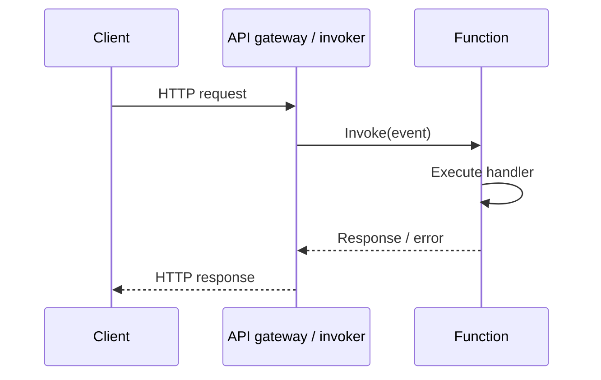
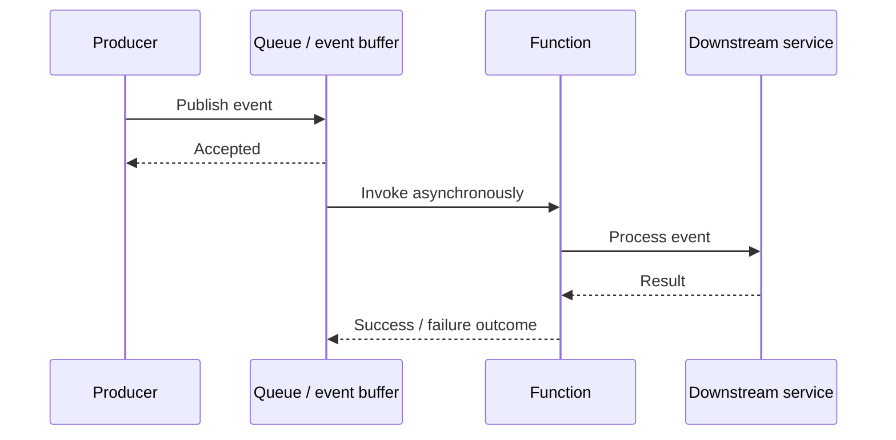
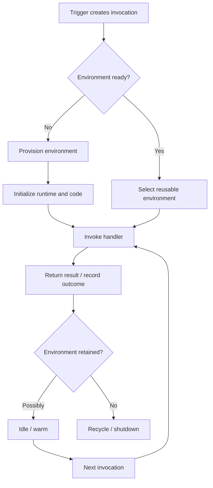
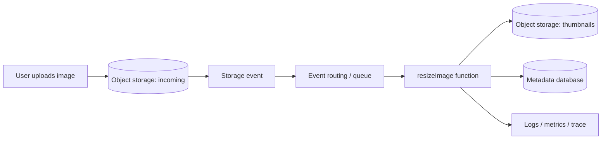

# Functions, triggers, events, and execution environments

## Context: a function is invoked when an event occurs

In the serverless function model, the developer deploys a unit of code with a clear responsibility, while the platform manages most of the underlying runtime infrastructure. A function can be invoked directly over HTTP, triggered when a message arrives in a queue, when an object is created in storage, when data changes, or on a schedule. Each invocation typically has an **event** describing what happened and a **runtime context** providing information about the execution.

This model makes it easier to build event-driven applications: instead of a server running continuously waiting for requests, a function is invoked when there is work to do. However, “serverless” does not mean there are no servers or no need to care about compute. The platform still provisions CPU, memory, network, and the execution environment; developers must understand invocation limits, concurrency, timeouts, cold starts, retries, and the execution environment lifecycle.

In the **CLOUD_CORE_SERVICES_COMPUTE** module, functions are a compute option alongside VMs and containers. Understanding functions, triggers, events, and execution environments helps choose the right model for APIs, asynchronous processing, system integration, automation, and scheduled tasks.

## 1. What is a function?

A serverless function is a deployable unit that the platform can invoke to handle a request or event. A function typically consists of:

- **Handler:** the entry point called by the runtime when an invocation occurs.
- **Event:** input data describing the request or triggering event.
- **Context:** metadata about the invocation and runtime environment, such as request ID, deadline, or runtime information.
- **Code and dependencies:** business logic together with required libraries.
- **Configuration:** memory/CPU tier, timeout, environment variables, network, identity, and other limits.

For example, the `resizeImage` function receives an event containing a bucket and object key, reads the original image, generates a thumbnail, and saves the result. The function does not need to manage a web server itself, but it must still handle storage errors, access permissions, image formats, memory limits, and timeouts.

### 1.1. Function and handler

A function is the deployed unit of logic; a handler is the function or method that the runtime calls to start processing an invocation. The handler name, signature, and conventions depend on the language and platform.

Conceptually, a handler has the form:

```text
handler(event, context) -> result
```

- `event` contains the invocation input.
- `context` contains control and environment information.
- `result` can be a synchronous response, a processing status, or no return value for asynchronous triggers.

Not every platform passes two parameters with those exact names or in that exact form. Some runtimes use a request object, callback, stream, or dedicated API. You need to read the contract of the chosen runtime.

### 1.2. A function should focus on a single responsibility

Functions are usually effective when they have a clear responsibility, such as verifying a webhook, handling one event type, converting an image, or sending a notification. An overly large function can accumulate too many dependencies, permissions, and logic branches; an overly small function can introduce excessive network hops, invocations, and orchestration overhead.

Split boundaries along business capabilities and data ownership. For example, `validateOrder`, `reserveInventory`, and `sendReceipt` can be separate steps in a workflow if each step has different retry rules, timeouts, and access permissions. Do not split functions merely to keep each function to a small number of lines of code.

## 2. Trigger: what causes a function to be invoked?

A trigger is the mechanism or event source that causes the platform to create an invocation for a function. The trigger determines when the function is called, how input data is passed, and part of the delivery semantics.

Common trigger categories:

| Trigger category | Examples | Typical processing style |
|---|---|---|
| HTTP/API | HTTP request, webhook, API gateway | Synchronous, requires a response for the caller |
| Queue/message | Message from a queue or broker | Asynchronous, with retries and acknowledgement |
| Event bus | Business events from multiple producers | Asynchronous, routed by rules/filters |
| Storage | Object uploaded, file created | Asynchronous, processed from object metadata |
| Database | Change stream, record change, CDC event | Asynchronous, processes data changes |
| Schedule | Cron-like schedule, timer | Time-based invocation |
| Stream | Records from an event/log stream | Per batch or per record, with checkpoint/offset |
| Platform event | Resource lifecycle, audit event, deployment event | Automation and operational response |

A function can have multiple triggers if its logic and security boundary are appropriate. However, different triggers may have different event schemas, retry policies, timeouts, and invocation permissions. You must clearly control which sources are allowed to invoke which functions.

### 2.1. Push-based trigger

With a push-based trigger, the event source or an intermediary service sends a request/event to the function’s endpoint or invocation mechanism. For example, an API gateway sends an HTTP request to a function or an event bus pushes an event to a target.

Characteristics:

- The function is invoked when the source sends an event.
- It may require authenticating the caller, webhook signature, or invoke permissions.
- The sending system must handle delivery errors, timeouts, and retries according to the contract.
- The endpoint must be protected against invalid traffic and bursts.

### 2.2. Pull-based trigger and event source mapping

With a pull-based trigger, the platform or an event source mapping reads messages/records from a source such as a queue or stream and invokes the function in batches. The function does not necessarily have a public endpoint for producers to call directly.

Characteristics:

- A consumer/poller reads messages or records using a platform-managed mechanism.
- Batch size, polling window, concurrency, and checkpointing can be configured.
- Batch success/failure affects acknowledgement or offset progression.
- You must understand how partial batch failures, poison messages, and retries are handled.

The terminology and semantics of event source mappings vary across providers. Distinguish the trigger mechanism from the handler code: the trigger fetches data from the source and creates invocations; the handler executes business logic.

### 2.3. Schedule-based trigger

Schedule triggers suit periodic reports, cleanup jobs, data synchronization, or status checks. Schedules can be expressed using cron expressions or fixed intervals depending on the platform.

Factors to decide:

- Time zone and daylight saving rules, if applicable.
- Whether scheduled runs can overlap if the previous invocation has not finished.
- Behavior when a schedule is missed due to platform disruption.
- Retries and handling of duplicate runs.
- An idempotency key or business date to avoid processing the same period twice.

Do not assume a schedule always creates exactly one invocation. Duplicates, delays, or retries can occur depending on the service; the handler should be safe when receiving the same work period multiple times.

## 3. Event: the input data of an invocation

An event is a data record describing what happened or the request to be processed. An event may contain business data, resource identifiers, timestamps, metadata, trace context, and emitter information.

Example object upload event:

```json
{
  "eventType": "storage.object.created",
  "eventId": "evt-7f3a2",
  "occurredAt": "2026-11-22T09:30:00Z",
  "source": "media-upload-service",
  "data": {
    "bucket": "incoming-media",
    "objectKey": "customers/42/photo.jpg",
    "version": "v18",
    "contentType": "image/jpeg",
    "sizeBytes": 2481930
  }
}
```

This is an illustrative application-defined schema, not a standard payload from a specific cloud provider. Real storage triggers may structure fields differently and include encoding, region, bucket ARN, or a dedicated sequencer.

### 3.1. Components that should be in an event contract

An event contract can define:

- `eventId`: unique identifier for tracing and deduplication.
- `eventType`: event type and version semantics.
- `source`: system that emitted the event.
- `occurredAt`: UTC timestamp when the event occurred.
- `subject` or resource identifier: the affected entity.
- `data`: business payload needed by consumers.
- `schemaVersion`: version of the event structure.
- Correlation/trace ID: links processing steps together.

Not every event needs every field. What matters is that producers and consumers agree on the schema, semantics, compatibility, and how missing or invalid fields are handled.

### 3.2. How an event differs from a command and a request

- **Event** describes something that already happened, e.g. `OrderPlaced`; consumers can react independently.
- **Command** asks a component to perform an action, e.g. `ReserveInventory`; usually has a single owner responsible for execution.
- **Request** asks for immediate processing and usually waits for a response, e.g. HTTP `POST /orders`.

In practice, a message may have hybrid traits, but distinguishing these three concepts helps design coupling and failure handling. An event is typically emitted after a business fact has occurred; a command expresses an intent to be executed.

### 3.3. Events should be immutable and versioned

Once published, an event should be treated as an immutable record. If consumers need new fields, add them in a backward-compatible way or bump the schema version according to policy. Avoid changing the meaning of an existing field without changing the version, because running consumers may misinterpret the data.

Common guidelines:

- Prefer additive changes and optional fields with clear defaults.
- Do not reuse an old field name for a new meaning.
- Define rules for when a consumer encounters an unsupported schema version.
- Use a schema registry or contract tests when a system has multiple producers/consumers.
- Do not put secrets, tokens, or unnecessary sensitive data into events.

### 3.4. Event payload and size

Large payloads increase transfer cost, parsing time, memory usage, and the risk of exceeding invocation limits. For large files or binary data, an event should usually carry only a reference such as an object key, internal URI, or resource ID; the function reads the data from storage using an authorized identity.

References must be stable and access-controlled. If an object can be overwritten, the event should include a version ID, generation, or immutable key so the function reads the exact content that triggered the event. Do not put broadly accessible public URLs in events just to make downloading easier for consumers.

## 4. Invocation context and metadata

Runtime context is the information the platform provides to the handler about the current invocation or execution environment. Depending on the runtime, context may include:

- Request/invocation ID for looking up logs and traces.
- Deadline or remaining time before timeout.
- Function name, version, alias, or revision.
- Memory limit, runtime version, and environment details.
- Identity/metadata of the trigger or client, if provided by the platform.
- Cancellation token or runtime-specific logging/metrics APIs.

Context should not be confused with the event. The event is the business input data; the context is invocation control metadata. Do not make business logic depend on internal context fields when an explicit event contract can be used instead.

Pseudocode example:

```javascript
export async function handler(event, context) {
  const requestId = context.requestId;
  const deadline = context.deadline;

  logger.info({ requestId, eventType: event.eventType }, "invocation started");

  const result = await processEvent(event, { deadline });
  return { ok: true, result };
}
```

The names `requestId` and `deadline` are illustrative. Actual APIs depend on the runtime; some platforms expose remaining time via a method rather than a property.

### 4.1. Use deadlines instead of assuming enough time remains

Functions typically have a maximum timeout. Near the end of the allotted time, calling additional dependencies can cause the invocation to be terminated before cleanup finishes. The handler should:

1. Read the deadline or remaining time from context if the runtime supports it.
2. Set outbound request timeouts smaller than the remaining time.
3. Avoid starting work that cannot finish before the deadline.
4. Save a checkpoint or emit a follow-up message if the work needs to be split.
5. Avoid internal retries that stretch past the timeout; use queue/workflow retry policies where appropriate.

## 5. Invocation models

An invocation is a single execution of a function called by the platform to process an input. The invocation model determines how the caller receives results, how errors are returned, and where retries are managed.

### 5.1. Synchronous invocation

The caller sends a request and waits for the function to finish to receive the response. This model is commonly used for HTTP/APIs, webhooks, or direct calls needing an immediate result.



Characteristics:

- Function latency is part of the response time observed by the caller.
- Timeouts of the gateway, client, and function must be compatible.
- Errors are usually returned to the caller; the caller may retry.
- Callers must handle ambiguous timeouts: the function may have committed data while the response was lost.

For operations such as order creation or payment, HTTP retries must not create duplicate side effects. Use an idempotency key and persist request state to determine the outcome when the caller does not receive a response.

### 5.2. Asynchronous invocation

The invoker accepts the event, queues or buffers it, and replies that the request has been accepted. The function processes it later; the caller does not wait for the final business outcome.



Characteristics:

- Producers and consumers are loosely coupled in time.
- The system can retry failed invocations according to policy.
- Events may arrive late or multiple times; idempotency is required.
- You must monitor backlog, age of the oldest event, retries, and the dead-letter destination.
- The producer receiving “accepted” does not mean the business operation has completed.

### 5.3. Stream or batch invocation

With queues/streams, the platform can group multiple records into a batch and invoke the function. The handler processes the batch and reports success/failure according to the trigger’s semantics.

The advantage is reducing invocation count and overhead; in return, a single failing record can affect the entire batch if partial batch responses are not supported. You must define:

- Batch size and maximum batching window.
- Record ordering and partition key.
- How offsets/acknowledgements are confirmed.
- Whether the entire batch or only failed records are retried.
- How poison messages are handled to avoid blocking a partition/queue.

With streams ordered per partition, a failing record can stall subsequent records in the same partition depending on the service. Appropriate retry, checkpoint, and DLQ policies are needed to avoid losing order or blocking the stream indefinitely.

### 5.4. Choosing an invocation model

| Criterion | Synchronous | Asynchronous | Stream/batch |
|---|---|---|---|
| Does caller wait for final result? | Yes | No | Usually no |
| Response latency | Low if processing is fast | Only acknowledgement of receipt | Depends on batching/lag |
| Retry owner | Caller/gateway and app | Invoker/queue per policy | Event source/consumer |
| Throughput | By request/concurrency | Absorbs bursts via buffer | Efficient for high-volume record streams |
| Best suited for | APIs, validation, lookup | Notifications, workflow steps, background jobs | Analytics, ingestion, change streams |

If a task can take a long time, needs durable retries, or should be decoupled from client latency, use a queue/workflow/event bus instead of keeping an HTTP request open for a long time.

## 6. Execution environment: where the function runs

The execution environment is the compute environment prepared by the platform to run a function. It typically includes the runtime, process, memory, temporary filesystem, network configuration, identity, and dependencies deployed with the function.

A conceptual lifecycle:



This diagram is a conceptual model. The platform may create multiple environments in parallel, reuse an environment for an uncommitted duration, or reclaim it at any time based on capacity and policy.

### 6.1. Cold start and warm invocation

**Cold start** is the additional time spent preparing an environment before the handler processes an invocation. This work can include allocating compute, downloading the image/package, initializing the runtime, loading code/dependencies, setting up networking, and running initialization code.

**Warm invocation** reuses an already initialized environment, typically avoiding part of the initial startup cost. Warm does not mean fixed latency or zero overhead: the runtime still needs to dispatch the invocation, deserialize the event, and call the handler.

Cold starts can increase when:

- The function is invoked infrequently and environments are reclaimed.
- Packages/images are large or dependencies are heavy to initialize.
- The function attaches to a VPC/network interface or needs private connections established.
- The runtime requires JIT compilation, model loading, or SDK initialization.
- Burst concurrency forces the platform to spin up many new environments at once.

### 6.2. Do not rely on environment reuse for durable state

Some platforms may reuse processes and module state across invocations within the same environment. This can be useful for caching configuration or reusing connections, but it is not guaranteed over the long term.

Do not store sole business state in global variables, RAM, or the temporary filesystem because:

- The next invocation may run in a different environment.
- The environment may be recycled without notice.
- Multiple concurrent invocations may run across separate environments.
- Global state may be shared across invocations in the same process and cause race conditions if the runtime permits concurrency.
- Data in memory/temp storage does not replace a durable database or object storage.

Persist state that must survive across invocations in a database, object storage, durable queue, or appropriate state service. In-environment caches should only be regenerable optimizations with TTL/validation that do not affect correctness when lost.

### 6.3. Initialization code and handler code

Code can be split into two parts:

- **Initialization:** loading libraries, reading configuration, creating SDK clients, preparing models or connection pools.
- **Invocation handler:** validating input, executing business logic, and returning the outcome for the current call.

Placing heavy setup in initialization can make warm invocations faster, but it also makes cold starts longer. Placing everything in the handler can recreate clients on every invocation and increase latency. Both cold and warm paths should be measured.

SDK clients or connection pools can be reused if the library and runtime support it. However, you must handle stale connections, credential rotation, DNS changes, and pool exhaustion. Do not keep transactions or request-specific data in global variables between calls.

## 7. Runtimes and how functions are executed

The runtime is the execution layer that knows how to load code, invoke the handler, pass event/context, and collect results. Platforms may provide managed runtimes for popular languages or allow packaging a custom runtime/container image.

Common options:

- **Managed language runtime:** the provider maintains the runtime and platform patches; the user deploys code/dependencies.
- **Custom runtime:** the user provides an adapter to receive invocations and return results using the provider’s runtime API.
- **Container image:** packages the runtime, code, and dependencies in an image; the platform still manages provisioning and invocation.
- **WebAssembly or specialized runtimes:** may be supported by some platforms for specialized workloads.

Supported runtime names and lists vary by provider. Check version support lifecycles, architectures (x86_64/ARM64), native libraries, artifact size limits, and security update mechanisms.

### 7.1. Runtime contract

The runtime contract defines how the platform delivers invocations to the function and how the function returns outcomes. It may specify:

- Event and context formats.
- Handler name or entry point.
- How the process starts and loads code.
- How HTTP responses or acknowledgements are returned.
- How errors are reported for platform retries.
- How signals/shutdown and lifecycle hooks are handled.
- System environment variables provided.

If using a custom runtime, the adapter must follow the invocation protocol strictly. A minor bug in reading requests, holding connections, or reporting completion status can cause invocations to hang or be retried.

### 7.2. Dependencies and artifacts

A function can be deployed as a ZIP/package, layer, bundle, or container image. Optimize artifacts to reduce download/startup time while keeping dependencies controlled:

- Package only required libraries.
- Pin dependency versions and generate lockfiles.
- Scan packages for vulnerabilities and licenses.
- Build reproducible artifacts from controlled source.
- Separate environment configuration from the binary/image whenever possible.
- Use immutable image digests/versions instead of tags that can be overwritten.
- Test new runtimes before upgrading production.

Native dependencies must match the runtime’s OS, architecture, and ABI. A package built on Windows or against a different glibc version may fail to run in a minimal Linux runtime.

## 8. Concurrency and scaling

Concurrency is the number of invocations executing simultaneously. Serverless platforms usually scale execution environments up or down based on invocation volume, subject to limits per function, account/project, region, or event source.

### 8.1. Relationship between arrival rate, duration, and concurrency

By Little’s Law, in steady state:

\[
L=\lambda\times W
\]

Where:

- `L` is the average number of running invocations (concurrency).
- `λ` is the arrival rate of invocations per second.
- `W` is the average execution duration in seconds.

For example, if a function receives 120 invocations/second and each invocation runs for an average of 0.5 seconds:

\[
L=120\times0.5=60\text{ concurrent invocations}
\]

This is an estimated average concurrency. Peaks, tail durations, retries, and bursts can drive actual concurrency higher. Measure p95/p99 duration and arrival patterns.

### 8.2. Concurrency limits and throttling

Concurrency limits protect both the platform and downstream services from invocation volume exceeding capacity. When a limit is reached, new invocations may be throttled, queued, or retried depending on the trigger model.

Common limit types:

- Account/region concurrency quota.
- Reserved concurrency or a per-function concurrency cap.
- Provisioned concurrency/minimum warm capacity.
- Event source maximum concurrency or consumer parallelism.
- Downstream limits such as database connections, API rate limits, or queue throughput.

Setting concurrency too high can overload downstream databases or APIs. Setting it too low can build up a backlog and increase event age. Size limits according to both the function and its dependencies.

### 8.3. Scale-out and scale-in

When load increases, the platform can provision additional execution environments; when load drops, environments may be reclaimed. Scaling speed and concurrency ramp-up per interval depend on the service, region, and trigger. Do not assume scale-out is instantaneous or unbounded.

For large bursts, consider:

- Queues/buffers to smooth bursts.
- Batch sizing to reduce invocation count.
- Reserved/provisioned capacity for workloads requiring predictable latency.
- Concurrency caps to protect databases and downstream services.
- Backpressure and admission control when the system cannot keep up.
- Warm-up or pre-scaling if supported by the platform and the workload is scheduled.

### 8.4. Concurrent execution and shared data

Do not assume only one invocation runs at a time. Multiple environments can run in parallel and process events simultaneously. Shared data must be managed using database transactions, conditional writes, locks/leases, or appropriate idempotency keys.

Global variables in an environment may persist between invocations, while invocation concurrency within the same environment depends on the provider’s runtime and model. Some environments process invocations sequentially one at a time; some runtimes support concurrency within the same process. Verify the specific semantics and write thread-safe code if needed.

## 9. Statelessness and data management

Functions are usually designed to be stateless: each invocation receives enough input to do its job and does not rely on RAM from the previous call. Statelessness makes it easy for the platform to scale, replace environments, and retry.

This does not mean the application has no state. State lives in durable services outside the execution environment:

| State type | Appropriate storage | Notes |
|---|---|---|
| Business records | Database | Transactions, consistency, and connection limits |
| Files/objects | Object storage | Versioning, encryption, and lifecycle |
| Sessions/cache | Managed cache or database | TTL, eviction, and cache invalidation |
| Pending work | Queue/event stream | Retries, visibility, ordering, and DLQ |
| Long workflows | Workflow/state machine or durable store | Checkpoints and per-step state |
| Secrets/config | Secret manager/config service | IAM, rotation, and auditing |

### 9.1. Temporary storage

The execution environment may provide a temporary filesystem or directory such as `/tmp`. Capacity, durability, and sharing depend on the provider/runtime. Temporary data may survive between invocations in a reused environment, but it can be lost when the environment is reclaimed.

Use temporary storage for intermediate files, regenerable caches, or scratch data; do not use it as the sole store for orders, workflow state, or confirmed results. Delete sensitive temporary data after use and avoid assuming a new invocation always gets a clean filesystem if the platform reuses temporary storage.

### 9.2. Idempotency on retries or duplicate events

An event can be delivered multiple times due to timeouts, network failures, lost acknowledgements, or retry policies. The handler should handle duplicates safely.

Common pattern:

1. Read `eventId` or the idempotency key.
2. Create/check a processing record in the database using a unique constraint or conditional write.
3. If the event is already completed, return success without repeating side effects.
4. If not yet processed, execute the business logic within a transaction or recoverable protocol.
5. Mark completed after the result is durably persisted.

Do not simply record event IDs in a non-durable cache and treat that as sufficient deduplication if duplicates can arrive after cache expiration or environment recycling.

## 10. Retries, acknowledgements, and dead-letter handling

Retry is the mechanism that re-invokes a function when an invocation fails or no acknowledgement is received. How retries work depends on the trigger type:

- For synchronous HTTP, the caller/gateway may retry according to policy; the function requires idempotency.
- For asynchronous invocations, the invoker can retry and may route events to a dead-letter destination after a set number of attempts or duration.
- For queues, messages are typically retained until ACKed/deleted or the visibility timeout expires; messages can reappear.
- For streams, checkpoints/offsets determine which records are re-read; failures can affect subsequent records in the partition.

### 10.1. Retries with backoff

Unbounded immediate retries can amplify load when a downstream service is already failing. Use exponential backoff, jitter, and limits on retry count/duration to avoid retry storms.

Illustrative policy example:

```text
attempt 1: retry after 1 s + jitter
attempt 2: retry after 2 s + jitter
attempt 3: retry after 4 s + jitter
after max attempts: send to dead-letter queue
```

These values are examples only. Choose backoff settings based on timeouts, maximum event age, and dependency recovery characteristics.

### 10.2. Error classification

- **Transient error:** network timeouts, throttling, or temporarily unavailable dependencies; usually safe to retry.
- **Permanent/business error:** invalid payload, unsupported schema, or business rule violation; retrying usually will not help.
- **Poison message:** an event that consistently causes the handler to error or crash; must be isolated so it does not block the queue/partition.
- **Configuration/security error:** missing permissions, bad secret, or wrong endpoint; continuous retries may only generate logs and cost.

Do not catch every exception and return success, as that can silently drop failed events. Conversely, do not retry permanent errors indefinitely. Classify errors and return outcomes matching the trigger contract.

### 10.3. Partial batch failure

If a trigger delivers multiple records in a batch, the handler must know whether the platform supports per-record failure reporting or only whole-batch failure. When only batch-level acknowledgement exists, a single failing record can cause the entire batch to be redelivered, re-processing already-succeeded records.

If partial batch responses are available:

- List only the failed records using the exact schema required by the platform.
- Ensure succeeded records can be re-processed without side effects.
- Preserve ordering if required by the stream.
- Monitor retry counts and the age of the oldest unprocessed record.

### 10.4. Dead-letter queues and replay

A dead-letter queue (DLQ) or dead-letter destination holds events that could not be processed after the retry policy is exhausted. You must define:

- Who monitors and handles the DLQ.
- Retention and alerting when messages enter the DLQ.
- How to inspect payloads/errors without exposing sensitive data.
- Conditions for fixing data/code before replaying.
- How to replay safely while preventing duplicate side effects.

A DLQ does not fix data or recover workflows on its own. Without an owner and runbook, a DLQ simply becomes a forgotten pile of failures.

## 11. Configuring the execution environment

Although the provider manages servers, functions still have compute and runtime parameters to choose. These parameters affect latency, throughput, limits, and cost.

### 11.1. CPU and memory

Many platforms tie CPU allocation to the configured memory level or offer discrete compute tiers. Increasing memory may simultaneously increase CPU allocation, depending on the provider. CPU-bound, memory-bound, and I/O-bound workloads behave differently:

- CPU-bound: large parsing, compression, encryption, image processing, or numeric computation.
- Memory-bound: processing large batches, model inference, or holding large objects in RAM.
- I/O-bound: waiting on databases, object storage, or external APIs.

Do not size memory solely by input size. Account for peak working set, runtime overhead, buffers, concurrency, and libraries. Monitor OOM events, peak memory, CPU duration, and throttling if metrics are provided.

### 11.2. Timeout

The timeout is the maximum allowed duration for an invocation or a single processing attempt under platform limits. Setting a timeout too low causes failures during slow dependencies or cold starts; setting it too high can hold concurrency for long periods, raise costs, and slow backlog recovery.

Choose timeouts based on:

- The workload’s p95/p99 duration distribution.
- Timeouts of the gateway, client, and downstream services.
- Processing time for the largest supported batch/job.
- Retry policy and maximum event age.
- Graceful cancellation/cleanup if supported by the runtime.

A function’s timeout should be lower than or compatible with the caller layer’s timeout so the caller can receive a meaningful error. For long-running tasks, split the work or move to workflow/batch compute rather than pushing timeouts upward indefinitely.

### 11.3. Environment variables and configuration

Environment variables are suited for non-secret configuration such as environment names, internal endpoints, or feature flags. Secrets such as passwords, API tokens, and private keys should come from a secret manager or controlled secret injection mechanism.

Guidelines:

- Separate dev/staging/prod configurations.
- Validate configuration during initialization and fail fast if required values are missing.
- Never log secrets or dump all environment variables.
- Restrict secret read permissions to the specific function identity.
- Plan how secret refresh/rotation works; warm environments may hold stale clients/configs.

### 11.4. Network and VPC connectivity

Functions can run in a provider-managed network or be attached to a VPC/private network to access databases, caches, and internal services. Attaching to a VPC does not automatically guarantee Internet egress; check routes, NAT, firewalls, DNS, and security groups.

Questions to answer:

- Which resources must the function reach, and via which subnets/routes?
- Is public Internet egress required?
- Are NAT gateways, private endpoints, or service endpoints needed?
- Do security groups/firewalls allow the right ports and destinations?
- Does internal DNS resolve from the execution environment?
- Are cold starts or network initialization affected by the network attachment?

Grant only the network access required. Do not open unrestricted egress/ingress just as a quick fix for connectivity errors.

### 11.5. Temporary disk and filesystem

Functions may be allocated temporary storage with a size cap. Use it for intermediate files, unpacking packages, or scratch data. Measure peak disk usage and clean up files after processing; do not treat temporary storage as a persistent volume.

When handling large files, consider streaming instead of loading the entire file into RAM or onto disk. If downloading is necessary, verify payload size, disk capacity, memory, and I/O time within the timeout.

## 12. Identity and access permissions

Functions usually run under a platform-assigned service identity/role. This identity lets the function call other services without embedding static access keys in code.

For example, an image-processing function only needs:

- Read access to objects under the `incoming/` prefix of a specified bucket.
- Write access for thumbnails under the `thumbnails/` prefix.
- Permissions to emit required metrics/logs.
- Read access to the image-processing service secret if truly needed.

Do not grant bucket-wide or account-wide admin permissions if the function only needs two operations on two prefixes.

### 12.1. Separate invoke permissions from execution permissions

Two permission types must be distinguished:

- **Invoke permission:** who or which service is allowed to call the function.
- **Execution role:** what the function is allowed to do once invoked.

For example, the event bus has permission to invoke the function; the function’s execution role has permission to read objects and write thumbnails. Merging these two risks unintentionally granting callers access to resources meant only for the function.

### 12.2. Trigger authentication and event protection

For HTTP/webhooks, verify callers using IAM, signatures, tokens, mTLS, or an appropriate mechanism. Do not trust fields such as `source`, `userId`, or `tenantId` simply because they appear in the JSON body; authenticate the origin and authorize based on verified identity.

For internal events, control permissions to publish to the event bus/queue, invoke permissions on the function, and routing policies. Event payloads may carry data from untrusted producers; handlers must still validate schema, size, and values.

### 12.3. Secrets and sensitive data

- Do not hard-code secrets in source code or container images.
- Do not place tokens/passwords in events when consumers can fetch them via a secret manager.
- Limit payload logging; mask personal data and credentials.
- Encrypt data in transit and at rest according to policy.
- Restrict read access to logs, event archives, DLQs, and replay tools.
- Secret rotation should not require rebuilding code when secret references can be used.

## 13. Observability for functions and triggers

Short-lived or autoscaled functions can generate many invocations across many execution environments. Inspecting logs from a single process is not enough to understand the whole system. Correlate metrics, logs, and traces using invocation IDs/correlation IDs.

### 13.1. Metrics

Track at least:

- Invocation count and invocation rate.
- Success/error/throttle counts.
- Duration p50/p95/p99 and timeout count.
- Concurrent executions and concurrency utilization.
- Cold start count/rate and initialization duration if exposed by the platform.
- Queue depth, age of oldest message, stream lag, and batch failures.
- Retry count, DLQ count, and partial batch failures.
- Downstream latency/errors, connection counts, and rate limits.
- Memory usage/peak and CPU utilization/throttling if metrics are available.

### 13.2. Structured logs

Logs should be structured with stable identifier fields:

```json
{
  "level": "INFO",
  "message": "event processed",
  "function": "resize-image",
  "invocationId": "inv-82d1",
  "eventId": "evt-7f3a2",
  "eventType": "storage.object.created",
  "durationMs": 184,
  "outcome": "success"
}
```

Illustrative example. Do not log full payloads if they may contain personal information, tokens, or sensitive data. Log normalized resource IDs, event IDs, and outcomes for investigation without duplicating secret content.

### 13.3. Distributed tracing

In multi-function workflows, propagate trace context or correlation IDs through events/messages to link producers, queues, functions, and downstream services. For asynchronous events, traces can connect via parent/child relationships or span links depending on the tracing model.

Do not start an unrelated new trace at each step if end-to-end investigation is needed. Likewise, do not use event IDs as high-cardinality metric labels; event IDs belong in logs/traces, whereas metric labels should have bounded cardinality.

### 13.4. Alert on business symptoms

Alerts based solely on failed invocation counts can be noisy during low traffic. Combine:

- Error rate and absolute error count.
- Event age/backlog exceeding business deadlines.
- Rising DLQ counts or repeated poison messages.
- Sustained throttling.
- p95/p99 duration breaching latency objectives.
- High cold start rate if it affects SLOs.
- Dependency errors or near-exhausted connection pools.

## 14. End-to-end example: processing images on upload

An application lets users upload images to object storage. When an object is created, storage emits an event; the event trigger invokes the `resizeImage` function.



### 14.1. Processing flow

1. Client uploads an object under the `incoming/` prefix.
2. Storage generates an event containing bucket, object key, version, and metadata.
3. Event routing forwards the event to a queue or function per configuration.
4. The function validates the schema, checks the prefix, and fetches the exact object version.
5. The function reads/streams the image and generates a thumbnail within allowed dimensions.
6. The function writes the result to `thumbnails/` and saves metadata to the database.
7. The function logs the outcome with event ID and correlation ID.
8. If processing fails, the trigger retries per policy; persistently failing events go to the DLQ.

### 14.2. Illustrative handler

```python
def handler(event, context):
    record = validate_event(event)
    event_id = record["eventId"]
    bucket = record["data"]["bucket"]
    key = record["data"]["objectKey"]
    version = record["data"].get("version")

    # Ensure duplicate processing does not create duplicate thumbnails or metadata.
    if already_processed(event_id):
        return {"status": "duplicate", "eventId": event_id}

    image = storage.read_object(bucket, key, version=version)
    thumbnail = create_thumbnail(image, max_width=640, max_height=640)
    output_key = build_thumbnail_key(key, version)

    storage.write_object("media-output", output_key, thumbnail)
    metadata.save_processed(event_id, output_key)

    return {"status": "processed", "outputKey": output_key}
```

This is pseudocode, not a specific SDK. In real implementations, marking the event processed and writing the output require appropriate transaction/idempotency design. If the function writes the thumbnail successfully but fails before saving metadata, retries must safely detect the output or overwrite idempotently.

### 14.3. Limits to account for

- Maximum image size and valid formats.
- Memory required for decoding/resizing; small compressed images can expand into large bitmaps.
- Temporary disk or streaming to avoid memory spikes.
- Timeouts when reading/writing objects and generating thumbnails.
- Maximum concurrency to avoid exceeding storage/database quotas.
- Retries and DLQ for corrupt objects or duplicate events.
- Permissions to read the source prefix and write the destination prefix.
- Avoiding trigger loops if the function writes objects into the same watched prefix.

## 15. HTTP function example

An HTTP function can sit behind an API gateway. The gateway authenticates requests, applies rate limits, and forwards events to the handler.

```javascript
export async function handler(event, context) {
  const request = parseHttpEvent(event);
  const identity = authenticate(request);

  if (!identity) {
    return {
      statusCode: 401,
      headers: { "content-type": "application/json" },
      body: JSON.stringify({ error: "unauthorized" })
    };
  }

  const input = validateOrderRequest(request.body);
  const order = await createOrder(input, identity);

  return {
    statusCode: 201,
    headers: { "content-type": "application/json" },
    body: JSON.stringify({ orderId: order.id })
  };
}
```

HTTP event and response schemas depend on the API gateway/integration. Verify body encoding (e.g., base64), multi-value headers, path parameters, request context, and status code mapping. Do not assume all gateways pass events with the same structure.

For order creation, accept an idempotency key from the client, store the key alongside the result, and return the previous result if the client retries the same request. If the function commits the order but the response times out, idempotency prevents creating two orders.

## 16. When to choose functions over VMs or containers?

Functions fit well when a workload can be expressed as invocations with clear inputs/outputs, execution time fits within platform limits, and continuous host control is unnecessary.

| Criterion | Serverless function | Container service | VM |
|---|---|---|---|
| Host/OS management | Mostly managed by provider | Provider or user depending on service | User usually manages guest OS |
| Scaling unit | Invocation/concurrency | Container/replica | VM/instance |
| Suitable workloads | Events, short APIs, automation, background tasks | Long-running services, long-lived workers, multi-process apps | Legacy software, special OS/kernel needs, deep-control workloads |
| Runtime control | Bound by runtime/platform contract | More flexible via image | Highly flexible at guest OS level |
| Cold start | Can be significant depending on runtime/config | Possible when scaling from zero or pulling images | VM boot is usually longer, though instances can stay running |
| Local state | Ephemeral, should not be relied upon | Can use volumes, but requires lifecycle management | Can use disks, but requires backup/HA |
| Scaling | Automatic per trigger/concurrency, with quotas | Orchestrator/autoscaler | Autoscaling group or automation |

Functions are unsuitable if a workload must run indefinitely, hold long-lived connections beyond limits, requires special kernel/OS privileges, uses unsupported specialized hardware, or depends heavily on local persistent state. In those cases, containers or VMs may be a better fit.

### 16.1. Workloads that can be decomposed

A long job can be split into multiple function steps if each step can checkpoint and communicate via queues/workflows. For example, video processing can be split into validate, transcode, generate preview, and publish metadata. Weigh orchestration overhead, data transfer counts, retries, and cross-step consistency.

Do not break a job into hundreds of tiny functions if network/orchestration costs and complexity outweigh the benefits. For continuous computation or large sequential data access, container/batch services may be more efficient.

### 16.2. Functions and workflow orchestration

A function handles a single invocation; a workflow engine/state machine orchestrates multiple steps, retries, timeouts, waits, branches, and compensation. Do not write a long-running function that keeps state in memory to coordinate a multi-hour process.

Workflows can persist state durably across steps, while functions execute individual units of work. When a step fails, the workflow can retry or run compensation as defined. Distinguish workflow-step retries from trigger retries so the same operation is not unexpectedly retried at multiple layers.

## 17. Testing functions and event contracts

A function may run quickly locally yet fail under real triggers due to differences in event schemas, identity, networking, or runtime. Testing should cover both the handler and the trigger path.

### 17.1. Unit tests

- Test business logic with valid events.
- Test missing fields, wrong types, large payloads, and unsupported schema versions.
- Test duplicate events and idempotency.
- Test timeouts/cancellations and dependency errors.
- Test authorization by identity and tenant.

### 17.2. Contract tests

Contract tests verify that producers emit events matching the schema and consumers understand that schema. Check:

- Event type names, schema versions, and required fields.
- Timestamp/time zone formats and resource identifiers.
- Compatibility when adding fields or changing producer versions.
- Payload sizes and encoding.
- Handling rules for invalid events.

### 17.3. Integration tests

Test the function with queues, storage, databases, API gateways, or event buses in a test environment. Verify invoke permissions, execution roles, network routes, secret access, and retry behavior.

### 17.4. Load and failure tests

- Increase arrival rate to measure concurrency, throttling, and backlog.
- Generate bursts to measure scale-out and cold starts.
- Slow down downstream dependencies to test timeouts, backpressure, and connection pools.
- Fail one record in a batch to verify partial batch responses.
- Send duplicate events to verify idempotency.
- Fill the DLQ or inject a poison message to test alerts/runbooks.
- Test the function when runtime versions or dependencies are updated.

## 18. Common anti-patterns

**Treating events as arbitrary JSON objects.** Events need contracts, versions, producer identities, and clear semantics. If producers alter structure without control, consumers can fail or misprocess business logic.

**Assuming an event is processed exactly once.** Many triggers provide at-least-once delivery or have retries/duplicates. Design idempotent handlers and control side effects.

**Storing business state in global variables or `/tmp`.** Execution environments can be recycled or subsequent invocations may run in different environments. Use a database, durable store, or queue.

**Assuming warm environments always exist.** The platform can reclaim environments at any time. Code must work properly after a cold start.

**Setting maximum concurrency without checking downstream services.** Functions can scale faster than backend databases/APIs and overload dependencies. Set concurrency caps, queues, and backpressure.

**Retrying all errors indefinitely.** Schema or business errors do not fix themselves; retry storms drive up cost and backlog. Classify transient vs. permanent errors and set backoff, limits, and DLQs.

**Embedding large file payloads in events.** Large payloads increase latency, memory usage, and may exceed limits. Events should carry resource references/versions; functions fetch data with proper permissions.

**Using very long timeouts to run like a continuous server.** Functions have invocation limits and do not replace every long-running workload. Split the job or choose containers/VMs/workflows.

**Embedding credentials in code or events.** Use execution roles/service identities and a secret manager; restrict permissions under least privilege.

**Measuring only successful invocation counts.** Measure duration, throttles, cold starts, queue age, retries, DLQs, and downstream errors to understand actual behavior.

## 19. Function design checklist

### Function and runtime

- [ ] Function has a clear single responsibility and a defined handler contract.
- [ ] Runtime/version/architecture is supported with an upgrade plan.
- [ ] Dependencies are pinned, scanned, and packaged for the target environment.
- [ ] Initialization code and handler code are properly separated.
- [ ] No reliance on environment reuse or durable local state.

### Triggers and events

- [ ] Trigger source, push/pull style, and invocation model are clear.
- [ ] Event schema includes appropriate event ID, type, source, timestamp, and version.
- [ ] Producer/consumer have a contract and compatibility policy.
- [ ] Payload size is reasonable; large files use resource references.
- [ ] Duplicates, out-of-order, and late events are handled per business rules.

### Execution environment and scaling

- [ ] CPU/memory/timeout/storage fit the workload and are benchmarked.
- [ ] Cold starts, warm path, and initialization duration are measured.
- [ ] Concurrency limits protect downstream services and meet peak demand.
- [ ] Network routes, DNS, egress, and private connectivity are verified.
- [ ] Deadlines/cancellations are applied to outbound calls and cleanup.

### Reliability and security

- [ ] Handler is idempotent against retries/duplicate events.
- [ ] Retries/backoff, acknowledgements, partial batch handling, and DLQs are configured.
- [ ] Invoke permissions are separated from the execution role.
- [ ] Secrets are fetched from a secret manager with least privilege.
- [ ] Events, logs, and DLQs do not leak sensitive data.

### Observability and testing

- [ ] Invocation ID/event ID/correlation ID are included in logs.
- [ ] Duration, errors, throttling, concurrency, cold starts, and backlog are monitored.
- [ ] Alerts exist for DLQs, event age, timeouts, and dependency failures.
- [ ] Unit, contract, integration, load, and failure tests are selected appropriately.
- [ ] An owner and runbook exist for failed events or replays.

## Conclusion

A serverless function is a compute unit invoked through a handler when triggered. Triggers can be HTTP, queues, event buses, storage, databases, streams, or schedules; each produces events with distinct semantics for acknowledgements, retries, ordering, and batching. The runtime passes events/context to the handler inside a platform-managed execution environment. Environments can be reused but are not guaranteed to persist long-term, so functions should be stateless and store business state in durable services. Designing functions requires defining the invocation model, event contract, CPU/memory/timeout, networking, identity, concurrency, cold starts, retries, and observability. Idempotency, backoff, DLQs, and testing with realistic triggers keep functions reliable under duplicates, bursts, or dependency failures. Functions suit event-driven workloads and bounded invocations; containers or VMs are a better fit when continuous processes, OS-level control, or long-lived local state are needed.
