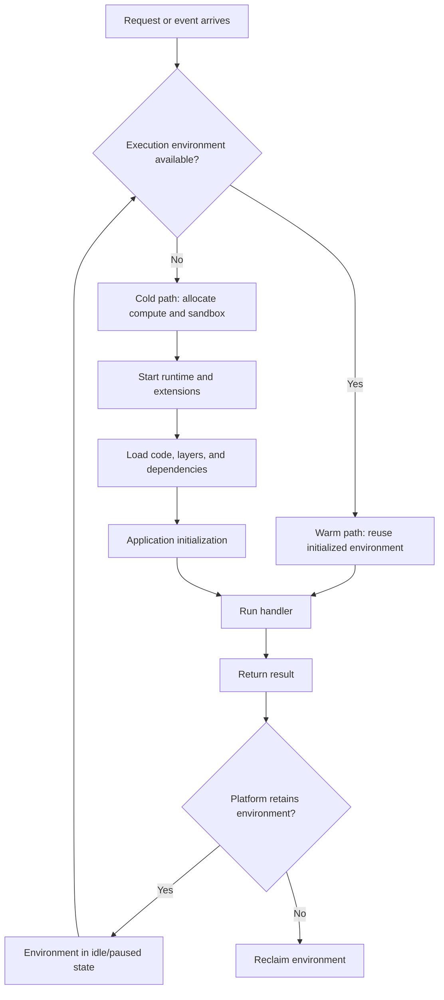

# Cold starts, warm execution, and execution environment reuse

Serverless functions are typically invoked to process a request, event, or message. The platform may retain an execution environment after an invocation finishes so it can reuse it for a subsequent call. When a suitable environment already exists, the function usually starts faster; when the platform must allocate a new environment, load code, and initialize the runtime, the invocation can experience a **cold start**.

Cold starts directly affect latency, especially for synchronous APIs, interactive applications, and workloads with sudden traffic spikes. Warm execution helps reduce startup time, but environment lifecycle is controlled by the platform. Applications must not assume how long an environment will survive, whether the next call will land on the same environment, or that in-memory data will persist.

In cloud compute, cold starts must be understood as part of the on-demand resource provisioning model. Effective optimization requires measuring each startup phase, trimming initialization work, safely managing shared state, and balancing latency against the cost of keeping pre-warmed capacity.

## 1. What is an execution environment?

An execution environment is the environment prepared by the platform to run one or more function executions. Depending on the service, it may include:

- Compute capacity and sandboxing/isolation for the workload.
- An operating system or provider-managed runtime layer.
- A language runtime such as Java, Node.js, Python, .NET, or a custom runtime.
- The function’s code package, container image, layers, or dependencies.
- CPU, memory, environment variables, and runtime identity permissions.
- Network interfaces, DNS, routes, and connections to supporting services.
- A temporary filesystem and process memory space.

The platform may reuse an environment after an invocation to reduce initialization cost. Some runtimes retain the process and loaded modules; some platforms freeze and thaw environments; some services manage concurrency differently per environment. Specifics depend on the provider, runtime, and concurrency configuration.

### Invocation

An invocation is a single execution of a function. Triggers can include HTTP requests, queue messages, object uploads, database events, timers, or event buses. Each invocation has input, context, execution duration, and a result or error.

### Cold execution vs. warm execution

- **Cold execution:** an invocation that requires a new environment or must repeat part of runtime/application initialization.
- **Warm execution:** an invocation handled on an already-initialized, still-available environment, allowing reuse of the prepared runtime, code, and resources.

Warm does not guarantee the function executes instantaneously. The environment may still need to resume, run partial initialization, refresh connections, or reload expired data. Nor is there any guarantee that the next invocation will reuse the previous environment.

## 2. Phases of a cold start

A cold start can span multiple phases. Exact names and ordering vary across platforms, but they follow a general model:

1. **Scheduling and capacity allocation:** the platform locates suitable compute and allocates an environment.
2. **Provisioning/isolation:** creates the sandbox, container, or isolated execution environment.
3. **Runtime initialization:** starts the language runtime and loads runtime extensions.
4. **Code and dependency loading:** downloads the code package, layers, libraries, or image.
5. **Application initialization:** executes module initialization, static initializers, dependency injection, config reads, and client creation.
6. **Invocation:** invokes the handler with the specific input.

Some platforms fetch code in parallel with compute provisioning; others merge runtime and application initialization into a single phase. Use service metrics/tracing to identify actual phases rather than summing assumed durations.



### Cold-start time vs. handler time

Total latency of a synchronous invocation can be represented broadly as:

\[
T_{total} = T_{queue} + T_{startup} + T_{handler} + T_{response}
\]

Where `T_startup` can include provisioning, runtime initialization, code loading, and application initialization. `T_queue` is the wait time before the invocation begins processing; `T_handler` is the time spent executing function logic. For a warm invocation, some or most of `T_startup` may be absent.

When measuring latency, separate queue wait time, startup, and handler time. Looking only at handler duration hides cold starts; looking only at total latency makes it hard to know whether to optimize the image, runtime, networking, or code.

## 3. Why do cold starts happen?

The platform may create a new environment when:

- The service receives its first request after scaling to zero.
- Load increases and existing environments cannot cover the concurrency.
- An environment is reclaimed due to idle timeout, maintenance, or capacity management.
- A new function version is deployed or configuration changes invalidate old environments.
- The runtime or host is updated under the provider’s maintenance mechanism.
- An environment fails or is replaced.
- Traffic shifts to a different zone/capacity pool by service design.

Cold starts do not occur only on the very first call after deployment. A workload may be running warm, yet a sudden burst forces the platform to spin up many new environments; a portion of invocations in that burst will incur startup latency.

### Scale-out creates additional cold environments

Suppose a function currently has two environments and each environment handles a fixed concurrency. When concurrent requests exceed existing capacity, the platform can provision more environments. Invocations routed to new environments wait for startup.

As a result, a function can show a good p50 latency while p95/p99 spike sharply during bursts. Measuring a single request after environments are warm does not reflect scale-out behavior.

### Deployments and configuration updates

Changing code, runtime, layers, environment variables, memory, or network configuration can force the platform to create fresh environments. After each deployment, verify cold starts and scaling behavior for the new version; do not rely on warm caches from the previous version.

## 4. Factors that lengthen cold starts

| Factor | Potential impact | Optimization direction |
|---|---|---|
| Large package/image | Time spent downloading and extracting | Remove unused dependencies, trim layers and artifacts |
| Heavy runtime | Long runtime initialization time | Choose an appropriate runtime, use optimized builds |
| Heavy static initialization | Runs before the handler and extends startup | Defer non-essential work, reduce initialization overhead |
| Complex dependency injection | Scans classes and instantiates many objects | Use minimal wiring or generated metadata where suitable |
| Database connections at startup | Prolonged DNS/TLS/auth/connection handshakes | Initialize lazily or use a suitable connection proxy/pool |
| External API calls at startup | Startup depends on external services | Avoid synchronous calls unless required per invocation |
| VPC/network integration | Can add network or route provisioning time | Measure separately, trim dependencies, pick right configuration |
| Secret/config fetching | Multiple calls to secret/config services | Batch required queries, cache with TTL and rotation |
| Certificate/crypto initialization | Key computation or reading takes time | Reuse objects safely, optimize key retrieval |
| Logging/monitoring extensions | Extensions initialize and ship telemetry | Keep only needed extensions, enforce timeouts |
| Memory set too low | CPU/runtime constrained or excessive GC | Benchmark across multiple memory/CPU tiers |
| Runtime compilation/JIT | Some runtimes need warm-up | Optimize startup or retain capacity for latency-sensitive paths |

Not every factor applies on every serverless platform. Cross-check with your specific service’s metrics and documentation.

## 5. Warm execution and environment reuse

Once an invocation finishes, the platform may keep the execution environment around for a period to serve subsequent invocations. Reuse can preserve:

- The already-started runtime.
- Imported modules/packages or loaded classes.
- Process/module-scoped initialized objects.
- Connection pools or clients to external services, if still valid.
- Caches of non-sensitive, still-valid reference data.
- JIT-compiled code or runtime-prepared metadata.

For example, a Node.js function can instantiate an SDK client at module scope; the next invocation in the same process can reuse that client. A Java function can retain static objects or a connection pool after first initialization. A Python function can keep imported modules loaded in the process.

### Warm reuse is an optimization, not a lifecycle contract

The platform can reclaim an environment at any time under service policy. There are no guarantees regarding:

- How long an environment stays alive after an invocation.
- Whether the next invocation runs in the same environment.
- Ordering or continuity across requests.
- RAM/local filesystem data surviving across calls.
- Whether an environment handles only one invocation at a time, unless explicitly documented by the service.

Application design must remain correct even if every invocation runs in a brand-new environment. When warm reuse happens, it purely improves performance.

## 6. Global initialization and per-invocation data

Many runtimes let you place code outside the handler to run only when the process/environment initializes. This is the right place for immutable objects or safely reusable clients.

### Safe to place outside the handler

- Importing modules and loading classes.
- Creating shared SDK clients or HTTP clients if thread-safe.
- Loading non-sensitive, rarely changing configuration.
- Compiling regexes or schema validators.
- Creating bounded connection pools with explicit lifecycles.
- Loading small, non-sensitive reference data with TTL/refresh.

### Should not be kept in global variables

- User IDs, access tokens, or authenticated permissions of an invocation.
- Request bodies, customer data, or uncommitted transaction state.
- Open transactions or locks tied to a single request.
- Trace/request context unless explicitly reset.
- Tenant-specific results lacking strict isolation keys.
- Expired secrets or unrefreshed credentials.

If an environment is reused, mutable global state can outlive a single invocation and accidentally leak data across requests. Keep request data in local variables, explicitly passed context, or per-invocation objects.

### Example of a shared-state bug

```python
# Unsafe: global variable stores data from a previous request
current_user = None

def handler(event, context):
    global current_user
    current_user = event["user_id"]
    return process_for_user(current_user)
```

If the runtime handles multiple invocations concurrently or code uses async flows, the global value can be overwritten and corrupt the context. Even when each environment processes sequentially, global variables can still retain stale data from earlier requests.

Safer version:

```python
def handler(event, context):
    user_id = event["user_id"]
    return process_for_user(user_id)
```

For shared data, use caches keyed by tenant, permissions, and explicit TTL; do not rely on global variables as a system of record.

## 7. Reusing connections and clients

Opening TCP/TLS/database connections on every invocation increases latency and connection counts. Keeping clients or pools at environment scope can cut handshake and setup overhead.

### Benefits

- Reduces DNS, TCP, and TLS handshake time.
- Cuts repeated authentication or client construction overhead.
- Reuses connection pools and connection metadata.
- Reduces startup load on databases or external APIs.

### Risks

- Connections may be closed by the server while the environment sits idle.
- DNS records or endpoints may change.
- Credentials/secrets may expire or rotate.
- Per-environment pools multiply by environment count, breaching connection limits.
- Sockets may enter a half-open state after network interruptions.
- Shared connections may be unsafe if the client is not thread-safe.

### How to manage

- Use bounded connection pools sized for concurrency.
- Validate connections before use or enable appropriate keepalives/validation.
- Configure connect/read timeouts and bounded retries.
- Refresh credentials via a secure mechanism.
- Handle connection errors by recreating clients/connections as needed.
- Track `environment count × pool size` to protect databases.
- Consider a database proxy or pooling service if supported by the platform.

Do not open a huge pool inside each environment just because warm reuse keeps it alive. With 100 environments each opening 50 connections, a database could face up to 5,000 connections when all pools are active.

## 8. Caching inside the execution environment

In-memory caching can cut repeated reads of reference data or loading of models/configs. However, an environment-local cache is shared only among invocations hitting that specific environment. As the platform scales out, each environment has its own cache; when an environment is reclaimed, the cache disappears.

### Data suitable for caching

- Public metadata or infrequently changing configuration.
- Small, non-sensitive schemas and lookup tables.
- Certificate chains or public keys if a refresh mechanism exists.
- Versioned model artifacts or reference datasets.

### Data that should not be cached only locally

- Transaction state requiring consistency.
- Balances, access permissions, or authorization data needing immediate updates.
- Distributed locks or counters acting as a source of truth.
- Secrets without rotation/expiry handling.

### Caches need TTL and versioning

Set TTLs based on staleness tolerance. When config updates, use version keys, ETags, or timestamps to detect when refresh is needed. Cache misses must have a safe reload path and timeout. If cache refresh fails, decide whether to serve stale data or fail closed depending on data sensitivity.

Do not assume all environments refresh at the same instant. If immediate invalidation or strong consistency is needed, use an externally managed shared cache/store.

## 9. Temporary filesystem and limits of local state

Some function runtimes offer a writable temporary directory such as `/tmp` or equivalent scratch storage. Data may persist between invocations in the same environment, but typically without durability guarantees.

You can use the temporary filesystem for:

- Intermediate files when processing images/documents.
- Re-downloadable artifact caches.
- Extracted archives or scratch data.
- Sockets or temporary files needed within a single invocation.

Do not use the temporary filesystem as the sole store for transaction outputs, critical checkpoints, or user data. When an environment is reclaimed, contents can vanish; when an environment is reused, leftover files can persist and leak data if not cleaned up.

### Cleaning up temporary data

- Use unique filenames per invocation or task ID.
- Do not assume the temporary directory is empty when the handler starts.
- Delete files containing sensitive data once processing finishes.
- Bound disk usage and handle disk-full errors.
- Avoid writing secrets or tokens to temporary files unless necessary.
- Upload results to durable storage before returning success.

## 10. Concurrency and execution environment count

Concurrency is the number of invocations being processed simultaneously. The platform may spin up additional environments as concurrency rises beyond current capacity, depending on the service model.

### Concurrency per environment

Some function runtimes handle one invocation at a time per environment; other services/runtimes handle multiple concurrent requests inside the same instance. Do not infer this behavior from the programming language alone. Check the concurrency model of the specific service and runtime.

### Impact on warm reuse

When concurrency rises, the platform may need extra new environments. New environments experience cold starts; existing environments can continue serving requests. Thus, a single burst can contain both warm and cold invocations.

### Concurrency limits

Concurrency limits protect downstream dependencies and control cost. Set too low, requests queue up or get throttled. Set too high, downstream databases/APIs can overload and environment counts spike rapidly.

Choose concurrency via load testing, observing CPU/RAM, connection pools, p95/p99 latency, error rates, and dependency capacity. Configure reserved/per-function concurrency or quotas where the platform supports them.

### Queues and backpressure

For event/queue workloads, you can cap concurrent invocations and let backlog sit in the queue. Monitor queue age, retries, and visibility timeouts. If a function runs longer than the visibility timeout, the message can be redelivered while the earlier invocation is still active; idempotency and proper timeout settings are essential.

## 11. Optimizing application initialization

Application initialization is code executed before the handler, typically at module scope, in static initializers, or during framework bootstrap. Any work performed here can lengthen cold starts.

### Initialize only what is needed

Do not construct every client, load every model, or call every API at startup if only a subset of invocations use them. Lazy initialization can defer creating a dependency until first needed and reuse it afterward.

However, lazy initialization shifts latency from startup to the first invocation requiring that dependency. If a dependency is used on nearly every request, eager initialization may yield more consistent latency. Measure both cold and warm paths before deciding.

### Reduce synchronous work

- Avoid sequential external API calls during initialization.
- Batch configuration lookups when possible.
- Set explicit timeouts for DNS, secret managers, and dependencies.
- Never run database migrations on every environment startup.
- Avoid loading huge datasets if handlers only need a slice.
- Separate one-time provisioning tasks from the invocation path.

### Optimize frameworks and dependencies

Heavy frameworks may scan packages, run reflection, or evaluate annotations/plugins at startup. You can trim dependencies, enable fast-startup modes, use compile-time metadata, or build tailored artifacts. Balance startup speed against maintainability and compatibility.

## 12. Differences across language runtimes

Cold starts depend on runtime, framework, code size, and initialization patterns. There is no fixed ranking that holds for every workload.

| Runtime | Typical startup work | Things to watch |
|---|---|---|
| Node.js | Module loading, client creation, package parsing | CommonJS/ESM graph, package size, async init |
| Python | Module imports, loading native libraries/models | Import graph, native extensions, package footprint |
| Java | JVM startup, class loading, framework context, JIT | Framework bootstrap, reflection, memory/CPU allocation |
| .NET | Runtime startup, assembly loading, dependency injection | Assembly size, trimming/AOT compatibility, static init |
| Custom runtime/container | Runtime bootstrap, image pull, process startup | Image size, entrypoint, native dependencies, and platform contract |

### Node.js

Keep SDK clients and immutable modules at module scope if the client is safe to reuse. Avoid instantiating a new client per request unnecessarily. Audit top-level await or asynchronous initialization because they can prolong startup.

### Python

Importing large libraries and native packages can be slow. Import heavy modules only inside branches that need them if doing so improves the overall cold path. For models or large datasets, consider on-demand loading and versioned caching.

### Java

The JVM and frameworks can create significant startup overhead. Reduce initialized beans/modules, trim the classpath, and consider AOT compilation or serverless-optimized runtimes if supported by the service. Check heap, GC, and memory settings; memory allocation affects CPU on some platforms.

### .NET

Audit assembly loading, dependency injection, and static initialization. Trimming or Native AOT can cut startup/size for compatible workloads, though reflection, serializers, and native libraries must be tested.

Do not pick a language solely from generic cold-start benchmarks. Measure using your application’s real dependencies, image, framework, and request patterns.

## 13. Optimizing memory and CPU allocation

On some platforms, memory allocation is coupled with CPU capacity or network throughput. Increasing memory can speed up runtime startup and execution even if the app does not consume all the RAM.

Benchmark across multiple configuration tiers:

- Cold-start duration.
- Warm handler duration.
- p50/p95/p99 end-to-end latency.
- Peak memory and OOM rate.
- CPU time and throttling.
- Invocations per second per environment.
- Cost per invocation or cost per completed task.

Do not optimize a single metric in isolation. Higher memory can cut latency while raising price per second; if execution duration drops enough, total cost may actually fall. Calculate total cost across your workload and traffic profile.

## 14. Provisioned concurrency, minimum instances, and warm pools

Some platforms offer mechanisms to pre-warm execution environments or capacity before requests arrive. Depending on the provider, these may be called provisioned concurrency, minimum instances, always-ready instances, or warm pools.

### How it works

The platform maintains a set of pre-initialized environments. Invocations can be routed directly to ready capacity instead of waiting for new environment initialization. This reduces cold-start variance within the reserved capacity band.

### When it fits

- Synchronous APIs with strict latency SLOs.
- Predictable traffic cycles, such as business hours or planned campaigns.
- Runtimes/frameworks with long startup times.
- Workloads loading large models or configurations.
- Critical endpoints requiring consistent latency.

### Cost trade-offs

Pre-warmed capacity may be billed even when no invocations occur, or priced at a dedicated rate. Over-provisioning increases idle cost; under-provisioning still exposes bursts to cold starts.

Size capacity based on baseline concurrency and load distribution. Scale up before peak hours and down during low demand if scheduled adjustments are supported. Always retain dynamic scaling for traffic beyond baseline forecasts.

### Provisioned capacity does not replace code optimization

If application initialization is buggy or slow, keeping environments warm only masks the issue for part of traffic. New deployments, spikes beyond provisioned levels, or environment replacements still trigger cold starts. Optimizing startup remains essential.

## 15. SnapStart, runtime snapshots, and advanced initialization

Some platforms support capturing initialized runtime state and restoring from a snapshot to reduce startup time. Names and limits vary by provider/runtime.

A snapshot can contain heap/process state captured at snapshot time. This avoids repeating part of class loading or initialization, but imposes special requirements:

- Never snapshot short-lived credentials or tokens and reuse them after expiration.
- Never assume socket/network connections inside a snapshot remain valid.
- Re-seed entropy, random generators, or runtime-required identifiers upon resume.
- Refresh timestamps, leases, and time-limited caches.
- Avoid snapshotting per-invocation or per-tenant state.
- Test post-restore hooks to re-establish required resources.

If a snapshot is taken from an environment holding sensitive data in memory, understand who can access the snapshot artifact and how it is encrypted/protected. Do not treat snapshots as a substitute for secret management.

## 16. Security when reusing environments

Warm reuse allows process state to span multiple invocations. That delivers performance gains, yet introduces data leakage risks across requests if state is not properly isolated.

### Security rules

- Never hold user-specific authorization context in global variables.
- Clear or reset request context after each invocation.
- Key caches by tenant and permissions; never share a single key across differing access levels.
- Never store tokens in globals without expiry/rotation checks.
- Never write request bodies or secrets to temporary files that survive across invocations.
- Scope runtime identity permissions strictly to the function.
- Treat memory dumps, snapshots, and logs as assets that may contain sensitive data.

### Multi-tenant functions

If a function serves multiple tenants, every cache and reused object must be partitioned by tenant or hold strictly public data. A cache-key bug can return tenant A’s data to tenant B. Test sequential invocations for different tenants hitting the same environment.

### Credential rotation

Warm environments may hold clients initialized with old credentials. Design clients to refresh tokens or re-authenticate upon expired-credential errors. Do not assume new environments will spin up immediately when a secret rotates.

## 17. Observability: measuring cold starts and warm paths

To optimize systematically, separate cold invocations from warm invocations and track initialization phases.

### Essential metrics

| Metric | Meaning |
|---|---|
| Cold start count/rate | Number or share of invocations requiring new initialization |
| Init duration | Runtime/application initialization time |
| Provisioning duration | Compute allocation time, if published by the platform |
| Handler duration | Time spent executing function logic |
| End-to-end latency | Total latency observed by the client or trigger |
| p50/p95/p99 | Latency distribution and tail behavior |
| Concurrent executions | Number of invocations running simultaneously |
| Throttle count | Requests limited by concurrency/quotas |
| Environment reuse indicator | Cold/warm signal if provided by the service |
| Memory/CPU utilization | Resource usage vs. configured limits |
| Error/timeout rate | Failures during startup or handler execution |
| Cost per invocation | Cost per call or per completed unit of work |

Not every provider exposes per-phase metrics. When missing, record timestamps during application initialization and inside the handler, using trace spans or structured logs. Avoid logging sensitive data.

### Percentile analysis

Cold starts may account for a small percentage of traffic yet dominate p99. Compare latency across cold/warm cohorts, runtimes, versions, memory sizes, regions, and trigger sources. A low p50 does not prove tail latency SLOs are satisfied.

### Correlation IDs

Attach an invocation ID or trace ID to logs to link trigger events, startup, handler execution, and downstream calls. Do not use the environment ID as a business identifier; environments can vanish or be replaced.

## 18. Testing cold starts properly

Benchmarks firing continuous requests at a single environment mainly measure warm performance, not cold starts. You must create conditions where new environments are observed.

### Test scenarios

1. **First invocation:** deploy a new version and send the first call.
2. **Warm sequence:** send consecutive calls to measure the warm path.
3. **Idle gap:** wait for an idle period and call again; note there is no guarantee the platform reclaimed the environment.
4. **Burst scale-out:** ramp concurrency rapidly to force the platform to provision additional capacity.
5. **Deployment churn:** publish new versions/configs and measure startup.
6. **Runtime update:** test when upgrading runtimes or major dependencies.
7. **Dependency degradation:** simulate slow secret manager/database/API responses to evaluate startup impact.
8. **Provisioned capacity:** compare latency and cost across different pre-warmed capacity levels.

### Measurement discipline

- Record region, runtime, memory/CPU, package/image version, and concurrency.
- Collect enough samples for p95/p99 to be meaningful.
- Separate cold start, handler, and dependency latency.
- Repeat across different times of day since host placement and background load vary.
- Compare cost per invocation and cold-start rate, not just best-case latency.

Do not rely on a fixed idle window to claim an environment has definitely been reclaimed; reclamation is an internal platform decision. Use explicit cold-start indicators or fresh deployments to observe cold paths reliably.

## 19. Optimization strategies by workload type

| Workload | Priority | Approach |
|---|---|---|
| Latency-sensitive API | Stable p95/p99 | Trim init, keep minimum capacity, control concurrency |
| Background event processing | Throughput and cost | Allow queue buffering, cap concurrency, optimize batching |
| Short traffic bursts | Fast scale-out | Small images, fast startup, queues/backpressure, and capacity buffers |
| ML inference | Model loading and GPU readiness | Cache/bake model artifacts, keep ready capacity for key endpoints |
| Long batch jobs | Completion and recovery | Checkpoints, retries, chunking; cold starts matter less than correctness |
| Low-traffic dev/test | Low cost | Scale-to-zero if cold starts are acceptable |
| Multi-tenant API | Isolation and security | Keep request state out of globals; partition caches by tenant |

### Synchronous APIs

Measure cold-start tail latency and determine how much capacity needs to be kept warm. For critical endpoints, provisioned capacity may fit. Minimize startup dependencies and configure timeouts so cold starts do not trigger client retry storms.

### Queue/event workers

Queues absorb bursts and smooth invocation rates. Choose appropriate batch size, concurrency, and visibility timeouts. Cold starts slow initial queue drain; monitor oldest message age and scaling policies.

### ML inference

Model loading often dominates startup. Use optimized artifacts, lazy load by model/version, cache inside the environment, or retain warm instances. Invalidate/refresh caches when model versions change.

## 20. Cost and trade-offs

Cold starts are not solely a latency concern. Optimizing startup can reduce billed duration per invocation, whereas options like provisioned concurrency, minimum instances, or warm pools add idle capacity charges.

### Trade-off options

| Measure | Latency impact | Cost/complexity impact |
|---|---|---|
| Shrink package/image | Cuts download and startup | Low to moderate build/maintenance effort |
| Lazy initialization | Cuts startup when dependency is rarely needed | First invocation using that dependency can be slower |
| Tune runtime/framework | Cuts init duration | Can raise build and testing effort |
| Increase memory/CPU | Can shorten startup and handler time | Per-unit time price may increase |
| Cache clients/config | Cuts init and request latency | Requires expiry, consistency, and security handling |
| Provisioned capacity | Eliminates cold starts within reserved capacity | Adds idle/always-ready cost |
| Scale-to-zero | Does not improve cold path | Saves idle cost at the expense of startup latency |
| Queuing/batching | Absorbs bursts and amortizes startup | May increase end-to-end completion time |

### Cost per successful operation

Evaluate cost per successful request or job, not just cost per invocation. Retries caused by timeouts, cold starts, or dependency errors can multiply invocations for a single business operation.

\[
\text{Cost per success} =
\frac{\text{Total compute and related services}}
{\text{Number of successfully completed operations}}
\]

When comparing configurations, include retried requests, logs/traces, networking, storage, provisioned capacity, and dependencies. A higher per-second tier can still yield a lower cost per operation if execution finishes fast enough.

## 21. Troubleshooting cold starts and warm reuse

| Symptom | Possible cause | Investigation path |
|---|---|---|
| First invocation is very slow | Long runtime/application initialization | Measure init duration, imports, DI, and startup logs |
| p95 spikes after deploy | New environments, large code/package, or new init | Compare versions, image sizes, and cold-start rate |
| Many timeouts during bursts | Scale-out provisioning, quotas, or concurrency limits | Inspect concurrent executions, throttles, and startup duration |
| Warm invocations remain slow | Handler/dependency bottleneck, environment resume, or stale connections | Separate handler and dependency latency |
| Database connection errors after idle | Server closed connections or credentials expired | Add validation, refresh, and bounded reconnects |
| Previous request data appears in later request | Mutable global state or uncleaned temp files | Audit state scope and tenant isolation |
| Inconsistent caches across invocations | Multiple environments hold separate caches | Add versioning/TTL or use a shared cache |
| Memory grows over time | Unbounded caches or memory leaks | Track memory per environment and enforce eviction |
| Provisioned capacity still sees cold starts | Bursts exceed provisioned level or deployments spawn fresh environments | Compare concurrency against provisioned level and deployment events |
| Startup stalls on slow secret/API calls | Initialization calls dependencies synchronously | Measure outbound calls, timeouts, and config caching |

### Investigation workflow

1. Identify function version, runtime, region, and memory/CPU settings.
2. Separate cold vs. warm invocations using available telemetry.
3. Compare init duration against handler duration.
4. Inspect package/layer/image size and the dependency graph.
5. Measure time spent calling secret managers, DNS, databases, and external APIs.
6. Check concurrency, throttling, quotas, and newly provisioned environments.
7. Audit global state, caches, connections, and temporary files across invocations.
8. Test one change at a time in staging and re-measure p50/p95/p99 and cost per success.

## 22. Example: optimizing an API function

A serverless API handles order lookup requests. After deployment, p50 latency is 80 ms, while p99 reaches 1.8 seconds. Logs indicate the first invocations are frequently slow.

Investigation reveals:

- The framework instantiates many objects and scans packages during application initialization.
- The function creates a new database client on every invocation.
- Startup synchronously calls the secret manager and two metadata APIs.
- Request bursts spawn many new environments, causing a surge in database connections.

Changes to apply:

1. Trim unused dependencies and streamline framework bootstrap.
2. Create a shared client at environment scope if the client is safe to reuse.
3. Cache non-sensitive configuration with TTL and refresh; renew credentials before expiry.
4. Use a database proxy or bounded connection pool to control connections.
5. Cap maximum concurrency to match database capacity.
6. Keep an appropriate level of provisioned capacity if required by the p99 SLO, after evaluating cost.
7. Test bursts and fresh deployments to verify the cold path.

After the changes, compare cold-start duration, warm latency, p99, throttling, connection counts, and cost per successful lookup. Do not declare success solely because p50 dropped.

## 23. Design and operations checklist

**Understand the platform:**

- [ ] Documented how the provider creates, retains, freezes/resumes, and reclaims environments.
- [ ] Reviewed the service’s concurrency model and runtime limits.
- [ ] Identified which startup phases expose metrics.
- [ ] Verified which filesystems are ephemeral and their capacity limits.

**Optimize startup:**

- [ ] Image/package contains only necessary dependencies.
- [ ] Application initialization avoids unnecessary external dependency calls.
- [ ] Imports, runtime, framework, and client initialization have been measured.
- [ ] Memory/CPU tiers have been benchmarked for latency and cost.
- [ ] Lazy initialization is applied deliberately.

**Safe reuse:**

- [ ] Global state holds only immutable objects or safely shared resources.
- [ ] Request/tenant state cannot leak across invocations.
- [ ] Connections are validated, refreshed, and bounded by pool limits.
- [ ] Caches have TTLs/versions and invalidation handling.
- [ ] Temporary files are cleaned up with no residual sensitive data.
- [ ] Secrets and credentials refresh throughout their lifecycle.

**Latency, scaling, and cost:**

- [ ] Measured cold/warm paths and p50/p95/p99 latency.
- [ ] Tested burst scale-out and new version deployments.
- [ ] Concurrency aligns with dependency capacity.
- [ ] Provisioned/minimum capacity is balanced against SLOs and budget.
- [ ] Throttles, cold-start rate, and cost per success are tracked.

**Security and operations:**

- [ ] Runtime identity follows least privilege.
- [ ] Caches and state are isolated per tenant.
- [ ] Logs/traces contain no secrets or sensitive data.
- [ ] Alerts exist for startup regressions, timeouts, and dependency failures.
- [ ] Runbooks exist for elevated cold starts after deployments or runtime updates.

## Conclusion

Cold starts occur when a function needs a new execution environment or must repeat initialization steps; warm execution can reuse the runtime, modules, clients, and caches of an available environment. Warm reuse lowers latency, yet never guarantees the environment will persist or be reused on the next invocation. Minimize startup work, measure provisioning/init/handler separately, safely reuse shared clients, restrict global state, and refresh connections/secrets/caches over their lifecycle. For latency-sensitive APIs, consider provisioned capacity; for asynchronous workloads, use queues and backpressure to absorb bursts. Finally, test cold paths, warm paths, bursts, and fresh deployments, evaluating p95/p99 alongside cost per successful operation.
